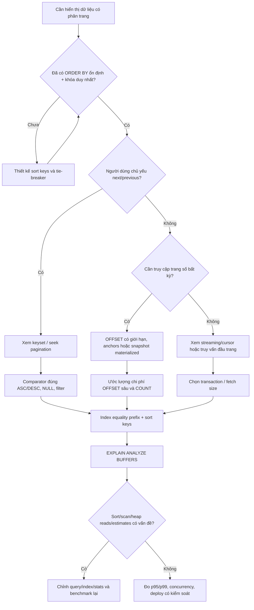

# Tối ưu ORDER BY, LIMIT và phân trang sâu trong PostgreSQL

Hiển thị danh sách đơn hàng, lịch sử giao dịch, bảng điều khiển quản trị hay nhật ký sự kiện thường dùng một mẫu truy vấn quen thuộc:

```sql
SELECT event_id, created_at, title
FROM app_event
WHERE tenant_id = 10
ORDER BY created_at DESC
LIMIT 20 OFFSET 200000;
```

Câu SQL này có vẻ chỉ yêu cầu **20 hàng**, nhưng PostgreSQL có thể phải **duyệt qua hoặc sắp xếp lượng dữ liệu tương ứng với 200.020 vị trí đầu tiên** rồi loại bỏ 200.000 hàng để lấy 20 hàng cuối. Nếu truy vấn có JOIN, filter và SORT phức tạp, công việc còn lớn hơn.

Để tối ưu đúng, cần hiểu ba thứ tách biệt:

1. **`ORDER BY`** xác định thứ tự kết quả, có thể yêu cầu `Sort` hoặc được phục vụ bởi một đường scan có thứ tự.
2. **`LIMIT`** giới hạn số hàng kết quả; nó **không bảo đảm** PostgreSQL chỉ phải đọc đúng bằng ấy hàng.
3. **`OFFSET`** bỏ qua những hàng đứng trước; phân trang càng sâu, chi phí đọc bỏ qua thường càng tăng.

Trong những API cuộn liên tục hoặc “Xem thêm”, **keyset pagination** (*seek pagination*) thường hiệu quả và ổn định hơn `OFFSET` sâu, nếu ứng dụng có một khóa sắp xếp rõ ràng và cursor đúng nghĩa. Nhưng keyset không thay thế được tất cả các chức năng: truy cập trực tiếp trang số 500, đếm tổng số trang hoặc sắp xếp tùy ý vẫn cần thiết kế bổ sung.

Bài học thuộc chương **Tối ưu truy vấn** của module *Database Engine Relational PostgreSQL*. Nội dung trình bày cách PostgreSQL xử lý sort/limit, chọn B-tree index theo filter và thứ tự, thiết kế cursor an toàn, kiểm chứng với `EXPLAIN (ANALYZE, BUFFERS)`, xử lý NULL, khóa nhiều cột, JOIN, dữ liệu thay đổi đồng thời và JDBC.

**Các lệnh DDL/DML là bài thực hành trên database thử nghiệm, không chạy trực tiếp trên production.** Chi phí và execution plan tùy dữ liệu, phiên bản PostgreSQL, thống kê, cấu hình và máy chủ thực tế.

## 1. Kết quả đúng quan trọng hơn truy vấn nhanh

Giả sử ứng dụng hiển thị 20 sự kiện mới nhất. Câu:

```sql
SELECT event_id, created_at
FROM app_event
WHERE tenant_id = 10
LIMIT 20;
```

**không bảo đảm** lấy 20 sự kiện mới nhất. Nó chỉ giới hạn 20 hàng từ một kế hoạch truy vấn nào đó.

Để yêu cầu dữ liệu mới nhất:

```sql
SELECT event_id, created_at
FROM app_event
WHERE tenant_id = 10
ORDER BY created_at DESC
LIMIT 20;
```

Nhưng nếu có nhiều sự kiện cùng `created_at`, thứ tự giữa chúng **chưa được xác định hoàn toàn**. Muốn phân trang ổn định, thêm khóa phụ duy nhất:

```sql
SELECT event_id, created_at
FROM app_event
WHERE tenant_id = 10
ORDER BY created_at DESC, event_id DESC
LIMIT 20;
```

Đây là hợp đồng thứ tự: so thời gian giảm dần trước, nếu trùng thời gian thì ID giảm dần.

### 1.1. Vì sao cần khóa phụ duy nhất?

Giả sử ba hàng có cùng timestamp:

```text
event_id | created_at
---------+------------------------
101      | 2026-11-14 09:00:00+07
102      | 2026-11-14 09:00:00+07
103      | 2026-11-14 09:00:00+07
```

`ORDER BY created_at DESC` cho phép bất kỳ thứ tự nào giữa 101, 102 và 103. Một trang kết thúc giữa nhóm trùng timestamp có thể làm hàng bị lặp hoặc bỏ sót giữa các lần đọc.

`ORDER BY created_at DESC, event_id DESC` tạo **thứ tự toàn phần** nếu `event_id` duy nhất, không NULL và so sánh theo toán tử đã xác định.

### 1.2. Thứ tự ổn định không đồng nghĩa snapshot bất biến

Khóa phụ duy nhất khắc phục **mơ hồ thứ tự khi các sort keys bằng nhau**. Nó không tự ngăn insert/delete/update đồng thời làm thay đổi vị trí hàng giữa hai request. Vấn đề này cần chiến lược phân trang và consistency riêng.

## 2. Ba cách hiển thị dữ liệu và yêu cầu khác nhau

| Trải nghiệm | Câu hỏi nghiệp vụ | Hướng kỹ thuật |
|---|---|---|
| Trang đầu tiên của danh sách | “20 bản ghi mới nhất?” | `ORDER BY ... LIMIT 20` và index phù hợp |
| Người dùng bấm “Xem thêm” | “20 bản ghi ngay sau bản ghi cuối trang trước?” | Keyset/seek pagination |
| Người dùng chọn “Trang 500” | “Bỏ qua 9.980 bản ghi rồi trả 20?” | `LIMIT/OFFSET` hoặc cấu trúc tìm trang riêng |
| Export toàn bộ dữ liệu theo thứ tự | “Duyệt nhiều hàng nhất quán?” | Streaming/cursor/transaction thích hợp |
| Bảng quản trị có tổng số trang | “Tổng số hàng khớp filter?” | COUNT hoặc kỹ thuật thống kê/snapshot |
| Timeline thay đổi liên tục | “Dữ liệu mới nào xuất hiện kể từ mốc vừa xem?” | Cursor/sequence/watermark, không chỉ OFFSET |

Không phải API nào cũng cần chuyển ngay sang keyset. Chọn theo hành vi người dùng và yêu cầu kết quả, không chỉ dựa trên thời gian chạy một câu SQL.

## 3. PostgreSQL thực thi ORDER BY như thế nào?

Có hai nhóm đường thực thi lớn:

1. **Đọc theo đường truy cập đã có thứ tự phù hợp**, thường bằng B-tree Index Scan hoặc Index Only Scan.
2. **Đọc dữ liệu rồi sắp xếp**, sử dụng các node như `Sort` hoặc `Incremental Sort`.

Ví dụ:

```sql
SELECT event_id, created_at
FROM app_event
WHERE tenant_id = 10
ORDER BY created_at DESC, event_id DESC
LIMIT 20;
```

Planner có thể chọn:

```text
Limit
  -> Index Scan using idx_event_tenant_created_id
       Index Cond: (tenant_id = 10)
```

hoặc:

```text
Limit
  -> Sort
       Sort Key: created_at DESC, event_id DESC
       -> Seq Scan on app_event
            Filter: (tenant_id = 10)
```

Các plan trên chỉ minh họa. PostgreSQL sẽ chọn theo **chi phí ước lượng**, không theo việc một index có tồn tại hay không.

### 3.1. ORDER BY không có nghĩa luôn xuất hiện node Sort

Nếu Index Scan đã tạo đúng thứ tự yêu cầu, PostgreSQL có thể không cần Sort tách riêng.

### 3.2. Có Index Scan không có nghĩa SQL được ORDER BY tự động

Ngay cả khi một plan tình cờ trả hàng theo index key, **chỉ `ORDER BY` mới là hợp đồng thứ tự của kết quả SQL**. Plan có thể thay sau `ANALYZE`, nâng cấp PostgreSQL hoặc đổi tham số.

## 4. B-tree là cấu trúc quan trọng cho ORDER BY

B-tree giữ khóa theo một thứ tự xác định theo operator class và collation tương ứng. Nó có thể hỗ trợ:

- `=` và những phép so sánh thứ tự.
- `ORDER BY key ASC` hoặc `DESC`.
- Các khoảng `<`, `<=`, `>`, `>=`.
- `LIMIT` kết hợp với scan từ đầu hoặc cuối vùng index phù hợp.
- Index nhiều cột với thứ tự được thiết kế đúng.
- Một số `Index Only Scan` khi đủ điều kiện.

Ví dụ:

```sql
CREATE INDEX idx_event_created
ON app_event (created_at);
```

Với `created_at NOT NULL`, index B-tree theo thứ tự tăng có thể quét **ngược** để phục vụ `ORDER BY created_at DESC`.

### 4.1. Quét xuôi và quét ngược

Một B-tree một cột mặc định được khai báo tương đương:

```sql
CREATE INDEX idx_example_time
ON app_event (created_at ASC NULLS LAST);
```

Quét xuôi cung cấp `ASC NULLS LAST`; quét ngược cung cấp `DESC NULLS FIRST`.

Nếu query yêu cầu `DESC NULLS LAST` trên **cột nullable**, cần xét index với null ordering phù hợp; không suy luận mọi quét ngược đều đáp ứng mọi lựa chọn `NULLS FIRST/LAST`.

### 4.2. Defaults của NULL cần nhớ

Trong PostgreSQL:

- `ORDER BY x ASC` mặc định `NULLS LAST`.
- `ORDER BY x DESC` mặc định `NULLS FIRST`.

Khi tạo cursor, **nên chỉ định rõ `NULLS FIRST/LAST`** nếu cột có thể NULL; nếu có thể, ưu tiên sort keys `NOT NULL` để logic phân trang đơn giản hơn.

### 4.3. B-tree không bảo đảm đọc heap không tốn chi phí

Một Index Scan có thứ tự có thể truy cập hàng rải rác trong heap và gây random I/O. Nếu query lấy phần lớn bảng, planner có thể chọn `Seq Scan + Sort` dù B-tree đã sắp đúng key.

## 5. Index nhiều cột: filter trước, thứ tự sau

Một mẫu API phổ biến:

```sql
SELECT event_id, created_at, title
FROM app_event
WHERE tenant_id = 10
ORDER BY created_at DESC, event_id DESC
LIMIT 20;
```

Index ứng viên:

```sql
CREATE INDEX idx_event_tenant_time_id
ON app_event (tenant_id, created_at DESC, event_id DESC);
```

Vì `tenant_id = 10` là điều kiện equality trên prefix đầu, PostgreSQL có thể đọc riêng đoạn index chứa tenant 10 rồi lấy hàng theo thứ tự `created_at DESC, event_id DESC`.

```text
B-tree (tenant_id, created_at DESC, event_id DESC)

tenant_id = 9:  [...]
tenant_id = 10:
    created_at mới nhất, event_id cao
    ...
    created_at cũ hơn, event_id thấp
tenant_id = 11: [...]

WHERE tenant_id=10
ORDER BY created_at DESC, event_id DESC
LIMIT 20

→ Dò vùng tenant 10, có thể dừng sau đủ 20 hàng phù hợp.
```

### 5.1. Không phải cứ index chứa đủ cột là hỗ trợ thứ tự

Index:

```sql
CREATE INDEX idx_event_wrong_for_global_time
ON app_event (tenant_id, status, created_at DESC);
```

không tự cung cấp `ORDER BY created_at DESC` trên **mọi status** của tenant 10, vì dữ liệu được nhóm theo `status` trước. Nếu query có `status = 'PAID'`, lại có thể trở thành đường truy cập rất tốt.

### 5.2. Equality prefix là quy tắc thiết kế quan trọng

Đối với:

```sql
WHERE tenant_id = 10
  AND status = 'PAID'
ORDER BY created_at DESC, event_id DESC
LIMIT 20
```

index ứng viên:

```sql
CREATE INDEX idx_event_tenant_status_time_id
ON app_event
    (tenant_id, status, created_at DESC, event_id DESC);
```

Một prefix equality gồm `tenant_id` và `status` giúp đoạn còn lại có thứ tự phù hợp với query.

### 5.3. Filter sau khi đọc index vẫn có thể tốn nhiều công việc

Nếu dùng index `(tenant_id, created_at DESC, event_id DESC)` nhưng thêm `WHERE status='RARE'`, PostgreSQL có thể phải duyệt rất nhiều hàng theo thời gian để tìm đủ 20 hàng hiếm.

Kế hoạch không có Sort **chưa chắc** nhanh. Cần xem `Rows Removed by Filter`, số index entries/heap pages đã đọc và `Execution Time`.

## 6. Nhiều giá trị IN không giống một equality prefix

Ví dụ:

```sql
SELECT event_id, created_at
FROM app_event
WHERE tenant_id = 10
  AND status IN ('NEW', 'PAID')
ORDER BY created_at DESC, event_id DESC
LIMIT 20;
```

Index `(tenant_id, status, created_at DESC, event_id DESC)` nhóm theo từng `status` trước rồi mới theo thời gian; do vậy không cung cấp thứ tự thời gian **toàn cục giữa hai status** chỉ bằng một quét liên tiếp như trường hợp `status='PAID'`.

Planner có thể cần Sort/Merge/Bitmap/đường khác. Trong trường hợp này index `(tenant_id, created_at DESC, event_id DESC)` cộng filter status có thể cạnh tranh, tùy tỷ lệ được chọn.

Không thay một điều kiện `IN` nhiều giá trị thành `=` để ép index vì sẽ làm thay đổi dữ liệu kết quả.

## 7. Index nhiều cột và hướng ASC/DESC hỗn hợp

Với một key, quét ngược B-tree thường có thể đổi ASC ↔ DESC. Với nhiều key, quét ngược làm **đảo hướng của tất cả các key cùng lúc**.

Index:

```sql
CREATE INDEX idx_mixed_wrong
ON app_event (priority DESC, created_at DESC);
```

không tự phục vụ trực tiếp:

```sql
ORDER BY priority DESC, created_at ASC
```

chỉ bằng cách scan backward, vì backward scan sẽ đảo thành `priority ASC, created_at ASC`.

Index phù hợp cho thứ tự hỗn hợp:

```sql
CREATE INDEX idx_mixed_order
ON app_event (priority DESC, created_at ASC, event_id DESC);
```

Nếu còn điều kiện equality tenant:

```sql
CREATE INDEX idx_tenant_mixed_order
ON app_event (
    tenant_id,
    priority DESC,
    created_at ASC,
    event_id DESC
);
```

Chọn chiều từng cột theo **`ORDER BY` thực sự**. Với cột nullable, cũng xác định `NULLS FIRST/LAST`, không chỉ ASC/DESC.

## 8. LIMIT có thể giúp PostgreSQL dừng sớm

Ví dụ:

```sql
SELECT event_id, created_at
FROM app_event
WHERE tenant_id = 10
ORDER BY created_at DESC, event_id DESC
LIMIT 20;
```

Nếu có đường Index Scan phù hợp, executor có thể đọc đủ 20 hàng phù hợp rồi dừng, thay vì xử lý toàn bộ tenant.

Kế hoạch minh họa:

```text
Limit (actual rows=20)
  -> Index Scan using idx_event_tenant_time_id
       Index Cond: (tenant_id = 10)
       (actual rows=20)
```

Nhưng **kế hoạch có filter bổ sung** có thể phải đọc nhiều index entries hơn để tìm 20 hàng đạt điều kiện.

### 8.1. LIMIT không thể làm mất công đoạn bắt buộc

Nếu query:

```sql
SELECT customer_id, SUM(amount)
FROM app_event
GROUP BY customer_id
ORDER BY SUM(amount) DESC
LIMIT 20;
```

thì thường phải tính tổng theo các nhóm trước khi biết nhóm nào thuộc top 20. Một index đơn giản trên `amount` không tự giải được việc sắp xếp theo `SUM(amount)` của mỗi khách.

Cần đánh giá tổng thể aggregation/query design, không coi `LIMIT 20` là giấy phép đọc đúng 20 hàng.

### 8.2. LIMIT không có ORDER BY

```sql
SELECT event_id
FROM app_event
LIMIT 20;
```

trả tối đa 20 hàng nhưng **không xác định hàng nào**. PostgreSQL có thể chọn các kế hoạch khác khi LIMIT thay đổi; cùng dữ liệu vẫn có thể cho thứ tự quan sát khác.

## 9. Sort thường có những hình thức nào?

PostgreSQL có node `Sort` với nhiều phương pháp tùy input, memory và mục tiêu:

- **Quicksort**: có thể dùng khi cần sắp dữ liệu và vừa memory.
- **Top-N heapsort**: có thể dùng khi chỉ cần N hàng đầu theo `ORDER BY ... LIMIT`.
- **External merge**: có thể xuất hiện khi sort phải dùng temp files do dữ liệu không đủ bộ nhớ hoặc plan cần ngoại bộ.
- **Incremental Sort**: tận dụng dữ liệu đã sắp theo một prefix phù hợp.

Đây là tên những kỹ thuật xuất hiện trong plan, không phải các từ khóa SQL người dùng cần chỉ định.

### 9.1. Top-N heapsort không đồng nghĩa chỉ đọc N hàng

Plan giả định:

```text
Limit
  -> Sort
       Sort Key: created_at DESC
       Sort Method: top-N heapsort  Memory: ...
       -> Seq Scan on app_event
```

Top-N heapsort có thể giữ số lượng ứng viên giới hạn trong bộ nhớ, nhưng **vẫn phải xem xét input** để biết hàng nào thuộc top N nếu không có đường truy cập order sẵn.

Nó giảm nhu cầu lưu/sắp toàn bộ đầu vào, **không nhất thiết giảm số hàng phải scan**.

### 9.2. work_mem và temp I/O

```sql
SHOW work_mem;
```

`work_mem` ảnh hưởng ngân sách cho các hoạt động sort/hash theo node. Nếu sort spill, plan có thể có:

```text
Sort Method: external merge  Disk: 180MB
Buffers: temp read=... written=...
```

Không tăng `work_mem` toàn cluster lên một giá trị rất lớn để chữa một query; mỗi query có thể có nhiều sort/hash nodes và nhiều sessions chạy đồng thời.

## 10. Incremental Sort: khi input đã sắp một phần

Từ PostgreSQL 13, `Incremental Sort` có thể tận dụng input đã sắp theo **prefix** của `ORDER BY`.

Ví dụ index:

```sql
CREATE INDEX idx_event_tenant_time
ON app_event (tenant_id, created_at DESC);
```

Query:

```sql
SELECT event_id, created_at
FROM app_event
WHERE tenant_id = 10
ORDER BY created_at DESC, event_id DESC
LIMIT 20;
```

Một đường Index Scan có thể đã sắp theo `created_at DESC`, nhưng các hàng cùng `created_at` chưa có thứ tự `event_id DESC`. Planner có thể cân nhắc Incremental Sort để sắp **bên trong từng nhóm cùng timestamp**, thay vì sắp toàn bộ kết quả.

### 10.1. Plan minh họa

```text
Limit
  -> Incremental Sort
       Sort Key: created_at DESC, event_id DESC
       Presorted Key: created_at
       -> Index Scan ...
```

Sự xuất hiện phụ thuộc thống kê, nhóm trùng, LIMIT, chi phí và phiên bản.

### 10.2. Incremental Sort không luôn tối ưu

Nếu một prefix chỉ có hai giá trị và mỗi nhóm rất lớn, việc tận dụng presorted groups có thể kém hữu ích. Ngược lại, nếu prefix có độ phân biệt cao, nhóm nhỏ, chi phí incremental có thể tốt.

Không ép incremental sort theo tên; đo số groups, memory, temp I/O và runtime.

### 10.3. Index đủ mọi sort key có thể tốt hơn

Nếu workload luôn sắp `created_at DESC, event_id DESC`, một index chứa cả hai key có thể tránh incremental sort. Tuy nhiên index lớn hơn làm tăng chi phí ghi và storage. Cân đối với số truy vấn và tỷ lệ UPDATE.

## 11. OFFSET hoạt động về mặt chi phí

Cú pháp:

```sql
SELECT event_id
FROM app_event
ORDER BY event_id
LIMIT 20 OFFSET 0;
```

```sql
SELECT event_id
FROM app_event
ORDER BY event_id
LIMIT 20 OFFSET 100000;
```

Với một index B-tree thuận thứ tự, executor có thể lấy các entry từ vị trí đầu, **duyệt qua khoảng 100.000 hàng trước đó** rồi trả 20 hàng tiếp theo. PostgreSQL không có cơ chế tổng quát để “nhảy trực tiếp đến hàng thứ 100001” theo vị trí logic của một query tùy ý chỉ từ B-tree.

```text
ORDER BY event_id ASC

[1] [2] ... [100000] [100001] ... [100020]
 <--------- bỏ qua ---------->  <-- trả 20 -->

LIMIT 20 OFFSET 100000
```

### 11.1. Độ phức tạp định tính

Với Index Scan phù hợp, chi phí thường tăng theo số lượng hàng phải bỏ qua:

\[
\text{work} \propto \text{OFFSET} + \text{LIMIT}
\]

Đây là quan hệ tư duy, không phải công thức runtime tuyến tính chính xác. Nếu query phải Sort, Join, Filter hay Aggregate, tổng công việc còn phụ thuộc các node đó.

### 11.2. OFFSET có thể khiến planner đổi plan

Một `OFFSET` nhỏ và `LIMIT 20` có thể ưu tiên Index Scan trả sớm. Với `OFFSET` rất lớn, planner có thể thấy `Seq Scan + Sort` cạnh tranh hơn vì phải đọc gần hết dữ liệu dù dùng index.

**Đừng giả định cùng query ở OFFSET 0 và OFFSET 100000 dùng cùng plan.**

### 11.3. OFFSET không “chậm vì syntax”

Nó chậm khi yêu cầu bỏ qua nhiều hàng trong một **tập kết quả đã lọc và sắp xếp**. Trong một tập rất nhỏ, `OFFSET 100` không đáng lo. Với phân trang sâu hàng trăm nghìn bản ghi, vấn đề xuất hiện rõ hơn.

## 12. Keyset pagination: dùng vị trí khóa, không dùng số hàng cần bỏ

Thay vì yêu cầu “bỏ qua 100.000 hàng”, keyset nói:

> Hãy lấy 20 hàng tiếp theo đứng **sau khóa cuối của trang trước** trong thứ tự đã định.

Trang đầu:

```sql
SELECT event_id, tenant_id, created_at, title
FROM app_event
WHERE tenant_id = 10
ORDER BY created_at DESC, event_id DESC
LIMIT 20;
```

Giả sử hàng cuối trang trả:

```text
created_at = 2026-11-13 08:30:00+00
event_id   = 728199
```

Trang kế:

```sql
SELECT event_id, tenant_id, created_at, title
FROM app_event
WHERE tenant_id = 10
  AND (
      created_at < TIMESTAMPTZ '2026-11-13 08:30:00+00'
      OR (
          created_at = TIMESTAMPTZ '2026-11-13 08:30:00+00'
          AND event_id < 728199
      )
  )
ORDER BY created_at DESC, event_id DESC
LIMIT 20;
```

Vì thứ tự là DESC ở cả hai khóa, “đứng sau cursor” có nghĩa timestamp nhỏ hơn, hoặc timestamp bằng nhau nhưng ID nhỏ hơn.

### 12.1. Dạng row-value comparison gọn hơn

Với hai cột `NOT NULL`, kiểu so sánh có thứ tự tương thích:

```sql
WHERE tenant_id = 10
  AND (created_at, event_id)
      < (TIMESTAMPTZ '2026-11-13 08:30:00+00', 728199)
ORDER BY created_at DESC, event_id DESC
LIMIT 20;
```

Trong ví dụ **cả hai khóa đều DESC**, phép so sánh tuple `<` biểu đạt đúng thứ tự lexicographic cần tìm.

**Không dùng công thức này máy móc cho chiều sắp xếp hỗn hợp hoặc nullable keys.** Những trường hợp đó cần điều kiện cursor khác, trình bày ở phần sau.

### 12.2. Vì sao keyset thường nhanh ở trang sâu?

B-tree index `(tenant_id, created_at DESC, event_id DESC)` có thể tìm đoạn khóa ngay **sau cursor** thay vì duyệt toàn bộ các trang trước.

```text
tenant_id = 10
B-tree range
     │
     ├─ các hàng mới hơn cursor (không cần duyệt để bỏ)
     ├─ cursor (created_at, event_id)
     └─ các hàng cũ hơn cursor → lấy 20 hàng tiếp theo
```

Chi phí không hoàn toàn độc lập với dữ liệu: filter, visibility, heap fetches, non-indexed predicate và query joins vẫn có thể gây thêm đọc. Nhưng khi có index khớp, nó thường tránh được **chi phí tuyến tính theo OFFSET**.

## 13. Keyset phải có thứ tự duy nhất và nhất quán

Nếu chỉ dùng:

```sql
ORDER BY created_at DESC
```

và cursor chỉ gồm `created_at`, câu:

```sql
WHERE created_at < :last_created_at
```

sẽ **bỏ qua** các hàng có cùng timestamp nhưng chưa xuất hiện ở trang trước.

Ví dụ:

```text
Sự kiện cùng created_at = 09:00:00
event_id: 105, 104, 103, 102, 101

LIMIT 3 → 105,104,103
Trang 2 WHERE created_at < '09:00:00'
    → bỏ luôn 102,101
```

Giải pháp: thêm một khóa phân xử duy nhất và lưu **đầy đủ tuple khóa cuối**:

```sql
ORDER BY created_at DESC, event_id DESC
```

Cursor: `(created_at, event_id)`.

### 13.1. “ID tăng dần” không phải luôn cùng thứ tự timestamp

Nếu ứng dụng sắp theo thời gian sự kiện, `event_id` chỉ là tiebreaker; không giả định ID lớn luôn đồng nghĩa timestamp mới. Dùng **cả hai khóa** theo đúng ORDER BY.

### 13.2. Một index không tự tạo tính duy nhất của ORDER BY

Dù index chứa `(created_at, event_id)`, query chỉ viết `ORDER BY created_at` vẫn chưa yêu cầu thứ tự cố định theo `event_id`. SQL phải nêu tiebreaker tường minh.

## 14. Phân trang ngược: trang trước của cursor

Giả sử danh sách hiển thị theo:

```sql
ORDER BY created_at DESC, event_id DESC
```

Muốn quay lại những hàng **mới hơn** cursor đầu tiên trên trang hiện tại, ta đảo điều kiện và thứ tự **trong truy vấn lấy dữ liệu**:

```sql
SELECT event_id, created_at, title
FROM app_event
WHERE tenant_id = 10
  AND (created_at, event_id)
      > (TIMESTAMPTZ '2026-11-13 08:30:00+00', 728199)
ORDER BY created_at ASC, event_id ASC
LIMIT 20;
```

Query lấy 20 hàng **gần cursor nhất ở phía mới hơn** nhờ thứ tự ASC. Sau khi nhận kết quả, ứng dụng **đảo thứ tự 20 hàng** để hiển thị lại theo DESC.

### 14.1. Vì sao không chỉ đổi dấu mà giữ ORDER BY DESC?

Nếu dùng `> cursor` và `ORDER BY ... DESC LIMIT 20`, query có thể lấy 20 hàng **mới nhất toàn bộ** thay vì 20 hàng sát cursor. Với dữ liệu lớn, đó không phải trang liền trước.

### 14.2. Reverse scan trên B-tree

B-tree hỗ trợ quét ngược theo thứ tự. Index tương ứng có thể phục vụ cả hướng forward và backward cho một thứ tự mà mọi key đảo chiều thích hợp; không nhất thiết tạo hai index ASC và DESC riêng.

## 15. Chuẩn bị lab tái hiện phân trang sâu

Tạo schema riêng `demo_page`, bảng `activity` và dữ liệu nhiều sự kiện. Tất cả lệnh tạo/ghi chỉ dành cho database lab.

```sql
CREATE SCHEMA IF NOT EXISTS demo_page;

CREATE TABLE demo_page.activity (
    event_id BIGINT GENERATED ALWAYS AS IDENTITY PRIMARY KEY,
    tenant_id INTEGER NOT NULL,
    customer_id INTEGER NOT NULL,
    status TEXT NOT NULL,
    priority INTEGER NOT NULL,
    created_at TIMESTAMPTZ NOT NULL,
    title TEXT NOT NULL,
    amount NUMERIC(12, 2) NOT NULL
);
```

Để có nhiều hàng trùng timestamp, dùng modulo trên một khoảng nhỏ hơn số hàng:

```sql
INSERT INTO demo_page.activity
    (tenant_id, customer_id, status, priority,
     created_at, title, amount)
SELECT
    ((g - 1) % 4) + 1,
    ((g - 1) % 5000) + 1,
    CASE ((g / 7) % 4)
        WHEN 0 THEN 'NEW'
        WHEN 1 THEN 'PAID'
        WHEN 2 THEN 'CANCELLED'
        ELSE 'PROCESSING'
    END,
    (g % 5),
    TIMESTAMPTZ '2026-01-01 00:00:00+00'
       + (g % 95000) * INTERVAL '1 second',
    'Activity ' || g::text,
    ((g % 100000) / 100.0)::numeric(12, 2)
FROM generate_series(1, 200000) AS g;

ANALYZE demo_page.activity;
```

Với bảng mới: 200.000 hàng, 4 tenants, khoảng 50.000 hàng mỗi tenant. Có **nhiều created_at trùng nhau**, để bài tập phân trang không thể lờ tiebreaker.

### 15.1. Kiểm tra dữ liệu

```sql
SELECT
    COUNT(*) AS rows_total,
    COUNT(DISTINCT tenant_id) AS tenant_count,
    COUNT(DISTINCT created_at) AS timestamps_distinct
FROM demo_page.activity;

SELECT tenant_id, COUNT(*) AS rows_per_tenant
FROM demo_page.activity
GROUP BY tenant_id
ORDER BY tenant_id;

SELECT created_at, COUNT(*) AS duplicates
FROM demo_page.activity
GROUP BY created_at
HAVING COUNT(*) > 1
ORDER BY duplicates DESC, created_at
LIMIT 10;
```

Nếu chạy lại khối INSERT, kết quả sẽ khác; chỉ setup một lần trên schema sạch.

## 16. Bước A: quan sát ORDER BY và LIMIT khi chưa có index ghép

Bảng đã có B-tree PK trên `event_id`, nhưng chưa có index ghép tenant/time.

```sql
EXPLAIN (ANALYZE, BUFFERS)
SELECT event_id, created_at, title
FROM demo_page.activity
WHERE tenant_id = 1
ORDER BY created_at DESC, event_id DESC
LIMIT 20;
```

Planner có thể chọn `Seq Scan + Sort + Limit`, có thể dùng top-N heapsort tùy điều kiện. Ghi:

- `actual rows` tại scan.
- `Rows Removed by Filter`.
- `Sort Method`.
- `Buffers shared hit/read`.
- `Execution Time`.

Không có con số cố định; dữ liệu 200.000 hàng có thể vẫn vừa cache trên máy học.

### 16.1. LIMIT 20 không bảo đảm chỉ scan 20 hàng

Nếu không có đường truy cập đã sắp phù hợp, phải xem xét các hàng thuộc tenant 1 để biết chính xác 20 hàng mới nhất.

## 17. Bước B: tạo index theo filter và sort

```sql
CREATE INDEX idx_activity_tenant_time_id
ON demo_page.activity
    (tenant_id, created_at DESC, event_id DESC);

ANALYZE demo_page.activity;
```

Chạy lại:

```sql
EXPLAIN (ANALYZE, BUFFERS)
SELECT event_id, created_at, title
FROM demo_page.activity
WHERE tenant_id = 1
ORDER BY created_at DESC, event_id DESC
LIMIT 20;
```

Index này hỗ trợ equality prefix tenant và thứ tự thời gian/ID. PostgreSQL có thể chọn Index Scan và dừng sau 20 hàng, tránh Sort.

### 17.1. Index Cond và Filter

Trong plan:

```text
Index Cond: (tenant_id = 1)
```

cho biết index giới hạn phạm vi tenant. Nếu query có thêm `status` mà index không dùng trực tiếp ở prefix, có thể xuất hiện:

```text
Filter: (status = 'PAID')
Rows Removed by Filter: ...
```

Tìm đủ 20 hàng PAID có thể đòi hỏi đọc nhiều hơn 20 hàng theo thứ tự.

### 17.2. Kiểm tra kích thước index

```sql
SELECT
    pg_size_pretty(
       pg_relation_size('demo_page.idx_activity_tenant_time_id')
    ) AS index_size,
    pg_size_pretty(
       pg_relation_size('demo_page.activity')
    ) AS heap_size;
```

Index mới không miễn phí: nó chiếm disk, memory/cache và được bảo trì khi INSERT/UPDATE/DELETE.

## 18. Bước C: đo OFFSET sâu

Trang đầu:

```sql
EXPLAIN (ANALYZE, BUFFERS)
SELECT event_id, created_at
FROM demo_page.activity
WHERE tenant_id = 1
ORDER BY created_at DESC, event_id DESC
LIMIT 20 OFFSET 0;
```

Trang sâu trong khoảng 50.000 hàng của tenant 1:

```sql
EXPLAIN (ANALYZE, BUFFERS)
SELECT event_id, created_at
FROM demo_page.activity
WHERE tenant_id = 1
ORDER BY created_at DESC, event_id DESC
LIMIT 20 OFFSET 40000;
```

So:

- Số hàng được đọc/trả từ node dưới `Limit`.
- Shared buffers hit/read.
- Execution Time.
- Có `Index Only Scan` hay `Index Scan` không.
- Có Sort không.

Với index phù hợp, `OFFSET 40000` vẫn thường phải đi qua khoảng 40.020 vị trí kết quả, trong khi `OFFSET 0` chỉ cần khoảng 20. Nếu visibility/heap fetches khác, chi phí thực tế còn biến động.

### 18.1. OFFSET phải đo trên cùng tập dữ liệu và filter

Không so OFFSET sâu của tenant có 100 hàng với OFFSET nông của tenant có 50.000 hàng rồi suy luận tốc độ thuật toán. Dùng cùng predicate và chỉ thay OFFSET.

## 19. Bước D: bootstrap cursor cho trang sâu

Trong API thật, cursor trang 2000 thường lấy từ **hàng cuối trang trước**, không tạo bằng OFFSET 39999 mỗi lần.

Để có mốc lab mà không nhập tay, ta có thể lấy anchor là hàng thứ 40.000:

```sql
SELECT event_id, created_at
FROM demo_page.activity
WHERE tenant_id = 1
ORDER BY created_at DESC, event_id DESC
OFFSET 39999 LIMIT 1;
```

Câu tìm anchor này **vẫn có chi phí OFFSET sâu**. Nó chỉ phục vụ mô phỏng so sánh hai kiểu truy vấn trên cùng vị trí.

### 19.1. Truy vấn keyset sau anchor

```sql
WITH anchor AS (
    SELECT created_at, event_id
    FROM demo_page.activity
    WHERE tenant_id = 1
    ORDER BY created_at DESC, event_id DESC
    OFFSET 39999 LIMIT 1
)
SELECT a.event_id, a.created_at
FROM demo_page.activity AS a
CROSS JOIN anchor AS x
WHERE a.tenant_id = 1
  AND (a.created_at, a.event_id)
      < (x.created_at, x.event_id)
ORDER BY a.created_at DESC, a.event_id DESC
LIMIT 20;
```

Câu này trả trang liền sau mốc anchor trong một trạng thái dữ liệu ổn định. Nhưng vì **CTE anchor vẫn dùng OFFSET**, tổng query chưa tránh được chi phí đi sâu.

Muốn chứng minh lợi ích keyset, lấy cursor trước từ một request, rồi **chỉ đo SELECT thứ hai với giá trị cursor đã biết**.

### 19.2. Keyset với giá trị bind

```sql
PREPARE next_page(timestamptz, bigint) AS
SELECT event_id, created_at
FROM demo_page.activity
WHERE tenant_id = 1
  AND (created_at, event_id) < ($1, $2)
ORDER BY created_at DESC, event_id DESC
LIMIT 20;
```

Gọi sau khi có mốc từ một trang trước:

```sql
EXECUTE next_page(
    TIMESTAMPTZ '2026-01-02 00:00:00+00',
    12345
);
```

Giá trị này **chỉ minh họa cách bind**, không bảo đảm là cursor của hàng thứ 40.000 trong lab. Để so công bằng, thay bằng `created_at`/`event_id` thực tế được trả bởi bước lấy anchor, rồi:

```sql
EXPLAIN (ANALYZE, BUFFERS)
EXECUTE next_page(
    TIMESTAMPTZ '2026-01-02 00:00:00+00',
    12345
);
```

Không báo cáo thời gian từ placeholder như thể nó là phép đo trang sâu thật.

## 20. Dạng kế hoạch keyset tối ưu

Với index `(tenant_id, created_at DESC, event_id DESC)`, plan có thể có:

```text
Limit
  -> Index Only Scan using idx_activity_tenant_time_id
       Index Cond: (
           tenant_id = 1
           AND ROW(created_at, event_id) < ROW($1, $2)
       )
```

hoặc `Index Scan` khi cần thêm cột từ heap. Plan cụ thể phụ thuộc PostgreSQL version, visibility map và query shape.

### 20.1. Index Cond tốt hơn Filter cho cursor

Một mục tiêu là để row-comparison trở thành **điều kiện giới hạn phạm vi index** thay vì scan toàn vùng tenant rồi lọc hàng triệu bản ghi bằng `Filter`.

Nếu cursor predicate bị viết qua function/cast không tương thích index, planner có thể không dùng index range như mong đợi.

### 20.2. INDEX ONLY không phải luôn bỏ heap

Dù query chỉ chọn `event_id,created_at` có trong index, PostgreSQL vẫn phải bảo đảm MVCC visibility. Nếu heap pages chưa all-visible, plan `Index Only Scan` có thể báo `Heap Fetches > 0`.

### 20.3. Độ sâu không biến mất nếu filter không nằm trong index

Nếu `status='RARE'` nhưng index chỉ theo tenant/time, keyset vẫn có thể đọc nhiều entries để tìm 20 bản ghi RARE. Chọn index theo **cả filter lẫn order**, không chỉ tối ưu vị trí cursor.

## 21. Filter theo status: lựa chọn giữa hai index

Query:

```sql
SELECT event_id, created_at, title
FROM demo_page.activity
WHERE tenant_id = 1
  AND status = 'PAID'
ORDER BY created_at DESC, event_id DESC
LIMIT 20;
```

Có hai chiến lược:

**Index A:**

```sql
CREATE INDEX idx_activity_tenant_status_time_id
ON demo_page.activity
    (tenant_id, status, created_at DESC, event_id DESC);
```

Dùng cả hai điều kiện equality trước thứ tự.

**Index B:** `idx_activity_tenant_time_id` đã tạo; có thể scan theo time và filter status.

Nếu PAID hiếm, A thường đáng thử. Nếu hầu hết hàng đều PAID, B có thể rất cạnh tranh và tránh bảo trì thêm index. PostgreSQL chọn theo thống kê và cost.

### 21.1. Keyset cùng filter phải giữ nguyên contract

```sql
SELECT event_id, created_at, title
FROM demo_page.activity
WHERE tenant_id = 1
  AND status = 'PAID'
  AND (created_at, event_id) < ($1, $2)
ORDER BY created_at DESC, event_id DESC
LIMIT 20;
```

Cursor từ một query `status='NEW'` **không được dùng âm thầm** như cursor của tập PAID. Nếu đổi filter, người dùng đang xem một tập kết quả khác.

### 21.2. Hai index cạnh tranh gây write amplification

Mỗi index tạo chi phí bảo trì và WAL. Trong lab có thể tạo cả hai để so, nhưng production nên giữ những index thực sự hỗ trợ query patterns quan trọng. Không đặt index cho mọi bộ filter/sort tùy biến mà không phân tích workload.

## 22. Partial index cho một tập dữ liệu thường truy vấn

Nếu UI thường chỉ hiển thị sự kiện chưa xử lý:

```sql
CREATE INDEX idx_activity_open_time
ON demo_page.activity
    (tenant_id, created_at DESC, event_id DESC)
WHERE status = 'NEW';
```

Query:

```sql
SELECT event_id, created_at
FROM demo_page.activity
WHERE tenant_id = 1
  AND status = 'NEW'
ORDER BY created_at DESC, event_id DESC
LIMIT 20;
```

có thể dùng index nhỏ hơn nếu planner suy luận query thỏa predicate partial.

### 22.1. Prepared statement và generic plan

Nếu query viết:

```sql
WHERE tenant_id = $1
  AND status = $2
```

thì generic plan không thể mặc định `$2='NEW'` cho mọi lần thực thi. Vì vậy partial index có thể không được dùng, dù benchmark literal `status='NEW'` đã sử dụng.

Kiểm tra custom/generic plan theo trình điều khiển và dữ liệu thật, không chỉ dựa vào một query hard-code.

### 22.2. Đổi status thường xuyên làm index tốn công ghi

Một partial index theo `status` cần cập nhật membership khi status đổi. Đừng chỉ so kích thước index nhỏ; theo dõi chi phí INSERT/UPDATE và tình trạng HOT updates.

## 23. INCLUDE columns và index-only scan

Một API chỉ trả:

```sql
SELECT event_id, created_at, title
FROM demo_page.activity
WHERE tenant_id = 1
ORDER BY created_at DESC, event_id DESC
LIMIT 20;
```

Index `(tenant_id,created_at,event_id)` **không chứa title**. PostgreSQL cần đọc heap để lấy title.

Có thể thử:

```sql
CREATE INDEX idx_activity_tenant_time_cover
ON demo_page.activity
    (tenant_id, created_at DESC, event_id DESC)
INCLUDE (title);
```

Nếu query phù hợp và visibility map cho phép, planner có thể dùng Index Only Scan và giảm heap reads.

### 23.1. INCLUDE không miễn phí

`title` được lưu trong index; khi title đổi, index phải được duy trì và có thể cản HOT update. Giá trị title quá dài có thể làm index tuple lớn, tăng dung lượng hoặc gặp giới hạn kích thước.

Index covering chỉ hợp lý sau khi đo:

- `Heap Fetches`.
- Index size.
- Query latency với số hàng cần lấy.
- Tần suất cập nhật title.
- WAL/chi phí ghi.

**Đối với page 20 hàng, 20 heap fetches có thể rẻ hơn một index lớn**, tùy cache và workload.

## 24. NULL trong khóa phân trang: bẫy của tuple comparison

Với hai khóa `NOT NULL`, điều kiện:

```sql
(created_at, event_id) < (:time, :id)
```

rõ ràng. Nhưng nếu `created_at` nullable, SQL row comparison có thể cho `NULL/UNKNOWN` ở những phép so liên quan NULL. Trong khi đó `ORDER BY ... NULLS LAST` vẫn đặt những hàng NULL vào một vị trí xác định.

Vì thế có thể **bỏ sót cả nhóm hàng NULL** nếu dùng tuple comparison đơn giản.

### 24.1. Cách ưu tiên: khóa sort không NULL

Nếu business contract cho phép:

```sql
created_at TIMESTAMPTZ NOT NULL
event_id   BIGINT PRIMARY KEY
```

đây là hướng giúp thiết kế cursor đơn giản và ổn định.

### 24.2. Nếu phải có NULLS LAST

Ví dụ:

```sql
ORDER BY nullable_score DESC NULLS LAST, event_id DESC
```

Cursor logic có **hai nhánh**:

1. Cursor score **không NULL**: các score nhỏ hơn, hoặc cùng score với ID nhỏ hơn, **cộng thêm** nhóm score NULL đứng sau.
2. Cursor score **NULL**: chỉ những hàng NULL có ID nhỏ hơn.

Một ví dụ khái niệm cho cursor có score khác NULL:

```sql
WHERE score < :cursor_score
   OR (score = :cursor_score AND event_id < :cursor_id)
   OR score IS NULL
```

Với cursor score NULL:

```sql
WHERE score IS NULL
  AND event_id < :cursor_id
```

Cả hai cần đi cùng filter gốc và `ORDER BY score DESC NULLS LAST, event_id DESC`. Đừng gộp thành một biểu thức dùng `score < NULL`.

### 24.3. COALESCE sentinel có trade-off

`COALESCE(score, -999999)` có thể tạo một biểu thức sort thống nhất, nhưng giá trị sentinel phải **nằm ngoài miền dữ liệu thật** và có chính sách tương thích business logic. Expression index có thể cần thiết nếu filter/sort trên COALESCE; không áp dụng sentinels tùy tiện.

## 25. Mixed sort direction: không dùng so sánh tuple một cách máy móc

Giả sử UI yêu cầu:

```sql
ORDER BY priority DESC,
         created_at ASC,
         event_id DESC
```

Trong đó ba cột đều NOT NULL.

Nếu cursor là `(p,t,id)`, “hàng tiếp theo” có logic:

- Priority **nhỏ hơn** `p`; hoặc
- Priority bằng `p`, created_at **lớn hơn** `t`; hoặc
- Priority bằng `p` và created_at bằng `t`, event_id **nhỏ hơn** `id`.

SQL:

```sql
WHERE priority < :cursor_priority
   OR (
       priority = :cursor_priority
       AND created_at > :cursor_created_at
   )
   OR (
       priority = :cursor_priority
       AND created_at = :cursor_created_at
       AND event_id < :cursor_event_id
   )
ORDER BY priority DESC, created_at ASC, event_id DESC
LIMIT 20;
```

Không thể thay đúng logic trên bằng:

```sql
-- SAI khi sort directions khác nhau:
WHERE (priority, created_at, event_id)
    < (:p, :t, :id)
```

vì row comparison dùng cùng hướng so sánh lexicographic, không biết cột thứ hai cần đảo chiều.

### 25.1. Index hỗ trợ thứ tự hỗn hợp

```sql
CREATE INDEX idx_activity_tenant_mixed
ON demo_page.activity
    (tenant_id, priority DESC, created_at ASC, event_id DESC);
```

Một index đúng thứ tự có thể giúp tránh Sort; tuy nhiên `OR` phức tạp có thể không được biến thành một range scan liên tục tối ưu trong mọi trường hợp.

### 25.2. Khi cần tối ưu hơn nữa

Có thể cân nhắc:

- Một sort key chuẩn hóa có semantics rõ và expression index tương ứng.
- Chia nhánh seek thành những truy vấn `UNION ALL` hợp lệ với giới hạn riêng, rồi sort/limit chung.
- Thiết kế thứ tự sản phẩm đơn giản hơn nếu UX cho phép.
- Kiểm chứng `Index Cond`, `Filter`, `Rows Removed by Filter` thay vì suy đoán.

Không hy sinh độ đúng của mixed-direction cursor chỉ để SQL ngắn.

## 26. Expression ORDER BY: index phải khớp biểu thức

Ví dụ sắp theo tên không phân biệt hoa/thường:

```sql
SELECT customer_id, full_name
FROM customer
ORDER BY lower(full_name), customer_id
LIMIT 20;
```

B-tree index trên `full_name` thô **không tự tương đương** index trên `lower(full_name)`.

Index ứng viên:

```sql
CREATE INDEX idx_customer_lower_name_id
ON customer (lower(full_name), customer_id);
```

Ở đây `customer` là mẫu schema minh họa, không phải bảng `demo_page.activity` trong lab.

Nếu cần phân trang theo biểu thức:

```sql
WHERE (lower(full_name), customer_id)
    > (:last_lower_name, :last_id)
ORDER BY lower(full_name), customer_id
LIMIT 20;
```

Cursor phải lưu **giá trị đã chuẩn hóa theo biểu thức mà SQL sử dụng**, không thay thế bằng client-side lowercasing khác collation.

### 26.1. Unicode và collation

`lower()`, ICU collation, accent-insensitive, NFC/NFD và Java String comparison có thể có chính sách khác nhau. Cùng một trang không được tính bằng định nghĩa sort khác ở client so với SQL.

Nếu đổi collation/version hoặc quy tắc chuẩn hóa, những cursor cũ có thể không còn so đúng. Cần gắn cursor với version sort contract hoặc buộc bắt đầu từ trang đầu sau migration.

## 27. ORDER BY với JOIN: phải hiểu cardinality

Ví dụ:

```sql
SELECT c.customer_id, c.full_name, o.order_id, o.created_at
FROM customer c
JOIN orders o ON o.customer_id = c.customer_id
ORDER BY o.created_at DESC, o.order_id DESC
LIMIT 20;
```

Đây là 20 **hàng kết quả của JOIN**, không phải 20 khách. Một khách có 15 đơn có thể chiếm 15 dòng trên trang.

### 27.1. Paginate parent trước khi JOIN child có thể đổi nghĩa

Nếu mục tiêu là 20 **khách**, nên chọn 20 khách trước rồi mới JOIN các dữ liệu liên quan, nhưng phải xác định số lượng dòng sau JOIN có thể vượt 20.

Nếu mục tiêu là 20 **đơn**, paginate bảng orders theo khóa đơn trước rồi JOIN thông tin customer (quan hệ nhiều-đến-một), có thể giảm lượng join phải làm:

```sql
WITH page AS (
    SELECT order_id, customer_id, created_at
    FROM orders
    WHERE tenant_id = :tenant_id
    ORDER BY created_at DESC, order_id DESC
    LIMIT 20
)
SELECT p.order_id, p.created_at, c.full_name
FROM page p
JOIN customer c ON c.customer_id = p.customer_id
ORDER BY p.created_at DESC, p.order_id DESC;
```

Đây là mẫu SQL khái niệm. Cần bảo đảm JOIN không loại/nâng số hàng ngoài dự kiến. Với one-to-many JOIN, thứ tự phân trang trước/sau JOIN có thể **không tương đương**.

### 27.2. Filter của child có thể làm thay đổi tập parent hợp lệ

Nếu người dùng yêu cầu “20 đơn gần nhất **có payment thành công**”, lọc payment sau khi đã LIMIT 20 đơn có thể cho ít hơn 20 kết quả, vì 20 đơn gần nhất chưa chắc đều có payment.

Phải đặt điều kiện tồn tại vào phần chọn page phù hợp:

```sql
WITH page AS (
    SELECT o.order_id, o.customer_id, o.created_at
    FROM orders o
    WHERE o.tenant_id = :tenant_id
      AND EXISTS (
          SELECT 1 FROM payment p
          WHERE p.order_id = o.order_id
            AND p.status = 'SUCCESS'
      )
    ORDER BY o.created_at DESC, o.order_id DESC
    LIMIT 20
)
SELECT ...
FROM page ...
```

Thiết kế đúng semantics thường quan trọng hơn việc chỉ dời LIMIT xuống sâu nhất có thể.

## 28. DISTINCT ON, GROUP BY và thứ tự

Kịch bản “mỗi khách lấy đơn mới nhất”:

```sql
SELECT DISTINCT ON (customer_id)
    customer_id, order_id, created_at
FROM orders
ORDER BY customer_id, created_at DESC, order_id DESC;
```

`DISTINCT ON` giữ hàng đầu theo nhóm dựa trên `ORDER BY`; nếu không có tiebreaker, việc chọn đại diện có thể không ổn định.

Index `(customer_id, created_at DESC, order_id DESC)` có thể có lợi, nhưng **không đồng nghĩa query tự nhảy qua mọi hàng còn lại của mỗi nhóm** trong mọi phiên bản/plan. Đọc EXPLAIN.

### 28.1. Trang kết quả DISTINCT ON không giống trang dữ liệu gốc

Nếu query:

```sql
SELECT DISTINCT ON (customer_id) ...
FROM orders
ORDER BY customer_id, created_at DESC
LIMIT 20;
```

thì LIMIT áp dụng sau khi phân nhóm chọn hàng theo ngữ nghĩa SQL, không phải lấy 20 orders gốc rồi chọn mỗi customer.

### 28.2. GROUP BY ORDER BY aggregate

```sql
SELECT tenant_id, COUNT(*) AS cnt
FROM demo_page.activity
GROUP BY tenant_id
ORDER BY cnt DESC
LIMIT 3;
```

Cần tính aggregation để biết các nhóm top. Index `tenant_id` không tự sắp theo `COUNT(*)` của nhóm. Có thể dùng bảng thống kê/materialized summary khi workload yêu cầu top-N realtime lớn, với chính sách cập nhật đúng.

## 29. Window function ROW_NUMBER không phải giải pháp miễn phí cho OFFSET

Một cách viết phân trang:

```sql
SELECT *
FROM (
    SELECT
        event_id, created_at,
        ROW_NUMBER() OVER (
            ORDER BY created_at DESC, event_id DESC
        ) AS rn
    FROM demo_page.activity
    WHERE tenant_id = 1
) s
WHERE rn BETWEEN 40001 AND 40020;
```

Mẫu này có thể hữu ích cho phân tích hoặc rank, nhưng **không mặc nhiên nhanh hơn OFFSET 40000**. Engine vẫn phải xác định thứ tự và số thứ tự của các hàng cần thiết, có thể cần đọc và xử lý lượng input lớn.

Nếu mục tiêu là “trang tiếp theo sau cursor”, hãy ưu tiên keyset khi hợp nghiệp vụ và có index.

## 30. COUNT(*) tổng số trang là bài toán riêng

Một API trả:

```text
items: 20 rows
totalCount: 1928453
totalPages: 96423
```

Có thể phải chạy:

```sql
SELECT COUNT(*)
FROM app_event
WHERE tenant_id = 10
  AND status = 'PAID';
```

Đếm chính xác số hàng visible theo một predicate **không luôn có giá O(1)** trong MVCC. Index có thể giúp trong một số điều kiện, nhưng PostgreSQL vẫn phải tuân theo snapshot/visibility.

### 30.1. Keyset không tự trả total pages

Keyset trả “có trang tiếp không?” dễ hơn “trang thứ 96423 ở đâu?”. Nếu UX chỉ là infinite scroll, có thể không cần totalCount chính xác.

### 30.2. LIMIT page_size + 1 để biết còn hàng

Thay vì chỉ lấy 20, lấy **21 hàng**:

```sql
SELECT event_id, created_at
FROM demo_page.activity
WHERE tenant_id = 1
ORDER BY created_at DESC, event_id DESC
LIMIT 21;
```

Nếu nhận 21, hiển thị 20 và đặt `hasNextPage=true`; hàng thứ 21 không được xem là “đã tiêu thụ” khi lập cursor cho trang tiếp. Cursor phải là **khóa của hàng thứ 20**, không phải hàng thứ 21 nếu muốn trang kế tiếp bắt đầu đúng sau trang hiển thị.

### 30.3. Các ước lượng thay cho COUNT

Một số giao diện có thể dùng:

- Ước lượng từ thống kê `pg_class.reltuples` ở mức bảng.
- Bộ đếm/summary được bảo trì riêng.
- Số lượng gần đúng, có ghi nhãn “khoảng”.
- Chỉ báo `hasNextPage`, không hiển thị tổng.

Đây là quyết định sản phẩm: **không trình bày số ước lượng như con số chính xác**.

## 31. OFFSET và dữ liệu thay đổi: duplicate/missing giữa các trang

Giả sử có danh sách DESC:

```text
Trang 1: [100, 99, 98]
Trang 2 dự kiến: [97, 96, 95]
```

Sau khi client nhận trang 1, một sự kiện `101` được INSERT lên đầu.

Câu `OFFSET 3 LIMIT 3` lúc này có thể trả:

```text
[98, 97, 96]
```

Hàng 98 lặp lại; hàng 95 bị đẩy sang trang sau. `OFFSET` dựa vào **vị trí hiện tại** của tập kết quả, nên nhạy với insert/delete trước vị trí đó.

### 31.1. Keyset làm giảm vị trí trôi

Nếu trang 1 kết thúc ở ID 98 và thứ tự theo ID DESC, trang kế:

```sql
WHERE event_id < 98
ORDER BY event_id DESC
LIMIT 3;
```

sẽ bắt đầu ở 97, không bị ảnh hưởng bởi việc xuất hiện ID 101 trước cursor.

Đây là một lợi ích lớn của keyset cho feed tăng dần theo append-only ID.

### 31.2. Keyset không bảo đảm snapshot bất biến

Nếu hàng đã xem đổi sort key, một hàng có thể di chuyển qua cursor. Nếu hàng cũ bị xóa, nó biến mất. Nếu backdated event được insert với key nhỏ hơn cursor, nó có thể xuất hiện trong trang sau.

Vì vậy cần phân biệt:

- **Pagination stability:** tránh lệch vị trí do OFFSET.
- **Snapshot consistency:** mọi trang nhìn cùng một tập dữ liệu theo một snapshot.
- **Business freshness:** cho phép/không cho phép dữ liệu mới xuất hiện khi đang cuộn.

Keyset chủ yếu giải quyết điểm đầu, không tự giải quyết hai điểm sau.

## 32. MVCC và transaction snapshot qua nhiều request

Ở `READ COMMITTED`, mỗi statement thường nhìn snapshot mới. Trang 1 và trang 2 gọi qua hai HTTP requests có thể nhìn các commit khác nhau.

Một `REPEATABLE READ` transaction có snapshot ổn định cho nhiều SELECT **trong cùng transaction**, nhưng giữ transaction mở suốt thời gian người dùng cuộn nhiều phút có thể:

- Giữ snapshot/lock/tài nguyên.
- Ảnh hưởng VACUUM/pruning.
- Tốn một connection trong pool.
- Dễ gặp timeout hoặc client disconnect.

### 32.1. Không mở transaction nhiều phút chỉ để giữ trang

Một API paginated thông thường không nên giữ PostgreSQL transaction mở qua hàng loạt HTTP requests chỉ để tránh UI nhảy trang. Thường chọn keyset với ý nghĩa “tiếp tục sau khóa này” và chấp nhận dữ liệu thay đổi theo contract.

### 32.2. Cần snapshot dữ liệu đúng tại thời điểm báo cáo?

Nếu doanh nghiệp yêu cầu export chính xác một trạng thái ở một thời điểm, hãy dùng một workflow export/transaction/cursor hoặc snapshot coordination được thiết kế đúng, có giới hạn lifetime. Không gọi keyset nhiều request độc lập là “consistent snapshot” nếu không có cơ chế bảo đảm.

### 32.3. Snapshot export/import là kỹ thuật nâng cao

PostgreSQL có `pg_export_snapshot()` và `SET TRANSACTION SNAPSHOT` cho những trường hợp dùng snapshot chung dưới các điều kiện về isolation và thời điểm import. Snapshot ID **không phải token vô thời hạn** lưu trong link phân trang.

Dùng cơ chế này cho job chuyên biệt, không như giải pháp mặc định của infinite scroll.

## 33. Sort key có thể thay đổi: xử lý event cập nhật

Giả sử danh sách sắp theo `updated_at DESC`. Khi người dùng mở trang 1, một entity dưới trang 3 được cập nhật, `updated_at` tăng và nhảy lên đầu.

Cursor của các trang có thể:

- Không thấy entity đó ở vị trí cũ nữa.
- Thấy các hàng thay đổi thứ tự qua thời gian.
- Có số lượng trang khác dự kiến.

Nếu yêu cầu audit/timeline tuyệt đối, có thể cần **sort key bất biến** như `created_at` hoặc `event_sequence`, và lưu mỗi thay đổi thành một event append-only.

### 33.1. Dùng timestamp không đủ để phân biệt commit order

Một timestamp từ client hoặc `created_at` có thể không trùng thứ tự commit. Transaction lấy timestamp trước nhưng commit sau. Nếu nghiệp vụ yêu cầu thứ tự commit/hệ thống phát sự kiện, cần thiết kế sequence/watermark/LSN hoặc log cơ chế phù hợp; không tự đồng nhất timestamp với commit order.

### 33.2. ID sinh từ sequence cũng không là commit order

PostgreSQL sequence cấp giá trị không giao dịch theo thứ tự commit; transaction lấy ID 100 có thể commit sau transaction lấy ID 101. Vì vậy `event_id DESC` cho thứ tự ID, không mặc định “commit mới nhất”.

Chọn sort key theo điều người dùng thực sự muốn thấy.

## 34. Cursor token: dữ liệu cần mang theo

Một token keyset thường cần:

- Giá trị các cột sort của hàng cuối, theo đúng thứ tự.
- Version của cursor format.
- Loại sort (ví dụ `created_at_desc_id_desc`).
- Filter tenant/status hoặc hash canonical filter.
- Page size nếu contract yêu cầu.
- Thời điểm hết hạn nếu cần.
- Chữ ký/HMAC nếu không muốn client tự sửa token.

Mô hình JSON minh họa:

```json
{
  "version": 1,
  "sort": "created_at_desc_event_id_desc",
  "tenantId": 10,
  "status": "PAID",
  "lastCreatedAt": "2026-11-13T08:30:00Z",
  "lastEventId": 728199,
  "pageSize": 20
}
```

JSON là nội dung ví dụ, không phải chứng thực tính hợp lệ hoặc bảo mật.

### 34.1. Base64 không phải mã hóa bảo mật

Mã hóa JSON sang Base64 chỉ biến bytes thành một chuỗi truyền qua URL. Người dùng vẫn có thể giải mã và sửa nếu token không được ký.

Nếu token chứa context không được phép sửa, dùng signature/HMAC hoặc cơ chế xác thực phù hợp. Không đưa bí mật vào payload chỉ vì nó được Base64.

### 34.2. Tenant từ token không thay authorization

Ngay cả khi token có `tenantId=10`, backend vẫn phải lấy tenant/rights từ **identity đã xác thực** và xác minh token tương thích. Không dùng tenant ID do client tự đưa để cấp quyền đọc.

### 34.3. Khi filter/sort thay đổi, cursor cũ không còn hợp lệ

Nếu người dùng đổi `status` từ PAID sang NEW, hoặc chuyển ASC ↔ DESC, phải bắt đầu trang đầu mới hoặc cấp cursor mới. Dùng cursor của query khác có thể dẫn đến bỏ sót hoặc trùng hàng.

## 35. Java/JDBC: truy vấn trang kế bằng PreparedStatement

Ví dụ API dùng `tenant_id`, `status` và cursor hai trường:

```java
String sql = """
    SELECT event_id, tenant_id, status, created_at, title
    FROM demo_page.activity
    WHERE tenant_id = ?
      AND status = ?
      AND (created_at, event_id) < (?, ?)
    ORDER BY created_at DESC, event_id DESC
    LIMIT ?
    """;

try (PreparedStatement ps = connection.prepareStatement(sql)) {
    ps.setInt(1, tenantId);
    ps.setString(2, status);
    ps.setObject(3, cursorCreatedAt); // OffsetDateTime tương thích driver.
    ps.setLong(4, cursorEventId);
    ps.setInt(5, pageSize + 1);

    try (ResultSet rs = ps.executeQuery()) {
        // Chuyển các hàng thành DTO.
        // Hiển thị tối đa pageSize hàng.
        // hasNextPage = result count > pageSize.
        // nextCursor = sort keys của hàng CUỐI ĐÃ HIỂN THỊ.
    }
}
```

`cursorCreatedAt` nên là một giá trị Java hỗ trợ mapping `timestamptz` nhất quán, ví dụ `OffsetDateTime` theo khả năng pgJDBC phiên bản sử dụng.

### 35.1. Trang đầu không có cursor

Không viết:

```sql
AND (created_at, event_id) < (NULL, NULL)
```

vì phép so có NULL không cho TRUE như mong muốn. Dùng **hai statement** rõ ràng:

- Trang đầu: không có cursor predicate.
- Trang sau: có cursor predicate và đủ hai giá trị.

Hoặc viết SQL có nhánh điều kiện NULL một cách có chủ đích, nhưng kiểm tra kế hoạch vì OR có thể ảnh hưởng index range.

### 35.2. Không cho client chọn SQL identifier trực tiếp

Dấu `?` bind **giá trị**, không bind tên cột hay hướng ASC/DESC. Backend nên whitelist những lựa chọn sort hợp lệ, ví dụ:

```text
RECENT: ORDER BY created_at DESC, event_id DESC
OLDEST: ORDER BY created_at ASC, event_id ASC
PRIORITY: ORDER BY priority DESC, created_at ASC, event_id DESC
```

Mỗi loại sort có comparator và cursor contract khác nhau. Không ghép chuỗi `ORDER BY` trực tiếp từ tham số HTTP tùy ý.

### 35.3. Chống OFFSET quá lớn từ API công khai

Nếu API vẫn hỗ trợ page số:

- Giới hạn page size.
- Giới hạn `OFFSET` hoặc số trang tối đa.
- Cho người dùng hướng sang export/seek với deep pages.
- Đặt timeout và rate limit.
- Giám sát các truy vấn chậm theo tenant/user.
- Trả lỗi rõ khi page number vượt policy.

Không để client yêu cầu `OFFSET 100000000000` rồi làm DB xử lý vô ích nếu UX không cần.

## 36. Cursor kiểu server-side: khác keyset token

PostgreSQL có SQL cursor:

```sql
BEGIN;

DECLARE activity_cursor NO SCROLL CURSOR FOR
SELECT event_id, created_at
FROM demo_page.activity
WHERE tenant_id = 1
ORDER BY created_at DESC, event_id DESC;

FETCH FORWARD 20 FROM activity_cursor;
FETCH FORWARD 20 FROM activity_cursor;

CLOSE activity_cursor;
COMMIT;
```

Server-side cursor duy trì trạng thái của một truy vấn trong transaction/session. Nó phù hợp với streaming/processing tuần tự trong một công việc có connection sống.

### 36.1. Khác biệt với keyset pagination

| Keyset token | Server-side cursor |
|---|---|
| Request mới có thể dùng connection khác | Thường gắn với session/transaction cụ thể |
| Lưu khóa sort cuối ở client/server token | Server giữ trạng thái cursor/portal |
| Mỗi request đọc snapshot theo transaction riêng nếu không phối hợp | Cursor có quy tắc snapshot của query/transaction |
| Tốt cho infinite scroll/API stateless | Tốt cho streaming/export trong một job |
| Không cần giữ DB connection xuyên requests | Có thể giữ connection/transaction |
| Có thể tiếp tục sau restart tùy contract và dữ liệu | Cursor thông thường mất khi transaction/session kết thúc |

### 36.2. WITH HOLD không phải miễn phí

Holdable cursor có thể tồn tại sau commit theo quy tắc PostgreSQL, nhưng có thể phải materialize kết quả vào memory/temp storage. Không sử dụng `WITH HOLD` chỉ để giữ hàng triệu rows cho người dùng cuộn qua nhiều ngày.

### 36.3. JDBC fetch size

Một số cấu hình pgJDBC dùng server-side cursor khi autocommit tắt và fetch size được đặt thích hợp. Cần xác minh phiên bản driver, trạng thái transaction và cách `ResultSet` được tiêu thụ.

Không coi `setFetchSize(100)` là một API keyset pagination: nó chủ yếu ảnh hưởng **cách client lấy kết quả của một query**, không chuyển query có OFFSET thành seek.

## 37. Jump tới trang số 500: keyset không giải trực tiếp

Nếu UI muốn nhập “Trang 500”, keyset cần biết **khóa cuối của trang 499** hoặc một anchor tương ứng. Nó không tự tính tọa độ của hàng thứ 9.980 mà không quét/đếm/chỉ mục bổ sung.

Các chiến lược:

1. **Dùng OFFSET** trong một ngưỡng được chấp nhận, nếu số trang không quá sâu.
2. **Cursor navigation** cho next/previous, bỏ yêu cầu nhảy tới trang số bất kỳ.
3. **Lưu anchors/bookmarks** theo những mốc được thiết kế, có quy tắc cập nhật khi dữ liệu đổi.
4. **Materialize tập kết quả/report** cho các phiên làm việc có snapshot cố định.
5. **Tìm kiếm/filter mạnh hơn** để thu hẹp tập thay vì trang 500.
6. **Export/stream** nếu người dùng thật sự cần duyệt hàng trăm nghìn records.

Không hứa một B-tree index có thể “nhảy đến trang 500 với O(log N)” cho mọi `ORDER BY` tùy ý.

## 38. Kích thước trang và chi phí request

`LIMIT 20`, `LIMIT 100` và `LIMIT 10000` có trade-off:

- Page nhỏ: nhiều round trips, nhưng response nhẹ và dễ hủy.
- Page lớn: ít round trips, nhưng truyền/mapping nhiều DTO, memory network và latency tăng.
- Page lớn với WHERE không selectivity: có thể đọc nhiều heap pages.
- Client cuộn liên tục: nên prefetch với số lượng giới hạn và backpressure.

Phân trang sâu không chỉ là vấn đề PostgreSQL: JSON serialization, HTTP payload, mobile rendering và cache cũng góp chi phí.

### 38.1. Page size là một phần cursor contract

Nếu token cursor ràng buộc pageSize=20 mà request sau dùng 100, vị trí “sau khóa” vẫn có thể rõ nghĩa, nhưng UX và chính sách giới hạn có thể thay đổi. Backend nên quyết định có cho phép thay page size giữa requests hay yêu cầu reset token.

## 39. OFFSET và biểu thức âm/giá trị lớn

`LIMIT`/`OFFSET` cần đầu vào hợp lệ. Một API phải kiểm tra:

- Page number dương theo định nghĩa ứng dụng.
- Page size trong giới hạn.
- `(page - 1) * pageSize` không overflow kiểu integer ứng dụng.
- `OFFSET` nằm trong ngưỡng được hỗ trợ.
- Không dùng số âm hoặc giá trị gây lỗi/đọc vô ích.
- `LIMIT ALL`/`LIMIT NULL` không vô tình làm bỏ giới hạn.

Không tin rằng PostgreSQL tự bảo vệ ứng dụng khỏi mọi request phân trang đắt tiền.

## 40. LIMIT kết hợp aggregate và DISTINCT có chi phí khác

Xét:

```sql
SELECT DISTINCT customer_id
FROM demo_page.activity
WHERE tenant_id = 1
ORDER BY customer_id
LIMIT 20;
```

`LIMIT 20` áp dụng cho **20 customer IDs phân biệt** theo thứ tự, không phải chỉ đọc 20 activity rows rồi DISTINCT.

Nếu 20.000 activity đầu tiên cùng một customer, query có thể phải đọc nhiều rows để tìm 20 customers. Index trên `(tenant_id,customer_id)` có thể thay đổi đường xử lý nhưng không bảo đảm chỉ đọc 20 source rows.

Tương tự với `GROUP BY`/window functions: đặt LIMIT không làm mọi phép tính phía dưới biến mất.

## 41. Parallel plans, Gather Merge và ORDER BY

Trên bảng lớn, PostgreSQL có thể dùng parallel scan và sort.

Một node `Gather` gom hàng từ workers nhưng không tự bảo đảm thứ tự kết quả. `Gather Merge` có thể ghép các luồng **đã sắp** từ workers theo key phù hợp.

Plan minh họa:

```text
Limit
  -> Gather Merge
       Workers Planned: 4
       -> Sort
            Sort Key: created_at DESC, event_id DESC
            -> Parallel Seq Scan ...
```

### 41.1. ORDER BY vẫn phải có trong SQL

Dù plan có `Gather Merge`, ứng dụng chỉ được dựa vào thứ tự khi query biểu đạt `ORDER BY`.

### 41.2. LIMIT có thể giảm kết quả nhưng workers vẫn làm việc

Không giả định top-N dưới Gather Merge chỉ phải xử lý đúng 20 rows trên tất cả workers. Mỗi worker có thể scan/sort số lượng khác trước khi kết quả cuối được cắt.

### 41.3. So chi phí startup với throughput

Parallel plan có startup overhead. Trang đầu 20 hàng có index tốt có thể nhanh hơn parallel scan/sort toàn bảng, dù parallelism rất hiệu quả cho báo cáo lớn.

## 42. Partitioning và phân trang

Giả sử bảng phân vùng theo thời gian hoặc tenant. Một query:

```sql
WHERE tenant_id = 10
ORDER BY created_at DESC, event_id DESC
LIMIT 20
```

có thể hưởng lợi từ **partition pruning** nếu partition key/predicate phù hợp.

Nhưng một `ORDER BY` toàn cục qua nhiều partitions vẫn cần tổng hợp đường dữ liệu theo thứ tự. PostgreSQL có thể cân nhắc append/merge-append/sort tùy partition paths và index trên partitions.

### 42.1. Mỗi partition có index không đồng nghĩa có global sorted index

Nếu query quét 100 partitions, mỗi partition có index theo `created_at DESC`, PostgreSQL vẫn phải tạo kết quả toàn cục đúng thứ tự. Không giả định LIMIT sẽ đọc đúng một partition mới nhất nếu partition scheme, filter và dữ liệu không chứng minh điều đó.

### 42.2. Cursor cần bao gồm khóa duy nhất toàn tập

Nếu `event_id` chỉ duy nhất trong từng partition nhưng có thể trùng xuyên partitions, sort tuple `(created_at,event_id)` có thể chưa duy nhất trên toàn query. Cần một tiebreaker bao phủ toàn tập, chẳng hạn partition key và ID hoặc một global identity phù hợp.

## 43. Collation và sắp xếp chuỗi

`ORDER BY name` trên `TEXT` phụ thuộc collation. B-tree index và query phải có collation/operator class tương thích để dùng thứ tự đã lưu.

Ví dụ:

```sql
SELECT customer_id, full_name
FROM customer
ORDER BY full_name COLLATE "C", customer_id
LIMIT 20;
```

Một index được tạo theo collation khác có thể không cung cấp đúng pathkeys cho query này.

### 43.1. Thay collation version ảnh hưởng cursor

Nếu PostgreSQL/ICU/libc thay đổi thứ tự so sánh văn bản, những cursor cũ dựa trên giá trị name có thể không còn đặt tại cùng vị trí. Ngoài yêu cầu bảo trì index theo quy trình collation version, backend có thể cần invalidation/versioning cursor token.

### 43.2. Case-insensitive ORDER BY

Nếu yêu cầu sắp `lower(full_name)`, hãy dùng cùng expression/collation ở SQL và index, và lưu expression key trong cursor. Không phụ thuộc vào thứ tự do Java tạo trên frontend để điều hướng DB cursor.

## 44. Vì sao planner không dùng index dù có ORDER BY LIMIT?

Các nguyên nhân thường gặp:

- Bảng nhỏ: `Seq Scan + Sort` rẻ hơn.
- LIMIT quá lớn: gần như phải lấy toàn bộ tập.
- Filter chọn rất nhiều hàng hoặc cần fetch heap ngẫu nhiên.
- Index không khớp equality prefix.
- Thứ tự ASC/DESC hỗn hợp không khớp index.
- NULLS FIRST/LAST không khớp khi cột nullable.
- ORDER BY expression/collation khác index.
- Join/GROUP/DISTINCT làm thay đổi thứ tự cần thiết.
- Thống kê sai hoặc cũ.
- Keyset predicate không được đẩy thành `Index Cond`.
- Đường parallel scan/sort được ước lượng rẻ hơn.
- Query cần nhiều cột lớn từ heap.
- Mức cache, cost parameters khác với giả định.

Không ép planner dùng index chỉ để plan trông ngắn hơn. So toàn bộ I/O, CPU, latency và throughput.

## 45. Các thông số chi phí nên biết

```sql
SHOW random_page_cost;
SHOW seq_page_cost;
SHOW effective_cache_size;
SHOW work_mem;
SHOW enable_incremental_sort;
```

Ý nghĩa định tính:

- `random_page_cost` ảnh hưởng chi phí index paths có random I/O.
- `seq_page_cost` ảnh hưởng đường quét tuần tự.
- `effective_cache_size` là **gợi ý chi phí cache**, không phải RAM được cấp phát cho query.
- `work_mem` ảnh hưởng sort/hash memory budget.
- `enable_incremental_sort` giúp planner cân nhắc incremental sort khi phiên bản hỗ trợ.

Không thay đổi các tham số này trên toàn hệ thống chỉ để ép một query. Đọc estimates, thống kê và workload trước; nếu thử thay, giới hạn ở session/lab và đo toàn bộ tác động.

## 46. Đọc EXPLAIN (ANALYZE, BUFFERS)

Ví dụ:

```sql
EXPLAIN (ANALYZE, BUFFERS, VERBOSE, SETTINGS)
SELECT event_id, created_at, title
FROM demo_page.activity
WHERE tenant_id = 1
ORDER BY created_at DESC, event_id DESC
LIMIT 20 OFFSET 40000;
```

Những trường đáng quan sát:

| Dòng EXPLAIN | Cách hiểu |
|---|---|
| `Limit` | Node áp dụng LIMIT/OFFSET |
| `Sort` | Sắp xếp khi input chưa có thứ tự cần |
| `Incremental Sort` | Tận dụng prefix order |
| `Sort Key` | Những cột/biểu thức/hướng sort |
| `Presorted Key` | Prefix order đã có khi incremental sort |
| `Sort Method` | top-N heapsort, quicksort, external merge ... |
| `Index Scan` | Đọc theo index, có thể cần heap |
| `Index Only Scan` | Có thể giảm heap reads nếu visibility cho phép |
| `Index Cond` | Predicate được đưa vào tìm vùng index |
| `Filter` | Predicate kiểm tra sau khi đọc hàng ứng viên |
| `Rows Removed by Filter` | Hàng bị loại tại node |
| `actual rows` | Số hàng thực quan sát được theo node/loops |
| `Buffers shared hit/read` | Truy cập cache và đọc pages |
| `Buffers temp read/written` | I/O tạm khi sort/hash spill |
| `Heap Fetches` | Heap checks trong Index Only Scan |
| `Planning Time` | Thời gian lập plan |
| `Execution Time` | Thời gian thực thi tại server |

### 46.1. Đọc đúng vị trí của LIMIT

Trong plan:

```text
Limit (actual rows=20)
  -> Index Scan (actual rows=40020)
```

node dưới Limit đã phát 40.020 hàng để Limit bỏ qua 40.000 rồi giữ 20. Đây là dấu hiệu bản chất của OFFSET, dù Index Scan không có Sort.

### 46.2. Đừng cộng thời gian node đơn giản

`actual time` của parent có thể bao gồm công việc child nodes; cộng mọi thời gian sẽ double-count. Cần xem đường chạy chính, buffer activity, loops và estimated-vs-actual rows.

### 46.3. EXPLAIN ANALYZE thực thi truy vấn

Trong lab này dùng SELECT. Với DML, `EXPLAIN ANALYZE` thực sự ghi dữ liệu; không dùng trên production DML nếu chưa hiểu side effects và không có quy trình bảo vệ.

## 47. Prepared statement có thể chọn generic hoặc custom plan

Một API thường dùng:

```sql
WHERE tenant_id = $1
  AND status = $2
ORDER BY created_at DESC, event_id DESC
LIMIT $3
```

Phân phối các tenants/status có thể lệch đáng kể. Một custom plan theo tham số hiện tại có thể khác generic plan tái sử dụng.

### 47.1. Tại sao literal query nhanh mà JDBC chậm?

Có thể do:

- Generic plan dùng selectivity trung bình.
- Tenant/status thực có cardinality khác case lab.
- Type của bind parameter làm operator/index condition khác.
- Partial index predicate không được chứng minh ở generic plan.
- Request trả nhiều cột hoặc mapping object nặng.
- Pool/network/cache khác khi chạy psql.

So **query và bind types thực tế**, không chỉ thay placeholder bằng một giá trị mẫu trong psql.

### 47.2. Không thay đổi plan_cache_mode toàn server tùy tiện

PostgreSQL có `plan_cache_mode` trong các phiên bản hiện đại để thử generic/custom behavior. Đây là công cụ chẩn đoán nâng cao, không phải nút bảo đảm query luôn nhanh hơn.

## 48. Chi phí viết và bảo trì index

Index giúp đọc `ORDER BY LIMIT` nhanh hơn nhưng có giá:

- INSERT phải ghi thêm entry.
- UPDATE các cột indexed có thể cản HOT.
- DELETE cần cleanup.
- Index tăng disk/WAL và áp lực cache.
- Nhiều index giống nhau tăng chi phí bảo trì.
- Index trên `updated_at` đổi mỗi update có thể rất đắt cho bảng write-heavy.

Không tạo mọi tổ hợp `(tenant_id,status,priority,created_at,event_id)` chỉ vì UI cho phép 20 kiểu sort. Cần thống kê query patterns, ưu tiên những index phục vụ SLA quan trọng.

### 48.1. Index phủ rộng không tự tốt hơn

Một index gồm 8 keys và nhiều INCLUDE fields có thể lớn hơn heap trong trường hợp cực đoan, giảm cache efficiency và làm write path chậm. So index size, `idx_scan`, latency và HOT ratio trước khi giữ.

## 49. Sắp xếp theo phép tính và dữ liệu tổng hợp

Ví dụ bảng xếp hạng:

```sql
SELECT seller_id, SUM(amount) AS revenue
FROM sales
GROUP BY seller_id
ORDER BY revenue DESC, seller_id DESC
LIMIT 20;
```

Không có index B-tree trực tiếp trên biểu thức `SUM(amount)` của **nhiều hàng** trong bảng gốc. PostgreSQL cần aggregate rồi sort top groups, trừ khi có summary/materialized view được bảo trì theo quy tắc riêng.

Với dashboard chạy thường xuyên trên tập lớn, cân nhắc:

- Summary table cập nhật theo batch/stream.
- Materialized view có refresh policy.
- Cache có TTL/watermark.
- Kết quả rank theo snapshot.
- Chấp nhận độ trễ cập nhật phù hợp SLA.

Đây là lựa chọn kiến trúc, không chỉ CREATE INDEX.

## 50. Phân trang qua số phiên bản/thiết bị

Một cursor token là một hợp đồng giữa backend và client. Trong hệ thống nhiều service:

1. Định nghĩa sort keys tường minh.
2. Định nghĩa timezone/precision/timestamp serialization.
3. Định nghĩa collation nếu sort text.
4. Ràng buộc token với tenant và filter.
5. Version token để hỗ trợ migration.
6. Không đọc/ghi cursor bằng floating-point đối với ID lớn.
7. Không phụ thuộc vào thứ tự default của JSON object.
8. Kiểm soát token tampering và expiration.
9. Có policy khi bản ghi cursor đã bị xóa: keyset vẫn có thể dùng **giá trị khóa** nếu token đã chứa đủ, không cần tìm row cũ.
10. Không hứa điểm bắt đầu trang luôn tồn tại nếu sort key mutable.

Nếu dùng JavaScript ở frontend, cần lưu ý số nguyên BIGINT lớn có thể vượt giới hạn biểu diễn chính xác của Number; serialize ID dạng chuỗi khi cần.

## 51. Bài tập 1: ORDER BY thiếu khóa phụ

```sql
SELECT event_id, created_at
FROM demo_page.activity
WHERE tenant_id = 1
ORDER BY created_at DESC
LIMIT 20;
```

**Hỏi:** điều gì chưa ổn định?

**Đáp án:** thứ tự giữa các sự kiện cùng `created_at`. Thêm `event_id DESC` (nếu ID duy nhất) và đưa cả hai khóa vào cursor.

## 52. Bài tập 2: chọn index đầu tiên

Query:

```sql
SELECT event_id, title
FROM demo_page.activity
WHERE tenant_id = 1
ORDER BY created_at DESC, event_id DESC
LIMIT 20;
```

**Hỏi:** giữa hai index `(created_at DESC,event_id DESC)` và `(tenant_id,created_at DESC,event_id DESC)`, index nào thường đáng thử trước?

**Đáp án:** index có prefix `tenant_id` phù hợp lọc equality, giúp scan đoạn tenant 1 đã có thứ tự thời gian/ID. Còn tùy thống kê, tỷ lệ tenant và query patterns.

## 53. Bài tập 3: giải thích OFFSET sâu

Với `LIMIT 20 OFFSET 40000`, vì sao Index Scan vẫn có thể đọc khoảng 40.020 hàng?

**Đáp án:** PostgreSQL cần bỏ 40.000 hàng đầu **trong kết quả có thứ tự** trước khi trả 20. B-tree không có lookup trực tiếp theo số thứ tự logic bất kỳ của một query.

## 54. Bài tập 4: viết keyset cho DESC

Order:

```sql
ORDER BY created_at DESC, event_id DESC
```

Cursor:

```text
created_at=2026-11-13 08:30:00+00
event_id=728199
```

**Đáp án:**

```sql
WHERE tenant_id = 10
  AND (created_at, event_id)
      < (TIMESTAMPTZ '2026-11-13 08:30:00+00', 728199)
ORDER BY created_at DESC, event_id DESC
LIMIT 20;
```

Với hai khóa NOT NULL, phép tuple comparison phù hợp.

## 55. Bài tập 5: trùng timestamp

Nếu trang 1 kết thúc tại `created_at='09:00:00'` nhưng còn hàng cùng timestamp, điều kiện `created_at < '09:00:00'` có vấn đề gì?

**Đáp án:** bỏ sót những hàng chưa hiển thị có cùng timestamp. Dùng tiebreaker duy nhất và cursor gồm cả timestamp + ID.

## 56. Bài tập 6: truy vấn trang trước

Order hiển thị DESC/DESC, muốn 20 hàng gần cursor nhất nhưng **mới hơn** cursor.

**Đáp án định hướng:**

```sql
WHERE (created_at, event_id) > (:t, :id)
ORDER BY created_at ASC, event_id ASC
LIMIT 20;
```

Sau đó đảo thứ tự kết quả tại ứng dụng để hiển thị DESC/DESC. Giữ filter gốc và auth scope.

## 57. Bài tập 7: mixed-direction cursor

Thứ tự:

```sql
ORDER BY priority DESC, created_at ASC, event_id DESC
```

**Hỏi:** `(priority,created_at,event_id) < (:p,:t,:id)` có đúng không?

**Đáp án:** không. Cột thứ hai ASC nên cần `created_at > :t` khi priority bằng nhau; cột thứ ba DESC nên cần `event_id < :id` khi hai key trước bằng nhau. Dùng biểu thức OR/DNF đúng như mục 25.

## 58. Bài tập 8: NULL và cursor

Thứ tự `score DESC NULLS LAST, id DESC`, cursor score không NULL. Câu `WHERE score < :score OR (score=:score AND id<:id)` có đủ không?

**Đáp án:** chưa. Nó bỏ nhóm `score IS NULL`, dù nhóm này đứng sau mọi giá trị không NULL. Cần thêm nhánh NULL (và khi cursor NULL thì xử lý riêng).

## 59. Bài tập 9: top-N heapsort

EXPLAIN có:

```text
Limit
  -> Sort
       Sort Method: top-N heapsort
       -> Seq Scan (actual rows=3000000)
```

**Hỏi:** query có chỉ đọc 20 hàng không?

**Đáp án:** không. Top-N giúp quản lý/sắp ứng viên trong bộ nhớ, nhưng Seq Scan vẫn có thể đọc 3 triệu hàng để biết top 20.

## 60. Bài tập 10: Incremental Sort

Đã có index theo `(tenant_id,created_at DESC)`, query yêu cầu `ORDER BY created_at DESC, event_id DESC`.

**Hỏi:** Incremental Sort có thể giúp gì?

**Đáp án:** tận dụng thứ tự theo created_at rồi sắp event_id trong các nhóm cùng timestamp, thay vì sort toàn bộ dữ liệu nếu planner đánh giá có lợi.

## 61. Bài tập 11: filter status

Query `tenant_id=1 AND status='PAID' ORDER BY created_at DESC,event_id DESC`.

**Hỏi:** index nào thường có lợi?

**Đáp án định hướng:** `(tenant_id,status,created_at DESC,event_id DESC)` có thể lọc theo hai equality columns trước rồi đọc đã sorted. So với index chỉ tenant/time tùy selectivity PAID và chi phí ghi.

## 62. Bài tập 12: status IN hai giá trị

Query `status IN ('PAID','NEW')` và `ORDER BY created_at DESC`.

**Hỏi:** index `(tenant_id,status,created_at DESC)` có trực tiếp đảm bảo global order theo created_at cho cả hai status không?

**Đáp án:** không. Nó nhóm theo status trước; planner có thể cần sort/merge hoặc chọn index khác.

## 63. Bài tập 13: dữ liệu thay đổi giữa trang

Trang 1 theo ID DESC là [100,99,98]. Có sự kiện 101 mới được insert. Trang 2 dùng `OFFSET 3 LIMIT 3`.

**Đáp án:** có thể chứa 98 lần nữa. Keyset `WHERE id < 98` tránh trôi do insert phía trên, nhưng không bảo đảm snapshot bất biến khi sort keys thay đổi.

## 64. Bài tập 14: COUNT và hasNextPage

API chỉ cần biết còn trang tiếp hay không, không cần tổng số trang. Với pageSize=20:

**Đáp án:** lấy `LIMIT 21`, hiển thị 20, `hasNextPage = có hàng thứ 21`. Cursor của trang sau lấy từ **hàng thứ 20**, không phải hàng thứ 21.

## 65. Bài tập 15: Index Only Scan có Heap Fetches

EXPLAIN thấy `Index Only Scan` nhưng `Heap Fetches=900`.

**Hỏi:** có bug không?

**Đáp án:** không. Index-only cần kiểm tra MVCC visibility; các heap pages chưa all-visible khiến executor phải vào heap. VACUUM/visibility map và UPDATE workload ảnh hưởng hiệu quả, không phải index bị bỏ qua.

## 66. Bài tập 16: trang sâu với ROW_NUMBER

Một đề xuất dùng `ROW_NUMBER() OVER (ORDER BY ...)` rồi lọc `rn BETWEEN 100001 AND 100020`.

**Hỏi:** có chắc nhanh hơn OFFSET sâu?

**Đáp án:** không. Đánh số thứ tự vẫn có thể đòi hỏi xử lý nhiều hàng. Nếu chỉ cần 20 hàng tiếp sau cursor, keyset với index phù hợp thường đáng thử hơn.

## 67. Bài tập 17: có index nhưng vẫn Sort

Query:

```sql
WHERE tenant_id = 1
ORDER BY priority DESC, created_at ASC
```

Chỉ có index `(tenant_id,priority DESC,created_at DESC)`.

**Đáp án:** hướng created_at không khớp. Backward scan đảo cả priority lẫn created_at. Có thể cần sort hoặc index mới với hướng hỗn hợp đúng nếu workload xứng đáng.

## 68. Bài tập 18: LIMIT trước JOIN

Nghiệp vụ cần “20 đơn mới nhất có payment thành công”. Một developer lấy 20 đơn trước rồi INNER JOIN payment.

**Hỏi:** có gì sai?

**Đáp án:** trong 20 đơn mới nhất có thể chỉ một số có payment; kết quả không phải 20 đơn mới nhất *thỏa điều kiện payment thành công*. Cần lọc điều kiện tồn tại trước khi LIMIT theo đúng semantics.

## 69. Bài tập 19: phân trang trực tiếp trang số 500

**Hỏi:** keyset có thể tìm trang 500 ngay mà không biết cursor trang 499 không?

**Đáp án:** không theo cách tổng quát. Cần anchor, materialized ranking, OFFSET trong ngưỡng hoặc thay UX sang cursor navigation. B-tree không hỗ trợ nhảy theo logical row number tùy query như một address.

## 70. Bài tập 20: cursor token bị sửa

Một token chỉ Base64-encode `tenantId,status,createdAt,id`.

**Hỏi:** đã bảo mật chưa?

**Đáp án:** chưa. Base64 không chống sửa, không chứng minh quyền. Backend phải xác minh tenant từ auth context, ký hoặc kiểm tra tính toàn vẹn token và ràng buộc filter/sort theo contract.

## 71. Bài tập 21: cập nhật thứ tự

Feed sắp theo `updated_at DESC`. Một record trang 3 được update rồi chuyển lên đầu.

**Hỏi:** keyset có bảo đảm mọi record chỉ xem một lần không?

**Đáp án:** không. Nếu sort keys mutable, record có thể di chuyển qua boundary giữa các requests. Muốn snapshot cố định cần workflow khác; nếu cần event feed bất biến, dùng event sequence/append-only model phù hợp.

## 72. Bài tập 22: EXPLAIN chi phí lớn nằm ở đâu?

Plan:

```text
Limit (actual rows=20)
  -> Index Scan (actual rows=100020)
       Filter: (status = 'PAID')
       Rows Removed by Filter: ...
```

**Hỏi:** không có Sort thì vì sao chậm?

**Đáp án:** Index Scan đã phải phát/kiểm tra khoảng 100.020 rows trước khi Limit trả 20, do OFFSET và/hoặc filter không được đẩy vào index. Cần xem exact predicate, index prefix, buffers và thiết kế keyset, không chỉ đếm Sort nodes.

## 73. Bài tập 23: thiết kế API có hai thứ tự

API hỗ trợ:

- Mới nhất: `created_at DESC, event_id DESC`.
- Cũ nhất: `created_at ASC, event_id ASC`.

**Hỏi:** có nhất thiết cần hai B-tree indexes trên cùng hai cột ngược chiều?

**Đáp án:** không. Với một B-tree multi-column có hướng đồng nhất và filter prefix tương ứng, backward scan có thể cung cấp chiều đảo đồng thời của tất cả keys. Xác minh NULL ordering và plan thực tế.

## 74. Bài tập 24: sắp chuỗi theo collation

Backend dùng `ORDER BY lower(name) COLLATE "C", id` nhưng frontend tính cursor từ `name.toLowerCase()` theo môi trường khác.

**Hỏi:** rủi ro gì?

**Đáp án:** Java/client normalization hoặc locale có thể khác PostgreSQL; cursor có thể sai vị trí. Lấy chính sort expression key từ database, dùng cùng collation, và version cursor khi policy đổi.

## 75. Checklist trước khi deploy phân trang

1. **`ORDER BY` có tiebreaker duy nhất không?** Không dựa vào thứ tự ngẫu nhiên.
2. **Sort keys có NULL không?** Nếu có, định nghĩa `NULLS FIRST/LAST` và cursor logic.
3. **Các cột sort có thể đổi trong lúc paging không?** Quy định consistency.
4. **Filter tenant/authorization có được giữ ở mọi trang không?**
5. **`WHERE` và `ORDER BY` có dùng cùng kiểu dữ liệu, biểu thức và collation không?**
6. **Index có equality prefix phù hợp filter không?**
7. **Index hỗ trợ đúng ASC/DESC hỗn hợp không?**
8. **Query có sắp được từ Index Scan hay vẫn cần Sort không?**
9. **Nếu Sort, là top-N, incremental hay external spill?**
10. **`LIMIT` có thật sự cho phép dừng sớm không?** Có GROUP/JOIN trước nó không?
11. **Có dùng OFFSET quá sâu không?** Có thể chuyển next-page sang keyset không?
12. **Cursor có lưu đủ toàn bộ sort keys không?**
13. **Comparator cursor có đúng chiều và xử lý NULL không?**
14. **Có hỗ trợ trang trước đúng bằng đảo comparator/thứ tự không?**
15. **Filter/sort/pageSize đổi có invalidate cursor không?**
16. **Cursor được xác thực, ký và version hóa khi cần không?**
17. **API có pageSize/offset caps và timeouts không?**
18. **Có cần total count chính xác không?** Hay `hasNextPage` đủ?
19. **Có JOIN one-to-many làm số dòng/trang khác kỳ vọng không?**
20. **Có khả năng push filter trước LIMIT mà không đổi semantics không?**
21. **EXPLAIN estimated/actual rows có lệch lớn không?**
22. **Indexes có thừa hoặc quá lớn không?** Đánh giá write overhead.
23. **JDBC custom/generic plan có khác psql literal không?**
24. **Parallel plan có Gather Merge/Sort hợp lý không?**
25. **Partition pruning có đúng không?**
26. **Đã đo deep-page và first-page riêng chưa?**
27. **Đã thử concurrent insert/delete/update giữa hai requests chưa?**
28. **Các snapshot/timezone/ID precision có đúng qua các tầng không?**
29. **Có giám sát p95/p99, buffers, temp I/O và query timeout không?**
30. **Đã có kế hoạch rollback index/migration nếu chậm hơn không?**

Checklist này không yêu cầu mọi ứng dụng dùng keyset. Nó giúp chọn **đúng** phương pháp cho dữ liệu, UX và SLA.

## 76. Sơ đồ chọn phương pháp



## 77. Bảng tra cứu nhanh

| Yêu cầu | Mẫu SQL / gợi ý |
|---|---|
| 20 hàng mới nhất | `ORDER BY created_at DESC, id DESC LIMIT 20` |
| Index theo tenant và thời gian | `(tenant_id, created_at DESC, id DESC)` |
| Index theo tenant + status + thời gian | `(tenant_id, status, created_at DESC, id DESC)` |
| Trang đầu | Không có cursor predicate |
| Trang tiếp DESC/DESC | `(created_at,id) < (:t,:id)` |
| Trang tiếp ASC/ASC | `(created_at,id) > (:t,:id)` |
| Trang trước DESC/DESC | `(created_at,id) > (:t,:id) ORDER BY ... ASC LIMIT n`, rồi đảo kết quả |
| ASC/DESC hỗn hợp | Viết comparator theo từng cột, không dùng tuple `<` tùy tiện |
| Cột nullable | `NULLS FIRST/LAST` rõ và nhánh cursor NULL |
| Biết còn trang sau | Lấy `pageSize+1` hàng |
| Nhảy tới trang N | OFFSET có cap / anchor / materialize |
| Đếm tổng | `COUNT(*)` theo predicate và snapshot |
| Đọc plan | `EXPLAIN (ANALYZE, BUFFERS)` |
| Xem sort spill | `Sort Method` và `Buffers: temp` |
| Index-only scan thực tế | `Heap Fetches` |
| Index có thứ tự một phần | `Incremental Sort` nếu planner thấy lợi |
| Parallel ordered results | `Gather Merge` có thể áp dụng |
| Streaming dài | SQL cursor/JDBC fetch size và transaction đúng |
| API stateless | Keyset token được xác thực, version hóa |
| Dữ liệu thay đổi | Xác định consistency contract, không tự hứa snapshot |

## 78. Tổng kết

**Tối ưu `ORDER BY`, `LIMIT` và phân trang sâu là bài toán kết hợp giữa ngữ nghĩa kết quả và đường truy cập vật lý.** Một index phù hợp có thể trả đúng top 20 hàng rất nhanh; nhưng `OFFSET 40000` vẫn buộc engine bỏ qua lượng lớn dữ liệu. Keyset pagination thay “đi đến vị trí thứ N” bằng “tiếp tục sau khóa K”, thường hiệu quả cho cuộn tuần tự nếu sort keys và index được thiết kế đúng.

Sáu điều cốt lõi:

1. **`ORDER BY` phải xác định thứ tự đầy đủ.** Dùng tiebreaker duy nhất như `event_id`; tránh các trang không ổn định khi timestamp trùng.
2. **B-tree nhiều cột thường là công cụ quan trọng nhất.** Equality filter prefix rồi sort keys theo hướng/collation phù hợp có thể tránh Sort và cho phép LIMIT dừng sớm.
3. **`LIMIT` không đồng nghĩa chỉ đọc LIMIT hàng.** Sort, Aggregate, JOIN, filter và OFFSET có thể buộc executor xử lý nhiều dữ liệu.
4. **`OFFSET` sâu có chi phí tích lũy và dễ trôi khi dữ liệu thay đổi.** Keyset giải quyết tốt việc next/previous theo khóa, nhưng không tự cung cấp random page access hoặc snapshot bất biến.
5. **Cursor phải khớp mọi chi tiết của ORDER BY.** Lưu đủ keys, xử lý ASC/DESC hỗn hợp và NULL, ràng buộc tenant/filter, kiểm tra token và cập nhật contract khi collation/sort thay đổi.
6. **Đo plan thay vì đoán.** Xem `Sort Method`, `Index Cond`, `Filter`, `Rows Removed by Filter`, `Buffers`, `Heap Fetches` và số hàng thật dưới `Limit` trên những trang sâu đại diện.

Ba câu hỏi tốt trước khi tối ưu là: **“Người dùng cần trang số bất kỳ hay chỉ trang tiếp?”, “Có B-tree index nào cung cấp đúng thứ tự sau khi lọc không?”, và “EXPLAIN cho thấy executor phải đọc, sort hoặc bỏ qua bao nhiêu hàng để trả 20 dòng?”** Trả lời được ba câu hỏi này sẽ giúp chọn giữa `LIMIT/OFFSET`, keyset và streaming có căn cứ, thay vì chỉ tăng `work_mem` hoặc thêm index theo cảm tính.
