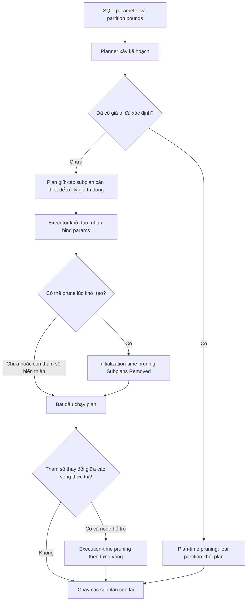

# Partition pruning tại lập kế hoạch và thực thi trong PostgreSQL

Một bảng PostgreSQL được chia thành nhiều partition không tự động khiến mọi truy vấn nhanh hơn. Nếu một câu `SELECT` chỉ cần dữ liệu tháng 3 nhưng PostgreSQL vẫn phải quét cả 60 partition theo tháng, lợi ích phân vùng cho truy vấn đó có thể rất nhỏ. **Partition pruning** là cơ chế dùng điều kiện truy vấn và ranh giới phân vùng để **bỏ qua những partition chắc chắn không thể chứa hàng thỏa điều kiện**.

Một điểm quan trọng thường bị bỏ qua là **pruning có thể diễn ra ở nhiều thời điểm**:

- **Tại lập kế hoạch (plan-time pruning):** PostgreSQL biết đủ thông tin khi xây execution plan để loại các partition không liên quan ngay khỏi kế hoạch.
- **Khi khởi tạo thực thi (initialization-time pruning):** giá trị tham số chưa được biết ở lúc tạo kế hoạch nhưng đã biết khi bắt đầu thực hiện; những subplan không cần thiết được loại trong pha khởi tạo.
- **Trong khi thực thi (execution-time pruning):** giá trị dùng để xác định partition thay đổi trong lúc plan chạy, chẳng hạn mỗi vòng của một parameterized nested loop; executor có thể bỏ qua các subplan tương ứng ở từng lần lặp.

Hiểu sự khác biệt này giúp trả lời những câu hỏi thực tế: Vì sao một câu SQL với hằng số hiện chỉ còn một partition trong `EXPLAIN`? Vì sao một prepared statement vẫn xuất hiện nhiều partition trong generic plan nhưng lúc chạy thực sự chỉ đọc một partition? Vì sao có dòng `Subplans Removed` hoặc một partition được ghi `(never executed)`? Và khi nào một biểu thức trên partition key làm mất hiệu quả pruning?

Bài học thuộc chương **Phân vùng** của PostgreSQL. Nội dung gồm cú pháp và bộ dữ liệu tự chạy, cách đọc plan, ví dụ với `PREPARE`/JDBC, dynamic pruning khi join, giới hạn của planner, tác động của index và statistics, chiến lược benchmark, các lỗi thường gặp và bài thực hành.

## 1. Partitioning và partition pruning là hai việc khác nhau

**Partitioning** mô tả cách lưu hàng vào các quan hệ con. Ví dụ, bảng `orders` được chia theo `ordered_at`:

```text
orders (partitioned parent)
├── orders_2026_01  [2026-01-01, 2026-02-01)
├── orders_2026_02  [2026-02-01, 2026-03-01)
├── orders_2026_03  [2026-03-01, 2026-04-01)
├── orders_2026_04  [2026-04-01, 2026-05-01)
├── orders_2026_05  [2026-05-01, 2026-06-01)
├── orders_2026_06  [2026-06-01, 2026-07-01)
└── orders_default  [mọi giá trị không thuộc các khoảng trên]
```

Một query:

```sql
SELECT COUNT(*)
FROM orders
WHERE ordered_at >= TIMESTAMPTZ '2026-03-01 00:00:00+00'
  AND ordered_at <  TIMESTAMPTZ '2026-04-01 00:00:00+00';
```

chỉ cần hàng của tháng 3. Nếu ranh giới các partition được khai báo đúng, PostgreSQL có thể **prune** năm partition tháng khác và default partition.

Pruning không có nghĩa PostgreSQL “tìm đúng index”. Nó quyết định **partition nào có thể được truy cập**. Sau đó, trong từng partition được giữ lại, planner vẫn chọn `Seq Scan`, `Index Scan`, `Bitmap Heap Scan` hoặc đường truy cập phù hợp.

| Cơ chế | Câu hỏi được trả lời |
| --- | --- |
| Partition routing khi `INSERT` | Hàng mới phải được lưu vào partition nào? |
| Partition pruning | Partition nào chắc chắn không thể chứa hàng phù hợp query? |
| Index scan | Trong partition được chọn, tìm hàng bằng index thế nào? |
| Predicate filtering | Những hàng đã đọc có thỏa toàn bộ `WHERE` không? |
| Partitionwise join/aggregate | Có thể chia join hoặc aggregate thành công việc theo partition không? |

**Không đồng nhất pruning với routing, index selection hay partitionwise execution.** Chúng có thể phối hợp nhưng là các khâu khác nhau.

## 2. Vì sao pruning đúng có thể làm truy vấn nhanh hơn?

Giả sử bảng lưu 120 tháng, mỗi tháng có vài chục triệu dòng. Một báo cáo chỉ hỏi dữ liệu trong ba ngày gần đây.

Nếu PostgreSQL có thể loại 119 partition, nó có thể tiết kiệm:

1. Công việc mở/scan các quan hệ không liên quan.
2. Đọc heap và index page của những partition bị loại.
3. CPU lọc hàng và thực thi operator trên dữ liệu không cần thiết.
4. Một phần overhead của executor, buffer accesses và các node bên dưới.
5. Khả năng giảm lượng dữ liệu đưa vào join/sort/aggregate.

Tuy vậy, **pruning không phải phép bảo đảm thời gian chạy giảm theo đúng tỷ lệ số partition bị loại**. Một query chỉ đọc một partition lớn có thể vẫn chậm nếu thiếu index hoặc phải sort hàng triệu dòng. Một query quét toàn bộ bảng để làm thống kê tất cả các tháng thì không có nhiều partition để loại bỏ.

### 2.1. Pruning cần dựa vào ranh giới dữ liệu được khai báo

PostgreSQL dùng metadata từ `PARTITION BY RANGE`, `LIST` hoặc `HASH` để biết partition có thể chứa giá trị nào.

Ví dụ đối với RANGE:

- `orders_2026_03` chứa các timestamp từ đầu tháng 3 đến **trước** đầu tháng 4.
- Query yêu cầu khoảng tháng 3 thì partition tháng 1 không có khả năng phù hợp.
- PostgreSQL có thể loại partition tháng 1 **mà không phải quét từng hàng tháng 1 để thử `WHERE`**.

Đây là một điểm khác biệt căn bản so với predicate filtering thông thường.

## 3. Ba thời điểm pruning



Ba pha có mối liên hệ nhưng không phải query nào cũng đi qua cả ba theo cách nhìn thấy trong `EXPLAIN`.

| Pha | Thời điểm biết giá trị | Dấu hiệu có thể quan sát |
| --- | --- | --- |
| Plan-time | Khi planner tạo plan, ví dụ literal cố định | Các partition không liên quan **không xuất hiện** trong plan |
| Initialization-time | Khi executor bắt đầu với tham số đã bind | `Subplans Removed: N` ở node hỗ trợ |
| During-execution | Khi một tham số đổi theo từng vòng của nested loop | Một số subplan ít `loops` hoặc `(never executed)` |
| Không prune | Thiếu điều kiện phù hợp hoặc node/biểu thức không hỗ trợ | Nhiều partition còn được thực thi và lọc hàng |

**Không đọc một dấu hiệu duy nhất như bằng chứng tuyệt đối.** `(never executed)` còn có thể do `LIMIT`, một nhánh điều kiện không được đi tới hoặc node cha không đòi hàng, chứ không chỉ bởi pruning.

## 4. Bộ dữ liệu thực hành tự chứa

Tạo một schema `prune_lab` riêng trong database PostgreSQL dùng cho học tập. Không tạo/xóa các đối tượng minh họa trên database có dữ liệu production.

### 4.1. Tạo partitioned parent

```sql
CREATE SCHEMA IF NOT EXISTS prune_lab;

CREATE TABLE prune_lab.orders (
    order_id bigint NOT NULL,
    tenant_id integer NOT NULL,
    ordered_at timestamptz NOT NULL,
    status text NOT NULL
        CHECK (status IN ('pending', 'paid', 'cancelled')),
    amount numeric(12, 2) NOT NULL
        CHECK (amount >= 0),
    PRIMARY KEY (order_id, ordered_at)
) PARTITION BY RANGE (ordered_at);
```

Ở đây:

- `ordered_at` là **partition key**.
- `orders` là bảng cha khai báo phân vùng.
- Khóa chính `(order_id, ordered_at)` chứa partition key để tuân thủ giới hạn ràng buộc unique/primary key của partitioned table trong PostgreSQL.
- `timestamptz` lưu thời điểm tuyệt đối; các ví dụ dùng timestamp kèm offset `+00` để tránh phụ thuộc múi giờ client.

### 4.2. Tạo sáu partition theo tháng

```sql
CREATE TABLE prune_lab.orders_2026_01
PARTITION OF prune_lab.orders
FOR VALUES FROM ('2026-01-01 00:00:00+00')
           TO ('2026-02-01 00:00:00+00');

CREATE TABLE prune_lab.orders_2026_02
PARTITION OF prune_lab.orders
FOR VALUES FROM ('2026-02-01 00:00:00+00')
           TO ('2026-03-01 00:00:00+00');

CREATE TABLE prune_lab.orders_2026_03
PARTITION OF prune_lab.orders
FOR VALUES FROM ('2026-03-01 00:00:00+00')
           TO ('2026-04-01 00:00:00+00');

CREATE TABLE prune_lab.orders_2026_04
PARTITION OF prune_lab.orders
FOR VALUES FROM ('2026-04-01 00:00:00+00')
           TO ('2026-05-01 00:00:00+00');

CREATE TABLE prune_lab.orders_2026_05
PARTITION OF prune_lab.orders
FOR VALUES FROM ('2026-05-01 00:00:00+00')
           TO ('2026-06-01 00:00:00+00');

CREATE TABLE prune_lab.orders_2026_06
PARTITION OF prune_lab.orders
FOR VALUES FROM ('2026-06-01 00:00:00+00')
           TO ('2026-07-01 00:00:00+00');

CREATE TABLE prune_lab.orders_default
PARTITION OF prune_lab.orders DEFAULT;
```

Ranh giới RANGE có dạng **[FROM, TO)**: bao gồm `FROM` và **không bao gồm `TO`**. Timestamp đúng `2026-04-01 00:00:00+00` thuộc partition tháng 4, không thuộc tháng 3.

Default partition chứa các giá trị không nằm trong các bound đã khai báo. PostgreSQL cũng phải xét khả năng dữ liệu thuộc default partition khi quyết định prune, thay vì coi mọi dữ liệu nằm trọn trong sáu tháng.

### 4.3. Thêm dữ liệu phân bố đều giữa các tháng

```sql
INSERT INTO prune_lab.orders
    (order_id, tenant_id, ordered_at, status, amount)
SELECT
    ((m.month_no - 1) * 6000 + g)::bigint,
    (g % 20 + 1)::integer,
    TIMESTAMPTZ '2026-01-01 00:00:00+00'
        + (m.month_no - 1) * INTERVAL '1 month'
        + ((g - 1) % 27) * INTERVAL '1 day'
        + (g % 24) * INTERVAL '1 hour',
    CASE
        WHEN g % 10 = 0 THEN 'cancelled'
        WHEN g % 3 = 0 THEN 'pending'
        ELSE 'paid'
    END,
    ((g % 10000)::numeric / 100)::numeric(12, 2)
FROM generate_series(1, 6) AS m(month_no)
CROSS JOIN generate_series(1, 6000) AS s(g);

CREATE INDEX idx_orders_tenant_time
ON prune_lab.orders (tenant_id, ordered_at);

ANALYZE prune_lab.orders;
```

Bộ dữ liệu gồm **36.000 hàng**, mỗi tháng 6.000 hàng, không có hàng nằm trong default partition. Dữ liệu giới hạn ngày 1–27 mỗi tháng để không vô tình vượt tháng 2.

`CREATE INDEX` trên partitioned parent sẽ tạo/quản lý những index tương ứng trên partitions theo cơ chế PostgreSQL. Index này để minh họa rằng **index scan và pruning có thể cùng xảy ra**, không phải một cái thay thế cái kia.

### 4.4. Kiểm tra dữ liệu thực tế từng partition

```sql
SELECT
    tableoid::regclass AS physical_partition,
    COUNT(*) AS rows_in_partition,
    MIN(ordered_at) AS min_time,
    MAX(ordered_at) AS max_time
FROM prune_lab.orders
GROUP BY tableoid
ORDER BY physical_partition;
```

`tableoid` giúp quan sát hàng hiện nằm ở relation vật lý nào. Vì default partition không có hàng nên truy vấn `GROUP BY tableoid` chỉ trả các partition chứa dữ liệu.

Kiểm tra tổng:

```sql
SELECT COUNT(*) AS total_orders
FROM prune_lab.orders;
```

Kỳ vọng 36.000 hàng nếu lệnh nạp dữ liệu chạy thành công đúng một lần trên schema trống.

## 5. Plan-time pruning với điều kiện hằng số

Chạy:

```sql
EXPLAIN (COSTS ON, VERBOSE)
SELECT COUNT(*)
FROM prune_lab.orders
WHERE ordered_at >= TIMESTAMPTZ '2026-03-01 00:00:00+00'
  AND ordered_at <  TIMESTAMPTZ '2026-04-01 00:00:00+00';
```

Ở thời điểm lập kế hoạch, planner thấy cả hai ranh giới và partition bounds. Nó có thể nhận ra chỉ `orders_2026_03` có khả năng chứa hàng phù hợp.

Một hình dạng plan **minh họa**, không phải output thực tế được bảo đảm:

```text
Aggregate
  -> Seq Scan on prune_lab.orders_2026_03
       Filter: ((ordered_at >= ...) AND (ordered_at < ...))
```

Planner có thể chọn index scan, index-only scan, parallel execution hoặc node khác tùy thống kê và cấu hình. Điều đáng quan tâm là **không còn scan các partition tháng khác**.

### 5.1. Vì sao điều kiện lọc vẫn có thể xuất hiện?

Pruning chỉ chứng minh partition nào **có khả năng** chứa dữ liệu phù hợp; trong nhiều kế hoạch, executor vẫn cần kiểm tra `WHERE` với các hàng được đọc.

Ví dụ, partition tháng 3 chứa cả 31 ngày, query chỉ hỏi từ ngày 10 tới ngày 12. PostgreSQL có thể prune mọi tháng khác, nhưng còn phải **lọc hoặc tìm bằng index** những hàng trong tháng 3.

Do đó, việc thấy `Filter` trên partition còn lại **không phải bằng chứng pruning thất bại**.

### 5.2. Một partition được chọn không nhất thiết dùng index

```sql
EXPLAIN (ANALYZE, BUFFERS)
SELECT COUNT(*)
FROM prune_lab.orders
WHERE ordered_at >= TIMESTAMPTZ '2026-03-01 00:00:00+00'
  AND ordered_at <  TIMESTAMPTZ '2026-04-01 00:00:00+00';
```

Nếu cần phần lớn 6.000 hàng trong partition tháng 3, `Seq Scan` trên partition đó có thể rẻ hơn việc đi qua index rồi lấy hàng. Đây có thể là lựa chọn tốt.

**Pruning thành công** trả lời câu hỏi **bao nhiêu partition cần đọc**, còn **Index Scan hay Seq Scan** trả lời câu hỏi **đọc hàng trong partition ấy theo cách nào**.

### 5.3. Phân biệt plan-time pruning và query chỉ đọc partition con

Hai truy vấn:

```sql
SELECT COUNT(*)
FROM prune_lab.orders
WHERE ordered_at >= TIMESTAMPTZ '2026-03-01 00:00:00+00'
  AND ordered_at <  TIMESTAMPTZ '2026-04-01 00:00:00+00';
```

```sql
SELECT COUNT(*)
FROM prune_lab.orders_2026_03;
```

có thể cùng đọc partition tháng 3 trong dữ liệu mẫu, nhưng **không hoàn toàn cùng ngữ nghĩa**:

- Truy vấn đầu dùng partitioned parent và điều kiện nghiệp vụ; PostgreSQL quyết định pruning dựa trên bounds.
- Truy vấn sau chỉ đọc trực tiếp một partition và không có predicate thời gian; nếu tương lai ranh giới/định nghĩa partition thay đổi, query có thể không còn đại diện cùng phạm vi.
- Tham chiếu parent cho phép ứng dụng làm việc với tập partition một cách thống nhất.

Đừng thay mọi query trên parent bằng tên partition cụ thể chỉ để tạo cảm giác “đã pruning”.

## 6. So sánh khi tắt enable_partition_pruning

PostgreSQL có tham số planner:

```sql
SHOW enable_partition_pruning;
```

Thông thường nó bật. Để quan sát ảnh hưởng trong **transaction thực hành**, có thể tắt tạm thời:

```sql
BEGIN;

SET LOCAL enable_partition_pruning = off;

EXPLAIN (ANALYZE, BUFFERS, VERBOSE)
SELECT COUNT(*)
FROM prune_lab.orders
WHERE ordered_at >= TIMESTAMPTZ '2026-03-01 00:00:00+00'
  AND ordered_at <  TIMESTAMPTZ '2026-04-01 00:00:00+00';

ROLLBACK;
```

Sau đó dùng cài đặt mặc định:

```sql
EXPLAIN (ANALYZE, BUFFERS, VERBOSE)
SELECT COUNT(*)
FROM prune_lab.orders
WHERE ordered_at >= TIMESTAMPTZ '2026-03-01 00:00:00+00'
  AND ordered_at <  TIMESTAMPTZ '2026-04-01 00:00:00+00';
```

Khi pruning bị tắt, plan có thể có thêm nhiều partition scan, ví dụ một node `Append` dưới `Aggregate`. Số hàng cuối cùng vẫn phải đáp ứng `WHERE`; sự khác nhau nằm ở lượng công việc không cần thiết.

**Cẩn thận khi diễn giải:** planner vẫn có thể thay đổi kiểu scan/index và những tối ưu khác, nên không nhất thiết chỉ số execution time thay đổi vì pruning. Hãy nhìn các partition trong plan, `actual rows`, `Buffers`, thời gian và chạy nhiều lượt trong điều kiện tương đương.

`SET LOCAL` tồn tại trong transaction hiện tại nên tránh để cài đặt bất thường bị lưu lại trong session của ứng dụng. Không tắt `enable_partition_pruning` toàn production để thử hiệu năng.

## 7. Initialization-time pruning: tham số chỉ được biết lúc bắt đầu chạy

Prepared statements là tình huống đặc biệt quan trọng. Client gửi SQL với placeholders thay vì nhúng literal:

```sql
PREPARE orders_for_window(timestamptz, timestamptz) AS
SELECT COUNT(*)
FROM prune_lab.orders
WHERE ordered_at >= $1
  AND ordered_at <  $2;
```

Khi planner sử dụng **generic plan**, nó không biết giá trị cụ thể của `$1` và `$2` tại thời điểm xây generic plan. Vì vậy plan có thể cần giữ các subplan của nhiều partition.

Nhưng khi client thực hiện:

```sql
EXECUTE orders_for_window(
    TIMESTAMPTZ '2026-03-01 00:00:00+00',
    TIMESTAMPTZ '2026-04-01 00:00:00+00'
);
```

giá trị đã được bind. Executor có thể **prune khi khởi tạo**, không cần thực thi scan của năm partition khác chỉ vì generic plan tồn tại.

### 7.1. Ép generic plan trong môi trường thực hành

Để dễ quan sát cơ chế này, có thể thử:

```sql
BEGIN;

SET LOCAL plan_cache_mode = force_generic_plan;

EXPLAIN (ANALYZE, BUFFERS, VERBOSE, SETTINGS)
EXECUTE orders_for_window(
    TIMESTAMPTZ '2026-03-01 00:00:00+00',
    TIMESTAMPTZ '2026-04-01 00:00:00+00'
);

ROLLBACK;
```

Ở những plan/version thích hợp, `EXPLAIN` có thể hiện:

```text
Append
  Subplans Removed: 6
  -> ... orders_2026_03 ...
```

Đây là **minh họa**. Bộ dữ liệu có sáu partition tháng và một default; số được loại có thể khác theo cấu trúc và plan. Điều cốt lõi là `Subplans Removed` chỉ ra những subplan được loại ở **pha khởi tạo executor**, không phải bạn đã cố tình xóa partition khỏi schema.

Nếu planner chọn một cấu trúc node khác hoặc áp dụng pruning từ pha khác, `EXPLAIN` có thể trình bày kết quả khác. Cần xem tree thực tế, không đòi output phải khớp từng chữ với ví dụ.

### 7.2. Vì sao còn partition trong generic plan nhưng không đọc dữ liệu?

Một generic plan phải sử dụng được cho nhiều bộ tham số: tháng 3 hôm nay, tháng 5 ngày mai và khoảng xuyên hai tháng ở lần tiếp theo.

Giữ các subplan ở lúc lập generic plan không có nghĩa phải **chạy tất cả** trong mỗi execution. Phần được loại ở initialization phase có thể được ghi `Subplans Removed`; phần còn lại mới được executor xem xét.

Đây là khác biệt quan trọng giữa:

- **Đối tượng tồn tại trong generic plan**.
- **Subplan còn được dùng sau khi biết parameter**.
- **Node thực sự chạy và đọc buffer**.

### 7.3. Giá trị của custom plan

PostgreSQL cũng có thể chọn **custom plan**, được lập kế hoạch với những tham số của lần chạy cụ thể. Khi đó một số điều kiện có thể được dùng để prune ngay trong planning, và plan hiển thị ít partition từ đầu.

Thử:

```sql
BEGIN;

SET LOCAL plan_cache_mode = force_custom_plan;

EXPLAIN (ANALYZE, BUFFERS, VERBOSE, SETTINGS)
EXECUTE orders_for_window(
    TIMESTAMPTZ '2026-03-01 00:00:00+00',
    TIMESTAMPTZ '2026-04-01 00:00:00+00'
);

ROLLBACK;
```

Sau bài thực hành:

```sql
DEALLOCATE orders_for_window;
```

**Không suy rằng generic plan luôn tệ:** generic plan có thể giảm chi phí lập kế hoạch; initialization-time pruning giúp nó tránh nhiều scan không cần thiết. Custom plan có thể tối ưu hơn với tham số lệch mạnh, nhưng cũng tốn chi phí lập kế hoạch cho từng execution.

Khi đánh giá trong ứng dụng, phải xem **planning time, execution time và latency tổng** với tập tham số thực.

## 8. Tham số ứng dụng khác biểu thức hằng số như thế nào?

Có ba ví dụ:

```sql
-- Hằng số viết trong SQL.
SELECT COUNT(*)
FROM prune_lab.orders
WHERE ordered_at >= TIMESTAMPTZ '2026-03-01 00:00:00+00'
  AND ordered_at <  TIMESTAMPTZ '2026-04-01 00:00:00+00';
```

```sql
-- Prepared statement dùng tham số.
PREPARE count_since(timestamptz) AS
SELECT COUNT(*)
FROM prune_lab.orders
WHERE ordered_at >= $1;
```

```sql
-- Biểu thức phụ thuộc thời điểm hiện tại.
SELECT COUNT(*)
FROM prune_lab.orders
WHERE ordered_at >= now() - INTERVAL '30 days';
```

Cơ hội pruning có thể khác:

- Literal có kiểu xác định thường giúp plan-time pruning.
- Tham số trong generic plan thường được biết ở execution initialization.
- Biểu thức ổn định như `now()` có thể dùng thông tin ở execution phase thay vì được coi là literal bất biến tại planning; hành vi cụ thể phụ thuộc cách biểu thức được xử lý và major version.

**Đừng coi mọi biểu thức bên phải toán tử là “constant at planning time”.** PostgreSQL phân biệt tính bất biến và thời điểm có giá trị của biểu thức.

## 9. Execution-time pruning khi tham số thay đổi trong Nested Loop

Một số truy vấn có **giá trị dùng để chọn partition thay đổi ngay trong lúc chạy**, ví dụ một bảng nhỏ chứa danh sách các cửa sổ thời gian; với mỗi cửa sổ, query đọc vài order thuộc tháng tương ứng.

Để tạo dữ liệu minh họa:

```sql
CREATE TABLE prune_lab.report_windows (
    window_id integer PRIMARY KEY,
    month_start timestamptz NOT NULL
);

INSERT INTO prune_lab.report_windows (window_id, month_start)
VALUES
    (1, TIMESTAMPTZ '2026-01-01 00:00:00+00'),
    (2, TIMESTAMPTZ '2026-03-01 00:00:00+00'),
    (3, TIMESTAMPTZ '2026-05-01 00:00:00+00');

ANALYZE prune_lab.report_windows;
```

Query dùng `LATERAL`:

```sql
EXPLAIN (ANALYZE, BUFFERS, VERBOSE)
SELECT
    w.window_id,
    w.month_start,
    x.order_id
FROM prune_lab.report_windows AS w
CROSS JOIN LATERAL (
    SELECT o.order_id
    FROM prune_lab.orders AS o
    WHERE o.ordered_at >= w.month_start
      AND o.ordered_at <  w.month_start + INTERVAL '1 month'
    LIMIT 3
) AS x
ORDER BY w.window_id, x.order_id;
```

`LIMIT 3` giúp giữ subquery `LATERAL` có hành vi lấy một nhóm hàng tương ứng mỗi outer row; không có `ORDER BY` bên trong nên **ba order nào được chọn không được bảo đảm**. Đây là bài minh họa cơ chế, không phải query lấy “ba đơn hàng mới nhất”.

Trong một plan dùng parameterized nested loop và node partition scan hỗ trợ:

1. Outer relation `report_windows` trả cửa sổ tháng 1.
2. Inner subplan nhận `w.month_start = 2026-01-01`.
3. Executor prune những partition không thuộc tháng 1.
4. Outer chuyển sang tháng 3; inner subplan chạy lại với giá trị khác.
5. Executor prune theo **giá trị mới**.
6. Tương tự với tháng 5.

Kết quả: các partition không cần thiết có thể bị loại **theo từng lần lặp**, thay vì chỉ một lần cho cả execution.

### 9.1. Vì sao phải xem actual plan?

Không phải mọi câu `JOIN` hoặc `LATERAL` đều chắc chắn tạo ra runtime partition pruning. Planner có thể:

- Chọn một join strategy khác.
- Đẩy/pull các điều kiện trong query.
- Biến đổi subquery.
- Chọn `Append`, `MergeAppend` hoặc node khác tùy ordering, index và version.
- Quyết định rằng scan/aggregate tổng thể rẻ hơn parameterized path.

Vì vậy, truy vấn trên chỉ tạo **tình huống có cơ hội pruning**. Cần kiểm tra trong plan thực tế có nested loop parameterization và các partition subplans nhận tham số hay không.

### 9.2. Đọc loops và “never executed”

Một plan runtime pruning có thể có hình dạng minh họa:

```text
Nested Loop
  -> Seq Scan on report_windows w (... rows=3 loops=1)
  -> Limit (... loops=3)
       -> Append (... loops=3)
            -> Seq Scan on orders_2026_01 (... loops=1)
            -> Seq Scan on orders_2026_02 (never executed)
            -> Seq Scan on orders_2026_03 (... loops=1)
            -> Seq Scan on orders_2026_04 (never executed)
            -> Seq Scan on orders_2026_05 (... loops=1)
            -> Seq Scan on orders_2026_06 (never executed)
```

Đây chỉ là **mô hình dự kiến để giải thích**, không phải kết quả đo thật; node có thể là `Index Scan`, số loops khác và `LIMIT` có thể dẫn đến một số node không được yêu cầu thực thi.

Trong runtime pruning:

- Những partition được chọn ở một số vòng có thể có số `loops` thấp hơn số vòng inner node.
- Partition bị prune ở tất cả các vòng có thể báo `(never executed)`.
- `loops` không nhất thiết bằng số hàng outer nếu plan có nhiều node hoặc optimization khác.

**Quan trọng:** `(never executed)` còn có thể do `LIMIT`, nhánh `CASE`/one-time filter hoặc node cha chưa yêu cầu tuple. Để chứng minh runtime pruning, phải xem **toàn cây kế hoạch và tính chất tham số động**, không chỉ một dòng text.

### 9.3. Hạn chế theo loại plan node và phiên bản

Execution-time pruning phụ thuộc những node executor hỗ trợ trong major version đang chạy. Các plan dùng `Append`, `MergeAppend`, `ModifyTable` hoặc những biến thể đặc biệt có thể có khả năng pruning khác nhau. Không mặc định mọi node trên parent partitioned table đều hỗ trợ mọi hình thức runtime pruning.

Khi một query có `ORDER BY` làm planner chọn `MergeAppend`, hoặc DML tạo `ModifyTable`, phải **xác minh plan thực tế trên đúng PostgreSQL version**. Một ví dụ chạy trên phiên bản khác chưa chắc cho cùng hành vi.

## 10. Đọc “Subplans Removed” đúng bối cảnh

`Subplans Removed` trong `EXPLAIN` liên quan **subplans bị loại khi executor khởi tạo**, trước khi thực thi scan dữ liệu.

Ví dụ:

```text
Append
  Subplans Removed: 6
  -> Index Scan using ... on orders_2026_03
```

Ý nghĩa:

- Có các subplan mà generic plan hoặc plan ở thời điểm trước đã giữ lại.
- Khi biết đủ giá trị, executor đã xác định không cần chạy chúng.
- Những subplan bị bỏ trong pha này không được thực thi như các node scan thông thường.

**Không suy rằng PostgreSQL chưa từng xem metadata hoặc chưa từng có chi phí liên quan tới những partition đó.** Execution-time initialization xảy ra **sau planning**; metadata/locks/plan construction có thể vẫn tạo overhead.

### 10.1. Khóa của những partition bị prune ở execution initialization

Theo cơ chế PostgreSQL được mô tả trong tài liệu các phiên bản hỗ trợ execution-time pruning, những partition bị bỏ **ở initialization phase** vẫn có thể đã được khóa ở đầu quá trình thực thi. Điều này khác với khả năng loại chúng từ sớm tại plan-time.

Do đó:

- Pruning ở initialization vẫn giúp tránh scan dữ liệu của partition bị loại.
- Nhưng nó không bảo đảm loại bỏ **mọi chi phí locking/catalog** như plan-time pruning có thể giảm.
- Với hàng nghìn partition, planning và khởi tạo plan vẫn có thể tốn chi phí dù runtime scan chỉ một partition.

Đây là lý do không nên thiết kế hàng chục nghìn partitions rồi chỉ dựa vào “cuối cùng executor cũng prune”.

### 10.2. Không có Subplans Removed chưa chắc là không prune

Nếu plan-time pruning đã loại partition khỏi kế hoạch, có thể **không cần báo `Subplans Removed`**.

Nếu runtime pruning xảy ra trong những vòng lặp sau, quan sát có thể nằm ở `loops` của subplan chứ không phải trường này.

Ngoài ra, layout và các thuộc tính trong `EXPLAIN` có thể thay đổi theo plan node và PostgreSQL version.

**Chẩn đoán phải kết hợp:** partition xuất hiện trong plan, `Subplans Removed`, `loops`, `Buffers`, cùng câu SQL/giá trị tham số.

## 11. Điều kiện truy vấn nào tạo cơ hội pruning?

Partition pruning thường hiệu quả khi PostgreSQL nhận ra quan hệ giữa **partition key** và giá trị/range có thể xác định.

### 11.1. Một khoảng nửa mở trên RANGE key

```sql
SELECT order_id, amount
FROM prune_lab.orders
WHERE ordered_at >= TIMESTAMPTZ '2026-03-10 00:00:00+00'
  AND ordered_at <  TIMESTAMPTZ '2026-03-12 00:00:00+00';
```

Điều kiện này nằm trọn tháng 3 nên chỉ tháng 3 có thể chứa hàng phù hợp.

### 11.2. Điều kiện bằng trên partition key

```sql
SELECT *
FROM prune_lab.orders
WHERE ordered_at = TIMESTAMPTZ '2026-03-10 08:00:00+00';
```

Một timestamp cụ thể nằm trong đúng một range partition (hoặc default nếu nằm ngoài tất cả khoảng khai báo). PostgreSQL có thể dùng bounds để chọn partition ứng viên.

### 11.3. Khoảng đi qua nhiều partition

```sql
SELECT COUNT(*)
FROM prune_lab.orders
WHERE ordered_at >= TIMESTAMPTZ '2026-02-25 00:00:00+00'
  AND ordered_at <  TIMESTAMPTZ '2026-04-02 00:00:00+00';
```

Query đi qua cuối tháng 2, toàn tháng 3 và đầu tháng 4. Pruning đúng **không nhất thiết chỉ giữ một partition**: cả ba partition có thể cần thiết.

“Chỉ một partition được quét” không phải tiêu chí thành công cho mọi query. Tiêu chí đúng là **không quét partition chắc chắn không thể có dữ liệu phù hợp**.

### 11.4. Điều kiện IN và OR

```sql
SELECT order_id, ordered_at
FROM prune_lab.orders
WHERE ordered_at = TIMESTAMPTZ '2026-01-10 12:00:00+00'
   OR ordered_at = TIMESTAMPTZ '2026-05-10 12:00:00+00';
```

Hai giá trị thuộc hai partition riêng. PostgreSQL có thể giữ những partition ứng viên tương ứng, tùy cách xử lý biểu thức/plan.

Với `IN (...)` hoặc `= ANY(array)`, hiệu quả phụ thuộc biểu thức, tính chất tham số và kế hoạch. Không giả định mọi OR phức tạp hoặc array expression đều cho một cây prune tối ưu.

### 11.5. Điều kiện chỉ trên cột không phải partition key

```sql
SELECT COUNT(*)
FROM prune_lab.orders
WHERE tenant_id = 7;
```

Bảng được phân vùng theo **`ordered_at`**, không phải tenant. Mọi tháng đều có thể chứa tenant 7, nên chỉ điều kiện `tenant_id = 7` **không đủ để loại partition theo thời gian**.

Index `(tenant_id, ordered_at)` có thể giúp tìm hàng trong từng partition, nhưng không làm PostgreSQL suy ra một tháng cụ thể từ tenant nếu không có ràng buộc khác bảo đảm điều đó.

Đây là sự khác biệt giữa **partition key** và **indexed column**.

## 12. Viết điều kiện thời gian để hỗ trợ pruning và đúng nghiệp vụ

### 12.1. Ưu tiên khoảng [start, end)

Với báo cáo tháng 3:

```sql
WHERE ordered_at >= TIMESTAMPTZ '2026-03-01 00:00:00+00'
  AND ordered_at <  TIMESTAMPTZ '2026-04-01 00:00:00+00'
```

Không dùng:

```sql
WHERE ordered_at BETWEEN
      TIMESTAMPTZ '2026-03-01 00:00:00+00'
  AND TIMESTAMPTZ '2026-04-01 00:00:00+00'
```

với ý định “toàn bộ tháng 3”: `BETWEEN` bao gồm **cả hai đầu**, khiến timestamp đúng đầu tháng 4 cũng phù hợp.

### 12.2. Tránh đặt function lên partition key nếu muốn prune theo raw key

Một query dễ gây mất cơ hội pruning:

```sql
SELECT COUNT(*)
FROM prune_lab.orders
WHERE date_trunc('month', ordered_at)
    = TIMESTAMPTZ '2026-03-01 00:00:00+00';
```

Bảng được partition theo **giá trị nguyên `ordered_at`**, nhưng predicate so sánh **kết quả của một hàm áp lên cột**. PostgreSQL không nhất thiết suy ra được tập range bounds cần giữ từ biểu thức đó.

Ngoài ra `date_trunc` với `timestamptz` có ngữ nghĩa liên quan timezone, làm điều kiện trên có thể khác ý định nếu client chạy ở một timezone không phải UTC.

Nếu nghiệp vụ là tháng 3 theo UTC, hãy viết rõ:

```sql
SELECT COUNT(*)
FROM prune_lab.orders
WHERE ordered_at >= TIMESTAMPTZ '2026-03-01 00:00:00+00'
  AND ordered_at <  TIMESTAMPTZ '2026-04-01 00:00:00+00';
```

Mẫu này vừa rõ thời điểm biên, vừa trực tiếp liên hệ partition key với range.

### 12.3. Cast partition key sang date có thể cản trở pruning

Ví dụ:

```sql
SELECT *
FROM prune_lab.orders
WHERE ordered_at::date = DATE '2026-03-10';
```

Việc cast `timestamptz` sang `date` phụ thuộc timezone của session và thay đổi kiểu biểu thức bên trái. Planner không được phép mặc định biến mọi phép cast như vậy thành đúng cùng một range bound mà không có các điều kiện an toàn.

Nên tính thời điểm đầu/cuối ngày theo timezone nghiệp vụ ở phía ứng dụng, rồi so sánh **trực tiếp `ordered_at`**:

```sql
WHERE ordered_at >= TIMESTAMPTZ '2026-03-10 00:00:00+00'
  AND ordered_at <  TIMESTAMPTZ '2026-03-11 00:00:00+00'
```

Nếu ngày nghiệp vụ thuộc một timezone có DST, **một “ngày địa phương” không phải lúc nào dài đúng 24 giờ**. Hãy chuyển hai mốc bắt đầu của hai ngày liên tiếp ở timezone đó sang `timestamptz` thay vì cộng cứng 24 giờ trong mọi trường hợp.

### 12.4. Expression partition key là trường hợp khác

PostgreSQL cũng có thể partition theo một biểu thức trong các cấu hình được phép. Khi đó, điều kiện trực tiếp trên **partition expression tương ứng** có thể tạo cơ hội pruning.

Ví dụ, không nên suy rằng mọi query gọi function đều phá pruning. Điều quyết định là **cây biểu thức của partition key và predicate có thể khớp/được suy luận phù hợp hay không**, cùng giới hạn hàm/toán tử và version.

## 13. IMMUTABLE, STABLE và VOLATILE ảnh hưởng thế nào?

PostgreSQL phân loại độ biến thiên của function:

| Nhóm | Ý nghĩa khái quát | Liên hệ với pruning |
| --- | --- | --- |
| `IMMUTABLE` | Với cùng input, kết quả không đổi trong các điều kiện được cam kết | Có thể hỗ trợ rút gọn biểu thức khi lập kế hoạch nếu input đã biết |
| `STABLE` | Kết quả ổn định trong phạm vi statement theo quy tắc PostgreSQL | Có thể được đánh giá ở execution phase khi giá trị cần thiết sẵn có |
| `VOLATILE` | Có thể thay đổi giữa các lần gọi | Thường không an toàn để coi như một partition boundary cố định cho pruning |

Ví dụ:

```sql
SELECT COUNT(*)
FROM prune_lab.orders
WHERE ordered_at >= now() - INTERVAL '7 days';
```

`now()` ổn định trong transaction, nên query có thể có cơ hội prune ở một thời điểm phù hợp. Tuy nhiên, **đừng hứa nó luôn là plan-time pruning** như literal cố định.

Ngược lại:

```sql
SELECT COUNT(*)
FROM prune_lab.orders
WHERE ordered_at >= clock_timestamp() - INTERVAL '7 days';
```

`clock_timestamp()` là volatile và có thể thay đổi trong quá trình một statement thực thi. Planner không thể tùy tiện coi giá trị này là một hằng an toàn để loại partition từ sớm.

Ngoài hiệu năng, hai hàm còn có semantics thời gian khác nhau. Chỉ thay `clock_timestamp()` bằng `now()` khi nghiệp vụ cho phép dùng một thời điểm cố định trong transaction.

### 13.1. Không khai sai volatility để ép pruning

Một function phụ thuộc bảng dữ liệu, timezone, trạng thái session hoặc thời gian thực không nên được khai `IMMUTABLE` chỉ để PostgreSQL bỏ partition sớm. Việc khai sai volatility có thể khiến planner cache/rút gọn kết quả và tạo **kết quả truy vấn sai**, nghiêm trọng hơn nhiều việc quét thừa partition.

Hãy viết predicate rõ ràng và dùng hàm đúng tính chất của nó.

## 14. Partition pruning với LIST

Với `PARTITION BY LIST`, mỗi partition nhận một hoặc một số giá trị liệt kê.

Ví dụ riêng:

```sql
CREATE TABLE prune_lab.jobs (
    job_id bigint NOT NULL,
    status text,
    payload text
) PARTITION BY LIST (status);

CREATE TABLE prune_lab.jobs_pending
PARTITION OF prune_lab.jobs FOR VALUES IN ('pending');

CREATE TABLE prune_lab.jobs_running
PARTITION OF prune_lab.jobs FOR VALUES IN ('running');

CREATE TABLE prune_lab.jobs_done
PARTITION OF prune_lab.jobs FOR VALUES IN ('done');

CREATE TABLE prune_lab.jobs_default
PARTITION OF prune_lab.jobs DEFAULT;

INSERT INTO prune_lab.jobs (job_id, status, payload)
VALUES
    (1, 'pending', 'A'),
    (2, 'running', 'B'),
    (3, 'done', 'C'),
    (4, 'failed', 'D');
```

Truy vấn:

```sql
EXPLAIN (ANALYZE, BUFFERS)
SELECT *
FROM prune_lab.jobs
WHERE status = 'pending';
```

có thể chỉ giữ `jobs_pending`. Tương tự:

```sql
EXPLAIN
SELECT *
FROM prune_lab.jobs
WHERE status IN ('pending', 'done');
```

có thể giữ hai partition tương ứng, không cần `jobs_running` hoặc default nếu partition bounds đủ để chứng minh.

**Lưu ý NULL:** với list partitioning, NULL có quy tắc gán vào partition phù hợp; ở ví dụ trên các partition được khai không nhận NULL riêng, nên default có thể chứa những hàng `status IS NULL`. Khi query có `IS NULL`, pruning phụ thuộc các bound thực tế và phiên bản.

## 15. Partition pruning với HASH

Với `PARTITION BY HASH`, PostgreSQL phân phối dữ liệu theo hash của partition key, với `MODULUS` và `REMAINDER`. Đây **không phải** range theo thời gian.

```sql
CREATE TABLE prune_lab.tenant_events (
    event_id bigint NOT NULL,
    tenant_id integer NOT NULL,
    payload text
) PARTITION BY HASH (tenant_id);

CREATE TABLE prune_lab.tenant_events_h0
PARTITION OF prune_lab.tenant_events
FOR VALUES WITH (MODULUS 4, REMAINDER 0);

CREATE TABLE prune_lab.tenant_events_h1
PARTITION OF prune_lab.tenant_events
FOR VALUES WITH (MODULUS 4, REMAINDER 1);

CREATE TABLE prune_lab.tenant_events_h2
PARTITION OF prune_lab.tenant_events
FOR VALUES WITH (MODULUS 4, REMAINDER 2);

CREATE TABLE prune_lab.tenant_events_h3
PARTITION OF prune_lab.tenant_events
FOR VALUES WITH (MODULUS 4, REMAINDER 3);

INSERT INTO prune_lab.tenant_events (event_id, tenant_id, payload)
SELECT g, (g % 20 + 1)::integer, 'event-' || g::text
FROM generate_series(1, 2000) AS g;
```

Query với equality:

```sql
EXPLAIN
SELECT COUNT(*)
FROM prune_lab.tenant_events
WHERE tenant_id = 7;
```

có thể prune xuống partition hash chứa tenant 7.

Nhưng query:

```sql
SELECT COUNT(*)
FROM prune_lab.tenant_events
WHERE tenant_id BETWEEN 3 AND 12;
```

không phải một dải partition liên tiếp theo tenant ID; hash partitioning phân bố giá trị theo hàm hash, nên có thể phải xét nhiều partition.

### 15.1. Không suy partition hash bằng tenant_id % 4

Hash partition routing của PostgreSQL dựa trên hash support functions và quy tắc kết hợp hash key, không đơn giản là mọi kiểu dữ liệu dùng `tenant_id % 4` theo nghĩa số học. Muốn kiểm tra hàng nằm đâu, dùng `tableoid`:

```sql
SELECT
    tenant_id,
    tableoid::regclass AS physical_partition,
    COUNT(*) AS event_count
FROM prune_lab.tenant_events
GROUP BY tenant_id, tableoid
ORDER BY tenant_id;
```

Với nhiều partition keys, hash assignment càng không thể được đoán chỉ bằng toán tử modulo của một cột.

## 16. Composite key và subpartitioning

Một bảng có nhiều tenant và nhiều năm dữ liệu có thể dùng nhiều tầng phân vùng:

- Tầng 1: theo tenant hoặc tenant group.
- Tầng 2: theo thời gian.

Ví dụ khái niệm:

```text
events
├── tenant_group_A  (LIST tenant_group)
│   ├── events_A_2026_01 (RANGE event_time)
│   └── events_A_2026_02
└── tenant_group_B
    ├── events_B_2026_01
    └── events_B_2026_02
```

Một query lọc **cả tenant group lẫn thời gian** có cơ hội prune ở hai tầng. Nếu chỉ lọc thời gian, vẫn phải xét những nhóm tenant phù hợp nếu không có điều kiện loại nhóm.

### 16.1. RANGE partition key nhiều cột có thứ tự từ trái sang phải

`PARTITION BY RANGE (tenant_id, ordered_at)` không có nghĩa PostgreSQL tự tạo hai chiều độc lập tenant × tháng. Với range partitioning nhiều cột, ranh giới được so sánh theo thứ tự key, theo quy tắc range tuple.

Không dùng composite RANGE key rồi giả định có thể suy từng cột giống hai lớp subpartition. Hãy hiểu rõ bound declaration, độ phân bố và query predicates trước khi chọn thiết kế.

### 16.2. Quá nhiều partition cũng có chi phí

Một hệ thống có hàng nghìn partition có thể chịu chi phí:

- Planner phải thao tác với nhiều metadata và paths.
- Executor có thể phải khởi tạo/khóa nhiều đối tượng ở những pha nhất định.
- Catalog và syscache chịu tải hơn.
- Autovacuum/analyze và quản trị index/partition phức tạp hơn.
- Migrations DDL, grants, backup/restore và monitoring tốn thêm công việc.

Pruning giúp tránh scan dữ liệu không liên quan, nhưng không biến **chi phí quản trị hàng nghìn relation thành 0**. Chọn số lượng partition theo retention, số hàng, kích thước bảng, nhu cầu vận hành và workload.

## 17. Default partition và cơ hội pruning

Default partition không chỉ là “partition tháng còn lại”. Nó chứa **mọi giá trị không phù hợp với những partition đã khai báo**.

Với bảng mẫu:

```sql
INSERT INTO prune_lab.orders
    (order_id, tenant_id, ordered_at, status, amount)
VALUES
    (
        999999,
        7,
        TIMESTAMPTZ '2026-10-10 12:00:00+00',
        'paid',
        10.00
    );
```

Hàng này đi vào `orders_default` vì không thuộc sáu tháng đầu năm 2026.

Kiểm tra:

```sql
SELECT tableoid::regclass AS partition_name, order_id
FROM prune_lab.orders
WHERE order_id = 999999;
```

Kỳ vọng trả `orders_default`.

Query về tháng 10:

```sql
EXPLAIN (ANALYZE, BUFFERS)
SELECT *
FROM prune_lab.orders
WHERE ordered_at >= TIMESTAMPTZ '2026-10-01 00:00:00+00'
  AND ordered_at <  TIMESTAMPTZ '2026-11-01 00:00:00+00';
```

có thể prune các partition tháng 1–6 nhưng **không được loại default**, vì nó có thể chứa tháng 10.

### 17.1. Default không phải bảo đảm query luôn phải đọc nó

Nếu predicate tháng 3 nằm trọn bound của partition tháng 3 và default được ràng buộc loại khỏi range đó, planner có thể loại default. Khả năng này phụ thuộc thông tin partition bounds thực tế.

Do đó không có quy tắc “default partition luôn bị scan” hoặc “default luôn được prune”.

### 17.2. DEFAULT làm thao tác thêm partition mới cần cẩn trọng

Nếu muốn tạo một partition tháng 10 sau khi đã có hàng tháng 10 trong default, PostgreSQL phải đảm bảo không còn hàng vi phạm partition bound mới trong default; việc attach/create partition và di chuyển dữ liệu có thể có công việc quét/khóa cần lập kế hoạch.

**Không dùng việc pruning tháng 10 hiện tại làm bằng chứng có thể thêm partition tháng 10 không cần migration dữ liệu.**

## 18. Thống kê bảng và index vẫn quan trọng sau pruning

Giả sử pruning chọn đúng partition tháng 3 nhưng query vẫn chậm:

```sql
EXPLAIN (ANALYZE, BUFFERS)
SELECT *
FROM prune_lab.orders
WHERE ordered_at >= TIMESTAMPTZ '2026-03-01 00:00:00+00'
  AND ordered_at <  TIMESTAMPTZ '2026-04-01 00:00:00+00'
  AND tenant_id = 7
ORDER BY amount DESC
LIMIT 20;
```

Pruning bỏ những tháng khác, nhưng trong tháng 3:

- Index `(tenant_id, ordered_at)` có thể giúp lọc theo tenant.
- `ORDER BY amount DESC` có thể yêu cầu sort.
- `SELECT *` có thể cần đọc heap, không phải index-only.
- Thống kê per-partition có thể ảnh hưởng lựa chọn scan.
- Dữ liệu tenant không đều có thể khiến estimates lệch.

Vì vậy, việc “pruning đúng một partition” không thể thay `ANALYZE`, index design hoặc query optimization.

### 18.1. Statistics có nhiều phạm vi

PostgreSQL có thống kê liên quan tới partition riêng và parent/hierarchy theo quy tắc của từng version. Khi số lượng hàng thay đổi lớn, cần đảm bảo các thống kê thích hợp được cập nhật.

Trên bộ dữ liệu học tập:

```sql
ANALYZE prune_lab.orders;
```

Khi benchmark, ghi thời điểm chạy `ANALYZE` vì thay đổi statistics có thể khiến planner chọn một plan khác ngay cả khi điều kiện pruning không đổi.

### 18.2. Pruning và partitionwise aggregate không đồng nghĩa

Query:

```sql
SELECT tenant_id, SUM(amount)
FROM prune_lab.orders
WHERE ordered_at >= TIMESTAMPTZ '2026-01-01 00:00:00+00'
  AND ordered_at <  TIMESTAMPTZ '2026-07-01 00:00:00+00'
GROUP BY tenant_id;
```

có thể dùng nhiều partition cùng lúc, có thể có aggregate theo kiểu khác nhau tùy planner và tính năng partitionwise aggregate. `enable_partitionwise_aggregate` là một thiết lập riêng; nó không phải công tắc bật/tắt pruning.

Tương tự, `enable_partitionwise_join` ảnh hưởng cách join có thể chia theo partition, **khác** cơ chế loại partition không liên quan.

## 19. Pruning khi JOIN: điều kiện từ bảng khác

Giả sử ứng dụng lưu bảng các lần chạy báo cáo, mỗi lần chứa một khoảng thời gian. Query JOIN có thể lấy ranh giới từ hàng của bảng ngoài.

Nhưng để runtime pruning thực sự xảy ra, cần một plan hỗ trợ **tham số hóa inner scan theo giá trị outer row**. Không phải mọi `JOIN` đều được executor tự động biến thành vòng lặp prune từng tháng.

### 19.1. Nested Loop có thể là cơ hội pruning

Dạng logic:

```text
Outer row #1: start = 2026-01-01  -> inner chỉ cần tháng 1
Outer row #2: start = 2026-03-01  -> inner chỉ cần tháng 3
Outer row #3: start = 2026-05-01  -> inner chỉ cần tháng 5
```

Nếu inner scan được parameterize theo `start` và node hỗ trợ pruning, executor có thể chọn partition theo từng vòng.

### 19.2. Hash Join có thể không cung cấp cùng kiểu dynamic pruning

Một hash join có thể quét các đầu vào theo cách khác, thay vì gọi một partitioned inner scan riêng cho từng outer row. Khi đó không nên kỳ vọng cùng dấu hiệu pruning theo `loops`.

**Đừng ép `enable_hashjoin = off` trên production chỉ để thấy dòng “never executed”.** Nếu cần khám phá alternative plan trong môi trường học tập, hãy tạm thay đổi GUC trong một transaction, sau đó khôi phục, và so sánh cả hiệu năng thực tế.

### 19.3. Partitionwise join là tối ưu khác

Hai bảng partitioned theo khóa/bounds tương thích có thể được PostgreSQL xét **partitionwise join** trong những điều kiện nhất định; đó là việc thực hiện join theo các cặp partition phù hợp.

Partitionwise join và runtime pruning có thể cùng xuất hiện hoặc không. Không gọi mọi plan join có nhiều child nodes là bằng chứng pruning tốt.

## 20. Pruning với UPDATE và DELETE

Các câu DML trên partitioned parent cũng có thể tận dụng thông tin partition bounds để giảm số partition cần xử lý.

Ví dụ DELETE trong tháng 3:

```sql
BEGIN;

EXPLAIN (ANALYZE, BUFFERS)
DELETE FROM prune_lab.orders
WHERE ordered_at >= TIMESTAMPTZ '2026-03-01 00:00:00+00'
  AND ordered_at <  TIMESTAMPTZ '2026-04-01 00:00:00+00'
  AND status = 'cancelled';

ROLLBACK;
```

Trên database học tập, `ROLLBACK` hủy dữ liệu bị xóa ở transaction này. Nhưng `EXPLAIN ANALYZE` **thực thi DELETE thật trước khi rollback** và có thể tạo WAL/locks, nên chỉ dùng môi trường thử nghiệm.

Pruning giúp tránh nhắm những partition chắc chắn không chứa hàng thỏa điều kiện. Tuy nhiên, **execution-time pruning cho DML phụ thuộc khả năng của `ModifyTable`, các scan node và phiên bản PostgreSQL**. Không lấy behavior của SELECT qua `Append` rồi mặc định mọi DELETE/UPDATE với tham số động sẽ có y hệt cơ chế và dấu hiệu.

### 20.1. UPDATE partition key còn có thể di chuyển hàng

```sql
UPDATE prune_lab.orders
SET ordered_at = TIMESTAMPTZ '2026-04-15 12:00:00+00'
WHERE order_id = 12345
  AND ordered_at >= TIMESTAMPTZ '2026-03-01 00:00:00+00'
  AND ordered_at <  TIMESTAMPTZ '2026-04-01 00:00:00+00';
```

Đây là ví dụ về ý tưởng thay đổi partition key: PostgreSQL có thể phải thực hiện row movement giữa partitions theo cơ chế DML phù hợp, với các hạn chế concurrency/constraint liên quan. **Không chạy lệnh này nếu chưa xác định đúng hàng**; giá trị `order_id` trong dữ liệu mẫu có thể thuộc tháng khác và cập nhật 0 hàng.

Đừng nhầm việc chọn partition nguồn khi lọc UPDATE với **định tuyến partition đích cho giá trị mới**.

### 20.2. Chèn dữ liệu dùng routing, không dùng pruning theo WHERE

`INSERT INTO parent VALUES (...)` dùng cơ chế tìm partition chứa hàng mới. Nó không có predicate `WHERE` để planner loại partitions như một `SELECT` điển hình. Khi INSERT từ `SELECT`, phần SELECT nguồn có thể có pruning riêng, còn routing của hàng đích là một bước khác.

## 21. Khi predicate không giúp pruning

Một số tình huống thường khiến planner/executor không thể loại nhiều partition:

| Predicate/tình huống | Vì sao có vấn đề | Cách cải thiện |
| --- | --- | --- |
| `WHERE tenant_id = 7` trên bảng partition theo `ordered_at` | Không ràng buộc partition key | Thêm khoảng thời gian khi nghiệp vụ yêu cầu |
| `WHERE ordered_at::date = ...` | Function/cast trên partition key | So sánh range trực tiếp trên `ordered_at` |
| `WHERE date_trunc('month', ordered_at) = ...` | Partition bounds là raw timestamp | Dùng khoảng tháng [start, end) |
| `WHERE ordered_at >= clock_timestamp() - ...` | Volatile expression không an toàn làm bound cố định | Dùng tham số hay biểu thức stable khi đúng nghiệp vụ |
| Điều kiện OR phức tạp không thể suy partition bounds | Planner không chứng minh được partition không liên quan | Viết lại predicate rõ ràng hoặc tách query nếu tương đương |
| Giá trị partition key chỉ được tạo ra sau một phép tính trên cột | Không đủ điều kiện so sánh trực tiếp với key | Đưa điều kiện về dạng so sánh key nếu hợp lệ |
| Có tham số động nhưng plan node không hỗ trợ cần thiết | Không thể prune ở từng vòng theo kỳ vọng | Xem actual plan, version và join strategy |
| Chỉ filter sau khi truy vấn đã tổng hợp khác ngữ nghĩa | Không thể tùy tiện đẩy filter xuống partition scan | Kiểm tra rewrite có giữ nguyên kết quả không |
| `enable_partition_pruning = off` | Tối ưu bị vô hiệu hóa | Bật lại trong cấu hình bình thường |

Không áp dụng “rewrite cho nhanh” nếu nó thay đổi ngữ nghĩa kết quả. Ví dụ đổi ngày theo timezone UTC trong khi nghiệp vụ cần ngày theo `Asia/Ho_Chi_Minh` có thể làm báo cáo sai dù pruning nhanh hơn.

## 22. Đọc kế hoạch công bằng: pruning có thật giảm công việc không?

Sử dụng:

```sql
EXPLAIN (ANALYZE, BUFFERS, VERBOSE, SETTINGS)
SELECT COUNT(*)
FROM prune_lab.orders
WHERE ordered_at >= TIMESTAMPTZ '2026-03-01 00:00:00+00'
  AND ordered_at <  TIMESTAMPTZ '2026-04-01 00:00:00+00';
```

Những điểm cần đọc:

1. Có bao nhiêu partition scan node trong plan?
2. Có `Subplans Removed` không? Nếu có, đó là dấu hiệu của pha nào?
3. Các partition scan có `actual ... loops` bao nhiêu?
4. Có `(never executed)` không, và nó do pruning hay do flow khác?
5. Có `Seq Scan`, `Index Scan` hay `Bitmap Heap Scan`?
6. Số `rows` ước lượng lệch `actual rows` nhiều không?
7. Có bao nhiêu `Buffers: shared hit/read`?
8. `Planning Time` và `Execution Time` thay đổi thế nào?
9. Có parallel workers làm kế hoạch không tương đương hai lần chạy không?
10. Những setting được báo có khác nhau không?

### 22.1. BUFFERS read không bằng physical disk read

`shared hit` cho biết page được truy cập từ PostgreSQL shared buffer cache; `shared read` là page phải được lấy vào shared buffers. Một `shared read` có thể được đáp ứng từ OS page cache, không nhất thiết truy cập SSD/HDD vật lý.

Hai lần đo trên cùng plan có thể khác nhau vì cache. Muốn đánh giá pruning, hãy nhìn **cấu trúc plan và partition accesses** trước; để đánh giá latency, chạy nhiều lượt trong điều kiện tải/cache tương đương.

### 22.2. Planning time có thể tăng dù execution time giảm

Một thiết kế có vài nghìn partition và generic plan có thể tốn thêm công việc lập kế hoạch/khởi tạo, dù runtime pruning loại gần hết scan.

Do đó, đừng so sánh chỉ `Execution Time` rồi kết luận thiết kế phân vùng đã tối ưu tổng thể. Với query ngắn chạy hàng trăm nghìn lần, **planning overhead** có thể là phần lớn chi phí.

### 22.3. EXPLAIN ANALYZE có instrumentation overhead

`EXPLAIN ANALYZE` thu thời gian và rows theo node, nên có overhead. Khi cần đối chiếu số hàng/loops/buffers mà giảm chi phí lấy đồng hồ, cân nhắc:

```sql
EXPLAIN (ANALYZE, BUFFERS, TIMING OFF)
SELECT COUNT(*)
FROM prune_lab.orders
WHERE ordered_at >= TIMESTAMPTZ '2026-03-01 00:00:00+00'
  AND ordered_at <  TIMESTAMPTZ '2026-04-01 00:00:00+00';
```

`TIMING OFF` không loại bỏ mọi instrumentation, và tổng execution time vẫn được báo. Với các query trả nhiều hàng, thời gian mạng/serialize ở ứng dụng cũng không được phản ánh đầy đủ bởi một lần `EXPLAIN`.

## 23. PreparedStatement của Java/JDBC

Ứng dụng Java nên dùng **tham số kiểu thời gian chuẩn** để PostgreSQL có thể hiểu predicate trên partition key.

Ví dụ PgJDBC với `OffsetDateTime`:

```java
import java.math.BigDecimal;
import java.sql.Connection;
import java.sql.PreparedStatement;
import java.sql.ResultSet;
import java.sql.SQLException;
import java.time.OffsetDateTime;
import javax.sql.DataSource;

public class OrderRepository {
    private final DataSource dataSource;

    public OrderRepository(DataSource dataSource) {
        this.dataSource = dataSource;
    }

    public BigDecimal totalForMarch2026(int tenantId)
            throws SQLException {
        String sql = """
            SELECT COALESCE(SUM(amount), 0)
            FROM prune_lab.orders
            WHERE tenant_id = ?
              AND ordered_at >= ?
              AND ordered_at < ?
            """;

        OffsetDateTime start =
                OffsetDateTime.parse("2026-03-01T00:00:00Z");
        OffsetDateTime end =
                OffsetDateTime.parse("2026-04-01T00:00:00Z");

        try (Connection connection = dataSource.getConnection();
             PreparedStatement ps =
                     connection.prepareStatement(sql)) {

            ps.setInt(1, tenantId);
            ps.setObject(2, start);
            ps.setObject(3, end);

            try (ResultSet rs = ps.executeQuery()) {
                rs.next();
                return rs.getBigDecimal(1);
            }
        }
    }
}
```

Các điểm đáng chú ý:

- `ordered_at` là `timestamptz`, nên bind `OffsetDateTime` làm rõ thời điểm theo offset theo khả năng của PgJDBC hiện đại.
- Predicate so sánh **trực tiếp partition key** với hai tham số, tạo cơ hội pruning.
- Kết quả tính theo khoảng nửa mở, không phụ thuộc “23:59:59.999”.
- `COALESCE(SUM(amount), 0)` trả 0 khi không có order phù hợp.
- Connection và statement được đóng bằng `try-with-resources`.

### 23.1. Đừng biến key thành text chỉ vì dễ bind

Một mẫu nên tránh:

```sql
WHERE ordered_at::text >= ?
```

So sánh chuỗi text không tương đương với so sánh thời điểm ở mọi định dạng/timezone; nó còn biến cột thành biểu thức khác với partition key.

Dùng tham số có kiểu rõ ràng cho thời gian và SQL predicate tương ứng.

### 23.2. Prepared statement có thể đi qua generic/custom plan

PgJDBC và PostgreSQL có cơ chế prepared statements/server-side prepare tùy cấu hình và số lần thực thi. Cùng một SQL Java có thể sử dụng custom plan trong một tình huống và generic plan trong tình huống khác.

Do đó:

- Không mặc định mọi JDBC placeholder đều trở thành literal tại plan-time.
- Không mặc định generic plan sẽ quét mọi partition.
- Khi query có vấn đề, tái hiện bằng `PREPARE`/`EXECUTE` và `plan_cache_mode` trong môi trường thử nghiệm, dùng cùng tham số thực tế.
- Đo thêm latency tổng vì custom plan có thể tốn planning time.

### 23.3. Không nên truy cập partition vật lý trực tiếp từ Java

Việc tạo SQL như `SELECT ... FROM orders_2026_03` bằng cách nối tên partition theo tháng tạo các vấn đề:

- SQL thay đổi theo mỗi tháng, làm phức tạp statement caching.
- Migration thay đổi partition naming khiến code phụ thuộc.
- Truy vấn xuyên nhiều tháng trở nên phức tạp.
- Có nguy cơ SQL injection nếu dựng identifier từ input không tin cậy.
- Tách sai ranh giới có thể làm thiếu dữ liệu default/partition mới.

Thông thường, ứng dụng nên query **partitioned parent** với predicate rõ ràng và để PostgreSQL thực hiện pruning.

## 24. Join và khóa ngoại không tự đảm bảo pruning

Giả sử query JOIN theo `order_id` nhưng không có điều kiện `ordered_at`:

```sql
SELECT o.order_id, o.amount
FROM prune_lab.orders AS o
WHERE o.order_id = 12000;
```

Mặc dù `order_id` có mặt trong composite primary key, nếu không có ràng buộc giúp suy ra thời điểm, PostgreSQL có thể phải xét nhiều partition vì **partition key là ordered_at**.

Tương tự, có index `(order_id, ordered_at)` trên các partition không đồng nghĩa có thể prune về một partition nếu chỉ biết `order_id`.

### 24.1. Kết quả đúng không cần pruning

Query chỉ lọc `order_id` vẫn có thể trả kết quả đúng và đủ nhanh với ít partition. Pruning là một tối ưu, không phải yêu cầu hợp lệ của SQL. Khi số lượng partition tăng rất lớn, điều kiện thời gian bổ sung hợp lệ theo nghiệp vụ có thể tạo khác biệt.

Không thêm `ordered_at` vào `WHERE` bằng một giá trị đoán mò chỉ để ép pruning; nếu khoảng thời gian đoán sai, query sẽ bỏ sót order thật.

## 25. Runtime pruning có ý nghĩa gì với hệ thống nhiều partition?

Ở workload có hàng trăm partition, prepared queries là trường hợp phổ biến. Nếu generic plan được cache để tái sử dụng, không thể “cố định” một tháng cho mọi lần thực thi, nhưng runtime pruning cho phép giảm các scans thực tế.

Vẫn phải cân nhắc:

- **Số partition trong generic plan:** có thể ảnh hưởng plan size và planning/init overhead.
- **Khoảng thời gian của query:** một khoảng ba năm đúng nghiệp vụ thì vẫn cần nhiều partition.
- **Tính sẵn có của tham số:** nếu chỉ được xác định sau một phép tính phức tạp, node phù hợp mới có thể prune.
- **Loại plan:** cơ chế runtime pruning không đồng nhất ở mọi node/version.
- **Khóa/metadata:** prune ở execution không nhất thiết bỏ mọi chi phí quản lý partition từ trước.
- **Cache:** mỗi partition có index/heap riêng và tải truy vấn có thể gây churn.

Đừng chỉ nhìn một plan có `Subplans Removed: 500` rồi kết luận thiết kế 501 partitions tối ưu. Cần đo planning time, execution time, memory và ảnh hưởng concurrency.

## 26. Các tình huống pruning khó thấy

### 26.1. OR có một nhánh không ràng buộc key

```sql
SELECT *
FROM prune_lab.orders
WHERE ordered_at >= TIMESTAMPTZ '2026-03-01 00:00:00+00'
   OR tenant_id = 7;
```

Vì `tenant_id = 7` có thể đúng ở **mọi tháng**, PostgreSQL không thể loại mọi partition ngoài tháng 3 chỉ dựa vào nhánh thời gian.

Đây không phải lỗi planner; đó là logic OR: một hàng tháng 1 của tenant 7 vẫn hợp lệ.

### 26.2. NOT và điều kiện bất đẳng thức

```sql
SELECT *
FROM prune_lab.orders
WHERE ordered_at <> TIMESTAMPTZ '2026-03-10 00:00:00+00';
```

Điều kiện `<>` có thể đúng gần như mọi partition, nên pruning có thể rất ít hoặc không có. Cần hiểu tập giá trị thỏa điều kiện, không chỉ thấy partition key xuất hiện.

### 26.3. Join không đẩy điều kiện xuống nơi cần thiết

Một predicate có thể nằm ở tầng trên sau JOIN/aggregate. Planner không được tùy tiện đưa nó xuống relation scan nếu thay đổi semantics của outer join, null-extension hoặc aggregate.

Khi cần tối ưu, hãy kiểm tra query rewrite có **bảo toàn kết quả** bằng so sánh trên dữ liệu đại diện, không chỉ xem plan gọn hơn.

### 26.4. Hàm volatile ở phía partition bound

Giá trị thay đổi giữa các lần gọi không an toàn để dùng như hằng pruning. Nếu nghiệp vụ cho phép, lấy một thời điểm chuẩn ở ứng dụng rồi bind như parameter ổn định; như vậy điều kiện vừa rõ ngữ nghĩa vừa dễ tối ưu.

### 26.5. Partition DEFAULT chứa dữ liệu ngoài dự kiến

Khi dữ liệu ngoài phạm vi tháng được chèn vào default, một query tương lai vẫn phải xét default. Theo dõi lượng hàng của default và quy trình tạo partition đúng hạn; không coi default là “ngăn chứa miễn phí” với mọi kích thước.

## 27. Những lỗi suy luận khi đọc EXPLAIN

| Quan sát | Kết luận sai | Cách hiểu đúng |
| --- | --- | --- |
| Chỉ thấy `orders_2026_03` | “Chắc chắn Index Scan” | Đã prune partition; vẫn có thể Seq Scan trong partition |
| Không thấy `Subplans Removed` | “Pruning đã tắt” | Có thể plan-time pruning đã loại từ đầu |
| `Subplans Removed: 6` | “Planner không hề xét/khóa sáu partition” | Đây là initialization-time pruning; chi phí trước executor có thể còn |
| `(never executed)` | “Chắc chắn do pruning” | Có thể do LIMIT hoặc plan flow khác |
| `loops=1` ở partition tháng 3 | “Query chỉ có một outer row” | Loops của từng node cần đọc trong toàn cây plan |
| Generic plan có nhiều partition | “Phải quét mọi partition” | Initialization/runtime pruning có thể loại khi bind params |
| Custom plan chỉ còn một partition | “Custom luôn nhanh hơn generic” | Phải tính planning overhead và tập params thực |
| `shared read=0` | “Query không dùng tài nguyên” | Vẫn có CPU, hits, temp, locks và công việc khác |
| `Seq Scan` sau pruning | “Pruning vô dụng” | Quét partition phù hợp có thể là lựa chọn tối ưu |
| `WHERE date_trunc(...key)` | “Có key trong WHERE là prune được” | Biểu thức trên key có thể ngăn suy bounds |
| `tenant_id = 7` trên bảng partition theo thời gian | “Index tenant_id giúp chỉ đọc một tháng” | Index và partition pruning là hai tối ưu khác nhau |
| SELECT prune tốt | “UPDATE/DELETE chắc chắn prune giống hệt” | Node DML và runtime support có giới hạn riêng |
| Query nhanh một lần | “Do pruning” | Có thể do cache, plan khác hoặc tải hệ thống thay đổi |
| Prune 99% partitions | “Planning cost bằng 0” | Metadata/plan size và các pha pruning vẫn tốn công |
| Partition có tên tháng 3 | “Chỉ có dữ liệu tháng 3 vì tên” | PostgreSQL dựa vào **partition bounds**, không dựa tên |

## 28. Runbook chẩn đoán truy vấn thiếu pruning

Khi thấy một truy vấn trên partitioned table chậm, có thể đi theo trình tự:

**Bước 1 — Xác định partition key thực tế.** Đọc `PARTITION BY` và bounds của bảng, không đoán từ tên bảng con.

**Bước 2 — Kiểm tra predicate.** Có ràng buộc trực tiếp lên partition key không? Có cast/function trên cột hay OR mở rộng phạm vi không?

**Bước 3 — Kiểm tra loại tham số.** Query dùng literal, bind placeholder, `now()` hay giá trị tính trong join? Chúng được biết ở thời điểm nào?

**Bước 4 — Lấy `EXPLAIN` trước.** Xem các partition trong plan, loại scan, join/Append node và estimated rows. Nếu là DML, tránh `EXPLAIN ANALYZE` trên production.

**Bước 5 — Nếu cần, dùng `EXPLAIN ANALYZE` có kiểm soát.** Quan sát `Subplans Removed`, `loops`, `Buffers` và execution time; chọn môi trường/tải an toàn.

**Bước 6 — Thử generic và custom plan.** Tái hiện trong session thử nghiệm với `plan_cache_mode`, cùng giá trị tham số và dữ liệu.

**Bước 7 — So sánh khi tắt pruning.** Dùng `SET LOCAL enable_partition_pruning = off` trên database học tập để hiểu lợi ích cấu trúc, không áp dụng toàn production.

**Bước 8 — Đánh giá index/statistics.** Nếu đã prune đúng nhưng query vẫn chậm, điều tra index scan, estimates, sort, hash, work_mem và cache.

**Bước 9 — Đánh giá số lượng partitions.** Nếu query rất ngắn nhưng planning time lớn, xem thiết kế phân vùng có quá nhỏ/quá nhiều partitions hay không.

**Bước 10 — Đo end-to-end.** Xem JDBC latency, số hàng trả về, network, concurrency và tác động những query khác. Một plan đẹp không bảo đảm SLA ứng dụng.

### 28.1. SQL theo dõi danh sách partition

Có thể xem định nghĩa partition theo catalog:

```sql
SELECT
    c.oid::regclass AS partition_name,
    pg_get_expr(c.relpartbound, c.oid) AS partition_bound
FROM pg_inherits AS inh
JOIN pg_class AS c
    ON c.oid = inh.inhrelid
WHERE inh.inhparent = 'prune_lab.orders'::regclass
ORDER BY c.relname;
```

Dữ liệu này cho thấy bounds theo catalog, không dựa vào giả định rằng hậu tố `_2026_03` luôn có phạm vi đúng.

### 28.2. Kiểm tra cài đặt liên quan

```sql
SHOW server_version;
SHOW enable_partition_pruning;
SHOW plan_cache_mode;
SHOW constraint_exclusion;
SHOW enable_partitionwise_join;
SHOW enable_partitionwise_aggregate;
```

Các thiết lập có vai trò khác nhau. `enable_partition_pruning` là công tắc liên quan trực tiếp tới tối ưu đang học; `constraint_exclusion` là một cơ chế tách biệt và `enable_partitionwise_*` điều khiển những cơ hội tối ưu khác.

Đừng bật tất cả tùy chọn chỉ vì muốn planner “nhanh hơn”: mỗi cài đặt có trade-off và hiệu lực tùy version.

## 29. Partition pruning khác constraint exclusion

Trước declarative partitioning, PostgreSQL có kiểu phân vùng dựa trên inheritance và `CHECK` constraints. Cơ chế **constraint exclusion** có thể dùng các ràng buộc `CHECK` để chứng minh một bảng con không có hàng phù hợp.

| Tiêu chí | Partition pruning | Constraint exclusion |
| --- | --- | --- |
| Nguồn metadata chính | Declarative partition bounds (`RANGE/LIST/HASH`) | Ràng buộc `CHECK` phù hợp |
| Mục tiêu chính | Loại partition không liên quan | Loại các quan hệ/nhánh không phù hợp dựa trên constraints |
| Chi phí lập kế hoạch | Được thiết kế tối ưu cho partition bounds | Có thể tốn công xét CHECK constraints trên nhiều relation |
| Pruning khi biết execution parameters | Có cơ chế hỗ trợ trong những node/version thích hợp | Không đồng nghĩa tự có runtime pruning tương tự |
| Cấu hình chính | `enable_partition_pruning` | `constraint_exclusion` |

Trong một số tình huống, constraint exclusion vẫn có thể đóng góp nhờ các ràng buộc bổ sung. Tuy vậy, **không coi việc bật `constraint_exclusion` là thay thế cho cơ chế runtime pruning** của declarative partitioning.

### 29.1. Không trộn hai khái niệm khi debug

Một plan mất partition có thể do pruning theo bounds, constraint exclusion hoặc các phép biến đổi khác. Khi muốn đánh giá tác dụng cơ chế nào, dùng schema, điều kiện và GUC đúng mục tiêu, đồng thời hiểu giới hạn của từng version.

Không dùng toàn bộ một bảng inheritance cũ làm đại diện chính xác cho declarative partitioning trong bài này.

## 30. Tác động đến observability và monitoring

Với ứng dụng dùng nhiều parameterized queries, nên đo:

- Số partitions trong plan ở các query đại diện.
- `Planning Time` và `Execution Time`.
- `Subplans Removed` khi có.
- Distribution của `loops` ở partition scans.
- Buffer hit/read và temp I/O.
- Số dòng thực tế/ước lượng và kế hoạch join.
- p50/p95/p99 latency, throughput và error rate của API.
- Cache regime, cấu hình prepared statements và các nguồn workload nền.
- Số lượng partitions theo thời gian và mức độ sử dụng default partition.

### 30.1. EXPLAIN JSON để lưu bằng máy

```sql
EXPLAIN (
    ANALYZE,
    BUFFERS,
    TIMING OFF,
    FORMAT JSON
)
SELECT COUNT(*)
FROM prune_lab.orders
WHERE ordered_at >= TIMESTAMPTZ '2026-03-01 00:00:00+00'
  AND ordered_at <  TIMESTAMPTZ '2026-04-01 00:00:00+00';
```

JSON hữu ích khi so sánh node types, relation names, estimated/actual rows, loops và runtime statistics. Tuy nhiên, cấu trúc một plan JSON có thể khác giữa PostgreSQL versions, và không phải mọi dấu hiệu pruning đều có cùng đường dẫn JSON ở mọi node.

Không diff mọi số timing và kết luận plan thay đổi; tách **cấu trúc plan**, **ước lượng** và **quan sát runtime**.

### 30.2. pg_stat_statements có chứng minh pruning không?

Khi extension `pg_stat_statements` được bật, bạn có thể theo dõi tổng latency, calls, blocks hit/read và số liệu khác của query fingerprint.

Nhưng extension không tự cho biết **partition nào bị prune ở từng execution**, và có thể gom nhiều giá trị parameters với hành vi khác nhau. Để giải thích pruning, vẫn cần `EXPLAIN` với tập tham số đại diện.

## 31. Bài thực hành

Các bài dùng schema `prune_lab` đã tạo. Những bài có `EXPLAIN ANALYZE DELETE/UPDATE` hoặc thay đổi GUC phải chạy trên database học tập và kết thúc transaction đúng cách.

### Bài 1 — Nhận diện bounds

Xem danh sách partition từ `pg_inherits`/`pg_get_expr(relpartbound, ...)`. Giải thích vì sao ngày `2026-04-01 00:00+00` thuộc partition tháng 4, không thuộc tháng 3.

### Bài 2 — Plan-time pruning theo tháng

```sql
EXPLAIN
SELECT COUNT(*)
FROM prune_lab.orders
WHERE ordered_at >= TIMESTAMPTZ '2026-03-01 00:00:00+00'
  AND ordered_at <  TIMESTAMPTZ '2026-04-01 00:00:00+00';
```

Liệt kê các partition hiện diện trong plan. Có `Subplans Removed` không? Vì sao không có vẫn có thể là plan-time pruning?

### Bài 3 — Tắt pruning để đối chiếu

```sql
BEGIN;
SET LOCAL enable_partition_pruning = off;

EXPLAIN (ANALYZE, BUFFERS, TIMING OFF)
SELECT COUNT(*)
FROM prune_lab.orders
WHERE ordered_at >= TIMESTAMPTZ '2026-03-01 00:00:00+00'
  AND ordered_at <  TIMESTAMPTZ '2026-04-01 00:00:00+00';

ROLLBACK;
```

So sánh số partition scan nodes và buffer accesses với plan khi pruning bật. Đừng kết luận chỉ từ một lần execution time.

### Bài 4 — Query xuyên ba tháng

```sql
EXPLAIN
SELECT COUNT(*)
FROM prune_lab.orders
WHERE ordered_at >= TIMESTAMPTZ '2026-02-25 00:00:00+00'
  AND ordered_at <  TIMESTAMPTZ '2026-04-02 00:00:00+00';
```

Dự đoán partition nào có thể được giữ. Vì sao pruning đúng không có nghĩa chỉ còn một partition?

### Bài 5 — Chỉ lọc tenant_id

```sql
EXPLAIN
SELECT COUNT(*)
FROM prune_lab.orders
WHERE tenant_id = 7;
```

Tại sao có index trên `tenant_id` không đồng nghĩa PostgreSQL prune về một partition thời gian?

### Bài 6 — Function trên partition key

So sánh:

```sql
EXPLAIN
SELECT COUNT(*)
FROM prune_lab.orders
WHERE date_trunc('month', ordered_at)
    = TIMESTAMPTZ '2026-03-01 00:00:00+00';
```

với range trực tiếp trên `ordered_at`. Ghi chú session timezone và giải thích vì sao hai câu có thể khác semantics nếu chuyển timezone.

### Bài 7 — Generic plan và Subplans Removed

```sql
PREPARE q_month(timestamptz, timestamptz) AS
SELECT COUNT(*)
FROM prune_lab.orders
WHERE ordered_at >= $1 AND ordered_at < $2;

BEGIN;
SET LOCAL plan_cache_mode = force_generic_plan;

EXPLAIN (ANALYZE, BUFFERS)
EXECUTE q_month(
    TIMESTAMPTZ '2026-03-01 00:00:00+00',
    TIMESTAMPTZ '2026-04-01 00:00:00+00'
);

ROLLBACK;

DEALLOCATE q_month;
```

Nếu có `Subplans Removed`, nó liên hệ với pha nào? Các partition bị loại vẫn có thể mang overhead gì?

### Bài 8 — So với custom plan

Chạy `PREPARE` lại và `SET LOCAL plan_cache_mode = force_custom_plan` với **cùng parameter values**. So số partition xuất hiện và Planning/Execution Time. Custom plan có luôn nhanh hơn generic trong tổng latency không?

### Bài 9 — Dynamic pruning trong LATERAL

Tạo `report_windows` và chạy query `CROSS JOIN LATERAL` phần 9. Kiểm tra có nested loop và inner partition scan được parameterize không. Nhìn các `loops` và `(never executed)` nếu có.

Vì sao không thể kết luận chỉ từ việc một node không chạy?

### Bài 10 — OR làm mở rộng phạm vi

```sql
EXPLAIN
SELECT COUNT(*)
FROM prune_lab.orders
WHERE ordered_at >= TIMESTAMPTZ '2026-03-01 00:00:00+00'
   OR tenant_id = 7;
```

Tại sao không thể prune tất cả partition ngoài tháng 3?

### Bài 11 — BETWEEN và biên nửa mở

So sánh `BETWEEN '2026-03-01' AND '2026-04-01'` với `>= '2026-03-01' AND < '2026-04-01'` bằng dữ liệu ở đúng thời điểm đầu tháng 4.

Lưu ý dùng `TIMESTAMPTZ` rõ offset. Kết quả có khác không? Việc thêm một partition tháng 4 có thể làm plan khác thế nào?

### Bài 12 — Default partition

Chèn một order tháng 10 vào default, chạy query chỉ tháng 10 và xem partition trong plan. Vì sao default cần được giữ trong trường hợp này?

### Bài 13 — LIST pruning

Tạo bảng `jobs` theo `status` từ phần 14. Chạy `EXPLAIN` với `status='pending'` và `status IN ('pending','done')`. Mỗi query cần bao nhiêu partition?

### Bài 14 — HASH pruning

Tạo `tenant_events` phân vùng hash, đo plan với `tenant_id=7` và với `tenant_id BETWEEN 3 AND 12`.

Vì sao hash partition không được hiểu là bốn dải tenant ID liên tiếp?

### Bài 15 — Index Scan và pruning

Chạy query một tháng có thêm `tenant_id = 7` và quan sát loại scan trong partition còn lại. Đặt câu hỏi: nếu PostgreSQL chọn `Seq Scan`, pruning có thất bại không?

### Bài 16 — DML và ranh giới transaction

Trong database học tập:

```sql
BEGIN;

EXPLAIN (ANALYZE, BUFFERS)
DELETE FROM prune_lab.orders
WHERE ordered_at >= TIMESTAMPTZ '2026-03-01 00:00:00+00'
  AND ordered_at <  TIMESTAMPTZ '2026-04-01 00:00:00+00'
  AND status = 'cancelled';

ROLLBACK;
```

Giải thích vì sao `EXPLAIN ANALYZE` vẫn thực thi DELETE thật và tại sao không nên dùng cách này trên production.

### Bài 17 — Dùng JDBC bind timestamp đúng kiểu

Viết một `PreparedStatement` có điều kiện nửa mở trên `ordered_at` và bind `OffsetDateTime`. Giải thích khác biệt giữa bind tham số kiểu thời gian với việc viết `ordered_at::text >= ?`.

### Bài 18 — Tìm hạn chế của partition count

Giả sử bảng có 1.500 partition theo ngày, một prepared generic plan mỗi lần chỉ đọc một ngày. Hãy đề xuất cách đo:

- Planning Time.
- Initialization/execution work.
- Số partition scan thực tế.
- Lock/catalog overhead nếu có.
- p95 latency và số lượng request đồng thời.

Vì sao 1.499 partitions được prune không có nghĩa chi phí tổng bằng query một bảng đơn giản?

### Bài 19 — Partition pruning và partitionwise join

Hai bảng cùng phân vùng thời gian có query JOIN. Hãy giải thích ba câu hỏi độc lập:

1. Có partition nào không liên quan bị prune không?
2. Có thể join theo từng cặp partition không?
3. Có thể index scan hiệu quả trong partition còn lại không?

Không dùng `enable_partitionwise_join` làm công tắc thay thế `enable_partition_pruning`.

### Bài 20 — Runbook cho sự cố production

Một API báo cáo theo tháng đột nhiên chậm khi chuyển từ literal SQL sang prepared statement. Plan generic hiển thị nhiều partitions nhưng `EXPLAIN ANALYZE` có `Subplans Removed`.

Hãy viết runbook gồm:

- Xác minh parameter type và range predicate.
- Đọc partition bounds, plan-time/initialization pruning.
- So generic/custom plan với cùng tham số.
- Xem `loops`, `Buffers`, Planning/Execution Time.
- Kiểm tra cache, index và statistics.
- Đo end-to-end JDBC/p95 thay vì chỉ đo một lần EXPLAIN.
- Kiểm tra major version và node hỗ trợ.
- Phương án xử lý an toàn, không thay đổi dữ liệu nghiệp vụ.

## 32. Tổng kết

**Partition pruning** giúp PostgreSQL không phải truy cập những partition chắc chắn không thể chứa dữ liệu phù hợp. Nhưng cần phân biệt **thời điểm** tối ưu xảy ra:

- **Plan-time pruning:** giá trị đã biết khi lập kế hoạch; các partition không liên quan có thể biến mất khỏi plan.
- **Initialization-time pruning:** executor biết bind parameters khi bắt đầu chạy; `Subplans Removed` có thể cho biết những subplan bị loại ở pha này.
- **Execution-time pruning:** một tham số thay đổi trong lúc thực thi, như mỗi vòng parameterized nested loop; số `loops` hoặc `(never executed)` ở các partition subplans có thể phản ánh việc bỏ qua trong từng vòng.
- **Không có pruning:** nếu predicate không ràng buộc partition key, chứa biểu thức không thể suy bound hoặc plan node/version không hỗ trợ cơ chế cần thiết.

Các nguyên tắc cần nhớ:

1. **Dựa vào partition bounds, không dựa tên bảng con.**
2. **Đặt predicate trực tiếp lên partition key** và dùng khoảng nửa mở `>= start AND < end` cho thời gian.
3. **Generic plan không đồng nghĩa quét tất cả partitions.** Initialization-time pruning có thể loại subplan khi bind params.
4. **Không suy từ một dấu hiệu riêng lẻ.** `Subplans Removed`, `loops`, `Buffers` và cấu trúc plan phải được đọc cùng nhau.
5. **Pruning khác Index Scan và partitionwise join.** Đúng partition vẫn cần scan/join/sort tối ưu.
6. **Execution-time pruning có giới hạn theo plan node/version.** Kiểm tra trên PostgreSQL đang chạy, đặc biệt với `ModifyTable` và các node chuyên biệt.
7. **Số partition quá lớn vẫn có overhead** ở planning, khởi tạo, catalog và vận hành dù runtime loại phần lớn.
8. **Benchmark công bằng:** cùng dữ liệu, tham số, statistics, cache và tải; đo nhiều lượt và cả latency ứng dụng.
9. **Không ép pruning bằng cách đổi ngữ nghĩa query.** Một báo cáo sai ngày hoặc bỏ sót order không trở thành đúng chỉ vì nhanh.
10. **Thiết kế partition theo workload và vòng đời dữ liệu**, không coi pruning là giải pháp thay thế cho index, thống kê hay SQL tốt.

Hiểu đầy đủ cả ba thời điểm pruning giúp bạn giải thích vì sao PostgreSQL xử lý khác nhau giữa một truy vấn có literal, một prepared statement và một JOIN với giá trị thay đổi theo từng vòng. Nhờ đó, việc đánh giá kế hoạch truy vấn trên bảng phân vùng trở nên chính xác hơn và những thay đổi tối ưu có cơ sở kỹ thuật rõ ràng.

## 33. Tài liệu PostgreSQL để đối chiếu

- [Table Partitioning — Declarative Partitioning và Partition Pruning](https://www.postgresql.org/docs/current/ddl-partitioning.html)
- [EXPLAIN — ANALYZE, BUFFERS, VERBOSE và các tùy chọn](https://www.postgresql.org/docs/current/sql-explain.html)
- [Using EXPLAIN — cách đọc actual rows, loops và plan nodes](https://www.postgresql.org/docs/current/using-explain.html)
- [Planner Method Configuration — enable_partition_pruning và partitionwise options](https://www.postgresql.org/docs/current/runtime-config-query.html)
- [PREPARE — generic và custom plans](https://www.postgresql.org/docs/current/sql-prepare.html)
- [System Catalog pg_class, pg_inherits và pg_partitioned_table](https://www.postgresql.org/docs/current/catalogs.html)

Tài liệu có đường dẫn `current` được cập nhật theo phiên bản PostgreSQL hiện hành. Khi triển khai thực tế, hãy mở hướng dẫn **đúng major version** của server để xác nhận các chi tiết về execution-time pruning, plan nodes, `EXPLAIN` và giới hạn đối với DML.
