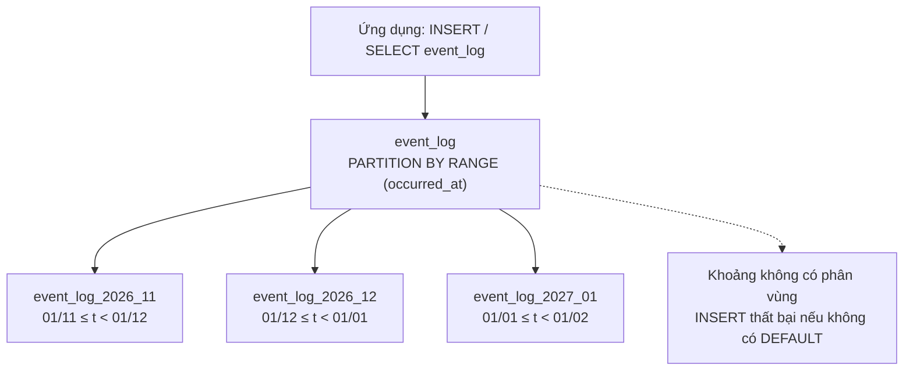
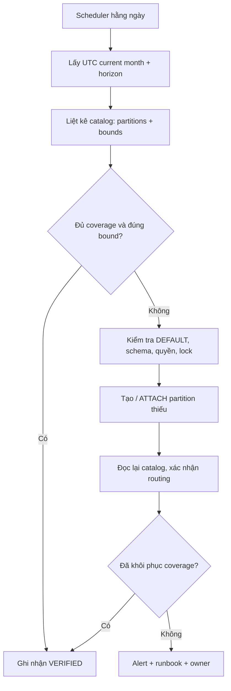

# Tạo trước phân vùng, kiểm tra khoảng trống và dữ liệu lệch trong PostgreSQL

Một bảng PostgreSQL lưu sự kiện có thể tăng từ vài triệu lên hàng tỷ dòng. Nếu mọi dữ liệu được lưu vào một bảng vật lý, một số thao tác như xóa dữ liệu cũ theo tháng, bảo trì index, đọc từng khoảng thời gian và quản lý vòng đời lưu trữ có thể trở nên khó khăn. **Declarative partitioning** cho phép chia dữ liệu theo những khoảng giá trị của một **partition key**, trong khi ứng dụng vẫn truy vấn qua một bảng cha (*partitioned table*).

Ví dụ hệ thống ghi sự kiện theo thời điểm:

```sql
CREATE TABLE event_log (
    event_id BIGINT NOT NULL,
    occurred_at TIMESTAMPTZ NOT NULL,
    tenant_id INTEGER NOT NULL,
    payload JSONB NOT NULL,
    PRIMARY KEY (occurred_at, event_id)
) PARTITION BY RANGE (occurred_at);
```

Bảng cha trên là một **partitioned table**. Để có thể ghi sự kiện vào các tháng tương ứng, cần tạo những phân vùng con:

```sql
CREATE TABLE event_log_2026_11
PARTITION OF event_log
FOR VALUES FROM ('2026-11-01 00:00:00+00')
         TO   ('2026-12-01 00:00:00+00');

CREATE TABLE event_log_2026_12
PARTITION OF event_log
FOR VALUES FROM ('2026-12-01 00:00:00+00')
         TO   ('2027-01-01 00:00:00+00');
```

**Ba vấn đề vận hành** sẽ xuất hiện ngay khi hệ thống chạy lâu dài:

1. **Tạo trước phân vùng:** nếu tới ngày 01/01/2027 chưa có phân vùng tương ứng, INSERT có thể thất bại; yêu cầu tạo trước đủ xa và xử lý cả dữ liệu đến muộn/đến sớm.
2. **Kiểm tra khoảng trống (*gaps*):** có thể thiếu một tháng, định nghĩa sai mốc, gắn nhầm bảng hoặc có `DEFAULT` partition đang âm thầm chứa dữ liệu vốn phải nằm trong phân vùng chính.
3. **Kiểm tra dữ liệu lệch (*skew*):** một phân vùng có thể lớn bất thường, chứa lượng dữ liệu không tương xứng, hoặc một tenant/khung giờ tạo tải quá lớn, làm query và bảo trì mất cân bằng.

Trọng tâm bài học là **chủ động quản trị phạm vi dữ liệu**, không chỉ thuộc cú pháp `CREATE TABLE ... PARTITION OF`. Hệ thống tốt cần biết **phân vùng nào phải tồn tại, phân vùng nào thực tế đang tồn tại, dữ liệu đang nằm ở đâu và dấu hiệu sai lệch nào cần cảnh báo**.

## 1. Mục tiêu học tập

Sau bài này, bạn có thể:

- Hiểu các khoảng `RANGE` với **cận dưới bao gồm, cận trên không bao gồm**.
- Thiết kế phân vùng theo ngày/tháng và quy ước UTC, năm nhuận, tháng 28/29/30/31 ngày.
- Tạo trước một **horizon** gồm những tháng tương lai để tránh lỗi INSERT tại ranh giới.
- Dùng `pg_partition_tree`, `pg_inherits`, `pg_class` và `pg_get_expr` để quan sát phân vùng/bounds thực tế.
- Phân biệt **thiếu tên**, **chưa ATTACH**, **bounds sai**, **khoảng trống** và **một DEFAULT partition che lỗi**.
- Viết SQL phát hiện thiếu những partition mong đợi theo **lịch và quy tắc đặt tên**, đồng thời xác minh bounds.
- Đo sự lệch về **số hàng, dung lượng, ngày/giờ, tenant và tỷ lệ dữ liệu vào DEFAULT**.
- Đánh giá partition pruning qua `EXPLAIN` và hiểu vì sao thiếu predicate theo khóa có thể khiến quét nhiều partition.
- Hiểu sự khác nhau giữa `CREATE TABLE ... PARTITION OF` và tạo bảng riêng rồi `ATTACH PARTITION` dưới tải.
- Xây dựng lịch tạo trước, cảnh báo, runbook xử lý sự cố, kiểm tra dữ liệu đến muộn và quy trình retention.
- Tránh tạo số lượng phân vùng cực lớn hoặc cố dùng phân vùng để thay mọi loại index.

## 2. Declarative partitioning là gì?

PostgreSQL hỗ trợ các cách chia phổ biến:

| Kiểu partitioning | Quy tắc phân phối | Ví dụ |
| --- | --- | --- |
| `RANGE` | Chia theo khoảng liên tiếp trên key | Dữ liệu theo tháng |
| `LIST` | Chia theo những giá trị cụ thể | Vùng dữ liệu, nhóm trạng thái |
| `HASH` | Chia theo hàm băm key | Phân bố tải theo tenant/account khi phù hợp |

Trong bài, ta tập trung vào `RANGE (occurred_at)` vì yêu cầu **tạo trước, kiểm tra khoảng trống và dữ liệu lệch** thường gặp nhất khi chia theo thời gian.

Một bảng cha `PARTITION BY RANGE` không lưu các row như một heap table thường. Dữ liệu được đặt vào **các phân vùng con tương ứng với giá trị partition key**. Khi ứng dụng:

```sql
INSERT INTO event_log (event_id, occurred_at, tenant_id, payload)
VALUES (
    1001,
    TIMESTAMPTZ '2026-11-14 10:30:00+00',
    42,
    '{"action":"checkout"}'::jsonb
);
```

PostgreSQL tìm phân vùng bao phủ mốc thời gian và chuyển row vào phân vùng đó.

### 2.1. Sơ đồ



Tên bảng con là **quy ước vận hành**. PostgreSQL thực sự phân phối theo **bounds đã khai báo**, không chỉ nhìn tên `event_log_2026_11` rồi suy ra tháng 11.

### 2.2. Partitioning không phải giải pháp cho mọi bảng lớn

Lợi ích có thể gồm:

- Partition pruning giúp tránh truy cập các vùng dữ liệu không liên quan nếu query có điều kiện phù hợp.
- Có thể quản lý retention theo partition, ví dụ detach/drop cả tháng cũ.
- Có thể bảo trì một số cấu trúc trên từng partition.
- Cho phép chính sách lưu trữ, index và thống kê theo phân vùng trong những tình huống phù hợp.

Đổi lại:

- Nhiều relation/index hơn trong catalog.
- DDL/monitoring/backup/replication và schema migrations phức tạp hơn.
- Query không có điều kiện partition key có thể vẫn phải xử lý nhiều partition.
- Không có một cơ chế global uniqueness độc lập với partition key cho mọi dạng constraint.
- Tạo phân vùng quá nhiều có thể tăng planning time, metadata và chi phí vận hành.

**Partitioning nên xuất phát từ kích thước, vòng đời dữ liệu và query patterns**, không phải cứ có 100.000 row là bắt buộc chia bảng.

## 3. Khoảng RANGE có cận dưới đóng và cận trên mở

Khai báo:

```sql
FOR VALUES FROM ('2026-11-01 00:00:00+00')
         TO   ('2026-12-01 00:00:00+00')
```

có nghĩa:

```text
2026-11-01 00:00:00+00 ≤ occurred_at
occurred_at < 2026-12-01 00:00:00+00
```

Đó là khoảng **[start, end)**.

| Giá trị occurred_at | Partition tháng 11? |
| --- | :---: |
| 2026-10-31 23:59:59.999999+00 | Không |
| 2026-11-01 00:00:00+00 | Có |
| 2026-11-14 10:30:00+00 | Có |
| 2026-11-30 23:59:59.999999+00 | Có |
| 2026-12-01 00:00:00+00 | Không; thuộc partition tháng 12 nếu có |

### 3.1. Tại sao không dùng 23:59:59 làm cận trên?

PostgreSQL có giá trị timestamp với độ chính xác nhỏ hơn một giây. Nếu khai báo tháng 11 kết thúc ở:

```text
2026-11-30 23:59:59
```

thì còn những mốc như `23:59:59.000001` đến sát nửa đêm. Dùng **đầu tháng tiếp theo làm cận trên mở** tránh khoảng trống đó.

### 3.2. Không dùng số ngày cố định cho tháng

Khoảng tháng 2 có thể có 28 hoặc 29 ngày; tháng 4 có 30 ngày, tháng 7 có 31 ngày.

Đúng:

```sql
FOR VALUES FROM ('2027-02-01 00:00:00+00')
         TO   ('2027-03-01 00:00:00+00')
```

Không nên tự cộng cố định `INTERVAL '30 days'` để tính ranh giới mọi tháng.

### 3.3. Quy tắc không chồng lấn

Hai partition con trong cùng cấp phân vùng không được định nghĩa các RANGE chồng lấn. Ví dụ tháng 11 và tháng 12 có ranh giới đúng:

```text
Nov: [2026-11-01, 2026-12-01)
Dec: [2026-12-01, 2027-01-01)
```

Chúng **liền kề** tại 01/12 nhưng không giao nhau, vì Nov không chứa đầu tháng 12.

PostgreSQL từ chối việc ATTACH hoặc tạo một partition có bound overlap với partition đã tồn tại. Tuy vậy, PostgreSQL **không buộc các range phải phủ kín toàn bộ trục thời gian**; bạn vẫn có thể tạo **gaps** giữa các partition.

## 4. TIMESTAMP hay TIMESTAMPTZ: chọn và chuẩn hóa múi giờ

Nếu sự kiện có thời điểm tuyệt đối từ nhiều nguồn, `TIMESTAMPTZ` thường phù hợp hơn `TIMESTAMP WITHOUT TIME ZONE`.

`TIMESTAMPTZ` lưu một thời điểm tuyệt đối và hiển thị theo timezone của phiên khi cần. Các mốc:

```sql
TIMESTAMPTZ '2026-11-01 00:00:00+00'
```

và một thời điểm được ghi theo timezone khác nhưng tương đương có **cùng giá trị thời gian thực**. Không nên tạo partition theo tên “tháng UTC” mà lại vô tình chuyển ranh giới qua timezone phiên.

### 4.1. Dùng UTC nhất quán

Quy ước bài học:

- Partition key: `occurred_at TIMESTAMPTZ NOT NULL`.
- Ranh giới: nửa đêm **UTC**, có ghi `+00` rõ trong literal.
- Tên partition: `events_YYYY_MM` theo **tháng UTC**.
- Dashboard nếu dùng giờ địa phương phải chuyển timezone khi hiển thị/đếm.

Ví dụ một thời điểm:

```sql
SELECT
    TIMESTAMPTZ '2026-11-30 18:00:00+00'
        AT TIME ZONE 'Asia/Ho_Chi_Minh'
        AS local_time;
```

Giá trị hiển thị theo giờ Việt Nam là **01/12/2026 01:00**, nhưng vẫn thuộc **partition tháng 11 theo UTC**.

### 4.2. Nếu yêu cầu partition theo tháng kinh doanh địa phương?

Khi nghiệp vụ đòi “tháng theo timezone Hà Nội/Hồ Chí Minh”, cần thiết kế mốc chuyển đổi chính xác về instant UTC, tính đến timezone/DST nếu vùng có đổi giờ. Đừng vừa gọi partition tháng địa phương vừa dùng mốc tháng UTC mà không công bố semantics.

### 4.3. Tránh so sánh cột bằng cách ép kiểu làm mất pruning

Truy vấn có lợi cho RANGE pruning:

```sql
WHERE occurred_at >= TIMESTAMPTZ '2026-11-01 00:00:00+00'
  AND occurred_at < TIMESTAMPTZ '2026-12-01 00:00:00+00'
```

Truy vấn:

```sql
WHERE occurred_at::date = DATE '2026-11-14'
```

có nghĩa phụ thuộc timezone phiên đối với `timestamptz::date` và có thể làm khó việc nhận diện trực tiếp bound theo khóa phân vùng. Hãy ưu tiên khoảng thời gian có cận rõ ràng khi mục tiêu là lọc theo partition key.

## 5. Chọn kích thước phân vùng: ngày, tuần, tháng hay năm?

Không có công thức “luôn chia theo tháng”.

| Đơn vị | Ưu điểm | Nguy cơ |
| --- | --- | --- |
| Theo giờ | Dễ tách các đợt dữ liệu rất lớn, retention giờ | Rất nhiều relation, DDL/metadata |
| Theo ngày | Kiểm soát retention, size theo ngày | Số partition tăng nhanh |
| Theo tháng | Số partition vừa phải cho nhiều hệ thống | Tháng nóng có thể rất lớn |
| Theo quý/năm | Ít partition, quản lý đơn giản | Partition lớn, pruning kém chi tiết hơn |

Hãy xem:

1. Số row/byte tạo mỗi ngày.
2. Retention period.
3. Query thường truy vấn theo khoảng bao lâu.
4. Số relation/index/partition dự kiến.
5. Tần suất DDL tạo/xóa partition.
6. Tốc độ dữ liệu theo ngày và tenant có lệch không.
7. Yêu cầu backup, archiving và retention.

Ví dụ một hệ thống có dữ liệu 5 TB/tháng có thể cần partition theo ngày hoặc mô hình nhiều tầng; hệ thống 5 GB/tháng có thể chia theo tháng rất hợp lý. Cần benchmark trên dữ liệu và hệ lưu trữ thực.

## 6. Vì sao phải tạo trước phân vùng?

Một ngày cuối tháng:

```text
23:59:59.999999 UTC -> rows tới partition tháng hiện tại
00:00:00.000000 UTC -> rows phải tới partition tháng mới
```

Nếu phân vùng tháng mới chưa tồn tại và không có default:

```text
ERROR: no partition of relation "events" found for row
DETAIL: Partition key of the failing row contains ...
```

Ứng dụng có thể:

- Không ghi được dữ liệu mới.
- Retry liên tục mà vẫn lỗi vì thiếu cấu trúc.
- Làm message consumer backlog tăng.
- Gây gián đoạn nghiệp vụ vào đúng ranh giới thời gian.

Một quy trình “đúng 00:00 mới chạy DDL” có thể thất bại do downtime, migration lock, thiếu quyền, scheduler không chạy hoặc hệ thống có dữ liệu **timestamp tương lai**.

### 6.1. Horizon tạo trước

**Partition creation horizon** là khoảng thời gian đã được chuẩn bị sẵn so với hiện tại.

Ví dụ:

```text
Tháng vận hành: 2026-11
Có sẵn:         2026-11, 2026-12, 2027-01, 2027-02, 2027-03
Horizon:        tới hết tháng 03/2027 (theo UTC)
```

Khi qua tháng 12, scheduler bổ sung các tháng tiếp theo để horizon không cạn.

### 6.2. Chọn horizon từ độ trễ và tính sẵn sàng

Horizon nên lớn hơn:

- Thời gian ứng dụng có thể gửi sự kiện trong tương lai.
- Thời gian tối đa để khôi phục scheduler/DDL job sau sự cố.
- Thời gian cần để hoàn tất và verify migration.
- Biên an toàn cho maintenance windows và ngày nghỉ.

Ví dụ sự kiện có thể được lập lịch trước 60 ngày thì chỉ tạo trước một ngày rõ ràng là không đủ.

Không nhất thiết tạo trước 10 năm phân vùng nếu số relation rất lớn; horizon cần dựa vào **forecast window, retry lag và chi phí catalog**.

## 7. Xây dựng schema thử nghiệm

Tất cả phần thực hành dùng schema riêng `partition_ops_lab` để tránh ảnh hưởng ứng dụng khác. Không dùng trực tiếp những lệnh tạo/xóa partition trên production.

### 7.1. Tạo schema và bảng cha

```sql
CREATE SCHEMA IF NOT EXISTS partition_ops_lab;

CREATE TABLE partition_ops_lab.events (
    event_id BIGINT NOT NULL,
    occurred_at TIMESTAMPTZ NOT NULL,
    tenant_id INTEGER NOT NULL,
    event_type TEXT NOT NULL,
    metric_value NUMERIC(12, 2) NOT NULL DEFAULT 0,
    payload JSONB NOT NULL DEFAULT '{}'::jsonb,
    PRIMARY KEY (occurred_at, event_id)
) PARTITION BY RANGE (occurred_at);
```

Vì primary key trên partitioned table trong trường hợp này phải bao gồm **partition key**, ta dùng `PRIMARY KEY (occurred_at, event_id)` thay vì chỉ `PRIMARY KEY (event_id)`.

**Quan trọng:** ràng buộc đó làm duy nhất **cặp** `(occurred_at, event_id)`, **không bảo đảm một mình event_id duy nhất trên mọi partition**. Nếu nghiệp vụ cần event ID toàn cục, hãy thiết kế nguồn tạo ID/constraint/registry phù hợp; không suy luận PostgreSQL đã có global unique index độc lập với key phân vùng.

### 7.2. Tạo partition cho các tháng liền kề

```sql
CREATE TABLE partition_ops_lab.events_2026_11
PARTITION OF partition_ops_lab.events
FOR VALUES FROM ('2026-11-01 00:00:00+00')
         TO   ('2026-12-01 00:00:00+00');

CREATE TABLE partition_ops_lab.events_2026_12
PARTITION OF partition_ops_lab.events
FOR VALUES FROM ('2026-12-01 00:00:00+00')
         TO   ('2027-01-01 00:00:00+00');

CREATE TABLE partition_ops_lab.events_2027_01
PARTITION OF partition_ops_lab.events
FOR VALUES FROM ('2027-01-01 00:00:00+00')
         TO   ('2027-02-01 00:00:00+00');
```

Ba partition bao phủ:

```text
[2026-11-01, 2026-12-01)
[2026-12-01, 2027-01-01)
[2027-01-01, 2027-02-01)
```

Giữa các khoảng không có gap. Nhưng từ 01/02/2027 trở đi chưa được bao phủ.

### 7.3. Index hỗ trợ truy vấn theo tenant trong từng tháng

```sql
CREATE INDEX idx_lab_events_tenant_time
ON partition_ops_lab.events
    (tenant_id, occurred_at DESC);
```

Khi tạo index trên partitioned parent trong cơ chế declarative partitioning, PostgreSQL quản lý các index tương ứng trên partitions theo tính năng phiên bản. Query một tenant trong một tháng có thể được hỗ trợ bởi index phù hợp.

Đừng tạo index trên parent rồi giả định nó là **một B-tree vật lý duy nhất chứa mọi partition**. Mỗi partition có cấu trúc dữ liệu/index tương ứng.

### 7.4. Xem partition tree

```sql
SELECT
    relid::regclass AS relation,
    parentrelid::regclass AS parent_relation,
    isleaf,
    level
FROM pg_partition_tree('partition_ops_lab.events'::regclass)
ORDER BY level, relid::text;
```

Kết quả có bảng cha cấp 0 và ba partition con cấp 1; `isleaf` là TRUE với các leaf partitions.

## 8. Nạp dữ liệu mẫu có độ lệch có chủ đích

Ta nạp ba tháng với số lượng khác nhau, đồng thời cố tình cho **tenant_id = 1** chiếm phần lớn dữ liệu. Nhờ đó có thể quan sát cả lệch theo tháng lẫn theo tenant.

### 8.1. Tháng 11: 30.000 sự kiện

```sql
INSERT INTO partition_ops_lab.events (
    event_id,
    occurred_at,
    tenant_id,
    event_type,
    metric_value,
    payload
)
SELECT
    g.n,
    TIMESTAMPTZ '2026-11-01 00:00:00+00'
        + (g.n % 30) * INTERVAL '1 day'
        + (g.n % 86400) * INTERVAL '1 second',
    CASE
        WHEN g.n % 10 < 8 THEN 1
        ELSE 2 + (g.n % 9)
    END,
    CASE WHEN g.n % 5 = 0 THEN 'PURCHASE' ELSE 'VIEW' END,
    (g.n % 5000)::numeric(12, 2),
    jsonb_build_object('source', 'lab-nov', 'n', g.n)
FROM generate_series(1, 30000) AS g(n);
```

### 8.2. Tháng 12: 12.000 sự kiện

```sql
INSERT INTO partition_ops_lab.events (
    event_id, occurred_at, tenant_id, event_type,
    metric_value, payload
)
SELECT
    30000 + g.n,
    TIMESTAMPTZ '2026-12-01 00:00:00+00'
        + (g.n % 31) * INTERVAL '1 day'
        + (g.n % 86400) * INTERVAL '1 second',
    CASE WHEN g.n % 10 < 8 THEN 1 ELSE 2 + (g.n % 9) END,
    'VIEW',
    (g.n % 3000)::numeric(12, 2),
    '{"source":"lab-dec"}'::jsonb
FROM generate_series(1, 12000) AS g(n);
```

### 8.3. Tháng 01: 1.200 sự kiện

```sql
INSERT INTO partition_ops_lab.events (
    event_id, occurred_at, tenant_id, event_type,
    metric_value, payload
)
SELECT
    42000 + g.n,
    TIMESTAMPTZ '2027-01-01 00:00:00+00'
        + (g.n % 31) * INTERVAL '1 day'
        + (g.n % 86400) * INTERVAL '1 second',
    CASE WHEN g.n % 10 < 8 THEN 1 ELSE 2 + (g.n % 9) END,
    'VIEW',
    (g.n % 1000)::numeric(12, 2),
    '{"source":"lab-jan"}'::jsonb
FROM generate_series(1, 1200) AS g(n);
```

### 8.4. Tổng dữ liệu

```sql
ANALYZE partition_ops_lab.events;

SELECT COUNT(*) AS total_events
FROM partition_ops_lab.events;
```

Trên schema mới và script chạy đúng một lần, tổng là **43.200 sự kiện**.

Lưu ý: chênh lệch 30.000–12.000–1.200 là **do bài lab tạo có chủ đích**, không phải bằng chứng rằng PostgreSQL phân phối sai. Việc phát hiện skew là bước đầu; kết luận bất thường phải so với ngày trong tháng, lưu lượng dự kiến và dữ liệu thực.

## 9. Tạo trước tháng tiếp theo theo cách tường minh

Từ trạng thái hiện có, để có tới tháng 03/2027:

```sql
CREATE TABLE partition_ops_lab.events_2027_02
PARTITION OF partition_ops_lab.events
FOR VALUES FROM ('2027-02-01 00:00:00+00')
         TO   ('2027-03-01 00:00:00+00');

CREATE TABLE partition_ops_lab.events_2027_03
PARTITION OF partition_ops_lab.events
FOR VALUES FROM ('2027-03-01 00:00:00+00')
         TO   ('2027-04-01 00:00:00+00');
```

Hai phân vùng mới **có thể trống**; đó là trạng thái bình thường của phân vùng tương lai.

### 9.1. Tạo partition trống không có nghĩa thiếu dữ liệu

Một partition tháng 03/2027 còn 0 hàng vào tháng 11/2026 là **đúng** nếu hệ thống chưa có sự kiện tương lai.

Khi đo skew hoặc cảnh báo zero rows, cần phân biệt:

- Partition tương lai chưa đến kỳ.
- Partition quá khứ đáng lẽ có dữ liệu.
- Partition hiện tại đang mới bắt đầu.
- Khoảng kỳ nghỉ hoặc sự kiện không có lưu lượng theo business.

**Không báo sự cố “partition trống” chỉ dựa vào COUNT=0.**

### 9.2. Tạo càng sớm càng ít áp lực mốc 00:00

Khi phân vùng mới đã có trước vài tháng, INSERT tại thời điểm biên không phụ thuộc thành công của một DDL diễn ra vào giây cuối cùng.

## 10. Tự động tạo trước bằng DO block trong PostgreSQL

Thay vì viết tay 12 câu DDL mỗi năm, có thể sinh bảng theo tháng. Ví dụ sau tạo **tháng UTC hiện tại và bốn tháng tiếp theo** (nếu thiếu), theo quy ước tên:

```sql
DO $body$
DECLARE
    base_month TIMESTAMP;
    month_start TIMESTAMP;
    month_end TIMESTAMP;
    partition_name TEXT;
    lower_utc TEXT;
    upper_utc TEXT;
BEGIN
    base_month :=
        date_trunc('month', now() AT TIME ZONE 'UTC');

    FOR month_start IN
        SELECT generate_series(
            base_month,
            base_month + INTERVAL '4 months',
            INTERVAL '1 month'
        )
    LOOP
        month_end := month_start + INTERVAL '1 month';
        partition_name :=
            'events_' || to_char(month_start, 'YYYY_MM');

        lower_utc :=
            to_char(month_start, 'YYYY-MM-DD') || ' 00:00:00+00';
        upper_utc :=
            to_char(month_end, 'YYYY-MM-DD') || ' 00:00:00+00';

        EXECUTE format(
            'CREATE TABLE IF NOT EXISTS partition_ops_lab.%I
             PARTITION OF partition_ops_lab.events
             FOR VALUES FROM (%L) TO (%L)',
            partition_name,
            lower_utc,
            upper_utc
        );
    END LOOP;
END;
$body$;
```

### 10.1. Vì sao dùng date_trunc theo UTC?

`now() AT TIME ZONE 'UTC'` cho giá trị thời gian dạng timestamp theo UTC, rồi `date_trunc('month', ...)` lấy đầu tháng UTC. Từ đó ta sinh ranh giới bằng **calendar months**, không cộng cứng 30 ngày.

`format('%I', name)` dùng để quote identifier và `%L` quote literal cho SQL động. Không ghép trực tiếp input không kiểm soát vào tên bảng hoặc giá trị mốc DDL.

### 10.2. DO block là cơ chế lab, chưa phải scheduler production

Đoạn trên chỉ tạo partition **khi được gọi**. Muốn có tự động hóa, phải có một job scheduler hoặc migration/operational workflow chạy định kỳ.

Trong production cần bổ sung:

- Quyền DDL thích hợp.
- Chống chạy đồng thời bởi nhiều job.
- Kiểm tra một bảng có tên trùng **thực sự gắn đúng parent và bounds**.
- Kiểm tra hệ thống không có default rows cần di chuyển.
- Giới hạn thời gian chờ lock.
- Log/audit thay đổi DDL.
- Alert khi tạo hoặc verify thất bại.
- Kiểm soát migration/index/schema cho partition mới.

### 10.3. IF NOT EXISTS không xác minh bounds

`CREATE TABLE IF NOT EXISTS ...` chỉ giúp giảm một số lỗi “tên bảng đã tồn tại”. Nó **không khẳng định bảng đang tồn tại đã có cấu trúc đúng, đang ATTACH vào parent đúng hoặc có bound đúng**.

Ví dụ một bảng tên `events_2027_03` nhưng bound vô tình là tháng 04 thì tên vẫn tồn tại. Một job chỉ nhìn IF NOT EXISTS có thể bỏ qua mà không sửa lỗi.

Vì vậy **bước verify là bắt buộc**, không thể xem DDL exit code thành công là đủ.

### 10.4. Chống hai job DDL chạy cùng lúc

Nếu scheduler có nhiều bản sao, chúng có thể cùng thử tạo phân vùng. Có thể điều phối ở mức deployment job hoặc dùng advisory lock đúng quy tắc trong môi trường quản trị.

Ví dụ ý tưởng:

```text
acquire partition-maintenance lock
  -> kiểm tra catalog
  -> tạo các partition thiếu
  -> xác minh bounds/horizon
release lock
```

Không được giữ session-level advisory lock lâu hơn cần thiết; nếu dùng lock phải có cơ chế release trên mọi nhánh lỗi, tránh job treo. Chống chạy đồng thời không thay cho verify.

## 11. Điều tra catalog: phân vùng nào thực sự được ATTACH?

PostgreSQL có metadata phân vùng trong catalog. Với declarative partitioning, những đối tượng hữu ích:

- `pg_partition_tree`: hiển thị cây partition của một parent.
- `pg_inherits`: quan hệ parent–child (cũng dùng cho inheritance truyền thống).
- `pg_class`: metadata các relation.
- `pg_namespace`: schema.
- `pg_get_expr(relpartbound, oid)`: hiển thị bound của partition dưới dạng SQL dễ đọc.
- `pg_partitioned_table`: đặc tính partitioned table.

### 11.1. Liệt kê partition trực tiếp

```sql
SELECT
    child.oid::regclass AS partition,
    parent.oid::regclass AS parent,
    child.relkind,
    pg_get_expr(child.relpartbound, child.oid) AS partition_bound
FROM pg_inherits AS i
JOIN pg_class AS child
  ON child.oid = i.inhrelid
JOIN pg_class AS parent
  ON parent.oid = i.inhparent
WHERE i.inhparent = 'partition_ops_lab.events'::regclass
ORDER BY child.relname;
```

Ví dụ một hàng:

```text
partition:       partition_ops_lab.events_2026_11
partition_bound: FOR VALUES FROM ('2026-11-01 00:00:00+00')
                 TO ('2026-12-01 00:00:00+00')
```

Giá trị render thực tế có thể khác về cast, timezone và formatting. Dùng catalog để **xác nhận ý nghĩa ranh giới**, không phụ thuộc định dạng chuỗi byte-for-byte.

### 11.2. pg_partition_tree cho phân vùng nhiều cấp

```sql
SELECT
    relid::regclass,
    parentrelid::regclass,
    isleaf,
    level
FROM pg_partition_tree('partition_ops_lab.events'::regclass)
ORDER BY level, relid::text;
```

Khi dùng subpartitioning, bảng con cấp 1 có thể là một **partitioned table** tiếp tục chứa partition con cấp 2. `pg_partition_tree` giúp thấy toàn bộ cây thay vì chỉ cấp trực tiếp.

### 11.3. Đừng coi relname là sự thật duy nhất

Một relation tên `events_2027_02` có thể:

- Là bảng thường chưa ATTACH.
- Là partition của bảng cha khác.
- Có bound sai do quy trình tạo thủ công.
- Là phân vùng hợp lệ nhưng ở schema khác.

Một kiểm tra tin cậy phải xét **schema + OID của parent + relation attachment + bounds**, không chỉ một phép tìm tên trong `pg_class`.

## 12. “Khoảng trống” có thể mang nhiều nghĩa

Đừng dùng từ gap mà không nói rõ loại:

| Loại | Dấu hiệu | Hệ quả |
| --- | --- | --- |
| **Gap thời gian thực trong bounds** | Không partition nào bao phủ một khoảng | INSERT trong khoảng đó thất bại nếu không có DEFAULT |
| **Tên partition theo lịch bị thiếu** | Không tìm thấy `events_YYYY_MM` | Có thể thiếu partition hoặc có partition tên khác |
| **Bảng có tên nhưng chưa ATTACH** | Relation tồn tại nhưng không thuộc cây | Parent không route INSERT vào đó |
| **Tên đúng, bounds sai** | Catalog có range khác expected | Dữ liệu có thể route sai partition hoặc không có nơi nhận |
| **DEFAULT đang chứa một tháng** | INSERT thành công nhưng tableoid trỏ DEFAULT | Lỗi cấu hình dễ bị che giấu |
| **Tháng quá khứ thiếu dữ liệu** | Partition đúng bounds nhưng 0 hoặc ít rows | Có thể lỗi ingestion, không phải gap partition |
| **Khoảng ngày không phát sinh sự kiện** | Không có rows trong vài ngày | Có thể là hành vi business bình thường |

Vì thế cần **hai tuyến giám sát độc lập**:

1. **Structural coverage:** partition bounds và attachment có bao phủ những khoảng hệ thống yêu cầu không?
2. **Data completeness/distribution:** rows và hoạt động ingest có phù hợp dự kiến không?

## 13. SQL phát hiện partition thiếu theo lịch và tên

Giả sử quy ước một partition mỗi tháng, tên `events_YYYY_MM` và horizon cần kiểm tra từ 11/2026 tới 04/2027.

```sql
WITH expected_months AS (
    SELECT
        gs::date AS lower_utc_date,
        (gs + INTERVAL '1 month')::date AS upper_utc_date,
        'events_' || to_char(gs, 'YYYY_MM') AS expected_name
    FROM generate_series(
        TIMESTAMP '2026-11-01 00:00:00',
        TIMESTAMP '2027-04-01 00:00:00',
        INTERVAL '1 month'
    ) AS gs
)
SELECT
    e.expected_name,
    e.lower_utc_date,
    e.upper_utc_date,
    child.oid::regclass AS found_relation,
    (i.inhrelid IS NOT NULL) AS attached_to_expected_parent,
    pg_get_expr(child.relpartbound, child.oid) AS actual_bound
FROM expected_months AS e
LEFT JOIN pg_class AS child
  ON child.relname = e.expected_name
 AND child.relnamespace = 'partition_ops_lab'::regnamespace
LEFT JOIN pg_inherits AS i
  ON i.inhrelid = child.oid
 AND i.inhparent = 'partition_ops_lab.events'::regclass
ORDER BY e.lower_utc_date;
```

### 13.1. Cách đọc

Với mỗi tháng:

- `found_relation IS NULL`: không có relation theo **tên kỳ vọng** trong schema đó.
- `attached_to_expected_parent = FALSE`: relation đó **chưa được gắn** đúng bảng cha.
- `actual_bound`: cần xác minh bằng với **[lower_utc_date 00:00 UTC, upper_utc_date 00:00 UTC)**.

Query này **kiểm tra quy ước tên và attachment**, chưa tự phân tích toàn bộ range thật từ metadata ở dạng có kiểu dữ liệu. Một partition khác tên nhưng có bound đúng vẫn có thể route dữ liệu tốt; query trên sẽ báo thiếu tên chuẩn theo chính sách.

### 13.2. Chỉ liệt kê tên chưa được ATTACH

```sql
WITH expected_months AS (
    SELECT 'events_' || to_char(gs, 'YYYY_MM') AS expected_name
    FROM generate_series(
        TIMESTAMP '2026-11-01',
        TIMESTAMP '2027-04-01',
        INTERVAL '1 month'
    ) AS gs
)
SELECT e.expected_name AS missing_or_unattached_partition
FROM expected_months AS e
LEFT JOIN pg_class AS c
  ON c.relname = e.expected_name
 AND c.relnamespace = 'partition_ops_lab'::regnamespace
LEFT JOIN pg_inherits AS i
  ON i.inhrelid = c.oid
 AND i.inhparent = 'partition_ops_lab.events'::regclass
WHERE i.inhrelid IS NULL
ORDER BY e.expected_name;
```

Ở thời điểm chỉ tạo tháng 11, 12, 01, câu này báo thiếu tháng 02, 03, 04. Sau khi tạo thêm 02, 03, chỉ còn thiếu tháng 04 trong phạm vi ví dụ.

### 13.3. Đừng dừng ở “tên đủ”

Một bảng có tên chuẩn và ATTACH đúng cha **vẫn cần kiểm tra bounds**. Có thể một migration tạo `events_2027_04` với khoảng 01/05–01/06. PostgreSQL không có lý do tự sửa vì tên bảng không trùng khái niệm tháng.

Để kiểm tra nghiêm ngặt trong automation, hệ thống quản trị cần có mô tả expected ranges **dạng timestamp có kiểu dữ liệu**, so với metadata thực tế bằng công cụ/logic quản trị đáng tin cậy. Không nên dùng regex tùy tiện cắt chuỗi `pg_get_expr` rồi coi đó là cách duy nhất xác minh bounds qua mọi phiên bản/format.

## 14. Kiểm tra khoảng trống giữa các RANGE thực tế

Với các partition đúng chuẩn theo tháng, một cách suy luận:

```text
Expected:
  [2026-11-01, 2026-12-01)
  [2026-12-01, 2027-01-01)
  [2027-01-01, 2027-02-01)
  [2027-02-01, 2027-03-01)

Actual:
  [2026-11-01, 2026-12-01)
  [2026-12-01, 2027-01-01)
  [2027-02-01, 2027-03-01)

Gap:
  [2027-01-01, 2027-02-01)
```

Nếu bạn có một **inventory quản trị dạng dữ liệu có kiểu** gồm `lower_bound`, `upper_bound` của từng partition đã được đối chiếu với catalog, có thể phát hiện gap bằng window function:

```sql
-- Định nghĩa inventory minh họa, không phải catalog tự đồng bộ.
CREATE TABLE partition_ops_lab.partition_inventory (
    partition_name TEXT PRIMARY KEY,
    lower_bound TIMESTAMPTZ NOT NULL,
    upper_bound TIMESTAMPTZ NOT NULL,
    verified_at TIMESTAMPTZ NOT NULL DEFAULT now(),
    CHECK (lower_bound < upper_bound)
);
```

Nạp inventory **chỉ sau khi đã xác minh actual partition bounds**, ví dụ cho ba tháng lab:

```sql
INSERT INTO partition_ops_lab.partition_inventory
    (partition_name, lower_bound, upper_bound)
VALUES
    ('events_2026_11', '2026-11-01 00:00:00+00',
                       '2026-12-01 00:00:00+00'),
    ('events_2026_12', '2026-12-01 00:00:00+00',
                       '2027-01-01 00:00:00+00'),
    ('events_2027_01', '2027-01-01 00:00:00+00',
                       '2027-02-01 00:00:00+00');
```

Phát hiện gap **giữa các dòng inventory**:

```sql
WITH ordered AS (
    SELECT
        partition_name,
        lower_bound,
        upper_bound,
        LAG(upper_bound) OVER (
            ORDER BY lower_bound, upper_bound
        ) AS previous_upper
    FROM partition_ops_lab.partition_inventory
)
SELECT
    partition_name,
    previous_upper AS gap_starts_at,
    lower_bound AS gap_ends_at
FROM ordered
WHERE previous_upper IS NOT NULL
  AND previous_upper < lower_bound
ORDER BY gap_starts_at;
```

### 14.1. Kiểm tra overlaps trong inventory

```sql
WITH ordered AS (
    SELECT
        partition_name,
        lower_bound,
        upper_bound,
        MAX(upper_bound) OVER (
            ORDER BY lower_bound, upper_bound
            ROWS BETWEEN UNBOUNDED PRECEDING AND 1 PRECEDING
        ) AS prior_max_upper
    FROM partition_ops_lab.partition_inventory
)
SELECT *
FROM ordered
WHERE prior_max_upper > lower_bound;
```

Trong PostgreSQL, cấu trúc partition thật không cho phép overlap theo cùng cấp; query này vẫn hữu ích để kiểm tra **sổ quản trị/manifest dự kiến** trước khi tạo DDL.

### 14.2. Inventory không phải nguồn sự thật nếu cập nhật bằng tay

Bảng `partition_inventory` **không tự đồng bộ** khi một partition bị DETACH, DROP hoặc đổi bounds bằng quy trình khác. Vì vậy:

- Dùng inventory như **expected/verified metadata**.
- Đối chiếu định kỳ với `pg_inherits` và `pg_get_expr`.
- Cập nhật inventory cùng quy trình thay đổi DDL.
- Nếu có khác biệt, phát cảnh báo **metadata drift**.
- Không dùng inventory cũ để kết luận chắc chắn một partition đang tồn tại.

**Nguồn route thực tế là catalog của PostgreSQL**, không phải bảng inventory tùy chỉnh.

## 15. Kiểm tra đầy đủ horizon chứ không chỉ gaps giữa partitions

Một cách kiểm tra `LAG` chỉ tìm **lỗ hổng giữa những range có trong inventory**. Nó có thể bỏ qua:

- Khoảng từ **horizon start** tới partition đầu tiên.
- Khoảng từ partition cuối cùng tới **horizon end**.

Ví dụ inventory có đúng tháng 11–01 nhưng bài toán yêu cầu coverage tới hết tháng 04, `LAG` không thể biết nó thiếu tháng 02–04 nếu không có expected horizon.

### 15.1. Horizon đầu/cuối

```sql
WITH desired AS (
    SELECT
        TIMESTAMPTZ '2026-11-01 00:00:00+00' AS start_at,
        TIMESTAMPTZ '2027-05-01 00:00:00+00' AS end_at
),
coverage AS (
    SELECT
        MIN(lower_bound) AS first_lower,
        MAX(upper_bound) AS last_upper
    FROM partition_ops_lab.partition_inventory
)
SELECT
    d.start_at,
    d.end_at,
    c.first_lower,
    c.last_upper,
    (c.first_lower <= d.start_at
      AND c.last_upper >= d.end_at) AS covers_outer_boundaries
FROM desired AS d
CROSS JOIN coverage AS c;
```

Kết quả `covers_outer_boundaries` **chỉ kiểm tra ranh giới ngoài cùng**, không phát hiện gap bên trong; phải dùng **cả kiểm tra gaps** và xác minh attachment/bounds.

### 15.2. Định nghĩa coverage đủ

Đối với range theo tháng, yêu cầu vận hành nên ghi:

```text
Coverage contract:
  parent = partition_ops_lab.events
  timezone = UTC
  granularity = calendar month
  required past window = 3 months
  required future window = 4 months
  naming = events_YYYY_MM
  gaps allowed = NO (within required window)
  default rows allowed = policy-defined (ideally monitored and rare)
```

Khi có contract rõ, job kiểm tra không cần suy đoán “tháng nào có lẽ nên tồn tại”.

## 16. Dùng kiểm thử routing có rollback trong lab

Trong **database thử nghiệm**, bạn có thể xác minh một timestamp được route vào đúng partition bằng một INSERT rồi ROLLBACK.

```sql
BEGIN;

INSERT INTO partition_ops_lab.events (
    event_id, occurred_at, tenant_id, event_type,
    metric_value, payload
)
VALUES (
    900001,
    TIMESTAMPTZ '2027-02-01 00:00:00+00',
    1,
    'ROUTING_PROBE',
    0,
    '{}'::jsonb
)
RETURNING
    tableoid::regclass AS routed_partition,
    occurred_at;

ROLLBACK;
```

Nếu tháng 02 đã tồn tại, PostgreSQL sẽ route vào `events_2027_02`; `tableoid::regclass` cho biết **bảng vật lý của row**.

### 16.1. Test ngày ranh giới

Thử lần lượt:

- 31/01/2027 23:59:59.999999 UTC.
- 01/02/2027 00:00:00 UTC.
- 28/02/2027 23:59:59.999999 UTC.
- 01/03/2027 00:00:00 UTC.

Ghi lại `tableoid` cho mỗi lần. Đây là cách học trực quan về cận trên mở.

### 16.2. Khi thiếu partition

Nếu chưa có tháng 04 và không có DEFAULT:

```sql
BEGIN;
INSERT INTO partition_ops_lab.events
    (event_id, occurred_at, tenant_id, event_type)
VALUES (
    900002,
    TIMESTAMPTZ '2027-04-15 12:00:00+00',
    1,
    'ROUTING_PROBE'
);
-- Dự kiến lỗi vì tháng 04 chưa được tạo.
ROLLBACK;
```

Sau lỗi INSERT bên trong transaction, phải ROLLBACK để thoát trạng thái lỗi.

**Không dùng probe dạng INSERT/ROLLBACK tự động trên production** khi có trigger, audit, external side effects, sequences, CDC và workload thật. ROLLBACK không hoàn tác mọi side effect bên ngoài database; hệ thống production nên dựa vào metadata và monitoring đáng tin.

## 17. DEFAULT partition: giải pháp dự phòng hay cách che lỗi?

PostgreSQL cho phép:

```sql
CREATE TABLE partition_ops_lab.events_default
PARTITION OF partition_ops_lab.events
DEFAULT;
```

Sau đó một row nằm ngoài tất cả những range tường minh có thể được route vào DEFAULT thay vì báo lỗi “no partition found”.

### 17.1. Lợi ích

- Có thể giữ dữ liệu không nằm trong range dự kiến thay vì làm INSERT lỗi.
- Hỗ trợ quan sát sự kiện timestamp quá khứ hoặc tương lai bất thường.
- Giảm một loại downtime do thiếu phân vùng, nếu đã thiết kế quy trình xử lý fallback.

### 17.2. Rủi ro

- Scheduler lỗi có thể bị **che giấu** vì INSERT vẫn thành công.
- DEFAULT phình to, chứa dữ liệu nhiều tháng.
- Query theo thời gian có thể phải xem DEFAULT khi pruning không thể loại bỏ.
- Khi tạo thêm partition mới, PostgreSQL phải bảo đảm DEFAULT không có row thuộc range mới, có thể phải **scan và khóa DEFAULT**.
- Một lượng lớn row trong DEFAULT khiến migration chuyển dữ liệu/ATTACH phức tạp và tốn thời gian.

**DEFAULT không thay thế việc tạo trước phân vùng.** Nó là một lựa chọn có trade-off rõ, chỉ an toàn khi có alert và playbook để đưa dữ liệu về partition đúng.

### 17.3. Kiểm tra DEFAULT đang chứa bao nhiêu rows

```sql
SELECT COUNT(*) AS rows_in_default
FROM partition_ops_lab.events_default;
```

Truy vấn này đếm chính xác theo snapshot hiện tại, nhưng có thể đắt nếu DEFAULT đã rất lớn.

Để xem phân bố tháng UTC trong DEFAULT:

```sql
SELECT
    date_trunc(
        'month',
        occurred_at AT TIME ZONE 'UTC'
    )::date AS utc_month,
    COUNT(*) AS event_count
FROM partition_ops_lab.events_default
GROUP BY 1
ORDER BY 1;
```

Nếu DEFAULT còn dữ liệu của một tháng đã có partition tường minh thì cần xem quy trình nạp/di chuyển và trạng thái tại thời điểm ATTACH. **Đừng xóa DEFAULT rows chỉ vì phân vùng tường minh đã xuất hiện**.

### 17.4. DEFAULT không phải nơi lưu trữ dài hạn

Nếu quyết định dùng DEFAULT, đặt rõ:

```text
SLA: default rows phải được phân loại và xử lý
Alert: default row count/age tăng bất thường
Policy: dữ liệu quá xa tương lai được reject/quarantine
Runbook: tạo partition, di chuyển dữ liệu an toàn, verify và archive
```

## 18. Thêm partition khi DEFAULT đã có dữ liệu

Giả sử `events_default` chứa các rows có `occurred_at` thuộc tháng 04/2027, do tháng 04 chưa được tạo.

Nếu chạy:

```sql
CREATE TABLE partition_ops_lab.events_2027_04
PARTITION OF partition_ops_lab.events
FOR VALUES FROM ('2027-04-01 00:00:00+00')
         TO   ('2027-05-01 00:00:00+00');
```

PostgreSQL cần xác minh DEFAULT không có dữ liệu thuộc khoảng mới. Nếu có những rows thuộc tháng 04, thao tác thêm partition **không thể coi là tạo rỗng đơn giản**; có thể bị từ chối hoặc cần giải quyết rows và constraints trước.

### 18.1. Quy trình vận hành an toàn ở mức ý tưởng

1. Xác định chính xác bounds của partition mới.
2. Đếm và kiểm tra rows trong DEFAULT thuộc range đó.
3. Chọn cửa sổ migration và cách đồng bộ writer: tránh hàng mới tiếp tục vào DEFAULT khi đang chuyển.
4. Chuẩn bị bảng dữ liệu mục tiêu/staging phù hợp schema, constraint và index.
5. Di chuyển row theo batch hoặc transaction được kiểm soát, có cơ chế chống duplicate.
6. Bảo đảm DEFAULT không còn row thuộc range sẽ ATTACH.
7. Tạo/ATTACH partition và xác minh routing mới.
8. Đối chiếu số lượng và nội dung dữ liệu trước/sau; giữ audit trail.

### 18.2. Vì sao không dùng INSERT SELECT + DELETE sơ sài trên production?

Giả sử:

```text
copy rows từ DEFAULT sang staging
delete rows khỏi DEFAULT
attach staging
```

Giữa các bước, writer mới có thể chèn thêm row cùng tháng vào DEFAULT. Nếu không khóa hoặc điều phối ingestion/transaction đúng, quy trình có race, mất đồng bộ hoặc ATTACH thất bại.

Trên hệ thống có foreign keys, triggers, CDC hoặc replication, việc chuyển dữ liệu càng cần kế hoạch cụ thể; không áp dụng nguyên văn một script lab như runbook production.

## 19. Tạo partition riêng rồi ATTACH: giảm khóa trên parent

Có hai cách phổ biến.

### 19.1. CREATE TABLE ... PARTITION OF

```sql
CREATE TABLE partition_ops_lab.events_2027_05
PARTITION OF partition_ops_lab.events
FOR VALUES FROM ('2027-05-01 00:00:00+00')
         TO   ('2027-06-01 00:00:00+00');
```

Đây là cách ngắn và thuận tiện. Nhưng tạo trực tiếp partition thường cần **`ACCESS EXCLUSIVE` lock trên parent**, có thể gây blocking với traffic đang chạy.

### 19.2. Tạo standalone table rồi ATTACH

Trong môi trường thử nghiệm, chuẩn bị bảng trước:

```sql
CREATE TABLE partition_ops_lab.events_2027_06 (
    LIKE partition_ops_lab.events
    INCLUDING DEFAULTS
    INCLUDING CONSTRAINTS
);

ALTER TABLE partition_ops_lab.events_2027_06
ADD CONSTRAINT chk_events_2027_06_bounds
CHECK (
    occurred_at >= TIMESTAMPTZ '2027-06-01 00:00:00+00'
    AND occurred_at < TIMESTAMPTZ '2027-07-01 00:00:00+00'
);
```

Sau khi chuẩn bị dữ liệu, index và constraint thích hợp:

```sql
ALTER TABLE partition_ops_lab.events
ATTACH PARTITION partition_ops_lab.events_2027_06
FOR VALUES FROM ('2027-06-01 00:00:00+00')
         TO   ('2027-07-01 00:00:00+00');
```

Khi dùng cách này trong production, cần khớp cấu trúc/constraint/index của partitioned parent, không chỉ lấy cột bằng LIKE. Các index/constraints kế thừa, FK, triggers và quyền thực tế phải được tính đến.

### 19.3. Tại sao CHECK constraint giúp?

Nếu PostgreSQL có thể chứng minh toàn bộ rows trong standalone table đã nằm trong bound bằng một **CHECK constraint phù hợp và đã được validate**, nó có thể tránh phải scan toàn bộ bảng để xác minh partition constraint trong bước ATTACH.

Nếu thiếu CHECK đúng/được validate, ATTACH có thể phải scan bảng lớn dưới lock mạnh để xác nhận không có row ngoài khoảng.

### 19.4. Lock của ATTACH vẫn cần đánh giá

Trong các phiên bản PostgreSQL hiện đại, `ATTACH PARTITION` thường yêu cầu:

- **`SHARE UPDATE EXCLUSIVE`** trên parent.
- **`ACCESS EXCLUSIVE`** trên bảng con được attach.
- Có thể cần khóa/scan DEFAULT partition nếu tồn tại, đặc biệt để chứng minh không có dữ liệu thuộc range mới.

Đó là **ít khóa độc quyền trên parent hơn** cách `CREATE TABLE ... PARTITION OF`, nhưng không có nghĩa “ATTACH không block ai bao giờ”.

### 19.5. CHECK bounds phải đúng và constraint phải đầy đủ

Một CHECK viết:

```sql
CHECK (occurred_at >= TIMESTAMPTZ '2027-06-01 00:00:00+00')
```

chỉ có cận dưới, không chứng minh rows nằm **trước 01/07**. PostgreSQL vẫn có thể phải scan.

Ngoài ra, CHECK trong SQL có logic NULL. Partition key parent ở lab là `NOT NULL`, nên cơ chế chứng minh phạm vi rõ hơn. Không dùng CHECK thiếu cận/thiếu NOT NULL rồi tin nó bảo đảm toàn bộ bound.

## 20. Lịch tạo trước: từ script sang vận hành định kỳ

Trong production, một workflow phù hợp có thể:



### 20.1. Tần suất scheduler

Với partition theo tháng, chạy job mỗi ngày có thể hợp lý dù mỗi ngày không tạo phân vùng mới. Công việc thường là:

1. Kiểm tra horizon.
2. Nếu thiếu, tạo trước.
3. Xác minh catalog/bounds.
4. Ghi số liệu và alert nếu không đạt mục tiêu.

Không cần đợi đầu tháng mới kiểm tra.

### 20.2. Đơn vị vận hành

Một đối tượng quản lý cần tối thiểu:

| Field | Ví dụ | Ý nghĩa |
| --- | --- | --- |
| parent | `partition_ops_lab.events` | Bảng cha |
| timezone | `UTC` | Quy ước ranh giới |
| granularity | `month` | Độ dài kỳ |
| horizon_months | `4` | Số tháng tương lai muốn có |
| retention_months | `18` | Khoảng lịch sử giữ lại |
| schedule | `daily` | Kiểm tra định kỳ |
| owner | `DB operations` | Nhóm phụ trách |
| max_default_rows | theo chính sách | Cảnh báo dữ liệu ngoài coverage |

Không tự áp dụng retention hoặc xóa dữ liệu chỉ vì có field cấu hình; cần chính sách lưu trữ được phê duyệt.

### 20.3. Trạng thái nên ghi

```text
PLANNED -> CREATING -> ATTACHED -> VERIFIED
                          |
                          +-> INVALID / GAP / DRIFT -> ALERT
```

Một job tạo partition “thành công” nhưng chưa xác minh bounds vẫn nên được coi là **chưa hoàn tất**.

## 21. Bắt sự cố trước khi ranh giới tháng tới

Ba kiểm tra nên chạy chủ động:

### 21.1. Horizon còn bao lâu?

Lấy expected last upper bound từ catalog/metadata đã xác minh, so với thời điểm hiện tại theo UTC. Nếu coverage chỉ còn vài ngày mà yêu cầu có ba tháng tương lai, cảnh báo.

### 21.2. Có phân vùng tháng tiếp theo chưa?

Không chỉ kiểm tra:

```sql
SELECT to_regclass('partition_ops_lab.events_2027_04');
```

vì to_regclass chỉ kiểm tra tên relation. Phải xác minh **ATTACH đúng parent và bound đúng**.

### 21.3. Có DEFAULT rows bất thường?

Nếu DEFAULT tăng nhanh gần ranh giới tháng, có thể:

- Thiếu phân vùng tháng mới.
- Nguồn gửi timestamp tương lai quá xa.
- Timezone/clock sai.
- Producer ghi nhầm event time.
- Schema hoặc migration lệch giữa các môi trường.

Nếu ứng dụng chỉ quan sát tỷ lệ INSERT thành công, lỗi thiếu phân vùng có thể hoàn toàn bị che giấu.

## 22. Dữ liệu lệch theo tháng: đếm chính xác khi bảng vừa phải

Một câu SQL hữu ích để xem mỗi row thực sự nằm ở partition nào:

```sql
SELECT
    tableoid::regclass AS physical_partition,
    COUNT(*) AS row_count
FROM partition_ops_lab.events
GROUP BY tableoid
ORDER BY physical_partition::text;
```

Trong bài lab, kỳ vọng ba tháng đầu:

| physical_partition | row_count |
| --- | ---: |
| `events_2026_11` | 30.000 |
| `events_2026_12` | 12.000 |
| `events_2027_01` | 1.200 |

Các partition tạo trước nhưng **trống không xuất hiện trong GROUP BY này**. Khi cần liệt kê cả partition trống, phải xuất phát từ catalog rồi kết hợp thống kê/đếm phù hợp.

### 22.1. Đây là exact COUNT, có thể đắt

`COUNT(*)` theo `tableoid` trên parent có thể phải quét nhiều partitions. Với hàng tỷ dòng, chạy định kỳ theo từng phút có thể rất tốn I/O.

Để monitoring thường xuyên, ưu tiên thống kê ước lượng/counter đã có hoặc hệ thống telemetry ingestion. Chỉ exact COUNT khi cần đối soát/điều tra hoặc trên phạm vi phù hợp.

### 22.2. Đừng đồng nhất lệch với lỗi

Tháng 11 có 30.000 rows, tháng 01 có 1.200 có thể do:

- Dữ liệu lab nạp không đều.
- Tháng 01 mới diễn ra một ngày khi đo.
- Hệ thống có seasonal traffic.
- Ingestion bị lỗi hoặc ngừng.
- Retention/archival đã xử lý dữ liệu cũ.

Một threshold “partition nào thấp hơn 10.000 rows là lỗi” có thể tạo báo động giả.

## 23. Ước lượng row count bằng pg_stat_user_tables

Trong production, thống kê phục vụ quan sát chi phí thấp:

```sql
SELECT
    schemaname,
    relname,
    n_live_tup,
    n_dead_tup,
    last_analyze,
    last_autoanalyze,
    last_vacuum,
    last_autovacuum
FROM pg_stat_user_tables
WHERE schemaname = 'partition_ops_lab'
  AND relname LIKE 'events_%'
ORDER BY relname;
```

Ý nghĩa:

- `n_live_tup`: **ước lượng** số tuple sống.
- `n_dead_tup`: **ước lượng** số tuple chết.
- `last_analyze/last_autoanalyze`: lần cập nhật statistics tương ứng.
- `last_vacuum/last_autovacuum`: lịch sử bảo trì gần đây.

### 23.1. n_live_tup không phải COUNT(*) chính xác

Nó có thể khác số hàng thật, đặc biệt:

- Partition mới tạo/chưa ANALYZE.
- Ghi dữ liệu nhiều, stats chưa kịp cập nhật.
- Bulk load hoặc DELETE vừa diễn ra.
- Stats reset.

Không dùng n_live_tup để quyết định tài chính, audit hoặc tính số bản ghi chính xác.

### 23.2. Đếm theo catalog để có cả partition trống

```sql
SELECT
    c.oid::regclass AS partition,
    COALESCE(s.n_live_tup, 0) AS estimated_live_rows,
    COALESCE(s.n_dead_tup, 0) AS estimated_dead_rows
FROM pg_inherits AS i
JOIN pg_class AS c
  ON c.oid = i.inhrelid
LEFT JOIN pg_stat_user_tables AS s
  ON s.relid = c.oid
WHERE i.inhparent = 'partition_ops_lab.events'::regclass
ORDER BY c.relname;
```

Query này liệt kê cả partition chưa có thống kê, nhưng `COALESCE(...,0)` ở đây chỉ có nghĩa **chưa có số liệu hoặc ước lượng 0**, không phải bằng chứng bảng vật lý thực sự rỗng.

## 24. Dung lượng lệch: pg_relation_size và pg_total_relation_size

Hai partition có cùng số rows có thể chiếm dung lượng khác nhau nếu:

- Payload JSONB/TEXT khác độ rộng.
- Có nhiều index hơn ở một partition.
- Bloat do UPDATE/DELETE.
- TOAST size khác.
- Fillfactor, compression hoặc storage thay đổi.

### 24.1. Xem dung lượng từng partition

```sql
SELECT
    c.oid::regclass AS partition,
    pg_size_pretty(pg_relation_size(c.oid)) AS heap_main_size,
    pg_size_pretty(pg_indexes_size(c.oid)) AS indexes_size,
    pg_size_pretty(pg_total_relation_size(c.oid)) AS total_size,
    pg_total_relation_size(c.oid) AS total_bytes
FROM pg_inherits AS i
JOIN pg_class AS c
  ON c.oid = i.inhrelid
WHERE i.inhparent = 'partition_ops_lab.events'::regclass
ORDER BY pg_total_relation_size(c.oid) DESC;
```

Ý nghĩa:

- `pg_relation_size(c.oid)` thường là kích thước fork chính của table heap.
- `pg_indexes_size(c.oid)` là kích thước các index của relation.
- `pg_total_relation_size(c.oid)` gồm heap và các cấu trúc liên quan như index/TOAST theo quy tắc PostgreSQL.

### 24.2. Không chỉ hỏi kích thước parent

Bảng cha partitioned table thường không chứa heap data thực tế. `pg_total_relation_size('partition_ops_lab.events')` **không phải cách đáng tin để lấy tổng dung lượng tất cả child partitions**.

Muốn tính tổng các leaf partitions:

```sql
SELECT
    SUM(pg_total_relation_size(relid)) AS total_leaf_bytes,
    pg_size_pretty(
        SUM(pg_total_relation_size(relid))
    ) AS pretty_total
FROM pg_partition_tree(
    'partition_ops_lab.events'::regclass
)
WHERE isleaf;
```

Với partition nhiều cấp, lọc `isleaf` để không đếm một bảng cha trung gian không lưu heap dữ liệu như leaf.

## 25. Tính tỷ trọng dung lượng của từng partition

```sql
WITH sizes AS (
    SELECT
        c.oid::regclass AS partition,
        pg_total_relation_size(c.oid) AS bytes
    FROM pg_inherits AS i
    JOIN pg_class AS c
      ON c.oid = i.inhrelid
    WHERE i.inhparent =
          'partition_ops_lab.events'::regclass
)
SELECT
    partition,
    pg_size_pretty(bytes) AS total_size,
    ROUND(
        100.0 * bytes
        / NULLIF(SUM(bytes) OVER (), 0),
        2
    ) AS percentage_of_total_bytes
FROM sizes
ORDER BY bytes DESC;
```

### 25.1. Tỷ lệ lớn không tự chứng minh sai lệch

Một partition hiện tại có 70% tổng bytes có thể bình thường nếu:

- Chỉ giữ một ít partition lịch sử do retention.
- Tháng hiện tại có chiến dịch marketing lớn.
- Dữ liệu lịch sử đã được nén/archived khác cách.

Nếu tháng hiện tại mới bắt đầu nhưng đã lớn hơn tháng trước 10 lần, đó là tín hiệu đáng điều tra hơn.

### 25.2. So row count với byte count

| Tình huống | Dấu hiệu | Nguyên nhân cần xem |
| --- | --- | --- |
| Rows tăng và bytes tăng tương ứng | Data growth | Ingestion nhiều, seasonal load |
| Rows gần như không đổi, bytes tăng | Bloat/index/TOAST | UPDATE, DELETE, payload tăng |
| Rows ít, bytes rất lớn | Hàng rộng hoặc index đắt | JSONB/TEXT, index, dead tuples |
| Rows/bytes thấp bất ngờ ở tháng hoàn tất | Có thể thiếu ingest | Producer/consumer, timestamp, retention |
| DEFAULT tăng đều | Horizon thiếu hoặc timestamp lệch | Scheduler, clock/timezone, routing |

## 26. Đo số byte trung bình theo partition

Một chỉ số thô:

```sql
SELECT
    c.oid::regclass AS partition,
    s.n_live_tup,
    pg_total_relation_size(c.oid) AS total_bytes,
    ROUND(
        pg_total_relation_size(c.oid)::numeric
        / NULLIF(s.n_live_tup, 0),
        2
    ) AS estimated_bytes_per_live_row
FROM pg_inherits AS i
JOIN pg_class AS c
  ON c.oid = i.inhrelid
LEFT JOIN pg_stat_user_tables AS s
  ON s.relid = c.oid
WHERE i.inhparent = 'partition_ops_lab.events'::regclass
ORDER BY estimated_bytes_per_live_row DESC NULLS LAST;
```

`estimated_bytes_per_live_row` **không phải kích thước vật lý chính xác của một row**, vì tử số bao gồm index/TOAST/bloat và mẫu số là n_live_tup ước lượng.

Nếu tỷ số tăng bất thường, có thể phân tích tiếp:

```sql
SELECT
    tableoid::regclass AS physical_partition,
    ROUND(AVG(pg_column_size(payload)), 2)
        AS avg_payload_bytes,
    MAX(pg_column_size(payload)) AS max_payload_bytes
FROM partition_ops_lab.events
WHERE occurred_at >= TIMESTAMPTZ '2026-11-01 00:00:00+00'
  AND occurred_at < TIMESTAMPTZ '2027-02-01 00:00:00+00'
GROUP BY tableoid
ORDER BY physical_partition::text;
```

Câu AVG/MAX đọc dữ liệu thực nên tốn chi phí tương ứng; chỉ dùng trên phạm vi phù hợp hoặc môi trường thử nghiệm.

## 27. Chuẩn hóa theo độ dài tháng và số ngày đã trôi qua

Không nên so số rows giữa tháng 2 và tháng 3 một cách tuyệt đối nếu traffic thực tế gần đều theo ngày:

```text
Tháng 02: 28 ngày
Tháng 03: 31 ngày
```

Với cùng 100.000 sự kiện/ngày, số rows tháng 03 tự nhiên cao hơn tháng 02.

### 27.1. Trung bình theo ngày cho tháng đã hoàn tất

Nếu có inventory kiểu `lower_bound/upper_bound` đã xác minh và thống kê per partition:

```sql
SELECT
    inv.partition_name,
    inv.lower_bound,
    inv.upper_bound,
    s.n_live_tup AS estimated_live_rows,
    ROUND(
        s.n_live_tup::numeric
        / NULLIF(
            EXTRACT(EPOCH FROM
                (inv.upper_bound - inv.lower_bound)) / 86400,
            0
          ),
        2
    ) AS estimated_rows_per_day
FROM partition_ops_lab.partition_inventory AS inv
LEFT JOIN pg_class AS c
  ON c.relname = inv.partition_name
 AND c.relnamespace = 'partition_ops_lab'::regnamespace
LEFT JOIN pg_stat_user_tables AS s
  ON s.relid = c.oid
ORDER BY inv.lower_bound;
```

Kết quả còn phụ thuộc inventory/stats được cập nhật đúng. Với một partition chưa đủ tháng, lấy tổng rows chia toàn bộ số ngày tháng sẽ **đánh giá thấp tốc độ hiện tại**.

### 27.2. Chuẩn hóa theo thời gian quan sát

Để tính tốc độ ingest, tốt hơn nên thu **đếm sự kiện mới mỗi 5 phút/giờ/ngày** từ hệ thống monitoring hoặc query theo cửa sổ nhỏ:

```sql
SELECT
    date_trunc(
        'day',
        occurred_at AT TIME ZONE 'UTC'
    )::date AS day_utc,
    COUNT(*) AS events
FROM partition_ops_lab.events
WHERE occurred_at >= TIMESTAMPTZ '2026-11-01 00:00:00+00'
  AND occurred_at < TIMESTAMPTZ '2026-12-01 00:00:00+00'
GROUP BY 1
ORDER BY 1;
```

Query chỉ xét tháng 11 nên PostgreSQL có cơ hội partition prune. Trên dữ liệu lớn, vẫn phải xem chi phí scan/aggregation.

## 28. Dữ liệu lệch theo tenant: một khách có thể tạo hotspot

Một partition theo tháng có thể trông cân đối tổng row count, nhưng 80% dữ liệu đến từ một tenant. Điều này gây:

- Query một tenant đọc nhiều rows.
- Index trên tenant_id bị truy cập nóng.
- Một số worker xử lý dữ liệu tập trung.
- Retention/archiving hoặc aggregation theo tenant tốn bất cân xứng.

### 28.1. Top tenant trong một tháng

```sql
SELECT
    tenant_id,
    COUNT(*) AS events,
    ROUND(
        100.0 * COUNT(*) / SUM(COUNT(*)) OVER (),
        2
    ) AS percent_of_month
FROM partition_ops_lab.events
WHERE occurred_at >= TIMESTAMPTZ '2026-11-01 00:00:00+00'
  AND occurred_at < TIMESTAMPTZ '2026-12-01 00:00:00+00'
GROUP BY tenant_id
ORDER BY events DESC
LIMIT 20;
```

Trong lab, tenant 1 chiếm phần lớn vì dữ liệu được tạo như vậy.

### 28.2. Phân bố theo partition và tenant

```sql
SELECT
    tableoid::regclass AS physical_partition,
    tenant_id,
    COUNT(*) AS events
FROM partition_ops_lab.events
WHERE occurred_at >= TIMESTAMPTZ '2026-11-01 00:00:00+00'
  AND occurred_at < TIMESTAMPTZ '2027-02-01 00:00:00+00'
GROUP BY tableoid, tenant_id
ORDER BY physical_partition::text, events DESC;
```

### 28.3. Khi nào skew theo tenant là bất thường?

Không có quy tắc “tenant > 30% là lỗi” cho mọi hệ thống. Một khách doanh nghiệp lớn có thể hợp pháp tạo 80% tải.

Cần đối chiếu:

- Hợp đồng và quota của tenant.
- Tốc độ tăng trong kỳ.
- CPU/I/O/latency cho tenant và toàn hệ thống.
- Query/index access pattern.
- Số batch/job đang đợi.

**Skew là hiện tượng cần quan sát; tối ưu hoặc can thiệp chỉ có ý nghĩa khi nó tạo chi phí hoặc vi phạm bất biến/SLA.**

## 29. Hot partition: một khoảng nhận hầu hết INSERT

Khi phân vùng theo tháng, hầu hết sự kiện thời gian thực đi vào **partition tháng hiện tại**. Điều này là tự nhiên.

```text
events_2026_09  lịch sử, ít ghi
events_2026_10  lịch sử, ít ghi
events_2026_11  hiện tại, gần như mọi INSERT mới
events_2026_12  tương lai, trống
```

Partitioning theo thời gian **không tự chia tải ghi hiện tại đều sang 12 partition**. Nếu một tháng hiện tại đang là hotspot, chỉ precreate nhiều tháng hơn không giải quyết được.

### 29.1. Giải pháp cần đánh giá theo nguyên nhân

- Batch ingestion để giảm per-row overhead, nhưng cần kiểm soát transaction size.
- Index ít và phù hợp hơn trên partition nóng.
- Phân vùng theo ngày nếu tháng hiện tại quá lớn.
- Subpartition theo HASH tenant_id để chia dữ liệu trong cùng tháng nếu cấu trúc và workload phù hợp.
- Điều chỉnh worker concurrency/backpressure.
- Kiểm tra WAL, checkpoints, autovacuum và resource saturation.

Không khẳng định cứ chia thêm partition sẽ tăng TPS: nhiều partition có thể làm planning/DDL/maintenance tốn thêm.

### 29.2. Hai tầng RANGE + HASH

Một ý tưởng thiết kế:

```text
events (RANGE occurred_at)
  ├── 2026_11 (HASH tenant_id)
  │     ├── remainder 0
  │     ├── remainder 1
  │     ├── remainder 2
  │     └── remainder 3
  └── 2026_12 (HASH tenant_id)
        ├── remainder 0 ...
```

Đây là **mô hình subpartitioning**, không phải script triển khai. Khi thêm tầng HASH, số relation sẽ tăng theo số tháng × số buckets; unique constraints, pruning, indexes và retention phải được thiết kế lại cho phù hợp.

## 30. Phân vùng đúng nhưng dữ liệu vẫn có thể lệch thời gian

Một sự kiện có hai thời điểm khác nhau:

- **Event time:** khi hành động thực sự xảy ra ở nguồn.
- **Ingestion time:** khi PostgreSQL nhận/sửa/ghi nhận sự kiện.

Nếu partition key là `occurred_at` (event time):

```text
Ngày hiện tại: 2026-11-14
Sự kiện đến hôm nay nhưng occurred_at = 2026-07-25
=> cần partition tháng 07, không phải tháng 11
```

### 30.1. Dữ liệu đến muộn

Một pipeline có thể replay dữ liệu nhiều tháng trước sau outage. Nếu retention đã DROP các partition quá khứ:

- INSERT sẽ thất bại khi không có partition phù hợp và không có DEFAULT.
- Hoặc rơi vào DEFAULT, gây lệch dữ liệu.

Vì thế **past coverage** cũng quan trọng, không chỉ future horizon.

### 30.2. Dữ liệu mang timestamp tương lai

Nguyên nhân:

- Clock của producer chạy sai.
- Timezone/cast nhầm.
- Event được lên lịch trước hợp lệ.
- Bug chuyển epoch milliseconds thành seconds hoặc ngược lại.

Nếu một event có `occurred_at` năm 2099, việc tự tạo hơn 800 phân vùng tháng chỉ để nhận một row **không phải giải pháp tốt**.

Hãy thiết kế một chính sách:

```text
if occurred_at too far in future:
    reject / quarantine / investigate
else if within allowed future horizon:
    insert normally
else if valid historical replay:
    ensure historical partition exists
```

Điều kiện cụ thể phụ thuộc nghiệp vụ; không tự sửa timestamp gốc mà không có audit.

### 30.3. Cần quyết định dùng event time hay ingestion time

Event time cho phép phân tích theo khi sự kiện xảy ra, nhưng phải chịu dữ liệu đến muộn. Ingestion time giúp routing gần hiện tại và quản lý tiến độ nạp, nhưng query theo event time có thể không prune tốt nếu partition key khác.

Nhiều hệ thống lưu **cả hai cột** và chọn partition key dựa trên mục tiêu chính, không chọn ngẫu nhiên.

## 31. Kiểm tra dữ liệu vào sai partition bằng tableoid

Khi SELECT qua parent:

```sql
SELECT
    event_id,
    occurred_at,
    tenant_id,
    tableoid::regclass AS stored_in
FROM partition_ops_lab.events
WHERE event_id = 1001;
```

`tableoid` cho biết relation vật lý đang giữ row đó.

### 31.1. Dùng tableoid để điều tra chứ không thay logic partition

Ứng dụng bình thường nên truy vấn parent và dựa vào PostgreSQL để route/prune. `tableoid` đặc biệt hữu ích khi:

- Kiểm tra DEFAULT rows.
- Audit việc replay lịch sử.
- Debug phân vùng theo timezone.
- Xác nhận một migration đã chuyển dữ liệu vào đúng partition.

Không thiết kế API nghiệp vụ phụ thuộc **tên partition con** thay vì keys dữ liệu; tên/partition structure có thể thay đổi khi bảo trì.

### 31.2. Tìm records ngoài expected month

Nếu đang điều tra partition cụ thể:

```sql
SELECT
    MIN(occurred_at) AS min_time,
    MAX(occurred_at) AS max_time,
    COUNT(*) AS rows
FROM partition_ops_lab.events_2026_11;
```

Với partition đúng bound và dữ liệu đi qua cơ chế PostgreSQL, min/max nằm trong khoảng của nó. Nếu dữ liệu đang được chuyển bằng standalone table hoặc có trạng thái đặc biệt, kiểm tra constraints/bounds thật trước khi ATTACH.

## 32. Partition pruning: kiểm tra hiệu quả với EXPLAIN

Đúng partition có tồn tại vẫn chưa đủ. Query phải được viết để PostgreSQL biết **partition nào cần đọc**.

### 32.1. Query theo một tháng

```sql
EXPLAIN
SELECT COUNT(*)
FROM partition_ops_lab.events
WHERE occurred_at >= TIMESTAMPTZ '2026-11-01 00:00:00+00'
  AND occurred_at < TIMESTAMPTZ '2026-12-01 00:00:00+00';
```

Planner có thể chọn scan chỉ partition tháng 11. Trong kế hoạch đơn giản, có thể chỉ thấy node liên quan `events_2026_11`; với kế hoạch khác có thể còn node parent/aggregate.

### 32.2. Query không có điều kiện partition key

```sql
EXPLAIN
SELECT COUNT(*)
FROM partition_ops_lab.events
WHERE tenant_id = 1;
```

Vì `tenant_id` không phải khóa phân vùng RANGE, query có thể cần quét hoặc tìm qua **nhiều partition**. Index `(tenant_id, occurred_at)` trên các partitions có thể giúp lọc từng partition, nhưng **không tự loại các tháng không liên quan**.

### 32.3. Dùng biểu thức không khớp key có thể hạn chế pruning

```sql
EXPLAIN
SELECT COUNT(*)
FROM partition_ops_lab.events
WHERE date_trunc('month', occurred_at AT TIME ZONE 'UTC')
        = TIMESTAMP '2026-11-01';
```

Khi partition key là raw `occurred_at`, biểu thức function trên cột có thể khiến planner không suy ra được raw range tối ưu như hai điều kiện so sánh trực tiếp.

Không phải mọi function đều luôn phá pruning trong mọi phiên bản/kế hoạch, nhưng **dùng cận thời gian trực tiếp** thường rõ nghĩa và dễ tối ưu hơn.

### 32.4. EXPLAIN (ANALYZE, BUFFERS)

```sql
EXPLAIN (ANALYZE, BUFFERS)
SELECT
    tenant_id,
    COUNT(*) AS events
FROM partition_ops_lab.events
WHERE occurred_at >= TIMESTAMPTZ '2026-11-01 00:00:00+00'
  AND occurred_at < TIMESTAMPTZ '2026-12-01 00:00:00+00'
GROUP BY tenant_id;
```

Quan sát:

- Có bao nhiêu partition được scan?
- Node `Append` hoặc `Parallel Append` có bao nhiêu nhánh?
- `actual rows` của mỗi nhánh?
- Shared buffers hit/read?
- Có partition cũ hoặc DEFAULT bị quét không?
- Có Sort/HashAggregate spill?

**Không dùng EXPLAIN ANALYZE với INSERT/UPDATE/DELETE trên production chỉ để xem plan**; ANALYZE thực thi statement thật.

## 33. Runtime pruning và prepared statements

Ứng dụng thường gửi truy vấn tham số:

```sql
PREPARE events_in_window(timestamptz, timestamptz) AS
SELECT COUNT(*)
FROM partition_ops_lab.events
WHERE occurred_at >= $1
  AND occurred_at < $2;

EXPLAIN (ANALYZE, BUFFERS)
EXECUTE events_in_window(
    TIMESTAMPTZ '2026-11-01 00:00:00+00',
    TIMESTAMPTZ '2026-12-01 00:00:00+00'
);

DEALLOCATE events_in_window;
```

PostgreSQL có thể dùng **plan-time pruning** hoặc **execution-time pruning** tùy generic/custom plan, tham số và phiên bản.

Trong một số plan, `Subplans Removed` hoặc child `never executed` giúp nhận biết các partition bị loại ở runtime.

### 33.1. Không nhìn số node trong generic plan rồi kết luận thiếu pruning

Một generic plan có thể vẫn biểu diễn nhiều partition nhưng loại bỏ một phần tại execution time khi tham số đã biết.

### 33.2. Không dùng PREPARE này như prepared transaction

`PREPARE name(...) AS ...` là chuẩn bị **SQL statement**. Nó khác `PREPARE TRANSACTION` của two-phase commit.

## 34. Cảnh báo skew theo hàng, byte và thời gian

Một dashboard hữu ích nên có:

| Tín hiệu | Nguồn | Ý nghĩa |
| --- | --- | --- |
| Partition thiếu trong expected horizon | Calendar + catalog | Nguy cơ lỗi INSERT |
| Partition ATTACH sai/không đúng parent | `pg_inherits` | Routing sai hoặc không hiệu lực |
| Bound không khớp tháng dự kiến | `pg_get_expr` + expected spec | Có thể có gap/drift |
| DEFAULT rows | Query/stats trên DEFAULT | Dữ liệu ngoài coverage |
| Live rows / partition | `pg_stat_user_tables` | Ước lượng phân bố |
| Total bytes / partition | `pg_total_relation_size` | Storage imbalance |
| Dead tuples / partition | `pg_stat_user_tables` | VACUUM/bloat suspicion |
| Events per hour/day | Metrics ingest hoặc SQL cửa sổ | Phát hiện drop/spike |
| Top tenants / partition | Aggregate theo tenant | Hot tenant |
| Query latency / partitions scanned | EXPLAIN / metrics | Pruning và index |
| DDL job failures/locks | Scheduler/log/pg_stat_activity | Horizon có thể cạn |

### 34.1. Thế nào là ngưỡng skew?

Nên có baseline:

- So một tháng hoàn tất với **các tháng hoàn tất tương đương**.
- Chuẩn hóa rows/ngày khi độ dài tháng khác nhau.
- So thời gian trong ngày và thứ/ngày lễ.
- Phân biệt tenant mới onboard và traffic bất thường.
- Xem tốc độ tăng, không chỉ tổng tích lũy.

Một cảnh báo “bytes tăng 10 lần” có giá trị hơn khi biết **row count, payload width, index count và bloat**.

### 34.2. Tỷ lệ phân bố 80/20 không luôn là sự cố

Nhiều hệ thống tự nhiên có vài tenant hoặc event type rất lớn. Mục tiêu là xác định **hotspot gây vi phạm SLA**, chứ không bắt mọi partition hoặc tenant chứa đúng bằng nhau.

## 35. Kiểm tra n_dead_tup và bloat

Một partition có dung lượng tăng trong khi row count không tăng có thể do MVCC dead tuples hoặc index bloat.

```sql
SELECT
    relname,
    n_live_tup,
    n_dead_tup,
    last_autovacuum,
    last_autoanalyze
FROM pg_stat_user_tables
WHERE schemaname = 'partition_ops_lab'
  AND relname LIKE 'events_%'
ORDER BY n_dead_tup DESC;
```

### 35.1. Vì sao có dead tuples?

PostgreSQL UPDATE thường tạo phiên bản row mới theo MVCC, DELETE để lại tuple cần dọn sau. Nếu một partition thường xuyên bị UPDATE hoặc DELETE, số dead tuples có thể tăng trước khi VACUUM xử lý.

### 35.2. VACUUM không đồng nghĩa thu nhỏ file ngay

VACUUM thông thường giúp tái sử dụng không gian và cập nhật visibility, nhưng thường không trả lại mọi byte file cho hệ điều hành ngay. `VACUUM FULL` viết lại relation và có khóa mạnh; không dùng nó như phản xạ mặc định khi thấy partition size tăng.

### 35.3. Transaction dài ảnh hưởng cleanup

Transaction/snapshot kéo dài có thể khiến VACUUM không dọn được các phiên bản cũ như kỳ vọng. Cần kiểm tra transaction state và workload thay vì chỉ tăng tần suất VACUUM.

## 36. Retention: xóa một tháng dữ liệu bằng partition operation

Một lợi ích quan trọng của partitioning là quản lý dữ liệu cũ theo toàn partition.

Ví dụ khi **chính sách lưu trữ cho phép** loại bỏ tháng 11/2026:

```sql
-- CHỈ minh họa; KHÔNG chạy nếu vẫn cần dữ liệu.
-- ALTER TABLE partition_ops_lab.events
-- DETACH PARTITION partition_ops_lab.events_2026_11;
--
-- DROP TABLE partition_ops_lab.events_2026_11;
```

DETACH đưa partition ra khỏi cây parent; DROP xóa bảng vật lý. Đây là hai hành động khác nhau và phải được kiểm soát bằng retention/backup/archive policy.

### 36.1. DETACH không có nghĩa dữ liệu đã bị xóa

Sau DETACH, bảng con vẫn có thể tồn tại độc lập, nhưng SELECT qua parent không thấy rows đó nữa. Nếu application cần dữ liệu lịch sử từ parent, DETACH sớm có thể gây thiếu dữ liệu.

### 36.2. DETACH PARTITION CONCURRENTLY

PostgreSQL hiện đại có cú pháp:

```sql
-- Ví dụ cú pháp tham khảo cho môi trường phù hợp:
-- ALTER TABLE partition_ops_lab.events
-- DETACH PARTITION partition_ops_lab.events_2026_11
-- CONCURRENTLY;
```

Tính năng và hạn chế phụ thuộc phiên bản: thường không được thực thi trong transaction block và có những ràng buộc với DEFAULT partition/other operations. Nếu một DETACH CONCURRENTLY gặp lỗi, có thể cần xử lý trạng thái pending và `FINALIZE` theo tài liệu phiên bản đang chạy.

Không áp dụng cú pháp concurrent mà không kiểm tra version/support và transaction/lock requirements thực tế.

### 36.3. Gap cố ý do retention

Nếu đã DROP partition trước thời điểm retention, vùng lịch sử đó **không còn cần coverage** theo chính sách. Job gap checker phải biết **required retention window** để không báo mọi tháng trước năm 2000 là gap.

Ngược lại, nếu producer có thể replay dữ liệu của tháng đã xóa, cần chính sách reject/recovery/archive rõ ràng.

## 37. Lỗi tạo partition và khóa DDL

Tạo/ATTACH partition không hoàn toàn miễn phí:

- Metadata và catalog locks.
- Chờ các transaction đang dùng parent hoặc default.
- Tạo/attach index và constraint.
- Scan bảng standalone/default nếu không chứng minh được bounds.
- WAL/catalog changes.
- Lỗi permission hoặc schema mismatch.

### 37.1. Đặt lock_timeout cho job có kiểm soát

Một workflow DDL có thể đặt giới hạn chờ khóa theo chính sách, ví dụ trong transaction tạo trực tiếp ở lab:

```sql
BEGIN;

SET LOCAL lock_timeout = '3s';

CREATE TABLE partition_ops_lab.events_2027_07
PARTITION OF partition_ops_lab.events
FOR VALUES FROM ('2027-07-01 00:00:00+00')
         TO   ('2027-08-01 00:00:00+00');

COMMIT;
```

Nếu quá hạn lấy lock, DDL thất bại và transaction cần ROLLBACK; job phải **retry có backoff và alert**, không tự coi partition đã tồn tại.

Giá trị ba giây chỉ là ví dụ, không áp dụng mọi workload.

### 37.2. Quan sát ai đang chờ

```sql
SELECT
    pid,
    datname,
    state,
    wait_event_type,
    wait_event,
    pg_blocking_pids(pid) AS blocking_pids,
    query
FROM pg_stat_activity
WHERE datname = current_database()
  AND wait_event_type = 'Lock';
```

Nếu job DDL liên tục không lấy được lock, cần điều tra transaction dài/maintenance conflict thay vì tăng timeout vô hạn hoặc chờ tới đúng đầu tháng mới retry.

## 38. Kiểm tra schema drift giữa các partitions

Một hệ thống sống lâu có thể trải qua thay đổi schema:

- Thêm cột.
- Thêm CHECK constraint.
- Tạo index mới.
- Thay kiểu cột.
- Thêm trigger hoặc chính sách bảo mật.

Với declarative partitioning, parent–partition có các quy tắc kế thừa/đồng bộ schema riêng. Khi tạo standalone table rồi ATTACH, cần xác minh bảng mục tiêu **khớp định nghĩa parent**; không nên tạo bằng SQL cũ và tự tin attach thành công.

### 38.1. Quan sát danh sách cột trong catalog

```sql
SELECT
    attrelid::regclass AS relation,
    attnum,
    attname,
    atttypid::regtype AS type,
    attnotnull
FROM pg_attribute
WHERE attrelid IN (
    'partition_ops_lab.events'::regclass,
    'partition_ops_lab.events_2026_11'::regclass
)
  AND attnum > 0
  AND NOT attisdropped
ORDER BY relation::text, attnum;
```

Đây là bước quan sát cột cơ bản, chưa đủ để chứng minh mọi default, generated column, identity, index, constraints, storage settings và permissions đều giống nhau.

### 38.2. Partition mới phải có index đúng workload

Kiểm tra:

```sql
SELECT
    schemaname,
    tablename,
    indexname,
    indexdef
FROM pg_indexes
WHERE schemaname = 'partition_ops_lab'
  AND tablename LIKE 'events_%'
ORDER BY tablename, indexname;
```

Phải phân biệt:

- Index được quản lý từ parent partitioned index.
- Index riêng của một partition.
- Index còn thiếu hoặc invalid sau migration.

Đừng nhìn thấy cùng tên prefix rồi tin tất cả các partition có cùng hiệu năng.

## 39. Lệch dữ liệu do chính partition key

Nếu partition key chọn sai, có thể tạo dữ liệu không cân đối:

### 39.1. Partition theo created_at nhưng query theo updated_at

Ứng dụng thường query:

```sql
WHERE updated_at >= ...
```

nhưng bảng partition theo `created_at`. PostgreSQL có thể phải kiểm tra nhiều partition vì predicate không có điều kiện trên partition key.

### 39.2. Partition theo tenant trong khi lưu lượng một tenant quá lớn

Nếu một tenant tạo 90% dữ liệu, LIST partition theo tenant có thể tạo một phân vùng rất nóng và nhiều phân vùng nhỏ. HASH subpartitioning hoặc chia thời gian có thể phù hợp hơn nhưng cần đánh giá nghiệp vụ.

### 39.3. Partition quá mịn

Một năm có 365 partitions theo ngày; mười năm có hàng nghìn partitions, chưa tính subpartitioning/indexes. Query không có pruning tốt có thể phát sinh planning/metadata overhead.

### 39.4. Partition quá thô

Một partition theo năm có thể chứa hàng trăm triệu rows, khiến retention theo tháng phải DELETE thay vì DROP partition trọn tháng. Chọn granularity theo SLA, retention và quy mô.

## 40. Kiểm tra partition theo thời gian dữ liệu ghi nhận

Với một hệ thống streaming, metrics nên có:

```text
producer_events_total
ingestion_attempts_total
ingestion_success_total
ingestion_failure_total
partition_routing_default_total
ingestion_lag_seconds
events_by_utc_day
events_by_tenant
```

Đây là tên metrics gợi ý, **không phải built-in PostgreSQL counters**. Hệ thống monitoring hoặc ứng dụng phải chủ động thu chúng.

### 40.1. Vì sao đếm từ DB chưa đủ?

Nếu producer gửi 100.000 sự kiện nhưng 20.000 thất bại trước PostgreSQL, database chỉ chứa 80.000. Query COUNT(*) chỉ biết số row đang có, không biết số sự kiện đáng lẽ được gửi.

Để phát hiện thiếu dữ liệu phải **đối chiếu nguồn, hàng đợi, ingestion logs, retries và DB**, không chỉ phân bố các partition đang tồn tại.

### 40.2. Source offset và watermark

Với pipeline Kafka/stream processing hoặc nguồn khác, cần theo dõi:

- Offset/watermark đã xử lý tới đâu.
- Event time vs ingest time.
- Số retry/dead-letter.
- Độ trễ nguồn.
- Tỷ lệ duplicate và idempotency.

Khi partition ít dữ liệu bất thường, đây có thể là vấn đề pipeline chứ không phải DDL.

## 41. Runbook khi INSERT lỗi “no partition found”

**Bước 1 — Ghi nhận hiện tượng.**

Thu thập:

- Tên parent relation và database/cluster.
- Timestamp partition key gây lỗi.
- Timezone của giá trị đầu vào.
- Thời điểm lỗi và số request bị ảnh hưởng.
- Có DEFAULT hay không.

**Bước 2 — Xác định bound cần có.**

Ví dụ event timestamp là 2027-04-15 UTC thì partition tháng 04 cần:

```text
FROM 2027-04-01 00:00:00+00
TO   2027-05-01 00:00:00+00
```

**Bước 3 — Kiểm tra catalog.**

```sql
SELECT
    child.oid::regclass,
    pg_get_expr(child.relpartbound, child.oid) AS bound
FROM pg_inherits AS i
JOIN pg_class AS child ON child.oid = i.inhrelid
WHERE i.inhparent = 'partition_ops_lab.events'::regclass
ORDER BY child.relname;
```

**Bước 4 — Tạo/ATTACH đúng partition theo quy trình được phê duyệt.**

Nếu chưa có phân vùng tháng 04, xem tình trạng DEFAULT, schema, lock và chỉ mục trước khi thực thi DDL.

**Bước 5 — Xác minh.**

Đọc lại catalog và đảm bảo ranh giới không chồng lấn, đã ATTACH đúng parent. Kiểm tra ingestion tiếp tục, retry thành công và không xuất hiện duplicate event do replay.

**Bước 6 — Ngăn tái diễn.**

Kiểm tra vì sao scheduler/horizon alert không phát hiện sớm; bổ sung kiểm soát, không chỉ tạo tay một partition rồi kết thúc incident.

## 42. Runbook khi DEFAULT phình to

**Bước 1:** đo số rows và phân bố theo tháng UTC trong DEFAULT.

**Bước 2:** xác định do thiếu partition, timestamp producer sai hay late arrival.

**Bước 3:** kiểm tra những partition mới định ATTACH có bị DEFAULT rows overlap không.

**Bước 4:** thiết kế di chuyển dữ liệu an toàn với writer concurrency, transaction/lock constraints, idempotency và audit.

**Bước 5:** chuyển dữ liệu, attach đúng bound rồi xác minh route mới bằng metadata và những truy vấn có kiểm soát.

**Bước 6:** xác nhận DEFAULT trở lại mức kỳ vọng, dashboard/alert đã hoạt động.

**Không nên chạy DELETE toàn DEFAULT để “dọn”**, vì đó có thể là dữ liệu nghiệp vụ hợp lệ đang nằm sai nơi.

## 43. Runbook khi một partition lớn bất thường

Đừng chia lại ngay. Điều tra:

1. **Rows tăng hay bytes tăng?** So n_live_tup và pg_total_relation_size.
2. **Tháng đã hoàn tất chưa?** So theo số ngày được quan sát.
3. **Payload width có tăng?** Kiểm tra JSONB/TEXT và dữ liệu event type.
4. **Có nhiều UPDATE/DELETE?** Xem n_dead_tup, autovacuum, bloat.
5. **Một tenant tạo hotspot?** Top tenant/month/day.
6. **Có clock/timezone error?** Xem min/max timestamp và sample có kiểm soát.
7. **Partition có index khác thường?** So pg_indexes_size và index definitions.
8. **Có backlog replay?** Xem ingestion lag, source offsets.
9. **Query có pruning đúng?** EXPLAIN với predicate trên partition key.
10. **Hành động nào ít rủi ro nhất?** Điều chỉnh pipeline, index, partition granularity hoặc retention theo dữ liệu thực.

### 43.1. Không chia partition quá muộn trong sự cố

Chuyển một partition hàng TB sang cấu trúc subpartition mới có thể cần copy/DDL/lock và rất nhiều I/O. Nếu xu hướng tăng có thể dự báo, lập capacity plan sớm hơn một chu kỳ.

## 44. Kiểm tra kích thước partition trên nhiều cấp

Với cấu trúc RANGE → HASH, query chỉ dùng `pg_inherits` cấp 1 không thấy mọi leaf child.

```sql
SELECT
    p.relid::regclass AS leaf_relation,
    p.parentrelid::regclass AS direct_parent,
    p.level,
    pg_total_relation_size(p.relid) AS bytes
FROM pg_partition_tree(
    'partition_ops_lab.events'::regclass
) AS p
WHERE p.isleaf
ORDER BY bytes DESC;
```

Đây là cách lấy leaf-level storage cho một partition tree; nhớ rằng nhiều partition không chứa dữ liệu vì là parent trung gian.

### 44.1. Tổng row count khác tổng leaf partition statistics

`SELECT COUNT(*) FROM parent` cho số row chính xác theo snapshot, còn tổng `n_live_tup` của leaf partitions chỉ là **ước lượng**. Hai số có thể khác nhau; không tự coi là lỗi dữ liệu khi chênh ít hoặc stats chưa cập nhật.

## 45. Migration an toàn và kiểm tra sau tạo partition

Một checklist chuẩn cho mỗi partition mới:

1. Schema và table name đúng.
2. Partition parent OID đúng.
3. Lower bound đúng múi giờ.
4. Upper bound đúng múi giờ và đúng đầu kỳ tiếp theo.
5. Không overlap, không gap trong required horizon.
6. Table/index/constraints đúng với parent.
7. Nếu ATTACH standalone, CHECK đã validate và dữ liệu trong range.
8. Nếu có DEFAULT, đã xác minh không có rows overlap.
9. Quyền, ownership, RLS/triggers hợp với ứng dụng.
10. Planner có thể prune theo query trọng tâm.
11. Không còn job DDL bị lock timeout/error.
12. Monitoring biết partition mới.
13. Backup/restore/replication policy bao phủ partition.
14. Inventory/manifest được cập nhật theo kết quả **verify**, không chỉ DDL.

### 45.1. Không đánh dấu READY trước verify

Workflow nên chỉ chuyển trạng thái READY sau khi truy vấn catalog sau DDL thành công. Nếu script crash ngay sau CREATE nhưng trước verify, scheduler lần sau phải kiểm tra lại thay vì giả định status cũ.

### 45.2. Idempotency trong migration

Job định kỳ cần chạy lại an toàn:

- Partition đã tồn tại với đúng bounds → skip có ghi nhận.
- Partition thiếu → tạo.
- Tên tồn tại nhưng chưa ATTACH/bound sai → **fail + alert**, không im lặng.
- DDL timeout → retry có backoff.
- DEFAULT có dữ liệu overlap → đưa vào quy trình di chuyển, không ép attach bằng cách xóa tùy tiện.

## 46. Một số anti-pattern

| Anti-pattern | Hậu quả | Thay thế phù hợp |
| --- | --- | --- |
| Tạo tháng mới đúng phút 00:00 | Scheduler lỗi làm mất khả năng INSERT | Tạo trước vài kỳ |
| Cộng 30 ngày để tính tháng | Gap/overlap ở tháng 28/31 ngày | Calendar month |
| Dùng timestamp literal không rõ timezone | Bound lệch múi giờ | TIMESTAMPTZ với +00 hoặc quy ước rõ |
| Tin tên partition chính là bound | Bảng có tên đúng nhưng range sai | Xem catalog bounds |
| Chỉ dùng IF NOT EXISTS | Bỏ qua bảng sai parent/sai bound | Verify OID, attachment, bounds |
| Chỉ dùng pg_class kiểm tra tên | Bảng có thể chưa ATTACH | Join pg_inherits |
| Dùng LAG không kiểm tra horizon endpoints | Bỏ sót gap đầu/cuối | So expected start/end |
| Regex parse pg_get_expr tùy tiện làm nguồn sự thật | Format/version drift | Typed metadata + catalog verification |
| Có DEFAULT là khỏi cần precreate | DEFAULT phình to và che lỗi | Monitor DEFAULT và duy trì horizon |
| Xóa DEFAULT rows để attach | Có thể mất dữ liệu thật | Migration có kiểm soát |
| DDL on demand trong trigger INSERT | Race/lock/error phức tạp | Scheduler tạo trước |
| Tạo partition ngày cho bảng rất nhỏ | Quá nhiều relation/index | Chọn granularity theo dữ liệu |
| Tạo partition năm cho dữ liệu cần retention ngày | Không thể drop kỳ nhỏ gọn | Chọn granularity theo retention |
| Chỉ xem pg_total_relation_size(parent) | Thiếu kích thước child | SUM leaf partitions |
| Xem n_live_tup là COUNT thật | Stats là ước lượng | COUNT khi cần chính xác |
| So tháng đang chạy với tháng hoàn tất | Báo skew giả | Chuẩn hóa thời gian quan sát |
| So số rows mà bỏ payload width | Không hiểu vì sao bytes lệch | So rows, bytes, index, TOAST |
| Mọi phân vùng phải bằng nhau | Không phản ánh business/time load | Baseline theo kỳ/tenant |
| Partition theo tháng để chia đều writes | Current partition vẫn nóng | Đánh giá subpartition/batching |
| Query không có partition key | Quét nhiều partitions | WHERE cận raw key đúng |
| Dùng occurred_at::date ở WHERE mọi lúc | Có thể giảm pruning và lệch timezone | Cận TIMESTAMPTZ |
| Tạo vô hạn partitions cho timestamp 2099 | Catalog/DDL bùng nổ | Validate/quarantine event time |
| Không chuẩn bị late-arriving data | Replay lịch sử thất bại | Past coverage/retention policy |
| ALTER/ATTACH dưới tải mà không xét lock | Blocking traffic | Tạo trước, CHECK, ATTACH có kế hoạch |
| Không kiểm tra schema/index của child | Plan và behavior khác giữa tháng | Migration/verify đồng bộ |
| DROP partition trước khi archive/backup | Mất dữ liệu | Retention phê duyệt và đối soát |
| Coi DETACH là xóa dữ liệu | Bảng vẫn tồn tại độc lập | Phân biệt DETACH và DROP |

## 47. Bài tập thực hành PostgreSQL

Thực hiện trên database học tập, không chạy destructive DDL hoặc bulk data operations trên production. Một số bài yêu cầu giả lập sự cố; hãy dọn những bảng/partition tạo riêng sau khi hoàn tất.

1. **Khái niệm:** giải thích RANGE partitioning và sự khác nhau giữa bảng cha/leaf partition.
2. **Cận nửa mở:** với partition tháng 11/2026, nêu ba thời điểm thuộc và hai thời điểm không thuộc range.
3. **Ranh giới:** vì sao `TO ('2026-12-01')` tốt hơn `TO ('2026-11-30 23:59:59')`?
4. **UTC:** event 2026-11-30 18:00 UTC thuộc tháng nào nếu partition theo UTC? Nó hiển thị ngày nào ở Việt Nam?
5. **Schema:** tạo `partition_ops_lab.events` phân vùng RANGE theo occurred_at.
6. **Unique key:** tại sao PRIMARY KEY trên parent gồm occurred_at và event_id trong schema lab?
7. **Tạo ba tháng:** tạo partitions 11/2026, 12/2026, 01/2027 với bounds liên tiếp.
8. **Quan sát catalog:** chạy `pg_partition_tree` và nêu cấp 0, cấp 1, isleaf.
9. **Bounds:** dùng `pg_inherits` và `pg_get_expr` đọc bounds từng child.
10. **Nạp dữ liệu:** thêm các sự kiện tháng 11/12/01 và kiểm tra count tổng.
11. **Routing:** dùng `RETURNING tableoid::regclass` xác nhận một event tháng 11 được ghi vào child đúng.
12. **Đầu tháng:** probe mốc 01/12/2026 00:00:00 UTC, giải thích vì sao không vào partition tháng 11.
13. **Thiếu partition:** INSERT một timestamp tháng 04/2027 khi partition đó chưa tồn tại và không có DEFAULT. Ghi nhận loại lỗi.
14. **Tạo trước:** tạo tháng 02 và 03/2027, xác nhận partition trống nhưng hợp lệ.
15. **Horizon:** nếu producer có thể gửi sự kiện trước 45 ngày, chọn horizon tháng bao nhiêu và giải thích biên an toàn.
16. **DO block:** đọc và chạy DO sinh partition tháng hiện tại + bốn tháng tương lai; giải thích việc dùng format %I và %L.
17. **IF NOT EXISTS:** vì sao không đủ để xác nhận bảng có bounds đúng?
18. **Missing name:** chạy query expected_months LEFT JOIN catalog tìm tháng theo tên chưa ATTACH.
19. **Attachment:** phân biệt bảng tên events_2027_04 có tồn tại nhưng chưa ATTACH với child có bound đúng.
20. **Gap giữa ranges:** tạo inventory minh họa thiếu tháng 01/2027, dùng LAG tìm gap.
21. **Horizon endpoints:** vì sao LAG không báo thiếu những tháng sau partition cuối cùng? Bổ sung kiểm tra expected end.
22. **Overlap:** dùng MAX(upper_bound) window function kiểm tra overlap trong inventory.
23. **Metadata drift:** vì sao inventory phải đối chiếu catalog sau DETACH/DROP?
24. **DEFAULT:** tạo DEFAULT trong lab, chèn một event tháng chưa có partition và xem tableoid.
25. **DEFAULT distribution:** viết query GROUP BY tháng UTC của occurred_at trong DEFAULT.
26. **ATTACH khi DEFAULT có rows:** giải thích vì sao không thể attach partition mới ngay nếu DEFAULT chứa rows thuộc range đó.
27. **Migration data:** đề xuất các bước chuyển rows khỏi DEFAULT có xét writer concurrency.
28. **CREATE PARTITION OF:** giải thích lock parent và nguy cơ chặn DML.
29. **ATTACH:** mô tả cách tạo standalone table, CHECK bound và ATTACH có kế hoạch.
30. **Validated CHECK:** vì sao chỉ có CHECK cận dưới chưa đủ để tránh scan trong ATTACH?
31. **Lock:** dùng pg_stat_activity và pg_blocking_pids để quan sát DDL lock wait trên lab.
32. **COUNT theo tableoid:** nhóm sự kiện theo partition vật lý, kiểm tra 30.000/12.000/1.200.
33. **Stats:** so COUNT chính xác với n_live_tup, giải thích vì sao khác nhau.
34. **Size:** tính pg_relation_size, pg_indexes_size, pg_total_relation_size từng partition.
35. **Parent total:** vì sao không chỉ dùng pg_total_relation_size(parent) để tính dung lượng tất cả dữ liệu?
36. **Leaf size:** dùng pg_partition_tree WHERE isleaf để SUM bytes.
37. **Tỷ trọng:** tính % dung lượng mỗi partition trên tổng bytes.
38. **Bytes/row:** tính estimated bytes per live row; vì sao đây không phải kích thước chính xác một tuple?
39. **Lệch tháng:** giải thích vì sao tháng đang chạy ít rows hơn tháng đã hoàn tất không đủ kết luận thiếu dữ liệu.
40. **Rows/day:** dùng inventory tính số rows/ngày ước lượng cho những tháng hoàn tất.
41. **Tenant skew:** query top tenants tháng 11 và tính tỷ trọng tenant 1.
42. **Hot partition:** giải thích vì sao mọi sự kiện hiện tại vẫn đổ vào partition tháng hiện tại dù đã tạo 12 tháng tương lai.
43. **Subpartition:** thiết kế ý tưởng RANGE month → HASH tenant và đánh giá số lượng relation tạo ra.
44. **Late arrival:** sự kiện đến tháng 11 nhưng occurred_at tháng 07 phải vào partition nào? Nếu đã DROP partition đó thì sao?
45. **Future timestamp:** producer ghi năm 2099. Vì sao không nên tự động tạo hàng trăm partitions?
46. **Pruning:** dùng EXPLAIN query lọc tháng 11 bằng cận occurred_at; có những child nào được scan?
47. **No pruning:** EXPLAIN WHERE tenant_id=1 nhưng không có occurred_at, giải thích hành vi.
48. **Function predicate:** so WHERE occurred_at::date với cận timestamptz trực tiếp về timezone/pruning.
49. **Parameter plan:** xem EXPLAIN EXECUTE của prepared statement theo cửa sổ tháng; giải thích runtime pruning.
50. **Bloat:** một partition có n_dead_tup tăng và size lớn nhưng n_live_tup ổn định. Đề xuất hướng điều tra.
51. **Retention:** phân biệt DETACH partition và DROP TABLE; tác động tới SELECT qua parent?
52. **Gap do retention:** thiết kế required past window để gap checker không báo sai các tháng đã xóa hợp lệ.
53. **DDL thất bại:** xây runbook khi lock_timeout khiến partition tháng sau chưa tạo xong.
54. **Schema drift:** so pg_attribute và pg_indexes của parent/child; tại sao chưa đủ chỉ nhìn tên?
55. **Monitoring:** lập dashboard horizon, gap, DEFAULT, rows, bytes, n_dead_tup, ingest lag.
56. **Phân tích sự cố:** tháng 04 có 0 rows nhưng producer báo 100.000 events. Điều tra từ producer tới DB như thế nào?
57. **Báo động giả:** xác định cách tránh alert khi phân vùng tương lai trống hoặc tháng chưa hoàn tất.
58. **Capacity planning:** với 2 TB/tháng và retention 24 tháng, so thiết kế partition ngày/tháng về số relation và retention.
59. **Migration concurrency:** vì sao không chạy copy/delete DEFAULT rows tự do khi có nhiều writer đang ingest?
60. **Thiết kế tổng hợp:** đề xuất workflow tạo trước 4 tháng, verify catalog/bounds, theo dõi DEFAULT, kiểm tra skew/ngày/tenant và xử lý retention 18 tháng.

## 48. Checklist vận hành trước ngày đầu tháng

Một checklist gọn có thể áp dụng cho từng parent:

1. **UTC timezone được thống nhất.**
2. **Tháng hiện tại và các tháng tương lai theo horizon đều có partition.**
3. **Bounds liên tục, lower inclusive/upper exclusive, không gap trong required window.**
4. **Không có table trùng tên nhưng chưa ATTACH/sai parent.**
5. **Mọi partition có schema/index/constraint tương thích.**
6. **Nếu có DEFAULT, số rows và phân bố timestamp nằm trong ngưỡng chấp nhận.**
7. **Tạo phân vùng mới không đang bị lock timeout/failure.**
8. **Scheduler đã chạy, và lần verify gần nhất còn đủ mới.**
9. **Đã tính tới late arrivals và future timestamps hợp lệ.**
10. **Rows/day, bytes, dead tuples và top tenant không có drift bất thường.**
11. **EXPLAIN trên query theo thời gian prune đúng phạm vi.**
12. **Runbook và quyền DDL sẵn sàng nếu phát hiện thiếu phân vùng.**
13. **Retention/archiving chưa xóa partition còn cần cho replay.**
14. **Monitoring/alert hướng tới owner trực vận hành.**

Trên production, checklist này nên được tự động hóa theo khả năng của nền tảng, nhưng **tự động hóa phải báo lỗi/kiểm tra trạng thái**, không âm thầm sửa một bất thường chưa xác định nguyên nhân.

## 49. Câu hỏi kiến trúc: nên dùng DEFAULT hay từ chối INSERT?

Không có câu trả lời chung.

### 49.1. Ưu tiên tính sẵn sàng ghi

Nếu mất một event nghiêm trọng hơn việc dữ liệu tạm nằm sai partition, DEFAULT có thể là lựa chọn phù hợp khi:

- Có cảnh báo và phân loại nhanh.
- DEFAULT được kiểm soát dung lượng.
- Có quy trình chuyển dữ liệu.
- Query không bị ảnh hưởng nặng bởi DEFAULT.
- Business chấp nhận row tạm thời nằm ở nơi fallback.

### 49.2. Ưu tiên phát hiện dữ liệu sai

Nếu timestamp ngoài khoảng là dấu hiệu lỗi dữ liệu nghiêm trọng hoặc một record năm 2099 không được chấp nhận, từ chối INSERT và đưa vào dead-letter/quarantine có thể phù hợp hơn.

### 49.3. Kết hợp

Một số hệ thống:

- Cho phép vài tháng tương lai đã precreate.
- Giữ đủ lịch sử cho replay trong SLA.
- Quarantine sự kiện ngoài contract.
- Có DEFAULT cho trường hợp hiếm được audit.

Điều quan trọng là **chính sách phải rõ và được kiểm thử ở ranh giới thời gian**, không để hành vi tình cờ quyết định số phận dữ liệu.

## 50. Tổng kết

Với PostgreSQL `PARTITION BY RANGE` theo thời gian, có ba nhóm kiểm soát cần duy trì cùng lúc:

```text
1. CHỦ ĐỘNG TẠO TRƯỚC
   UTC calendar boundaries
   current month + N future months
   past window cho late arrivals
   migration + retry + lock management

2. XÁC MINH COVERAGE VÀ GAPS
   expected calendar ranges
   pg_partition_tree / pg_inherits / pg_class
   pg_get_expr(relpartbound, oid)
   attachment + bound verification
   default partition rows
   check cả gap bên trong lẫn horizon endpoints

3. GIÁM SÁT SKEW
   n_live_tup, n_dead_tup  (ước lượng)
   pg_total_relation_size (bytes)
   COUNT(*) / tableoid     (đếm chính xác khi phù hợp)
   rows/day và tenant distribution
   hot partition / payload width / bloat
   ingestion lag, missing source events
```

Những nguyên tắc cần ghi nhớ:

- **RANGE dùng khoảng [lower, upper)**. Dùng đầu tháng tiếp theo làm cận trên, không cứng hóa 30 ngày hoặc 23:59:59.
- **Tạo partition sớm hơn thời điểm cần ghi.** Đợi scheduler chạy vào đúng giây 00:00 là rủi ro không cần thiết.
- **Tên bảng không quyết định routing.** PostgreSQL route theo bounds và attachment thực tế, nên `IF NOT EXISTS` hay `to_regclass` một mình không chứng minh coverage đúng.
- **Kiểm tra gaps phải có required horizon.** Chỉ so các phân vùng cạnh nhau có thể bỏ sót thiếu ở đầu/cuối.
- **DEFAULT có thể tránh lỗi INSERT nhưng che giấu việc thiếu partition.** Theo dõi rows và xử lý di chuyển trước khi attach range mới.
- **Phân biệt số hàng ít với thiếu dữ liệu.** Tháng tương lai trống là bình thường; sự cố ingestion chỉ được xác nhận bằng baseline/source telemetry và phạm vi thời gian thích hợp.
- **Skew phải đo cả rows, bytes, payload, tenant và bloat.** Một partition lớn chưa chắc sai; phần lớn ghi đổ vào partition hiện tại là điều tự nhiên của range theo thời gian.
- **Query phải có predicate partition key phù hợp để pruning.** Chia bảng không giúp nhiều nếu ứng dụng vẫn quét mọi tháng.
- **Tạo/ATTACH/DETACH partition là DDL có khóa và giới hạn vận hành.** Chuẩn bị CHECK, xử lý DEFAULT, theo dõi lock và xác minh sau thay đổi.
- **Retire partition dựa trên retention và nhu cầu replay đã phê duyệt.** DETACH khác DROP; không xóa dữ liệu để “sửa gap” hoặc “làm nhẹ DEFAULT”.

Một hệ thống partitioning vận hành tốt không chỉ có nhiều bảng con. Nó **luôn biết khoảng nào phải được bao phủ, có bằng chứng rằng PostgreSQL đang route đúng, và phát hiện sớm dữ liệu/chi phí lệch khỏi dự kiến**. Đó là nền tảng để tăng trưởng dữ liệu theo thời gian mà vẫn chủ động được tính sẵn sàng ghi, hiệu năng truy vấn và vòng đời lưu trữ.
