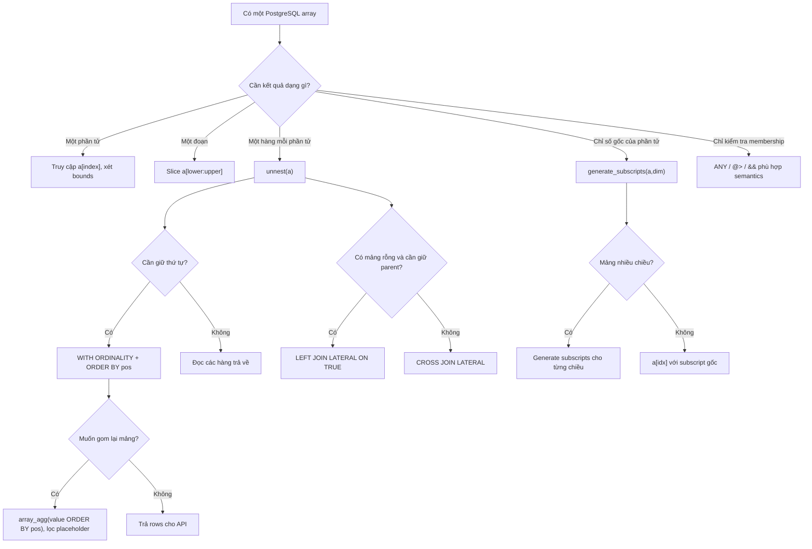

# Truy cập mảng, lát cắt, unnest và WITH ORDINALITY trong PostgreSQL

PostgreSQL có **kiểu mảng SQL** (*array type*) cho phép lưu nhiều giá trị cùng kiểu trong một cột hoặc một biểu thức. Mảng hữu ích khi một hàng cần giữ một tập giá trị có cấu trúc tương đối nhỏ: các nhãn, tọa độ, điểm số, danh sách lựa chọn hoặc kết quả xử lý trung gian. Nhưng việc đọc phần tử, lấy lát cắt, biến mảng thành nhiều hàng và theo dõi thứ tự phải được hiểu chính xác.

Ví dụ:

```sql
SELECT
    ARRAY['java', 'postgresql', 'sql']::text[] AS topics;
```

Mảng SQL của PostgreSQL khác **JSON array**: thông thường phần tử đầu của mảng SQL ở vị trí **1**, trong khi phần tử đầu của JSON array dùng toán tử `->`/`->>` ở vị trí **0**. PostgreSQL còn cho phép một số mảng có **cận dưới khác 1**. Vì vậy không nên suy đoán index dựa vào ngôn ngữ Java hay JSON.

Bốn thao tác trọng tâm:

- **Subscript:** `arr[2]` lấy một phần tử.
- **Slice:** `arr[2:4]` lấy một đoạn có cả hai đầu mút.
- **`unnest(arr)`:** biến các phần tử mảng thành nhiều dòng của tập kết quả.
- **`WITH ORDINALITY`:** thêm cột số thứ tự dòng được sinh, bắt đầu từ 1.

Bài này thuộc chương **JSON và mảng** của module *Database Engine Relational PostgreSQL*. Ta sẽ học từ mảng một chiều đến nhiều chiều; phân biệt `NULL`, mảng rỗng và phần tử NULL; phối hợp `LATERAL`, `generate_subscripts` và `array_agg`; cuối cùng áp dụng vào SELECT, JOIN, API JDBC và tối ưu truy vấn.

> Các lệnh tạo bảng và sửa dữ liệu được thiết kế cho database lab. Không chạy trực tiếp trên production nếu chưa xác minh dữ liệu và quyền thao tác.

## 1. Sau bài học, bạn làm được gì?

1. Khai báo mảng một chiều và hai chiều bằng `ARRAY[...]` hoặc literal có ép kiểu.
2. Truy cập phần tử theo chỉ số và nhận biết `NULL` khi truy cập vượt phạm vi.
3. Lấy lát cắt bằng `[lower:upper]` và hiểu đầu mút **bao gồm**.
4. Sử dụng `array_lower`, `array_upper`, `array_length`, `cardinality` và `array_dims` để đọc giới hạn thực.
5. Hiểu vì sao mảng có thể có lower bound bằng 0 hoặc số âm.
6. Phân biệt mảng SQL `NULL`, mảng rỗng `{}` và mảng chứa phần tử `NULL`.
7. Dùng `unnest` trong `FROM` để đưa dữ liệu mảng về dạng hàng.
8. Dùng `WITH ORDINALITY` để giữ trình tự phát ra từ một set-returning function.
9. Không nhầm **ordinality** với **array subscript**.
10. Dùng `generate_subscripts` khi cần chỉ số gốc của mảng.
11. Giữ cả hàng có mảng rỗng bằng `LEFT JOIN LATERAL`.
12. Nối nhiều mảng song song bằng dạng nhiều đối số của `unnest` và hiểu NULL padding.
13. Khôi phục mảng có thứ tự bằng `array_agg(... ORDER BY ...)`.
14. Xử lý mảng từ Java/JDBC, dữ liệu JSON và những truy vấn nên chuẩn hóa thành bảng quan hệ.

## 2. Mảng SQL có cấu trúc như thế nào?

Một mảng chứa các phần tử cùng kiểu cơ sở:

```sql
SELECT
    ARRAY[10, 20, 30]             AS integer_array,
    ARRAY['An', 'Bình', 'Chi']      AS text_array,
    ARRAY[TRUE, FALSE, TRUE]      AS boolean_array;
```

PostgreSQL thường suy ra kiểu mảng từ kiểu phần tử. Trong các ví dụ ứng dụng và prepared statements, nên **ép kiểu rõ** khi mảng rỗng hoặc kiểu phần tử có thể nhập nhằng.

```sql
SELECT
    ARRAY[10, 20, 30]::integer[] AS scores,
    ARRAY['red', 'blue']::text[] AS labels,
    ARRAY[]::integer[] AS no_scores;
```

### 2.1. Hai cách biểu diễn thường gặp

Cách dùng constructor:

```sql
SELECT ARRAY[1, 2, 3]::integer[];
```

Cách dùng array literal:

```sql
SELECT '{1,2,3}'::integer[];
```

**Đừng nhầm literal `'{1,2,3}'` với JSON**. Một JSON array thường viết `'[1,2,3]'::jsonb`, có kiểu và quy tắc truy cập khác.

### 2.2. Mảng là một giá trị của một cột

```sql
CREATE TABLE demo_array.example (
    id BIGINT PRIMARY KEY,
    scores INTEGER[] NOT NULL
);
```

Một hàng có thể mang cả mảng `{10,20,30}`. Điều này không tạo ra ba hàng con; đó vẫn là **một giá trị SQL array**.

Nếu hệ thống cần một foreign key, trạng thái, audit hoặc quyền trên **từng phần tử**, việc đặt tất cả trong một array có thể không phải mô hình tốt nhất.

## 3. Tạo schema thực hành

Toàn bộ ví dụ tiếp theo dùng schema `demo_array`. Chạy trên database lab mà bạn được phép tạo bảng.

```sql
CREATE SCHEMA IF NOT EXISTS demo_array;

CREATE TABLE demo_array.team (
    team_id BIGINT GENERATED ALWAYS AS IDENTITY PRIMARY KEY,
    team_name TEXT NOT NULL UNIQUE,
    members TEXT[] NOT NULL DEFAULT '{}'::text[],
    scores INTEGER[] NOT NULL DEFAULT '{}'::integer[],
    metadata JSONB NOT NULL DEFAULT '{}'::jsonb
);
```

Chèn dữ liệu:

```sql
INSERT INTO demo_array.team
    (team_name, members, scores, metadata)
VALUES
    (
        'Alpha',
        ARRAY['An', 'Bình', 'Chi'],
        ARRAY[5, 0, 7],
        '{"source":"internal","labels":["java","sql"]}'::jsonb
    ),
    (
        'Beta',
        ARRAY['Dũng', NULL, 'Em']::text[],
        ARRAY[2, NULL, 10]::integer[],
        '{"source":"external","labels":[]}'::jsonb
    ),
    (
        'Gamma',
        '{}'::text[],
        '{}'::integer[],
        '{"source":"internal","labels":["postgresql"]}'::jsonb
    );

ANALYZE demo_array.team;
```

Ta có ba trường hợp:

| Team | members | scores | Ý nghĩa |
|---|---|---|---|
| Alpha | `{An,Bình,Chi}` | `{5,0,7}` | Các phần tử đều khác NULL |
| Beta | `{Dũng,NULL,Em}` | `{2,NULL,10}` | Có phần tử NULL ở vị trí 2 |
| Gamma | `{}` | `{}` | Mảng rỗng |

Cột mảng đã khai báo `NOT NULL` nên cả `members` và `scores` **không thể là NULL array**, nhưng vẫn có thể là **mảng chứa phần tử NULL**. Đây là hai loại NULL khác nhau.

### 3.1. Kiểm tra dữ liệu

```sql
SELECT team_id, team_name, members, scores
FROM demo_array.team
ORDER BY team_id;
```

Nếu chạy lại INSERT trên schema đã có ba team, unique constraint `team_name` sẽ báo trùng. Các phần thực hành bên dưới giả định bạn chạy setup **một lần**.

## 4. Chỉ số thông thường bắt đầu từ 1

Với mảng constructor thông dụng:

```sql
WITH sample AS (
    SELECT ARRAY[10, 20, 30, 40] AS a
)
SELECT
    a[1] AS first_element,
    a[2] AS second_element,
    a[4] AS last_element
FROM sample;
```

Kết quả logic:

| first_element | second_element | last_element |
|---:|---:|---:|
| 10 | 20 | 40 |

Khác với Java `int[]`, JavaScript array và JSON arrays có chỉ số bắt đầu từ 0, array SQL tạo thông thường của PostgreSQL bắt đầu từ **1**.

### 4.1. Truy cập cột mảng

```sql
SELECT
    team_name,
    members[1] AS first_member,
    scores[2] AS second_score
FROM demo_array.team
ORDER BY team_id;
```

Ý nghĩa:

- Alpha: `members[1] = 'An'`, `scores[2] = 0`.
- Beta: `members[1] = 'Dũng'`, `scores[2] IS NULL`.
- Gamma: mảng rỗng nên `members[1]` và `scores[2]` cho NULL.

### 4.2. Truy cập chỉ số ngoài phạm vi

```sql
WITH sample AS (
    SELECT ARRAY[10, 20, 30] AS a
)
SELECT
    a[0] AS before_first,
    a[99] AS after_last,
    a[-1] AS negative_index
FROM sample;
```

Với mảng này, các biểu thức trên trả **SQL NULL** thay vì “phần tử cuối” như cú pháp chỉ số âm ở một số ngôn ngữ lập trình.

Đừng dùng `a[-1]` để lấy phần tử cuối trừ khi mảng **thực sự** có lower bound chứa -1.

## 5. NULL do vượt phạm vi và phần tử NULL không giống nhau

Xét:

```sql
WITH sample AS (
    SELECT ARRAY[7, NULL, 9]::integer[] AS a
)
SELECT
    a[2] AS actual_null_element,
    a[99] AS out_of_range,
    a[3] AS value_9
FROM sample;
```

Cả `a[2]` và `a[99]` đều có thể trả NULL, nhưng:

- `a[2]` là **phần tử tồn tại** với giá trị NULL.
- `a[99]` là **vị trí không tồn tại** trong mảng.

Nếu nghiệp vụ cần phân biệt hai trường hợp, phải kiểm tra **bounds**:

```sql
WITH sample AS (
    SELECT ARRAY[7, NULL, 9]::integer[] AS a
)
SELECT
    2 BETWEEN array_lower(a, 1) AND array_upper(a, 1)
        AS index_2_exists,
    99 BETWEEN array_lower(a, 1) AND array_upper(a, 1)
        AS index_99_exists,
    a[2] IS NULL AS element_2_is_null
FROM sample;
```

Một mảng một chiều thông thường có chỉ số liên tục trong khoảng bounds. Vì vậy có thể biết vị trí tồn tại mặc dù giá trị ở vị trí đó là NULL.

## 6. Đọc độ dài mảng bằng array_length

```sql
SELECT
    team_name,
    array_length(members, 1) AS members_length,
    array_length(scores, 1) AS scores_length
FROM demo_array.team
ORDER BY team_id;
```

Tham số thứ hai là **chiều** cần đo:

- `array_length(a, 1)`: số phần tử theo chiều thứ nhất.
- `array_length(a, 2)`: số phần tử theo chiều thứ hai nếu có.
- Một mảng một chiều không có chiều 2.

### 6.1. Với mảng rỗng, array_length có thể là NULL

```sql
SELECT
    array_length('{}'::integer[], 1) AS empty_length,
    array_length(ARRAY[NULL::integer], 1) AS one_null_length;
```

Kết quả quan trọng:

- `array_length('{}'::integer[], 1)` là **NULL**, không phải 0.
- Mảng chứa một phần tử NULL vẫn có độ dài là **1**.

Đây là lý do không nên viết một biểu thức so sánh:

```sql
-- Có thể không hoạt động như mong muốn với mảng rỗng:
WHERE array_length(members, 1) = 0
```

Với mảng rỗng, `NULL = 0` có kết quả UNKNOWN nên không được điều kiện WHERE giữ lại.

## 7. cardinality: số phần tử toàn bộ mảng

`cardinality(a)` trả tổng số phần tử, bao gồm các vị trí mang giá trị NULL.

```sql
SELECT
    team_name,
    cardinality(members) AS member_slots,
    cardinality(scores) AS score_slots
FROM demo_array.team
ORDER BY team_id;
```

Với dữ liệu lab:

| Team | cardinality(members) |
|---|---:|
| Alpha | 3 |
| Beta | 3 |
| Gamma | 0 |

### 7.1. cardinality khác array_length khi có nhiều chiều

Với mảng 2 × 3:

```sql
WITH sample AS (
    SELECT ARRAY[[1, 2, 3], [4, 5, 6]] AS m
)
SELECT
    array_length(m, 1) AS row_count,
    array_length(m, 2) AS column_count,
    cardinality(m) AS total_slots
FROM sample;
```

Kết quả:

```text
row_count = 2
column_count = 3
total_slots = 6
```

Nếu bạn cần biết toàn bộ số vị trí, `cardinality` thường dễ đọc hơn. Nó **tính cả NULL elements**; nó không đếm số giá trị khác NULL.

### 7.2. NULL array vẫn khác empty array

```sql
SELECT
    cardinality(NULL::integer[]) AS null_array_count,
    cardinality('{}'::integer[]) AS empty_array_count,
    cardinality(ARRAY[NULL::integer]) AS one_null_slot;
```

Kết quả tương ứng: **NULL, 0, 1**.

## 8. Mảng có lower bound và upper bound

PostgreSQL cho phép cận dưới của một mảng không nhất thiết là 1.

```sql
SELECT
    array_lower(ARRAY[10, 20, 30], 1) AS lower_bound,
    array_upper(ARRAY[10, 20, 30], 1) AS upper_bound;
```

Thông thường: lower = 1, upper = 3.

Nhưng bạn cũng có thể tạo:

```sql
SELECT '[0:2]={10,20,30}'::integer[] AS zero_based_array;
```

Mảng này có:

```text
Subscript:  0   1   2
Value:     10  20  30
```

Đọc đúng chỉ số:

```sql
WITH sample AS (
    SELECT '[0:2]={10,20,30}'::integer[] AS a
)
SELECT
    array_lower(a, 1) AS actual_lower,
    array_upper(a, 1) AS actual_upper,
    a[0] AS first_value,
    a[1] AS second_value,
    a[2] AS third_value
FROM sample;
```

### 8.1. Cận dưới âm cũng có thể tồn tại

```sql
WITH sample AS (
    SELECT '[-2:0]={5,6,7}'::integer[] AS a
)
SELECT
    array_dims(a) AS dimension_text,
    a[-2] AS first_value,
    a[0] AS last_value
FROM sample;
```

Không suy đoán “chỉ số âm luôn bất hợp lệ”. Nó chỉ ngoài phạm vi ở mảng có bounds không chứa giá trị âm đó.

### 8.2. array_dims hiển thị giới hạn từng chiều

```sql
SELECT
    array_dims('[0:2]={10,20,30}'::integer[]) AS dims_1d,
    array_dims(ARRAY[[1,2,3],[4,5,6]]) AS dims_2d;
```

Kết quả minh họa:

```text
dims_1d = [0:2]
dims_2d = [1:2][1:3]
```

`array_dims` trả một biểu diễn dạng text của các bounds. Khi viết SQL dùng vị trí, `array_lower`/`array_upper` và `generate_subscripts` thường linh hoạt hơn việc tự parse chuỗi dims.

## 9. Phân biệt giá trị phần tử và vị trí phần tử

Đây là ví dụ rất dễ nhầm:

```sql
SELECT
    ARRAY[NULL::integer, 0, 3] AS a;
```

- Giá trị **NULL** ở subscript 1.
- Giá trị **0** ở subscript 2.
- Giá trị **3** ở subscript 3.
- Không có phần tử ở subscript 4.

`NULL` không đồng nghĩa 0. Khi hiển thị kết quả mảng ra ứng dụng, cần giữ thông tin độ dài và thứ tự thay vì dùng `WHERE value IS NOT NULL` một cách vô thức rồi đánh số lại.

## 10. Lát cắt mảng: cú pháp [lower:upper]

Với mảng:

```text
Subscript:  1    2    3    4    5
Value:     10   20   30   40   50
```

`a[2:4]` lấy các vị trí **2, 3 và 4**:

```sql
WITH sample AS (
    SELECT ARRAY[10, 20, 30, 40, 50] AS a
)
SELECT
    a[2:4] AS middle_three,
    a[1:2] AS first_two,
    a[4:5] AS last_two
FROM sample;
```

Kết quả logic:

```text
middle_three = {20,30,40}
first_two    = {10,20}
last_two     = {40,50}
```

Hai đầu mút đều **inclusive**. Độ dài đoạn hợp lệ khi lower ≤ upper và nằm trong bounds thường là `upper - lower + 1`.

### 10.1. Khác cú pháp slicing của Python/Java

Python thường dùng `a[1:3]` để lấy vị trí 1 và 2, nhưng **không lấy 3**. PostgreSQL slice `a[1:3]` lấy cả vị trí 3.

Đừng chuyển chỉ số client sang SQL mà không xét sự khác biệt về:

- Điểm bắt đầu 0 hay 1.
- Đầu trên bao gồm hay loại trừ.
- Bound thực của mảng.
- Dữ liệu NULL và mảng nhiều chiều.

## 11. Slice ngoài bounds

Ví dụ:

```sql
WITH sample AS (
    SELECT ARRAY[10, 20, 30] AS a
)
SELECT
    a[2:99] AS requested_past_end,
    a[10:20] AS entirely_outside
FROM sample;
```

Một slice có thể chỉ trả phần giao với những phần tử có thật; nếu khoảng không chứa phần tử hợp lệ, nó có thể trả một **mảng rỗng**, khác với việc truy cập `a[99]` trả **NULL**.

Hãy quan sát thực tế bằng:

```sql
WITH sample AS (
    SELECT ARRAY[10, 20, 30] AS a
)
SELECT
    cardinality(a[2:99]) AS kept_slots,
    cardinality(a[10:20]) AS empty_slots
FROM sample;
```

Không dùng slice vượt bounds như một phép kiểm tra giá trị ở index cụ thể; khi cần kiểm tra tồn tại, dùng `array_lower`/`array_upper` hoặc `generate_subscripts`.

### 11.1. Slice đảo chiều không tự đảo dữ liệu

`a[4:2]` **không** phải cách đảo ngược thứ tự phần tử. Nếu lower > upper, nó không tạo một reverse slice giống một số ngôn ngữ. Muốn đảo phần tử, dùng `generate_subscripts(a,1,true)` rồi `array_agg` có `ORDER BY`.

## 12. Slice có giữ NULL elements không?

Có. Slice trả những vị trí trong đoạn, bao gồm phần tử mang SQL NULL.

```sql
WITH sample AS (
    SELECT ARRAY[10, NULL, 30, 40]::integer[] AS a
)
SELECT
    a[1:3] AS first_three,
    cardinality(a[1:3]) AS number_of_slots
FROM sample;
```

Lát cắt đầu có ba slots, trong đó slot thứ hai là NULL. Không nên xóa NULL phần tử trừ khi business rule yêu cầu bỏ.

## 13. Lát cắt không phải phép phân trang quan hệ

`arr[101:120]` có thể lấy một đoạn từ **một giá trị mảng đã có sẵn**, khác với:

```sql
SELECT ...
FROM some_table
ORDER BY ...
LIMIT 20 OFFSET 100;
```

Trong SQL quan hệ, thứ tự hàng chỉ được định nghĩa khi có `ORDER BY`. Còn một array là giá trị **có thứ tự phần tử**. Trộn hai khái niệm có thể tạo bug khi `array_agg` không chỉ định order.

### 13.1. Không ép tất cả bản ghi thành một mảng lớn chỉ để phân trang

Tạo `array_agg` của hàng triệu giá trị rồi cắt `[100001:100020]` có thể tốn bộ nhớ/CPU hơn truy vấn với index/keyset trên bảng nguồn. Lát cắt phù hợp khi **array đã tồn tại và kích thước hợp lý**, không phải phương án mặc định cho deep pagination.

## 14. Mảng hai chiều và chỉ số kép

PostgreSQL hỗ trợ mảng nhiều chiều, ví dụ ma trận:

```sql
SELECT ARRAY[
    [1, 2, 3],
    [4, 5, 6]
]::integer[][] AS matrix;
```

Khi biểu diễn theo hai chiều:

```text
       column 1   column 2   column 3
row 1      1          2          3
row 2      4          5          6
```

Truy cập phần tử:

```sql
WITH sample AS (
    SELECT ARRAY[[1,2,3],[4,5,6]] AS m
)
SELECT
    m[1][1] AS upper_left,
    m[1][3] AS upper_right,
    m[2][2] AS lower_middle,
    m[2][3] AS lower_right
FROM sample;
```

Kết quả: 1, 3, 5, 6.

### 14.1. Độ dài từng chiều

```sql
WITH sample AS (
    SELECT ARRAY[[1,2,3],[4,5,6]] AS m
)
SELECT
    array_ndims(m) AS dimensions,
    array_length(m, 1) AS rows_count,
    array_length(m, 2) AS columns_count,
    cardinality(m) AS total_elements,
    array_dims(m) AS bounds
FROM sample;
```

Với ma trận này:

```text
dimensions     = 2
rows_count     = 2
columns_count  = 3
total_elements = 6
bounds         = [1:2][1:3]
```

### 14.2. Mảng nhiều chiều cần cấu trúc chữ nhật

Constructor dạng:

```sql
-- CỐ TÌNH GÂY LỖI: subarrays không cùng kích thước.
SELECT ARRAY[[1,2],[3,4,5]];
```

PostgreSQL không coi đây là một array SQL hai chiều hợp lệ chỉ vì JSON cho phép nested arrays khác độ dài. Với cấu trúc ragged, JSONB hoặc bảng quan hệ có thể phù hợp hơn.

## 15. Lát cắt trên mảng hai chiều

Dùng `[lower_row:upper_row][lower_col:upper_col]`:

```sql
WITH sample AS (
    SELECT ARRAY[[1,2,3],[4,5,6]] AS m
)
SELECT
    m[1:2][2:3] AS last_two_columns,
    m[2:2][1:3] AS second_row_as_slice
FROM sample;
```

Ý nghĩa của lát cắt đầu:

```text
{{2,3},{5,6}}
```

Nó vẫn là **mảng hai chiều**; không tự trở thành mảng một chiều chỉ vì một trong các slice chọn một hàng.

### 15.1. Khi dùng slice đa chiều, viết bounds của mọi chiều rõ ràng

Để dễ đọc và tránh nhầm cách diễn giải subscript/slice hỗn hợp, ưu tiên:

```sql
m[2:2][1:3]
```

thay vì cố mô phỏng cú pháp `m[2][1:3]` của ngôn ngữ khác. Nếu chỉ cần phần tử vô hướng, dùng `m[2][3]`.

## 16. Mảng SQL không phải “mảng của mảng” tùy ý

Các khai báo `integer[]`, `integer[][]` giúp diễn đạt ý định, nhưng số chiều/dimensions thực tế của mảng được PostgreSQL theo dõi trong giá trị mảng. Trong nhiều ngữ cảnh, kích thước/number of dimensions ở type declaration không phải một ràng buộc nghiêm ngặt như kiểu ma trận cố định trong một số ngôn ngữ.

Khi business logic **bắt buộc 2 × 3** hoặc có đúng N phần tử, cần constraint/thao tác kiểm tra riêng phù hợp:

```sql
CREATE TABLE demo_array.fixed_matrix (
    matrix_id BIGINT GENERATED ALWAYS AS IDENTITY PRIMARY KEY,
    values_2x3 INTEGER[] NOT NULL,
    CONSTRAINT ck_matrix_size CHECK (
        array_ndims(values_2x3) = 2
        AND array_length(values_2x3, 1) = 2
        AND array_length(values_2x3, 2) = 3
    )
);
```

Ví dụ này yêu cầu hai chiều có kích thước mong muốn; nếu cần cấm mọi NULL element, cần thêm chính sách validation khác.

## 17. unnest biến mảng thành nhiều hàng

`unnest` là **set-returning function** (*SRF*): nó phát mỗi phần tử của mảng thành một hàng.

```sql
SELECT element
FROM unnest(ARRAY[10, 20, 30]) AS u(element);
```

Kết quả:

| element |
|---:|
| 10 |
| 20 |
| 30 |

Mỗi phần tử trở thành một row. Khác `arr[2]` (trả scalar) hoặc `arr[1:2]` (trả array), `unnest(arr)` trả một **relation-like stream of rows**.

### 17.1. Alias giúp code SQL dễ hiểu

```sql
SELECT u.member
FROM unnest(ARRAY['An','Bình','Chi']) AS u(member);
```

Trong `AS u(member)`:

- `u` là alias cho table-function result.
- `member` là tên cột chứa giá trị phần tử.

Không đặt tên alias trùng cột từ bảng khác khi query có JOIN lớn; ưu tiên alias rõ ngữ nghĩa.

## 18. unnest với NULL element

```sql
SELECT u.value
FROM unnest(ARRAY[10, NULL, 30]::integer[]) AS u(value);
```

Kết quả vẫn có **ba hàng**, trong đó hàng thứ hai có giá trị NULL.

Nếu thêm:

```sql
SELECT u.value
FROM unnest(ARRAY[10, NULL, 30]::integer[]) AS u(value)
WHERE u.value IS NOT NULL;
```

thì chỉ còn hai hàng. Đó là quyết định **lọc dữ liệu của query**, không phải hành vi mặc định của `unnest`.

### 18.1. Mảng rỗng tạo không hàng

```sql
SELECT u.value
FROM unnest('{}'::integer[]) AS u(value);
```

Query trả **0 hàng**.

### 18.2. NULL array cũng không tạo hàng

```sql
SELECT u.value
FROM unnest(NULL::integer[]) AS u(value);
```

Query cũng trả **0 hàng**. Nhưng `NULL::integer[]` không đồng nghĩa `'{}'::integer[]` ở mức giá trị SQL; hãy kiểm tra loại nào xuất hiện trước khi flatten.

## 19. unnest mảng của từng hàng bằng LATERAL

Áp dụng vào bảng `team`:

```sql
SELECT
    t.team_id,
    t.team_name,
    u.member
FROM demo_array.team AS t
CROSS JOIN LATERAL unnest(t.members) AS u(member)
ORDER BY t.team_id;
```

Ý nghĩa: với **mỗi hàng t**, chạy `unnest(t.members)` và kết hợp những hàng được phát ra.

### 19.1. Vì sao LATERAL?

`LATERAL` cho phép một mục trong `FROM` phụ thuộc vào giá trị của mục đứng trước. Ở đây `unnest(t.members)` dùng cột `t.members` của hàng hiện tại.

Đối với table functions trong `FROM`, PostgreSQL cho phép tham chiếu cột phía trước mà không luôn phải viết keyword `LATERAL`, nhưng dùng `CROSS JOIN LATERAL` là cách trình bày rõ ràng.

### 19.2. Hàng có mảng rỗng biến mất trong CROSS JOIN

Team Gamma có `members='{}'`, nên `unnest` phát 0 hàng. `CROSS JOIN LATERAL` không giữ Gamma trong kết quả.

Đây là hệ quả của **JOIN cardinality**. Nếu bạn cần giữ mọi team, đổi sang `LEFT JOIN LATERAL`.

## 20. LEFT JOIN LATERAL giữ hàng có mảng rỗng

```sql
SELECT
    t.team_id,
    t.team_name,
    u.member
FROM demo_array.team AS t
LEFT JOIN LATERAL unnest(t.members) AS u(member)
    ON TRUE
ORDER BY t.team_id;
```

Với Gamma, sẽ có một row kết quả có `u.member IS NULL` do **outer join padding**, dù mảng nguồn không có phần tử.

### 20.1. Phân biệt ba loại hàng NULL khi LEFT JOIN

Một hàng kết quả có `member=NULL` có thể đến từ:

1. **Phần tử NULL có thật**, như vị trí 2 của Beta.
2. **Mảng rỗng**, LEFT JOIN tạo một hàng placeholder.
3. **NULL array**, LEFT JOIN cũng tạo placeholder nếu cột nullable.

Muốn phân biệt, thêm `WITH ORDINALITY` và xem số thứ tự:

```sql
SELECT
    t.team_name,
    u.member,
    u.ordinality
FROM demo_array.team AS t
LEFT JOIN LATERAL unnest(t.members)
    WITH ORDINALITY AS u(member, ordinality)
    ON TRUE
ORDER BY t.team_id, u.ordinality;
```

- Beta, phần tử NULL thật: `u.ordinality = 2`.
- Gamma, hàng placeholder của LEFT JOIN: `u.ordinality IS NULL`.

Đây là kỹ thuật quan trọng khi muốn dựng lại array mà không đưa một NULL giả vào kết quả.

## 21. WITH ORDINALITY là gì?

`WITH ORDINALITY` thêm một cột số nguyên dạng `bigint` để đánh số **các hàng mà set-returning function phát ra**, bắt đầu từ 1:

```sql
SELECT
    u.value,
    u.position
FROM unnest(ARRAY['A', 'B', 'C'])
    WITH ORDINALITY AS u(value, position);
```

Kết quả:

| value | position |
|---|---:|
| A | 1 |
| B | 2 |
| C | 3 |

### 21.1. WITH ORDINALITY dùng được ở FROM

Mẫu tổng quát:

```sql
FROM unnest(array_expression)
WITH ORDINALITY AS alias(value_column, ordinal_column)
```

Không viết `WITH ORDINALITY` như một toán tử trên cột scalar đơn lẻ. Nó bổ sung cột thứ tự cho kết quả của table function trong `FROM`.

### 21.2. Ordinality không phải ROW_NUMBER() của toàn query

`WITH ORDINALITY` đánh số **thứ tự hàng do function phát ra**. Khi nó được gọi LATERAL theo từng hàng t của bảng cha, dãy số bắt đầu lại cho mỗi lần gọi hàm:

```sql
SELECT
    t.team_name,
    u.member,
    u.pos
FROM demo_array.team AS t
CROSS JOIN LATERAL unnest(t.members)
    WITH ORDINALITY AS u(member, pos)
ORDER BY t.team_id, u.pos;
```

Alpha có pos 1,2,3; Beta cũng có pos 1,2,3. `WITH ORDINALITY` không tạo một counter duy nhất xuyên tất cả teams.

## 22. Ordinality khác array subscript

Đây là điểm dễ gây bug nhất khi làm việc với các lower bounds tùy chỉnh.

```sql
WITH sample AS (
    SELECT '[0:2]={10,20,30}'::integer[] AS a
)
SELECT
    u.value,
    u.pos
FROM sample AS s
CROSS JOIN LATERAL unnest(s.a)
    WITH ORDINALITY AS u(value, pos);
```

Kết quả:

| value | pos |
|---:|---:|
| 10 | 1 |
| 20 | 2 |
| 30 | 3 |

Nhưng **subscript thật** của các giá trị trên là **0, 1, 2**.

`WITH ORDINALITY` đánh số dòng phát ra từ 1, **không giữ nguyên chỉ số gốc** của array.

### 22.1. Tính subscript thật cho mảng một chiều

Với một mảng 1D, thứ tự các phần tử liên tục từ cận dưới:

\[
\text{subscript} =
\text{array\_lower}(a,1) + \text{ordinality} - 1
\]

SQL:

```sql
WITH sample AS (
    SELECT '[0:2]={10,20,30}'::integer[] AS a
)
SELECT
    u.value,
    u.pos,
    array_lower(s.a, 1) + u.pos - 1
        AS original_subscript
FROM sample AS s
CROSS JOIN LATERAL unnest(s.a)
    WITH ORDINALITY AS u(value, pos);
```

Kết quả:

```text
value   pos   original_subscript
10      1     0
20      2     1
30      3     2
```

Đây là cách đúng với 1D. Với nhiều chiều, không dùng công thức cộng đơn giản cho một index duy nhất; cần `generate_subscripts` theo từng chiều.

## 23. generate_subscripts lấy chỉ số gốc

`generate_subscripts(array, dimension)` trả một tập **subscripts hợp lệ** cho chiều đã chọn.

```sql
WITH sample AS (
    SELECT '[0:2]={10,20,30}'::integer[] AS a
)
SELECT
    s.idx,
    x.a[s.idx] AS value
FROM sample AS x
CROSS JOIN LATERAL generate_subscripts(x.a, 1) AS s(idx)
ORDER BY s.idx;
```

Kết quả:

| idx | value |
|---:|---:|
| 0 | 10 |
| 1 | 20 |
| 2 | 30 |

`generate_subscripts` hữu ích khi:

- Array lower bound không mặc định bằng 1.
- Cần gắn nhãn theo **index vật lý/logical gốc**.
- Cần lấy phần tử và vị trí cùng lúc.
- Cần đi qua từng chiều của mảng nhiều chiều.
- Cần duyệt chỉ số theo thứ tự ngược.

### 23.1. Tham số chiều

```sql
SELECT s.idx
FROM generate_subscripts(
    ARRAY[10,20,30],
    1
) AS s(idx);
```

Chiều 1 tồn tại và có ba subscript. Nếu yêu cầu dimension không có, function không phát ra index như thể đó là một chiều giả.

### 23.2. Đếm slot bằng subscripts

```sql
WITH sample AS (
    SELECT ARRAY[10, NULL, 30]::integer[] AS a
)
SELECT COUNT(*) AS slots
FROM sample AS x
CROSS JOIN LATERAL generate_subscripts(x.a, 1) AS s(idx);
```

Trả 3; phần tử NULL vẫn có subscript hợp lệ.

## 24. Duyệt mảng theo chiều ngược

`generate_subscripts` nhận đối số thứ ba kiểu boolean để đảo thứ tự subscripts:

```sql
WITH sample AS (
    SELECT ARRAY['A','B','C']::text[] AS a
)
SELECT
    s.idx,
    x.a[s.idx] AS value
FROM sample AS x
CROSS JOIN LATERAL generate_subscripts(x.a, 1, TRUE) AS s(idx);
```

Hàng phát theo chỉ số 3, 2, 1.

Nếu cần bảo đảm thứ tự ở **kết quả SQL cuối**, thêm `ORDER BY s.idx DESC`:

```sql
WITH sample AS (
    SELECT ARRAY['A','B','C']::text[] AS a
)
SELECT x.a[s.idx] AS value
FROM sample AS x
CROSS JOIN LATERAL generate_subscripts(x.a, 1) AS s(idx)
ORDER BY s.idx DESC;
```

Một set-returning function có thể phát giá trị theo trật tự nhất định, nhưng kết quả relation cuối chỉ được **bảo đảm thứ tự khi viết ORDER BY**. Đặc biệt quan trọng khi JOIN/GROUP có thể thay đổi đường thực thi.

## 25. unnest mảng hai chiều: flatten theo thứ tự lưu trữ

`unnest` với mảng nhiều chiều tạo **một dòng cho mỗi phần tử vô hướng**, duyệt theo thứ tự lưu trữ (*row-major*, chỉ số chiều cuối thay đổi nhanh nhất).

```sql
SELECT
    u.value,
    u.pos
FROM unnest(ARRAY[[1,2,3],[4,5,6]])
    WITH ORDINALITY AS u(value, pos);
```

Kết quả:

| value | pos |
|---:|---:|
| 1 | 1 |
| 2 | 2 |
| 3 | 3 |
| 4 | 4 |
| 5 | 5 |
| 6 | 6 |

Mảng ban đầu có cấu trúc 2 × 3, nhưng output từ unnest là sáu rows. **Thông tin vị trí hàng/cột không có sẵn** nếu chỉ giữ `value` và `pos`.

### 25.1. Không suy ra hai chỉ số chỉ từ ordinality tùy tiện

Bạn có thể tính row/column bằng chia nguyên/modulo khi biết chính xác kích thước/bounds của ma trận hình chữ nhật. Nhưng nếu số chiều thay đổi, lower bounds khác 1 hoặc có slice, công thức hard-code sẽ rất dễ sai.

Ưu tiên `generate_subscripts` cho cách lấy cặp chỉ số trực tiếp.

## 26. generate_subscripts cho mảng hai chiều

```sql
WITH sample AS (
    SELECT ARRAY[[1,2,3],[4,5,6]] AS m
)
SELECT
    r.row_idx,
    c.col_idx,
    s.m[r.row_idx][c.col_idx] AS cell_value
FROM sample AS s
CROSS JOIN LATERAL generate_subscripts(s.m, 1) AS r(row_idx)
CROSS JOIN LATERAL generate_subscripts(s.m, 2) AS c(col_idx)
ORDER BY r.row_idx, c.col_idx;
```

Kết quả:

```text
row_idx col_idx cell_value
1       1       1
1       2       2
1       3       3
2       1       4
2       2       5
2       3       6
```

Đây là cách rõ ràng để biến ma trận thành quan hệ `(row_index, column_index, value)`.

### 26.1. Dùng khi cần lưu tọa độ đầy đủ

Ví dụ một ma trận điểm muốn xuất CSV có ba cột `row, col, score`; `generate_subscripts` giúp giữ nguyên tọa độ thay vì chỉ nhận một số thứ tự 1..6 từ `unnest`.

## 27. unnest nhiều mảng song song

PostgreSQL hỗ trợ truyền **nhiều array arguments** cho `unnest` khi dùng trong `FROM`:

```sql
SELECT
    u.member,
    u.score
FROM unnest(
    ARRAY['An','Bình','Chi']::text[],
    ARRAY[5,0,7]::integer[]
) AS u(member, score);
```

Kết quả:

| member | score |
|---|---:|
| An | 5 |
| Bình | 0 |
| Chi | 7 |

Các mảng được mở rộng **theo vị trí song song**, rất hữu ích khi hai arrays thể hiện hai thuộc tính của cùng danh sách vị trí.

### 27.1. Khi độ dài không bằng nhau

```sql
SELECT *
FROM unnest(
    ARRAY[10,20,30],
    ARRAY['A','B']::text[]
) AS u(number_value, label);
```

Kết quả:

| number_value | label |
|---:|---|
| 10 | A |
| 20 | B |
| 30 | NULL |

Mảng ngắn hơn được **padding NULL** để số dòng bằng chiều dài lớn nhất. Padding này có thể bị nhầm với một phần tử NULL thực sự trong mảng nguồn.

### 27.2. Dạng nhiều đối số phải dùng ở FROM

Không coi `unnest(a,b)` như một biểu thức scalar thường trong `SELECT`. Dạng nhiều arguments được PostgreSQL hỗ trợ dưới dạng table function trong `FROM`.

## 28. WITH ORDINALITY khi unnest nhiều mảng

```sql
SELECT
    u.member,
    u.score,
    u.pos
FROM unnest(
    ARRAY['An','Bình','Chi']::text[],
    ARRAY[5,0]::integer[]
)
WITH ORDINALITY AS u(member, score, pos);
```

Kết quả:

```text
member   score   pos
An       5       1
Bình     0       2
Chi      NULL    3
```

Ordinality đánh số **dòng đã ghép**, không đánh riêng từng mảng. Nếu hai mảng có độ dài lệch nhau, vị trí vẫn tiếp tục tới phần tử cuối của mảng dài hơn.

### 28.1. Vì sao padding có thể che lỗi dữ liệu?

Nếu `members` có 5 người nhưng `scores` chỉ có 4 điểm, multi-argument unnest vẫn chạy và tạo hàng score NULL.

Điều này tiện trong ETL nhưng có thể che giấu mismatch. Nếu nghiệp vụ yêu cầu hai array luôn cùng số phần tử, hãy thêm constraint:

```sql
ALTER TABLE demo_array.team
ADD CONSTRAINT ck_team_parallel_array_lengths
CHECK (cardinality(members) = cardinality(scores));
```

Trên dữ liệu lab, Alpha/Beta/Gamma đều có cùng cardinality ở hai mảng. Constraint bảo vệ **độ dài bằng nhau**, không cấm phần tử NULL.

## 29. unnest song song với một hàng cha

```sql
SELECT
    t.team_name,
    u.member,
    u.score,
    u.pos
FROM demo_array.team AS t
CROSS JOIN LATERAL unnest(t.members, t.scores)
    WITH ORDINALITY AS u(member, score, pos)
ORDER BY t.team_id, u.pos;
```

Đây là mẫu phổ biến để biến hai arrays song song thành danh sách hàng có cùng position.

### 29.1. Tránh CROSS JOIN hai unnests độc lập

Câu này thường là **sai** nếu mục tiêu ghép phần tử cùng vị trí:

```sql
SELECT
    m.member,
    s.score
FROM demo_array.team AS t
CROSS JOIN LATERAL unnest(t.members) AS m(member)
CROSS JOIN LATERAL unnest(t.scores) AS s(score)
WHERE t.team_name = 'Alpha';
```

Nếu Alpha có 3 members và 3 scores, hai `CROSS JOIN` tạo **3 × 3 = 9 cặp**, không phải 3 cặp song song.

Cách đúng: dùng `unnest(members, scores)` trong FROM hoặc mở hai tập kèm ordinality rồi JOIN theo vị trí.

## 30. JOIN hai danh sách theo ordinality

Khi không muốn dùng multi-argument unnest, có thể:

```sql
SELECT
    m.member,
    s.score,
    m.pos
FROM unnest(ARRAY['An','Bình','Chi']::text[])
    WITH ORDINALITY AS m(member, pos)
JOIN unnest(ARRAY[5,0,7]::integer[])
    WITH ORDINALITY AS s(score, pos)
    ON s.pos = m.pos
ORDER BY m.pos;
```

Chú ý: đây là **INNER JOIN** theo vị trí. Nếu độ dài khác nhau, các vị trí chỉ có ở mảng dài hơn **bị loại**, khác với multi-argument `unnest` vốn padding NULL.

### 30.1. Khi cần giữ mọi vị trí

Dùng `FULL JOIN` theo ordinality nếu muốn giữ cả hai phía, hoặc dùng trực tiếp `unnest(a,b)` với logic padding đã xác định. Chọn theo nghiệp vụ, không chỉ cú pháp ngắn.

## 31. array_agg dựng lại mảng từ nhiều hàng

`array_agg` là aggregate gom các giá trị từ nhiều rows thành một array:

```sql
SELECT array_agg(u.value ORDER BY u.pos) AS rebuilt
FROM unnest(ARRAY[10,20,30])
    WITH ORDINALITY AS u(value, pos);
```

Kết quả: `{10,20,30}`.

### 31.1. ORDER BY bên trong aggregate là quan trọng

Không dùng:

```sql
SELECT array_agg(u.value)
FROM unnest(ARRAY[10,20,30]) AS u(value);
```

rồi cho rằng thứ tự của `array_agg` **luôn được bảo đảm** theo thứ tự nguồn. Trong SQL, thứ tự input vào aggregate có thể thay đổi khi JOIN, Sort, Hash Aggregate hoặc planner tối ưu.

Nếu thứ tự có ý nghĩa, hãy viết:

```sql
array_agg(u.value ORDER BY u.pos)
```

thay vì chỉ ORDER BY ở phía ngoài query.

### 31.2. array_agg bao gồm NULL elements

```sql
SELECT array_agg(u.value ORDER BY u.pos)
FROM unnest(ARRAY[10, NULL, 30]::integer[])
    WITH ORDINALITY AS u(value, pos);
```

Kết quả chứa ba slots, trong đó slot thứ hai là NULL.

Muốn bỏ NULL elements, phải dùng filter rõ ràng và chấp nhận rằng vị trí của các phần tử còn lại sẽ thay đổi.

## 32. Rebuild mảng từ LEFT JOIN LATERAL mà không tạo NULL giả

Đây là một lỗi thực tế: với team Gamma có mảng rỗng, `LEFT JOIN LATERAL` tạo một row placeholder có `member=NULL`. Nếu dùng `array_agg(u.member)` trực tiếp, Gamma có thể nhận **`{NULL}`** thay vì `{}`.

Mẫu đúng:

```sql
SELECT
    t.team_id,
    t.team_name,
    COALESCE(
        array_agg(u.member ORDER BY u.pos)
            FILTER (WHERE u.pos IS NOT NULL),
        '{}'::text[]
    ) AS rebuilt_members
FROM demo_array.team AS t
LEFT JOIN LATERAL unnest(t.members)
    WITH ORDINALITY AS u(member, pos)
    ON TRUE
GROUP BY t.team_id, t.team_name
ORDER BY t.team_id;
```

Giải thích:

- Alpha nhận lại 3 phần tử.
- Beta nhận lại 3 phần tử, **giữ NULL thật ở vị trí 2**, vì `pos=2`.
- Gamma có row placeholder `pos=NULL` nên bị FILTER loại; `array_agg` của zero values trả NULL, rồi `COALESCE` chuyển thành mảng rỗng.

### 32.1. Tại sao không FILTER member IS NOT NULL?

```sql
FILTER (WHERE u.member IS NOT NULL)
```

sẽ xóa phần tử NULL **thật** của Beta. Nếu cần giữ cấu trúc gốc, dùng sự tồn tại của **ordinality** để phân biệt hàng thật với padding của LEFT JOIN.

## 33. NULL array khác empty array: ví dụ đầy đủ

Bảng `team` có `members NOT NULL`. Để minh họa cả NULL array, dùng CTE độc lập:

```sql
WITH sample(id, values_array) AS (
    VALUES
        (1, ARRAY['A','B']::text[]),
        (2, '{}'::text[]),
        (3, NULL::text[]),
        (4, ARRAY[NULL::text])
)
SELECT
    id,
    values_array IS NULL AS is_null_array,
    cardinality(values_array) AS slots
FROM sample
ORDER BY id;
```

Kết quả logic:

| id | is_null_array | slots |
|---:|---|---:|
| 1 | false | 2 |
| 2 | false | 0 |
| 3 | true | NULL |
| 4 | false | 1 |

### 33.1. unnest và OUTER JOIN

```sql
WITH sample(id, values_array) AS (
    VALUES
        (1, ARRAY['A','B']::text[]),
        (2, '{}'::text[]),
        (3, NULL::text[]),
        (4, ARRAY[NULL::text])
)
SELECT
    s.id,
    u.value,
    u.pos
FROM sample AS s
LEFT JOIN LATERAL unnest(s.values_array)
    WITH ORDINALITY AS u(value, pos)
    ON TRUE
ORDER BY s.id, u.pos;
```

Cách đọc:

- ID 1: hai dòng, pos 1 và 2.
- ID 2: một dòng placeholder, pos NULL.
- ID 3: một dòng placeholder, pos NULL.
- ID 4: một dòng phần tử NULL **thật**, pos 1.

Dùng đồng thời `s.values_array IS NULL` và `u.pos` nếu cần phân biệt cả ba trường hợp.

## 34. COUNT(*) sau unnest và COUNT(value) khác nhau

```sql
SELECT
    t.team_name,
    COUNT(*) AS emitted_rows,
    COUNT(u.member) AS non_null_members
FROM demo_array.team AS t
CROSS JOIN LATERAL unnest(t.members) AS u(member)
GROUP BY t.team_name
ORDER BY t.team_name;
```

Ở Beta:

- `COUNT(*)` đếm 3 dòng do `unnest` phát.
- `COUNT(u.member)` chỉ đếm 2 giá trị khác NULL.

Gamma không xuất hiện vì `CROSS JOIN LATERAL` phát 0 dòng.

### 34.1. Muốn giữ cả Gamma và đếm đúng slots

```sql
SELECT
    t.team_name,
    cardinality(t.members) AS slots,
    COUNT(u.pos) AS emitted_slots,
    COUNT(u.member) AS non_null_members
FROM demo_array.team AS t
LEFT JOIN LATERAL unnest(t.members)
    WITH ORDINALITY AS u(member, pos)
    ON TRUE
GROUP BY t.team_id, t.team_name, t.members
ORDER BY t.team_id;
```

Với Gamma:

- `slots = 0`.
- `emitted_slots = 0` vì placeholder `pos IS NULL`.
- `non_null_members = 0`.

Dùng `COUNT(*)` với LEFT JOIN ở đây sẽ cho ít nhất 1 dòng ngay cả khi array rỗng, nên **không phản ánh cardinality của array**.

## 35. Lọc phần tử bằng unnest

Ví dụ tìm các thành viên bắt đầu bằng chữ B:

```sql
SELECT
    t.team_name,
    u.member,
    u.pos
FROM demo_array.team AS t
CROSS JOIN LATERAL unnest(t.members)
    WITH ORDINALITY AS u(member, pos)
WHERE u.member LIKE 'B%'
ORDER BY t.team_id, u.pos;
```

`WHERE` áp dụng trên từng phần tử **sau khi mở mảng** trong mô hình logic của query.

### 35.1. Mất phần tử sau lọc là có chủ đích

Nếu `members` gốc là `{'An','Bình','Chi'}` và chỉ lấy member bắt đầu B, output chỉ còn Bình. Ordinality vẫn mang vị trí gốc trong **kết quả unnest**, ví dụ pos=2.

Nếu bạn sau đó dựng mảng bằng `array_agg(member ORDER BY pos)`, mảng kết quả ngắn hơn, nhưng thứ tự giữa những phần tử được giữ vẫn đúng.

### 35.2. Không tự JOIN theo vị trí sau khi đã lọc một bên

Nếu bạn lọc members trước rồi dùng `row_number()` mới để nối scores, số vị trí sẽ bị đánh lại và có thể ghép sai điểm. Dùng ordinality gốc hoặc multi-argument unnest để duy trì cùng slot.

## 36. Phân biệt WITH ORDINALITY và ROW_NUMBER()

`ROW_NUMBER()` là **window function**, hoạt động trên một tập quan hệ theo `OVER (ORDER BY ...)`; `WITH ORDINALITY` gắn số thứ tự ngay khi table function phát rows.

Ví dụ:

```sql
SELECT
    t.team_name,
    u.member,
    u.pos AS original_array_order,
    ROW_NUMBER() OVER (
        PARTITION BY t.team_id
        ORDER BY u.member NULLS LAST
    ) AS alphabetical_rank
FROM demo_array.team AS t
CROSS JOIN LATERAL unnest(t.members)
    WITH ORDINALITY AS u(member, pos)
ORDER BY t.team_id, alphabetical_rank;
```

- `pos`: thứ tự **trong array**.
- `alphabetical_rank`: thứ tự theo **tên member** trong mỗi team.

Chúng có thể khác nhau. Không dùng một hàm thay thế hàm kia chỉ vì hai cột đều có số 1,2,3 trên dataset nhỏ.

## 37. WITH ORDINALITY và ORDER BY khi JOIN phức tạp

`WITH ORDINALITY` gắn số thứ tự phát ra nhưng **không bắt buộc kết quả cuối vẫn được trình bày theo pos**.

Ví dụ:

```sql
SELECT
    t.team_name,
    u.member,
    u.pos
FROM demo_array.team AS t
CROSS JOIN LATERAL unnest(t.members)
    WITH ORDINALITY AS u(member, pos)
JOIN (
    VALUES ('Alpha'), ('Beta'), ('Gamma')
) AS allowed(team_name)
    ON allowed.team_name = t.team_name
ORDER BY t.team_name, u.pos;
```

`ORDER BY t.team_name, u.pos` mới là yêu cầu hiển thị rõ. Join planner có thể chọn plan khác, nhưng kết quả cuối vẫn phải thỏa order.

### 37.1. DISTINCT và GROUP BY có thể thay đổi thứ tự

Nếu bạn chỉ:

```sql
SELECT DISTINCT u.member
FROM demo_array.team AS t
CROSS JOIN LATERAL unnest(t.members) AS u(member);
```

thì không còn một ordinality gốc duy nhất cho mỗi tên vì tên có thể nằm ở nhiều teams/vị trí. Muốn thứ tự nhất quán, phải định nghĩa tiêu chí mới: nhỏ nhất `team_id,pos`, alphabetically hoặc thứ tự nghiệp vụ khác.

## 38. array_position và array_positions

Khi cần tìm vị trí của một giá trị trong mảng một chiều, PostgreSQL có các hàm:

- `array_position(a, value)`: vị trí xuất hiện đầu tiên.
- `array_positions(a, value)`: mảng các vị trí xuất hiện.

```sql
SELECT
    array_position(ARRAY['A','B','A']::text[], 'A')
        AS first_a,
    array_positions(ARRAY['A','B','A']::text[], 'A')
        AS all_a_positions;
```

Kết quả:

```text
first_a        = 1
all_a_positions = {1,3}
```

### 38.1. Có thể tìm NULL element

`array_position`/`array_positions` dùng semantics tìm kiếm phù hợp để nhận diện cả SQL NULL element:

```sql
SELECT
    array_position(ARRAY[5,NULL,9]::integer[], NULL::integer)
        AS null_position;
```

Kết quả: 2.

Nếu hàm trả NULL vì không tìm thấy hoặc mảng nguồn NULL, cần phân biệt bằng cách đọc dữ liệu nguồn và bounds khi business rule yêu cầu.

### 38.2. Không dùng cho mảng nhiều chiều như hàm tìm tọa độ

Các hàm `array_position`/`array_positions` dành cho trường hợp một chiều. Nếu cần tọa độ của giá trị trong ma trận, dùng `generate_subscripts` ở mỗi chiều rồi lọc `m[i][j]`.

## 39. Cách tìm các phần tử NULL mà vẫn giữ vị trí

```sql
SELECT
    t.team_name,
    u.pos AS null_slot
FROM demo_array.team AS t
CROSS JOIN LATERAL unnest(t.members)
    WITH ORDINALITY AS u(member, pos)
WHERE u.member IS NULL
ORDER BY t.team_id, u.pos;
```

Kết quả: Beta có một phần tử NULL ở pos 2.

Đây là cách tiện để kiểm tra dữ liệu sau khi nhập mảng từ API. Nếu cần **subscript gốc** cho một mảng không bắt đầu ở 1, dùng `generate_subscripts` thay vì pos.

## 40. Cắt mảng sau khi lọc: hai bài toán khác nhau

Bài toán A: “Lấy các slot 2 đến 4 của mảng gốc”.

```sql
WITH sample AS (
    SELECT ARRAY['A','B','C','D','E']::text[] AS a
)
SELECT a[2:4]
FROM sample;
```

Kết quả: B,C,D.

Bài toán B: “Lọc phần tử theo điều kiện rồi lấy ba phần tử đầu tiên của danh sách đã lọc”.

```sql
WITH sample AS (
    SELECT ARRAY['A','B','C','D','E']::text[] AS a
)
SELECT array_agg(value ORDER BY pos) AS result
FROM (
    SELECT u.value, u.pos
    FROM sample AS s
    CROSS JOIN LATERAL unnest(s.a)
        WITH ORDINALITY AS u(value, pos)
    WHERE u.value >= 'B'
    ORDER BY u.pos
    LIMIT 3
) AS selected;
```

Lọc diễn ra trước LIMIT trên **quan hệ các phần tử**, nên có thể tạo kết quả khác việc slice gốc. Hãy mô tả rõ thứ tự và bộ lọc mà sản phẩm yêu cầu.

## 41. Đảo thứ tự một mảng một chiều

PostgreSQL không yêu cầu bạn viết một function procedural để đảo mảng nhỏ:

```sql
WITH sample AS (
    SELECT ARRAY['A','B','C']::text[] AS a
)
SELECT array_agg(s.a[idx] ORDER BY idx DESC) AS reversed
FROM sample AS s
CROSS JOIN LATERAL generate_subscripts(s.a, 1) AS x(idx);
```

Kết quả: `{C,B,A}`.

Đây là ví dụ dùng `generate_subscripts` và `array_agg`; với array lớn, thao tác này vẫn có chi phí mở mảng, sắp xếp/aggregate, không miễn phí.

## 42. Cập nhật một phần tử theo subscript

PostgreSQL hỗ trợ subscript assignment trong `UPDATE`:

```sql
UPDATE demo_array.team
SET scores[2] = 8
WHERE team_name = 'Alpha';
```

Giá trị thứ hai của Alpha thay từ 0 thành 8. Toàn bộ hàng vẫn chịu quy tắc MVCC/locks/constraint như một UPDATE thông thường.

### 42.1. Cập nhật một lát cắt

```sql
UPDATE demo_array.team
SET scores[1:2] = ARRAY[10, 20]
WHERE team_name = 'Alpha';
```

Lệnh cập nhật hai slot đầu. Thực hiện trên lab có thể làm các kết quả bài tập điểm số ở phần sau thay đổi.

### 42.2. Cập nhật indexed array vẫn có chi phí

Nếu cột `scores` nằm trong GIN index hoặc expression index, thay đổi mảng có thể đòi hỏi index maintenance, ghi WAL và làm giảm khả năng HOT update của bảng.

Không coi việc sửa một slot là “sửa tại chỗ 4 byte mà không động đến row version”.

## 43. Thêm và nối mảng

Một số hàm/toán tử thường dùng:

```sql
SELECT
    array_append(ARRAY[1,2], 3) AS appended,
    array_prepend(0, ARRAY[1,2]) AS prepended,
    ARRAY[1,2] || ARRAY[3,4] AS concatenated;
```

Kết quả logic:

```text
appended     = {1,2,3}
prepended    = {0,1,2}
concatenated = {1,2,3,4}
```

### 43.1. Không nhầm thêm phần tử với thêm chiều

`array_append` và toán tử `||` có quy tắc riêng về số chiều và kiểu đối số. Không ghép hai mảng 2D khác kích thước rồi kỳ vọng thành JSON-like nested lists tùy ý.

### 43.2. Kiểm tra NULL khi nối

Khi hệ thống cho phép NULL array, các hàm/toán tử có semantics cụ thể với NULL mà bạn cần thử trên phiên bản mục tiêu. Muốn yêu cầu một mảng không NULL ở tầng ứng dụng, nên dùng `NOT NULL DEFAULT '{}'::type[]` trong schema.

## 44. Phần tử khác NULL và vị trí hợp lệ

Muốn tính trung bình các điểm **khác NULL**:

```sql
SELECT
    t.team_name,
    AVG(u.score)::numeric(10,2) AS average_non_null_score
FROM demo_array.team AS t
LEFT JOIN LATERAL unnest(t.scores) AS u(score)
    ON TRUE
GROUP BY t.team_id, t.team_name
ORDER BY t.team_id;
```

`AVG` bỏ qua NULL values. Với Gamma không có score, aggregate trên giá trị NULL placeholder cho NULL, không phải 0.

Nếu business rule muốn 0 khi không có điểm, dùng `COALESCE(AVG(...),0)` một cách **có chủ đích**, không áp như quy tắc toán học mặc định.

### 44.1. Không dùng COUNT(score) làm độ dài mảng

Beta có ba slots nhưng một điểm NULL; `COUNT(score)=2`, còn `cardinality(scores)=3`. Hai chỉ số trả lời hai câu hỏi khác nhau.

## 45. Tìm team có một phần tử cụ thể

Cách một: `ANY` trên mảng:

```sql
SELECT team_id, team_name
FROM demo_array.team
WHERE 'An' = ANY(members);
```

Cách hai: array containment:

```sql
SELECT team_id, team_name
FROM demo_array.team
WHERE members @> ARRAY['An']::text[];
```

Cách ba: `EXISTS` với unnest:

```sql
SELECT t.team_id, t.team_name
FROM demo_array.team AS t
WHERE EXISTS (
    SELECT 1
    FROM unnest(t.members) AS u(member)
    WHERE u.member = 'An'
);
```

Ba dạng có thể cùng tìm đúng team trong trường hợp đơn giản, nhưng **không phải tương đương hoàn toàn** nếu xét NULL elements, multiple values, duplicates và kiểu operator. Chọn theo semantics và index access path.

## 46. GIN index cho containment/overlap của mảng

PostgreSQL thường dùng GIN index khi truy vấn các toán tử array phù hợp, như:

- `@>`: mảng bên trái chứa các phần tử yêu cầu.
- `<@`: mảng bên trái được chứa trong mảng bên phải.
- `&&`: hai mảng có phần tử chung.

```sql
CREATE INDEX idx_team_members_gin
ON demo_array.team
USING gin (members);
```

Truy vấn:

```sql
SELECT team_name
FROM demo_array.team
WHERE members @> ARRAY['An']::text[];
```

Hoặc:

```sql
SELECT team_name
FROM demo_array.team
WHERE members && ARRAY['An','Em']::text[];
```

Planner có thể dùng GIN nếu số hàng, thống kê và chi phí cho thấy lợi ích. Với ba hàng lab, Seq Scan rất có thể rẻ hơn.

### 46.1. = ANY(column_array) không đồng nghĩa một GIN index condition

`'An' = ANY(members)` là cách SQL dễ đọc cho membership, nhưng không nên giả định mọi lần PostgreSQL biến nó thành cùng index path của `members @> ARRAY['An']`.

Nếu tối ưu GIN, dùng toán tử phù hợp với opclass và kiểm tra `EXPLAIN (ANALYZE, BUFFERS)`.

### 46.2. Duplicate trong mảng

Array containment không coi số lần lặp như **multiset containment** trong mọi trường hợp. Ví dụ về membership:

```sql
SELECT ARRAY[1] @> ARRAY[1,1] AS contains_duplicate_values;
```

Giá trị true là phù hợp với semantics containment của PostgreSQL: không dùng toán tử này để chứng minh mảng phải chứa **hai bản sao độc lập** của cùng một số.

## 47. WHEN nào nên dùng unnest thay vì membership operator?

Dùng `unnest` khi bạn cần:

- Một row **cho mỗi vị trí**.
- Phần tử và thứ tự.
- JOIN với bảng lookup theo mỗi phần tử.
- Aggregate trên từng phần tử.
- Phát hiện phần tử NULL hoặc duplicates theo vị trí.
- Ghép hai arrays song song.

Dùng `ANY`/`@>`/`&&` khi bạn chỉ cần hỏi về **sự hiện diện/độ giao nhau** của các giá trị, đặc biệt khi có index phù hợp. Không flatten toàn bộ hàng triệu arrays chỉ để hỏi một boolean nếu có phép toán array trực tiếp đủ ngữ nghĩa.

## 48. JOIN mảng với bảng tra cứu

Tạo một bảng danh mục thành viên đơn giản:

```sql
CREATE TABLE demo_array.member_directory (
    member_name TEXT PRIMARY KEY,
    department TEXT NOT NULL
);

INSERT INTO demo_array.member_directory
    (member_name, department)
VALUES
    ('An','Backend'),
    ('Bình','Data'),
    ('Chi','Frontend'),
    ('Dũng','Backend'),
    ('Em','QA');
```

JOIN theo từng phần tử:

```sql
SELECT
    t.team_name,
    u.member,
    u.pos,
    d.department
FROM demo_array.team AS t
CROSS JOIN LATERAL unnest(t.members)
    WITH ORDINALITY AS u(member, pos)
LEFT JOIN demo_array.member_directory AS d
    ON d.member_name = u.member
ORDER BY t.team_id, u.pos;
```

Các phần tử không có directory match (kể cả NULL element) vẫn được giữ nhờ `LEFT JOIN` tới directory.

### 48.1. Thứ tự output phải dựa vào pos

Dù JOIN với directory có index, kết quả không được bảo đảm giữ thứ tự mảng nếu không có `ORDER BY t.team_id, u.pos`.

### 48.2. Không tạo FK cho từng array element chỉ bằng GIN

GIN index trên `members` giúp membership queries, **không tự enforce** rằng mọi tên trong mảng có trong `member_directory`. Nếu cần foreign key thật sự trên từng quan hệ team-member, dùng bảng nối:

```sql
CREATE TABLE demo_array.team_member (
    team_id BIGINT NOT NULL
        REFERENCES demo_array.team(team_id),
    member_name TEXT NOT NULL
        REFERENCES demo_array.member_directory(member_name),
    member_position INTEGER NOT NULL CHECK (member_position > 0),
    PRIMARY KEY (team_id, member_position)
);
```

Bảng nối hỗ trợ FK, index và metadata trên từng membership. Thứ tự lưu trong cột `member_position`. Đây là lựa chọn mạnh khi danh sách lớn/thay đổi thường xuyên và có quan hệ nghiệp vụ rõ.

## 49. JSON array và SQL array: khác chỉ số

PostgreSQL có cả SQL arrays và JSONB arrays.

```sql
WITH sample AS (
    SELECT
        ARRAY['A','B','C']::text[] AS sql_array,
        '["A","B","C"]'::jsonb AS json_array
)
SELECT
    sql_array[1] AS sql_first,
    json_array ->> 0 AS json_first,
    json_array ->> 1 AS json_second
FROM sample;
```

Kết quả:

- `sql_array[1]` = A.
- `json_array ->> 0` = A.
- `json_array ->> 1` = B.

**SQL arrays mặc định 1-based; JSON arrays 0-based.**

### 49.1. JSONB không phải mảng SQL có kiểu phần tử cố định

JSON array có thể trộn text, number, object, boolean và NULL JSON. SQL array có kiểu phần tử thống nhất và các giới hạn đa chiều riêng.

Không chuyển mọi JSON array sang `text[]` mà không xác định typing, null handling và mục đích query.

## 50. jsonb_array_elements WITH ORDINALITY

Một JSONB array cũng có set-returning function:

```sql
SELECT
    j.element,
    j.pos,
    j.pos - 1 AS json_zero_based_index
FROM jsonb_array_elements(
    '["java","sql","postgresql"]'::jsonb
)
WITH ORDINALITY AS j(element, pos);
```

Kết quả:

```text
element         pos   json_zero_based_index
"java"          1     0
"sql"           2     1
"postgresql"    3     2
```

### 50.1. JSON element có type JSONB

`jsonb_array_elements` trả mỗi item dưới dạng `jsonb`. Với JSON string bạn thường cần:

```sql
SELECT
    j.value,
    j.pos
FROM jsonb_array_elements_text(
    '["java","sql","postgresql"]'::jsonb
)
WITH ORDINALITY AS j(value, pos);
```

Đầu ra `value` là text, thuận lợi cho so sánh với bảng từ điển. Với JSON object, chọn function phù hợp cấu trúc JSON.

### 50.2. Ordinality vẫn bắt đầu từ 1

Dù JSON `->0` trỏ phần tử đầu, `jsonb_array_elements(... ) WITH ORDINALITY` vẫn sinh pos=1 cho hàng đầu. Nếu cần JSON index, dùng `pos-1`.

### 50.3. JSON null và SQL NULL phải phân biệt

Một JSON item `null` có thể được trả về như giá trị JSONB `'null'::jsonb` hoặc thành SQL NULL theo đường chuyển đổi/hàm text phù hợp. Khi tích hợp JSON và SQL arrays, kiểm tra type bằng `jsonb_typeof` và những biểu thức `IS NULL` có ý nghĩa khác nhau.

## 51. JSONB array trong cột và LATERAL

Dùng `metadata` từ bảng team:

```sql
SELECT
    t.team_name,
    j.label,
    j.pos
FROM demo_array.team AS t
CROSS JOIN LATERAL jsonb_array_elements_text(t.metadata -> 'labels')
    WITH ORDINALITY AS j(label, pos)
ORDER BY t.team_id, j.pos;
```

Gamma có `["postgresql"]`; Beta có `[]` nên không phát hàng từ phần JSON array rỗng.

Nếu trường `labels` thiếu hoặc không có type JSON array, behavior khác nhau tùy input. Đừng mặc định rằng mọi JSONB object đều có `labels` đúng kiểu; có thể kiểm tra:

```sql
SELECT
    team_name,
    jsonb_typeof(metadata -> 'labels') AS labels_json_type
FROM demo_array.team;
```

### 51.1. Giữ hàng thiếu nhãn

Dùng `LEFT JOIN LATERAL` nếu muốn giữ team không có labels:

```sql
SELECT
    t.team_name,
    j.label,
    j.pos
FROM demo_array.team AS t
LEFT JOIN LATERAL jsonb_array_elements_text(t.metadata -> 'labels')
    WITH ORDINALITY AS j(label, pos)
    ON TRUE
ORDER BY t.team_id, j.pos;
```

Nhớ rằng phần row placeholder có pos=NULL; đừng hiểu đó là label ở vị trí 1.

## 52. Chuyển SQL array thành JSON array

`to_jsonb` có thể chuyển mảng SQL thành giá trị JSONB:

```sql
SELECT
    to_jsonb(ARRAY['A','B','C']::text[]) AS json_array;
```

Kết quả dạng JSON array với thứ tự các phần tử tương ứng. Nhưng khi truy cập bằng JSON operators, chỉ số bắt đầu từ **0**.

### 52.1. Đừng coi mọi JSON array đều ép sang SQL array bằng ::text[]

Không có quy tắc tổng quát rằng:

```sql
-- Không phải phép cast phổ quát từ JSONB array sang text[]:
SELECT '["A","B"]'::jsonb::text[];
```

thay cho chuyển đổi được thiết kế đúng. Khi cần, dùng `jsonb_array_elements_text` và `array_agg(... ORDER BY ordinality)` hoặc một function chuyển đổi được kiểm chứng.

```sql
SELECT array_agg(e.value ORDER BY e.pos) AS sql_array
FROM jsonb_array_elements_text('["A","B"]'::jsonb)
    WITH ORDINALITY AS e(value, pos);
```

Đối với JSON array rỗng, `array_agg` trả NULL vì không có input rows; dùng `COALESCE(..., '{}'::text[])` nếu muốn empty SQL array.

## 53. Aggregation theo thứ tự sau JOIN

Giả sử muốn tạo một array các department theo thứ tự members của từng team:

```sql
SELECT
    t.team_name,
    COALESCE(
        array_agg(d.department ORDER BY u.pos)
            FILTER (WHERE u.pos IS NOT NULL),
        '{}'::text[]
    ) AS departments_in_member_order
FROM demo_array.team AS t
LEFT JOIN LATERAL unnest(t.members)
    WITH ORDINALITY AS u(member, pos)
    ON TRUE
LEFT JOIN demo_array.member_directory AS d
    ON d.member_name = u.member
GROUP BY t.team_id, t.team_name
ORDER BY t.team_id;
```

Với member NULL thực sự hoặc không tìm thấy directory row, output department tại vị trí ấy có thể là NULL. Đó là thông tin hữu ích nếu bạn muốn **bảo toàn vị trí**, khác với việc xóa mọi unknown departments.

### 53.1. Nhiều directory matches sẽ làm thay đổi độ dài

Ở lab `member_name` là PK nên tối đa một match. Nếu JOIN tới bảng có nhiều hàng cho cùng member, mỗi slot có thể nhân thành nhiều hàng, làm array_agg kết quả dài hơn mảng ban đầu. Phải xác định cardinality trước khi dựng lại array.

## 54. Hiệu năng: unnest làm tăng số hàng của query

Nếu bảng có 100.000 rows, trung bình mỗi hàng chứa 50 phần tử, `CROSS JOIN LATERAL unnest` có thể phát khoảng **5 triệu rows** trước khi WHERE/GROUP/JOIN loại bớt.

```text
100.000 parent rows
         ×
50 elements / array
         =
5.000.000 unnested rows
```

Đó là chi phí quan hệ trung gian, chưa tính việc JOIN, Sort, network và serialization.

### 54.1. Kiểm tra plan

```sql
EXPLAIN (ANALYZE, BUFFERS)
SELECT
    t.team_id,
    u.member
FROM demo_array.team AS t
CROSS JOIN LATERAL unnest(t.members) AS u(member)
WHERE u.member = 'An';
```

Trong plan thường có node liên quan `Function Scan on unnest`. Đọc:

- `actual rows`.
- `loops`.
- Filters và số rows bị loại.
- Buffer reads từ bảng cha.
- Sort/Hash/Join nodes tiếp theo.
- Thời gian thực tế, không chỉ tên node.

### 54.2. Không dùng unnest nếu truy vấn chỉ cần membership và có index phù hợp

Với array text có GIN index, so `members @> ARRAY['An']` và cách `EXISTS (SELECT FROM unnest(...))` trên dữ liệu thực. Đừng đổi mọi phép membership thành flatten chỉ vì SQL dễ hiểu.

## 55. Filter bảng cha trước khi unnest

Nếu chỉ cần team Alpha:

```sql
SELECT
    t.team_name,
    u.member,
    u.pos
FROM demo_array.team AS t
CROSS JOIN LATERAL unnest(t.members)
    WITH ORDINALITY AS u(member, pos)
WHERE t.team_name = 'Alpha'
ORDER BY u.pos;
```

PostgreSQL thường có thể áp filter chọn lọc trên bảng cha trước khi thực thi unnest cho hàng tương ứng, nhưng kế hoạch thực tế tùy SQL shape và optimizer.

### 55.1. Materialized/CTE có thể ảnh hưởng tối ưu

Nếu bạn đưa unnest vào một CTE bị materialize rồi mới filter, có thể khiến engine mở nhiều arrays hơn cần thiết. Với PostgreSQL hiện đại, một số CTE có thể được inline; `MATERIALIZED` thay đổi lựa chọn. Hãy xem EXPLAIN thay vì suy luận từ hình thức có `WITH`.

## 56. Array size và giới hạn thiết kế

Không có một ngưỡng số phần tử duy nhất áp dụng cho mọi hệ thống, nhưng một array rất lớn trong một hàng có thể gây:

- Viết lại nhiều dữ liệu khi UPDATE một phần tử.
- TOAST compression/out-of-line storage và WAL đáng kể.
- Query flatten sinh nhiều rows.
- Tranh chấp row locks khi nhiều clients sửa các slot khác nhau của **cùng một row**.
- Khó đặt FK, UNIQUE hoặc metadata trên từng phần tử.
- Khó phân trang, truy vấn lọc chuyên biệt.

Nếu mỗi phần tử có vòng đời riêng, được cập nhật song song hoặc cần index theo nhiều trường, một **bảng con quan hệ** thường phù hợp hơn SQL array.

### 56.1. Mảng thích hợp khi nào?

- Danh sách nhỏ, kích thước bị giới hạn rõ.
- Các phần tử có cùng lifecycle với hàng cha.
- Hiếm cần JOIN tới từng phần tử.
- Không yêu cầu FK/unique complex trên từng phần tử.
- Cần giữ thứ tự và thường đọc cả danh sách.

### 56.2. Chuẩn hóa khi nào?

- Một phần tử là một entity có ID/metadata/permission riêng.
- Cần cập nhật/xóa từng phần tử với concurrency cao.
- Cần query theo nhiều thuộc tính phần tử.
- Cần unique/FK ở mức phần tử.
- Cần audit hoặc retention của từng membership.

## 57. JDBC: đọc mảng SQL từ ResultSet

Với pgJDBC, có thể lấy đối tượng `java.sql.Array`:

```java
String sql = """
    SELECT team_id, team_name, members
    FROM demo_array.team
    WHERE team_name = ?
    """;

try (PreparedStatement ps = connection.prepareStatement(sql)) {
    ps.setString(1, "Alpha");

    try (ResultSet rs = ps.executeQuery()) {
        if (rs.next()) {
            java.sql.Array dbArray = rs.getArray("members");

            if (dbArray != null) {
                try {
                    Object raw = dbArray.getArray();
                    // Chuyển đổi/kiểm tra kiểu mảng theo pgJDBC version.
                    System.out.println(java.util.Arrays.deepToString(
                        new Object[]{raw}
                    ));
                } finally {
                    dbArray.free();
                }
            }
        }
    }
}
```

Driver behavior và Java array class cụ thể có thể khác theo SQL type, dimensionality và phiên bản pgJDBC. Không ép bừa mọi `getArray()` thành `String[]`/`Integer[]` khi có thể chứa NULL hoặc nhiều chiều.

### 57.1. Null element và primitive arrays

`Integer[]` có thể chứa `null`, còn `int[]` thì không. Nếu SQL array cho phép phần tử NULL, mapping sang primitive array có thể mất dữ liệu hoặc gây lỗi. Xác định DTO policy rõ ràng.

### 57.2. JDBC không tự giữ SQL lower bound trong Java array index

Dù SQL array có lower bound 0, -2 hoặc 5, Java arrays có chỉ số 0-based theo Java. Nếu business logic cần **subscript SQL gốc**, hãy truy vấn chúng bằng `generate_subscripts` và trả như một cột riêng; không suy diễn chỉ từ vị trí Java.

## 58. JDBC: truyền mảng vào PreparedStatement

Dùng `Connection#createArrayOf`:

```java
String sql = """
    SELECT team_id, team_name
    FROM demo_array.team
    WHERE members && ?
    """;

java.sql.Array names = connection.createArrayOf(
    "text",
    new String[]{"An", "Em"}
);

try {
    try (PreparedStatement ps = connection.prepareStatement(sql)) {
        ps.setArray(1, names);

        try (ResultSet rs = ps.executeQuery()) {
            while (rs.next()) {
                System.out.println(rs.getString("team_name"));
            }
        }
    }
} finally {
    names.free();
}
```

Dạng này bind một giá trị SQL array có kiểu text[]. Không ghép trực tiếp input thành chuỗi `'{...}'` trong SQL vì escaping, NULL, dấu phẩy, ngoặc nhọn và injection risks.

### 58.1. Không sử dụng placeholder cho tên cột

`?` bind giá trị; nó không dùng để thay tên bảng hoặc tên cột trong `ORDER BY`. Với SQL động, whitelist identifiers và biểu thức hợp lệ ở tầng ứng dụng.

## 59. JDBC: map unnest và ordinality về DTO

Một API cần trả thành viên cùng vị trí:

```java
String sql = """
    SELECT
        t.team_id,
        u.member,
        u.pos
    FROM demo_array.team AS t
    CROSS JOIN LATERAL unnest(t.members)
        WITH ORDINALITY AS u(member, pos)
    WHERE t.team_id = ?
    ORDER BY u.pos
    """;

try (PreparedStatement ps = connection.prepareStatement(sql)) {
    ps.setLong(1, teamId);

    try (ResultSet rs = ps.executeQuery()) {
        while (rs.next()) {
            long sqlOrdinality = rs.getLong("pos");
            String member = rs.getString("member");
            // member có thể null ngay cả khi pos > 0.
            // Nếu client cần zero-based position:
            long zeroBasedPosition = sqlOrdinality - 1;
            System.out.println(zeroBasedPosition + ": " + member);
        }
    }
}
```

`WITH ORDINALITY` đánh số từ 1. Nếu API cần Java zero-based index của **danh sách được phát**, trừ 1 là đúng. Nhưng với mảng SQL có lower bound không phải 1, `pos-1` **không** phải subscript SQL gốc. Hãy dùng `generate_subscripts` để trả actual subscript.

## 60. Bài tập 1: chỉ số bắt đầu ở đâu?

```sql
SELECT (ARRAY[5,10,15]::integer[])[1];
```

**Đáp án:** 5. Mảng SQL tạo thông thường của PostgreSQL bắt đầu tại 1, không phải 0.

## 61. Bài tập 2: phần tử cuối

Cho:

```sql
WITH src AS (
    SELECT '[0:2]={10,20,30}'::integer[] AS a
)
SELECT
    a[array_upper(a,1)] AS last_value
FROM src;
```

**Đáp án:** 30. Dùng `array_upper` thay vì giả định `cardinality(a)` luôn là last subscript.

## 62. Bài tập 3: array_length của mảng rỗng

```sql
SELECT
    array_length('{}'::integer[], 1),
    cardinality('{}'::integer[]);
```

**Đáp án:** giá trị đầu là NULL, giá trị sau là 0. Nếu cần đếm slots của một mảng có thể rỗng, `cardinality` thường phù hợp hơn.

## 63. Bài tập 4: NULL element có được đếm?

```sql
SELECT cardinality(ARRAY[1,NULL,3]::integer[]);
```

**Đáp án:** 3, vì cardinality đếm số vị trí, không đếm giá trị non-NULL.

## 64. Bài tập 5: lát cắt bao gồm biên trên?

```sql
WITH s AS (
    SELECT ARRAY[10,20,30,40,50] AS a
)
SELECT a[2:4] FROM s;
```

**Đáp án:** `{20,30,40}`. PostgreSQL slice lấy cả vị trí 2 và 4.

## 65. Bài tập 6: lấy đoạn cuối theo bounds

Một mảng một chiều có lower bound lạ. Viết đoạn lấy ba slot cuối mà không giả định last subscript bằng cardinality:

```sql
WITH s AS (
    SELECT '[5:9]={10,20,30,40,50}'::integer[] AS a
)
SELECT a[
    array_upper(a,1)-2 :
    array_upper(a,1)
] AS last_three
FROM s;
```

**Đáp án:** các giá trị 30,40,50. Khi mảng có ít hơn ba phần tử, slice có thể chỉ lấy phần giao trong bounds; cần quy định business behavior.

## 66. Bài tập 7: unnest có bỏ NULL element?

```sql
SELECT u.value
FROM unnest(ARRAY['A',NULL,'C']::text[]) AS u(value);
```

**Đáp án:** không. Có ba dòng, dòng thứ hai mang NULL.

## 67. Bài tập 8: mảng rỗng và CROSS JOIN LATERAL

Team Gamma có `members='{}'`. Query dùng:

```sql
FROM demo_array.team t
CROSS JOIN LATERAL unnest(t.members) AS u(member)
```

**Hỏi:** Gamma còn trong output không?

**Đáp án:** không, vì unnest phát 0 rows. Dùng `LEFT JOIN LATERAL ... ON TRUE` để giữ hàng cha.

## 68. Bài tập 9: phân biệt placeholder NULL và phần tử NULL thật

Sau `LEFT JOIN LATERAL unnest(... ) WITH ORDINALITY`:

- Beta có hàng `member=NULL, pos=2`.
- Gamma có hàng `member=NULL, pos=NULL`.

**Đáp án:** Beta là NULL element thật, Gamma là hàng placeholder do LEFT JOIN. Khi rebuild array, dùng `FILTER (WHERE pos IS NOT NULL)`, không phải `WHERE member IS NOT NULL` nếu muốn giữ NULL thật.

## 69. Bài tập 10: lower bound bằng 0

```sql
SELECT
    u.value,
    u.pos
FROM unnest('[0:2]={10,20,30}'::integer[])
    WITH ORDINALITY AS u(value, pos);
```

**Hỏi:** pos của phần tử 10 là 0 hay 1?

**Đáp án:** 1. `WITH ORDINALITY` độc lập với array lower bound. Subscript gốc của giá trị 10 là 0.

## 70. Bài tập 11: chọn đúng function cho actual subscripts

Muốn trả:

```text
idx=0, value=10
idx=1, value=20
idx=2, value=30
```

cho mảng `'[0:2]={10,20,30}'::int[]`.

**Đáp án:** dùng `generate_subscripts(a,1)` và đọc `a[idx]`, không dùng mỗi `WITH ORDINALITY`.

## 71. Bài tập 12: mảng hai chiều flatten

```sql
SELECT value, pos
FROM unnest(ARRAY[[1,2],[3,4]])
    WITH ORDINALITY AS u(value, pos);
```

**Đáp án:** bốn giá trị 1,2,3,4 với pos 1..4. `unnest` flatten theo thứ tự lưu trữ, không tự trả (row,col).

## 72. Bài tập 13: dựng tọa độ ma trận

Viết query trả `(row_idx,col_idx,cell_value)` của ma trận 2 × 2:

```sql
WITH sample AS (
    SELECT ARRAY[[1,2],[3,4]] AS m
)
SELECT r.idx AS row_idx,
       c.idx AS col_idx,
       s.m[r.idx][c.idx] AS cell_value
FROM sample AS s
CROSS JOIN LATERAL generate_subscripts(s.m,1) AS r(idx)
CROSS JOIN LATERAL generate_subscripts(s.m,2) AS c(idx)
ORDER BY row_idx, col_idx;
```

**Đáp án:** các tọa độ (1,1)=1; (1,2)=2; (2,1)=3; (2,2)=4.

## 73. Bài tập 14: unnest hai mảng lệch độ dài

```sql
SELECT *
FROM unnest(
    ARRAY['A','B','C']::text[],
    ARRAY[1,2]::integer[]
) WITH ORDINALITY AS u(name,score,pos);
```

**Đáp án:** 3 rows; dòng thứ ba có `name='C'`, `score=NULL`, `pos=3`. Multi-arg unnest padding array ngắn hơn bằng NULL.

## 74. Bài tập 15: CROSS JOIN hai unnests có bao nhiêu hàng?

```sql
FROM unnest(ARRAY[1,2,3]) AS a(x)
CROSS JOIN unnest(ARRAY['A','B']) AS b(y)
```

**Đáp án:** 3 × 2 = 6 rows. Nếu cần ghép theo vị trí, dùng multi-argument `unnest` hoặc JOIN theo ordinality.

## 75. Bài tập 16: COUNT(*) và COUNT(member)

Beta có ba members slots, một slot NULL.

**Đáp án:** sau `unnest(Beta.members)`, `COUNT(*)` là 3 và `COUNT(member)` là 2.

## 76. Bài tập 17: rebuild array có thứ tự

Giả sử một query đã có cột `value,pos` nhưng các rows có thể bị planner sắp lại.

```sql
SELECT array_agg(value ORDER BY pos)
FROM some_rows;
```

**Đáp án:** dùng `ORDER BY` bên trong `array_agg`. Không dựa vào thứ tự tình cờ của source rows.

## 77. Bài tập 18: mảng rỗng và array_agg

Một `LEFT JOIN LATERAL` tạo placeholder NULL cho Gamma. Nếu dùng `array_agg(member)`, có thể nhận `{NULL}`.

**Đáp án:** dùng `array_agg(member ORDER BY pos) FILTER (WHERE pos IS NOT NULL)` và `COALESCE(..., '{}'::text[])` để khôi phục mảng rỗng mà vẫn giữ NULL element thật.

## 78. Bài tập 19: chọn toán tử membership

Nhu cầu chỉ hỏi một team có member An hay không; dữ liệu có GIN index trên `members`.

**Đáp án định hướng:** thử `members @> ARRAY['An']::text[]`, so với `'An'=ANY(members)` và EXISTS+unnest bằng EXPLAIN. Không cần flatten tất cả khi chỉ cần boolean membership, nhưng phải bảo đảm semantics NULL/duplicate phù hợp.

## 79. Bài tập 20: JSON và SQL array khác vị trí

```sql
WITH s AS (
    SELECT ARRAY['A','B']::text[] AS a,
           '["A","B"]'::jsonb AS j
)
SELECT a[1], j->>0 FROM s;
```

**Đáp án:** cả hai trả A. SQL array default 1-based, JSONB array 0-based.

## 80. Bài tập 21: JSONB WITH ORDINALITY

`jsonb_array_elements_text('["A","B"]'::jsonb) WITH ORDINALITY` trả pos 1 và 2.

**Hỏi:** làm sao có JSON index gốc?

**Đáp án:** với JSON array, chỉ số tương ứng `pos - 1`, tức 0 và 1. Đây không phải array SQL subscript.

## 81. Bài tập 22: two arrays represent business entities

Một cột `product_ids bigint[]` và cột `quantities int[]` được update riêng bởi hai services. Một service xóa product thứ hai nhưng quên xóa quantity thứ hai.

**Đáp án định hướng:** hai arrays song song đã lệch positional semantics. Nếu đây là danh sách sản phẩm trong đơn hàng, thiết kế bảng `order_line(order_id,line_no,product_id,quantity)` với PK/FK/constraints thường đáng tin hơn.

## 82. Bài tập 23: dùng LEFT JOIN mà vẫn mất team

Query:

```sql
SELECT t.team_name, u.member
FROM demo_array.team t
LEFT JOIN LATERAL unnest(t.members) AS u(member) ON TRUE
WHERE u.member = 'An';
```

**Hỏi:** Gamma còn không?

**Đáp án:** không, vì điều kiện `WHERE u.member='An'` loại placeholder NULL. Muốn giữ mọi teams và chỉ hiển thị matching member, cân nhắc đặt điều kiện lọc phù hợp vào nhánh LATERAL/`ON`; phải xác định rõ kết quả mong muốn.

## 83. Bài tập 24: array_length vs cardinality của ma trận

Ma trận `ARRAY[[1,2,3],[4,5,6]]`.

**Đáp án:** `array_length(m,1)=2`, `array_length(m,2)=3`, `cardinality(m)=6`.

## 84. Bài tập 25: kiểm thử không chạy trên production

Bạn cần kiểm tra hành vi `UPDATE scores[2]=8` và GIN index.

**Hướng giải:** chạy trong transaction trên schema lab; xem row versions/EXPLAIN/stats theo quyền. Đừng chạy UPDATE trên bảng kinh doanh để thử cú pháp; việc rollback cũng có thể phát WAL và gây lock trong thời gian transaction tồn tại.

## 85. Bảng tra cứu nhanh

| Nhu cầu | Cú pháp/khái niệm |
|---|---|
| Tạo integer array | `ARRAY[1,2,3]::integer[]` |
| Mảng rỗng kiểu text | `'{}'::text[]` |
| Phần tử thứ hai | `a[2]` |
| Hai phần tử từ 2 tới 3 | `a[2:3]` |
| Phần tử ma trận | `m[2][3]` |
| Slice ma trận | `m[1:2][2:3]` |
| Cận dưới chiều 1 | `array_lower(a,1)` |
| Cận trên chiều 1 | `array_upper(a,1)` |
| Số slot chiều 1 | `array_length(a,1)` |
| Tổng số slot | `cardinality(a)` |
| Hiển thị bounds | `array_dims(a)` |
| Mở mảng thành hàng | `unnest(a)` |
| Thêm số thứ tự dòng | `unnest(a) WITH ORDINALITY` |
| Lấy subscript thật | `generate_subscripts(a,1)` |
| Lấy tọa độ 2D | `generate_subscripts(m,1)` × `generate_subscripts(m,2)` |
| Ghép hai arrays theo vị trí | `unnest(a,b)` trong FROM |
| Giữ parent khi mảng rỗng | `LEFT JOIN LATERAL ... ON TRUE` |
| Mở mảng theo mỗi row parent | `CROSS JOIN LATERAL unnest(t.a)` |
| Khôi phục thứ tự mảng | `array_agg(value ORDER BY pos)` |
| Bỏ placeholder sau LEFT JOIN | `FILTER (WHERE pos IS NOT NULL)` |
| Mảng rỗng từ zero aggregate rows | `COALESCE(array_agg(...),'{}'::type[])` |
| Tìm một value trong 1D | `array_position(a,value)` |
| Tìm mọi vị trí của value | `array_positions(a,value)` |
| Membership | `value = ANY(a)` |
| Array contains | `a @> ARRAY[value]` |
| Array overlap | `a && other_array` |
| GIN index trên array | `CREATE INDEX ... USING gin (array_col)` |
| SQL array element đầu | Thường `a[1]`, nhưng cần kiểm tra lower bound |
| JSON array element đầu | `j->0` hoặc `j->>0` |
| JSON array thành hàng | `jsonb_array_elements(j)` |
| JSON array text thành hàng | `jsonb_array_elements_text(j)` |
| JDBC bind SQL array | `Connection#createArrayOf` + `PreparedStatement#setArray` |

## 86. Sơ đồ lựa chọn thao tác



## 87. Checklist thực hành để tránh bug

1. Đã xác nhận cột có kiểu `integer[]`/`text[]` hay `jsonb` chưa?
2. Có nhầm SQL array mặc định 1-based với JSON/Java 0-based không?
3. Có mảng có lower bound tùy chỉnh không?
4. Dùng `array_upper` thay vì `cardinality` làm chỉ số cuối khi lower bound khác 1 chưa?
5. Có phân biệt NULL array, mảng rỗng và NULL element không?
6. Có dùng `cardinality` khi muốn đếm cả NULL slots không?
7. Có nhớ `array_length('{}',1)` là NULL không?
8. Lát cắt có **bao gồm** upper boundary không?
9. Có vô tình dùng slice đảo `[upper:lower]` để yêu cầu reverse không?
10. Mảng nhiều chiều có shape chữ nhật phù hợp không?
11. Có nhầm `unnest` flatten ma trận với giữ tọa độ không?
12. Có dùng `generate_subscripts` khi cần actual SQL subscripts không?
13. Có nhầm `WITH ORDINALITY` với subscript gốc của mảng lower-bound 0 không?
14. Có dùng `ORDER BY pos` khi cần thứ tự kết quả cuối không?
15. Có nhầm `CROSS JOIN LATERAL` với `LEFT JOIN LATERAL` cho mảng rỗng không?
16. Có vô tình lọc `u.member IS NOT NULL` và xóa NULL element thật không?
17. Có dùng `u.pos IS NOT NULL` để loại row placeholder khi rebuild mảng không?
18. Có dùng `array_agg(... ORDER BY pos)` thay vì phụ thuộc thứ tự từ query con không?
19. Có hiểu multi-argument `unnest` padding NULL khi arrays lệch độ dài không?
20. Có tạo Cartesian product khi CROSS JOIN hai `unnest` độc lập không?
21. Có cần CHECK cardinality bằng nhau cho parallel arrays không?
22. Có bảo đảm business data không cần FK từng phần tử không?
23. Có GIN index phù hợp khi query chỉ là containment/overlap không?
24. Có đo `EXPLAIN` khi unnest phát hàng triệu rows không?
25. Có mapping NULL element và SQL bounds đúng trong JDBC không?
26. Có dùng bind values và `createArrayOf` thay vì nối array literal từ input không?
27. Có phân biệt JSON `null` với SQL NULL không?
28. Có xác định array size/growth policy trước khi lưu danh sách rất lớn vào một row không?
29. Có cần normalize thành bảng con khi từng element có lifecycle hoặc concurrency riêng không?
30. Có thử các tình huống mảng rỗng, lower bound 0 và duplicate values trong test suite không?

## 88. Tổng kết

PostgreSQL array là một kiểu dữ liệu có **thứ tự, số chiều và giới hạn chỉ số**. Để dùng đúng, cần tách bốn lớp thao tác:

1. **Truy cập phần tử:** `a[i]` lấy một giá trị tại subscript thật; mảng SQL thông thường bắt đầu ở 1 nhưng có thể có lower bound khác.
2. **Lát cắt:** `a[l:u]` lấy một array con theo đoạn có **cả hai biên**, không giống Python slice loại trừ biên trên.
3. **Mở thành quan hệ:** `unnest(a)` phát một hàng cho mỗi phần tử, kể cả NULL elements; mảng rỗng và NULL array phát 0 hàng.
4. **Gắn thứ tự:** `WITH ORDINALITY` đánh số các hàng được phát bắt đầu từ **1**, không nhất thiết là subscript gốc. Nếu cần chỉ số thật, dùng `generate_subscripts`.

Khi kết hợp với bảng cha, `CROSS JOIN LATERAL` sẽ bỏ những hàng có array rỗng, còn `LEFT JOIN LATERAL` giữ parent bằng một row placeholder. Khi gom lại bằng `array_agg`, phải có `ORDER BY` trong aggregate và loại placeholder bằng **ordinality IS NOT NULL**, nếu muốn giữ NULL elements thật.

Với mảng hai chiều, `unnest` flatten theo thứ tự lưu trữ; `generate_subscripts` trên từng chiều giúp bảo toàn tọa độ. Với JSONB array, chỉ số dùng toán tử `->` bắt đầu từ **0**, nhưng `WITH ORDINALITY` vẫn bắt đầu từ 1. Với dữ liệu ứng dụng, tránh biến một cột array thành tập entities lớn có FK/unique/concurrency riêng; khi cần quan hệ thực sự, bảng con chuẩn hóa thường dễ quản trị hơn.

**Ba câu hỏi thực hành nên luôn đặt trước khi viết SQL:** “Tôi cần giá trị, lát cắt hay các hàng?”, “Tôi muốn số thứ tự phát ra hay subscript gốc?”, và “Dữ liệu có thể rỗng hoặc chứa NULL ở những cấp nào?”. Trả lời rõ ba câu này sẽ giúp sử dụng subscript, slice, `unnest` và `WITH ORDINALITY` chính xác và dễ bảo trì.
