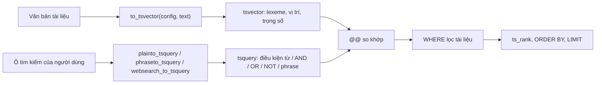

# to_tsvector, plainto_tsquery, phraseto_tsquery và websearch_to_tsquery trong PostgreSQL

Ứng dụng thường cần tìm tài liệu bằng những cụm từ như “PostgreSQL search”, “fat cat” hoặc một ô tìm kiếm cho phép nhập `postgresql OR database -legacy`. Nếu chỉ dùng `LIKE '%keyword%'`, hệ thống khó hỗ trợ đồng thời chuẩn hóa từ, bỏ stop words, tìm kiếm theo cụm từ và xếp hạng độ liên quan trên lượng lớn tài liệu.

PostgreSQL có **full-text search (FTS)** tích hợp. Bốn hàm trong bài này tạo nên phần nền tảng để dùng FTS đúng cách:

- **`to_tsvector`**: chuyển văn bản của tài liệu thành những **lexeme** có thể tra cứu, cùng vị trí và trọng số khi thích hợp.
- **`plainto_tsquery`**: nhận văn bản tìm kiếm thông thường và biến các từ có nghĩa thành các điều kiện **AND**.
- **`phraseto_tsquery`**: nhận một cụm từ thông thường, giữ **thứ tự và khoảng cách từ** để tìm các từ xuất hiện như cụm.
- **`websearch_to_tsquery`**: nhận cú pháp gần với ô tìm kiếm web: từ thường, cụm trong dấu ngoặc kép, `OR` và dấu `-` để loại trừ.

Hàm `to_tsvector` tạo **dữ liệu để tìm**, còn ba hàm `*_tsquery` tạo **điều kiện cần tìm**. Toán tử `@@` đối chiếu hai phía:

```sql
SELECT
    to_tsvector('english', 'PostgreSQL provides fast text search')
    @@ plainto_tsquery('english', 'fast searches')
    AS matches;
```

Dù `searches` có hình thức khác `search`, cấu hình tiếng Anh có thể chuẩn hóa về cùng lexeme. Đây là điểm khác biệt quan trọng so với so khớp chuỗi ký tự thuần túy.

Bài học thuộc chương **Tìm kiếm văn bản**, tập trung vào cú pháp, ngữ nghĩa và những bẫy thực tế của đúng bốn hàm trên; sau đó áp dụng vào dữ liệu mẫu, index GIN, xếp hạng, Java/JDBC và phương pháp kiểm thử.

## 1. Mô hình full-text search: tài liệu và câu hỏi tìm kiếm

Hãy hình dung pipeline:



Trong quá trình đó:

1. **Text search configuration** quyết định cách tách token và áp dụng các từ điển, ví dụ cấu hình `english`.
2. Parser nhận diện những token như từ, số, email hoặc chuỗi được phân loại theo các quy tắc riêng.
3. Dictionary có thể biến một token thành lexeme chuẩn hóa, bỏ một từ dừng hoặc tạo nhiều lexeme.
4. `tsvector` chứa những lexeme dùng làm biểu diễn tra cứu cho một tài liệu.
5. `tsquery` chứa cấu trúc điều kiện tìm kiếm.
6. `@@` trả Boolean: tài liệu có khớp điều kiện hay không.
7. GIN index, nếu được thiết kế phù hợp, có thể giúp tìm tập tài liệu ứng viên nhanh hơn quét toàn bảng.

### 1.1. “Lexeme” khác “từ nguyên bản”

Ví dụ trong cấu hình `english`, các hình thức như `run` và `running` có thể được đưa về cùng lexeme. Một số từ rất thường gặp như `the` hoặc `and` được nhận diện là **stop words** và bị loại khỏi biểu diễn tìm kiếm thông thường.

Vì vậy FTS trả lời câu hỏi “những **đơn vị từ vựng đã chuẩn hóa** có xuất hiện theo quy tắc tìm kiếm không?”, chứ không phải “chuỗi bytes có chứa substring này không?”.

Điều đó có mặt tốt và giới hạn:

- Tốt cho tìm kiếm nội dung theo từ.
- Có thể tìm cả những hình thức từ đã được stemming.
- Có thể giảm kích thước thông tin tra cứu khi bỏ stop words.
- Không mặc nhiên phù hợp để kiểm tra **chính xác một email, mã SKU, số điện thoại hoặc chuỗi có dấu câu đặc biệt**.
- Không tự giải quyết mọi vấn đề tách từ của tất cả ngôn ngữ.

### 1.2. Hai kiểu dữ liệu cần phân biệt

| Kiểu | Đại diện | Hàm thường tạo |
| --- | --- | --- |
| `tsvector` | Danh sách lexeme của **tài liệu**; có thể có vị trí và trọng số | `to_tsvector` |
| `tsquery` | Biểu thức điều kiện gồm các lexeme và toán tử | `plainto_tsquery`, `phraseto_tsquery`, `websearch_to_tsquery`, `to_tsquery` |

Một `tsquery` không phải câu SQL SELECT. Một `tsvector` cũng không phải bản sao văn bản gốc. Khi cần hiển thị tiêu đề/đoạn văn, vẫn phải giữ dữ liệu text ban đầu.

## 2. Thử nhanh cả bốn hàm trước khi tạo bảng

Các câu SQL sau có thể chạy trực tiếp trên PostgreSQL có cấu hình `english` mặc định thông dụng.

### 2.1. to_tsvector

```sql
SELECT to_tsvector(
    'english',
    'The quick brown fox jumps over the lazy dogs'
) AS doc_vector;
```

Kết quả có dạng các lexeme kèm vị trí, ví dụ `'brown':3`, `'dog':9`, `'fox':4` và những lexeme khác. **Thứ tự hiển thị lexeme không phải thứ tự xuất hiện của câu**; vị trí số sau dấu `:` mới liên hệ đến thứ tự gốc.

### 2.2. plainto_tsquery

```sql
SELECT plainto_tsquery(
    'english',
    'quick brown fox'
) AS plain_query;
```

Kết quả điển hình:

```text
'quick' & 'brown' & 'fox'
```

Ba từ được nối bằng **AND**: tất cả các lexeme có nghĩa phải xuất hiện trong tài liệu, nhưng không bắt buộc cạnh nhau hay theo đúng thứ tự.

### 2.3. phraseto_tsquery

```sql
SELECT phraseto_tsquery(
    'english',
    'quick brown fox'
) AS phrase_query;
```

Kết quả điển hình:

```text
'quick' <-> 'brown' <-> 'fox'
```

`<->` là toán tử **FOLLOWED BY** với khoảng cách một vị trí: những lexeme phải theo thứ tự và kề nhau trong mô hình vị trí của FTS.

### 2.4. websearch_to_tsquery

```sql
SELECT websearch_to_tsquery(
    'english',
    '"quick brown" OR "fat cat"'
) AS web_query;
```

Kết quả điển hình:

```text
'quick' <-> 'brown' | 'fat' <-> 'cat'
```

Dấu ngoặc kép tạo yêu cầu cụm từ, còn `OR` tạo phép tuyển. Đây là một cú pháp người dùng có thể học nhanh hơn biểu thức `to_tsquery`.

## 3. Bộ dữ liệu thực hành tự chứa

Tạo một schema `fts_lab` trong **database học tập**. Không dùng các lệnh tạo/xóa đối tượng trong bài trên cơ sở dữ liệu production có dữ liệu thật.

### 3.1. Bảng tài liệu và cột tsvector tự sinh

```sql
CREATE SCHEMA IF NOT EXISTS fts_lab;

CREATE TABLE fts_lab.articles (
    article_id bigint PRIMARY KEY,
    title text NOT NULL,
    body text NOT NULL,
    visibility text NOT NULL
        CHECK (visibility IN ('public', 'private')),
    published_at timestamptz NOT NULL,

    search_document tsvector GENERATED ALWAYS AS (
        setweight(
            to_tsvector('english'::regconfig, coalesce(title, '')),
            'A'
        ) ||
        setweight(
            to_tsvector('english'::regconfig, coalesce(body, '')),
            'D'
        )
    ) STORED
);
```

Ý nghĩa:

- `search_document` được PostgreSQL tạo lại từ `title` và `body` khi hàng được thêm/cập nhật theo cơ chế generated column.
- Cấu hình `english` được ghi **tường minh**, tránh phụ thuộc text search configuration mặc định của session.
- `setweight(..., 'A')` đánh dấu lexeme thuộc tiêu đề có trọng số cao hơn `'D'` của nội dung khi dùng hàm ranking phù hợp.
- Toán tử `||` giữa hai `tsvector` **ghép vector và điều chỉnh vị trí**, không nối chuỗi SQL thông thường.
- `coalesce` làm rõ cách xử lý text NULL nếu schema thay đổi; hiện tại `title` và `body` đã `NOT NULL`.
- PostgreSQL yêu cầu biểu thức generated column phù hợp quy tắc tính bất biến; sử dụng phiên bản `to_tsvector(regconfig, text)` với cấu hình xác định là mẫu thường dùng.

**Cảnh báo về phrase qua ranh giới trường:** ghép hai tsvector có thể đặt vị trí cuối của tiêu đề sát vị trí đầu của nội dung. Một phrase query có thể khớp ở ranh giới đó dù người dùng không nhìn thấy nó như một câu liên tục. Nếu yêu cầu không cho phép phrase băng qua hai trường, cần thiết kế kiểm tra riêng cho từng trường hoặc chiến lược ghép có ranh giới phù hợp.

### 3.2. Nạp tài liệu mẫu

```sql
INSERT INTO fts_lab.articles
    (article_id, title, body, visibility, published_at)
VALUES
(
    1,
    'Fast PostgreSQL search',
    'PostgreSQL provides full text search and ranking for documents.',
    'public',
    TIMESTAMPTZ '2026-01-01 00:00:00+00'
),
(
    2,
    'PostgreSQL search guide',
    'Learn to build GIN indexes for text documents and query planning.',
    'public',
    TIMESTAMPTZ '2026-01-02 00:00:00+00'
),
(
    3,
    'Search text quickly',
    'A practical guide to fast search in PostgreSQL databases.',
    'public',
    TIMESTAMPTZ '2026-01-03 00:00:00+00'
),
(
    4,
    'Cats and dogs',
    'The fat cat chased a small dog through the garden.',
    'public',
    TIMESTAMPTZ '2026-01-04 00:00:00+00'
),
(
    5,
    'A cat and a dog',
    'A cat and a dog are friends in this story.',
    'public',
    TIMESTAMPTZ '2026-01-05 00:00:00+00'
),
(
    6,
    'Data engineering handbook',
    'Use SQL joins to analyze database events and reports.',
    'public',
    TIMESTAMPTZ '2026-01-06 00:00:00+00'
),
(
    7,
    'Fast search without PostgreSQL',
    'This article compares search engines in other products.',
    'public',
    TIMESTAMPTZ '2026-01-07 00:00:00+00'
),
(
    8,
    'Phrase matching example',
    'The quick brown fox jumps over the lazy dog.',
    'public',
    TIMESTAMPTZ '2026-01-08 00:00:00+00'
),
(
    9,
    'Private PostgreSQL design',
    'Internal plans for a search engine architecture.',
    'private',
    TIMESTAMPTZ '2026-01-09 00:00:00+00'
),
(
    10,
    'PostgreSQL GIN search indexes',
    'Learn to improve search performance using GIN indexes.',
    'public',
    TIMESTAMPTZ '2026-01-10 00:00:00+00'
),
(
    11,
    'Search troubleshooting',
    'A search query can return no rows when words are missing.',
    'public',
    TIMESTAMPTZ '2026-01-11 00:00:00+00'
);

ANALYZE fts_lab.articles;
```

Dữ liệu được chọn để minh họa ba nhóm:

1. **Bài kỹ thuật PostgreSQL:** 1, 2, 3, 7, 9, 10, 11.
2. **Cụm từ liên quan mèo/chó:** 4, 5.
3. **Cụm từ “quick brown fox”:** 8.

Tài liệu 9 là `private` để nhắc rằng **full-text search không thay cơ chế phân quyền**. Tất cả truy vấn hiển thị với người dùng phải giữ điều kiện quyền truy cập tương ứng.

### 3.3. Kiểm tra vector đã được tính

```sql
SELECT
    article_id,
    title,
    search_document
FROM fts_lab.articles
WHERE article_id IN (1, 4, 5, 8)
ORDER BY article_id;
```

Bạn sẽ thấy lexeme, vị trí và hậu tố trọng số như `A` đối với một số lexeme trong title. PostgreSQL có thể lưu nhiều vị trí cho cùng lexeme nếu từ đó xuất hiện nhiều lần.

Bài học không yêu cầu kết quả phải có cùng thứ tự văn bản/format ở mọi major version; cách token hóa và dictionary cần đối chiếu với cấu hình trên server thật.

## 4. Text search configuration quyết định kết quả

Bốn hàm trong bài đều có dạng nhận một **configuration**:

```sql
SELECT
    to_tsvector('english', 'Cats are running'),
    plainto_tsquery('english', 'cats running'),
    phraseto_tsquery('english', 'cats running'),
    websearch_to_tsquery('english', 'cats OR running');
```

`english` là cấu hình có parser và hệ thống dictionaries/stop words/stemming cho tiếng Anh. `simple` là cấu hình cơ bản, ít biến đổi từ vựng hơn và không áp dụng English stemming.

### 4.1. Cùng văn bản, hai cấu hình

```sql
SELECT
    to_tsvector('simple', 'The cats are running') AS simple_vector,
    to_tsvector('english', 'The cats are running') AS english_vector;
```

Thông thường:

- `simple` lưu các từ được chuẩn hóa chữ hoa/thường, nhưng không stem `cats` thành `cat` theo cách của cấu hình tiếng Anh.
- `english` có thể bỏ `the`/`are`, stem `cats` thành `cat` và `running` thành `run`.

**Cấu hình là một phần của nghĩa truy vấn**, không phải một tùy chọn trang trí.

### 4.2. Dùng cùng cấu hình khi tạo vector và query

Một sai lầm:

```sql
SELECT
    to_tsvector('english', 'Cats are running')
    @@ plainto_tsquery('simple', 'cats')
    AS mixed_configuration_match;
```

Vector English có thể chứa `cat`, còn query Simple tìm `cats`. Hai lexeme không trùng, nên tài liệu có thể bị bỏ sót dù người đọc nhìn thấy chữ “Cats”.

Cách nhất quán:

```sql
SELECT
    to_tsvector('english', 'Cats are running')
    @@ plainto_tsquery('english', 'cats')
    AS consistent_match;
```

### 4.3. Không dựa vào default_text_search_config nếu cần tính nhất quán

PostgreSQL cho phép bỏ đối số configuration:

```sql
SELECT to_tsvector('Cats are running');
```

Khi đó kết quả phụ thuộc `default_text_search_config` của session/database.

```sql
SHOW default_text_search_config;
```

Đối với index, generated column hoặc ứng dụng dùng nhiều connections với cấu hình khác nhau, **nên chỉ rõ config trong cả vector lẫn query**. Nó giảm nguy cơ nội dung được index bằng cấu hình A nhưng người dùng tìm bằng cấu hình B.

### 4.4. Quan sát parser và dictionary bằng ts_debug

```sql
SELECT *
FROM ts_debug('english', 'The cats are running quickly');
```

Hàm `ts_debug` giúp xem token gốc, loại token, dictionary tham gia và lexeme cuối cùng. Nó là công cụ học tốt khi gặp vấn đề với stemming, stop words hoặc dấu câu.

Không nên suy lexeme chỉ bằng cách nhìn chuỗi đầu vào; hãy kiểm tra những gì cấu hình thật tạo ra.

## 5. to_tsvector: từ văn bản sang lexeme và vị trí

Cú pháp cốt lõi:

```sql
to_tsvector(config regconfig, document text)
```

Ví dụ:

```sql
SELECT to_tsvector(
    'english'::regconfig,
    'The fat cats chased the dogs'
) AS vector;
```

Kết quả thông thường có các lexeme như `cat`, `chase`, `dog`, `fat`, kèm vị trí. Một số từ như `the` có thể bị loại bởi stop-word dictionary.

### 5.1. Vị trí vẫn liên hệ tới câu gốc

Khi bỏ stop words, PostgreSQL không đơn giản nối mọi từ còn lại thành một câu liên tục. Vector có thông tin vị trí để hỗ trợ tìm **cụm từ**.

Ví dụ:

```sql
SELECT to_tsvector(
    'english',
    'The cat and the dog'
) AS vector;
```

Lexeme cho `cat` và `dog` có vị trí khác nhau, phản ánh những từ nằm giữa trong văn bản gốc. Đây là nền tảng để phân biệt query `'cat' <-> 'dog'` với `'cat' <4> 'dog'`.

### 5.2. Một lexeme có thể xuất hiện ở nhiều vị trí

```sql
SELECT to_tsvector(
    'english',
    'Search engines search text and search documents'
);
```

Lexeme tương ứng `search` có thể xuất hiện với nhiều vị trí. Điều đó giúp một số thuật toán ranking nhận biết tần suất và độ gần nhau của từ, không chỉ sự tồn tại.

### 5.3. Những gì to_tsvector không lưu

`tsvector` thường **không lưu trọn câu gốc** với đầy đủ dấu cách, dấu câu, chữ hoa và từ dừng. Nó không phải nơi lý tưởng để dựng lại đoạn văn cho người dùng xem.

Hãy giữ `title`/`body` ở các cột text và dùng `search_document` chỉ như **biểu diễn tra cứu**.

### 5.4. NULL và chuỗi rỗng

```sql
SELECT
    to_tsvector('english', NULL::text) AS null_vector,
    to_tsvector('english', '') AS empty_vector,
    to_tsvector('english', 'the and or') AS stop_word_vector;
```

- SQL NULL truyền vào hàm cho kết quả NULL.
- Chuỗi rỗng cho tsvector rỗng.
- Một văn bản chỉ có stop words cũng có thể cho vector rỗng với cấu hình English.

Với những field nullable:

```sql
SELECT to_tsvector(
    'english',
    coalesce(NULL::text, '')
);
```

`coalesce` hữu ích trong biểu thức index hoặc generated column để biến phần text thiếu thành chuỗi rỗng.

## 6. Gộp nhiều trường và trọng số trong to_tsvector

Một tài liệu thường có title, summary, body và tags. Khi tìm kiếm, người dùng có thể coi một lần khớp **tiêu đề** quan trọng hơn một lần khớp **nội dung**.

### 6.1. Ghép vector với ||

```sql
SELECT
    to_tsvector('english', 'PostgreSQL search')
    ||
    to_tsvector('english', 'Search documents efficiently')
    AS combined_vector;
```

Toán tử `||` ở đây có hai toán hạng `tsvector` nên thực hiện **nối vector** và điều chỉnh vị trí ở phần sau. Nó khác việc nối raw text bằng `||` khi toán hạng là `text`.

### 6.2. setweight và các mức A–D

```sql
SELECT
    setweight(to_tsvector('english', 'PostgreSQL search'), 'A')
    ||
    setweight(to_tsvector('english', 'Search documents efficiently'), 'D')
    AS weighted_vector;
```

Trọng số thường được ký hiệu:

| Trọng số | Cách dùng phổ biến |
| --- | --- |
| `A` | Tiêu đề hoặc field quan trọng nhất |
| `B` | Tóm tắt/heading |
| `C` | Tags hoặc một field trung gian |
| `D` | Nội dung thông thường |

Đây là **quy ước thiết kế**, không phải quy tắc bắt buộc. Hàm ranking có thể được cấu hình trọng số khác, và việc gán A không thay đổi tính đúng/sai của `@@` khi query chỉ kiểm tra lexeme thông thường.

### 6.3. Một ví dụ kết hợp nhiều field nullable

```sql
SELECT
    setweight(
        to_tsvector('english', coalesce('Fast search'::text, '')),
        'A'
    )
    ||
    setweight(
        to_tsvector('english', coalesce(NULL::text, '')),
        'B'
    )
    ||
    setweight(
        to_tsvector('english', coalesce('Indexing documents'::text, '')),
        'D'
    ) AS doc_vector;
```

Khi cần cập nhật vector trong database, dùng generated column như bảng mẫu hoặc trigger/materialized strategy phù hợp. Tránh tự đồng bộ hai cột `title` và `search_document` bằng hai thao tác ứng dụng tách rời nếu có thể làm chúng lệch nhau.

## 7. plainto_tsquery: từ plain text sang AND

Cú pháp:

```sql
plainto_tsquery(config regconfig, querytext text)
```

Ví dụ:

```sql
SELECT plainto_tsquery(
    'english',
    'PostgreSQL fast search'
) AS query;
```

Các lexeme có nghĩa được nối bằng `&`. Về logic:

```text
postgresql AND fast AND search
```

Tài liệu có thể chứa các từ ở **bất cứ vị trí nào** và vẫn khớp.

### 7.1. Tìm bài có cả PostgreSQL và search

```sql
SELECT article_id, title
FROM fts_lab.articles
WHERE visibility = 'public'
  AND search_document @@ plainto_tsquery(
      'english',
      'PostgreSQL search'
  )
ORDER BY article_id;
```

Các bài công khai có cả hai lexeme có thể gồm 1, 2, 3, 7 và 10 theo dữ liệu mẫu. Bài 9 cũng có nội dung liên quan nhưng bị loại vì `visibility='private'`.

### 7.2. AND không quan tâm thứ tự

```sql
SELECT
    to_tsvector('english', 'A dog chased a cat')
        @@ plainto_tsquery('english', 'cat dog') AS match_a,
    to_tsvector('english', 'A cat chased a dog')
        @@ plainto_tsquery('english', 'cat dog') AS match_b;
```

Cả hai có thể khớp: query chỉ yêu cầu hiện diện lexeme `cat` và `dog`, không yêu cầu chúng liền nhau.

### 7.3. Dấu câu không trở thành boolean operators

```sql
SELECT
    plainto_tsquery('english', 'postgresql & search'),
    plainto_tsquery('english', 'postgresql | search'),
    plainto_tsquery('english', 'postgresql OR search');
```

`plainto_tsquery` xem đầu vào là **plain text**, không trực tiếp chấp nhận cú pháp logic `&`/`|`/`!` theo cách `to_tsquery` làm. Trong cấu hình English, từ `or` có thể bị xử lý như stop word; nó không biến biểu thức thành toán tử OR.

Nếu người dùng thực sự cần `OR`, dùng `websearch_to_tsquery` hoặc xây `tsquery` có kiểm soát.

### 7.4. Plain text không tự động là phrase

```sql
SELECT
    to_tsvector('english', 'The quick brown fox')
      @@ plainto_tsquery('english', 'brown quick') AS plain_matches,
    to_tsvector('english', 'The quick brown fox')
      @@ phraseto_tsquery('english', 'brown quick') AS phrase_matches;
```

Dạng plain có thể khớp vì cả hai từ tồn tại; dạng phrase với thứ tự `brown quick` không khớp vì trong câu là `quick brown`.

**Khi yêu cầu thứ tự/khoảng cách, dùng `phraseto_tsquery` chứ không dùng `plainto_tsquery`.**

### 7.5. Stop words có thể làm query trở thành rỗng

```sql
SELECT
    plainto_tsquery('english', 'the and or') AS parsed,
    numnode(plainto_tsquery('english', 'the and or')) AS node_count;
```

Nếu tất cả từ bị loại theo stop-word dictionary, `tsquery` không có node tìm kiếm hữu ích. Ứng dụng nên nhận diện trường hợp này để hiển thị thông báo phù hợp, thay vì để người dùng tưởng dữ liệu không tồn tại.

## 8. phraseto_tsquery: tạo điều kiện theo cụm từ

Cú pháp:

```sql
phraseto_tsquery(config regconfig, querytext text)
```

Khác plain query, hàm này giữ **thứ tự** và **quan hệ vị trí** giữa các lexeme.

```sql
SELECT phraseto_tsquery('english', 'quick brown fox');
```

Kết quả dạng:

```text
'quick' <-> 'brown' <-> 'fox'
```

`<->` là cú pháp viết tắt cho `<1>`: từ bên phải theo sau từ bên trái một vị trí.

### 8.1. Phân biệt AND và phrase bằng dữ liệu thật

```sql
SELECT article_id, title
FROM fts_lab.articles
WHERE visibility = 'public'
  AND search_document @@ phraseto_tsquery(
      'english',
      'quick brown'
  )
ORDER BY article_id;
```

Tài liệu 8 chứa cụm “quick brown” trong body.

Nếu tìm:

```sql
SELECT article_id, title
FROM fts_lab.articles
WHERE visibility = 'public'
  AND search_document @@ phraseto_tsquery(
      'english',
      'brown quick'
  )
ORDER BY article_id;
```

thì thứ tự bị đảo, nên không khớp cụm đó trong dữ liệu mẫu.

### 8.2. Stop words không làm biến mất khoảng cách

Điểm tinh tế nhất của `phraseto_tsquery`: khi stop words bị bỏ, **khoảng cách tương đối được giữ lại**.

```sql
SELECT
    phraseto_tsquery('english', 'cat dog') AS adjacent,
    phraseto_tsquery('english', 'cat and dog') AS one_gap,
    phraseto_tsquery('english', 'cat and a dog') AS two_gaps;
```

Các biểu thức có dạng:

```text
'cat' <-> 'dog'
'cat' <2> 'dog'
'cat' <3> 'dog'
```

Giải thích:

- `<->`/`<1>`: hai lexeme cạnh nhau.
- `<2>`: vị trí lexeme thứ hai cách thứ nhất **2 vị trí**, tương ứng một token nằm giữa.
- `<3>`: cách 3 vị trí, tương ứng hai token nằm giữa.

Các stop words có thể không nằm trong `tsvector` nhưng vị trí của chúng vẫn làm khác biệt điều kiện phrase.

### 8.3. Thực hành với hai tài liệu cat/dog

```sql
SELECT article_id, title
FROM fts_lab.articles
WHERE search_document @@ phraseto_tsquery(
    'english',
    'cat and a dog'
)
ORDER BY article_id;
```

Tài liệu 5 chứa cụm `A cat and a dog`. Khoảng cách giữa `cat` và `dog` là ba vị trí theo tokenization phù hợp.

Nếu thay bằng:

```sql
SELECT article_id, title
FROM fts_lab.articles
WHERE search_document @@ phraseto_tsquery('english', 'cat dog')
ORDER BY article_id;
```

không nên kỳ vọng tài liệu 5 còn khớp; hai từ không đứng liền nhau.

### 8.4. Phrase không phải tìm substring nguyên bản

Một phrase query dựa vào **lexeme và vị trí**, không so sánh chuỗi raw byte:

- Stop words có thể bị loại nhưng vẫn ảnh hưởng khoảng cách.
- Từ có thể được stemming theo dictionary.
- Dấu câu và token boundaries theo parser có thể khác cách người dùng đếm ký tự.
- Hai hình thức chính tả có thể cùng lexeme.
- Kết quả phụ thuộc text search configuration.

Nếu nghiệp vụ yêu cầu đúng từng ký tự, bao gồm dấu cách và dấu câu, cần cách so khớp khác, không chỉ FTS phrase.

### 8.5. Khi nào nên dùng phraseto_tsquery?

Phù hợp khi:

- Người dùng chọn một chế độ **“tìm chính xác cụm từ” theo từ vựng**.
- Muốn tìm một cụm thuật ngữ như “query planning” thay vì hai từ xuất hiện cách xa.
- Thứ tự từ quan trọng.
- Muốn giảm số tài liệu chỉ tình cờ chứa đủ từ ở những phần khác nhau.

Không dùng phrase search mặc định cho mọi ô tìm kiếm nếu người dùng kỳ vọng các từ có thể xuất hiện cách xa hoặc trong thứ tự bất kỳ.

## 9. websearch_to_tsquery: cú pháp thân thiện với ô tìm kiếm

Cú pháp:

```sql
websearch_to_tsquery(config regconfig, querytext text)
```

Hàm này chấp nhận những quy ước tìm kiếm phổ biến:

| Đầu vào người dùng | Ý nghĩa chính |
| --- | --- |
| `postgresql search` | Hai từ phải xuất hiện (AND) |
| `"quick brown"` | Hai từ theo một phrase |
| `postgresql OR database` | Có một trong hai nhánh (OR) |
| `postgresql -legacy` | Có PostgreSQL, không có legacy |
| `"quick brown" OR "fat cat"` | Khớp một trong hai cụm |
| `postgresql search -old` | Có cả hai từ dương và loại trừ từ old |

### 9.1. Từ thường mặc định là AND

```sql
SELECT websearch_to_tsquery(
    'english',
    'postgresql search'
);
```

Cấu trúc tương ứng hai lexeme được nối `&`, tương tự `plainto_tsquery` khi đầu vào không chứa cú pháp tìm kiếm đặc biệt.

### 9.2. Dấu ngoặc kép tạo phrase

```sql
SELECT websearch_to_tsquery(
    'english',
    '"quick brown"'
);
```

Dạng query có toán tử `<->`, tương đương ý định gọi `phraseto_tsquery` với cụm `quick brown`.

Nếu trong dấu ngoặc kép có stop words, cơ chế phrase cũng bảo toàn khoảng cách tương ứng.

### 9.3. OR phải được viết như cú pháp web search

```sql
SELECT websearch_to_tsquery(
    'english',
    'postgresql OR database'
);
```

`OR` tạo toán tử `|` giữa các nhánh. Với những từ thường không có `OR`, chúng vẫn được nối AND.

Không suy rằng từ `or` trong một chuỗi `plainto_tsquery` cũng có ngữ nghĩa OR. **Đó là điểm khác biệt giữa hai hàm.**

### 9.4. Dấu trừ loại trừ từ hoặc nhóm từ

```sql
SELECT websearch_to_tsquery(
    'english',
    'search -postgresql'
);
```

Ý định: tài liệu chứa `search` nhưng **không** chứa `postgresql`. Trong bộ dữ liệu mẫu, bài “Search troubleshooting” là một ví dụ ứng viên công khai thỏa điều kiện đó.

Trong `tsquery`, phủ định thể hiện bằng `!`; nó **không phải phép trừ số học**.

### 9.5. Có thể kết hợp quote, OR và dấu trừ

```sql
SELECT websearch_to_tsquery(
    'english',
    '"quick brown" OR "fat cat"'
);
```

Truy vấn:

```sql
SELECT article_id, title
FROM fts_lab.articles
WHERE visibility = 'public'
  AND search_document @@ websearch_to_tsquery(
      'english',
      '"quick brown" OR "fat cat"'
  )
ORDER BY article_id;
```

Các tài liệu 4 và 8 là ví dụ khớp những cụm tương ứng.

Đối với cú pháp phức tạp kết hợp AND/OR/NOT, hãy **kiểm tra `SELECT websearch_to_tsquery(...)` trả về cây biểu thức nào** thay vì suy thứ tự ưu tiên bằng cảm tính.

### 9.6. Vì sao websearch_to_tsquery phù hợp với input từ người dùng?

Không giống `to_tsquery`, `websearch_to_tsquery` được thiết kế để xử lý input dạng text từ ô tìm kiếm, kể cả dấu câu khó hiểu, mà không buộc người dùng học cú pháp `tsquery` chặt chẽ.

Tuy nhiên, **không gây syntax error không có nghĩa không gây query tốn tài nguyên**. Một chuỗi dài, nhiều OR hoặc phần phủ định quá rộng vẫn cần kiểm soát độ dài, tải và quyền truy cập.

## 10. Những điều websearch_to_tsquery KHÔNG làm

### 10.1. Không diễn giải toàn bộ cú pháp to_tsquery

`to_tsquery` cho phép nhập các toán tử và hình thức nâng cao của `tsquery`, chẳng hạn điều kiện tiền tố `:*` hoặc weight labels. `websearch_to_tsquery` **không phải parser tổng quát cho tất cả cú pháp đó**.

Ví dụ người dùng gõ:

```text
postgre:*
```

Không được mặc định đây là lệnh prefix search theo `to_tsquery`. Những dấu câu không thuộc cú pháp web search được xử lý theo quy tắc riêng của `websearch_to_tsquery`.

Nếu muốn tìm lexeme theo tiền tố, phải thiết kế chức năng riêng, dùng `to_tsquery` với biểu thức được ứng dụng **xây dựng/validate an toàn**:

```sql
SELECT to_tsquery('english', 'postgre:*');
```

Không cho input người dùng được chuyển nguyên văn vào `to_tsquery` như một biểu thức tùy ý nếu ứng dụng không có chủ đích cung cấp toàn bộ cú pháp.

### 10.2. Không tự hiểu mọi cú pháp của Google hay Lucene

`websearch_to_tsquery` hỗ trợ một **tập con** quy ước quen thuộc: quotes, OR, minus và từ thường. Nó không phải bản sao của mọi toán tử tìm kiếm web, như `site:`, filter theo ngày, fuzzy matching hay wildcard suffix ở mọi vị trí.

Nếu cần các bộ lọc đó, xây chúng thành điều kiện SQL riêng trên những cột/index phù hợp.

### 10.3. Không phải tìm kiếm mờ theo lỗi chính tả

`postgresql` khác `postgressql`; cấu hình FTS thông thường không tự thực hiện edit-distance fuzzy search. Khi cần sửa lỗi chính tả hoặc tìm substring, có thể xem xét `pg_trgm` hoặc gợi ý từ gần đúng như một lớp hỗ trợ khác.

Đừng nhầm stemming của `english` với fuzzy matching hay semantic/vector search.

### 10.4. Không tự bảo đảm xếp hạng tốt nhất

`websearch_to_tsquery` xây điều kiện `tsquery`. Muốn sắp xếp tài liệu theo mức độ liên quan, cần `ts_rank`, `ts_rank_cd` hoặc một công thức xếp hạng ứng dụng có kiểm soát.

## 11. Bảng so sánh bốn hàm theo nhiệm vụ

| Hàm | Đầu vào | Đầu ra | Ý nghĩa chính | Trường hợp điển hình |
| --- | --- | --- | --- | --- |
| `to_tsvector` | Văn bản tài liệu | `tsvector` | Chuẩn hóa nội dung cần tìm | Lưu/search index cho title, body |
| `plainto_tsquery` | Plain text query | `tsquery` | Các từ có nghĩa nối AND | Ô tìm kiếm đơn giản |
| `phraseto_tsquery` | Một cụm text | `tsquery` | Thứ tự và khoảng cách cụm | Tìm một cụm thuật ngữ |
| `websearch_to_tsquery` | Chuỗi tìm kiểu web | `tsquery` | Từ thường, quote, OR, minus | Ô tìm kiếm có vài toán tử |

Ví dụ trực tiếp:

```sql
SELECT
    to_tsvector(
        'english', 'The quick brown fox'
    ) AS document_vector,

    plainto_tsquery(
        'english', 'quick brown'
    ) AS plain,

    phraseto_tsquery(
        'english', 'quick brown'
    ) AS phrase,

    websearch_to_tsquery(
        'english', '"quick brown" OR fox'
    ) AS web;
```

### 11.1. Chọn theo trải nghiệm người dùng

- Ô tìm kiếm chỉ nhận từ khóa đơn giản: **`plainto_tsquery`**.
- Chế độ “tìm đúng cụm từ” theo lexeme/position: **`phraseto_tsquery`**.
- Hộp tìm kiếm cho phép quotes, `OR` và `-`: **`websearch_to_tsquery`**.
- Bất kỳ cách nào ở trên vẫn cần tài liệu được chuẩn hóa bằng **`to_tsvector`** với cấu hình tương thích.

Một ứng dụng có thể kết hợp nhiều chế độ mà không cần viết nhiều pipeline index khác nhau, miễn thống nhất text search configuration và thiết kế query.

## 12. So sánh AND, phrase và OR trên cùng dữ liệu

### 12.1. Plain: có cả cat và dog

```sql
SELECT article_id, title
FROM fts_lab.articles
WHERE visibility = 'public'
  AND search_document @@ plainto_tsquery(
      'english', 'cat dog'
  )
ORDER BY article_id;
```

Tài liệu 4 và 5 đều chứa lexeme của `cat` và `dog`, dù cách sắp xếp và khoảng cách khác nhau.

### 12.2. Phrase: cat đứng ngay trước dog

```sql
SELECT article_id, title
FROM fts_lab.articles
WHERE visibility = 'public'
  AND search_document @@ phraseto_tsquery(
      'english', 'cat dog'
  )
ORDER BY article_id;
```

Với nội dung mẫu, không nên kỳ vọng tài liệu 5 khớp: giữa cat và dog có `and a`, dù chúng thường là stop words của English. Đây là trường hợp phrase khác plain một cách rõ ràng.

### 12.3. Phrase có stop-word gap

```sql
SELECT article_id, title
FROM fts_lab.articles
WHERE visibility = 'public'
  AND search_document @@ phraseto_tsquery(
      'english', 'cat and a dog'
  )
ORDER BY article_id;
```

Tài liệu 5 có đúng khoảng cách từ theo câu trong title/body, nên có thể khớp.

### 12.4. Web OR: cat hoặc database

```sql
SELECT article_id, title
FROM fts_lab.articles
WHERE visibility = 'public'
  AND search_document @@ websearch_to_tsquery(
      'english', 'cat OR database'
  )
ORDER BY article_id;
```

Tập kết quả có thể gồm tài liệu nói về mèo/chó **hoặc** tài liệu có lexeme database. Đây không phải phép nối AND.

### 12.5. Dùng biểu thức chẩn đoán để xem điều kiện thực

```sql
SELECT
    plainto_tsquery('english', 'cat and a dog') AS plain,
    phraseto_tsquery('english', 'cat and a dog') AS phrase,
    websearch_to_tsquery('english', '"cat and a dog"') AS quoted_web;
```

Quan sát ký hiệu `&` so với `<N>`. Cũng cần để ý stop words bị bỏ và khoảng cách được bảo toàn ở hai cách tạo phrase.

## 13. Toán tử @@ là bước so khớp tsvector và tsquery

Trong Full-Text Search:

```sql
tsvector @@ tsquery
```

trả `boolean` nếu vector thỏa query.

Ví dụ không dùng bảng:

```sql
SELECT
    to_tsvector('english', 'The fat cat sleeps')
      @@ plainto_tsquery('english', 'cat fat')
        AS both_words,

    to_tsvector('english', 'The fat cat sleeps')
      @@ phraseto_tsquery('english', 'fat cat')
        AS matching_phrase,

    to_tsvector('english', 'The fat cat sleeps')
      @@ phraseto_tsquery('english', 'cat fat')
        AS wrong_order;
```

Kỳ vọng hai cột đầu đúng, cột cuối sai.

### 13.1. Đừng nhầm @@ của FTS với toán tử kiểu khác

PostgreSQL nạp chồng ký hiệu toán tử theo kiểu dữ liệu. Khi thấy `@@`, hãy nhìn **kiểu hai toán hạng**:

- Trong FTS: `tsvector @@ tsquery`.
- Trong JSONPath: `jsonb @@ jsonpath` mang ngữ nghĩa khác.

Cùng một ký hiệu không có nghĩa hai tính năng chia sẻ cấu trúc query hay cách đánh giá.

### 13.2. SQL WHERE vẫn có những điều kiện độc lập

```sql
SELECT article_id, title
FROM fts_lab.articles
WHERE visibility = 'public'
  AND published_at >= TIMESTAMPTZ '2026-01-01 00:00:00+00'
  AND search_document @@ plainto_tsquery(
      'english', 'postgresql search'
  );
```

FTS kiểm tra lexeme; `visibility` và `published_at` là các điều kiện SQL bình thường. Không nhồi tất cả thành từ khóa FTS khi những field có kiểu dữ liệu rõ ràng.

## 14. Từ dừng (stop words), stemming và dấu câu

### 14.1. Stop words thay đổi kết quả tìm

```sql
SELECT
    to_tsvector('english', 'the cat and the dog') AS vector,
    plainto_tsquery('english', 'the and or') AS empty_or_small_query,
    phraseto_tsquery('english', 'cat and dog') AS spaced_phrase;
```

Ví dụ giúp thấy:

- Những từ như `the` và `and` có thể không xuất hiện dưới dạng lexeme.
- Phrase query vẫn giữ khoảng cách nơi từ dừng từng xuất hiện.
- Một query toàn stop words có thể rỗng, làm tìm kiếm không trả kết quả hữu ích.

### 14.2. Stemming không đồng nghĩa tìm đúng từng chữ

```sql
SELECT
    to_tsvector('english', 'The cats were running')
    @@ plainto_tsquery('english', 'cat run')
    AS stemmed_match;
```

Cấu hình English có thể chuẩn hóa `cats`/`cat` và `running`/`run` về các lexeme tương ứng, nên query vẫn khớp.

Đây là lợi thế tìm kiếm theo hình thái, nhưng nếu cần kiểm tra chuỗi nguyên bản, phải dùng phương án khác hoặc bổ sung điều kiện.

### 14.3. Tokenization của mã sản phẩm, email và số

Một token như `SKU-RED`, `C++`, `user@example.test` hay `v2.1.0` có thể bị parser chia thành các loại token đặc biệt hoặc nhiều phần. Không giả định mỗi mã nghiệp vụ luôn trở thành đúng một lexeme nguyên bản.

Dùng:

```sql
SELECT *
FROM ts_debug(
    'english',
    'SKU-RED user@example.test PostgreSQL-v2.1'
);
```

để quan sát cách parser/dictionary thực sự xử lý dữ liệu. Với mã cần equality tuyệt đối, cân nhắc **cột riêng + B-tree** thay vì trông chờ FTS.

## 15. Nhanh nhưng sai: các query toàn stop words hoặc chỉ phủ định

Một người dùng có thể nhập toàn những từ không được giữ lại trong cấu hình:

```sql
SELECT
    numnode(plainto_tsquery('english', 'the and or')) AS plain_nodes,
    numnode(websearch_to_tsquery('english', 'the and or')) AS web_nodes;
```

Khi cả hai bằng 0, ứng dụng thường nên thông báo “không còn từ khóa tìm kiếm có nghĩa sau chuẩn hóa”.

### 15.1. Không gán nghĩa “tìm mọi tài liệu” cho query rỗng

Không được lặng lẽ biến một query rỗng thành:

```sql
SELECT *
FROM fts_lab.articles;
```

nếu sản phẩm ban đầu chỉ cho phép search có lọc. Điều này có thể gây full scan và trả lượng dữ liệu lớn, thậm chí lộ tài liệu không được phép nếu quên điều kiện quyền.

Một lựa chọn rõ ràng:

```sql
WITH search AS (
    SELECT websearch_to_tsquery(
        'english', 'the and or'
    ) AS q
)
SELECT a.article_id, a.title
FROM fts_lab.articles AS a
CROSS JOIN search AS s
WHERE a.visibility = 'public'
  AND numnode(s.q) > 0
  AND a.search_document @@ s.q;
```

Khi query sau chuẩn hóa không có node, kết quả rỗng và ứng dụng có thể hiển thị một hướng dẫn.

### 15.2. Chỉ có NOT cũng có thể rất tốn

```sql
SELECT websearch_to_tsquery('english', '-postgresql');
```

Điều kiện chỉ phủ định có thể khớp **rất nhiều tài liệu không chứa từ đó**. Một index trên từ bị phủ định không tự đưa ra danh sách nhỏ ứng viên dương để tìm kiếm hiệu quả.

Một UI search thực tế thường nên yêu cầu ít nhất một **điều kiện khẳng định (positive term hoặc phrase)**, giới hạn số kết quả và thời gian thực thi. `numnode > 0` **chưa đủ** để kiểm tra query có positive term, vì phủ định cũng có node.

## 16. Full-text search với tiếng Việt

PostgreSQL có `english` và `simple`, nhưng **không mặc định có một text-search configuration tiếng Việt hoàn chỉnh với stemming và tách từ phù hợp mọi tiếng Việt**.

### 16.1. Cấu hình simple là điểm bắt đầu

```sql
SELECT
    to_tsvector('simple', 'Tìm kiếm văn bản trong PostgreSQL')
        AS vi_document,
    plainto_tsquery('simple', 'tìm kiếm văn bản')
        AS vi_query;
```

`simple` có thể chuẩn hóa chữ hoa/thường và giữ các lexeme theo token. Nhưng tiếng Việt có nhiều từ ghép/đơn vị nghĩa gồm nhiều âm tiết viết cách nhau, ví dụ `cơ sở dữ liệu`. Việc tách đơn giản theo khoảng trắng không tương đương tokenizer ngôn ngữ tự nhiên.

### 16.2. Dấu tiếng Việt và unaccent

Một người dùng có thể gõ:

```text
tim kiem van ban
```

trong khi tài liệu có:

```text
tìm kiếm văn bản
```

Đừng mặc định cấu hình `simple` tự bỏ dấu tiếng Việt. PostgreSQL có extension **`unaccent`** để hỗ trợ chuyển đổi dấu khi được cài và cấu hình phù hợp.

Nếu cần tìm không dấu, có thể xây text-search configuration riêng kết hợp `unaccent` với từ điển thích hợp. Việc cài extension, chọn token mappings, quyền sở hữu, schema/search_path và rebuild index là **nhiệm vụ cấu hình riêng**; không dùng hai nguồn vector/query khác nhau rồi mong chúng tự khớp.

### 16.3. Một chiến lược cho đa ngôn ngữ

Nếu ứng dụng có tài liệu tiếng Anh lẫn tiếng Việt:

- Lưu ngôn ngữ của tài liệu.
- Chuẩn hóa/index bằng configuration tương ứng.
- Chọn query configuration nhất quán với nhóm tài liệu được tìm.
- Kiểm tra việc so khớp theo từng ngôn ngữ và từ ghép.
- Cân nhắc bộ tách từ/điển ngôn ngữ bổ sung nếu chất lượng tìm kiếm tiếng Việt là yêu cầu cốt lõi.

Một vector tạo bằng `english` cho tất cả ngôn ngữ không đảm bảo kết quả tốt. Nếu sử dụng vector đã index, việc đổi cấu hình sau này thường yêu cầu **tính lại biểu diễn và xây lại index** thích hợp.

## 17. GIN index cho tsvector

Đối với bảng lớn, kiểm tra `@@` cho từng hàng bằng cách dựng vector động có thể tốn chi phí. PostgreSQL có **GIN index** phù hợp cho nhiều truy vấn full-text search.

Bảng mẫu đã có cột `search_document tsvector`. Tạo index:

```sql
CREATE INDEX idx_articles_search_document_gin
ON fts_lab.articles
USING GIN (search_document);
```

Sau đó cập nhật statistics:

```sql
ANALYZE fts_lab.articles;
```

Query:

```sql
EXPLAIN (ANALYZE, BUFFERS)
SELECT article_id, title
FROM fts_lab.articles
WHERE visibility = 'public'
  AND search_document @@ websearch_to_tsquery(
      'english', 'postgresql search'
  );
```

Trên bộ dữ liệu **11 hàng**, PostgreSQL có thể chọn `Seq Scan` vì quét ít hàng rẻ hơn dùng index. Điều đó không chứng minh index sai. Muốn đánh giá hiệu quả, phải dùng dữ liệu và tỷ lệ khớp đại diện workload thật.

### 17.1. Expression index thay vì generated column

Khi không muốn lưu thêm cột tsvector, có thể xây expression index:

```sql
CREATE INDEX idx_articles_title_fts
ON fts_lab.articles
USING GIN (
    to_tsvector('english'::regconfig, title)
);
```

Để có cơ hội sử dụng index này, query nên có **biểu thức tương ứng**:

```sql
SELECT article_id, title
FROM fts_lab.articles
WHERE to_tsvector('english'::regconfig, title)
      @@ plainto_tsquery('english', 'PostgreSQL');
```

Index trên `to_tsvector(..., title)` **không tự động dùng cho mọi query** trên `search_document` đã ghép title + body. Hai biểu diễn khác nhau.

### 17.2. Vì sao phải ghi configuration tường minh trong index?

`to_tsvector(text)` không ghi cố định cấu hình, mà phụ thuộc `default_text_search_config`. Với expression index yêu cầu hàm phù hợp tính bất biến, dùng bản có `regconfig` cố định:

```sql
to_tsvector('english'::regconfig, title)
```

Đây cũng là cách bảo đảm từ khóa được chuyển nhất quán giữa lúc index và lúc search.

### 17.3. GIN thường giúp tập lexeme, nhưng phrase có thể cần kiểm tra lại

GIN full-text search lưu thông tin giúp tra cứu lexeme hiệu quả, nhưng không phải mọi chi tiết **vị trí/khoảng cách phrase** đều được index xử lý trọn vẹn. Khi query có `<->` hoặc điều kiện weight, PostgreSQL có thể cần recheck tài liệu ứng viên để xác nhận đầy đủ ngữ nghĩa.

Vì thế, trong `EXPLAIN` có thể thấy `Bitmap Index Scan`, `Bitmap Heap Scan` và `Recheck Cond`. Đó không phải bằng chứng index hỏng.

### 17.4. Index không thay bảo mật hay pagination

Một truy vấn FTS trả hàng triệu kết quả vẫn cần:

- Điều kiện tenant/visibility từ hệ thống phân quyền.
- `ORDER BY` rõ ràng.
- `LIMIT`/pagination thích hợp.
- Điều kiện lọc theo trạng thái, thời gian hoặc loại tài liệu.
- Giám sát độ trễ và tải.

GIN index giúp tìm tài liệu, **không tự quyết định người dùng có quyền nhìn thấy tài liệu đó**.

## 18. GIN và GiST: chọn index từ workload

PostgreSQL hỗ trợ full-text search index bằng GIN hoặc GiST trong những điều kiện phù hợp.

| Đặc điểm | GIN | GiST |
| --- | --- | --- |
| Cách dùng phổ biến cho FTS | Thường là lựa chọn mặc định đáng cân nhắc | Phù hợp các tình huống cần xét đặc tính khác |
| Thông tin tra cứu | Index các lexeme | Có thể dùng signature/lossy representation |
| Recheck | Có thể cần cho phrase/weight | Có thể cần do false positives/lossy |
| Chi phí DML | Có chi phí duy trì; có thể có pending list | Có chi phí và trade-off riêng |
| Khả năng thay thế mọi truy vấn | Không | Không |

Không có câu trả lời “GIN luôn nhanh hơn GiST trong mọi trường hợp”. Tuy vậy, đối với workload điển hình **`tsvector @@ tsquery`**, GIN thường là điểm bắt đầu hợp lý. Đánh giá qua kích thước tập dữ liệu, số lexeme, tốc độ ghi và truy vấn thực.

## 19. Xếp hạng kết quả bằng ts_rank và ts_rank_cd

`@@` trả lời **có khớp hay không**. Nhiều tài liệu có thể cùng khớp; tìm kiếm thường cần xếp những kết quả phù hợp hơn lên trước.

### 19.1. ts_rank

```sql
WITH q AS (
    SELECT websearch_to_tsquery(
        'english', 'postgresql search'
    ) AS search_query
)
SELECT
    a.article_id,
    a.title,
    ts_rank(a.search_document, q.search_query) AS relevance
FROM fts_lab.articles AS a
CROSS JOIN q
WHERE a.visibility = 'public'
  AND numnode(q.search_query) > 0
  AND a.search_document @@ q.search_query
ORDER BY relevance DESC, a.published_at DESC, a.article_id
LIMIT 10;
```

Ý nghĩa:

- `ts_rank` tính điểm dựa trên thông tin tsvector/tsquery và cấu hình weight, frequency theo thuật toán của PostgreSQL.
- `ORDER BY relevance DESC` đưa tài liệu có điểm cao hơn lên đầu.
- Thứ tự phụ `published_at DESC, article_id` giúp ổn định các trường hợp bằng điểm.
- `LIMIT` giới hạn số tài liệu trả về.

**Điểm rank không phải xác suất phần trăm “90% phù hợp”.** Không tự dùng một ngưỡng bất biến qua mọi query/dataset nếu chưa đánh giá thực tế.

### 19.2. ts_rank_cd

```sql
SELECT
    article_id,
    title,
    ts_rank_cd(
        search_document,
        phraseto_tsquery('english', 'quick brown')
    ) AS coverage_rank
FROM fts_lab.articles
WHERE visibility = 'public'
  AND search_document @@ phraseto_tsquery(
      'english', 'quick brown'
  )
ORDER BY coverage_rank DESC, article_id;
```

`ts_rank_cd` dùng phương pháp *cover density* liên quan độ gần nhau của các lexeme, phù hợp để cân nhắc khi các từ xuất hiện gần nhau quan trọng.

Nó dựa vào thông tin vị trí; tsvector bị `strip` mất positions sẽ ảnh hưởng loại ranking này. Không dùng `strip` tùy tiện chỉ để giảm vector size nếu còn cần phrase và cover-density behavior.

### 19.3. Trọng số của title và body

Vì bảng mẫu đánh dấu title là `A`, body là `D`, hàm rank có thể ưu tiên tài liệu có từ khóa trong title hơn khi các yếu tố khác tương đương.

Nhưng thứ tự thực tế còn phụ thuộc tần suất, vị trí, query, document length và ranking parameters. Không cam kết “chứa query trong title luôn đứng đầu” chỉ từ weight A.

## 20. Tạo đoạn trích với ts_headline

Sau khi search, UI có thể hiển thị một đoạn ngắn chứa những lexeme phù hợp.

```sql
WITH q AS (
    SELECT websearch_to_tsquery(
        'english', '"quick brown"'
    ) AS search_query
)
SELECT
    a.article_id,
    a.title,
    ts_headline(
        'english',
        a.body,
        q.search_query,
        'StartSel=[, StopSel=], MaxWords=20, MinWords=5'
    ) AS highlighted_excerpt
FROM fts_lab.articles AS a
CROSS JOIN q
WHERE a.visibility = 'public'
  AND a.search_document @@ q.search_query
ORDER BY a.article_id;
```

Đoạn trích dùng dấu `[` và `]` để nhận biết từ được highlight trong ví dụ.

### 20.1. Cảnh báo HTML injection

Không tự đưa HTML do `ts_headline` tạo ra vào trang web bằng render-as-HTML khi nguồn tài liệu có thể chứa nội dung không tin cậy. Phần highlight và nội dung gốc cần được xử lý escaping/sanitization theo framework UI.

`ts_headline` là công cụ sinh trích đoạn, **không phải bộ lọc XSS**.

### 20.2. Excerpt không thay relevance ranking

`ts_headline` hỗ trợ hiển thị một đoạn có từ khớp. Điểm `ts_rank`/`ts_rank_cd` mới phù hợp để sắp xếp theo các phương pháp ranking FTS cơ bản.

## 21. Các truy vấn có tham số trong SQL

Một ứng dụng thường nhận một chuỗi tìm kiếm từ HTTP request. SQL có thể truyền chuỗi đó vào hàm tạo `tsquery` như một giá trị.

Ví dụ cú pháp PostgreSQL prepared statement:

```sql
PREPARE search_articles(text) AS
SELECT article_id, title
FROM fts_lab.articles
WHERE visibility = 'public'
  AND search_document @@ websearch_to_tsquery('english', $1)
ORDER BY article_id
LIMIT 20;
```

Thực thi:

```sql
EXECUTE search_articles('postgresql search');
EXECUTE search_articles('"quick brown" OR "fat cat"');

DEALLOCATE search_articles;
```

Dùng tham số giúp tránh nối nội dung người dùng trực tiếp vào **cú pháp SQL**. Tuy nhiên, `websearch_to_tsquery` vẫn cho người dùng tác động **ngữ nghĩa search** theo cú pháp web hỗ trợ, như OR và phủ định — đó là tính năng cần kiểm soát bằng yêu cầu sản phẩm, không phải SQL injection.

### 21.1. Không nối chuỗi thành SQL

Sai:

```java
String sql = "SELECT ... WHERE search_document @@ "
    + "websearch_to_tsquery('english', '" + userText + "')";
```

Ngay cả khi ý định chỉ nhập text search, nối như vậy có nguy cơ hỏng quoting và SQL injection.

Đúng hướng: tạo **prepared statement** có SQL placeholder và bind dữ liệu.

### 21.2. Hạn chế input quá dài và query quá rộng

Prepared statement ngăn thay đổi cấu trúc SQL ngoài ý muốn nhưng không ngăn:

- Query có rất nhiều từ, OR/NOT.
- Search phủ định quá rộng.
- Truy vấn khớp phần lớn bảng.
- Người dùng yêu cầu `LIMIT` quá lớn.
- Tốn CPU khi rank, sort và tạo excerpt.

Cần giới hạn input, kết quả, pagination, timeout và các điều kiện quyền truy cập.

## 22. Java/JDBC: triển khai ô tìm kiếm an toàn

Ví dụ một repository tìm bài công khai, dùng `websearch_to_tsquery` với một tham số nhập từ người dùng và giới hạn số dòng.

```java
import java.sql.Connection;
import java.sql.PreparedStatement;
import java.sql.ResultSet;
import java.sql.SQLException;
import java.util.ArrayList;
import java.util.List;
import javax.sql.DataSource;

public class ArticleSearchRepository {
    private final DataSource dataSource;

    public ArticleSearchRepository(DataSource dataSource) {
        this.dataSource = dataSource;
    }

    public record ArticleHit(long id, String title, double score) {}

    public List<ArticleHit> search(String rawQuery, int requestedLimit)
            throws SQLException {
        if (rawQuery == null || rawQuery.isBlank()) {
            return List.of();
        }

        if (rawQuery.length() > 200) {
            throw new IllegalArgumentException("Query too long");
        }

        int limit = Math.max(1, Math.min(requestedLimit, 50));

        String sql = """
            WITH search AS (
                SELECT websearch_to_tsquery(
                    'english'::regconfig,
                    CAST(? AS text)
                ) AS q
            )
            SELECT
                a.article_id,
                a.title,
                ts_rank(a.search_document, search.q) AS score
            FROM fts_lab.articles AS a
            CROSS JOIN search
            WHERE a.visibility = 'public'
              AND numnode(search.q) > 0
              AND a.search_document @@ search.q
            ORDER BY score DESC, a.published_at DESC, a.article_id
            LIMIT ?
            """;

        List<ArticleHit> hits = new ArrayList<>();

        try (Connection connection = dataSource.getConnection();
             PreparedStatement statement =
                     connection.prepareStatement(sql)) {

            statement.setString(1, rawQuery);
            statement.setInt(2, limit);

            try (ResultSet rs = statement.executeQuery()) {
                while (rs.next()) {
                    hits.add(new ArticleHit(
                        rs.getLong("article_id"),
                        rs.getString("title"),
                        rs.getDouble("score")
                    ));
                }
            }
        }

        return hits;
    }
}
```

Đây là ví dụ SQL/JDBC thông thường; môi trường thật cần schema/role và nguồn `DataSource` phù hợp.

### 22.1. Vì sao chọn websearch_to_tsquery cho ô search?

- Người dùng có thể gõ các từ thường.
- Có thể thêm `"..."` để yêu cầu cụm.
- Có thể dùng `OR`.
- Có thể dùng `-keyword` để loại kết quả.
- Không cần cho phép toàn bộ cú pháp `to_tsquery`.

Nếu UI chỉ hỗ trợ nhập từ khóa thường, `plainto_tsquery` có thể đơn giản và dễ kiểm soát hơn.

### 22.2. Kiểm soát quyền đọc là điều kiện độc lập

Trong ví dụ, `visibility='public'` là bộ lọc minh họa.

Trong hệ thống đa tenant, điều kiện phải dựa vào **tenant/owner thực đã được xác thực**, không lấy quyền truy cập từ chuỗi tìm kiếm hoặc tham số tùy ý do client có thể giả mạo.

Ví dụ khái niệm:

```sql
WHERE tenant_id = :authenticated_tenant
  AND search_document @@ :parsed_query
```

Dòng này là pseudocode dùng named parameters; JDBC chuẩn dùng placeholders `?`, và ứng dụng phải bind tenant ID từ context đã xác thực.

### 22.3. Prepared statements có thể dùng generic hoặc custom plan

PostgreSQL có thể lựa chọn prepared plan khác tùy tham số và session. Một query hiếm từ có thể phù hợp index, trong khi query rất phổ biến có thể khiến Seq Scan rẻ hơn.

Đánh giá với các query thật như:

- Một từ hiếm.
- Một từ phổ biến.
- Một phrase.
- Một OR lớn.
- Một NOT kết hợp positive term.
- Query toàn stop words.

Không kết luận index “không hoạt động” chỉ từ một giá trị tham số trên bảng nhỏ.

## 23. Dùng EXPLAIN để hiểu kế hoạch FTS

```sql
EXPLAIN (ANALYZE, BUFFERS)
SELECT article_id, title
FROM fts_lab.articles
WHERE visibility = 'public'
  AND search_document @@ plainto_tsquery(
      'english', 'postgresql search'
  );
```

Một số kiểu plan có thể thấy:

- `Seq Scan` trên `articles` rồi filter bằng `@@`.
- `Bitmap Index Scan` trên GIN.
- `Bitmap Heap Scan` để lấy hàng và recheck khi cần.
- Những node sort/rank nếu truy vấn dùng `ORDER BY ts_rank(...)`.

**`EXPLAIN (ANALYZE)` thật sự chạy truy vấn.** Với `SELECT` trên bảng học tập, điều này thường thuận tiện; trên bảng lớn, nó có thể tốn CPU/I/O. Không chạy một truy vấn nặng trên production chỉ để có output đẹp.

### 23.1. Cost không phải mili-giây

`cost=...` là ước lượng của planner; `actual time` là số liệu đo từ execution có instrumentation overhead. Không chuyển trực tiếp cost sang millisecond.

### 23.2. BUFFERS không phải số lượt đọc SSD vật lý

`shared hit` là truy cập page trong shared buffers, `shared read` là page cần được lấy vào buffer pool. OS page cache có thể phục vụ nhiều lần read này.

Khi so sánh hai index, thực hiện nhiều lượt đo trong điều kiện cache/tải tương đương, và xem cả size, write overhead, p95 latency.

### 23.3. GIN không “sắp thứ tự theo rank” sẵn

GIN giúp tìm lexeme match; nó không tự tạo một danh sách tài liệu đã sort theo `ts_rank` cho mọi query. Khi có nhiều tài liệu khớp, bước rank/sort/limit vẫn có chi phí.

Đừng giả định chỉ cần GIN là truy vấn `ORDER BY ts_rank DESC LIMIT 10` luôn nhanh bất kể số tài liệu candidate.

## 24. Bẫy của phrase trên nhiều trường ghép

Bảng mẫu dùng:

```sql
setweight(to_tsvector('english', title), 'A')
||
setweight(to_tsvector('english', body), 'D')
```

Giả sử:

```text
title = "Fast text"
body  = "search is useful"
```

Sau khi ghép tsvector, những vị trí từ cuối title và đầu body có thể nằm sát nhau. Phrase search `"text search"` có khả năng khớp dù người đọc thấy chúng thuộc hai field riêng.

Tùy yêu cầu sản phẩm, có thể:

1. **Cho phép** khớp qua ranh giới trường vì coi title+body là một nội dung duy nhất.
2. **Không cho phép**: tìm phrase riêng ở title hoặc body, sau đó ghép logic OR ở SQL.
3. Thiết kế vector có các khoảng cách vị trí có chủ đích, nhưng phải kiểm tra hành vi FTS/phrase và cách tính ranking của thiết kế đó.

Không nên gọi cách ghép vector là “sai”; nó là **một quyết định ngữ nghĩa** cần được xác định.

## 25. Tính đúng đắn và giới hạn tìm kiếm tiếng Việt

Ví dụ truy vấn tìm tài liệu tiếng Việt:

```sql
SELECT
    to_tsvector('simple', 'Cơ sở dữ liệu quan hệ')
        @@ plainto_tsquery('simple', 'dữ liệu quan hệ')
        AS match_vi_plain;
```

Dạng simple có thể tìm các token tương ứng, nhưng nó không hiểu mọi từ ghép như một đơn vị ngữ nghĩa.

### 25.1. Plain và phrase với tiếng Việt

```sql
SELECT
    plainto_tsquery('simple', 'cơ sở dữ liệu') AS vi_plain,
    phraseto_tsquery('simple', 'cơ sở dữ liệu') AS vi_phrase;
```

- Plain yêu cầu các lexeme xuất hiện, **không bắt buộc đúng thứ tự**.
- Phrase yêu cầu các token theo thứ tự/khoảng cách.
- Nhưng phrase theo token/âm tiết **không phải phân tích ngữ nghĩa tiếng Việt hoàn chỉnh**.

### 25.2. Kiểm tra tokenizer trước khi cam kết chất lượng

```sql
SELECT *
FROM ts_debug('simple', 'Hệ quản trị cơ sở dữ liệu PostgreSQL');
```

Hãy xem token nào được tạo và người dùng tìm những biến thể nào. Nếu yêu cầu tìm không dấu, đồng nghĩa, tách từ đa âm tiết hoặc sửa lỗi chính tả, cần thiết kế mở rộng chứ không coi bốn hàm là giải pháp đầy đủ.

### 25.3. Không tự thay English bằng Simple ở một phía

Nếu dữ liệu đã được index bằng `english` mà query chuyển sang `simple`, search có thể bỏ sót từ vì khác stemming/stop words.

Đổi text search configuration là một **thay đổi dữ liệu dẫn xuất**: cần tính lại vector/index khi thích hợp và triển khai đồng bộ query code.

## 26. Khi nào dùng LIKE, ILIKE hoặc pg_trgm thay vì FTS?

FTS đặc biệt phù hợp khi cần tìm theo từ/lexeme, phrase và điều kiện Boolean. Một số bài toán khác:

| Yêu cầu | Công cụ đáng xem xét |
| --- | --- |
| Tìm theo từ/cụm từ có stemming | FTS: `to_tsvector` + `tsquery` |
| Tìm chính xác ID, email, mã định danh | B-tree/equality trên cột có kiểu phù hợp |
| Kiểm tra tiền tố chuỗi có quy tắc rõ ràng | B-tree phù hợp hoặc thiết kế prefix lookup |
| Tìm substring ở giữa chuỗi | `LIKE`/`ILIKE`; cân nhắc `pg_trgm` khi cần index |
| Tìm gần đúng do lỗi chính tả | `pg_trgm` hoặc tầng fuzzy search |
| Semantic meaning/embedding | Vector search là nhóm kỹ thuật khác |
| Tìm theo điều kiện cấu trúc JSON | JSONB/JSONPath với index thích hợp |
| Tìm có filter thời gian/tenant | Kết hợp FTS với điều kiện SQL |

Không nên thay `WHERE article_id = ?` bằng tìm full-text trong body. Ngược lại, không nên dùng `LIKE '%postgresql%search%'` để thay một query từ khóa đa biến nếu ngữ nghĩa/hiệu năng không phù hợp.

## 27. Những lỗi phổ biến khi sử dụng bốn hàm

| Hiểu nhầm | Vì sao sai | Cách đúng |
| --- | --- | --- |
| `to_tsvector` trả text nguyên bản | Nó trả lexeme, vị trí/trọng số | Giữ cột title/body để hiển thị |
| `plainto_tsquery` giữ thứ tự từ | Nó thường nối từ bằng AND | Dùng `phraseto_tsquery` khi cần phrase |
| `phraseto_tsquery` so khớp byte-by-byte | Nó so lexeme và vị trí | Dùng string matching khác khi cần ký tự nguyên bản |
| Bỏ stop words làm mọi từ sát nhau | Các khoảng cách vị trí vẫn có ý nghĩa | Xem `<N>` trong phrase query |
| `websearch_to_tsquery` chấp nhận mọi cú pháp `to_tsquery` | Chỉ hỗ trợ tập con phong cách web | Dùng API query builder riêng cho advanced syntax |
| `OR` trong plain text trở thành toán tử OR | Plain xem input như văn bản | Dùng websearch để parse OR |
| Dấu trừ luôn là ký tự thường | Trong websearch nó có thể tạo NOT | Thiết kế UX và kiểm soát query |
| Query chỉ NOT luôn hiệu quả | Có thể khớp phần lớn bảng | Yêu cầu positive term, giới hạn kết quả |
| Vector English luôn khớp query Simple | Từ điển/stemming khác | Dùng cấu hình nhất quán |
| English hỗ trợ stemming tiếng Việt hoàn chỉnh | Không phải tokenizer tiếng Việt chuyên dụng | Dùng chiến lược ngôn ngữ phù hợp |
| `numnode(q)>0` bảo đảm query chọn lọc | Query chỉ NOT vẫn có node | Kiểm tra phạm vi và cấu trúc |
| GIN tự xếp hạng kết quả | GIN chủ yếu giúp tìm candidates | Dùng `ts_rank` và sort |
| GIN không được chọn nghĩa index sai | Bảng nhỏ/high selectivity có thể Seq Scan | Xem planner và data size |
| Cứ có GIN là phrase không cần recheck | Vị trí/weight có thể cần xác nhận ngoài index | Đọc plan/Recheck Cond |
| Rank là xác suất % | Rank là score theo thuật toán | Dùng để sắp thứ tự trong ngữ cảnh |
| Search tự lọc quyền dữ liệu | `@@` không biết tenant/ACL | Thêm filter phân quyền ở SQL |
| FTS tự hiểu mọi typo | Stemming không phải fuzzy search | Xem `pg_trgm`/fuzzy |
| `EXPLAIN ANALYZE` chỉ xem kế hoạch | Nó thực thi query | Cân nhắc tải và an toàn |
| Ghép title/body không ảnh hưởng phrase | Vector concat có vị trí tiếp nối | Xác định semantics qua field boundary |
| Thêm càng nhiều FTS index càng tốt | Có chi phí ghi/disk/WAL | Chọn index dựa workload |

## 28. Runbook triển khai chức năng tìm kiếm tài liệu

Đối với ứng dụng có nhiều bài viết, có thể theo trình tự:

**Bước 1 — Xác định ngữ nghĩa sản phẩm.** Người dùng muốn tìm tất cả từ, một cụm chính xác theo lexeme, hay cú pháp web search có OR/minus?

**Bước 2 — Xác định ngôn ngữ.** Nội dung tiếng Anh, tiếng Việt, hay nhiều ngôn ngữ? Chọn config và kế hoạch xử lý dấu/tách từ phù hợp.

**Bước 3 — Thiết kế trường được tìm.** Title/body/tags nào được đưa vào vector? Có trọng số khác nhau? Có cho phrase băng qua ranh giới field?

**Bước 4 — Xây tsvector có thể duy trì.** Dùng generated column hoặc chiến lược cập nhật nhất quán. Ghi cấu hình `regconfig` rõ ràng.

**Bước 5 — Chọn hàm tạo query.** `plainto_tsquery` cho plain, `phraseto_tsquery` cho phrase, `websearch_to_tsquery` cho web syntax.

**Bước 6 — Dùng SQL bind parameters.** Không nối raw input vào SQL hoặc biểu thức `to_tsquery` không kiểm soát.

**Bước 7 — Kiểm tra edge cases.** Chuỗi rỗng, stop words, query chỉ NOT, quá nhiều OR, ký tự lạ, Unicode, ngôn ngữ hỗn hợp.

**Bước 8 — Thiết kế index.** GIN trên tsvector đã chuẩn hóa, hoặc expression index khớp biểu thức query; kiểm tra chi phí DML.

**Bước 9 — Thêm quyền truy cập.** Search phải đi kèm tenant ID, visibility và các quy tắc ACL ở phía database/ứng dụng.

**Bước 10 — Rank và pagination.** Dùng `ts_rank`/`ts_rank_cd`, điều kiện sort ổn định, giới hạn số dòng và excerpt an toàn.

**Bước 11 — Đo với dữ liệu đại diện.** Thử term hiếm/phổ biến, phrase, OR, NOT; xem `EXPLAIN (ANALYZE, BUFFERS)`, p95, index size và latency ghi.

**Bước 12 — Giám sát sau rollout.** Ghi nhận query có tỷ lệ không khớp cao, tình trạng search quá rộng, chậm do rank/sort, thay đổi data distribution và các sự cố phân quyền.

### 28.1. Các chỉ số cần đo

- Tổng số tài liệu và độ dài trung bình title/body.
- Kích thước bảng và GIN index.
- Tần suất truy vấn theo loại plain/phrase/web.
- Tỷ lệ query rỗng sau chuẩn hóa.
- p50/p95/p99 latency tìm kiếm.
- Số candidates/matches của term phổ biến.
- CPU/I/O/temp files khi ranking/sorting.
- Tác động `INSERT/UPDATE` lên throughput và WAL.
- Số kết quả bị chặn bởi ACL/visibility.
- Tỷ lệ “không tìm thấy” cho tiếng Việt có dấu/không dấu.

Không dùng số lexeme trong một tài liệu làm đại diện duy nhất cho chất lượng tìm kiếm; cần đánh giá bằng bộ câu hỏi thật của người dùng.

## 29. Bài thực hành

Các bài dưới dùng bảng `fts_lab.articles` và các câu SQL đã giới thiệu. Mỗi bài cần dự đoán ngữ nghĩa trước, sau đó xem kết quả và giải thích sự khác biệt giữa tài liệu, query và điều kiện lọc SQL.

### Bài 1 — Đọc lexeme và vị trí

```sql
SELECT to_tsvector(
    'english',
    'The quick brown fox jumps over the lazy dogs'
);
```

Xác định ít nhất ba lexeme, vị trí gốc và những stop words bị loại. Vì sao thứ tự lexeme hiển thị không phải thứ tự từ trong câu?

### Bài 2 — So sánh simple với english

```sql
SELECT
    to_tsvector('simple', 'The cats are running') AS a,
    to_tsvector('english', 'The cats are running') AS b;
```

Giải thích khác biệt về stemming, stop words và hệ quả khi query dùng config không khớp dữ liệu.

### Bài 3 — Tạo vector có trọng số

Viết biểu thức nối title weight A và body weight D. Chạy trên tài liệu “PostgreSQL search” và quan sát dấu trọng số trong tsvector.

Trọng số có làm `@@` với query lexeme thông thường đổi true thành false không?

### Bài 4 — Plain query là AND

```sql
SELECT plainto_tsquery('english', 'postgresql search');
```

Tìm các bài công khai khớp. Đảo thứ tự người dùng thành `search postgresql` rồi giải thích vì sao hai query logic tương đương.

### Bài 5 — Plain không tôn trọng OR

```sql
SELECT
    plainto_tsquery('english', 'postgresql OR database'),
    websearch_to_tsquery('english', 'postgresql OR database');
```

Quan sát `&` và `|`. Khi nào bạn nên chọn websearch để đáp ứng nhu cầu người dùng?

### Bài 6 — Phrase kề nhau

```sql
SELECT phraseto_tsquery('english', 'quick brown');
```

Thử tìm trong tài liệu 8 với `quick brown` và `brown quick`. Vì sao chỉ một thứ tự khớp cụm trong body?

### Bài 7 — Khoảng cách stop words

```sql
SELECT
    phraseto_tsquery('english', 'cat dog') AS a,
    phraseto_tsquery('english', 'cat and dog') AS b,
    phraseto_tsquery('english', 'cat and a dog') AS c;
```

Giải thích `<->`, `<2>`, `<3>` và kiểm tra tài liệu 5.

### Bài 8 — Plain vs phrase trên cat/dog

Tìm tài liệu chứa `cat dog` bằng plain và phrase. Những tài liệu nào xuất hiện ở plain nhưng không xuất hiện ở phrase? Tại sao?

### Bài 9 — Web search có quotes

```sql
SELECT websearch_to_tsquery(
    'english',
    '"fat cat"'
);
```

Tìm tài liệu có cụm từ này, rồi bỏ dấu quotes. Cấu trúc query thay đổi thế nào?

### Bài 10 — Web search OR

```sql
SELECT websearch_to_tsquery(
    'english',
    '"quick brown" OR "fat cat"'
);
```

Tìm các article IDs khớp rồi giải thích ngữ nghĩa của toán tử `|`.

### Bài 11 — Loại trừ bằng dấu trừ

```sql
SELECT websearch_to_tsquery('english', 'search -postgresql');
```

Tìm tài liệu công khai khớp. Vì sao query này khác `search OR postgresql`?

### Bài 12 — Query toàn stop words

```sql
SELECT
    plainto_tsquery('english', 'the and or') AS q,
    numnode(plainto_tsquery('english', 'the and or')) AS nodes;
```

Hãy đề xuất trải nghiệm UI cho trường hợp query sau chuẩn hóa rỗng. Tại sao không tự mở quyền tìm mọi document?

### Bài 13 — NOT-only search

```sql
SELECT websearch_to_tsquery('english', '-postgresql');
```

Vì sao `numnode(q) > 0` chưa đủ để đảm bảo truy vấn có từ khóa khẳng định và có khả năng chọn lọc tốt?

### Bài 14 — GIN index và Seq Scan

Tạo GIN index cho `search_document` rồi xem:

```sql
EXPLAIN
SELECT article_id
FROM fts_lab.articles
WHERE search_document @@ plainto_tsquery(
    'english', 'postgresql'
);
```

Nếu planner chọn Seq Scan trên 11 hàng, liệu index có hỏng không? Muốn đánh giá hiệu quả thực sự cần thêm điều gì?

### Bài 15 — Expression index

Tạo GIN expression index trên `to_tsvector('english', title)`. So sánh query dùng đúng expression này với query dùng `search_document` đã ghép title/body.

Tại sao index trên một biểu thức không tự động tương đương index của một biểu thức khác?

### Bài 16 — ts_rank và weight

Tìm `postgresql search`, sắp xếp theo `ts_rank` giảm dần và theo `article_id` để ổn định kết quả. Thử thay weight title/body trên một bảng thực hành nếu muốn.

Tại sao rank không phải phần trăm xác suất liên quan?

### Bài 17 — ts_headline an toàn

Tạo excerpt cho `"quick brown"`. Thử `StartSel=[, StopSel=]`. Nếu giao diện web chuyển sang `<mark>` thì cần xử lý gì để tránh XSS?

### Bài 18 — English và tiếng Việt

```sql
SELECT
    to_tsvector('simple', 'Tìm kiếm văn bản') AS doc,
    plainto_tsquery('simple', 'tìm kiếm') AS q,
    phraseto_tsquery('simple', 'tìm kiếm') AS p;
```

Nêu hạn chế của tokenization dựa trên âm tiết/khoảng trắng khi tìm cụm “cơ sở dữ liệu”. Vì sao bỏ dấu cần cấu hình riêng?

### Bài 19 — JDBC PreparedStatement

Viết phương thức Java nhận raw search text, chuyển bằng `websearch_to_tsquery('english', ?)` và giới hạn `LIMIT` không quá 50.

Giải thích khác biệt giữa SQL injection prevention, kiểm soát ngữ nghĩa OR/NOT và giới hạn chi phí query.

### Bài 20 — Tình huống phân quyền

Bài 9 có `visibility='private'` và chứa PostgreSQL/search. Hãy viết truy vấn không trả bài 9 cho người dùng công khai, dù nó có thể có rank cao.

Vì sao không được dựa vào từ khóa tìm kiếm để suy ra quyền xem tài liệu?

### Bài 21 — Cụm từ băng qua title/body

Giả sử title là “Fast text”, body là “search is useful”. Hãy dự đoán xem vector ghép bằng `||` có thể khiến phrase “text search” khớp không.

Thiết kế cách tìm phrase riêng trong title hoặc body nếu sản phẩm không cho phép ghép qua ranh giới.

### Bài 22 — Prefix và cú pháp nâng cao

So sánh:

```sql
SELECT
    to_tsquery('english', 'postgre:*') AS advanced,
    websearch_to_tsquery('english', 'postgre:*') AS web;
```

Vì sao không thể coi websearch là parser toàn bộ `to_tsquery`? Khi xây prefix search do người dùng nhập, phải kiểm soát input thế nào?

### Bài 23 — Đánh giá truy vấn đa tham số

Tạo bộ input gồm:

- `postgresql search`.
- `"quick brown"`.
- `postgresql OR database`.
- `search -postgresql`.
- `the and or`.
- Một từ hiếm không tồn tại.
- Một query chỉ có `-postgresql`.

Giải thích cấu trúc mỗi `tsquery`, đếm số kết quả công khai và so `EXPLAIN` nếu được phép thực thi trong môi trường học tập.

### Bài 24 — Thiết kế hệ thống tìm kiếm thực tế

Một website có 5 triệu bài viết, 80% tiếng Việt và 20% tiếng Anh, có tài liệu private và nội dung cập nhật liên tục. Hãy lập kế hoạch gồm:

1. Cấu hình text search theo ngôn ngữ và xử lý dấu.
2. Vector cho title/body, trọng số và ranh giới phrase.
3. Chọn plain/phrase/web search theo chế độ UI.
4. Cách xử lý query rỗng, NOT-only và input dài.
5. GIN index, chi phí ghi, kiểm tra `EXPLAIN`.
6. Rank, snippets, pagination và XSS.
7. Điều kiện tenant/visibility và phân quyền.
8. Benchmark với câu query phổ biến, hiếm, có OR/phrase và tiếng Việt không dấu.
9. Giám sát p95, index size và khả năng rollback.

Mục tiêu không phải chỉ “tạo một index GIN”, mà là **xây chức năng tìm kiếm đúng ngữ nghĩa, an toàn và có thể vận hành**.

## 30. Checklist tư duy khi đọc kết quả tìm kiếm

Trước khi kết luận một truy vấn FTS đúng, hãy trả lời:

1. **Tài liệu được chuyển thành vector bằng cấu hình nào?**
2. **Người dùng muốn AND, phrase hay OR/NOT?**
3. **Các stop words/stemming có làm từ khóa thay đổi không?**
4. **Query có node hữu ích sau khi chuẩn hóa không?**
5. **Điều kiện cần tìm là từ vựng hay chuỗi nguyên bản?**
6. **Title và body được ghép như thế nào?**
7. **Có index GIN phù hợp với đúng biểu thức không?**
8. **Phần lọc theo tenant/visibility đã được áp dụng chưa?**
9. **Điểm rank và đoạn highlight được xử lý đúng chưa?**
10. **Kết quả có ổn định trên tiếng Việt/tiếng Anh và tham số thực tế không?**

Nếu những câu trả lời chưa rõ, một query chạy nhanh trên bộ dữ liệu nhỏ vẫn có thể trả kết quả không đúng kỳ vọng khi triển khai cho người dùng thật.

## 31. Tổng kết

Bốn hàm trong bài chia thành hai nhiệm vụ khác nhau:

- **`to_tsvector(config, text)`** chuẩn hóa tài liệu thành `tsvector` gồm lexeme, vị trí và trọng số khi được gán.
- **`plainto_tsquery(config, text)`** biến input thông thường thành các lexeme được nối **AND**, không bảo toàn thứ tự.
- **`phraseto_tsquery(config, text)`** xây điều kiện **theo thứ tự và khoảng cách** `<->`/`<N>`; stop words có thể bị loại nhưng khoảng cách được giữ.
- **`websearch_to_tsquery(config, text)`** cho phép người dùng dùng từ thường, **dấu ngoặc kép**, **OR** và **dấu trừ phủ định** trong một ô tìm kiếm.

Để triển khai hiệu quả:

- Dùng **cùng text search configuration** ở hai phía tài liệu và truy vấn.
- Dùng `@@` để so `tsvector` với `tsquery`.
- Dùng GIN index phù hợp cho workload lớn nhưng đo hiệu năng thực tế.
- Dùng `ts_rank` hoặc `ts_rank_cd` để xếp hạng, và `ts_headline` để tạo excerpt an toàn.
- Dùng **SQL/JDBC bind parameters**, không nối raw user input vào SQL.
- Kiểm soát query rỗng, chỉ phủ định, tài liệu có ngôn ngữ khác, lỗi chính tả và truy vấn quá rộng.
- Giữ **điều kiện phân quyền** độc lập với search predicate.
- Không nhầm FTS lexical matching với substring matching, fuzzy matching hay semantic search.

Khi nắm chắc sự khác biệt giữa **tài liệu đã chuẩn hóa** và **điều kiện tìm kiếm đã phân tích**, bạn có thể thiết kế ô tìm kiếm từ đơn giản tới nâng cao mà vẫn giải thích được vì sao một tài liệu khớp, vì sao một cụm từ không khớp và khi nào PostgreSQL có cơ hội dùng index để tăng hiệu năng.

## 32. Tài liệu PostgreSQL tham khảo

- [Text Search Introduction — Documents và Queries](https://www.postgresql.org/docs/current/textsearch-intro.html)
- [Text Search Controls — to_tsvector, plainto_tsquery, phraseto_tsquery, websearch_to_tsquery, ranking và highlighting](https://www.postgresql.org/docs/current/textsearch-controls.html)
- [Parsing Documents — parser và dictionaries](https://www.postgresql.org/docs/current/textsearch-parsers.html)
- [Dictionaries — stemming, stop words và unaccent](https://www.postgresql.org/docs/current/textsearch-dictionaries.html)
- [Text Search Indexes — GIN và GiST](https://www.postgresql.org/docs/current/textsearch-indexes.html)
- [Text Search Features — ts_debug và các hàm hỗ trợ](https://www.postgresql.org/docs/current/textsearch-features.html)
- [EXPLAIN — đọc kế hoạch truy vấn](https://www.postgresql.org/docs/current/sql-explain.html)
- [pg_trgm — khi cần similarity/substring](https://www.postgresql.org/docs/current/pgtrgm.html)

Các liên kết `current` trỏ tới tài liệu PostgreSQL mới nhất. Trên môi trường thực, hãy chạy `SHOW server_version;` và xem hướng dẫn **đúng major version** trước khi áp dụng đặc tính của parser, dictionary, generated column, index hoặc query planner.
