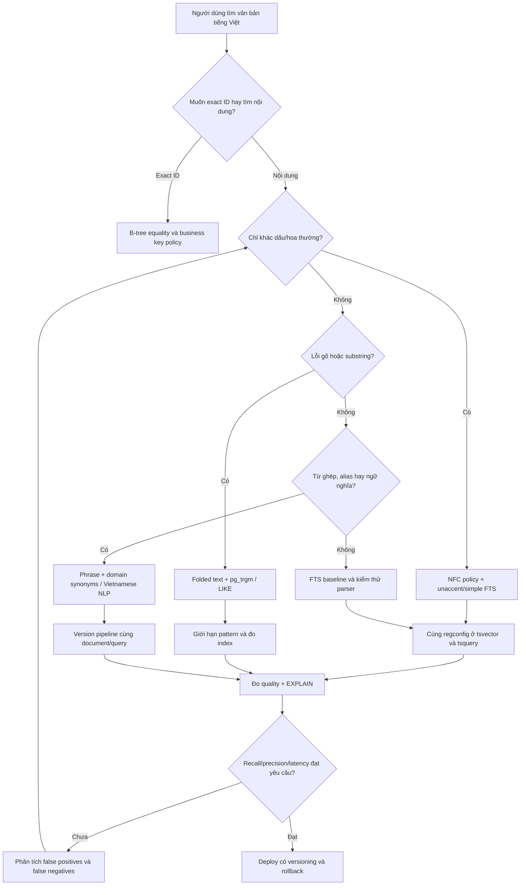

# Đặc thù tiếng Việt, dấu, chuẩn hóa và giới hạn từ điển trong PostgreSQL Full-Text Search

Tìm kiếm văn bản tiếng Việt trong PostgreSQL có một khác biệt quan trọng so với việc chỉ so sánh chuỗi: **“viết không dấu”, “cùng cách biểu diễn Unicode”, “cùng từ” và “cùng ý nghĩa” là bốn yêu cầu khác nhau**.

Một người dùng tìm `pho bo` thường mong thấy nội dung `Phở bò`. Nhưng họ có thể cũng tìm `đường` với ý nghĩa đường phố hoặc đường ăn; một từ không dấu `duong` không thể tự phân biệt hai nghĩa này. Ngoài ra, tiếng Việt thường viết **một từ ghép bằng nhiều âm tiết cách nhau bởi dấu cách**, ví dụ `học sinh`, `sinh học`, `công nghệ thông tin`. Bộ tách token mặc định của PostgreSQL xử lý khoảng trắng và dấu câu, **không tự phân tích ranh giới từ tiếng Việt theo ngữ nghĩa**.

Bài học thuộc chương **Tìm kiếm văn bản** của module *Database Engine Relational PostgreSQL*. Nội dung hướng dẫn cách dùng `to_tsvector`, `tsquery`, text search configuration, extension `unaccent`, Unicode normalization, `pg_trgm` và collation có kiểm soát; đồng thời chỉ ra **những giới hạn phải xử lý ở tầng ứng dụng hoặc pipeline ngôn ngữ riêng**.

> **Định hướng:** PostgreSQL cung cấp nền tảng lập chỉ mục và truy vấn toàn văn rất hữu ích. Nhưng thêm `unaccent` không biến PostgreSQL thành một bộ phân tích ngôn ngữ tiếng Việt hoàn chỉnh. Hãy phân biệt lỗi nhập liệu, bỏ dấu, biến thể chính tả, tách từ, đồng nghĩa và xếp hạng trước khi chọn kỹ thuật.

Các ví dụ SQL sử dụng database thử nghiệm với UTF-8 và các extension được cho phép. Không thay đổi text search configuration, dictionary rules hoặc index production mà chưa có kế hoạch reindex, migration và đo tác động.

## 1. Mục tiêu học tập

Sau bài này, bạn có thể:

1. Giải thích đặc thù tiếng Việt với dấu thanh, chữ `đ/Đ`, dấu cách giữa âm tiết và nhiều nghĩa sau khi bỏ dấu.
2. Phân biệt **Unicode NFC/NFD** với **bỏ dấu** và **chuyển chữ hoa/thường**.
3. Quan sát bộ parser, token types, dictionaries và lexemes qua `ts_debug`.
4. Hiểu vì sao `english` stemming/stopwords không phải cấu hình mặc định phù hợp cho kho văn bản thuần Việt.
5. Tạo một text search configuration kết hợp `unaccent` và `simple`.
6. Dùng cùng configuration để lập `tsvector` và tạo `tsquery` trên nội dung lẫn input người dùng.
7. Thiết lập GIN index, tìm kiếm không dấu và xếp hạng có trọng số.
8. Hiểu khác biệt giữa truy vấn chứa nhiều token, truy vấn cụm từ và tìm kiếm thực sự theo **từ ghép** tiếng Việt.
9. Biết khi nào `pg_trgm`, `LIKE` hoặc B-tree/collation phù hợp hơn FTS.
10. Thiết kế quy trình chuẩn hóa nhất quán, tránh index lỗi thời sau khi đổi dictionary.
11. Viết truy vấn bằng tham số JDBC, giới hạn input và xử lý kết quả an toàn.
12. Xây dựng bộ kiểm thử precision/recall cho văn bản có dấu, không dấu, từ viết tắt và lỗi gõ.

## 2. Nhìn nhanh: các vấn đề khác nhau

| Vấn đề | Ví dụ | Kỹ thuật liên quan | Giới hạn |
|---|---|---|---|
| Hoa/thường | `PHỞ` ↔ `phở` | `lower`, dictionary, collation | Không giải quyết dấu |
| Dấu tiếng Việt | `phở` ↔ `pho` | `unaccent`/chính sách fold | Mất phân biệt các từ |
| Unicode khác biểu diễn | `á` dạng ký tự ghép hoặc tách | `normalize(..., NFC)` | Không bỏ dấu |
| Đ/đ | `Đà` ↔ `Da` | Mapping `unaccent`, kiểm thử rules | Không phải mọi chuẩn transliteration đều giống |
| Âm tiết cách nhau | `học sinh` | Parser tokens, phrase search | Chưa phải bộ tách từ tiếng Việt |
| Từ ghép khác nghĩa | `học sinh` ↔ `sinh học` | `phraseto_tsquery`, vị trí lexeme | Phụ thuộc đúng thứ tự token |
| Từ đồng nghĩa | `TP HCM` ↔ `Sài Gòn` | Alias/synonym dictionary hoặc mapping ứng dụng | Không có sẵn toàn bộ danh mục Việt |
| Lỗi gõ | `postgre` ↔ `postgres` | `pg_trgm`, fuzzy ranking | Có false positives |
| Tên riêng | `Đắk Lắk`, `Buôn Ma Thuột` | Alias/segmentation riêng | Thường nhiều cách viết |
| Mã kỹ thuật | `C++`, `Node.js`, `Q1/2026` | Exact key/prefix/trigram | FTS parser có thể bỏ dấu câu |
| Xếp hạng | `phở bò` vs `phở chay` | `ts_rank`, title boosts | Không hiểu ý định tự nhiên |

**Không có một toán tử đơn lẻ** giải quyết tất cả các hàng trong bảng.

## 3. Ba lớp xử lý chữ Việt

Một pipeline tìm kiếm thường có ba lớp độc lập:

```text
Văn bản gốc / Input
         │
         ▼
Unicode normalization (NFC/NFD nếu cần)
         │
         ▼
Case / accent folding theo chính sách
         │
         ▼
Tokenization và từ điển FTS
         │
         ▼
Lexemes → tsvector / tsquery
         │
         ▼
Index matching → ranking / filtering
```

Thứ tự này là sơ đồ khái niệm. Trong PostgreSQL, `unaccent` có thể hoạt động **bên trong chuỗi dictionary của FTS**, thay vì phải tạo một cột văn bản đã bỏ dấu trước.

### 3.1. Chuẩn hóa biểu diễn không đồng nghĩa mất dấu

Unicode NFC có thể chuyển chuỗi `a` + combining acute thành ký tự `á` đã ghép, nhưng **vẫn giữ dấu sắc**. `unaccent` mới là một chính sách chuyển dấu như `á → a` trong những mappings được hỗ trợ.

### 3.2. Bỏ dấu không đồng nghĩa nhận diện từ

`phở bò` có thể thành `pho bo`, nhưng hai lexemes `pho` và `bo` chưa giúp hệ thống hiểu đó là **một cụm món ăn**. Bộ tìm kiếm cần thêm phrase constraints, entity dictionary hoặc language processing phù hợp nếu nghiệp vụ đòi hỏi.

### 3.3. Tách từ không đồng nghĩa hiểu nghĩa

Ngay cả khi có bộ tách từ tiếng Việt, hệ thống vẫn cần synonym/entity linking nếu muốn gắn `Sài Gòn` với `TP. Hồ Chí Minh` hoặc `bệnh tim` với một tập thuật ngữ y khoa tương đương.

## 4. Unicode và dấu tiếng Việt

Tiếng Việt dùng nhiều ký tự Latin có dấu phụ và dấu thanh, như:

```text
a, à, á, ả, ã, ạ
ă, ằ, ắ, ẳ, ẵ, ặ
â, ầ, ấ, ẩ, ẫ, ậ
e, è, é, ẻ, ẽ, ẹ
ê, ...
i, o, ô, ơ, u, ư, y
đ, Đ
```

`đ` và `Đ` là những chữ cái riêng trong cách viết tiếng Việt, không chỉ là `d` với một dấu thanh Unicode ghép vào.

### 4.1. NFC và NFD

Unicode có thể biểu diễn một số chữ có dấu theo hai hướng:

- **NFC** (*Normalization Form C*): ưu tiên dạng ghép sẵn khi có thể.
- **NFD** (*Normalization Form D*): tách những ký tự có decomposition phù hợp thành ký tự cơ sở và dấu kết hợp.

Ví dụ ý tưởng:

```text
NFC:  "á"       (ký tự có dấu đã ghép)
NFD:  "a" + "◌́" (a và combining acute accent)
```

Người dùng nhìn thấy gần như cùng hình dạng chữ, nhưng chuỗi mã Unicode có thể khác nhau. Nếu hệ thống so bytes hoặc lưu khóa tìm kiếm không chuẩn hóa, sự khác biệt có thể gây miss.

### 4.2. Kiểm chứng bằng PostgreSQL

Trên database có server encoding UTF8:

```sql
SHOW server_encoding;

SELECT
    normalize(U&'a\0301', NFC) AS nfc_text,
    U&'\00E1' AS precomposed_a_acute,
    normalize(U&'a\0301', NFC) = U&'\00E1'
        AS nfc_same;
```

`U&'a\0301'` tạo chữ a kèm combining acute. `U&'\00E1'` tạo ký tự á ghép sẵn. Kết quả `nfc_same` minh họa việc chuẩn hóa về cùng dạng.

Hàm `normalize(text, form)` của PostgreSQL hỗ trợ `NFC`, `NFD`, `NFKC` và `NFKD`; yêu cầu **server encoding UTF8**. Khi dùng bản PostgreSQL cũ, xác nhận phiên bản có hỗ trợ hàm trước khi viết migration.

### 4.3. NFC không phải unaccent

```sql
SELECT
    normalize('phở', NFC) AS preserved_accents;
```

Kết quả vẫn chứa chữ **ở**. Không triển khai chức năng “tìm không dấu” bằng cách chỉ gọi `normalize(..., NFC)`.

### 4.4. NFKC và NFKD có thể đổi tính tương thích

`NFKC/NFKD` thực hiện thêm compatibility normalization. Một số ký tự đặc biệt có thể được biến đổi theo cách khác NFC/NFD. Với mã hàng, tên sản phẩm hoặc văn bản pháp lý, **không mặc định dùng NFKC** nếu chưa kiểm tra ảnh hưởng tới identity và dữ liệu hiển thị.

## 5. Chữ hoa/thường là một bài toán khác

`lower` chuyển chữ hoa/thường theo locale của cơ sở dữ liệu:

```sql
SELECT
    lower('PHỞ BÒ') AS lowercase_text;
```

Giá trị dự kiến trong môi trường Unicode phù hợp là `phở bò`: chữ hoa trở thành chữ thường, **dấu vẫn còn**.

### 5.1. ILIKE có bỏ dấu không?

Thông thường, `ILIKE` là phép so khớp pattern **không phân biệt hoa/thường**, chứ không có lời hứa mặc định rằng `pho` bằng `phở` về dấu.

```sql
SELECT
    'Phở bò' ILIKE '%phở%' AS case_insensitive_pattern;
```

Đừng thay yêu cầu accent-insensitive bằng `ILIKE '%pho%'` rồi kỳ vọng mọi collation/phiên bản đều xử lý dấu giống nhau. Nếu dùng ICU nondeterministic collation đặc biệt, semantics còn phụ thuộc cấu hình; cần kiểm chứng riêng.

## 6. unaccent là gì?

Extension `unaccent` cung cấp:

1. Một **filtering text search dictionary** giúp chuyển những lexemes có dấu theo file rules.
2. Một hàm `unaccent(text)` tiện dùng ở các biểu thức SQL ngoài FTS.

Cài extension nếu có quyền và chưa tồn tại:

```sql
CREATE EXTENSION IF NOT EXISTS unaccent WITH SCHEMA public;
```

Ví dụ:

```sql
SELECT
    public.unaccent('Phở bò Hà Nội') AS folded_food,
    public.unaccent('Đắk Lắk') AS folded_place;
```

Theo rules phổ biến, kết quả tương ứng gần với:

```text
Pho bo Ha Noi
Dak Lak
```

Kết quả chính xác phụ thuộc rules của dictionary đang được dùng. **Hãy kiểm thử những chữ tiếng Việt thực tế của hệ thống**, đặc biệt `đ/Đ` và các tổ hợp Unicode.

### 6.1. unaccent khác transliteration phổ quát

`unaccent` không bảo đảm chuyển mọi ngôn ngữ và mọi biểu diễn Unicode thành ASCII theo một chuẩn bất biến. Nó áp dụng những replacement rules được cài cùng extension hoặc được cấu hình.

Ví dụ quy tắc có thể chuyển `đ → d`, nhưng đừng suy ra mọi chữ đặc biệt của mọi ngôn ngữ cũng có mapping tương tự.

### 6.2. Extension cài ở schema nào?

Lệnh trong lab chỉ định `public` để SQL có thể gọi `public.unaccent` và dùng dictionary `public.unaccent`.

Nếu extension đã tồn tại **ở schema khác**, `IF NOT EXISTS` sẽ không tự chuyển nó sang `public`. Kiểm tra môi trường và dùng schema thực tế thay vì sao chép tên public một cách máy móc.

## 7. unaccent là filtering dictionary, không phải tokenizer

Trong FTS, parser xác định **token boundaries** trước. Dictionary xử lý các token mà parser đã tạo.

```text
"Phở bò Hà Nội"
    │
    ▼
Parser:  "Phở"  "bò"  "Hà"  "Nội"
    │
    ▼
unaccent: "Pho"  "bo" "Ha"  "Noi"
    │
    ▼
simple:  "pho"  "bo" "ha"  "noi"
```

Sơ đồ này minh họa cách hoạt động với chuỗi thông thường. Parser có thể phân loại token khác nhau theo dấu câu/ký tự; dùng `ts_debug` để xem kết quả server thật.

**unaccent không tự gộp “Hà Nội” thành một entity**, không tự hiểu “bò” là thịt bò, và không giải nghĩa các từ đồng âm sau khi bỏ dấu.

### 7.1. Vì sao cần dictionary sau unaccent?

`unaccent` là *filtering dictionary*: nó chuyển token rồi chuyển tiếp sang dictionary tiếp theo. Kết hợp với `simple` cho phép nhận lexeme đã chuyển, thường hạ chữ hoa/thường và giữ những từ không thuộc stoplist.

### 7.2. Không tự dùng dictionary tiếng Anh làm từ điển Việt

Các dictionary stemming tiếng Anh được thiết kế cho ngữ pháp tiếng Anh, không phải thanh điệu, âm tiết và cấu trúc từ tiếng Việt. Một lexeme tiếng Việt sau bỏ dấu có thể trùng tiếng Anh, ví dụ `thế` thành `the`; dictionary tiếng Anh có thể xem `the` là **stop word** và loại bỏ nó.

Kết quả là hệ thống có thể làm mất một token tiếng Việt có nghĩa. Với FTS Việt cơ bản, `simple` thường là baseline an toàn hơn `english` cho bước dictionary cuối.

## 8. full-text parser: token khác từ tiếng Việt

Full-text search thường xử lý văn bản theo chuỗi:

```text
Document
   → parser tokens
   → dictionaries
   → normalized lexemes
   → tsvector positions
```

Ví dụ:

```sql
SELECT to_tsvector(
    'pg_catalog.simple'::regconfig,
    'Phở bò Hà Nội'
);
```

`simple` có thể tách thành các lexemes tương ứng với từng âm tiết theo dấu cách. Nhưng dấu thanh vẫn nằm trong lexeme nếu chưa có `unaccent`.

### 8.1. Tại sao nhiều âm tiết gây khó?

Trong tiếng Việt:

```text
"công nghệ thông tin"
"học sinh"
"sinh học"
"bánh mì"
"điện thoại"
```

các khoảng trắng thường nằm **bên trong từ/cụm nghĩa**. Bộ parser mặc định không đánh dấu “công nghệ” là một đơn vị ngôn ngữ độc lập chỉ dựa vào việc nhìn thấy hai âm tiết.

Vì vậy:

- Kết quả chứa tất cả âm tiết chưa chắc đúng cụm nghĩa người dùng muốn.
- Phrase search giúp ràng buộc thứ tự/khoảng cách, nhưng vẫn không phân loại thực thể.
- Tìm kiếm synonym trên từ ghép cần một tầng từ điển/ngữ nghĩa được thiết kế riêng.

### 8.2. Các ký tự đặc biệt không có nghĩa token được giữ nguyên

Các chuỗi như `C++`, `C#`, `Node.js`, `TP.HCM`, `Q.1`, `email@example.test` có thể được parser phân tách hoặc phân loại thành token types đặc biệt.

Không đoán tokenization từ việc người dùng nhìn thấy dấu chấm/dấu cộng. Dùng `ts_debug` hay `ts_parse` trên các case thực tế.

## 9. ts_debug: công cụ quan sát tốt nhất

`ts_debug(config, text)` trả từng token và cách các dictionaries xử lý nó.

```sql
SELECT
    alias,
    description,
    token,
    dictionaries,
    dictionary,
    lexemes
FROM ts_debug(
    'pg_catalog.simple'::regconfig,
    'Phở bò ở TP.HCM - C++ và Node.js'
);
```

Các cột:

| Cột | Ý nghĩa |
|---|---|
| `alias` | Token type do parser phát |
| `description` | Mô tả token type |
| `token` | Chuỗi token trước dictionary |
| `dictionaries` | Danh sách dictionaries được chọn theo mapping |
| `dictionary` | Dictionary nhận diện token |
| `lexemes` | Mảng lexemes sau xử lý; rỗng khi stop word được loại |

### 9.1. Thử từ rất ngắn và ký tự kỹ thuật

```sql
SELECT alias, token, lexemes
FROM ts_debug(
    'pg_catalog.simple'::regconfig,
    'AI, C#, C++, TP.HCM, Wi-Fi, e-mail, Q1/2026'
);
```

Mục đích không phải đoán output cố định, mà là xem server phân tích ra sao trước khi quyết định FTS là công cụ phù hợp cho những mã và tên riêng này.

### 9.2. Xem tất cả token types của parser

```sql
SELECT *
FROM ts_token_type('pg_catalog.default');
```

Các token types như `word`, `asciiword`, `hword` và những nhóm có dấu gạch nối giúp giải thích tại sao dictionary mappings khác nhau có thể xử lý các trường hợp khác nhau.

## 10. Tạo một text search configuration cho tiếng Việt cơ bản

Trong lab, dùng schema riêng:

```sql
CREATE SCHEMA IF NOT EXISTS demo_vi_search;
CREATE EXTENSION IF NOT EXISTS unaccent WITH SCHEMA public;
```

Tạo cấu hình bằng cách copy `simple`:

```sql
CREATE TEXT SEARCH CONFIGURATION demo_vi_search.vi_fold (
    COPY = pg_catalog.simple
);
```

Sau đó đặt `unaccent` trước `simple` cho các nhóm token từ thông dụng:

```sql
ALTER TEXT SEARCH CONFIGURATION demo_vi_search.vi_fold
ALTER MAPPING FOR
    word,
    asciiword,
    hword,
    asciihword,
    hword_part,
    hword_asciipart
WITH public.unaccent, pg_catalog.simple;
```

Cấu hình này là **baseline thực hành**, không phải “Vietnamese NLP dictionary”. Nó không tự thêm word segmentation hay synonym rules.

### 10.1. Tại sao không chỉ ALTER MAPPING FOR word?

Văn bản hỗn hợp tiếng Việt/ASCII/từ có gạch nối có thể đi qua nhiều token types. Mapping chỉ `word` có thể để một số tokens khác đi qua `simple` trực tiếp mà không có bước unaccent.

Cần dùng `ts_debug` để kiểm chứng những token types thực tế của dữ liệu, và bổ sung mapping cần thiết; không sửa bừa mọi token type nếu không hiểu dữ liệu đặc thù như URL, email, số và ký hiệu.

### 10.2. Vì sao copy pg_catalog.simple?

Nó cung cấp cấu hình parser + các dictionary mappings sẵn có, tránh phải định nghĩa từng token type từ đầu. Ta chỉ thay chain ở các nhóm từ cần fold.

### 10.3. Tên cấu hình nên schema-qualified

Không dựa vào `default_text_search_config` hoặc `search_path` một cách ngầm định khi dữ liệu/index đã được tạo theo một cấu hình cụ thể.

Ưu tiên:

```sql
'demo_vi_search.vi_fold'::regconfig
```

ở cả bên tạo tsvector lẫn bên tạo tsquery.

## 11. Kiểm tra cấu hình vi_fold

```sql
SELECT
    to_tsvector(
        'demo_vi_search.vi_fold'::regconfig,
        'Phở bò Hà Nội'
    ) AS folded_vector;
```

Kết quả dự kiến chứa các lexemes tương ứng gần với `'pho'`, `'bo'`, `'ha'`, `'noi'` cùng positions.

So sánh với `simple`:

```sql
SELECT
    to_tsvector(
        'pg_catalog.simple'::regconfig,
        'Phở bò Hà Nội'
    ) AS no_folding,
    to_tsvector(
        'demo_vi_search.vi_fold'::regconfig,
        'Phở bò Hà Nội'
    ) AS accent_folding;
```

### 11.1. Kiểm tra 'đ' và chữ hoa

```sql
SELECT
    to_tsvector(
        'demo_vi_search.vi_fold'::regconfig,
        'Đường phố, ĐÀ NẴNG, đậu xanh'
    ) AS test_d_and_tones;
```

Kết quả phụ thuộc rules; nếu yêu cầu `đ/Đ` về `d` là một phần contract, viết automated tests cho đúng tập ký tự thay vì coi đây là chi tiết ngẫu nhiên.

### 11.2. Dùng ts_debug trên cấu hình mới

```sql
SELECT alias, token, dictionaries, dictionary, lexemes
FROM ts_debug(
    'demo_vi_search.vi_fold'::regconfig,
    'Phở bò - điện thoại - C++ - TP.HCM'
);
```

Từ dữ liệu quan sát, bạn có thể phân biệt parser không sinh token cần thiết với dictionary nhận token nhưng biến đổi/loại nó.

## 12. Lexeme, position và trọng số

`tsvector` không chỉ là danh sách string thông thường. Nó lưu các lexemes, có thể kèm **vị trí xuất hiện** và trọng số A/B/C/D.

Ví dụ:

```sql
SELECT to_tsvector(
    'demo_vi_search.vi_fold'::regconfig,
    'Phở bò và phở gà'
);
```

Lexeme `pho` có thể xuất hiện ở nhiều positions. Những vị trí giúp phrase search và một số ranking algorithms phân biệt từ xuất hiện ở đâu.

### 12.1. Cùng từ xuất hiện nhiều lần

```sql
SELECT to_tsvector(
    'demo_vi_search.vi_fold'::regconfig,
    'phở phở phở'
);
```

Thay vì ba lexemes giống nhau hoàn toàn tách biệt, `tsvector` biểu diễn một lexeme với những positions tương ứng theo cơ chế text search.

### 12.2. Từ ghép có thể bị phân thành nhiều lexemes

```sql
SELECT to_tsvector(
    'demo_vi_search.vi_fold'::regconfig,
    'công nghệ thông tin'
);
```

Không tự kỳ vọng một lexeme duy nhất `cong_nghe_thong_tin` được tạo. Muốn có một token entity như vậy, cần pipeline tách từ/chuẩn hóa/ngữ nghĩa riêng.

## 13. tsquery phải dùng cùng một chính sách với tsvector

Một hệ thống index văn bản bằng `vi_fold` nhưng query bằng `english` có thể cho kết quả sai vì lexemes không còn khớp.

Mẫu đúng:

```sql
SELECT
    to_tsvector(
        'demo_vi_search.vi_fold'::regconfig,
        'Phở bò Hà Nội'
    )
    @@
    plainto_tsquery(
        'demo_vi_search.vi_fold'::regconfig,
        'pho bo'
    ) AS is_match;
```

Trong môi trường lab chuẩn, kết quả được kỳ vọng TRUE: hai phía cùng bỏ dấu và chuyển thành lexemes tương thích.

### 13.1. Lỗi thường gặp: index có dấu, query không dấu

```sql
-- Không thiết kế như thế này:
to_tsvector('pg_catalog.simple', title)
    @@ plainto_tsquery('demo_vi_search.vi_fold', $1)
```

Bên dữ liệu và bên query không dùng cùng rule normalization, nên truy vấn `pho` có thể không khớp `phở`.

### 13.2. Đừng phụ thuộc default_text_search_config

```sql
SHOW default_text_search_config;
```

Đây là giá trị cấu hình của session/database và có thể là `pg_catalog.english` trong nhiều cài đặt. Câu `to_tsvector(title)` không ghi config rõ ràng sẽ phụ thuộc giá trị đó; điều này không phù hợp với hệ thống cần khóa chính sách tìm kiếm Việt.

## 14. plainto_tsquery, phraseto_tsquery và websearch_to_tsquery

Các hàm tạo tsquery có semantics khác nhau:

| Hàm | Input ví dụ | Mục đích |
|---|---|---|
| `plainto_tsquery` | `học sinh` | Tạo điều kiện có các lexemes, thường nối AND |
| `phraseto_tsquery` | `học sinh` | Yêu cầu lexemes theo thứ tự/vị trí gần nhau |
| `websearch_to_tsquery` | `"học sinh" -đại học` | Cú pháp tìm kiếm thân thiện người dùng, có quoted phrases/OR/minus |
| `to_tsquery` | `'hoc' & 'sinh'` | Truy vấn cú pháp tsquery chuyên biệt |

Thực hành:

```sql
SELECT
    plainto_tsquery(
        'demo_vi_search.vi_fold'::regconfig,
        'học sinh'
    ) AS any_order_tokens,
    phraseto_tsquery(
        'demo_vi_search.vi_fold'::regconfig,
        'học sinh'
    ) AS adjacent_tokens,
    websearch_to_tsquery(
        'demo_vi_search.vi_fold'::regconfig,
        '"học sinh"'
    ) AS quoted_phrase;
```

Thông thường:

```text
plainto_tsquery:   'hoc' & 'sinh'
phraseto_tsquery:  'hoc' <-> 'sinh'
websearch quoted:  'hoc' <-> 'sinh'
```

### 14.1. AND không giữ trật tự

Văn bản `Sinh học và cách học của sinh viên` có thể chứa cả hai lexemes `sinh` và `hoc` nhưng không nhất thiết chứa phrase `học sinh`.

### 14.2. Phrase search vẫn chưa hiểu từ ghép

`'hoc' <-> 'sinh'` kiểm tra vị trí liên tiếp của lexemes, nhưng không phân biệt trong mọi tình huống xem `học sinh` có đang là một entity theo ngữ pháp hay chỉ là hai âm tiết vô tình cạnh nhau.

Phrase là một công cụ kiểm soát **vị trí token**, không phải một bộ phân tích ngữ nghĩa.

## 15. Chọn hàm xử lý input người dùng

Đối với thanh tìm kiếm có nội dung tự do, `websearch_to_tsquery` thường thân thiện hơn `to_tsquery` vì nó xử lý nhiều dấu câu và cú pháp giống công cụ web search.

```sql
SELECT websearch_to_tsquery(
    'demo_vi_search.vi_fold'::regconfig,
    '"phở bò" OR "phở gà"'
);
```

`websearch_to_tsquery` nhận dạng:

- Từ không đặt trong dấu nháy kép: thường nối bằng AND.
- Cụm trong dấu nháy kép: phrase logic.
- `OR`: nhóm OR.
- Dấu trừ: phủ định token/cụm tương ứng.

### 15.1. Không ghép user input vào to_tsquery raw syntax

`to_tsquery` yêu cầu cú pháp chuyên biệt như `'pho' & 'bo'`. Input chưa xử lý `phở bò !!!` có thể gây lỗi cú pháp nếu chuyển nguyên văn vào nơi cần tsquery operators.

Dùng `websearch_to_tsquery(config, ? )` hoặc `plainto_tsquery(config, ?)` với bind values để giảm rủi ro syntax errors và injection.

### 15.2. Input quá dài vẫn gây tốn tài nguyên

Hàm không báo lỗi cú pháp không có nghĩa query luôn rẻ. Hạn chế độ dài input, số từ/clauses, số request và áp dụng statement timeout/monitoring phù hợp.

## 16. Tạo bộ dữ liệu tiếng Việt để thực hành

Sau khi có `demo_vi_search.vi_fold`, tạo bảng:

```sql
CREATE TABLE demo_vi_search.article (
    article_id BIGINT GENERATED ALWAYS AS IDENTITY PRIMARY KEY,
    tenant_id INTEGER NOT NULL,
    title TEXT NOT NULL,
    body TEXT NOT NULL DEFAULT '',
    category TEXT NOT NULL DEFAULT 'general',
    created_at TIMESTAMPTZ NOT NULL DEFAULT clock_timestamp(),

    search_vector TSVECTOR GENERATED ALWAYS AS (
        setweight(
            to_tsvector(
                'demo_vi_search.vi_fold'::regconfig,
                title
            ),
            'A'
        )
        ||
        setweight(
            to_tsvector(
                'demo_vi_search.vi_fold'::regconfig,
                body
            ),
            'B'
        )
    ) STORED
);
```

`search_vector` là **stored generated column**, cần PostgreSQL hỗ trợ generated columns (PostgreSQL 12+). Nó được tính từ `title` và `body` khi ghi row theo biểu thức trên.

### 16.1. Vì sao chọn generated tsvector?

- Query dùng trực tiếp `search_vector` mà không phải lặp lại biểu thức `to_tsvector` dài.
- Cột generated được cập nhật khi title/body thay đổi qua cơ chế PostgreSQL.
- GIN index trên cột này dễ đọc và khó viết sai expression hơn.
- `setweight` gắn trọng số A cho title và B cho body, giúp ranking có thể ưu tiên tiêu đề.

Nhưng cấu hình FTS/dictionary là **dependency vận hành**: nếu đổi rules, những search_vector đã lưu **không tự được backfill lại chỉ vì một dictionary bị chỉnh**. Cần quy trình tái tính/reindex tương ứng.

### 16.2. Tạo GIN index

```sql
CREATE INDEX idx_article_search_vector
ON demo_vi_search.article
USING GIN (search_vector);

CREATE INDEX idx_article_tenant_created
ON demo_vi_search.article (tenant_id, created_at DESC, article_id DESC);
```

GIN index hỗ trợ tra cứu tsvector bằng toán tử `@@`. B-tree index thứ hai phục vụ filter/sort khác; PostgreSQL không mặc định kết hợp hai index như một index đa chiều duy nhất.

## 17. Nạp văn bản có dấu và không dấu

```sql
INSERT INTO demo_vi_search.article
    (tenant_id, title, body, category)
VALUES
    (1, 'Phở bò Hà Nội',
        'Phở bò truyền thống với nước dùng và bánh phở.',
        'food'),
    (1, 'Phở gà Sài Gòn',
        'Món phở gà nóng hổi, ăn kèm hành và rau thơm.',
        'food'),
    (1, 'Bánh mì thịt',
        'Bánh mì Việt Nam với thịt, rau và nước sốt.',
        'food'),
    (1, 'Cà phê sữa đá',
        'Thức uống cà phê và sữa đặc, dùng cùng đá.',
        'drink'),
    (1, 'Cá kho tộ',
        'Món cá kho truyền thống của gia đình.',
        'food'),
    (1, 'Học sinh và nhà trường',
        'Học sinh tìm tài liệu để học môn sinh học.',
        'education'),
    (1, 'Sinh học phân tử',
        'Giáo trình sinh học, nghiên cứu tế bào.',
        'education'),
    (1, 'Thế hệ trẻ',
        'Một bài viết về thế hệ học sinh Việt Nam.',
        'culture'),
    (1, 'Đường phố Hà Nội',
        'Các con đường, ngõ phố và giao thông đô thị.',
        'travel'),
    (1, 'Đường trong thực phẩm',
        'Lượng đường trong đồ uống ngọt.',
        'health'),
    (1, 'Đà Nẵng và Đắk Lắk',
        'Địa danh và cách viết tên riêng có dấu.',
        'travel'),
    (1, 'C++ và Node.js',
        'Tài liệu lập trình C++, C#, Java và Node.js.',
        'technology'),
    (1, 'Dien thoai thong minh',
        'Nội dung nhập theo kiểu tiếng Việt không dấu.',
        'technology'),
    (2, 'Phở bò của tenant khác',
        'Dữ liệu này phải được kiểm soát quyền truy cập.',
        'food');

ANALYZE demo_vi_search.article;
```

Dữ liệu nhỏ chỉ giúp **kiểm tra ngữ nghĩa**. Nó không chứng minh hiệu năng của GIN ở production; planner có thể chọn Seq Scan vì bảng quá nhỏ.

### 17.1. Xem vector sinh ra

```sql
SELECT
    article_id,
    tenant_id,
    title,
    search_vector
FROM demo_vi_search.article
ORDER BY article_id;
```

Bạn có thể kiểm tra từ có dấu và không dấu được biểu diễn thành lexemes như thế nào, đồng thời quan sát trọng số `A`/`B`.

## 18. Tìm "pho bo" ra "Phở bò"

```sql
SELECT article_id, title
FROM demo_vi_search.article
WHERE tenant_id = 1
  AND search_vector @@ websearch_to_tsquery(
      'demo_vi_search.vi_fold'::regconfig,
      'pho bo'
  )
ORDER BY article_id;
```

Dữ liệu có tiêu đề `Phở bò Hà Nội` sẽ phù hợp với các lexemes sau accent folding.

### 18.1. Kiểm tra truy vấn có dấu

```sql
SELECT article_id, title
FROM demo_vi_search.article
WHERE tenant_id = 1
  AND search_vector @@ websearch_to_tsquery(
      'demo_vi_search.vi_fold'::regconfig,
      'phở bò'
  )
ORDER BY article_id;
```

Với cùng configuration, các câu `pho bo` và `phở bò` thường tạo lexemes tương đương theo mapping rules.

### 18.2. Không có guarantee về nghĩa

Cả `phở bò` và `phở bò chay` có thể phù hợp với query; nếu muốn phân loại món chính xác, cần category/entity tags, rule và ranking riêng.

## 19. Tìm có AND khác tìm cụm từ

Query bình thường:

```sql
SELECT title
FROM demo_vi_search.article
WHERE tenant_id = 1
  AND search_vector @@ plainto_tsquery(
      'demo_vi_search.vi_fold'::regconfig,
      'học sinh'
  );
```

thường yêu cầu **cả hai lexemes** `hoc` và `sinh`, không bắt buộc đứng sát nhau.

Query cụm:

```sql
SELECT title
FROM demo_vi_search.article
WHERE tenant_id = 1
  AND search_vector @@ phraseto_tsquery(
      'demo_vi_search.vi_fold'::regconfig,
      'học sinh'
  );
```

thường yêu cầu vị trí `hoc` liền trước `sinh`.

### 19.1. Vì sao cần kiểm thử với nội dung tiếng Việt thật?

Một phrase chính xác về token positions có thể bỏ sót:

- Văn bản có dấu câu giữa hai âm tiết.
- Các cách viết nối bằng dấu gạch nối.
- Từ ghép có cách viết tắt/biến thể.
- Từ đồng nghĩa không chia sẻ token.
- Trường hợp parser phân loại token kỹ thuật khác thường.

Câu hỏi không chỉ là “SQL có chạy?” mà là **“người dùng có được kết quả họ kỳ vọng?”**.

## 20. Bỏ dấu giúp recall nhưng có thể giảm precision

Một số chữ Việt trở nên giống nhau sau khi bỏ dấu:

```text
ma, mà, má, mả, mã, mạ  →  ma
ca, cá, cà, cả, cã, cạ  →  ca
duong: đường / dương / dưỡng / ...
```

Khi hệ thống bỏ dấu, người gõ `ma` có thể nhận cả `má`, `mã`, `mà`. Đây là hệ quả **đã chọn của normalization**, không nhất thiết là bug.

### 20.1. Precision và recall

- **Recall:** trong các tài liệu đúng, hệ thống tìm được bao nhiêu.
- **Precision:** trong các tài liệu được trả về, có bao nhiêu thực sự đúng.

Bỏ dấu thường giúp recall khi người dùng không nhập dấu, nhưng có thể làm giảm precision vì nhiều từ bị gộp.

### 20.2. Chiến lược thực tế: hai tín hiệu

Một ứng dụng có thể:

1. Lấy tập ứng viên bằng FTS không dấu.
2. Ưu tiên các matches **giữ nguyên dấu như query** nếu query có dấu.
3. Tăng điểm cho title match, phrase match hoặc exact product name.
4. Dùng category/tenant/business signals để giảm ambiguity.

Không chỉ lấy `ts_rank` không dấu rồi tuyên bố ranking đã hiểu ngữ nghĩa tiếng Việt.

## 21. Xếp hạng có trọng số title/body

Bảng lab có `search_vector` gắn weight A cho title, B cho body. Có thể xếp hạng:

```sql
WITH q AS (
    SELECT websearch_to_tsquery(
        'demo_vi_search.vi_fold'::regconfig,
        'pho bo'
    ) AS query
)
SELECT
    a.article_id,
    a.title,
    ts_rank(
        ARRAY[0.05, 0.15, 0.4, 1.0]::real[],
        a.search_vector,
        q.query
    ) AS rank_score
FROM demo_vi_search.article AS a
CROSS JOIN q
WHERE a.tenant_id = 1
  AND a.search_vector @@ q.query
ORDER BY rank_score DESC, a.article_id DESC
LIMIT 20;
```

Trong mảng trọng số của `ts_rank`, thứ tự là **D, C, B, A**. Ví dụ trên cho title (A) trọng số lớn nhất.

### 21.1. Ranking score không phải xác suất đúng

`ts_rank` và `ts_rank_cd` dựa trên lexemes, vị trí, tần suất/trọng số và thuật toán cụ thể. Giá trị trả về **không phải** xác suất rằng người dùng thích tài liệu.

### 21.2. Một query không dấu có thể trả nhiều nghĩa

Nếu `duong` match cả đường phố, đường ăn và dương tính, `ts_rank` không tự biết domain intent. Bạn có thể cần mô hình semantic/synonyms và business ranking.

### 21.3. Tiebreaker làm kết quả phân trang ổn định

Nếu nhiều tài liệu có cùng rank, thêm `ORDER BY rank_score DESC, article_id DESC`. Khi rank thay đổi theo dữ liệu mới, phân trang sâu vẫn cần contract consistency/cursor riêng.

## 22. Prefix search khác substring và lỗi chính tả

FTS hỗ trợ **prefix lexeme** trong `to_tsquery`:

```sql
SELECT article_id, title
FROM demo_vi_search.article
WHERE tenant_id = 1
  AND search_vector @@ to_tsquery(
      'demo_vi_search.vi_fold'::regconfig,
      'dien:*'
  );
```

Truy vấn này tìm lexemes có prefix phù hợp sau normalization; ví dụ `dien` có thể liên quan `điện`.

### 22.1. Prefix không phải %substring%

`dien:*` có thể match lexeme bắt đầu bằng `dien`, nhưng không tự match mọi trường hợp chuỗi `dien` nằm **giữa** một token.

### 22.2. Prefix không sửa mọi lỗi gõ

Nếu người dùng gõ sai một ký tự ở đầu hoặc giữa từ, prefix FTS có thể không tìm ra. `pg_trgm` hoặc suggestion pipeline có thể phù hợp hơn.

### 22.3. Không ghép tsquery syntax từ input tùy tiện

Đối với prefix search, cần chuẩn hóa/escape token và giới hạn độ dài; đừng nối raw user input thành `'...:*'` nếu chưa kiểm soát các ký tự đặc biệt và parser semantics. `websearch_to_tsquery` không tự biến mọi từ của user thành prefix query.

## 23. Giới hạn “từ điển tiếng Việt” trong PostgreSQL chuẩn

Cần phân biệt:

- **Parser:** tìm ranh giới tokens.
- **Dictionary:** quyết định lexemes, stopwords, stems, synonym transformations.
- **Text search configuration:** gắn parser với dictionaries theo token type.
- **Thesaurus/synonym list:** tập luật do hệ thống hoặc quản trị viên cung cấp.
- **Bộ tách từ tiếng Việt:** thành phần NLP xác định đơn vị từ ghép/âm tiết.
- **Semantic search:** tìm văn bản gần ý nghĩa dù không chia sẻ lexemes.

PostgreSQL core cung cấp một số cấu hình/ngôn ngữ và dictionary mechanisms, nhưng **không có một pipeline FTS tiếng Việt đầy đủ tự động giải quyết mọi từ ghép, dấu, từ địa phương và đồng nghĩa** chỉ bằng `default_text_search_config`.

### 23.1. simple dictionary không phân loại từ ghép

`simple` thường nhận token và đưa thành lexeme (cùng xử lý chữ hoa/thường). Nó không biến tự động `công nghệ thông tin` thành một từ đồng nghĩa duy nhất với `CNTT`.

### 23.2. unaccent không phân loại từ ghép

`unaccent` chỉ làm các phép chuyển ký tự/chuỗi theo rules, không quyết định hai âm tiết nào tạo thành một từ.

### 23.3. English stemmer không phải Vietnamese stemmer

Không dùng `english` chỉ vì nó “thông minh” hơn `simple` trên tiếng Anh. Với văn bản thuần Việt, nó có thể loại stopwords vô tình trùng hoặc thay đổi lexemes theo quy tắc ngôn ngữ khác.

### 23.4. Từ điển tùy chỉnh có giới hạn

Một synonym dictionary có thể map các lexemes theo luật đã định. Thesaurus có thể xử lý nhiều từ theo cơ chế riêng, nhưng dictionary `unaccent` **không thể được dùng như một normalizing dictionary trực tiếp cho thesaurus** theo implementation hiện tại. Việc phối hợp cần thiết kế và kiểm thử thay vì ghép tên dictionaries một cách tùy ý.

## 24. Từ điển đồng nghĩa: phải đặt đúng tầng

Ví dụ ý tưởng:

```text
"TP HCM"       ↔ "Thành phố Hồ Chí Minh"
"Sài Gòn"      ↔ "TP HCM"
"CNTT"         ↔ "công nghệ thông tin"
"điện thoại"   ↔ "smartphone" (chỉ trong ngữ cảnh phù hợp)
```

Có ít nhất ba hướng:

1. **Alias table ở application/search layer:** lưu canonical entity ID và nhiều cách viết.
2. **Index thêm terms đã xử lý:** tài liệu được enrich với tokens/synonyms có kiểm soát.
3. **Text search dictionary/thesaurus tùy chỉnh:** phù hợp một số loại luật lexeme nhưng đòi hỏi maintenance và hiểu parser.

### 24.1. Một synonym không luôn có nghĩa hai từ tương đương

`đường` trong một công thức nấu ăn khác `đường` trong giao thông. Mở rộng synonym mù quáng có thể làm search precision tệ hơn.

### 24.2. Vấn đề update dictionary

Khi alias rules thay đổi, tài liệu/index đã được chuẩn hóa hoặc thêm tokens trước đó có thể cần **recompute/reindex**. Đừng sửa từ điển rồi chỉ kiểm tra query mới; phải kiểm tra cả indexed data.

## 25. Tên riêng địa phương và nhiều cách viết

Tên riêng là trường hợp thường khó hơn từ phổ thông:

```text
"Thành phố Hồ Chí Minh"
"TP.HCM"
"TP HCM"
"Sài Gòn"
"Ho Chi Minh City"
"HCMC"
```

Bỏ dấu chỉ giải quyết một phần:

```text
"Thành phố Hồ Chí Minh"
   → "Thanh pho Ho Chi Minh"
```

Nó **không tự kết luận** `HCMC` hay `Sài Gòn` tương đương. Vì vậy dữ liệu địa danh, sản phẩm và tổ chức thường cần alias/entity table hoặc một knowledge-base chuyên biệt.

### 25.1. Không áp dụng chuẩn hóa quá mức với mã định danh

`ĐN01` có thể là mã nghiệp vụ riêng; tự bỏ dấu và hạ chữ ở mọi nơi có thể làm trùng với mã khác. Tách:

- **Display text**: giữ nguyên.
- **Search text**: có thể fold theo chính sách.
- **Business identifier**: giữ canonical identity chính xác, có unique constraint phù hợp.

Không dùng cột search normalized làm khóa giao dịch nếu business identity yêu cầu phân biệt.

## 26. Các kiểu lỗi gõ tiếng Việt thường gặp

Người dùng có thể nhập:

- Không dấu: `pho bo` thay vì `phở bò`.
- Thiếu dấu/đặt dấu không chuẩn.
- Chữ `d` thay `đ`.
- Thiếu khoảng trắng: `dienthoai`.
- Thêm khoảng trắng: `đi ện thoại`.
- Kiểu gõ Telex chưa chuyển: `pho w`, `dduowngf`.
- Kiểu gõ VNI chưa chuyển.
- Từ viết tắt `HCM` hoặc tiếng Anh pha Việt.
- Sai chính tả thật, không chỉ khác dấu.

`unaccent` xử lý tốt **một phần biến thể có dấu/không dấu**, nhưng không bảo đảm sửa **Telex chưa chuyển**, split/merge whitespace, typo hay abbreviation.

### 26.1. Chuẩn hóa input Telex không phải nhiệm vụ unaccent

Nếu cần tự hiểu chuỗi Telex raw, dùng bộ xử lý input chuyên dụng hoặc product logic đã được kiểm chứng. Không viết một loạt `replace()` đơn giản rồi coi đã có bộ gõ tiếng Việt hoàn chỉnh.

## 27. Khi nào dùng pg_trgm?

Extension `pg_trgm` đo similarity dựa trên các **trigram** và cung cấp GIN/GiST operator classes cho tìm kiếm fuzzy/pattern.

```sql
CREATE EXTENSION IF NOT EXISTS pg_trgm WITH SCHEMA public;
```

Các toán tử/hàm quan trọng:

| Kỹ thuật | Vai trò |
|---|---|
| `similarity(a,b)` | Độ tương đồng trigram trong khoảng 0..1 |
| `a % b` | True nếu similarity vượt threshold hiện hành |
| `a <% b` | Word similarity theo một đoạn của b |
| `a <<% b` | Strict word similarity có xét biên từ |
| `a <-> b` | Trigram distance = 1 - similarity |
| `gin_trgm_ops` | GIN index cho similarity và pattern matching |
| `gist_trgm_ops` | GiST index, hữu ích cả kNN distance ordering |

### 27.1. Trigram không tự bỏ dấu Việt

Nếu cột raw chứa `phở bò` nhưng input là `pho bo`, tập trigrams có thể khác. Với bài toán không dấu + typo, thường cần một **cột search_folded** được chuẩn hóa nhất quán trước khi lập trigram index.

### 27.2. Trigram không hiểu ngữ nghĩa

`phở bò` và `phở gà` chia sẻ nhiều cấu trúc ký tự, nhưng không phải cùng món. Trigram trả điểm tương tự chữ viết, không trả độ tương đồng ngữ nghĩa.

## 28. Vì sao không index trực tiếp unaccent(title) dễ dàng?

Một biểu thức index/generation trong PostgreSQL cần tuân theo quy tắc **immutability**.

Hàm `unaccent(text)` dùng dictionary rules có thể thay đổi, nên thường được khai báo **STABLE**, không phải IMMUTABLE. Do đó các mẫu như:

```sql
-- KHÔNG NÊN GIẢ ĐỊNH HỢP LỆ:
CREATE INDEX idx_title_unaccent
ON demo_vi_search.article
USING GIN (
    public.unaccent(title) public.gin_trgm_ops
);
```

có thể bị PostgreSQL từ chối vì biểu thức index dùng hàm không immutable.

### 28.1. Đừng “sửa” bằng wrapper IMMUTABLE giả

Một số ví dụ trên Internet tạo function bọc `unaccent` rồi đánh dấu `IMMUTABLE` để lách yêu cầu. Nhưng nếu rules hay extension được đổi, đầu ra function có thể đổi dù dữ liệu input không đổi, vi phạm hợp đồng immutable.

Hậu quả là index có thể không còn đại diện đúng dữ liệu đã tính. Không dùng wrapper như vậy trong hệ thống nghiêm túc mà không có sự kiểm soát chặt chẽ và chiến lược rebuild rõ ràng.

### 28.2. Phương án an toàn: cột lưu sẵn

Dùng một cột search text được tính và duy trì bởi application hoặc trigger, rồi lập `pg_trgm` index trên **cột**. Khi thay normalization rules, có thể backfill toàn bộ cột và rebuild index có kiểm soát.

## 29. Thêm search_folded để tìm fuzzy và substring

Trên bảng lab:

```sql
ALTER TABLE demo_vi_search.article
ADD COLUMN search_folded TEXT;
```

Backfill bằng quy tắc rõ ràng:

```sql
UPDATE demo_vi_search.article
SET search_folded = public.unaccent(
    lower(normalize(title || ' ' || body, NFC))
);
```

Biểu thức này:

1. Ghép title/body với một khoảng trắng.
2. Chuẩn hóa Unicode NFC.
3. Hạ chữ hoa/thường theo locale.
4. Bỏ dấu theo extension rules.

### 29.1. Cột search phải được duy trì khi dữ liệu thay đổi

Một lần `UPDATE` backfill không đủ nếu ứng dụng tiếp tục INSERT hoặc đổi title/body. Có thể chọn:

- Application ghi search_folded theo cùng version rule.
- Trigger ở database.
- Batch ETL/queue cập nhật với SLA chấp nhận lag.
- Một search service/index riêng.

Không để cột normalized bị stale mà query vẫn dựa vào nó như dữ liệu chuẩn.

## 30. Trigger duy trì cột normalized

Ví dụ minh họa cho lab:

```sql
CREATE FUNCTION demo_vi_search.fill_search_folded()
RETURNS trigger
LANGUAGE plpgsql
AS $fn$
BEGIN
    NEW.search_folded := public.unaccent(
        lower(normalize(NEW.title || ' ' || NEW.body, NFC))
    );
    RETURN NEW;
END;
$fn$;

CREATE TRIGGER trg_article_search_folded
BEFORE INSERT OR UPDATE OF title, body
ON demo_vi_search.article
FOR EACH ROW
EXECUTE FUNCTION demo_vi_search.fill_search_folded();
```

Sau khi trigger được cài, mỗi INSERT/UPDATE thay title/body sẽ đặt lại `search_folded`.

### 30.1. Cần backfill một lần cho hàng cũ

Trigger không tự chạy ngược trên các rows đã tồn tại. Ta đã dùng UPDATE ở phần trước để backfill. Với bảng lớn, backfill phải chia batch/transaction đúng, theo dõi WAL, replica lag và lock duration.

### 30.2. Trigger không miễn phí

Nó tăng CPU và write amplification. Nếu title/body lớn, gọi normalization trên mỗi UPDATE có thể tốn chi phí. Không dùng trigger cho mọi text column chỉ vì có thể.

### 30.3. Không bật NOT NULL cho search_folded nếu chưa bảo đảm

Trước khi thêm `NOT NULL`, phải chắc chắn mọi rows cũ đã backfill và tất cả writer paths đều duy trì nó. Với ingestion bulk/replication/triggers disabled, cần kiểm tra cơ chế thực thi thực tế.

## 31. Tạo trigram index cho search_folded

```sql
CREATE INDEX idx_article_search_folded_trgm
ON demo_vi_search.article
USING GIN (search_folded public.gin_trgm_ops);

ANALYZE demo_vi_search.article;
```

Tìm chuỗi không dấu:

```sql
SELECT article_id, title
FROM demo_vi_search.article
WHERE tenant_id = 1
  AND search_folded LIKE '%pho bo%'
ORDER BY article_id;
```

Vì `search_folded` đã được lower/unaccent, `LIKE` trên literal lowercase có thể dùng làm substring search cho ví dụ.

### 31.1. Input pattern động phải escape wildcard

`%` và `_` trong `LIKE` là ký tự wildcard. JDBC bind giúp chống SQL injection khi dùng `?`, nhưng **không tự làm cho dấu %/_ trở thành literal**.

Nếu muốn tìm chuỗi con đúng nghĩa, escape wildcard theo một quy ước `ESCAPE` nhất quán trước khi thêm dấu % hai bên. Tránh cho raw user input trực tiếp trở thành pattern không giới hạn.

### 31.2. Pattern quá ngắn có thể khó tối ưu

`pg_trgm` khai thác các trigrams trong pattern. Những query ngắn hoặc không trích được trigram hữu ích có thể phải scan nhiều index entries hoặc toàn index. Tiếng Việt có nhiều âm tiết ngắn như `an`, `ba`, `ly`, nên cần đo thực tế.

## 32. Tìm lỗi gõ bằng trigram similarity

```sql
SELECT
    article_id,
    title,
    similarity(search_folded, 'pho bo') AS sim
FROM demo_vi_search.article
WHERE tenant_id = 1
  AND search_folded % 'pho bo'
ORDER BY sim DESC, article_id DESC
LIMIT 20;
```

Operator `%` dùng ngưỡng `pg_trgm.similarity_threshold` của session.

### 32.1. Threshold có trade-off

Threshold thấp:

- Có thể tìm thêm những lỗi gõ.
- Cũng có thể trả nhiều tài liệu ít liên quan.

Threshold cao:

- Precision có thể tốt hơn.
- Nhưng bỏ sót những từ gõ sai nhiều ký tự.

Đo trên bộ query thực tế, không lấy ngưỡng mặc định như chuẩn cho mọi ứng dụng.

### 32.2. Similarity trên toàn document có thể không tốt

Một query ngắn `pho bo` so với body dài nhiều đoạn có similarity rất thấp do nhiều trigrams của document không liên quan.

Có thể cân nhắc:

- `word_similarity`/`strict_word_similarity` trên một vùng.
- Tách title/keywords/terms vào cột riêng.
- FTS để lấy ứng viên, trigram để rerank/fallback.
- Tìm trong dictionary của terms thay vì cả body.
- Một search engine chuyên biệt khi yêu cầu phức tạp.

Không lấy phép similarity trên raw bài viết dài làm câu trả lời duy nhất cho typo search.

## 33. GIN và GiST cho trigram khác nhau

Cả GIN và GiST có operator class cho pg_trgm, nhưng có những khác biệt:

- **GIN** thường phù hợp tập truy vấn lọc bởi matching/similarity/pattern theo chi phí cụ thể.
- **GiST** có thể hỗ trợ **k-nearest-neighbor ordering** theo trigram distance, như `ORDER BY search_folded <-> query LIMIT n` trong những trường hợp phù hợp.
- GIN không phục vụ cách sắp theo distance top-N giống GiST kNN một cách tương đương.

Ví dụ index GiST **để so sánh trên lab**:

```sql
CREATE INDEX idx_article_search_folded_gist
ON demo_vi_search.article
USING GiST (search_folded public.gist_trgm_ops);
```

Và query:

```sql
SELECT article_id, title
FROM demo_vi_search.article
WHERE tenant_id = 1
ORDER BY search_folded <-> 'pho bo', article_id
LIMIT 10;
```

Planner có thể tận dụng GiST kNN theo distance, tùy điều kiện/filter và dữ liệu. **Không giữ cả hai index GIN/GiST production chỉ vì chúng đều có tên trigram**; benchmark workload và write costs.

## 34. Full-text search, trigram và ILIKE khác nhau

| Kỹ thuật | Hỏi gì? | Tốt cho | Không tự làm |
|---|---|---|---|
| `tsvector @@ tsquery` | Lexemes có thỏa điều kiện? | Từ/token, phrase, ranking, GIN | Substring tùy ý, typo tổng quát |
| `ILIKE '%x%'` | Có chuỗi con theo pattern? | Substring, case-insensitive | Bỏ dấu mặc định và semantic matching |
| `LIKE` trên search_folded | Chuỗi đã fold chứa pattern? | Không dấu + substring | Stemming/từ ghép |
| `pg_trgm` | Chuỗi/đoạn có các trigram tương tự? | Typo, gần giống cách viết | Hiểu nghĩa/ngữ cảnh |
| B-tree equality | Hai keys có bằng nhau theo semantics? | Canonical ID/name, uniqueness | Tìm mọi từ trong body |
| ICU collation | So sánh/sắp theo locale/cấp độ? | Một số equality/order/case/accent policies | FTS language segmentation |

Một hệ thống tìm kiếm tốt thường có **nhiều chiến lược**, nhưng chỉ giữ những index realmente phục vụ workload đã đo. Không phải query nào cũng phải OR toàn bộ kỹ thuật.

## 35. ICU nondeterministic collation là một hướng khác

PostgreSQL có thể dùng ICU collation với mức so sánh bỏ qua accent/case khác biệt trong các tình huống thích hợp.

Trên server được build với ICU và có quyền tạo collation:

```sql
CREATE COLLATION demo_vi_search.ignore_accent_case (
    provider = icu,
    locale = 'und-u-ks-level1',
    deterministic = false
);
```

Ví dụ:

```sql
SELECT
    'café' = 'cafe'
        COLLATE demo_vi_search.ignore_accent_case
    AS same_under_selected_collation;
```

Cấu hình trên minh họa equality accent-insensitive/case-insensitive theo ICU level, **không phải Vietnamese FTS dictionary**.

### 35.1. Collation không tự sinh lexemes tương ứng

Nếu `search_vector` đã được tạo theo `simple` và giữ dấu, việc đổi collation trong một phép so sánh text bên ngoài **không tự tái tạo tsvector đã được index**. Pipeline FTS vẫn cần text search configuration của nó.

### 35.2. Tính năng pattern matching phụ thuộc phiên bản

Một số pattern operators trên nondeterministic collations có giới hạn và thay đổi theo PostgreSQL version. Trong PostgreSQL hiện đại, `LIKE` có hỗ trợ những trường hợp nondeterministic collations, nhưng regex/`SIMILAR TO` vẫn có giới hạn. Đừng suy luận mọi `LIKE`, `ILIKE`, regex và trigram index đều tương thích với mọi collation tự định nghĩa.

### 35.3. Collation equality và UNIQUE là quyết định dữ liệu

Nếu tạo unique index theo collation coi hai chuỗi khác dấu là bằng nhau, database có thể **cấm lưu hai tên mà nghiệp vụ muốn phân biệt**. Chỉ dùng collation như vậy cho uniqueness khi đó thực sự là business rule.

## 36. Accent folding, collation và Unicode normalization khác nhau

Một ví dụ tư duy:

```text
Input A: "café" (composed)
Input B: "café" (e + combining accent)
Input C: "cafe"
```

- `normalize(..., NFC)` đưa A/B về cùng dạng Unicode phù hợp nhưng vẫn có dấu.
- `unaccent` có thể chuyển A/B về dạng gần với C nếu rules xử lý các biểu diễn tương ứng.
- ICU nondeterministic collation có thể **coi những chuỗi này tương đương trong so sánh** theo strength, nhưng **không thay đổi bytes được lưu**.
- FTS dictionaries biến tokens thành lexemes và có thể bỏ khác biệt ở bước index/search.

### 36.1. Không thay đổi dữ liệu hiển thị nếu chỉ muốn tìm không dấu

Một chiến lược an toàn là:

```text
display_title: "Phở bò Hà Nội"
search_vector: các lexemes đã fold
search_folded: "pho bo ha noi ..."
```

Người dùng vẫn nhìn thấy chữ có dấu đúng, còn hệ thống dùng normalized representations để tìm kiếm.

## 37. Vì sao cần chuẩn hóa cả khi unaccent có thể bỏ dấu?

Dữ liệu có thể đến từ:

- Mobile keyboards khác nhau.
- API Java/JavaScript.
- Import CSV/Excel từ nhiều hệ điều hành.
- OCR và speech-to-text.
- Copy-paste từ tài liệu.
- Các bước encode/decode liên tiếp.

Dù unaccent rules xử lý nhiều trường hợp, có thể có khác biệt ở combining marks, compatibility characters hoặc glyphs. **NFC trước khi index và trước khi xây query** giúp giảm đa dạng biểu diễn, đặc biệt khi bạn cũng có equality, B-tree, pg_trgm hoặc cache keys.

### 37.1. Một policy thống nhất

Ví dụ contract cho cột search_folded:

```text
Version: vi-search-v1
1. Unicode NFC
2. lower theo DB locale
3. unaccent theo rules hiện hành
4. giữ khoảng trắng tương đối gốc, trừ cleaning có chủ đích
```

Nếu backend Java dùng algorithm khác DB, search_folded của document và query có thể lệch. Tốt nhất là **cùng một implementation/version** hoặc test equivalence rất chặt.

## 38. Generated column và immutability

Generated column yêu cầu expression hợp lệ theo quy tắc immutability của PostgreSQL.

Trong bảng lab, biểu thức:

```sql
to_tsvector(
    'demo_vi_search.vi_fold'::regconfig,
    title
)
```

sử dụng bản hàm có **config regconfig được chỉ định tường minh**, phù hợp để thiết kế expression index/generated tsvector ở các phiên bản hỗ trợ.

Nhưng:

```sql
to_tsvector(title)
```

dựa trên default config của session/database và không nên được dùng trong expression index/generated column với kỳ vọng immutable giống bản cấu hình cố định.

### 38.1. Không coi dictionary settings là bất biến trong vận hành

Dù biểu thức `to_tsvector(config,text)` được hệ thống cho phép trong index/generated column, quy tắc dictionary/configuration vẫn có thể bị quản trị viên đổi bên ngoài dữ liệu.

Khi chuyển:

```text
vi_fold_v1 → vi_fold_v2
```

hãy lên kế hoạch build lại các search vectors/indexes; không để documents mới dùng rules mới và documents cũ giữ lexemes cũ mà không quản lý version.

## 39. Thay đổi từ điển và index cũ

Những thay đổi có thể ảnh hưởng FTS:

- `ALTER TEXT SEARCH CONFIGURATION` thay thứ tự dictionaries/mappings.
- `ALTER TEXT SEARCH DICTIONARY` đổi RULES.
- Thay nội dung file unaccent rules.
- Extension upgrade hoặc thay logic custom dictionary.
- Thay preprocessing/tách từ ở ứng dụng.
- Đổi tên/cấu trúc cột được đưa vào tsvector.

### 39.1. Kiểu index expression

Nếu index chứa trực tiếp biểu thức `to_tsvector(config, text_column)`, khi rules/config đổi, **index entries có thể không tương ứng với cách query hiện tại tạo lexemes**. Cần REINDEX theo quy trình thích hợp.

### 39.2. Kiểu stored generated tsvector

Nếu lưu `search_vector` trong hàng, dữ liệu vector đã tính **không tự được tái tính cho mọi hàng cũ** chỉ nhờ dictionary config đổi. Cần recompute/backfill các rows rồi bảo trì index tương ứng.

### 39.3. Chuẩn hóa cột text persisted

Nếu dùng `search_folded`, đổi rules phải dẫn đến backfill cột đó và index update/rebuild phù hợp. Ghi version chính sách và kiểm thử trên staging trước khi rollout.

**Không chỉ REINDEX cột GIN trên search_vector nếu giá trị search_vector trong heap đã cũ.** Index mới trên dữ liệu tsvector cũ vẫn có lexemes cũ.

## 40. Một quy trình versioning không làm mất dữ liệu

Ví dụ triển khai phiên bản mới:

```text
vi_fold_v1 + search_vector_v1 (đang phục vụ)
              │
              ▼
Tạo vi_fold_v2 / rules v2
              │
              ▼
Backfill search_vector_v2 / index v2
              │
              ▼
Test query set, precision/recall, latency
              │
              ▼
Canary route một phần traffic
              │
              ▼
Chuyển read path sang v2
              │
              ▼
Theo dõi kết quả và rollback
              │
              ▼
Thu hồi v1 sau khi không còn phụ thuộc
```

Các bước tạo generated columns mới, backfill và concurrent index construction có lock/storage/DDL constraints theo phiên bản. Không làm trên bảng rất lớn mà không đo WAL/replication/lock và capacity.

## 41. EXPLAIN cho truy vấn tiếng Việt

```sql
EXPLAIN (ANALYZE, BUFFERS)
SELECT article_id, title
FROM demo_vi_search.article
WHERE tenant_id = 1
  AND search_vector @@ websearch_to_tsquery(
      'demo_vi_search.vi_fold'::regconfig,
      'pho bo'
  )
LIMIT 20;
```

Các đường plan có thể gồm:

```text
Bitmap Heap Scan on article
  Recheck Cond: (search_vector @@ ...)
  -> Bitmap Index Scan on idx_article_search_vector
       Index Cond: (search_vector @@ ...)
```

hoặc `Seq Scan` khi bảng nhỏ/filter kém chọn lọc.

### 41.1. GIN index không có nghĩa luôn dùng GIN

Planner dựa trên thống kê, chi phí I/O, cache và số rows ước lượng. Với 14 rows lab, Seq Scan có thể nhanh hơn.

### 41.2. AND với tenant_id

B-tree index `tenant_id` và GIN index `search_vector` không tự biến thành một index duy nhất. Planner có thể bitmap combine hoặc scan một phía rồi filter phía còn lại, tùy cost.

Nếu hệ thống đa tenant, **authorization phải được bảo vệ riêng** ở application query/RLS; không coi sự hiện diện của tenant condition trong ví dụ là chính sách bảo mật hoàn chỉnh.

### 41.3. EXPLAIN ANALYZE thực thi truy vấn

Ở đây `SELECT` có ít tác động dữ liệu; nhưng `EXPLAIN ANALYZE` trên DML thực sự chạy DML. Không dùng nó với câu UPDATE/DELETE production khi chưa có bảo vệ phù hợp.

## 42. Debug khi query không có kết quả

Bắt đầu bằng bốn câu:

1. Parser có phát ra token mong muốn không?
2. Dictionaries có tạo lexeme hay loại token như stopword?
3. Query và indexed data có dùng **cùng config/version** không?
4. Index/tsvector có phản ánh dữ liệu **mới nhất** không?

Lệnh hữu ích:

```sql
SELECT *
FROM ts_debug(
    'demo_vi_search.vi_fold'::regconfig,
    'điện thoại'
);

SELECT to_tsvector(
    'demo_vi_search.vi_fold'::regconfig,
    'Điện thoại thông minh'
);

SELECT websearch_to_tsquery(
    'demo_vi_search.vi_fold'::regconfig,
    'dien thoai'
);
```

### 42.1. Token bị loại vì không có mapping

`ts_debug` có thể cho thấy token không được dictionary nào nhận diện trong cấu hình. Cần xem token alias và mappings trước khi thêm dictionary mới.

### 42.2. Từ bị biến thành stopword

Nếu `lexemes={}`, dictionary có thể đã nhận token là stop word và loại nó. Với từ tiếng Việt fold giống tiếng Anh, cần tránh dùng stoplist ngoại ngữ không phù hợp.

### 42.3. Query tạo tsquery rỗng

Có những inputs chỉ có dấu câu/stopwords nên tsquery có thể rỗng hoặc không có phần indexable. Dùng `numnode()` và các kiểm tra ứng dụng tương ứng; không tự chạy một truy vấn dữ liệu cực rộng để “bù” cho truy vấn rỗng.

```sql
SELECT
    numnode(
        websearch_to_tsquery(
            'demo_vi_search.vi_fold'::regconfig,
            '!!!'
        )
    ) AS query_node_count;
```

### 42.4. Dữ liệu đã có index nhưng vẫn miss

Kiểm tra `search_vector` ở hàng mẫu và xem nó có chứa lexemes sau normalization mong muốn không. Nếu vector được backfill dưới rules cũ, REINDEX đơn lẻ có thể không sửa được dữ liệu tsvector persisted.

## 43. Kiểm tra ánh xạ dictionary từ catalog

Xem configuration hiện có:

```sql
SELECT
    n.nspname AS schema_name,
    c.cfgname AS config_name
FROM pg_ts_config AS c
JOIN pg_namespace AS n ON n.oid = c.cfgnamespace
WHERE n.nspname = 'demo_vi_search';
```

Xem cách token được xử lý bằng `ts_debug` như các mục trước; nó thường dễ hiểu hơn một query catalog dài.

### 43.1. Không coi tên dictionary giống nhau là cùng phiên bản rules

Hai databases có thể đều có dictionary tên `unaccent` nhưng đã thay file rules hoặc có phiên bản extension khác nhau. Khi dữ liệu được restore/migrate, cần kiểm tra settings và output test cases, không chỉ tên object.

## 44. Hàm highlight không trả HTML an toàn mặc định

`ts_headline` có thể tạo đoạn trích với những từ match được đánh dấu:

```sql
WITH q AS (
    SELECT websearch_to_tsquery(
        'demo_vi_search.vi_fold'::regconfig,
        'pho bo'
    ) AS query
)
SELECT
    a.title,
    ts_headline(
        'demo_vi_search.vi_fold'::regconfig,
        a.body,
        q.query,
        'StartSel=<mark>, StopSel=</mark>, MaxWords=18'
    ) AS excerpt
FROM demo_vi_search.article AS a
CROSS JOIN q
WHERE a.tenant_id = 1
  AND a.search_vector @@ q.query;
```

**Bảo mật:** `ts_headline` có thể xuất nguyên những đoạn văn bản đầu vào cùng marker. Nó không được coi là HTML được escape/sanitize an toàn cho trình duyệt.

Nếu title/body có nội dung người dùng nhập, phải thực hiện escaping/sanitization phù hợp trước khi render vào HTML, tránh XSS. Không cho client tự đưa markup options tùy ý nếu điều đó vi phạm chính sách giao diện/bảo mật.

## 45. Exact match, normalization và business identity

Một tên hiển thị có thể cần match không dấu, nhưng một mã hàng hoặc mã tài khoản có thể yêu cầu **exact equality**.

Ví dụ:

```sql
SELECT article_id
FROM demo_vi_search.article
WHERE title = 'Phở bò Hà Nội';
```

Đây là phép equality trên text, semantics phụ thuộc collation và kiểu dữ liệu; nó không giống lexeme search `@@`.

### 45.1. Không thay PRIMARY KEY bằng normalized title

Nếu `title` khác dấu nhưng folding giống nhau, unique key dựa trên fold có thể coi các tên khác nghĩa là một. Tách:

- `article_id`: identity.
- `title`: display value.
- `search_vector` / `search_folded`: retrieval representations.

### 45.2. Tên riêng có thể phải giữ dấu để đối chiếu pháp lý

Với tài liệu pháp lý, hóa đơn hoặc tên công ty, bảo toàn nguyên văn có dấu là quan trọng. Search normalized là đường tra cứu phụ; không được sửa chữ hiển thị gốc trong dữ liệu nguồn chỉ để “tìm nhanh”.

## 46. Từ ghép tiếng Việt: khi nào cần xử lý bên ngoài PostgreSQL FTS?

Bài toán:

```text
"Công nghệ thông tin"
"trí tuệ nhân tạo"
"máy học"
"bất động sản"
"bảo hiểm nhân thọ"
```

Có thể cần biết mỗi cụm là một entity/term. Nếu chỉ tách theo whitespace, một phrase dài có thể bị match/score theo những âm tiết phổ biến không đủ phân biệt.

Những hướng nâng cao:

1. **Word segmentation trước indexing** bằng công cụ NLP tiếng Việt thích hợp.
2. Thêm cả **surface text** và **normalized entity tokens** vào search fields.
3. Tạo **phrase synonyms** có kiểm soát theo domain.
4. Index entity IDs hoặc tags riêng.
5. Kết hợp FTS với semantic retrieval cho câu hỏi phức tạp.

### 46.1. Một ví dụ về segmented terms

Giả sử bộ tách từ chuyên dụng tạo:

```text
"công nghệ thông tin"
→ "công_nghệ thông_tin"
```

Đây chỉ là **minh họa output của một hệ thống segmentation**, không phải output mặc định của PostgreSQL. Nếu đem chuỗi với dấu gạch dưới vào FTS, parser có thể xử lý theo những quy tắc token riêng; cần xác nhận lexemes bằng `ts_debug`.

Nếu muốn bảo toàn exact entity, đôi khi index **entity ID trong một cột riêng** an toàn hơn dựa vào ký hiệu gạch dưới.

### 46.2. Pipeline segmentation phải đồng bộ hai phía

Document dùng segmented tokens còn query giữ nguyên syllables có thể không match. Bắt buộc dùng cùng algorithm/version ở indexing và query path hoặc có mapping equivalence được kiểm chứng.

### 46.3. Không phải mọi trường hợp cần NLP

Với danh mục nhỏ, bài viết ít, và query chủ yếu là một vài từ cơ bản, `simple + unaccent + GIN` có thể đủ. Đừng gắn một pipeline NLP đắt đỏ khi chưa có bằng chứng nhu cầu.

## 47. Stopwords tiếng Việt: không nên loại bừa

Stopwords là các tokens được loại khỏi index/query vì chúng thường không giúp phân biệt tài liệu. Trong tiếng Việt, các từ ngắn như `và`, `là`, `của` đôi khi phổ biến, nhưng có thể quan trọng trong tên riêng, tiêu đề hoặc phrase search.

### 47.1. Bỏ stopwords ảnh hưởng phrase positions

Khi stopwords bị loại, phrase query có thể cần accounting về khoảng cách vị trí. Cấu hình và dictionary choices ảnh hưởng `phraseto_tsquery` output.

### 47.2. Không copy danh sách stopwords tiếng Anh

Từ Việt không dấu có thể trùng từ tiếng Anh, nên stoplist ngoại ngữ có thể loại nhầm. Nếu xây stoplist Việt, đánh giá trên corpus của domain và theo dõi false negatives.

### 47.3. Từ điển càng phức tạp càng tốn maintenance

Synonyms, stopwords, custom parser và stemming phải được versioned, backfilled và tested như code/data pipelines, không phải chỉ là một dòng ALTER CONFIG vô hại.

## 48. Corpus đánh giá nên có những nhóm nào?

Một bộ kiểm thử tìm kiếm tiếng Việt cần nhiều hơn 5 câu mẫu. Nên có:

| Nhóm | Ví dụ input | Kỳ vọng cần đánh giá |
|---|---|---|
| Có/không dấu | `pho bo` / `phở bò` | Cùng nhóm món liên quan |
| Chữ Đ | `da nang` / `Đà Nẵng` | Chữ đ mapping đúng policy |
| NFC/NFD | `á` ghép/tách | Cùng normalization |
| Từ đa nghĩa | `đường` | Domain disambiguation |
| Cụm từ | `học sinh` | Không nhầm `sinh học` |
| Từ ghép dài | `công nghệ thông tin` | Phrase/entity matching |
| Tên địa phương | `TP.HCM` / `Sài Gòn` | Alias policy |
| Thuật ngữ kỹ thuật | `C++` / `Node.js` | Tokenization chính xác |
| Stopword collision | `thế` / `the` | Không bị English stoplist loại nhầm |
| Typo | `phoe bo` | Fuzzy fallback đúng ngưỡng |
| Quá ngắn | `AI` / `An` | Không bỏ sót do trigram threshold |
| Input rất dài | hàng trăm ký tự | Tài nguyên có giới hạn |
| NULL/empty | trống, chỉ dấu câu | Không scan vô giới hạn |
| Multi-tenant | cùng title hai tenant | Không rò rỉ kết quả |

### 48.1. Ghi expected documents, không chỉ boolean

Một bộ test tốt ghi:

- Input và language policy.
- Danh sách document IDs đúng.
- Những document không nên xuất hiện.
- Vị trí top-k mong đợi khi ranking quan trọng.
- Cấu hình/dictionary version.
- PostgreSQL version/ICU version nếu có liên quan.

## 49. Đo precision, recall và thứ tự kết quả

Ví dụ: với một query, có 10 documents thực sự liên quan. Hệ thống trả 8 kết quả, trong đó 6 đúng.

\[
\text{Precision} = \frac{6}{8} = 0.75
\]

\[
\text{Recall} = \frac{6}{10} = 0.60
\]

Nếu thêm accent folding trả thêm nhiều kết quả nhưng đa số không liên quan, recall có thể tăng trong khi precision giảm.

### 49.1. Đừng tối ưu chỉ query time

Một FTS query chạy 5 ms nhưng bỏ sót `điện thoại` khi người dùng gõ `dien thoai` có thể không đạt yêu cầu sản phẩm.

### 49.2. Đừng tối ưu chỉ recall

Một query `ma` trả hàng triệu tài liệu chứa `mà`/`má` sẽ làm người dùng khó tìm đúng. Cân nhắc exact-accent boosts, phrase matching, categories và ranking.

### 49.3. Dữ liệu đánh giá phải đại diện

Số lượng và loại tài liệu, phân phối ngôn ngữ, có dấu/không dấu, từ địa phương và người dùng không đồng nhất. Kết quả trên vài dòng lab chỉ xác nhận cú pháp/semantics cơ bản.

## 50. Hệ thống nhiều ngôn ngữ không nên dùng một config cho tất cả

Nếu bảng chứa cả tiếng Việt và tiếng Anh:

- Tiếng Việt thường cần baseline `simple + unaccent` và xử lý từ ghép phù hợp.
- Tiếng Anh có thể hưởng lợi từ stemmer/stopwords tiếng Anh.
- Văn bản hỗn hợp có thể cần chiến lược kết hợp.

Một hướng là lưu `language_code` và tạo tsvector theo từng config đã định, nhưng generated column với config động theo row và index thiết kế cần đánh giá tính hợp lệ/immutability của biểu thức.

### 50.1. Không dùng english dictionary trên toàn bộ tài liệu Việt

Nó có thể làm mất lexeme tiếng Việt trùng stopwords của tiếng Anh. Nếu không chắc language, `simple` là điểm khởi đầu ít mất thông tin hơn, nhưng có thể kém hơn language-specific pipeline trên tài liệu English.

### 50.2. Cần kiểm thử mixing

Một tài liệu `Học PostgreSQL với Java` có cả Việt và English. Chỉ cần search `Java`, `PostgreSQL` và `học` đúng có thể được xử lý bằng một config cơ bản; nhưng stemming tiếng Anh trên title Việt có thể tạo các tác động phụ.

## 51. Java/JDBC: bind input an toàn

Dùng `PreparedStatement` để đưa query người dùng vào `websearch_to_tsquery`:

```java
String sql = """
    SELECT article_id, title
    FROM demo_vi_search.article
    WHERE tenant_id = ?
      AND search_vector @@ websearch_to_tsquery(
          'demo_vi_search.vi_fold'::regconfig,
          ?
      )
    ORDER BY article_id DESC
    LIMIT ?
    """;

try (PreparedStatement ps = connection.prepareStatement(sql)) {
    ps.setInt(1, tenantId);
    ps.setString(2, queryText);
    ps.setInt(3, Math.min(requestedLimit, 50));

    try (ResultSet rs = ps.executeQuery()) {
        while (rs.next()) {
            long id = rs.getLong("article_id");
            String title = rs.getString("title");
            System.out.println(id + " - " + title);
        }
    }
}
```

### 51.1. Placeholder không bind tên config/table

`?` là placeholder **giá trị**, không dùng để truyền SQL identifier như tên bảng. Text search configuration nên được backend chọn từ tập whitelist theo language policy.

### 51.2. Giới hạn query text và page size

Nếu input trống, chỉ có dấu câu hoặc dài bất thường, ứng dụng nên trả hướng dẫn hoặc dùng fallback đã được thiết kế; không tự mở một scan toàn bảng. Page size và timeout phải được giới hạn.

### 51.3. Không log PII không cần thiết

Search terms có thể chứa tên cá nhân, số điện thoại hoặc nội dung riêng tư. Không bật log raw query input vô hạn chỉ để debug FTS; dùng sampling/redaction/retention policy theo quy định hệ thống.

## 52. Java Normalizer: NFC không tự biến tiếng Việt thành không dấu

Ở Java:

```java
import java.text.Normalizer;

String raw = "Phở bò";
String nfc = Normalizer.normalize(
    raw,
    Normalizer.Form.NFC
);

// NFC giữ dấu: nfc vẫn là tiếng Việt có dấu.
System.out.println(nfc);
```

Nếu ứng dụng muốn loại combining marks sau NFD, vẫn cần chú ý:

- `đ/Đ` không trở thành `d/D` chỉ nhờ loại combining marks.
- Các compatibility characters cần policy rõ.
- Java case conversion có thể khác PostgreSQL/ICU theo locale.
- Thứ tự normalize/case-fold/accent-fold có thể ảnh hưởng output.

Không triển khai một phiên bản Java tự chế rồi giả định nó luôn tương đương `public.unaccent` trong database.

### 52.1. Chọn một source of truth cho search keys

Nếu hệ thống có nhiều writers Java, Go, Python, mobile, hãy chọn:

1. Tính normalized search key tại database bằng trigger/SQL thống nhất; hoặc
2. Cung cấp shared normalization library/version với test vectors qua mọi service.

Dù chọn cách nào, lưu/kiểm thử chính sách và backfill khi thay đổi.

## 53. SQL injection và những rủi ro khác

Prepared statements giúp chống SQL injection khi bind giá trị, nhưng không tự xử lý:

- Search queries quá dài gây CPU cao.
- Prefix/wildcard queries quá rộng.
- Pattern wildcard trong `LIKE` bị user thao túng.
- HTML từ `ts_headline` bị render không escape.
- Rò rỉ tài liệu liên tenant do thiếu điều kiện auth.
- PII trong logs/analytics.
- Thay dictionary rules không được phê duyệt.
- Extension/schema search_path và quyền object.

### 53.1. Quyền extension và cấu hình

Tạo extension/text search configuration/dictionary có yêu cầu quyền. Trong môi trường managed PostgreSQL, không luôn được phép dùng file custom rules hoặc cài extension tùy ý.

Không đề xuất sửa trực tiếp files trong thư mục cài PostgreSQL trên server managed nếu tổ chức không kiểm soát được chúng.

### 53.2. Không cho client đổi toàn bộ text search configuration

Nếu API nhận `configName` tự do rồi ghép vào SQL, có thể vừa là injection risk vừa làm thay đổi semantics. Backend nên chọn config theo domain/language với whitelist.

## 54. Những ngộ nhận phổ biến

| Ngộ nhận | Cách hiểu đúng |
|---|---|
| “NFC bỏ dấu tiếng Việt” | NFC chuẩn hóa biểu diễn Unicode, vẫn giữ dấu |
| “lower() biến Phở thành pho” | lower chỉ đổi hoa/thường theo locale |
| “ILIKE mặc định bỏ dấu” | Không có bảo đảm accent-insensitive phổ quát |
| “unaccent là bộ tách từ tiếng Việt” | Nó chuyển lexemes theo rules, không segment từ |
| “Việt có khoảng trắng nên parser hiểu mọi từ ghép” | Dấu cách thường nằm giữa các âm tiết của từ ghép |
| “simple có stemming tiếng Việt” | simple không phải Vietnamese morphological analyzer |
| “english config luôn tốt hơn simple” | English stopwords/stemming có thể làm mất token Việt |
| “Tìm pho và phở thì kết quả phải cùng nghĩa” | Folding làm tăng recall nhưng có thể trộn nghĩa |
| “Dùng GIN là query luôn chọn Index Scan” | Cost-based planner có thể Seq Scan |
| “unaccent(title) luôn tạo được expression index” | Hàm unaccent phụ thuộc rules và không immutable |
| “Đánh dấu wrapper IMMUTABLE là không sao” | Có thể làm index sai khi rules đổi |
| “REINDEX tự làm mới stored tsvector” | Reindex không tự tính lại giá trị tsvector cũ trong heap |
| “pg_trgm hiểu tiếng Việt” | Trigram chỉ đo gần giống ký tự |
| “Prefix FTS sửa được mọi typo” | Prefix khác fuzzy/substring |
| “WITH accents matching thì không cần alias” | Sài Gòn/TP.HCM cần synonym/entity mapping |
| “ts_rank = xác suất phù hợp” | Ranking là heuristic, không phải xác suất |
| “ts_headline luôn an toàn đưa vào HTML” | Cần escape/sanitize output |
| “Nondeterministic ICU collation thay được FTS dictionary” | Collation xử lý so sánh, FTS xử lý lexemes |
| “Một cấu hình cho mọi ngôn ngữ” | Stopwords/stemming/word segmentation phụ thuộc ngôn ngữ |
| “Tìm kiếm không dấu nên xóa dấu ở cột hiển thị” | Nên giữ nguyên văn bản gốc và thêm representation tìm kiếm |

## 55. Lab chẩn đoán: câu nào không khớp?

Sau khi tạo bảng `demo_vi_search.article`, chạy:

```sql
SELECT article_id, title
FROM demo_vi_search.article
WHERE tenant_id = 1
  AND search_vector @@ websearch_to_tsquery(
      'demo_vi_search.vi_fold'::regconfig,
      'dien thoai'
  );
```

Sau đó so:

```sql
SELECT article_id, title
FROM demo_vi_search.article
WHERE tenant_id = 1
  AND search_vector @@ phraseto_tsquery(
      'demo_vi_search.vi_fold'::regconfig,
      'dien thoai'
  );
```

Câu thứ nhất yêu cầu các lexemes theo cú pháp thông thường; câu thứ hai yêu cầu vị trí phrase. Đọc kết quả, rồi dùng `ts_debug` để hiểu tại sao `'Dien thoai thong minh'` và những câu có dấu có thể match khác nhau.

### 55.1. Thử Unicode NFD

```sql
SELECT
    to_tsvector(
        'demo_vi_search.vi_fold'::regconfig,
        normalize(U&'a\0301', NFC)
    ) AS nfc_vector;
```

Với biến thể NFD, kiểm thử đường indexing và query nhất quán, không chỉ một hàm standalone.

## 56. Bài tập 1: NFC hay unaccent?

**Đề:** Một người dùng gõ `pho` và cần tìm tài liệu có `phở`. Chỉ gọi `normalize(text,NFC)` có đủ không?

**Đáp án:** không. NFC vẫn giữ dấu; cần accent folding bằng `unaccent` hoặc cơ chế tương ứng và dùng cùng policy ở cả indexed document và query.

## 57. Bài tập 2: từ ghép

**Đề:** Vì sao `plainto_tsquery('học sinh')` có thể trả tài liệu có cả hai âm tiết mà không chứa đúng cụm `học sinh`?

**Đáp án:** nó thường tạo AND giữa hai lexemes, không giữ yêu cầu đứng sát và đúng thứ tự. Dùng `phraseto_tsquery` hoặc quoted phrase trong `websearch_to_tsquery` để kiểm soát vị trí, nhưng vẫn không đồng nghĩa có NLP segmentation.

## 58. Bài tập 3: English stopwords

**Đề:** Tại sao tài liệu tiếng Việt có từ `thế` có thể bị ảnh hưởng khi kết hợp unaccent với English stemmer?

**Đáp án:** `thế` có thể thành `the`, trùng stopword tiếng Anh và bị loại. Dùng `simple` baseline hoặc dictionary Việt được thiết kế/kiểm thử thay vì áp English stopwords.

## 59. Bài tập 4: Đ và d

**Đề:** Nếu `Đắk Lắk` không match input `dak lak` trong hệ thống, cần kiểm tra gì?

**Đáp án:** check extension/rules mapping `Đ/đ` và dấu, test NFC/NFD, `ts_debug` cho document/query, config mapping cho token types liên quan và trạng thái search_vector đã được recompute.

## 60. Bài tập 5: vì sao GIN index chưa được dùng?

**Đề:** Bảng lab có 14 rows, query `@@` vẫn dùng Seq Scan.

**Đáp án:** planner cost-based thường thấy Seq Scan rẻ hơn với tập nhỏ. Kiểm tra EXPLAIN trên dữ liệu đại diện trước khi kết luận GIN index hỏng.

## 61. Bài tập 6: bị trộn nghĩa khi bỏ dấu

**Đề:** Query `duong` trả bài về đường phố và đường trong thực phẩm.

**Đáp án:** hai nghĩa có thể chia sẻ lexemes sau bỏ dấu. Đó là trade-off giữa recall/precision; kết hợp category, exact accent match hoặc business ranking thay vì kỳ vọng unaccent tự phân biệt ngữ nghĩa.

## 62. Bài tập 7: build index với unaccent(text)

**Đề:** `CREATE INDEX ON t (unaccent(title))` bị báo function không immutable.

**Đáp án:** `unaccent` phụ thuộc dictionary rules và không được khai báo immutable; dùng cột normalized được duy trì theo trigger/app hoặc FTS configuration với tsvector/index phù hợp. Không đánh dấu wrapper IMMUTABLE giả để lách.

## 63. Bài tập 8: update rules rồi query miss

**Đề:** Quản trị viên đổi unaccent dictionary; query mới fold đúng nhưng stored search_vector vẫn chứa lexemes cũ.

**Đáp án:** cần rebuild/recompute giá trị tsvector persisted theo rules mới và bảo trì index tương ứng. `REINDEX` trên cột tsvector cũ không tự làm dữ liệu heap đổi theo rules mới.

## 64. Bài tập 9: substring search

**Đề:** Người dùng muốn tìm chuỗi con nằm giữa một token, không chỉ từ có cùng lexeme.

**Đáp án:** FTS prefix/lexeme match có thể không đủ. Dùng `LIKE`/`ILIKE` hoặc trigram index trên representation đã normalize theo policy, lưu ý pattern ngắn và wildcard escaping.

## 65. Bài tập 10: typo với tài liệu dài

**Đề:** `similarity(search_folded, 'pho bo')` thấp dù title bài là Phở bò vì body quá dài.

**Đáp án:** similarity toàn chuỗi có nhiều trigrams không liên quan. So title riêng, `word_similarity`, suggestion terms hoặc lấy ứng viên bằng FTS rồi rerank, thay vì áp threshold thấp trên toàn body.

## 66. Bài tập 11: generated column và default config

**Đề:** Một người muốn dùng `to_tsvector(title)` trong generated column để “đỡ phải khai báo config”.

**Đáp án:** phiên bản không chỉ định regconfig phụ thuộc session/default configuration nên không đáp ứng cùng immutability/consistency như bản `to_tsvector('schema.config'::regconfig,title)`. Hãy chọn config cố định tường minh và quản lý khi config thay đổi.

## 67. Bài tập 12: tenant isolation

**Đề:** GIN index trả kết quả title khớp, nhưng API quên điều kiện tenant.

**Đáp án:** FTS index không phải authorization filter. Backend/RLS phải giới hạn dữ liệu theo identity đã xác thực; không dùng user-supplied tenant ID chưa kiểm chứng.

## 68. Bài tập 13: phân biệt quote phrase và AND

```sql
SELECT
    websearch_to_tsquery(
        'demo_vi_search.vi_fold'::regconfig,
        'hoc sinh'
    ) AS and_query,
    websearch_to_tsquery(
        'demo_vi_search.vi_fold'::regconfig,
        '"hoc sinh"'
    ) AS phrase_query;
```

**Đáp án:** input không quote thường tạo AND, input quote yêu cầu lexemes theo thứ tự phrase. Thử trên hai tài liệu `Học sinh` và `Sinh học` để thấy khác biệt.

## 69. Bài tập 14: không sửa HTML từ ts_headline tùy tiện

**Đề:** API trả `ts_headline` từ nội dung người dùng và frontend render bằng innerHTML.

**Đáp án:** rủi ro XSS vì output không được bảo đảm HTML-escaped an toàn. Dùng escaping/sanitization và rendering policy phù hợp; không tin vào các tags được thêm bởi ts_headline là đủ.

## 70. Bài tập 15: chọn Unicode policy

**Đề:** Hai tài liệu nhìn giống `á` nhưng một ở dạng NFC, một ở NFD. API đang so bytes làm cache key.

**Đáp án:** định nghĩa canonical normalization, ví dụ NFC, cho keys khi nghiệp vụ muốn coi hai biểu diễn tương đương; vẫn giữ display data nếu cần bảo toàn bản gốc. Không xem normalization này là bỏ dấu.

## 71. Bài tập 16: tên riêng

**Đề:** Người dùng nhập `HCMC` và không tìm được bài `Thành phố Hồ Chí Minh` dù đã dùng unaccent.

**Đáp án:** unaccent chỉ bỏ dấu/ký tự theo rules; không biết `HCMC` là alias. Cần bảng aliases/synonym/entity mapping hoặc enrich indexed terms.

## 72. Bài tập 17: C++ và Node.js

**Đề:** Search không đúng theo tên ngôn ngữ `C++`.

**Đáp án:** kiểm tra `ts_debug` trước. Full-text parser có thể xử lý dấu cộng/dấu chấm khác kỳ vọng; với identifiers kỹ thuật, dùng tags, canonical keywords hoặc exact/trigram search phù hợp.

## 73. Bài tập 18: nâng precision

**Đề:** Search `má` trả cả `ma` và `mà` sau accent folding. Bạn phải ưu tiên tài liệu đúng dấu.

**Đáp án định hướng:** lấy ứng viên bằng folded FTS nhưng bổ sung tín hiệu exact-accent match ở title/body, so phrase/categories và ranking. Không tắt bỏ dấu hoàn toàn nếu người dùng vẫn cần tìm không dấu; cân nhắc chế độ search rõ ràng.

## 74. Bài tập 19: chọn pattern operator

**Đề:** Sau khi lưu `search_folded`, muốn tìm chuỗi con `pho`.

```sql
WHERE search_folded LIKE '%pho%'
```

**Đáp án:** phù hợp cho substring literal demo. Với input động, cần escape `%`/`_`, bind parameters và cân nhắc GIN trigram index. Query quá ngắn có thể không tận dụng index tốt.

## 75. Bài tập 20: stopwords và phrase search

**Đề:** Thêm danh sách stopword tự chế loại `của`, `và`. Tại sao phrase results thay đổi?

**Đáp án:** loại tokens ảnh hưởng chuỗi lexemes và positions/khoảng cách; `phraseto_tsquery` có thể biểu diễn gaps theo stopwords. Cần test phrase chính xác trước và sau khi đổi dictionary, đồng thời recompute search vectors/indexes.

## 76. Bài tập 21: multi-language

**Đề:** Cùng bảng có tiếng Việt và tiếng Anh, muốn apply English stemming cho mọi row.

**Đáp án:** không nên làm máy móc; language-specific stopwords/stemming có thể làm sai tiếng Việt. Dùng language policy, configs/fields riêng hoặc pipeline phù hợp, benchmark dữ liệu hỗn hợp.

## 77. Bài tập 22: bảng search vector được gắn weight

**Đề:** Query title match và body match cùng lexemes nhưng muốn title thường cao điểm hơn.

**Đáp án:** lưu `setweight(to_tsvector(config,title),'A') || setweight(to_tsvector(config,body),'B')`, chọn mảng trọng số phù hợp `ts_rank`, sau đó kiểm chứng ranking bằng bộ query có labels thực tế.

## 78. Bài tập 23: cải thiện recall mà không phá business key

**Đề:** Hệ thống có cột `product_code` yêu cầu UNIQUE và cột `product_name` cho search không dấu.

**Đáp án:** giữ product_code và unique constraint theo canonical business identity, không dùng accent-folded product_name làm khóa chính. Lập representation search riêng cho product_name.

## 79. Bài tập 24: lập kế hoạch migration

**Đề:** Muốn thay vi_fold_v1 sang vi_fold_v2 trên bảng 50 triệu rows.

**Đáp án định hướng:** thiết kế parallel representations/indexes, backfill có kiểm soát, kiểm tra GIN/index validity, đo WAL/replica lag, chạy quality regression, canary và rollback. Không thay rules đột ngột rồi để một nửa indexed rows sử dụng lexemes cũ.

## 80. Bảng quyết định kỹ thuật

| Nhu cầu thực | Hướng nên thử trước | Khi chưa đủ |
|---|---|---|
| Gõ không dấu tìm tài liệu có dấu | `simple + unaccent` FTS config | Kiểm thử mapping đ/Đ, NFC |
| Phrase chính xác theo âm tiết | `phraseto_tsquery` / quoted websearch | Word segmentation/entity matching |
| Từ ghép chuyên ngành | Phrase + tags/aliases | Vietnamese NLP pipeline |
| Từ đồng nghĩa địa danh | Alias/entity table | Search enrichment/semantic engine |
| Typo trong title | Folded title + pg_trgm | Suggestion dictionary/ranking |
| Substring trong body | Folded text + trigram/LIKE | Limit input và truy vấn rất ngắn |
| Exact product code | B-tree equality/UNIQUE | Canonical ID policy |
| Case/accent-insensitive equality | ICU collation được kiểm thử | Tách identity khỏi display |
| Chữ Unicode ghép/tách | NFC normalization | Kiểm thử encoding và app parity |
| Đa ngôn ngữ | Config theo language | Multi-field/hybrid retrieval |
| Cần truy vấn lớn nhanh | GIN/filters/ranking | Benchmark scale và partition/tenant |
| Cần search theo nghĩa | Enrich entities/rules | Semantic/vector retrieval phù hợp |

Không có một “best choice” cho tất cả: search UX và correctness đo trên corpus thật quyết định.

## 81. Checklist triển khai tìm kiếm tiếng Việt

1. Database server có encoding UTF8 không?
2. Có xác định **NFC/NFD policy** ở ingestion và query không?
3. Có giữ nguyên văn bản hiển thị có dấu không?
4. Accent folding có biến `đ/Đ` theo chính sách không?
5. Có biết unaccent rules đang dùng phiên bản nào không?
6. Extension được cài ở schema nào?
7. Đã kiểm thử `unaccent` trên toàn bộ bảng chữ Việt/chữ địa phương chưa?
8. Có hiểu parser tách âm tiết chứ không tự tách từ ghép không?
9. Có dùng `ts_debug` với dấu câu, C++, email, abbreviation không?
10. Có tránh English stopwords/stemming không phù hợp cho tiếng Việt không?
11. Có cấu hình `unaccent → simple` đúng thứ tự dictionary không?
12. Có cùng `regconfig` ở document và query không?
13. Có tránh default_text_search_config mơ hồ không?
14. Có biết phrase query khác AND query không?
15. Có test `học sinh` vs `sinh học` không?
16. Có alias cho địa danh, từ viết tắt và sản phẩm không?
17. Có đánh giá recall/precision sau accent folding không?
18. Có boost exact accent khi phù hợp không?
19. Có lựa chọn truy vấn theo domain/category không?
20. Có GIN index cho tsvector không?
21. Có đọc `EXPLAIN (ANALYZE, BUFFERS)` trên dữ liệu đại diện không?
22. Có hiểu pg_trgm chỉ đo tương tự chữ, không hiểu nghĩa không?
23. Có index trên folded search text thay vì unaccent expression STABLE không?
24. Có trigger/app update normalized column khi title/body đổi không?
25. Có backfill những rows cũ không?
26. Có kế hoạch tái tính persisted tsvector nếu dictionary rules đổi không?
27. Có plan REINDEX đúng loại index khi đổi config không?
28. Có giới hạn query length/page size/timeouts không?
29. Có escape wildcard cho LIKE pattern input không?
30. Có bind query text qua PreparedStatement không?
31. Có bảo vệ tenant/auth/RLS trước khi trả kết quả không?
32. Có escape/sanitize ts_headline khi render HTML không?
33. Có cân nhắc PII trong query logs không?
34. Có chất lượng dữ liệu đo bằng bộ regression queries thật không?
35. Có kế hoạch canary/rollback khi đổi normalization/search config không?

## 82. Sơ đồ lựa chọn



## 83. Tài liệu chính thức nên tham khảo

- [PostgreSQL 18 — Full Text Search](https://www.postgresql.org/docs/18/textsearch.html).
- [PostgreSQL 18 — Controlling Text Search](https://www.postgresql.org/docs/18/textsearch-controls.html).
- [PostgreSQL 18 — Dictionaries](https://www.postgresql.org/docs/18/textsearch-dictionaries.html).
- [PostgreSQL 18 — Testing and Debugging Text Search](https://www.postgresql.org/docs/18/textsearch-debugging.html).
- [PostgreSQL 18 — unaccent](https://www.postgresql.org/docs/18/unaccent.html).
- [PostgreSQL 18 — pg_trgm](https://www.postgresql.org/docs/18/pgtrgm.html).
- [PostgreSQL 18 — String Functions / Unicode normalize](https://www.postgresql.org/docs/18/functions-string.html).
- [PostgreSQL 18 — Collation Support](https://www.postgresql.org/docs/18/collation.html).

Đọc tài liệu theo **major version thực tế** của PostgreSQL và kiểm thử extension/ICU rules của môi trường triển khai. Những mô tả về Vietnamese segmentation/alias là yêu cầu thiết kế ứng dụng, không phải lời hứa rằng các chức năng đó có sẵn trong PostgreSQL core.

## 84. Tổng kết

Tìm kiếm tiếng Việt trong PostgreSQL cần giữ rõ ranh giới giữa **cách biểu diễn chữ viết**, **quy tắc bỏ dấu**, **cách tách token** và **ý nghĩa của từ**.

Sáu điều quan trọng nhất:

1. **NFC khác unaccent.** NFC chuẩn hóa biểu diễn Unicode, không xóa dấu. `unaccent` chuyển lexemes theo file rules; phải kiểm thử chữ `đ/Đ` và biến thể dấu thực tế.
2. **`unaccent + simple` là baseline FTS hữu ích nhưng không phải Vietnamese word segmenter.** PostgreSQL parser thường tách các âm tiết cách nhau bởi khoảng trắng; phrase search kiểm soát vị trí token, không hiểu đầy đủ từ ghép.
3. **Dữ liệu và truy vấn phải dùng cùng normalization/version/config.** Chỉ định `regconfig` rõ ràng, index `tsvector` bằng GIN, kiểm tra `ts_debug` và theo dõi việc tái tính khi dictionary rules đổi.
4. **Bỏ dấu có thể tăng recall nhưng giảm precision.** `ma/má/mã`, `đường/dương` và nhiều từ khác có thể nhập chung lexemes; cần exact-accent boosts, domains, aliases hoặc entity-level logic để giảm lẫn nghĩa.
5. **FTS, pg_trgm, collation và B-tree giải các bài toán khác nhau.** FTS tìm lexemes/phrases; trigram giúp fuzzy/substring; ICU collation giúp equality/order theo luật so sánh; B-tree bảo vệ identity chính xác. Không thay chúng cho nhau tùy tiện.
6. **Production search là một pipeline có versioning và quality tests.** Giữ display text nguyên gốc, giới hạn input, bảo vệ auth/HTML, benchmark latency và xây regression cases tiếng Việt có dấu, không dấu, từ ghép, tên riêng, thuật ngữ kỹ thuật và lỗi gõ.

Một quy tắc thực hành hữu ích là: **“Chuẩn hóa để tìm rộng hơn, nhưng giữ đủ dữ liệu gốc và tín hiệu ngữ nghĩa để không nhầm kết quả.”** Khi hiểu rõ giới hạn của dictionary, bạn có thể chọn `simple + unaccent` làm nền tảng đơn giản, rồi bổ sung đúng thành phần cần thiết thay vì kỳ vọng một extension xóa dấu giải quyết toàn bộ bài toán tìm kiếm tiếng Việt.
