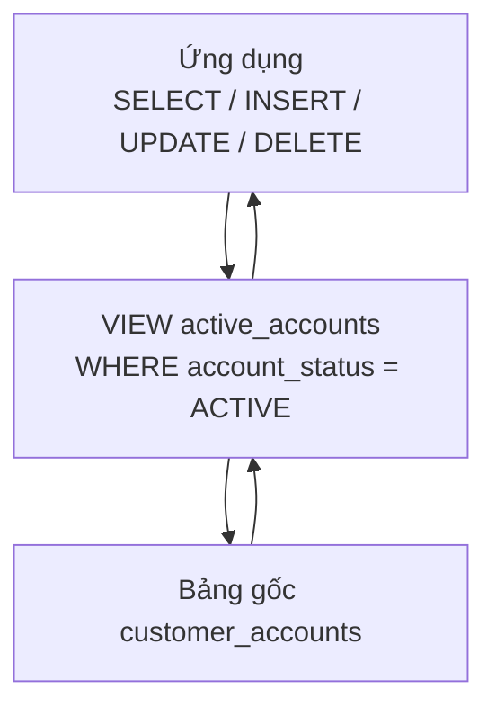
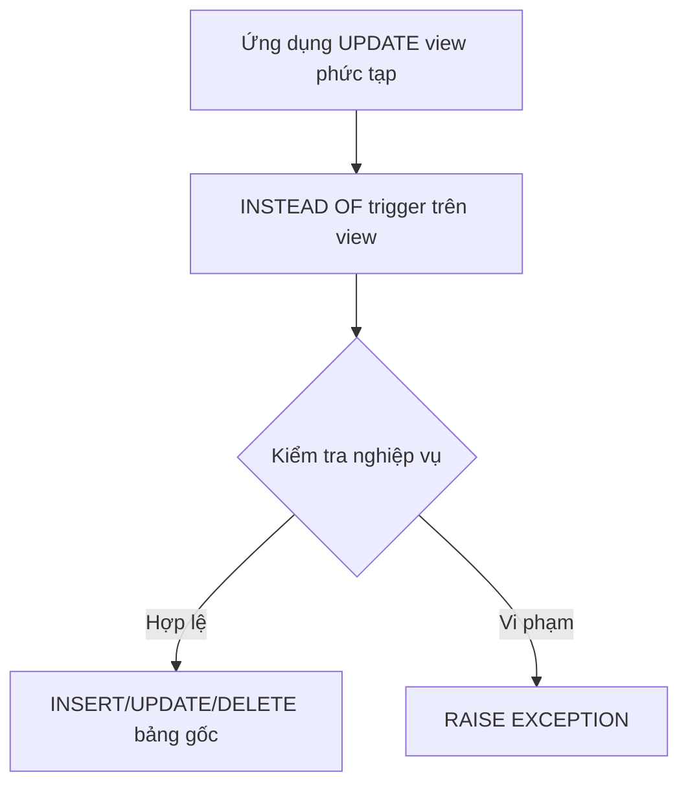

# View cập nhật được và WITH CHECK OPTION trong PostgreSQL

Một **view** trong PostgreSQL là một đối tượng có tên lưu **định nghĩa truy vấn**. Ứng dụng có thể `SELECT` từ view như từ một bảng. Nhưng một câu hỏi quan trọng hơn xuất hiện khi xây dựng API ghi dữ liệu: **Có thể `INSERT`, `UPDATE` hoặc `DELETE` thông qua view không, và nếu cập nhật khiến hàng không còn thỏa điều kiện của view thì điều gì xảy ra?**

Xét một bảng tài khoản có trạng thái:

```sql
SELECT account_id, display_name, account_status
FROM customer_accounts;
```

Một view chỉ hiển thị tài khoản đang hoạt động:

```sql
CREATE VIEW active_accounts AS
SELECT account_id, display_name, account_status
FROM customer_accounts
WHERE account_status = 'ACTIVE';
```

Một view đơn giản như vậy có thể **tự động cập nhật được** (*automatically updatable view*). Điều bất ngờ là nếu không có ràng buộc thêm, câu:

```sql
UPDATE active_accounts
SET account_status = 'SUSPENDED'
WHERE account_id = 101;
```

có thể cập nhật thành công hàng trong bảng gốc. Sau đó tài khoản 101 **biến mất khỏi view** vì không còn thỏa điều kiện `account_status = 'ACTIVE'`. Điều kiện `WHERE` của view giúp chọn những hàng nhìn thấy và có thể bị tác động, **không mặc nhiên bảo đảm trạng thái mới cũng thỏa điều kiện ấy**.

Nếu yêu cầu nghiệp vụ là **mọi hàng được ghi qua view vẫn phải nhìn thấy trong view sau khi ghi**, hãy dùng:

```sql
CREATE VIEW active_accounts_checked AS
SELECT account_id, display_name, account_status
FROM customer_accounts
WHERE account_status = 'ACTIVE'
WITH CHECK OPTION;
```

Khi `UPDATE` hoặc `INSERT` thông qua view này tạo ra hàng không thỏa `WHERE`, PostgreSQL sẽ **từ chối thao tác** bằng lỗi kiểm tra view. Đây là chức năng của `WITH CHECK OPTION`.

Bài học giải thích cơ chế đó từ các ví dụ đơn giản đến **view nhiều tầng, `LOCAL` và `CASCADED`, quyền truy cập, RLS, view có JOIN/aggregate, trigger, PostgreSQL catalog, ứng dụng Java/JDBC và những lỗi dễ gặp**.

## 1. Mục tiêu học tập

Sau bài này, bạn có thể:

1. Phân biệt bảng gốc, view thông thường, view tự động cập nhật được, view chỉ đọc và view cập nhật qua trigger.
2. Xác định điều kiện để một PostgreSQL view đơn giản có thể nhận `INSERT`, `UPDATE`, `DELETE` tự động.
3. Giải thích chính xác vì sao `WHERE` trong view **không tương đương** với `WITH CHECK OPTION`.
4. Dự đoán kết quả của một `UPDATE` khiến hàng không còn thỏa điều kiện view.
5. Dùng `WITH CHECK OPTION` để ngăn `INSERT`/`UPDATE` tạo hàng không còn nằm trong view.
6. Phân biệt `WITH LOCAL CHECK OPTION`, `WITH CASCADED CHECK OPTION` và mặc định cascaded khi view lồng nhau.
7. Hiểu các ràng buộc của bảng gốc như `NOT NULL`, `CHECK`, `UNIQUE`, FK, default và identity vẫn có hiệu lực.
8. Xử lý cột được chọn trực tiếp, cột tính toán, cột bị ẩn và các cột cần giá trị mặc định khi insert.
9. Biết vì sao view có `JOIN`, `GROUP BY`, `DISTINCT`, `LIMIT` hoặc các thành phần khác có thể không tự động cập nhật được.
10. Hiểu giới hạn của `INSTEAD OF` triggers/rules đối với việc thực thi check option.
11. Kết hợp view với `GRANT`, `security_invoker` và Row-Level Security (RLS) mà không đánh đồng `WITH CHECK OPTION` với phân quyền.
12. Quan sát định nghĩa và thuộc tính cập nhật của view bằng `information_schema.views`, `pg_views`, `pg_get_viewdef`.
13. Đọc `EXPLAIN` khi truy vấn view, kiểm soát tính đúng và hiệu năng của DML thông qua view.
14. Thiết kế bài kiểm thử và xử lý lỗi trong Java/JDBC.

## 2. View là gì và “cập nhật được” có nghĩa gì?

View thông thường lưu câu `SELECT`, không phải một bản sao dữ liệu riêng. Khi truy vấn:

```sql
SELECT *
FROM active_accounts
WHERE account_id = 101;
```

PostgreSQL xử lý dựa trên định nghĩa view và bảng gốc để trả kết quả. Các giá trị nằm trong bảng nguồn, không được nhân đôi thành một bản dữ liệu độc lập chỉ vì bạn tạo view.

Sơ đồ:



**Updatable view** nghĩa là một số câu lệnh ghi vào tên view được PostgreSQL chuyển thành thao tác trên dữ liệu gốc. Nó không có nghĩa view tự chứa một bản sao để cập nhật riêng.

### 2.1. Phân biệt ba trường hợp

| Đối tượng | `SELECT` | Ghi dữ liệu thông qua tên view |
| --- | --- | --- |
| View đơn giản, tự động cập nhật được | Có | PostgreSQL có thể tự chuyển `INSERT`/`UPDATE`/`DELETE` xuống bảng nền |
| View có cấu trúc phức tạp, không tự động cập nhật được | Có | Thường không ghi trực tiếp được nếu không có cơ chế ghi riêng |
| View có `INSTEAD OF` trigger hoặc rule thích hợp | Có | Logic ghi do trigger/rule quyết định; cần xem giới hạn tương tác với check option |

### 2.2. View và materialized view khác nhau

`CREATE MATERIALIZED VIEW` lưu một kết quả vật lý được làm mới theo cơ chế riêng. Materialized view **không phải** view tự động cập nhật được qua `INSERT`/`UPDATE`/`DELETE` như bài này.

Nếu cần cập nhật bảng nghiệp vụ qua một giao diện SQL có điều kiện, hãy xem `CREATE VIEW` thường, không dùng materialized view như vật thay thế.

### 2.3. Vì sao ứng dụng lại ghi qua view?

Một view có thể là giao diện có chủ đích:

- Chỉ công bố một số cột của bảng.
- Hiển thị những hàng ở trạng thái nghiệp vụ nhất định.
- Giữ tên cột/API SQL ổn định trong quá trình thay đổi schema nền.
- Tách quyền truy cập vào view khỏi quyền trực tiếp trên bảng.
- Làm tầng truy cập dữ liệu nhất quán cho nhiều ứng dụng.

Tuy nhiên, **view không tự thay thế tất cả các ràng buộc và chính sách an toàn**. Muốn kiểm soát dữ liệu chặt chẽ phải xét view predicate, check option, constraints, privileges, RLS, trigger và transaction cùng nhau.

## 3. Khi nào view tự động cập nhật được?

PostgreSQL có cơ chế **automatically updatable views** cho các view đủ đơn giản. Một số điều kiện chính của định nghĩa view:

- Có **đúng một mục** trong `FROM`, trỏ tới **bảng** hoặc một **view cũng cập nhật được**.
- Ở cấp cao nhất của query không có `WITH`, `DISTINCT`, `GROUP BY`, `HAVING`, `LIMIT` hoặc `OFFSET`.
- Không có các phép tập hợp `UNION`, `INTERSECT`, `EXCEPT` ở cấp cao nhất.
- Danh sách cột `SELECT` không dùng aggregate, window function hoặc set-returning function.
- Một cột view có thể được **ghi tự động** nếu biểu thức của nó là **tham chiếu đơn giản tới một cột tương ứng** của bảng/view nguồn.

Ví dụ đơn giản:

```sql
CREATE VIEW active_accounts AS
SELECT account_id, tenant_id, display_name, account_status
FROM customer_accounts
WHERE account_status = 'ACTIVE';
```

Đây là mẫu view có thể tự động cập nhật được.

### 3.1. WHERE không làm view mất khả năng cập nhật

Điều kiện:

```sql
WHERE account_status = 'ACTIVE'
```

chỉ giới hạn tập hàng hiển thị. Nó **không tự làm view thành read-only**.

### 3.2. Cột tính toán có thể chỉ đọc

Một view:

```sql
CREATE VIEW account_labels AS
SELECT
    account_id,
    display_name,
    upper(display_name) AS display_name_upper
FROM customer_accounts;
```

có cột `display_name_upper` là **biểu thức tính toán**. Bản thân view vẫn có thể có những cột cập nhật được như `display_name`, nhưng không thể tự gán vào `display_name_upper` vì không có một cột bảng nguồn duy nhất để cập nhật tương ứng.

### 3.3. Có thể INSERT thông qua view mà không lộ mọi cột?

Có, nếu cột bảng gốc **không được trình bày trong view** vẫn nhận được giá trị hợp lệ từ default, identity, generated column, nullable column hoặc cơ chế khác của database.

Nếu view ẩn một cột `NOT NULL` không có default mà câu INSERT không cung cấp được, PostgreSQL vẫn có thể từ chối vì ràng buộc của bảng gốc.

### 3.4. Không phải mọi câu SELECT đều có một cách ghi ngược rõ ràng

Một view tổng hợp:

```sql
SELECT tenant_id, COUNT(*) AS account_count
FROM customer_accounts
GROUP BY tenant_id
```

không cho biết một lệnh `UPDATE account_count = 100` nên sửa **những hàng gốc nào**. Đó là lý do view kiểu aggregate thường không tự động cập nhật được.

## 4. Bộ dữ liệu thực hành: tài khoản nhiều tenant

Ta dùng schema `updatable_view_lab` để tránh ảnh hưởng các bảng có sẵn. Những câu SQL bên dưới dành cho **database PostgreSQL thử nghiệm**. Nếu đã chạy một lần, nên dùng schema thử nghiệm mới hoặc dọn theo quy trình được phép thay vì chạy lại các lệnh `CREATE TABLE` trùng tên.

### 4.1. Tạo schema

```sql
CREATE SCHEMA IF NOT EXISTS updatable_view_lab;
```

### 4.2. Bảng gốc

```sql
CREATE TABLE updatable_view_lab.customer_accounts (
    account_id BIGINT GENERATED BY DEFAULT AS IDENTITY PRIMARY KEY,
    tenant_id INTEGER NOT NULL,
    email TEXT NOT NULL,
    display_name TEXT NOT NULL,
    account_status TEXT NOT NULL DEFAULT 'ACTIVE'
        CHECK (account_status IN ('ACTIVE', 'SUSPENDED', 'CLOSED')),
    credit_limit NUMERIC(12, 2) NOT NULL DEFAULT 0
        CHECK (credit_limit >= 0),
    created_at TIMESTAMPTZ NOT NULL DEFAULT now(),
    UNIQUE (tenant_id, email)
);
```

Một số lựa chọn thiết kế:

- `account_id` tự tạo giá trị nếu INSERT không cung cấp ID.
- `tenant_id` bắt buộc, có thể dùng để lọc theo tenant.
- `account_status` chỉ nhận `ACTIVE`, `SUSPENDED` hoặc `CLOSED`.
- `credit_limit` không âm.
- Cặp `(tenant_id, email)` là duy nhất.
- `created_at` có default, nên view không cần công bố cột này để INSERT.

### 4.3. Nạp dữ liệu mẫu

```sql
INSERT INTO updatable_view_lab.customer_accounts (
    account_id, tenant_id, email, display_name,
    account_status, credit_limit
)
VALUES
    (101, 10, 'an@example.test', 'An', 'ACTIVE', 1500),
    (102, 10, 'binh@example.test', 'Bình', 'SUSPENDED', 500),
    (103, 10, 'chi@example.test', 'Chi', 'ACTIVE', 3000),
    (201, 20, 'dung@example.test', 'Dũng', 'ACTIVE', 2000),
    (202, 20, 'ha@example.test', 'Hà', 'CLOSED', 0);
```

Vì `GENERATED BY DEFAULT AS IDENTITY` cho phép gán ID tường minh khi nạp dữ liệu thử nghiệm, ta có thể dùng ID 101/102/103/201/202 trong những ví dụ kế tiếp.

**Trong hệ thống thật**, nếu thường xuyên nhập ID thủ công vào một identity/sequence, hãy quản lý giá trị sequence phù hợp để không phát sinh xung đột sau này. Ở bài lab, những ID do sequence tự tạo bắt đầu từ vùng nhỏ nên không đụng các ID mẫu trong vài lần thử đầu.

### 4.4. Quan sát dữ liệu gốc

```sql
SELECT
    account_id, tenant_id, email,
    display_name, account_status, credit_limit
FROM updatable_view_lab.customer_accounts
ORDER BY account_id;
```

Kỳ vọng:

| account_id | tenant_id | display_name | account_status |
| ---: | ---: | --- | --- |
| 101 | 10 | An | ACTIVE |
| 102 | 10 | Bình | SUSPENDED |
| 103 | 10 | Chi | ACTIVE |
| 201 | 20 | Dũng | ACTIVE |
| 202 | 20 | Hà | CLOSED |

## 5. Tạo view đơn giản không có CHECK OPTION

```sql
CREATE VIEW updatable_view_lab.active_accounts AS
SELECT
    account_id,
    tenant_id,
    email,
    display_name,
    account_status,
    credit_limit
FROM updatable_view_lab.customer_accounts
WHERE account_status = 'ACTIVE';
```

Truy vấn:

```sql
SELECT account_id, tenant_id, display_name, account_status
FROM updatable_view_lab.active_accounts
ORDER BY account_id;
```

Kỳ vọng thấy tài khoản 101, 103 và 201, không thấy 102 hoặc 202.

### 5.1. View không phải bản sao vật lý

Nếu một thao tác trên bảng gốc đổi tài khoản 102 thành ACTIVE:

```sql
BEGIN;

UPDATE updatable_view_lab.customer_accounts
SET account_status = 'ACTIVE'
WHERE account_id = 102;

SELECT account_id
FROM updatable_view_lab.active_accounts
WHERE account_id = 102;

ROLLBACK;
```

Trong transaction, view lập tức có thể thấy hàng 102 theo quy tắc snapshot của chính transaction. Sau `ROLLBACK`, trạng thái mẫu trở về như cũ.

### 5.2. View cập nhật được vì có thể map về bảng nguồn

Các cột trong view đều là tham chiếu trực tiếp đến cột bảng `customer_accounts`. PostgreSQL có thể định tuyến các thao tác ghi qua view về bảng đó mà không cần trigger riêng.

## 6. UPDATE qua view không có CHECK OPTION: hàng có thể biến mất

Đây là ví dụ trọng tâm của bài.

```sql
BEGIN;

UPDATE updatable_view_lab.active_accounts
SET account_status = 'SUSPENDED'
WHERE account_id = 101
RETURNING account_id, account_status;

SELECT account_id, account_status
FROM updatable_view_lab.active_accounts
WHERE account_id = 101;

SELECT account_id, account_status
FROM updatable_view_lab.customer_accounts
WHERE account_id = 101;

ROLLBACK;
```

Trong transaction, diễn biến:

1. Ban đầu tài khoản 101 đang ACTIVE nên **xuất hiện trong view**.
2. `UPDATE` thông qua view xác định hàng hiện có thỏa `account_status = 'ACTIVE'`.
3. PostgreSQL ghi trạng thái mới `SUSPENDED` vào bảng nguồn.
4. `UPDATE ... RETURNING` có thể trả bản ghi đã cập nhật.
5. `SELECT` lại từ view không thấy tài khoản 101 nữa.
6. `SELECT` trực tiếp bảng gốc thấy 101 là SUSPENDED.
7. `ROLLBACK` trả lại trạng thái ban đầu để các ví dụ sau không bị ảnh hưởng.

### 6.1. Vì sao PostgreSQL không tự từ chối?

Vì `WHERE account_status='ACTIVE'` trong định nghĩa view quy định **hàng nào thuộc tập nhìn thấy**, không mặc định là một constraint trên trạng thái mới.

Không có `WITH CHECK OPTION`, một thao tác ghi có thể đưa hàng ra khỏi tập nhìn thấy của view.

### 6.2. Không phải dữ liệu đã bị xóa

Sau cập nhật, hàng **không còn đáp ứng filter**, chứ không phải bị `DELETE`. Nó vẫn tồn tại ở bảng gốc.

### 6.3. Ứng dụng có thể hiểu nhầm

Một API thực hiện:

```text
UPDATE active_accounts SET account_status='SUSPENDED' ...
SELECT active_accounts WHERE id=101
```

có thể thấy query UPDATE thành công nhưng SELECT trả 0 hàng. Nếu ứng dụng coi 0 hàng là “record đã bị xóa”, đó là lỗi diễn giải.

Hãy quyết định rõ nghiệp vụ: **chuyển trạng thái ra khỏi view là hợp lệ**, hay **tuyệt đối không được phép khi thao tác qua giao diện này**?

## 7. INSERT qua view không có CHECK OPTION

INSERT qua một view đơn giản có thể ghi vào bảng nguồn.

```sql
BEGIN;

INSERT INTO updatable_view_lab.active_accounts (
    tenant_id, email, display_name, account_status, credit_limit
)
VALUES (
    10, 'new-suspended@example.test', 'New Suspended',
    'SUSPENDED', 0
)
RETURNING account_id, account_status;

SELECT account_id
FROM updatable_view_lab.active_accounts
WHERE email = 'new-suspended@example.test';

SELECT account_id, account_status
FROM updatable_view_lab.customer_accounts
WHERE email = 'new-suspended@example.test';

ROLLBACK;
```

**Điểm đáng chú ý:** INSERT có thể thành công, nhưng hàng mới có `account_status='SUSPENDED'` **không xuất hiện trong active_accounts**.

### 7.1. Tại sao?

Không có check option, view filter không tự kiểm tra hàng mới có thỏa predicate sau INSERT hay không.

### 7.2. Constraints của bảng gốc vẫn áp dụng

Nếu INSERT:

```sql
INSERT INTO updatable_view_lab.active_accounts (
    tenant_id, email, display_name, account_status
)
VALUES (10, 'invalid@example.test', 'Invalid', 'DELETED');
```

thì `account_status='DELETED'` không thuộc tập giá trị cho phép của **CHECK trên bảng gốc**. PostgreSQL từ chối vì bảng nguồn có constraint, dù view không có check option.

**View check option và table constraints là hai lớp kiểm tra khác nhau.**

## 8. WITH CHECK OPTION: bắt buộc hàng mới vẫn thỏa WHERE

Tạo view có check option:

```sql
CREATE VIEW updatable_view_lab.active_accounts_checked AS
SELECT
    account_id,
    tenant_id,
    email,
    display_name,
    account_status,
    credit_limit
FROM updatable_view_lab.customer_accounts
WHERE account_status = 'ACTIVE'
WITH CHECK OPTION;
```

`WITH CHECK OPTION` là viết ngắn của hành vi **cascaded** mặc định khi không ghi LOCAL/CASCADED tường minh.

### 8.1. Điều gì được kiểm tra?

Khi `INSERT` hoặc `UPDATE` thông qua view:

```text
Hàng mới sau thao tác
       |
       v
Có thỏa view WHERE account_status = 'ACTIVE'?
       |
       +-- TRUE  --> được phép xét tiếp các constraints/permissions
       |
       +-- FALSE/UNKNOWN --> từ chối do CHECK OPTION
```

Đây là cách diễn đạt về điều kiện; thứ tự thực thi chính xác các kiểm tra và trigger phụ thuộc cơ chế PostgreSQL. Không dùng sơ đồ để suy ra error nào phải xuất hiện trước khi nhiều constraints cùng sai.

### 8.2. Tác động đến SELECT?

Không có khác biệt ở logic lọc:

```sql
SELECT *
FROM updatable_view_lab.active_accounts_checked;
```

vẫn thấy các tài khoản ACTIVE. Check option **không bổ sung một bộ lọc SELECT mới**, mà kiểm soát tính hợp lệ của hàng được ghi qua view.

## 9. UPDATE vi phạm WITH CHECK OPTION

Thử chuyển tài khoản 101 từ ACTIVE sang SUSPENDED qua checked view:

```sql
BEGIN;

UPDATE updatable_view_lab.active_accounts_checked
SET account_status = 'SUSPENDED'
WHERE account_id = 101;

-- PostgreSQL dự kiến báo lỗi check option cho view.
-- Sau lỗi, kết thúc transaction bằng ROLLBACK.
ROLLBACK;
```

Vì hàng mới không thỏa `account_status='ACTIVE'`, PostgreSQL từ chối thao tác. Một dạng thông báo điển hình:

```text
ERROR: new row violates check option for view "active_accounts_checked"
DETAIL: Failing row contains ...
```

Thông điệp chi tiết có thể khác theo phiên bản, loại câu lệnh và bối cảnh; không nên viết logic ứng dụng dựa vào việc cắt chuỗi lỗi.

**Lưu ý chạy trong psql/JDBC:** nếu statement làm transaction rơi vào trạng thái lỗi, phải `ROLLBACK` trước khi tiếp tục. Nếu client bật chế độ dừng ngay khi có SQL error, cần tự chạy ROLLBACK sau đó.

### 9.1. Hàng nguồn có bị đổi không?

Không. Khi statement bị từ chối, cập nhật không được commit. Trong bài lab, tài khoản 101 vẫn ACTIVE.

### 9.2. UPDATE các cột khác thì sao?

```sql
BEGIN;

UPDATE updatable_view_lab.active_accounts_checked
SET display_name = 'An Updated',
    credit_limit = 1800
WHERE account_id = 101
RETURNING account_id, display_name, account_status, credit_limit;

ROLLBACK;
```

Thao tác này thỏa view predicate vì `account_status` vẫn ACTIVE, đồng thời `credit_limit>=0`. Do đó có thể thành công nếu quyền và constraints khác hợp lệ.

### 9.3. CHECK OPTION không cấm mọi thay đổi

Nó chỉ yêu cầu **hàng sau thao tác đáp ứng điều kiện view**. Các trường không liên quan tới điều kiện có thể thay đổi theo quyền và ràng buộc nền.

## 10. INSERT vi phạm WITH CHECK OPTION

```sql
BEGIN;

INSERT INTO updatable_view_lab.active_accounts_checked (
    tenant_id, email, display_name, account_status, credit_limit
)
VALUES (
    10, 'blocked@example.test', 'Blocked',
    'SUSPENDED', 100
);

-- Dự kiến lỗi: hàng mới không thỏa WHERE của view.
ROLLBACK;
```

Khác với view không có check option, checked view **không cho phép** chèn một tài khoản SUSPENDED thông qua giao diện chỉ dành cho tài khoản ACTIVE.

### 10.1. INSERT hợp lệ

```sql
BEGIN;

INSERT INTO updatable_view_lab.active_accounts_checked (
    tenant_id, email, display_name, account_status, credit_limit
)
VALUES (
    10, 'new-active@example.test', 'New Active',
    'ACTIVE', 500
)
RETURNING account_id, tenant_id, email, account_status;

ROLLBACK;
```

Đây là INSERT hợp lệ theo view predicate. Việc `ROLLBACK` chỉ giúp bài lab không giữ thêm row.

### 10.2. INSERT bỏ qua cột có default

Vì `account_status TEXT NOT NULL DEFAULT 'ACTIVE'` trên bảng gốc:

```sql
BEGIN;

INSERT INTO updatable_view_lab.active_accounts_checked (
    tenant_id, email, display_name
)
VALUES (10, 'default-active@example.test', 'Default Active')
RETURNING account_id, account_status, credit_limit;

ROLLBACK;
```

PostgreSQL có thể sử dụng giá trị mặc định:

- `account_status='ACTIVE'`.
- `credit_limit=0`.
- `account_id` do identity sinh.
- `created_at=now()`.

Vì thế hàng mới thỏa check option và constraints nền.

### 10.3. Nếu default không đáp ứng predicate?

Giả sử bảng gốc có default `'SUSPENDED'`, còn view đòi `'ACTIVE'`. Một INSERT không truyền status sẽ tạo giá trị default SUSPENDED và **bị CHECK OPTION từ chối**.

Không được xem việc view ẩn cột là cách tự động ép giá trị cột đó thỏa WHERE. Default hoặc logic ghi mới quyết định.

## 11. WHERE của view kiểm tra hàng cũ hay mới?

Đây là khác biệt quan trọng:

| Tình huống | Hàng trước thao tác | Hàng sau thao tác | Kết quả với CHECK OPTION |
| --- | --- | --- | --- |
| Sửa tên tài khoản ACTIVE | Thấy qua view | Vẫn ACTIVE | Có thể cho phép |
| ACTIVE → SUSPENDED | Thấy qua view | Không còn thấy | Từ chối |
| INSERT ACTIVE | Chưa có | Thấy qua view | Có thể cho phép |
| INSERT SUSPENDED | Chưa có | Không thấy | Từ chối |
| UPDATE tài khoản SUSPENDED qua view ACTIVE | Không thấy | Không có hàng mục tiêu | Thường UPDATE 0 rows |
| DELETE tài khoản ACTIVE qua view | Thấy qua view | Hàng bị xóa | CHECK OPTION không dùng để giữ row sau DELETE |

### 11.1. UPDATE 0 hàng khác với lỗi check option

```sql
UPDATE updatable_view_lab.active_accounts_checked
SET account_status = 'ACTIVE'
WHERE account_id = 102;
```

Tài khoản 102 đang SUSPENDED, không nằm trong view ACTIVE. PostgreSQL không có hàng nào **được thấy qua view** phù hợp điều kiện UPDATE, nên statement có thể cập nhật **0 hàng**.

Không nên hiểu rằng checked view “chữa” tài khoản SUSPENDED thành ACTIVE khi nó vốn không thấy row đó.

Để kích hoạt tài khoản, dùng giao diện phù hợp:

- Update trực tiếp bảng gốc nếu role được phép và nghiệp vụ cho phép.
- Dùng view khác hiển thị tài khoản SUSPENDED.
- Dùng stored procedure/service có kiểm tra quyền và transition.

### 11.2. WHERE trong UPDATE có thể bổ sung điều kiện

```sql
UPDATE updatable_view_lab.active_accounts_checked
SET credit_limit = 2000
WHERE tenant_id = 10
  AND credit_limit < 2000;
```

Điều kiện WHERE của **view** và WHERE của **UPDATE statement** cùng tác động tới việc chọn hàng. Sau cập nhật, check option vẫn yêu cầu view predicate đúng.

### 11.3. CHECK OPTION không bắt buộc UPDATE có WHERE

```sql
UPDATE updatable_view_lab.active_accounts_checked
SET credit_limit = credit_limit + 100;
```

nếu có quyền, có thể cập nhật **mọi tài khoản nhìn thấy qua view**, không chỉ một ID. Check option không tự giới hạn số hàng được sửa hoặc thay thế nhu cầu xác định mục tiêu bằng khóa.

## 12. DELETE qua view: CHECK OPTION không ngăn xóa

```sql
BEGIN;

DELETE FROM updatable_view_lab.active_accounts_checked
WHERE account_id = 101
RETURNING account_id, account_status;

SELECT account_id
FROM updatable_view_lab.customer_accounts
WHERE account_id = 101;

ROLLBACK;
```

Khi DELETE hợp lệ theo quyền và foreign keys, hàng bị xóa khỏi bảng nguồn. `WITH CHECK OPTION` kiểm soát **hàng được INSERT/UPDATE**, không đòi một hàng đã DELETE phải tiếp tục xuất hiện trong view.

### 12.1. DELETE qua view chỉ tác động hàng nhìn thấy

Một DELETE:

```sql
DELETE FROM updatable_view_lab.active_accounts_checked
WHERE account_id = 102;
```

không thể xóa tài khoản 102 đang SUSPENDED vì row đó không nằm trong tập mà view công bố.

### 12.2. Nếu nghiệp vụ không cho phép DELETE?

Không dùng CHECK OPTION để cấm DELETE. Phải:

- Không cấp `DELETE` trên view cho role tương ứng.
- Hoặc thiết kế interface/service ghi khác.
- Kết hợp constraints/triggers/chính sách bảo mật khi cần.

**WITH CHECK OPTION là ràng buộc về tính nhìn thấy của hàng sau ghi, không phải hệ thống quyền CRUD đầy đủ.**

## 13. Ràng buộc bảng gốc vẫn có hiệu lực

View check option chỉ là **một lớp**. Bảng gốc có những quy tắc riêng.

### 13.1. NOT NULL

```sql
-- Lỗi NOT NULL của bảng gốc nếu cho phép đi đến bước insert:
INSERT INTO updatable_view_lab.active_accounts_checked (
    tenant_id, email, display_name, account_status
)
VALUES (10, 'noname@example.test', NULL, 'ACTIVE');
```

### 13.2. CHECK

```sql
-- Lỗi CHECK credit_limit >= 0 của bảng gốc:
INSERT INTO updatable_view_lab.active_accounts_checked (
    tenant_id, email, display_name, account_status, credit_limit
)
VALUES (10, 'negative@example.test', 'Negative', 'ACTIVE', -100);
```

### 13.3. UNIQUE

```sql
-- Cặp (tenant_id, email) đã tồn tại:
INSERT INTO updatable_view_lab.active_accounts_checked (
    tenant_id, email, display_name, account_status
)
VALUES (10, 'an@example.test', 'Duplicate', 'ACTIVE');
```

### 13.4. Foreign key

Lab chưa khai báo FK tới tenant; trong schema thật nếu `tenant_id` tham chiếu bảng tenant, INSERT/UPDATE qua view vẫn phải tuân theo FK.

### 13.5. Không thể biết thứ tự lỗi bằng suy luận đơn giản

Nếu một hàng cùng lúc vi phạm CHECK OPTION và CHECK của bảng gốc, không nên xây quy tắc nghiệp vụ dựa vào việc PostgreSQL **luôn** báo một lỗi cố định trước lỗi còn lại.

Trong Java/JDBC, phân biệt loại lỗi theo SQLSTATE/constraint metadata khi cần và trả thông điệp nghiệp vụ ổn định ở tầng ứng dụng.

## 14. LOCAL và CASCADED: vấn đề chỉ xuất hiện rõ khi view lồng nhau

Giả sử ứng dụng có hai tầng:

```text
customer_accounts (bảng gốc)
      |
      v
tenant10_accounts (view WHERE tenant_id=10)
      |
      v
tenant10_active (view WHERE account_status='ACTIVE')
```

Giả sử ở tầng trên, ta cập nhật account của tenant 10 thành tenant 20 nhưng vẫn giữ ACTIVE.

Trạng thái mới:

- Thỏa `account_status='ACTIVE'` của tầng trên.
- **Không thỏa** `tenant_id=10` của tầng dưới.

Nếu chỉ kiểm tra điều kiện của tầng trên thì câu UPDATE có thể được phép. Nếu kiểm tra cả hai tầng thì phải bị từ chối.

Đó là sự khác nhau giữa `LOCAL` và `CASCADED`.

## 15. Tạo view tầng dưới không có CHECK OPTION

```sql
CREATE VIEW updatable_view_lab.tenant10_accounts AS
SELECT
    account_id,
    tenant_id,
    email,
    display_name,
    account_status,
    credit_limit
FROM updatable_view_lab.customer_accounts
WHERE tenant_id = 10;
```

Đây là một automatically updatable view chỉ hiển thị những row tenant 10.

Truy vấn:

```sql
SELECT account_id, tenant_id, account_status
FROM updatable_view_lab.tenant10_accounts
ORDER BY account_id;
```

Thấy 101, 102 và 103.

**Chú ý:** tầng dưới **chưa có `WITH CHECK OPTION`**. Cố ý như vậy để thí nghiệm khác biệt rõ khi tầng trên dùng LOCAL và CASCADED.

## 16. Tầng trên dùng WITH LOCAL CHECK OPTION

```sql
CREATE VIEW updatable_view_lab.tenant10_active_local AS
SELECT
    account_id,
    tenant_id,
    email,
    display_name,
    account_status,
    credit_limit
FROM updatable_view_lab.tenant10_accounts
WHERE account_status = 'ACTIVE'
WITH LOCAL CHECK OPTION;
```

Khi ghi thông qua `tenant10_active_local`:

- Điều kiện do **chính view tầng này** khai báo là `account_status='ACTIVE'`.
- `LOCAL` kiểm tra điều kiện của tầng hiện tại, **và vẫn tôn trọng những check option đã được khai báo ở các tầng bên dưới**.
- Nhưng tầng `tenant10_accounts` hiện chưa khai báo check option nên điều kiện tenant ở tầng đó **không tự trở thành một check option cần bảo vệ** theo cách LOCAL.

### 16.1. UPDATE đổi tenant nhưng giữ ACTIVE

```sql
BEGIN;

UPDATE updatable_view_lab.tenant10_active_local
SET tenant_id = 20
WHERE account_id = 101
RETURNING account_id, tenant_id, account_status;

SELECT account_id, tenant_id
FROM updatable_view_lab.tenant10_active_local
WHERE account_id = 101;

SELECT account_id, tenant_id, account_status
FROM updatable_view_lab.customer_accounts
WHERE account_id = 101;

ROLLBACK;
```

Trong cấu hình lab, UPDATE này có thể thành công:

- Tài khoản ban đầu thuộc tenant 10 và ACTIVE, nên nhìn thấy ở view.
- Sau UPDATE, trạng thái vẫn ACTIVE → **thỏa predicate tầng trên**.
- Tenant đổi sang 20 → không còn thỏa tầng dưới.
- Vì tầng dưới **không có check option riêng**, LOCAL không bắt buộc kiểm tra điều kiện đó như một check option.
- Hàng biến mất khỏi view.

**Đây là hành vi đúng theo ý nghĩa LOCAL, không phải lỗi PostgreSQL.**

## 17. Tầng trên dùng WITH CASCADED CHECK OPTION

```sql
CREATE VIEW updatable_view_lab.tenant10_active_cascaded AS
SELECT
    account_id,
    tenant_id,
    email,
    display_name,
    account_status,
    credit_limit
FROM updatable_view_lab.tenant10_accounts
WHERE account_status = 'ACTIVE'
WITH CASCADED CHECK OPTION;
```

Trong hệ thống các view **tự động cập nhật được**, `CASCADED` yêu cầu hàng sau ghi thỏa:

1. Điều kiện view đang ghi: `account_status='ACTIVE'`.
2. Điều kiện view nền: `tenant_id=10`.
3. Những điều kiện phù hợp của các view nền khác nếu có.

### 17.1. UPDATE đổi tenant bị từ chối

```sql
BEGIN;

UPDATE updatable_view_lab.tenant10_active_cascaded
SET tenant_id = 20
WHERE account_id = 101;

-- Dự kiến lỗi CHECK OPTION vì hàng mới không thuộc tenant 10.
ROLLBACK;
```

Mặc dù vẫn ACTIVE, trạng thái mới **không nhìn thấy qua tầng tenant10_accounts**. Với CASCADED, PostgreSQL không cho phép thay đổi đó.

### 17.2. UPDATE đổi status cũng bị từ chối

```sql
BEGIN;

UPDATE updatable_view_lab.tenant10_active_cascaded
SET account_status = 'SUSPENDED'
WHERE account_id = 101;

-- Dự kiến lỗi CHECK OPTION ở tầng yêu cầu ACTIVE.
ROLLBACK;
```

### 17.3. UPDATE hợp lệ

```sql
BEGIN;

UPDATE updatable_view_lab.tenant10_active_cascaded
SET credit_limit = 2500
WHERE account_id = 101
RETURNING account_id, tenant_id, account_status, credit_limit;

ROLLBACK;
```

Hàng mới vẫn thuộc tenant 10 và ACTIVE, đồng thời tuân thủ constraint credit_limit của bảng gốc.

## 18. So sánh LOCAL, CASCADED và mặc định

| Tình huống | LOCAL trên view trên | CASCADED trên view trên |
| --- | --- | --- |
| Hàng mới không thỏa WHERE **của chính view trên** | Từ chối | Từ chối |
| Hàng mới không thỏa WHERE của view dưới **không có check option** | Có thể cho phép | Từ chối |
| View dưới **đã có check option riêng** và hàng mới vi phạm nó | Vẫn bị ràng buộc bởi check option đó | Bị từ chối |
| Có nhiều tầng tự động cập nhật được | Kiểm tra trực tiếp + các check option nền đã khai báo | Kiểm tra điều kiện các tầng theo cơ chế cascading |

### 18.1. Mặc định là CASCADED

```sql
CREATE VIEW some_view AS
SELECT ...
FROM ...
WHERE ...
WITH CHECK OPTION;
```

Khi không ghi `LOCAL` hoặc `CASCADED`, PostgreSQL sử dụng **CASCADED** theo mặc định.

### 18.2. LOCAL không có nghĩa “bỏ qua tất cả tầng dưới”

Nếu view dưới có `WITH CHECK OPTION`, check option đó vẫn có hiệu lực khi thao tác qua một automatically updatable view phía trên dùng LOCAL.

Đừng xây quyền tenant bằng cách nghĩ rằng LOCAL “chỉ kiểm tra một nơi và vô hiệu hóa mọi ràng buộc nền”.

### 18.3. CASCADED không phải một chế độ security xuyên qua mọi trigger/rule

Kết quả ở mục trên giả định **chuỗi view đều tự động cập nhật được**. Nếu trong chuỗi có một view ghi qua `INSTEAD OF` trigger hoặc rule, việc thực thi check option có giới hạn riêng; không tự áp dụng kết luận của ví dụ này cho một tầng do trigger tùy chỉnh ghi.

## 19. Khi view nền có CHECK OPTION riêng

Tạo một tầng thấp có ràng buộc tenant:

```sql
CREATE VIEW updatable_view_lab.tenant10_checked AS
SELECT
    account_id,
    tenant_id,
    email,
    display_name,
    account_status,
    credit_limit
FROM updatable_view_lab.customer_accounts
WHERE tenant_id = 10
WITH CHECK OPTION;
```

Tầng cao dùng LOCAL:

```sql
CREATE VIEW updatable_view_lab.tenant10_active_on_checked AS
SELECT
    account_id,
    tenant_id,
    email,
    display_name,
    account_status,
    credit_limit
FROM updatable_view_lab.tenant10_checked
WHERE account_status = 'ACTIVE'
WITH LOCAL CHECK OPTION;
```

Thử:

```sql
BEGIN;

UPDATE updatable_view_lab.tenant10_active_on_checked
SET tenant_id = 20
WHERE account_id = 101;

-- Dự kiến lỗi: view nền tenant10_checked đã có CHECK OPTION.
ROLLBACK;
```

### 19.1. Kết luận

Mặc dù tầng trên dùng LOCAL, check option **đã được khai báo ở tầng dưới** không bị bỏ qua. Vì vậy muốn hiểu đầy đủ một view lồng nhau, phải kiểm tra **toàn bộ chuỗi định nghĩa view**.

## 20. Điều kiện NULL và logic ba giá trị của SQL

Một predicate SQL có thể cho kết quả:

- `TRUE`.
- `FALSE`.
- `UNKNOWN` (thường khi có NULL).

View `WHERE predicate` chỉ hiển thị các row mà predicate là TRUE. Với checked view, một row mới **không thỏa TRUE** sẽ không được chấp nhận.

### 20.1. Ví dụ giả định với nullable field

Giả sử bảng `products` có cột `approved_at TIMESTAMPTZ NULL` và view:

```sql
CREATE VIEW approved_products AS
SELECT product_id, approved_at, title
FROM products
WHERE approved_at >= TIMESTAMPTZ '2026-01-01 00:00:00+00'
WITH CHECK OPTION;
```

Đây là **mẫu minh họa**, không chạy trực tiếp trong lab vì chưa tạo bảng `products`.

Nếu INSERT `approved_at=NULL`, biểu thức `NULL >= date` trả UNKNOWN, nên hàng **không xuất hiện trong view** và bị CHECK OPTION từ chối.

### 20.2. Trường hợp muốn cho phép NULL

Nếu nghiệp vụ muốn cả những hàng chưa được phê duyệt nhưng có NULL, predicate phải diễn đạt rõ điều đó, ví dụ:

```sql
WHERE approved_at IS NULL
   OR approved_at >= TIMESTAMPTZ '2026-01-01 00:00:00+00'
```

Đừng đổi điều kiện chỉ để INSERT qua view thành công mà làm sai ý nghĩa “approved products”.

### 20.3. CHECK OPTION không tự suy ra “NULL là rỗng”

`NULL` không bằng chuỗi rỗng, số 0 hoặc FALSE. Nếu business yêu cầu mặc định, nên thiết kế DEFAULT/NOT NULL/constraints rõ ràng thay vì dựa vào giả định của application.

## 21. View có điều kiện nhiều cột

Một giao diện cho phép thao tác chỉ trên tài khoản đang hoạt động, thuộc tenant 10 và có hạn mức dương:

```sql
CREATE VIEW updatable_view_lab.tenant10_active_credit AS
SELECT
    account_id,
    tenant_id,
    email,
    display_name,
    account_status,
    credit_limit
FROM updatable_view_lab.customer_accounts
WHERE tenant_id = 10
  AND account_status = 'ACTIVE'
  AND credit_limit > 0
WITH CHECK OPTION;
```

Sau đó:

```sql
-- Hợp lệ nếu row 101 vẫn có tenant 10, ACTIVE và credit_limit > 0:
UPDATE updatable_view_lab.tenant10_active_credit
SET credit_limit = 1200
WHERE account_id = 101;
```

Nhưng:

```sql
BEGIN;

UPDATE updatable_view_lab.tenant10_active_credit
SET credit_limit = 0
WHERE account_id = 101;

-- Dự kiến lỗi CHECK OPTION vì credit_limit > 0 không còn đúng.
ROLLBACK;
```

Điều này khác constraint bảng gốc:

- Bảng gốc cho phép `credit_limit=0`.
- View `tenant10_active_credit` chỉ cho phép các hàng có `credit_limit>0`.

**WITH CHECK OPTION có thể áp dụng một điều kiện nghiệp vụ hẹp hơn các constraints của bảng.**

## 22. View có cột bị ẩn: cần hiểu mặc định và giới hạn INSERT

Một view chỉ công bố:

```sql
CREATE VIEW updatable_view_lab.account_public_fields AS
SELECT
    account_id,
    tenant_id,
    display_name,
    account_status
FROM updatable_view_lab.customer_accounts
WHERE account_status = 'ACTIVE'
WITH CHECK OPTION;
```

View này ẩn:

- `email`.
- `credit_limit`.
- `created_at`.

Nếu thử:

```sql
INSERT INTO updatable_view_lab.account_public_fields (
    tenant_id, display_name, account_status
)
VALUES (10, 'Partial Account', 'ACTIVE');
```

thì bảng gốc yêu cầu `email TEXT NOT NULL` nhưng không có DEFAULT; câu INSERT **không cung cấp được email** qua view và sẽ thất bại.

### 22.1. VIEW không tự định nghĩa DEFAULT cho cột bị ẩn

PostgreSQL không thể tự đoán email. Muốn INSERT qua view này, phải thay đổi thiết kế:

- Công bố email nếu đó là field cần nhập.
- Có default hợp lệ ở bảng gốc nếu nghiệp vụ cho phép.
- Dùng một API/stored procedure/triggers có trách nhiệm tạo email hợp lệ.
- Không cho phép INSERT trên view nếu nó chỉ dành cho SELECT/UPDATE một số cột.

### 22.2. Cột ẩn không nhất thiết là biện pháp bảo mật đủ

Nếu user vẫn có quyền SELECT bảng gốc, ẩn email ở một view không ngăn user đọc email trực tiếp. Phải xét `GRANT`, schema privileges và RLS.

### 22.3. Dùng column privilege khi cần

Bạn có thể cấp quyền chỉ trên những cột phù hợp, nhưng phải hiểu quyền của view và bảng nền cũng như mọi đường truy cập khác. Không coi “chỉ không SELECT email trong view” là cơ chế xác thực/phân quyền hoàn chỉnh.

## 23. Cột tính toán và cột cập nhật được

Tạo view:

```sql
CREATE VIEW updatable_view_lab.account_labels AS
SELECT
    account_id,
    tenant_id,
    display_name,
    upper(display_name) AS display_name_upper,
    account_status
FROM updatable_view_lab.customer_accounts
WHERE account_status = 'ACTIVE'
WITH CHECK OPTION;
```

### 23.1. UPDATE cột nền

```sql
BEGIN;

UPDATE updatable_view_lab.account_labels
SET display_name = 'An Nguyễn'
WHERE account_id = 101
RETURNING account_id, display_name, display_name_upper;

ROLLBACK;
```

Thay đổi `display_name` có thể được map về cột gốc, và `display_name_upper` được tính lại khi SELECT/RETURNING view.

### 23.2. UPDATE cột tính toán

```sql
UPDATE updatable_view_lab.account_labels
SET display_name_upper = 'AN'
WHERE account_id = 101;
```

Cột `display_name_upper` là biểu thức `upper(display_name)`, không phải tham chiếu trực tiếp tới cột gốc, nên **không thể tự động UPDATE cột đó**.

### 23.3. View có cột tính toán không nhất thiết read-only toàn bộ

Một số cột vẫn có thể tự cập nhật nếu map trực tiếp tới cột nguồn. Điều này khác với view aggregate/JOIN khiến cả cấu trúc không đủ điều kiện tự động cập nhật.

## 24. View JOIN: vì sao không tự cập nhật như một bảng đơn?

Giả sử có:

```sql
CREATE TABLE updatable_view_lab.tenant_directory (
    tenant_id INTEGER PRIMARY KEY,
    tenant_name TEXT NOT NULL
);

INSERT INTO updatable_view_lab.tenant_directory
VALUES (10, 'Tenant Ten'), (20, 'Tenant Twenty');
```

Một view JOIN:

```sql
CREATE VIEW updatable_view_lab.account_with_tenant_name AS
SELECT
    a.account_id,
    a.tenant_id,
    t.tenant_name,
    a.display_name,
    a.account_status
FROM updatable_view_lab.customer_accounts AS a
JOIN updatable_view_lab.tenant_directory AS t
  ON t.tenant_id = a.tenant_id;
```

Thông thường đây **không phải automatically updatable view** vì có nhiều mục trong FROM.

### 24.1. Tại sao?

Ví dụ:

```sql
UPDATE updatable_view_lab.account_with_tenant_name
SET tenant_name = 'New Name'
WHERE account_id = 101;
```

PostgreSQL không tự có một quy tắc cập nhật chung cho mỗi trường hợp JOIN: cập nhật vào bảng account hay tenant, và phải xử lý trùng lặp như thế nào?

### 24.2. Không phải mọi phép JOIN đều có thể tự suy luận an toàn

Ngay cả khi JOIN dựa trên FK nhiều-đến-một và con người hiểu nên cập nhật bảng nào, tiêu chí automatically updatable views của PostgreSQL vẫn không cho phép suy ra như vậy cho mọi view JOIN.

### 24.3. Nếu cần ghi qua view JOIN

Một khả năng là tự thiết kế **INSTEAD OF trigger** trên view để kiểm tra và định tuyến DML. Nhưng khi chọn trigger, bạn phải tự quản lý constraints/semantics, và không nên trông chờ `WITH CHECK OPTION` tự vận hành giống như với view đơn giản.

## 25. GROUP BY, DISTINCT, aggregate và LIMIT thường làm view không tự cập nhật

Ví dụ aggregate:

```sql
CREATE VIEW updatable_view_lab.account_counts AS
SELECT
    tenant_id,
    COUNT(*) AS total_accounts
FROM updatable_view_lab.customer_accounts
GROUP BY tenant_id;
```

Không thể tự suy luận một lệnh:

```sql
UPDATE updatable_view_lab.account_counts
SET total_accounts = 100
WHERE tenant_id = 10;
```

sẽ tạo/xóa/sửa chính xác những row tài khoản nào.

### 25.1. DISTINCT

```sql
CREATE VIEW updatable_view_lab.distinct_account_statuses AS
SELECT DISTINCT account_status
FROM updatable_view_lab.customer_accounts;
```

Mỗi hàng view là kết quả khử trùng lặp từ nhiều hàng bảng nguồn, không có ánh xạ một-một để UPDATE/DELETE tự động.

### 25.2. LIMIT/OFFSET

```sql
CREATE VIEW updatable_view_lab.recent_accounts AS
SELECT
    account_id,
    tenant_id,
    display_name,
    account_status
FROM updatable_view_lab.customer_accounts
ORDER BY created_at DESC
LIMIT 10;
```

View này không đủ điều kiện automatically updatable vì có LIMIT ở cấp cao nhất. Dù người dùng chỉ cần cập nhật một hàng trong Top 10, PostgreSQL không coi đó là view tự động cập nhật được.

### 25.3. ORDER BY khác LIMIT

Đừng đồng nhất `ORDER BY` với `LIMIT`. Điều kiện “không có LIMIT/OFFSET” là một trong các tiêu chí chính; việc một view có ORDER BY đơn thuần phải được đánh giá theo các điều kiện còn lại, chứ không tự suy luận mọi ORDER BY đều ngăn cập nhật.

Với ứng dụng, thứ tự kết quả của SELECT từ view vẫn nên có `ORDER BY` ở câu truy vấn cuối cùng nếu cần đảm bảo ordering.

### 25.4. UNION, window functions, CTE

Những thành phần như `UNION`, window functions hoặc top-level `WITH` có thể làm view không đủ tiêu chí automatically updatable. Nếu ứng dụng chỉ cần một subset đơn giản có thể ghi, hãy tách **writable base view** khỏi **read-only reporting view**.

## 26. WITH CHECK OPTION không “biến” view phức tạp thành updatable

Không thể lấy view aggregate rồi chỉ thêm `WITH CHECK OPTION` để PostgreSQL tự biết update row gốc.

Ví dụ ý tưởng **không hợp lệ cho automatic write**:

```sql
-- Không nên kỳ vọng có thể tự ghi ngược aggregate:
-- CREATE VIEW account_counts_checked AS
-- SELECT tenant_id, COUNT(*) AS n
-- FROM customer_accounts
-- GROUP BY tenant_id
-- WITH CHECK OPTION;
```

Trong PostgreSQL, check option được thiết kế cho cơ chế kiểm tra tính nhìn thấy khi view **cập nhật tự động**. Nếu view không đủ điều kiện, bạn phải xem giới hạn cú pháp và lựa chọn thiết kế khác; check option không cung cấp logic chuyển một aggregate về nhiều bản ghi gốc.

## 27. INSTEAD OF trigger: kiểm soát ghi bằng code của bạn

Với một view không tự động cập nhật được, PostgreSQL có thể dùng **INSTEAD OF trigger** để định nghĩa hành động khi ứng dụng INSERT/UPDATE/DELETE.

Sơ đồ:



### 27.1. Trigger có thể tự thực thi điều kiện cần bảo vệ

Trong trigger, logic có thể kiểm tra `NEW.tenant_id` và `NEW.account_status` trước khi ghi vào bảng nguồn.

Tuy nhiên, ví dụ này là **thiết kế ý tưởng**: mỗi trigger thật phải xác định cách xử lý RETURNING, OLD/NEW, không tìm được row, concurrency, unique/FK, lỗi và atomicity.

### 27.2. Giới hạn quan trọng của CHECK OPTION

Không nên giả định check options ở trên hoặc tại một view có `INSTEAD OF` trigger/rule sẽ được PostgreSQL thực thi xuyên qua cơ chế rewrite/trigger **y hệt** như đối với một chuỗi view automatically updatable.

Các quy tắc của PostgreSQL về CHECK OPTION với trigger/rule có hạn chế; một số check options bị bỏ qua hoặc không được cascade qua tầng đó. Nếu chuyển từ automatically updatable view sang trigger-based view, **phải tự kiểm thử và triển khai enforcement ở bảng/trigger/RLS phù hợp**, không chỉ giữ nguyên cú pháp `WITH CHECK OPTION` rồi tin vẫn an toàn.

### 27.3. Dùng constraint ở bảng gốc nếu bất biến áp dụng mọi đường ghi

Nếu mọi account trong bảng **không bao giờ** được phép có credit_limit âm, hãy dùng `CHECK (credit_limit >= 0)` ở bảng. Không chỉ đặt điều kiện ấy vào một view trong khi còn nhiều đường INSERT/UPDATE khác.

**Ràng buộc toàn hệ thống** nên được bảo vệ tại tầng dữ liệu có hiệu lực trên mọi đường ghi, không phụ thuộc chỉ một giao diện view.

## 28. View, quyền truy cập và WITH CHECK OPTION

Một view có thể là một giao diện hạn chế thông tin, nhưng cần phân biệt **ba cơ chế**:

1. **Predicate của view** xác định rows hiển thị khi SELECT và rows mục tiêu cho UPDATE/DELETE.
2. **WITH CHECK OPTION** kiểm tra rows mới được INSERT/UPDATE qua view có vẫn thỏa predicate không.
3. **GRANT/RLS/security configuration** xác định role nào có thể đọc/ghi đối tượng và rows nào được phép truy cập.

Không cơ chế nào tự thay thế hoàn toàn hai cơ chế còn lại.

### 28.1. Cấp quyền trên view

Trong một hệ thống thật, DBA có thể tạo role dùng riêng cho thao tác qua view:

```sql
-- Đoạn mẫu; không tự chạy nếu không có quyền/role cần thiết.
-- CREATE ROLE account_app LOGIN;
-- GRANT USAGE ON SCHEMA updatable_view_lab TO account_app;
-- GRANT SELECT, INSERT, UPDATE
-- ON updatable_view_lab.active_accounts_checked TO account_app;
```

**Không cần cấp DELETE** nếu ứng dụng không được xóa qua view.

Quyền trên view **không tự động** có nghĩa role được phép truy cập bảng gốc trực tiếp. Việc kiểm tra quyền qua view còn tùy chế độ security invoker/owner, ownership, RLS và các cấu hình liên quan.

### 28.2. Cột nào được phép UPDATE?

Nếu ứng dụng chỉ cần sửa display_name:

```sql
-- Ví dụ định hướng phân quyền:
-- GRANT UPDATE (display_name)
-- ON updatable_view_lab.active_accounts_checked
-- TO account_app;
```

Thay vì cấp UPDATE toàn view, nên xem xét **quyền theo cột**. Nhưng một role có quyền DML rộng ở đối tượng khác vẫn có thể có đường ghi khác; phải audit toàn bộ privilege graph.

### 28.3. Nếu có quyền trực tiếp tới bảng gốc thì sao?

Một user có quyền UPDATE trên `customer_accounts` có thể đổi trạng thái trực tiếp, không đi qua view. CHECK OPTION trên `active_accounts_checked` **không cấm câu UPDATE trực tiếp vào bảng gốc**.

Vì vậy, không dùng checked view như một công tắc bảo vệ toàn bảng nếu role vẫn có quyền đi vòng qua nó.

## 29. security_invoker và quyền của view

Với PostgreSQL hiện đại hỗ trợ tùy chọn `security_invoker` (được giới thiệu từ PostgreSQL 15), có thể tạo view chạy việc kiểm tra quyền các relation nền theo người **gọi view** thay vì theo chủ view:

```sql
CREATE VIEW updatable_view_lab.active_accounts_invoker
WITH (security_invoker = true)
AS
SELECT
    account_id, tenant_id, display_name,
    account_status, credit_limit
FROM updatable_view_lab.customer_accounts
WHERE account_status = 'ACTIVE'
WITH CHECK OPTION;
```

### 29.1. Mặc định và security_invoker

Thông thường, các quyền đọc bảng nền của một view được kiểm tra theo **owner của view** theo cơ chế mặc định. Khi `security_invoker=true`, quyền liên quan đến base relations được đánh giá theo invoking user, cùng các quy tắc RLS tương ứng.

### 29.2. Không đặt security_invoker chỉ để sửa lỗi CHECK OPTION

Hai tính năng phục vụ mục đích khác nhau:

- `security_invoker`: ai phải có quyền trên bảng nền và chính sách RLS nào áp dụng.
- `WITH CHECK OPTION`: hàng sau ghi có tiếp tục thỏa điều kiện view hay không.

Nếu application role không có quyền bảng nền mà bạn bật security_invoker, thao tác từng thành công qua owner-based view có thể **không còn được phép**. Cần thiết kế quyền từ yêu cầu bảo mật, không bật/tắt tùy chọn ngẫu nhiên.

### 29.3. Phiên bản

Nếu dùng phiên bản PostgreSQL cũ hơn 15, cú pháp `security_invoker` cho view không khả dụng. Các ví dụ về updatable view và check option vẫn có thể học độc lập với tính năng đó trên phiên bản hỗ trợ.

## 30. Row-Level Security và WITH CHECK OPTION

RLS cho phép định nghĩa **chính sách đọc/ghi theo row** trên bảng, ví dụ theo tenant hoặc user. Trong PostgreSQL, RLS có các biểu thức:

- `USING` để xác định những row có thể nhìn thấy/được chọn làm mục tiêu trong các hoạt động tương ứng.
- `WITH CHECK` của policy để kiểm tra những row mới cho INSERT/UPDATE theo chính sách.

Nhìn superficially chúng giống view filter/check option, nhưng **không đồng nhất**.

| Cơ chế | Đặt ở đâu | Phạm vi |
| --- | --- | --- |
| View `WHERE` | Định nghĩa view | Dữ liệu nhìn thấy khi đi qua view |
| View `WITH CHECK OPTION` | Định nghĩa view | Hàng được INSERT/UPDATE qua view tự động cập nhật |
| RLS `USING` | Policy trên bảng | Quyền nhìn thấy/chọn row cho các lệnh chịu RLS |
| RLS `WITH CHECK` | Policy trên bảng | Hàng mới phải được phép theo policy cho DML chịu RLS |
| Bảng `CHECK` | Constraint trên bảng | Bất biến dữ liệu áp dụng cho mọi đường ghi phù hợp |

### 30.1. Ví dụ chính sách tenant ở mức ý tưởng

```sql
-- MẪU THIẾT KẾ, không chạy trực tiếp trong lab nếu chưa
-- thiết lập role, quyền, bảo vệ session context và quy trình RLS.
--
-- ALTER TABLE customer_accounts ENABLE ROW LEVEL SECURITY;
--
-- CREATE POLICY tenant_isolation ON customer_accounts
-- USING (tenant_id = current_setting('app.tenant_id')::integer)
-- WITH CHECK (tenant_id = current_setting('app.tenant_id')::integer);
```

Một thiết kế thực tế phải tính:

- Ai được SET giá trị session context?
- Connection pool có xóa context giữa requests không?
- Những role nào có BYPASSRLS hoặc là owner?
- Dùng security_invoker/owner-based view ra sao?
- INSERT/UPDATE/DELETE policies kết hợp thế nào?
- Query dùng quyền owner có bỏ qua RLS không?

Nếu người dùng có thể tự chọn `app.tenant_id` mà hệ thống tin tưởng không kiểm chứng, RLS như trên **không bảo đảm tenant isolation**.

### 30.2. View check option không thay thế RLS

Một checked view `WHERE tenant_id=10` bảo vệ điều kiện khi **ghi qua view đó**, nhưng không tự bảo vệ:

- Một query trực tiếp bảng nguồn.
- Một view khác không có filter.
- Một role có quyền rộng.
- Một thủ tục/triggers viết vào bảng không qua checked view.

Muốn cô lập tenant ở mức database phải có privilege/RLS/security design toàn diện.

## 31. security_barrier và ranh giới bảo mật view

PostgreSQL có tùy chọn `security_barrier` cho view trong các tình huống cần kiểm soát cách planner sắp xếp việc đánh giá predicate, nhằm tránh một số kiểu rò rỉ thông tin qua các hàm/toán tử không an toàn.

Mẫu cú pháp:

```sql
CREATE VIEW updatable_view_lab.active_accounts_barrier
WITH (security_barrier = true)
AS
SELECT
    account_id, tenant_id, email,
    display_name, account_status, credit_limit
FROM updatable_view_lab.customer_accounts
WHERE account_status = 'ACTIVE'
WITH CHECK OPTION;
```

### 31.1. Đừng đồng nhất barrier với check option

- `security_barrier` liên quan tới **an toàn khi tối ưu/đánh giá các điều kiện truy vấn**.
- `WITH CHECK OPTION` liên quan tới **tính nhìn thấy của hàng sau ghi**.

### 31.2. Tác động hiệu năng

Security barrier có thể hạn chế một số phép đẩy điều kiện qua ranh giới view, dẫn đến kế hoạch khác và đôi khi chậm hơn. Nếu sử dụng như biện pháp bảo mật, cần benchmark trên workload có điều kiện phức tạp.

**Không kết luận** một view có security_barrier là hệ thống phân quyền hoàn chỉnh. Vẫn cần kiểm tra các privilege, dữ liệu nhạy cảm, quyền trên function và RLS.

## 32. WITH CHECK OPTION và transition nghiệp vụ

Không phải lúc nào cũng nên chặn ACTIVE → SUSPENDED.

Ví dụ:

- Trang “sửa thông tin tài khoản đang hoạt động” chỉ được thay tên/email → checked view phù hợp.
- Chức năng “tạm khóa tài khoản” phải chuyển ACTIVE → SUSPENDED → dùng giao diện khác, không phải view chỉ cho ACTIVE tiếp tục tồn tại.

### 32.1. Thiết kế hai thao tác khác nhau

```text
PUT /accounts/101/profile
  -> Chỉ thay profile, vẫn ACTIVE
  -> Có thể dùng checked active view

POST /accounts/101/suspend
  -> Chuyển trạng thái ACTIVE -> SUSPENDED
  -> Dùng transition service/procedure với quyền riêng
```

Việc một view từ chối một transition **không có nghĩa transition đó trái nghiệp vụ**. Nó có thể chỉ không được phép **qua giao diện này**.

### 32.2. Không đặt CHECK OPTION nếu nghiệp vụ muốn hàng rời view

Một view mô tả “các task chưa hoàn tất” và API cho phép “đánh dấu hoàn tất” thường **cần** cập nhật task để nó biến mất khỏi danh sách. Nếu thêm CHECK OPTION vào view `WHERE done=false`, câu `UPDATE SET done=true` qua view sẽ bị từ chối.

Do đó, check option là **lựa chọn có chủ đích**, không phải cú pháp cần bật cho mọi filtered view.

## 33. UPDATE chuyển hàng khỏi view vs DELETE

Hai thao tác:

```sql
UPDATE active_accounts
SET account_status = 'SUSPENDED'
WHERE account_id = 101;
```

và:

```sql
DELETE FROM active_accounts
WHERE account_id = 101;
```

đều làm tài khoản 101 không còn xuất hiện trong view, nhưng hệ quả dữ liệu rất khác:

| Hành động | Dữ liệu ở bảng gốc | Tác động nghiệp vụ |
| --- | --- | --- |
| UPDATE trạng thái qua view không check | Row còn, status đổi | Tạm khóa/ngừng hiển thị |
| UPDATE qua checked view và làm sai predicate | Bị từ chối | Không đổi trạng thái |
| DELETE qua view | Row bị xóa nếu cho phép | Xóa dữ liệu và ảnh hưởng FK/triggers |

**Không suy luận “view không thấy row” nghĩa là DELETE đã diễn ra**. Cần kiểm tra loại DML và dữ liệu bảng nguồn.

## 34. Lệnh INSERT/UPDATE với RETURNING

PostgreSQL hỗ trợ `RETURNING` trên những câu DML phù hợp. Khi ghi qua view tự động cập nhật:

```sql
BEGIN;

UPDATE updatable_view_lab.active_accounts_checked
SET display_name = 'An Mới'
WHERE account_id = 101
RETURNING
    account_id,
    display_name,
    account_status;

ROLLBACK;
```

### 34.1. Vì sao RETURNING hữu ích?

- Biết ID và các giá trị được ghi.
- Tránh một SELECT bổ sung không cần thiết trong những trường hợp phù hợp.
- Hữu ích với ID do identity tạo ra.
- Giúp phát hiện UPDATE 0 hàng ở tầng ứng dụng.

### 34.2. Không cho phép RETURNING cột mà view không trình bày

Ứng dụng chỉ nên sử dụng các cột được view công bố hoặc biểu thức RETURNING hợp lệ trong ngữ cảnh view. Nếu cột bảng gốc bị ẩn khỏi view, đừng giả định luôn có thể `RETURNING hidden_column` qua view.

### 34.3. RETURNING không thay thế CHECK OPTION

Nếu view không có check option, `RETURNING` của một UPDATE chuyển row ra khỏi view **không làm PostgreSQL tự từ chối**. Nó chỉ trả dữ liệu của thao tác theo semantics DML.

## 35. UPDATE nhiều hàng và tính nguyên tử

Giả sử câu UPDATE:

```sql
BEGIN;

UPDATE updatable_view_lab.active_accounts_checked
SET account_status = CASE
    WHEN account_id = 101 THEN 'SUSPENDED'
    ELSE 'ACTIVE'
END
WHERE account_id IN (101, 103);

-- Dự kiến lỗi do ít nhất một row mới vi phạm CHECK OPTION.
ROLLBACK;
```

Trong PostgreSQL, một SQL statement thường có tính nguyên tử: nếu statement không hợp lệ và báo lỗi, **không commit một phần những row của chính statement đó**.

### 35.1. Phân biệt row count và thành công một phần

Nếu một câu UPDATE tác động 100 hàng, trong đó một hàng vi phạm check option, PostgreSQL không coi 99 hàng hợp lệ đã là một cập nhật thành công độc lập của cùng statement.

### 35.2. Giao dịch nhiều statements

Nếu một transaction gồm nhiều statements, lỗi ở một statement có thể làm transaction vào trạng thái aborted cần ROLLBACK hoặc rollback về savepoint phù hợp. Không chỉ kiểm tra count ở statement trước đó rồi tự COMMIT sau lỗi.

### 35.3. SAVEPOINT khi cần kiểm thử lỗi dự kiến

Trong một script lab:

```sql
BEGIN;
SAVEPOINT before_invalid_update;

-- Chạy lệnh thử nghiệm có khả năng lỗi tại đây.
-- Khi có lỗi, tiếp tục bằng ROLLBACK TO SAVEPOINT
-- trong client cho phép thực hiện câu tiếp theo.

ROLLBACK TO SAVEPOINT before_invalid_update;
ROLLBACK;
```

Không bắt buộc dùng savepoint cho mọi ví dụ; điều quan trọng là **không để transaction bị lỗi kéo dài và khóa tài nguyên**.

## 36. Ngữ nghĩa concurrency và snapshot

Ứng dụng nhiều người dùng có thể cùng sửa một account. View check option không tự giải quyết toàn bộ bài toán concurrency.

### 36.1. Một tình huống

```text
T1 đọc account 101 ACTIVE qua view.
T2 chuyển account 101 thành SUSPENDED và COMMIT.
T1 thử UPDATE account 101 qua view.
```

Tùy isolation level và thời điểm lock/snapshot, câu UPDATE của T1 có thể không tìm thấy row phù hợp nữa hoặc phải xử lý conflict/serialization theo quy tắc PostgreSQL. Không thể kết luận check option sẽ luôn là nguyên nhân lỗi trong mọi race.

### 36.2. Optimistic concurrency control

Khi cần ngăn cập nhật đè phiên bản cũ, một cách là sử dụng cột `version` hoặc `updated_at` kèm điều kiện trong WHERE:

```sql
-- Giả định có version column trong schema khác:
-- UPDATE active_accounts_checked
-- SET display_name = :new_name,
--     version = version + 1
-- WHERE account_id = :id
--   AND version = :expected_version
-- RETURNING version;
```

Nếu UPDATE 0 hàng, ứng dụng phải phân biệt “không còn thấy row”, “version conflict” và “ID không tồn tại” theo contract.

### 36.3. Không dùng CHECK OPTION như optimistic lock

CHECK OPTION xác minh predicate view trên row mới, **không chứng minh rằng ứng dụng đang sửa đúng phiên bản nó từng đọc**.

## 37. EXPLAIN: truy vấn view có thể được tối ưu như SQL

Tạo index cho các query thường xuyên lọc theo status/tenant:

```sql
CREATE INDEX idx_lab_accounts_tenant_status
ON updatable_view_lab.customer_accounts
    (tenant_id, account_status, account_id);
```

Đo truy vấn view:

```sql
ANALYZE updatable_view_lab.customer_accounts;

EXPLAIN
SELECT account_id, display_name
FROM updatable_view_lab.tenant10_active_cascaded
WHERE account_id = 101;
```

View được PostgreSQL triển khai qua cơ chế rewrite/planner phù hợp, để điều kiện tầng view và tầng truy vấn có thể được kết hợp trong kế hoạch khi hợp lệ.

### 37.1. Không có một heap riêng cho view

Không nên đo:

```sql
SELECT pg_total_relation_size(
    'updatable_view_lab.tenant10_active_cascaded'
);
```

rồi suy ra dữ liệu view chiếm chừng ấy storage. Regular view không có heap riêng chứa các row như materialized view.

### 37.2. Cây EXPLAIN minh họa

```text
Index Scan using customer_accounts_pkey on customer_accounts
  Index Cond: (account_id = 101)
  Filter: ((tenant_id = 10) AND (account_status = 'ACTIVE'))
```

Đây là **hình dạng minh họa**, không phải output phải giống từng chữ. Trên bảng 5 hàng, Seq Scan hoàn toàn có thể rẻ hơn Index Scan.

### 37.3. Kiểm tra EXPLAIN ANALYZE an toàn

```sql
EXPLAIN (ANALYZE, BUFFERS)
SELECT account_id, display_name
FROM updatable_view_lab.tenant10_active_cascaded
WHERE tenant_id = 10;
```

Với SELECT trên lab, lệnh này giúp đo actual rows, runtime và buffers.

**Không chạy `EXPLAIN ANALYZE UPDATE/DELETE` trên production như thể chỉ xem kế hoạch**: với `ANALYZE`, PostgreSQL thật sự thực thi DML.

### 37.4. Index không khiến CHECK OPTION biến mất

Index hỗ trợ tìm row; check option vẫn được áp dụng theo semantics view khi ghi. Một chỉ mục không thay thế constraint hoặc policy.

## 38. Đọc thuộc tính view từ information_schema

PostgreSQL có view metadata hữu ích:

```sql
SELECT
    table_schema,
    table_name,
    is_updatable,
    is_insertable_into,
    check_option
FROM information_schema.views
WHERE table_schema = 'updatable_view_lab'
ORDER BY table_name;
```

Các cột này mô tả tính cập nhật/chèn và check option của những view mà role hiện tại có thể nhìn thấy qua information_schema, với cách biểu diễn theo phiên bản.

Một số giá trị bạn có thể thấy:

- `is_updatable = YES/NO`.
- `is_insertable_into = YES/NO`.
- `check_option = NONE / LOCAL / CASCADED`.

### 38.1. Không lấy is_updatable làm chứng minh quyền nghiệp vụ

Một view có thể về mặt cấu trúc **cập nhật được**, nhưng role đang kết nối không có quyền UPDATE hoặc constraint vẫn từ chối thao tác. Metadata về khả năng DML không đồng nghĩa câu lệnh cụ thể luôn thành công.

### 38.2. Kiểm tra khả năng cập nhật theo cột

```sql
SELECT
    table_schema,
    table_name,
    column_name,
    is_updatable
FROM information_schema.columns
WHERE table_schema = 'updatable_view_lab'
  AND table_name = 'account_labels'
ORDER BY ordinal_position;
```

Điều này giúp phân biệt cột map trực tiếp và cột tính toán ở view `account_labels`.

## 39. Xem định nghĩa view bằng pg_get_viewdef

```sql
SELECT pg_get_viewdef(
    'updatable_view_lab.active_accounts_checked'::regclass,
    true
) AS view_sql;
```

`pg_get_viewdef` giúp đọc truy vấn SELECT được lưu ở view.

### 39.1. CHECK OPTION nằm trong metadata khác với SELECT text

Đừng dựa duy nhất vào nội dung chuỗi `pg_get_viewdef` rồi khẳng định view **có hay không có check option**. Hàm này chủ yếu dựng lại định nghĩa truy vấn của view; thông tin check option còn nằm trong metadata/tuỳ chọn view.

Kết hợp `information_schema.views.check_option` với định nghĩa/cấu hình object khi điều tra.

### 39.2. pg_views

```sql
SELECT
    schemaname,
    viewname,
    viewowner,
    definition
FROM pg_views
WHERE schemaname = 'updatable_view_lab'
ORDER BY viewname;
```

Đây là một cách quan sát owner và SELECT definition. Đối với quyền/DDL cụ thể, còn cần xem grants, options, dependencies và metadata liên quan.

### 39.3. pg_class.reloptions

Một số tùy chọn view như `security_barrier` hoặc `security_invoker` được biểu diễn trong catalog object options. Khi điều tra, có thể xem:

```sql
SELECT
    c.oid::regclass AS view_name,
    c.relkind,
    c.reloptions
FROM pg_class AS c
JOIN pg_namespace AS n
  ON n.oid = c.relnamespace
WHERE n.nspname = 'updatable_view_lab'
  AND c.relkind = 'v'
ORDER BY c.relname;
```

Đừng thay quyền/view definition chỉ vì `reloptions` trông khác một môi trường; đánh giá version và các yêu cầu nghiệp vụ trước.

## 40. CREATE OR REPLACE VIEW và thay đổi điều kiện

Trong PostgreSQL, `CREATE OR REPLACE VIEW` có thể thay định nghĩa view theo những điều kiện tương thích về các cột đã tồn tại.

Ví dụ:

```sql
CREATE OR REPLACE VIEW updatable_view_lab.active_accounts_checked AS
SELECT
    account_id,
    tenant_id,
    email,
    display_name,
    account_status,
    credit_limit
FROM updatable_view_lab.customer_accounts
WHERE account_status = 'ACTIVE'
  AND credit_limit >= 0
WITH CHECK OPTION;
```

Ở lab, `credit_limit>=0` đã là CHECK constraint bảng gốc, nên bổ sung predicate không thay đổi tập hàng hợp lệ theo thiết kế bảng; đây chỉ là ví dụ syntax.

### 40.1. Giới hạn thay đổi cột

Khi CREATE OR REPLACE VIEW, danh sách cột cũ phải được giữ tương thích về tên, thứ tự và kiểu dữ liệu theo quy tắc PostgreSQL; có thể có khả năng thêm cột ở cuối khi phù hợp. Không dùng nó như cơ chế đổi kiểu/xóa/đổi tên cột tùy ý mà không xét dependencies.

### 40.2. Thay điều kiện có thể làm thay đổi quyền thao tác

Nếu đổi:

```text
WHERE account_status='ACTIVE'
```

thành:

```text
WHERE account_status IN ('ACTIVE', 'SUSPENDED')
```

thì tập dữ liệu mà role nhìn thấy và có thể UPDATE/DELETE qua view sẽ **mở rộng**.

Migration view definition là một thay đổi về contract/bảo mật, không chỉ “refactor câu SELECT”.

### 40.3. Không vô tình bỏ CHECK OPTION

Khi thay/view recreate qua migration tool, cần kiểm tra lại `check_option`. Đừng cho rằng mọi lần thay SELECT sẽ tự duy trì đúng ràng buộc nếu DDL/migration vô tình thay options.

## 41. View check option và trigger trên bảng gốc

Trong một hệ thống thật, bảng `customer_accounts` có thể có `BEFORE INSERT/UPDATE` trigger sửa một số giá trị, hoặc trigger audit.

Một số điểm cần xác định:

- Check option phải xét **hàng thực sự được ghi qua cơ chế DML** theo quy tắc thực thi PostgreSQL.
- Trigger có thể thay đổi `NEW` ở bảng gốc, hoặc tác động phụ tới bảng khác.
- Constraints/RLS và check option cùng tồn tại.
- Không thể mặc định rằng việc một trigger chạy thành công làm thao tác DML chắc chắn thành công.

### 41.1. Kịch bản test nên có

Nếu trigger chuẩn hóa `account_status`, hãy kiểm thử:

1. INSERT qua checked view với status ACTIVE.
2. INSERT với status SUSPENDED.
3. Trigger đổi status trước khi ghi.
4. View còn nhìn thấy hàng sau commit không?
5. Các đường ghi khác vào bảng gốc có được bảo vệ không?

### 41.2. Đừng dùng side effect ngoài database trong lab lỗi

Một transaction ROLLBACK trong PostgreSQL không tự rollback email, API call hoặc hệ thống bên ngoài do trigger/worker tùy chỉnh kích hoạt. Vì thế ví dụ “BEGIN; thử INSERT; ROLLBACK” chỉ an toàn trong **lab biết rõ trigger và side effects**.

## 42. Cập nhật qua view và xử lý lỗi JDBC

Ứng dụng Java nên dùng `PreparedStatement`, bind tham số, giao dịch rõ và phân biệt:

- Cập nhật 1 row thành công.
- Cập nhật 0 row vì không nhìn thấy hoặc không tìm thấy ID.
- Statement bị PostgreSQL từ chối do check option/constraint.
- Transaction bị aborted, cần rollback.

Ví dụ Java:

```java
String sql = """
    UPDATE updatable_view_lab.active_accounts_checked
       SET display_name = ?
     WHERE account_id = ?
    """;

boolean originalAutoCommit = connection.getAutoCommit();
connection.setAutoCommit(false);

try (PreparedStatement ps = connection.prepareStatement(sql)) {
    ps.setString(1, "An Updated");
    ps.setLong(2, 101L);

    int updated = ps.executeUpdate();
    if (updated != 1) {
        throw new IllegalStateException(
            "Expected one visible account, updated=" + updated
        );
    }

    connection.commit();
} catch (SQLException | RuntimeException e) {
    connection.rollback();
    throw e;
} finally {
    connection.setAutoCommit(originalAutoCommit);
}
```

Đây là đoạn minh họa, giả định `connection` đã tồn tại và method có xử lý/khai báo checked exceptions phù hợp. Trong ứng dụng dùng transaction manager/connection pool, phải làm việc theo contract framework thay vì tự điều chỉnh autoCommit tùy tiện.

### 42.1. Không nối SQL từ input của client

Không làm:

```java
String sql = "UPDATE active_accounts_checked SET display_name='"
    + userInput
    + "' WHERE account_id=" + id;
```

Nên bind bằng `?`. SQL injection và row-level security là hai vấn đề khác nhau; view check option không bảo vệ khỏi SQL injection.

### 42.2. Bắt SQLException có kiểm soát

Khi update status sai:

```java
String sql = """
    UPDATE updatable_view_lab.active_accounts_checked
    SET account_status = ?
    WHERE account_id = ?
    """;

try (PreparedStatement ps = connection.prepareStatement(sql)) {
    ps.setString(1, "SUSPENDED");
    ps.setLong(2, 101L);
    ps.executeUpdate();
} catch (SQLException e) {
    // Ghi nhận SQLSTATE/metadata phù hợp để phân loại lỗi.
    // Rollback transaction theo framework.
    // Không trả nguyên văn chi tiết row của database cho client.
    throw e;
}
```

Không nên parse thông báo tiếng Anh “violates check option” bằng tìm chuỗi rồi dựa vào đó như API contract vĩnh viễn. Ưu tiên mã lỗi/loại constraint và mapping thông điệp nghiệp vụ ổn định. Tránh log payload nhạy cảm hoặc full row values trong lỗi.

### 42.3. Một view có thể UPDATE 0 rows mà không ném exception

Tài khoản 102 là SUSPENDED, nên:

```sql
UPDATE updatable_view_lab.active_accounts_checked
SET display_name = 'Bình Updated'
WHERE account_id = 102;
```

có thể trả `UPDATE 0`, không phải lỗi check option. API cần xác định khi nào trả 404, 409 hoặc thông điệp khác theo chính sách quyền; **không làm lộ sự tồn tại của tài khoản ngoài phạm vi nếu đó là thông tin nhạy cảm**.

## 43. Kiểm thử ngữ nghĩa view

Một bài test đáng tin không chỉ kiểm tra câu `CREATE VIEW` chạy thành công. Nó phải kiểm tra kết quả DML và bảng gốc.

### 43.1. Các nhóm test thiết yếu

| Test | Kết quả kỳ vọng |
| --- | --- |
| SELECT checked view | Chỉ thấy ACTIVE |
| UPDATE display_name tài khoản ACTIVE | Thành công |
| UPDATE status ACTIVE → SUSPENDED qua checked view | Bị từ chối |
| INSERT ACTIVE qua checked view | Thành công |
| INSERT SUSPENDED qua checked view | Bị từ chối |
| UPDATE account 102 đang SUSPENDED qua checked view | 0 rows |
| DELETE ACTIVE qua checked view khi role có quyền | Có thể xóa |
| INSERT sai credit_limit | Bị constraint bảng gốc từ chối |
| LOCAL tầng trên, tenant tầng dưới không check | Có thể đổi tenant và biến mất |
| CASCADED tầng trên | Đổi tenant ra khỏi range bị từ chối |
| LOCAL tầng trên, tầng dưới có check | Vi phạm tầng dưới vẫn bị từ chối |
| UPDATE cột computed | Không tự động hỗ trợ |

### 43.2. Kiểm thử quyền

Hãy kiểm thử dưới **chính role ứng dụng** chứ không chỉ role superuser/owner:

- Có SELECT/INSERT/UPDATE/DELETE trên view theo đúng policy không?
- Có quyền trực tiếp vào bảng gốc không?
- Có thể đọc cột bị ẩn qua object khác không?
- security_invoker/owner và RLS tác động đúng không?
- Có thể thay tenant_id ngoài phạm vi không?

### 43.3. Kiểm thử trước và sau migration

Sau `CREATE OR REPLACE VIEW`, xác nhận lại:

- View query returns đúng rows.
- `information_schema.views.check_option` đúng.
- Cột updatable đúng.
- Ràng buộc còn hoạt động.
- Privileges, owner, dependencies không lệch.

## 44. Các lỗi hiểu nhầm thường gặp

| Hiểu nhầm | Thực tế |
| --- | --- |
| View luôn chỉ đọc | View đơn giản có thể tự động cập nhật được |
| Tạo view từ một SELECT nghĩa nó có bản sao dữ liệu riêng | View thường không có heap kết quả riêng |
| View có WHERE thì tự bảo vệ WHERE khi INSERT/UPDATE | Không, cần CHECK OPTION nếu muốn giữ row sau ghi trong view |
| UPDATE khiến row mất khỏi view nghĩa là DELETE | Row có thể vẫn tồn tại ở bảng nguồn |
| CHECK OPTION cho phép chuyển mọi trạng thái nghiệp vụ | Nó có thể cố tình chặn transition làm hàng rời view |
| CHECK OPTION ngăn DELETE | Nó kiểm soát INSERT/UPDATE, không phải cấm DELETE |
| LOCAL bỏ qua mọi check option ở view dưới | Check option đã khai báo ở view dưới vẫn có hiệu lực |
| CASCADED mặc định phải viết tường minh | `WITH CHECK OPTION` mặc định cascaded |
| CASCADED luôn cưỡng chế qua INSTEAD OF trigger tùy ý | Có giới hạn với trigger/rule-updatable views |
| CHECK OPTION thay thế bảng CHECK/UNIQUE/FK | Các ràng buộc nền là lớp độc lập |
| CHECK OPTION là hệ thống tenant security hoàn chỉnh | Vai trò và RLS/đường ghi khác vẫn cần kiểm soát |
| View JOIN có thể tự UPDATE mọi bảng vì có FK | JOIN view thường không automatically updatable |
| Một view có expression column làm mọi cột read-only | Những cột map trực tiếp vẫn có thể ghi |
| INSERT qua view không cần cột bị ẩn | Bảng nguồn vẫn cần giá trị hợp lệ/default |
| UPDATE 0 rows luôn là lỗi check option | Có thể không có hàng nhìn thấy |
| View có security_invoker luôn dễ dùng hơn | Thay đổi quyền base table/RLS, cần thiết kế |
| View có security_barrier là xong bảo mật | Nó không thay thế grants/RLS/auth |
| Có index thì check option không cần thiết | Index là đường truy cập, không phải ràng buộc nghiệp vụ |
| CREATE OR REPLACE VIEW chỉ là thay cú pháp | Có thể đổi rows/khả năng DML/quyền truy cập |
| EXPLAIN ANALYZE UPDATE không ghi dữ liệu | Nó thật sự thực thi DML |
| ROLLBACK hoàn tác email/API call trong trigger | Side effects ngoài database không tự rollback |
| Ghi qua view luôn thành công nếu cấu trúc updatable | Privileges, constraints, RLS và CHECK OPTION vẫn có thể từ chối |

## 45. Bài tập thực hành PostgreSQL

Các bài dưới đây dùng schema `updatable_view_lab`. Khi yêu cầu gây lỗi, chạy trên database thử nghiệm và kết thúc transaction đúng cách. Không thực hiện DML destructive trên dữ liệu thật chỉ để học.

1. **Khái niệm:** giải thích view thường khác materialized view ở lưu trữ và cập nhật.
2. **Bảng nguồn:** tạo `customer_accounts` với status CHECK và credit_limit không âm.
3. **Nạp dữ liệu:** thêm năm account theo hai tenant và ba trạng thái.
4. **View đơn giản:** tạo `active_accounts` có WHERE status ACTIVE, không có CHECK OPTION.
5. **SELECT:** kiểm tra những account nào hiển thị và vì sao account 102 không có.
6. **UPDATE qua view:** đổi display_name account 101 trong transaction và rollback.
7. **Row biến mất:** đổi status account 101 sang SUSPENDED qua view không check; đọc lại view và bảng gốc.
8. **Phân biệt DELETE:** giải thích tại sao row biến mất khỏi view không chứng minh đã xóa row.
9. **INSERT không check:** chèn SUSPENDED qua active_accounts, kiểm tra nó tồn tại ở bảng gốc nhưng không trong view.
10. **Table CHECK:** thử INSERT một status không thuộc ACTIVE/SUSPENDED/CLOSED; ghi nhận constraint nào bảo vệ.
11. **Tạo checked view:** viết `active_accounts_checked ... WITH CHECK OPTION`.
12. **UPDATE bị chặn:** thử ACTIVE → SUSPENDED qua checked view và xem lỗi.
13. **INSERT bị chặn:** thử chèn SUSPENDED qua checked view.
14. **UPDATE hợp lệ:** đổi credit_limit từ 1500 sang 1800 qua checked view.
15. **Default:** INSERT vào checked view mà bỏ account_status; giải thích vì sao default ACTIVE có thể giúp.
16. **NOT NULL:** thử bỏ cột email bằng một view không công bố email và xác định lỗi bảng gốc.
17. **UNIQUE:** chèn trùng (tenant_id,email) qua checked view; phân biệt lỗi với check option.
18. **Không nhìn thấy row:** UPDATE account 102 qua checked view; vì sao affected rows = 0?
19. **DELETE:** xóa tạm account 101 qua checked view rồi rollback; check option có ngăn không?
20. **Nhiều hàng:** một UPDATE trong đó một row vi phạm predicate; giải thích tính nguyên tử statement.
21. **Tầng dưới:** tạo `tenant10_accounts` lọc tenant_id=10 nhưng không có CHECK OPTION.
22. **LOCAL:** tạo `tenant10_active_local` với status ACTIVE và LOCAL CHECK OPTION.
23. **LOCAL chuyển tenant:** UPDATE account 101 tenant 10 → 20 qua local view; giải thích vì sao có thể thành công và hàng mất khỏi view.
24. **CASCADED:** tạo view tương tự nhưng CASCADED, thử cập nhật tenant 10 → 20.
25. **CASCADED status:** thử đổi status ACTIVE → CLOSED qua view cascaded.
26. **Mặc định:** so `WITH CHECK OPTION` và `WITH CASCADED CHECK OPTION` khi view lồng nhau.
27. **Tầng dưới có check:** tạo `tenant10_checked` và tầng trên LOCAL; chứng minh điều kiện tầng dưới vẫn được bảo vệ.
28. **NULL:** xây một predicate dùng cột nullable, giải thích vì sao UNKNOWN không thỏa check option.
29. **Đa điều kiện:** tạo view yêu cầu tenant=10, ACTIVE, credit_limit>0; thử credit_limit=0.
30. **Bảng gốc vs view:** bảng cho phép credit_limit=0 nhưng checked view yêu cầu >0; hai quy tắc khác nhau thế nào?
31. **Computed column:** tạo view có `upper(display_name)` và thử UPDATE cột đó.
32. **Computed view:** chứng minh vẫn có thể UPDATE display_name thường nếu view đủ đơn giản.
33. **View JOIN:** tạo tenant_directory và view account_with_tenant_name; tại sao không automatically updatable?
34. **Aggregate:** tạo view COUNT(*) GROUP BY tenant_id rồi thử UPDATE COUNT; vì sao không có ánh xạ ngược?
35. **DISTINCT:** vì sao DISTINCT khiến cập nhật tự động không khả thi?
36. **LIMIT:** tạo view Top 10 accounts; phân biệt nó với view chỉ có WHERE/ORDER BY.
37. **INSTEAD OF trigger:** phác thảo logic và những invariant cần kiểm tra nếu buộc phải ghi qua view JOIN.
38. **Trigger caveat:** vì sao không dựa vào CHECK OPTION cascaded xuyên qua trigger-updatable view?
39. **GRANT:** đề xuất quyền tối thiểu cho role chỉ được sửa tên tài khoản ACTIVE.
40. **Direct table access:** một role có quyền UPDATE bảng gốc có thể đi vòng qua checked view như thế nào?
41. **security_invoker:** giải thích thay đổi quyền nền và yêu cầu PostgreSQL version.
42. **RLS:** so view CHECK OPTION với RLS USING/WITH CHECK, nêu khi nào cần cả hai.
43. **Tenant security:** đề xuất cách bảo vệ tenant_id trên mọi đường ghi thay vì chỉ một checked view.
44. **security_barrier:** giải thích mục đích khác với check option và ảnh hưởng kế hoạch.
45. **RETURNING:** UPDATE display_name với RETURNING account_id/display_name qua checked view.
46. **JDBC:** viết PreparedStatement UPDATE view, kiểm tra affected row count, commit/rollback đúng.
47. **SQLException:** xử lý lỗi vi phạm check option bằng SQLSTATE/metadata thay vì parse thông báo.
48. **Transaction:** giải thích vì sao sau một statement lỗi trong PostgreSQL cần ROLLBACK hoặc savepoint.
49. **Concurrency:** mô tả race khi một transaction đọc ACTIVE còn transaction khác chuyển thành SUSPENDED.
50. **Optimistic locking:** đề xuất cột version và WHERE expected_version, phân biệt với CHECK OPTION.
51. **EXPLAIN:** đo SELECT qua tenant10_active_cascaded, xem predicate được áp vào bảng gốc.
52. **EXPLAIN ANALYZE:** vì sao không chạy nó trên UPDATE production nếu chỉ muốn xem plan?
53. **Catalog:** query `information_schema.views` để tìm `is_updatable`, `is_insertable_into`, `check_option`.
54. **Theo cột:** đọc `information_schema.columns.is_updatable` của `account_labels`.
55. **View definition:** dùng `pg_get_viewdef` và `pg_views`, giải thích giới hạn khi chỉ đọc SELECT text.
56. **Migration:** dùng CREATE OR REPLACE VIEW giữ nguyên cột, thay predicate, xem tác động tới tập hiển thị.
57. **Regression test:** lập bảng test INSERT/UPDATE/DELETE hợp lệ và không hợp lệ ở LOCAL/CASCADED.
58. **Business transition:** một endpoint suspend account nên đi qua checked active view hay service khác? Giải thích.
59. **Quyền và cột ẩn:** nếu view không có email nhưng bảng yêu cầu email NOT NULL, INSERT cần thiết kế ra sao?
60. **Thiết kế tổng hợp:** thiết kế giao diện cho ứng dụng nhiều tenant: view SELECT profile, checked UPDATE profile, workflow suspend, RLS/GRANT, error mapping, test và giám sát.

## 46. Checklist thiết kế một updatable view

Khi review một yêu cầu tạo view cập nhật được, hãy trả lời:

1. **Nguồn dữ liệu của view là một bảng hoặc một view updatable không?**
2. **Có JOIN, GROUP BY, DISTINCT, LIMIT, window function, UNION hoặc cấu trúc làm mất tính tự động cập nhật?**
3. **Những cột nào là tham chiếu trực tiếp tới cột gốc và có thể ghi?**
4. **Cột gốc nào bị ẩn nhưng là NOT NULL không có DEFAULT?**
5. **Điều kiện WHERE thể hiện bộ lọc hiển thị hay invariant phải giữ sau ghi?**
6. **Nếu row ra khỏi view sau UPDATE thì có hợp lệ theo nghiệp vụ không?**
7. **Nếu không hợp lệ, đã khai báo WITH CHECK OPTION chưa?**
8. **Nếu view lồng nhau, LOCAL/CASCADED đã được chọn có chủ đích chưa?**
9. **Các view tầng dưới có check option riêng không?**
10. **Có INSTEAD OF trigger/rule làm thay đổi hành vi enforcement không?**
11. **Constraints của bảng gốc có bảo vệ các bất biến mọi đường ghi không?**
12. **Role ứng dụng có đúng quyền SELECT/INSERT/UPDATE/DELETE trên view không?**
13. **Role có thể đi vòng qua view bằng quyền bảng gốc hoặc view khác không?**
14. **RLS và security_invoker/security_barrier đã được xét theo phiên bản và yêu cầu không?**
15. **UPDATE 0 rows được API diễn giải thế nào?**
16. **Lỗi CHECK OPTION/constraint được xử lý và rollback an toàn không?**
17. **Có kiểm thử INSERT/UPDATE hợp lệ, làm hàng biến mất và view nhiều tầng không?**
18. **Sau migration, check_option, columns, privileges và SELECT semantics có được verify không?**
19. **EXPLAIN trên truy vấn quan trọng có cho kế hoạch phù hợp không?**
20. **Có bằng chứng thiết kế bảo đảm tính đúng cả khi dữ liệu và quyền thay đổi không?**

## 47. Tổng kết

Một view đơn giản:

```sql
CREATE VIEW active_accounts AS
SELECT *
FROM customer_accounts
WHERE account_status = 'ACTIVE';
```

có thể tự động cập nhật được. Nhưng:

```sql
UPDATE active_accounts
SET account_status = 'SUSPENDED'
WHERE account_id = 101;
```

có thể khiến tài khoản **rời khỏi view** mà UPDATE vẫn thành công.

Nếu ứng dụng **không cho phép** một row mới đi ra khỏi view qua các thao tác ghi đó:

```sql
CREATE VIEW active_accounts_checked AS
SELECT *
FROM customer_accounts
WHERE account_status = 'ACTIVE'
WITH CHECK OPTION;
```

thì PostgreSQL sẽ từ chối `INSERT`/`UPDATE` tạo hàng mới không đáp ứng `account_status='ACTIVE'`.

Những nguyên tắc chính:

- **View tự động cập nhật được** khi cấu trúc SELECT đủ đơn giản để PostgreSQL chuyển DML về bảng/view nền. View không phải một bản sao dữ liệu vật lý.
- **WHERE xác định tập hàng được nhìn thấy; CHECK OPTION xác định điều kiện hàng mới phải tiếp tục thỏa khi ghi qua view.** Hai vai trò không được đánh đồng.
- **Không có CHECK OPTION, một INSERT/UPDATE qua filtered view có thể thành công nhưng row không xuất hiện trong view sau đó.**
- **WITH CHECK OPTION** bảo vệ predicate đối với INSERT và UPDATE; **không dùng để cấm DELETE**.
- **WITH LOCAL CHECK OPTION** chủ yếu kiểm tra điều kiện tầng hiện tại và những check option tầng dưới đã có; **WITH CASCADED CHECK OPTION** kiểm tra điều kiện các tầng tự động cập nhật được. **CASCADED là mặc định** khi chỉ viết WITH CHECK OPTION.
- **Bảng gốc vẫn áp dụng NOT NULL, CHECK, UNIQUE, FK, defaults và các ràng buộc khác.** CHECK OPTION không thay thế chúng.
- **Cột tính toán không tự cập nhật được** chỉ vì view còn có các cột đơn giản. View JOIN/aggregate/DISTINCT/LIMIT thường không automatically updatable.
- **INSTEAD OF trigger/rule có giới hạn khác biệt với automatic updatability và check option**. Khi cần trigger, tự thiết kế enforcement, test và audit.
- **WITH CHECK OPTION không phải hệ thống phân quyền.** Xem `GRANT`, RLS, ownership, `security_invoker` và các đường ghi khác.
- **Kiểm thử trạng thái trước/sau, affected row count và rollback transaction** quan trọng hơn chỉ kiểm tra câu DDL chạy được.

Hiểu đúng **view cập nhật được** và **WITH CHECK OPTION** giúp bạn xây dựng một giao diện SQL vừa thuận tiện cho ứng dụng vừa có semantics rõ ràng: **hàng nào được nhìn thấy, thao tác nào được phép ghi, điều kiện nào phải tiếp tục đúng và quyền nào thực sự bảo vệ dữ liệu**.
