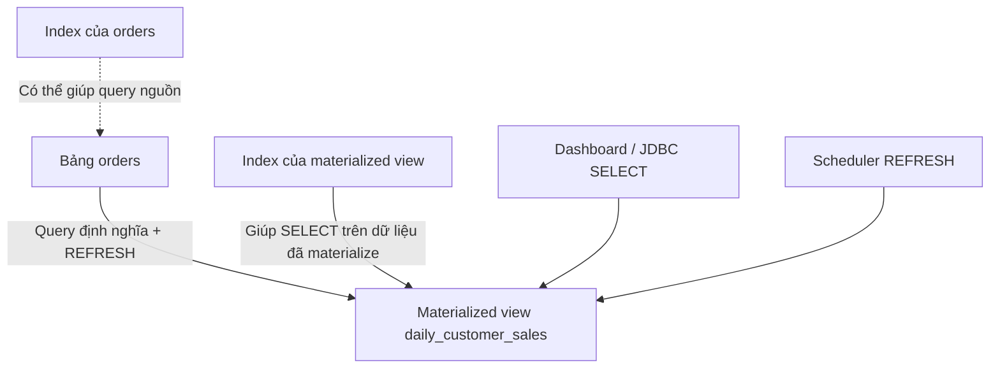

# Chỉ mục trên materialized view và truy vấn đọc trong PostgreSQL

Một truy vấn báo cáo có thể phải đọc hàng triệu đơn hàng, nhóm theo khách hàng và ngày, tính tổng doanh thu rồi sắp xếp kết quả. Nếu báo cáo được mở nhiều lần trong ngày, việc tính lại cùng một phép tổng hợp cho mỗi request có thể gây tải lớn.

**Materialized view** của PostgreSQL cho phép lưu sẵn kết quả của một câu `SELECT` như một quan hệ có dữ liệu vật lý. Điểm đặc biệt so với view thông thường: **có thể tạo index trực tiếp trên materialized view**, để truy vấn đọc tìm và sắp xếp những hàng đã được materialize như đối với một bảng.

Ví dụ hình dung:

```text
orders (bảng nguồn, hàng triệu dòng)
       |
       | SELECT customer_id, date, SUM(amount), COUNT(*)
       v
daily_customer_sales (materialized view, dữ liệu tổng hợp đã lưu)
       |
       +-- UNIQUE B-tree (customer_id, sale_day)
       |      +-- truy vấn theo một khách hàng
       |      +-- điều kiện bắt buộc để dùng REFRESH CONCURRENTLY
       |
       +-- B-tree (sale_day, paid_revenue DESC, customer_id)
              +-- dashboard top khách hàng theo một ngày
```

Bài học này thuộc chương **View** và tập trung vào hai câu hỏi liên quan trực tiếp:

1. **Tạo những index nào trên materialized view để tối ưu các câu `SELECT` đọc dữ liệu?**
2. **Thiết kế index và quy trình refresh thế nào để dữ liệu vẫn đúng, có thể phục vụ người đọc và có độ mới phù hợp?**

Sau bài học, bạn có thể tạo một materialized view hoàn chỉnh, xây unique và non-unique indexes, đọc `EXPLAIN`, hiểu yêu cầu của `REFRESH MATERIALIZED VIEW CONCURRENTLY`, chẩn đoán dữ liệu cũ và thiết kế cách truy vấn an toàn từ ứng dụng Java/JDBC.

## 1. View thường, materialized view và bảng khác nhau thế nào?

| Đặc điểm | View thường | Materialized view | Bảng thông thường |
| --- | --- | --- | --- |
| Lưu hàng kết quả riêng | Không | **Có** | Có |
| Mỗi lần `SELECT` có chạy lại query định nghĩa không? | Thường được rewrite/thực thi dựa trên dữ liệu nguồn theo plan | **Không**; đọc các hàng materialized đã lưu | Đọc hàng trong bảng |
| Index trực tiếp trên đối tượng | **Không** | **Có** | Có |
| Dữ liệu tự phản ánh mọi thay đổi bảng nguồn | View phản ánh trạng thái có thể nhìn thấy theo truy vấn/transaction | **Không**; cần refresh | Dữ liệu trong bảng được DML cập nhật |
| `INSERT/UPDATE/DELETE` trực tiếp | Có khả năng với một số updatable views | **Không** theo cách DML thông thường | Có |
| Điều kiện đồng bộ dữ liệu | Theo query đọc nguồn | Theo lần `REFRESH` cuối | Theo transaction DML |
| Ví dụ phù hợp | Đóng gói SQL/join, giao diện truy vấn | Tổng hợp báo cáo, dữ liệu remote tốn chi phí | Dữ liệu nghiệp vụ gốc |

**Ý tưởng quan trọng:** materialized view không phải “view thường có thêm cache tự động”. Nó là **bản kết quả đã được lưu** và được làm mới theo lệnh riêng.

### 1.1. View thường không có index trực tiếp

Ví dụ:

```sql
CREATE VIEW recent_orders AS
SELECT *
FROM orders
WHERE placed_at >= CURRENT_DATE - INTERVAL '30 days';
```

Không thể viết `CREATE INDEX ... ON recent_orders (...)` để có một index vật lý riêng trên view thường trong PostgreSQL.

Planner có thể tận dụng **index trên bảng `orders`** khi truy vấn thông qua view, tùy SQL rewrite và kế hoạch. Đó là tối ưu của **bảng nguồn**, không phải index trên view.

### 1.2. Materialized view có dữ liệu riêng và index riêng

```sql
CREATE MATERIALIZED VIEW daily_sales AS
SELECT sale_day, SUM(amount) AS revenue
FROM some_source
GROUP BY sale_day;

CREATE INDEX idx_daily_sales_day
ON daily_sales (sale_day);
```

Đây là mẫu ý tưởng; để chạy thực tế cần bảng `some_source` phù hợp. Index chứa các khóa của **hàng trong materialized view**, không phải của bảng nguồn.

### 1.3. SELECT từ materialized view không tự chạy lại phép tổng hợp

Khi thực hiện:

```sql
SELECT *
FROM daily_sales
WHERE sale_day = DATE '2026-03-01';
```

PostgreSQL đọc dữ liệu lưu trong `daily_sales`. Nó không tự chạy lại định nghĩa `SELECT ... GROUP BY ...` trên bảng nguồn chỉ vì có một lần đọc.

**Hệ quả:** truy vấn có thể rất nhanh, nhưng thông tin cũng có thể **cũ** so với bảng nguồn. Index chỉ giúp tìm dữ liệu đang được lưu; nó không tự cập nhật nội dung materialized view.

## 2. Hai loại index cần phân biệt trong hệ thống có materialized view

Một hệ thống thường có:

- **Index trên bảng nguồn:** hỗ trợ những query chạy trên bảng nguồn, có thể hỗ trợ công việc xây/refresh materialized view nếu query nguồn có predicate/join phù hợp.
- **Index trên materialized view:** hỗ trợ các query **đọc materialized view** và có thể phục vụ điều kiện định danh hàng cho concurrent refresh.

Sơ đồ:



Có một vài sai lầm cần tránh:

1. **Bảng nguồn có index không có nghĩa materialized view tự kế thừa index ấy.**
2. **Tạo index trên materialized view không làm query trực tiếp vào bảng nguồn nhanh hơn.**
3. **Tạo index trên materialized view không khiến refresh trở thành incremental refresh tự động.**
4. **PostgreSQL thông thường không tự rewrite mọi truy vấn trên bảng nguồn để thay bằng materialized view**. Ứng dụng phải tham chiếu materialized view hoặc có tầng điều phối truy vấn riêng.

### 2.1. Tại sao index trên materialized view đáng giá?

Một materialized view có thể chứa:

- Dữ liệu aggregate đã rút gọn còn một số dòng nhỏ.
- Kết quả JOIN phức tạp đã lưu.
- Dữ liệu từ foreign table/nguồn remote.
- Giá trị tính toán tốn CPU đã được materialize.
- Các cột báo cáo được đọc thường xuyên.

Nếu một dashboard chỉ cần một khách hàng hoặc một ngày, index phù hợp giúp đọc **một phần nhỏ** thay vì quét toàn bộ materialized view.

### 2.2. Khi nào không cần thêm index?

Nếu materialized view chỉ có 50 dòng và mỗi request cần tổng hợp/hiển thị **toàn bộ 50 dòng**, một `Seq Scan` có thể rẻ hơn dùng B-tree.

Nếu câu query quan trọng nhất là `SELECT SUM(...) FROM mv` trên **toàn bộ MV**, index không nhất thiết giảm công việc tương ứng. Cần xem predicate, sort, join và độ chọn lọc; không tạo index theo thói quen.

## 3. Bộ dữ liệu thực hành: đơn hàng và doanh thu theo ngày

Ví dụ dùng schema `mv_lab` trong một database dành cho học tập. Chỉ chạy các lệnh tạo và nạp dữ liệu trên schema mới/trống; không dùng bảng production.

### 3.1. Tạo bảng nguồn

```sql
CREATE SCHEMA IF NOT EXISTS mv_lab;

CREATE TABLE mv_lab.orders (
    order_id bigint GENERATED ALWAYS AS IDENTITY PRIMARY KEY,
    customer_id bigint NOT NULL,
    placed_at timestamptz NOT NULL,
    status text NOT NULL
        CHECK (status IN ('paid', 'pending', 'cancelled')),
    amount numeric(12, 2) NOT NULL
        CHECK (amount >= 0)
);
```

Các cột:

- `order_id`: khóa định danh từng đơn hàng.
- `customer_id`: khách hàng.
- `placed_at`: thời điểm đặt hàng, có timezone.
- `status`: trạng thái thanh toán.
- `amount`: giá trị đơn.

### 3.2. Nạp 60.000 đơn hàng giả lập

```sql
INSERT INTO mv_lab.orders (customer_id, placed_at, status, amount)
SELECT
    (g % 500 + 1)::bigint,
    TIMESTAMPTZ '2026-01-01 00:00:00+00'
        + (g % 120) * INTERVAL '1 day'
        + (g % 24) * INTERVAL '1 hour',
    CASE
        WHEN g % 13 = 0 THEN 'cancelled'
        WHEN g % 7 = 0 THEN 'pending'
        ELSE 'paid'
    END,
    ((g % 20000)::numeric / 100)::numeric(12, 2)
FROM generate_series(1, 60000) AS s(g);

ANALYZE mv_lab.orders;
```

Số liệu có chủ đích:

- **60.000 đơn**.
- **500 khách hàng**.
- Thời gian trải trên 120 ngày từ đầu tháng 1/2026.
- Ba trạng thái khác nhau.
- Số tiền được tạo theo công thức, đủ để thử tổng hợp.

Không sử dụng công thức dữ liệu này để suy hiệu năng của một bảng vài trăm triệu hàng trên production. Nó là môi trường minh họa hành vi SQL và index.

### 3.3. Một báo cáo trực tiếp trên bảng nguồn

```sql
SELECT
    customer_id,
    (placed_at AT TIME ZONE 'UTC')::date AS sale_day,
    COUNT(*) AS total_order_count,
    COUNT(*) FILTER (WHERE status = 'paid') AS paid_order_count,
    COALESCE(
        SUM(amount) FILTER (WHERE status = 'paid'),
        0
    )::numeric(16, 2) AS paid_revenue
FROM mv_lab.orders
GROUP BY
    customer_id,
    (placed_at AT TIME ZONE 'UTC')::date
ORDER BY sale_day DESC, paid_revenue DESC
LIMIT 20;
```

Nếu dashboard gọi truy vấn này liên tục, server có thể phải lặp lại tổng hợp từ bảng nguồn.

Một materialized view là lựa chọn phù hợp **khi báo cáo chấp nhận độ trễ cập nhật** và phép tổng hợp đủ tốn kém để đáng lưu kết quả.

## 4. Tạo materialized view với dữ liệu đã tổng hợp

```sql
CREATE MATERIALIZED VIEW mv_lab.daily_customer_sales AS
SELECT
    customer_id,
    (placed_at AT TIME ZONE 'UTC')::date AS sale_day,
    COUNT(*) AS total_order_count,
    COUNT(*) FILTER (WHERE status = 'paid') AS paid_order_count,
    COALESCE(
        SUM(amount) FILTER (WHERE status = 'paid'),
        0
    )::numeric(16, 2) AS paid_revenue,
    MAX(placed_at) AS last_order_at
FROM mv_lab.orders
GROUP BY
    customer_id,
    (placed_at AT TIME ZONE 'UTC')::date
WITH DATA;
```

Lưu ý:

- `WITH DATA` làm query nguồn chạy ngay để nạp kết quả; đây cũng là hành vi mặc định khi không ghi `WITH NO DATA`.
- Một dòng của MV là kết quả cho **một cặp (`customer_id`, `sale_day`)**.
- `sale_day` được tính theo ngày **UTC**, tránh thay đổi theo `TimeZone` của session đọc.
- `total_order_count` tính mọi đơn, còn `paid_order_count` và `paid_revenue` chỉ tính đơn đã paid.
- `last_order_at` ghi thời điểm đơn cuối trong nhóm; không phải “thời điểm MV được refresh”.

### 4.1. Kiểm tra dữ liệu materialized

```sql
SELECT
    customer_id,
    sale_day,
    total_order_count,
    paid_order_count,
    paid_revenue,
    last_order_at
FROM mv_lab.daily_customer_sales
ORDER BY sale_day DESC, customer_id
LIMIT 20;
```

Lưu ý: tên MV trong `FROM` **không chứa từ khóa VIEW**. Truy vấn đọc nó giống một relation thông thường.

### 4.2. Xem kích thước của MV

```sql
SELECT
    COUNT(*) AS summary_rows,
    MIN(sale_day) AS first_day,
    MAX(sale_day) AS last_day
FROM mv_lab.daily_customer_sales;
```

Có thể đo:

```sql
SELECT
    pg_size_pretty(
        pg_relation_size('mv_lab.daily_customer_sales'::regclass)
    ) AS mv_heap_size,
    pg_size_pretty(
        pg_indexes_size('mv_lab.daily_customer_sales'::regclass)
    ) AS total_indexes_size,
    pg_size_pretty(
        pg_total_relation_size('mv_lab.daily_customer_sales'::regclass)
    ) AS total_relation_size;
```

Ngay sau khi tạo MV mà chưa thêm index, `total_indexes_size` có thể bằng 0.

## 5. Materialized view không tự có PRIMARY KEY

Bảng nguồn có `PRIMARY KEY (order_id)`. Nhưng MV chứa hàng **đã GROUP BY**, không còn khóa `order_id` trong kết quả.

Không thể suy rằng materialized view tự được thừa hưởng:

- Primary key của bảng nguồn.
- Unique constraints từ bảng nguồn.
- Index trên `orders(placed_at)`.
- Foreign keys của bảng nguồn.
- Các indexes dùng cho những phép JOIN của query gốc.

Một materialized view trong PostgreSQL có thể mang **unique index** để bảo đảm tính duy nhất của những cột kết quả, nhưng unique index này **không phải một PRIMARY KEY constraint được thừa hưởng** từ bảng nguồn.

Trong ví dụ, mỗi cặp `(customer_id, sale_day)` được phép xuất hiện một lần do `GROUP BY`. Đây là một **khóa nghiệp vụ tự nhiên của kết quả tổng hợp**.

## 6. Tạo UNIQUE index trên khóa kết quả

```sql
CREATE UNIQUE INDEX ux_daily_customer_sales_customer_day
ON mv_lab.daily_customer_sales (customer_id, sale_day);
```

Index này có hai vai trò:

1. **Đọc:** cung cấp đường truy cập B-tree theo `customer_id` và `sale_day`.
2. **Refresh đồng thời:** đáp ứng một yêu cầu quan trọng của `REFRESH MATERIALIZED VIEW CONCURRENTLY` khi các điều kiện khác cũng thỏa.

### 6.1. Kiểm tra uniqueness trước khi tạo index

Trên một MV có sẵn dữ liệu, hãy kiểm tra:

```sql
SELECT
    customer_id,
    sale_day,
    COUNT(*) AS duplicate_rows
FROM mv_lab.daily_customer_sales
GROUP BY customer_id, sale_day
HAVING COUNT(*) > 1
ORDER BY duplicate_rows DESC, customer_id, sale_day;
```

Kỳ vọng **không có dòng nào** trên dữ liệu từ `GROUP BY`. Nếu có duplicates, `CREATE UNIQUE INDEX` sẽ lỗi.

Kiểm tra NULL:

```sql
SELECT COUNT(*) AS rows_with_null_key
FROM mv_lab.daily_customer_sales
WHERE customer_id IS NULL
   OR sale_day IS NULL;
```

Với `customer_id` và `placed_at` không NULL ở bảng nguồn, ví dụ này mong đợi bằng 0.

**Tại sao kiểm tra NULL?** Unique index mặc định trong PostgreSQL có semantics nhất định với NULL; sự duy nhất của business key nên được thiết kế rõ ràng, không chỉ trông chờ mặc định khi khóa có thể thiếu giá trị.

### 6.2. Index B-tree theo tiền tố trái

`CREATE UNIQUE INDEX ... (customer_id, sale_day)` có thể phục vụ:

```sql
SELECT *
FROM mv_lab.daily_customer_sales
WHERE customer_id = 42;
```

và:

```sql
SELECT *
FROM mv_lab.daily_customer_sales
WHERE customer_id = 42
  AND sale_day >= DATE '2026-02-01'
  AND sale_day <  DATE '2026-03-01'
ORDER BY sale_day;
```

B-tree nhiều cột hữu ích khi điều kiện lọc đi từ **cột khóa đầu**. Index này không mặc nhiên tối ưu cho mọi truy vấn chỉ lọc theo `sale_day`, vì `sale_day` là cột khóa thứ hai.

### 6.3. Unique index không phải bảo đảm planner sẽ sử dụng index

Trên materialized view chỉ vài nghìn dòng, planner có thể chọn `Seq Scan`, nhất là khi cần nhiều hàng.

Index tồn tại là điều kiện để **có lựa chọn**, không phải mệnh lệnh planner bắt buộc dùng nó.

## 7. Thiết kế một index khác cho truy vấn dashboard theo ngày

Dashboard thường cần: “Top 20 khách hàng có doanh thu cao nhất trong ngày D”.

```sql
SELECT
    customer_id,
    paid_revenue,
    paid_order_count
FROM mv_lab.daily_customer_sales
WHERE sale_day = DATE '2026-02-10'
ORDER BY paid_revenue DESC, customer_id
LIMIT 20;
```

Index `(customer_id, sale_day)` không có thứ tự khóa phù hợp để tìm toàn bộ khách hàng của một ngày rồi xếp theo doanh thu.

Tạo index cho kiểu truy vấn đó:

```sql
CREATE INDEX idx_daily_sales_day_revenue_customer
ON mv_lab.daily_customer_sales (
    sale_day,
    paid_revenue DESC,
    customer_id
);
```

Điểm mạnh:

- `sale_day` ở đầu phục vụ điều kiện `WHERE sale_day = ...`.
- `paid_revenue DESC` phù hợp yêu cầu sắp xếp doanh thu giảm dần.
- `customer_id` làm khóa phân biệt thứ tự trong trường hợp bằng doanh thu.
- `LIMIT 20` có thể cho phép PostgreSQL đọc ít entry từ index thay vì sort toàn bộ tập của ngày đó, tùy kế hoạch.

### 7.1. Thử kế hoạch với EXPLAIN

```sql
ANALYZE mv_lab.daily_customer_sales;

EXPLAIN (ANALYZE, BUFFERS)
SELECT
    customer_id,
    paid_revenue,
    paid_order_count
FROM mv_lab.daily_customer_sales
WHERE sale_day = DATE '2026-02-10'
ORDER BY paid_revenue DESC, customer_id
LIMIT 20;
```

Khi đọc plan, hãy quan sát:

- `Index Scan`/`Index Only Scan` hay `Seq Scan`?
- Có node `Sort` không?
- `Index Cond` có dùng `sale_day` không?
- `actual rows` và `loops` bao nhiêu?
- `Buffers: shared hit/read` và `Execution Time`?
- `LIMIT` có giúp PostgreSQL dừng sớm không?

Bộ dữ liệu mẫu nhỏ nên có thể thấy kế hoạch khác dự đoán. Điều cần học là **đối chiếu index với WHERE, ORDER BY và LIMIT**, không phải ép output phải có `Index Scan`.

### 7.2. Không tạo index trùng lặp không cần thiết

Sau khi có `idx_daily_sales_day_revenue_customer`, một index chỉ trên `(sale_day)` có thể **chồng lấn** trong một số query.

Nhưng không được tự xóa index một cột chỉ vì cột đầu đã có ở index composite; kích thước, selectivity và workload vẫn quyết định hiệu năng.

Trong ví dụ, hãy bắt đầu với **hai index có mục tiêu khác nhau**, đo rồi mới cân nhắc thêm.

## 8. Index covering với INCLUDE và index-only scan

Một query theo ngày có thể cần thêm một số cột mà không muốn heap fetch thường xuyên.

Ví dụ thiết kế index:

```sql
-- Chỉ minh họa một phương án khác; không nhất thiết cần
-- tạo thêm nếu đã có index report trước đó.
CREATE INDEX idx_daily_sales_covering
ON mv_lab.daily_customer_sales (
    sale_day,
    paid_revenue DESC,
    customer_id
)
INCLUDE (paid_order_count, total_order_count);
```

`INCLUDE` lưu thêm dữ liệu payload trong B-tree mà không biến thành các key dùng để định thứ tự/so sánh.

Với query:

```sql
SELECT
    customer_id,
    paid_revenue,
    paid_order_count,
    total_order_count
FROM mv_lab.daily_customer_sales
WHERE sale_day = DATE '2026-02-10'
ORDER BY paid_revenue DESC, customer_id
LIMIT 20;
```

index có thể chứa đủ những cột được truy vấn để planner cân nhắc `Index Only Scan`.

### 8.1. Index-only scan không luôn bỏ qua heap

PostgreSQL dùng thông tin visibility map để biết liệu các hàng nhìn thấy từ index có thể được trả mà không cần truy cập heap hay không.

Sau một lần refresh hoặc khi visibility map chưa có đủ thông tin, `Index Only Scan` vẫn có thể ghi `Heap Fetches`. Vì vậy:

- Có đủ cột trong index là **điều kiện cần nhưng chưa đủ**.
- Tình trạng visibility/MVCC quyết định số heap fetch thực tế.
- `VACUUM` phù hợp có thể giúp duy trì visibility map, nhưng không nên chạy tùy tiện chỉ để làm benchmark đẹp.

### 8.2. INCLUDE tăng chi phí

Index covering có thể lớn hơn:

- Thêm dung lượng disk.
- Tăng chi phí xây index.
- Tăng công việc duy trì khi refresh.
- Gây áp lực lên buffer cache.

Không tạo cả index thông thường và covering giống hệt cho mọi truy vấn nếu chưa có bằng chứng về lợi ích. Trong hệ thống thật, có thể chọn **một thiết kế** sau khi benchmark.

## 9. Những loại index khác có thể đặt trên materialized view

Materialized view là relation lưu dữ liệu, nên PostgreSQL cho phép dùng các access method index thích hợp như với bảng, tùy biểu thức/toán tử và khả năng hỗ trợ.

| Kiểu index | Tình huống đáng xem xét | Lưu ý |
| --- | --- | --- |
| **B-tree** | Equality/range, `ORDER BY`, `LIMIT`, unique key | Thường là điểm khởi đầu cho báo cáo theo ngày/khách |
| **GIN** | Dữ liệu `jsonb`, `tsvector` hoặc cấu trúc có nhiều phần tử | Cần opclass và toán tử phù hợp |
| **GiST** | Truy vấn không gian, range, similarity trong những cấu hình phù hợp | Có thể cần recheck |
| **BRIN** | MV rất lớn, dữ liệu có tương quan vật lý theo cột như thời gian | Thường tóm tắt page ranges, có false positives |
| **Hash** | Một số equality lookups | Không giúp sort/range và không thay unique B-tree |

Ví dụ B-tree theo tháng:

```sql
CREATE INDEX idx_daily_sales_month_expression
ON mv_lab.daily_customer_sales (
    (date_trunc('month', sale_day::timestamp))
);
```

Expression index này có thể hữu ích nếu query lặp lại đúng biểu thức:

```sql
SELECT COUNT(*)
FROM mv_lab.daily_customer_sales
WHERE date_trunc('month', sale_day::timestamp)
      = TIMESTAMP '2026-02-01 00:00:00';
```

Tuy nhiên, với `sale_day` kiểu `date`, truy vấn dạng khoảng thường đơn giản và dễ tận dụng B-tree trên ngày:

```sql
SELECT COUNT(*)
FROM mv_lab.daily_customer_sales
WHERE sale_day >= DATE '2026-02-01'
  AND sale_day <  DATE '2026-03-01';
```

**Không tạo expression index chỉ để chứng minh cú pháp.** Nếu ứng dụng có thể viết truy vấn range đơn giản và dùng index đang có, thêm một index mới có thể không mang lại lợi ích.

### 9.1. Khi nào nghĩ tới GIN trên MV?

Nếu MV chứa một cột `search_document tsvector` hoặc `metadata jsonb`, có thể xây GIN index cho truy vấn đọc tương ứng.

Ví dụ dạng khái niệm, **chỉ áp dụng khi materialized view thật sự có cột `search_document`**:

```sql
-- Template: yêu cầu MV có cột search_document kiểu tsvector.
CREATE INDEX idx_document_cache_fts
ON your_schema.document_cache
USING GIN (search_document);
```

Không chạy template này trên `mv_lab.daily_customer_sales` vì MV đó không có cột `search_document`.

Trong bài này, trọng tâm là **B-tree trên kết quả tổng hợp**, nhưng nguyên tắc chọn GIN/GiST/BRIN vẫn dựa vào operator, kiểu dữ liệu, kích thước và workload thực.

## 10. REFRESH MATERIALIZED VIEW: dữ liệu được làm mới thế nào?

Khi bảng nguồn thay đổi, materialized view **không tự động thay đổi ngay**.

Lệnh:

```sql
REFRESH MATERIALIZED VIEW mv_lab.daily_customer_sales;
```

chạy lại query định nghĩa để thay nội dung lưu bằng kết quả mới. Đây là **full refresh theo cơ chế có sẵn**, không phải một trigger tự áp dụng từng thay đổi từ bảng nguồn.

### 10.1. Thí nghiệm dữ liệu cũ

Thêm một đơn tháng 7, nằm ngoài tập thời gian của dữ liệu mẫu:

```sql
INSERT INTO mv_lab.orders (
    customer_id,
    placed_at,
    status,
    amount
)
VALUES (
    42,
    TIMESTAMPTZ '2026-07-01 12:00:00+00',
    'paid',
    199.00
);
```

Kiểm tra bảng nguồn:

```sql
SELECT
    COUNT(*) AS source_orders,
    SUM(amount) AS source_paid_revenue
FROM mv_lab.orders
WHERE customer_id = 42
  AND placed_at >= TIMESTAMPTZ '2026-07-01 00:00:00+00'
  AND placed_at <  TIMESTAMPTZ '2026-07-02 00:00:00+00'
  AND status = 'paid';
```

Trên dữ liệu mẫu vừa tạo, kết quả mong đợi có 1 order paid, doanh thu 199.00 nếu chưa chèn lặp.

**Ngay trước refresh**, chạy:

```sql
SELECT *
FROM mv_lab.daily_customer_sales
WHERE customer_id = 42
  AND sale_day = DATE '2026-07-01';
```

Kỳ vọng **chưa có dòng đó**. Đơn hàng đã nằm trong `orders` nhưng bản tổng hợp chưa được làm mới.

### 10.2. Refresh và đọc lại

```sql
REFRESH MATERIALIZED VIEW mv_lab.daily_customer_sales;
```

Sau đó:

```sql
SELECT *
FROM mv_lab.daily_customer_sales
WHERE customer_id = 42
  AND sale_day = DATE '2026-07-01';
```

Lúc này, dòng tổng hợp ngày 1/7 có thể xuất hiện với `paid_order_count=1` và `paid_revenue=199.00`.

**Bài học:** index trên MV giúp query tìm dòng đó nhanh khi nó **đã được refresh**, nhưng không khiến dữ liệu mới xuất hiện sớm hơn lịch refresh.

## 11. REFRESH thông thường và REFRESH CONCURRENTLY

PostgreSQL hỗ trợ hai cách làm mới phổ biến:

```sql
REFRESH MATERIALIZED VIEW mv_lab.daily_customer_sales;
```

và:

```sql
REFRESH MATERIALIZED VIEW CONCURRENTLY
    mv_lab.daily_customer_sales;
```

| Khía cạnh | REFRESH thông thường | REFRESH CONCURRENTLY |
| --- | --- | --- |
| Làm mới nội dung MV | Có | Có |
| Reader `SELECT` có thể bị chặn bởi khóa refresh | **Có** trong quá trình thích hợp | Được thiết kế để **không khóa chặn concurrent SELECT** trên MV |
| Cần qualifying UNIQUE index | Không | **Có** |
| MV đã phải có dữ liệu trước khi refresh | Không nhất thiết nếu đi từ `WITH NO DATA` | **Có** |
| Dùng chung với `WITH NO DATA` | Có thể | **Không** |
| Có thể dùng nhiều tài nguyên hơn cho việc duy trì thay đổi | Tùy workload | Có thể; không mặc nhiên nhanh hơn |
| Tự động incremental refresh trên bảng nguồn | Không | **Không** |

### 11.1. Concurrent refresh ưu tiên khả năng đọc

Không có `CONCURRENTLY`, quá trình refresh có thể giữ khóa làm những phiên muốn đọc MV bị chặn.

Với `CONCURRENTLY`, PostgreSQL thực hiện refresh theo cơ chế cho phép các `SELECT` đồng thời tiếp tục đọc một phiên bản nội dung phù hợp MVCC.

Điều này **không có nghĩa**:

- Không bao giờ phải chờ khóa.
- Không gây thêm I/O, CPU hay WAL.
- Kết quả đã mới ngay khi job bắt đầu.
- Có thể chạy song song nhiều refresh trên cùng một MV.
- Mọi câu DDL/DML khác đều không bị ảnh hưởng.
- Refresh chỉ xử lý những hàng nguồn mới thay đổi.

### 11.2. Một MV chỉ có một REFRESH đang chạy tại một thời điểm

Ngay cả khi dùng `CONCURRENTLY`, PostgreSQL không cho nhiều lệnh refresh cùng một materialized view hoạt động đồng thời theo cách độc lập.

Nếu scheduler chạy quá thường xuyên, các job có thể chờ nhau, tạo backlog và tăng lag dữ liệu.

Vì vậy, nên đo **thời gian refresh thực**, tránh lập lịch chồng lấp không cần thiết và có cơ chế theo dõi job.

## 12. Yêu cầu UNIQUE index cho REFRESH MATERIALIZED VIEW CONCURRENTLY

Đây là quy tắc trọng tâm khi thiết kế index cho materialized view.

Theo tài liệu PostgreSQL, để chạy:

```sql
REFRESH MATERIALIZED VIEW CONCURRENTLY
    mv_lab.daily_customer_sales;
```

MV cần **ít nhất một UNIQUE index hợp lệ phù hợp yêu cầu**:

1. Index được tạo **trên chính materialized view**.
2. Là **UNIQUE index**.
3. Key chỉ sử dụng **tên cột**, không phải expression index.
4. Index bao phủ **mọi hàng** của MV, tức **không có mệnh đề `WHERE`**.
5. Materialized view **đã được populate**.

Trong ví dụ:

```sql
CREATE UNIQUE INDEX ux_daily_customer_sales_customer_day
ON mv_lab.daily_customer_sales (customer_id, sale_day);
```

đáp ứng hình thức bắt buộc: UNIQUE, keys là hai cột thuần, không có partial predicate.

### 12.1. Non-unique index không đủ

```sql
-- Index này hữu ích cho một số SELECT nhưng không đáp ứng
-- điều kiện UNIQUE của REFRESH CONCURRENTLY.
CREATE INDEX idx_daily_sales_customer_day_nonunique
ON mv_lab.daily_customer_sales (customer_id, sale_day);
```

Tên hay bộ cột giống unique index **không thay thế** từ khóa `UNIQUE`.

Trong hệ thống thật, không nên tạo cả unique và non-unique B-tree giống nhau nếu không có lý do rõ ràng, vì chúng gây chi phí lưu trữ/bảo trì trùng lặp.

### 12.2. Partial UNIQUE index không đủ

Giả sử tạo:

```sql
-- Minh họa index không đủ điều kiện cho REFRESH CONCURRENTLY.
CREATE UNIQUE INDEX ux_daily_sales_positive_only
ON mv_lab.daily_customer_sales (customer_id, sale_day)
WHERE paid_revenue > 0;
```

Đây là một **partial unique index**. Nó chỉ bảo vệ những hàng thỏa `paid_revenue > 0`, không phải mọi hàng trong MV.

Dù index có từ khóa `UNIQUE`, nó **không đủ** để đáp ứng yêu cầu của `REFRESH ... CONCURRENTLY`.

Trong bài đã có unique index toàn bộ, nên không cần tạo thêm partial unique này. Câu trên được dùng để minh họa sự khác biệt về quy tắc.

### 12.3. UNIQUE expression index không đủ

```sql
-- Minh họa một trường hợp không đáp ứng yêu cầu:
CREATE UNIQUE INDEX ux_daily_sales_expr_example
ON mv_lab.daily_customer_sales (
    customer_id,
    (sale_day + 0)
);
```

Ở đây thành phần thứ hai là biểu thức, dù kết quả số học có thể tương ứng ngày gốc. PostgreSQL yêu cầu qualifying unique index dùng **column names trực tiếp**, nên expression unique index **không thay thế** được.

**Không suy “unique về mặt logic” đồng nghĩa “đủ yêu cầu cú pháp và catalog cho concurrent refresh”.**

### 12.4. Chỉ mục có nhiều cột vẫn đủ nếu đều là cột thường

`(customer_id, sale_day)` là cặp khóa vật lý của MV. PostgreSQL không bắt buộc unique index chỉ có một cột.

Điều quan trọng là nó phải phân biệt được các hàng theo business grain phù hợp và thỏa những yêu cầu về index definition.

### 12.5. Chọn khóa unique theo đúng grain của materialized view

Nếu mỗi hàng là doanh thu **theo khách hàng/ngày**, key tự nhiên là:

```text
(customer_id, sale_day)
```

Nếu MV đổi thành báo cáo **theo khách hàng/ngày/trạng thái**, grain mới sẽ là:

```text
(customer_id, sale_day, status)
```

Unique index cũ trên hai cột có thể không còn hợp lệ do có nhiều dòng trạng thái cho cùng khách/ngày. Khi thay định nghĩa MV, phải thiết kế lại khóa và index tương ứng.

Không chọn một khóa vì “trông có vẻ unique” trên dữ liệu mẫu nhỏ. Hãy xác nhận quy tắc nghiệp vụ và khả năng phát sinh nhóm mới.

## 13. REFRESH CONCURRENTLY yêu cầu MV đã populate

Một trường hợp phổ biến là tạo materialized view với `WITH NO DATA`:

```sql
CREATE MATERIALIZED VIEW mv_lab.customer_order_counts AS
SELECT
    customer_id,
    COUNT(*) AS order_count
FROM mv_lab.orders
GROUP BY customer_id
WITH NO DATA;
```

Nó đã có query definition nhưng **chưa có dữ liệu lưu để đọc**.

### 13.1. SELECT trên MV chưa populate

```sql
-- Minh họa lệnh chưa thể đọc cho tới khi refresh:
SELECT *
FROM mv_lab.customer_order_counts;
```

PostgreSQL sẽ báo lỗi do materialized view ở trạng thái **unscannable**, không phải vì bảng nguồn không có dữ liệu.

### 13.2. Không thể dùng CONCURRENTLY làm lần nạp đầu

```sql
-- Không hợp lệ khi MV chưa populate.
REFRESH MATERIALIZED VIEW CONCURRENTLY
    mv_lab.customer_order_counts;
```

Quy trình hợp lệ:

```sql
-- 1. Populate bằng refresh thông thường.
REFRESH MATERIALIZED VIEW mv_lab.customer_order_counts;

-- 2. Tạo unique index trên kết quả.
CREATE UNIQUE INDEX ux_customer_order_counts_customer
ON mv_lab.customer_order_counts (customer_id);

-- 3. Từ lần sau có thể refresh concurrently.
REFRESH MATERIALIZED VIEW CONCURRENTLY
    mv_lab.customer_order_counts;
```

Không phải MV nào cũng phù hợp thiết kế unique key đơn giản; nếu không thể có qualifying unique index trên các cột kết quả, cần xem lại grain/thiết kế hoặc dùng refresh thông thường.

### 13.3. WITH NO DATA không kết hợp CONCURRENTLY

```sql
-- Cú pháp bị PostgreSQL từ chối:
REFRESH MATERIALIZED VIEW CONCURRENTLY
    mv_lab.customer_order_counts
WITH NO DATA;
```

Muốn xóa dữ liệu lưu và để MV không thể đọc tới lần nạp sau, `REFRESH MATERIALIZED VIEW ... WITH NO DATA` là thao tác khác, có tác động vận hành lớn.

**Không chạy `WITH NO DATA` trên MV đang phục vụ dashboard** nếu chưa có kế hoạch khôi phục và thời gian ngừng đọc được chấp nhận.

## 14. Index còn tồn tại và ảnh hưởng thế nào sau REFRESH?

Index trên materialized view là **đối tượng schema được quản lý riêng**, không phải thao tác tạm chỉ có hiệu lực tới lần refresh kế tiếp.

Sau:

```sql
REFRESH MATERIALIZED VIEW mv_lab.daily_customer_sales;
```

các index đã khai báo trên MV vẫn là một phần của schema và có thể phục vụ truy vấn đọc sau đó.

Tuy nhiên, cơ chế refresh phải đưa dữ liệu mới vào trạng thái phù hợp với các index và ràng buộc uniqueness. Điều đó có **chi phí**.

### 14.1. Non-concurrent refresh có thể tái tạo/rebuild dữ liệu lưu

`REFRESH MATERIALIZED VIEW` thông thường thay thế nội dung vật lý của MV và làm cho hệ thống index phù hợp với nội dung mới theo cách triển khai của PostgreSQL.

Cần dự trù:

- Công việc chạy query nguồn.
- Dung lượng cho dữ liệu materialized mới.
- Công việc duy trì/tạo lại cấu trúc index.
- I/O, WAL và các thao tác quản lý relation.
- Locks có thể chặn reader.

Không đánh giá chi phí refresh chỉ bằng thời gian chạy một `SELECT` trên MV.

### 14.2. Concurrent refresh có thể phát sinh công việc so sánh và cập nhật

Với `CONCURRENTLY`, PostgreSQL phải giữ khả năng đọc đồng thời và xử lý khác biệt giữa kết quả mới với nội dung cũ theo cơ chế triển khai tương ứng.

Đây **không phải incremental view maintenance tự động** trên từng thay đổi của bảng nguồn. Query định nghĩa MV vẫn cần được tính lại để biết kết quả mới.

Đối với một MV mà hầu hết hàng thay đổi sau mỗi lượt, concurrent refresh có thể không nhanh hơn cách thông thường. Hãy đo trên workload thật.

### 14.3. Có nhiều index hơn có thể khiến refresh tốn hơn

Mỗi index thêm:

- Chiếm dung lượng.
- Có chi phí xây/tái xây hoặc duy trì khi dữ liệu MV thay đổi.
- Tiêu tốn cache và I/O.
- Có thể kéo dài thời gian refresh.
- Tạo thêm công việc vận hành khi thay đổi definition.

**Mục tiêu là bộ index tối thiểu đủ phục vụ truy vấn đọc và cơ chế refresh**, không phải càng nhiều index càng tốt.

## 15. Khả năng đọc trong lúc refresh và MVCC

Trong một dashboard đang mở:

1. Người dùng A chạy `SELECT` từ materialized view.
2. Scheduler bắt đầu refresh.
3. Người dùng B cũng muốn đọc MV.
4. Refresh hoàn tất và phiên đọc tiếp theo thấy dữ liệu mới phù hợp snapshot của transaction.

Tùy hình thức refresh:

- **Thông thường:** reader mới có thể phải chờ khóa mà refresh giữ.
- **Concurrent:** được thiết kế để không chặn các `SELECT` đồng thời trên MV theo cách refresh thông thường.

`CONCURRENTLY` không đồng nghĩa “mọi SELECT phải nhìn thấy giá trị mới nhất ngay khi refresh bắt đầu”. PostgreSQL vẫn có **transaction snapshots**, và kết quả có thể khác nhau giữa những phiên/transaction ở các thời điểm khác.

### 15.1. Độ mới được đo bằng thời điểm hoàn tất thành công

Nếu refresh bắt đầu lúc 02:00, chạy 6 phút, hoàn tất lúc 02:06, người dùng trước thời điểm hoàn tất chưa thể coi dữ liệu 02:00 đã sẵn sàng.

Hãy phân biệt:

- **Job started at.**
- **Job completed successfully at.**
- **Source data watermark:** dữ liệu nguồn mới tới thời điểm nào.
- **Freshness lag:** thời gian thực so với dữ liệu đã phản ánh.

Materialized view không tự có cột chuẩn `last_refreshed_at`. Nếu ứng dụng cần biết freshness, phải thiết kế cơ chế ghi nhận lịch sử job hoặc metadata riêng.

### 15.2. Snapshot của dữ liệu nguồn

Refresh đánh giá query nguồn trong ngữ cảnh transaction/snapshot phù hợp. Những thay đổi nguồn xảy ra **sau snapshot** có thể chưa được phản ánh ở lần refresh đó.

Do đó, dù refresh vừa kết thúc, MV không nhất thiết là “chính xác tới mili-giây hiện tại”. Với một dashboard tài chính yêu cầu đối soát, cần xác định watermark/source snapshot phù hợp.

## 16. Đọc từ MV bằng index và đọc trực tiếp từ bảng nguồn khác gì?

Cùng mục tiêu: lấy doanh thu của customer 42 trong tháng 2.

### 16.1. Đọc từ bảng nguồn và tổng hợp tại chỗ

```sql
SELECT
    customer_id,
    (placed_at AT TIME ZONE 'UTC')::date AS sale_day,
    COUNT(*) AS total_order_count,
    COUNT(*) FILTER (WHERE status = 'paid') AS paid_order_count,
    COALESCE(
        SUM(amount) FILTER (WHERE status = 'paid'),
        0
    )::numeric(16, 2) AS paid_revenue
FROM mv_lab.orders
WHERE customer_id = 42
  AND placed_at >= TIMESTAMPTZ '2026-02-01 00:00:00+00'
  AND placed_at <  TIMESTAMPTZ '2026-03-01 00:00:00+00'
GROUP BY
    customer_id,
    (placed_at AT TIME ZONE 'UTC')::date
ORDER BY sale_day;
```

Truy vấn phải xử lý những đơn nguồn phù hợp rồi tổng hợp.

### 16.2. Đọc từ materialized view

```sql
SELECT
    customer_id,
    sale_day,
    total_order_count,
    paid_order_count,
    paid_revenue
FROM mv_lab.daily_customer_sales
WHERE customer_id = 42
  AND sale_day >= DATE '2026-02-01'
  AND sale_day <  DATE '2026-03-01'
ORDER BY sale_day;
```

Truy vấn chỉ đọc những hàng tổng hợp đã tồn tại. Unique B-tree `(customer_id, sale_day)` là một đường truy cập tự nhiên.

### 16.3. Không so sánh hai câu nếu độ mới khác

Nếu nguồn có các order mới chưa được refresh, query nguồn có thể trả số liệu khác MV.

Một phép benchmark đúng về **hiệu năng** cần:

- Chọn snapshot/dữ liệu nguồn tương đương.
- Refresh MV ở thời điểm được xác định.
- Đối chiếu kết quả trước khi so thời gian.
- Chạy nhiều lượt trong điều kiện cache/tải phù hợp.
- Ghi rõ chấp nhận lag dữ liệu nào.

Nếu MV trả sai dữ liệu vì chưa refresh, nó không trở thành “tối ưu tốt” chỉ vì latency rất thấp.

## 17. Index trên bảng nguồn vẫn có thể cần

Trong thực tế, các màn hình giao dịch thường đọc chi tiết đơn theo khách hàng:

```sql
SELECT
    order_id,
    placed_at,
    status,
    amount
FROM mv_lab.orders
WHERE customer_id = 42
  AND placed_at >= TIMESTAMPTZ '2026-02-01 00:00:00+00'
  AND placed_at <  TIMESTAMPTZ '2026-03-01 00:00:00+00'
ORDER BY placed_at DESC
LIMIT 20;
```

Index trên MV **không giúp trực tiếp** query này, vì SQL đang đọc `mv_lab.orders`.

Có thể cân nhắc:

```sql
CREATE INDEX idx_orders_customer_placed
ON mv_lab.orders (customer_id, placed_at DESC);
```

Index giúp query chi tiết theo khách/thời gian, nhưng không phải vì MV yêu cầu một index cùng tên trên bảng nguồn.

### 17.1. Refresh query có được lợi từ index nguồn không?

Query định nghĩa `daily_customer_sales` phải nhóm dữ liệu của **tất cả đơn**. Nếu không lọc chọn lọc, planner có thể chọn sequential scan/hash aggregate thay vì dùng một index trên `customer_id` hoặc `placed_at`.

Một index nguồn có thể giúp khi refresh definition gồm:

- `WHERE` có chọn lọc.
- `JOIN` theo khóa cần tra cứu.
- `ORDER BY` hoặc chiến lược aggregate đặc biệt.
- Truy cập dữ liệu remote/partition có đường đi khác nhau.

Nhưng **không phải mọi source index đều rút ngắn refresh**. Phải `EXPLAIN` query định nghĩa riêng và đo thực tế.

### 17.2. MV giảm số dòng nhưng cũng có thể rất lớn

Nếu MV chỉ sao chép gần như nguyên bảng nguồn mà không aggregate hoặc lọc, kích thước MV có thể tương đương hoặc lớn hơn dữ liệu gốc do các index thêm vào.

Khi đó cần hỏi liệu lợi ích query/read isolation có đủ để bù chi phí disk, WAL và refresh hay không.

## 18. Đọc EXPLAIN trên materialized view

Sử dụng:

```sql
EXPLAIN (ANALYZE, BUFFERS, VERBOSE)
SELECT
    customer_id,
    sale_day,
    paid_revenue
FROM mv_lab.daily_customer_sales
WHERE customer_id = 42
  AND sale_day BETWEEN DATE '2026-02-01'
                   AND DATE '2026-02-28'
ORDER BY sale_day DESC;
```

Những node có thể gặp:

- `Seq Scan on daily_customer_sales`.
- `Index Scan using ux_daily_customer_sales_customer_day`.
- `Bitmap Heap Scan` + `Bitmap Index Scan`.
- `Index Only Scan` nếu các cột/visibility cho phép.
- `Sort` nếu index không cung cấp thứ tự mà query cần.

**Không hứa PostgreSQL luôn dùng Index Scan**. Planner có thể chọn Seq Scan khi bảng nhỏ hoặc predicate trả quá nhiều hàng.

### 18.1. Điểm nên nhìn trong kế hoạch

| Trường trong plan | Cách dùng |
| --- | --- |
| `cost=start..total` | Ước lượng của planner, không phải mili-giây |
| `rows` | Số hàng ước lượng node trả |
| `actual rows` | Số hàng thực, thường trung bình mỗi `loop` |
| `Index Cond` | Điều kiện được dùng để truy cập index |
| `Filter` | Điều kiện cần kiểm tra sau truy cập |
| `Buffers: shared hit/read` | Hoạt động PostgreSQL buffer cache |
| `Heap Fetches` | Thông tin hữu ích khi có Index Only Scan |
| `Sort Method` | Kiểu sort và dấu hiệu spill |
| `Planning Time` | Thời gian lập kế hoạch được đo |
| `Execution Time` | Thời gian executor theo phép đo |

### 18.2. BUFFERS read không chứng minh disk vật lý

`shared read` có nghĩa page chưa nằm trong PostgreSQL shared buffers tại lúc truy cập; OS page cache có thể phục vụ mà không đọc đĩa vật lý.

Khi so hai indexes, đừng lấy một lần execution time sau khi index A đã warm cache rồi khẳng định index B nhanh hơn.

### 18.3. Cần đo query quan trọng dưới tải thực

Một dashboard gọi 20 query/giây và một report cuối ngày gọi 1 lần có ưu tiên thiết kế index khác nhau.

Tối ưu theo:

- Tần suất.
- p95/p99 latency.
- Số dòng kết quả.
- Kích thước MV và index.
- Tỷ lệ refresh/write so với read.
- Mức SLA và freshness.

Không dùng duy nhất `EXPLAIN` trên dữ liệu 3.000 hàng để kết luận production.

## 19. Index và ORDER BY: đừng tin thứ tự lưu trữ

Ngay cả khi query định nghĩa materialized view có:

```sql
CREATE MATERIALIZED VIEW some_mv AS
SELECT ...
ORDER BY sale_day DESC;
```

PostgreSQL **không bảo đảm refresh sẽ giữ đúng thứ tự vật lý đó** để mọi `SELECT` không có `ORDER BY` được trả đúng thứ tự.

Một query:

```sql
SELECT *
FROM mv_lab.daily_customer_sales
LIMIT 20;
```

không có thứ tự hàng được cam kết. Index tồn tại cũng không tự thay lời yêu cầu sort của SQL.

Để có kết quả ổn định:

```sql
SELECT
    customer_id, sale_day, paid_revenue
FROM mv_lab.daily_customer_sales
ORDER BY sale_day DESC, customer_id
LIMIT 20;
```

Index có thể giúp thực hiện `ORDER BY` nhanh hơn, nhưng **SQL phải ghi rõ ORDER BY** nếu ứng dụng cần thứ tự.

### 19.1. Pagination cần tie-breaker

Một dashboard phân trang bằng:

```sql
ORDER BY paid_revenue DESC
LIMIT 20 OFFSET 20
```

có thể không ổn định nếu nhiều khách hàng cùng doanh thu.

Thêm `customer_id` hoặc khóa duy nhất phù hợp làm tiêu chí phụ. Với dữ liệu thay đổi sau refresh, offset pagination vẫn có thể có trượt trang giữa các lần làm mới; keyset pagination hoặc dùng snapshot/version cụ thể có thể cần cho UX quan trọng.

### 19.2. Index DESC không nhất thiết luôn cần riêng

B-tree PostgreSQL có thể quét xuôi/ngược. Với một cột và ordering đơn giản, một index ASC thường có thể hỗ trợ ORDER BY DESC nhờ backward scan.

Với index nhiều cột và yêu cầu thứ tự trộn, đặc tính `ASC/DESC` và `NULLS FIRST/LAST` cần đánh giá cụ thể. Chọn index để khớp query thật, không nhân đôi ASC và DESC một cách cơ học.

## 20. ANALYZE materialized view để hỗ trợ planner

Sau tạo hoặc refresh MV, thống kê phân bố có thể cần được cập nhật để planner dự đoán đúng selectivity.

```sql
ANALYZE mv_lab.daily_customer_sales;
```

Đây là thao tác thống kê, không làm mới dữ liệu từ bảng nguồn.

**Phân biệt:**

- `REFRESH MATERIALIZED VIEW`: cập nhật **hàng dữ liệu** của MV theo query định nghĩa.
- `ANALYZE`: cập nhật **thống kê planner** dựa trên các hàng hiện có.
- `VACUUM`: dọn dẹp/duy trì storage và thông tin visibility theo cơ chế PostgreSQL.
- `REINDEX`: xây lại cấu trúc index khi có lý do phù hợp.

Không kỳ vọng `ANALYZE` đưa đơn hàng mới vào MV; cũng không kỳ vọng `REFRESH` tự giải quyết mọi vấn đề statistics tối ưu cho mọi workload.

### 20.1. Kiểm tra ước lượng và thực tế

```sql
EXPLAIN (ANALYZE, BUFFERS)
SELECT *
FROM mv_lab.daily_customer_sales
WHERE sale_day = DATE '2026-02-10';
```

So `rows` với `actual rows`. Nếu ước lượng lệch nhiều sau thay đổi phân bố lớn, xem nhu cầu chạy `ANALYZE` và statistics configuration.

### 20.2. Có cần VACUUM sau refresh không?

Nhu cầu phụ thuộc phương thức refresh, lượng thay đổi, visibility, hoạt động của autovacuum và workload.

Đối với MV chủ yếu đọc, visibility map có thể quan trọng cho `Index Only Scan`. Tuy nhiên, không nên cố chạy `VACUUM FULL` chỉ để cải thiện index-only scan; lệnh này có mức tác động khóa/storage lớn hơn.

Khi benchmark, ghi rõ đã chạy `ANALYZE`/`VACUUM` ở thời điểm nào vì chúng có thể thay đổi plan và cache.

## 21. Theo dõi kích thước index và mức sử dụng

### 21.1. Liệt kê index trên một MV

```sql
SELECT
    indexname,
    indexdef
FROM pg_indexes
WHERE schemaname = 'mv_lab'
  AND tablename = 'daily_customer_sales'
ORDER BY indexname;
```

`pg_indexes` cho thấy định nghĩa SQL của index; muốn biết uniqueness, tình trạng valid hoặc số scan, có thể dùng thêm catalog/statistics.

### 21.2. Thống kê và dung lượng từng index

```sql
SELECT
    s.indexrelid::regclass AS index_name,
    s.idx_scan,
    s.idx_tup_read,
    s.idx_tup_fetch,
    pg_relation_size(s.indexrelid) AS index_bytes,
    pg_size_pretty(pg_relation_size(s.indexrelid)) AS index_size
FROM pg_stat_user_indexes AS s
WHERE s.relid = 'mv_lab.daily_customer_sales'::regclass
ORDER BY index_bytes DESC, index_name;
```

Cách đọc:

- `idx_scan` thấp không tự chứng minh index thừa.
- Một index UNIQUE có thể cần cho `REFRESH CONCURRENTLY` dù planner hiếm khi dùng nó để đọc.
- Một index phục vụ job cuối tháng có thể không được scan trong vài ngày quan sát.
- Stats có khoảng thời gian, có thể reset hoặc bắt đầu sau lúc index được tạo.

**Không auto-drop unique index bắt buộc của concurrent refresh vì `idx_scan = 0`.**

### 21.3. Kiểm tra tình trạng catalog

```sql
SELECT
    i.indexrelid::regclass AS index_name,
    i.indisunique,
    i.indisvalid,
    i.indisready,
    i.indisprimary,
    pg_get_indexdef(i.indexrelid) AS definition
FROM pg_index AS i
WHERE i.indrelid = 'mv_lab.daily_customer_sales'::regclass
ORDER BY index_name;
```

Nếu một index invalid do một thao tác concurrent index build lỗi, không nên coi đó là index đủ điều kiện cho mọi hoạt động đọc/refresh. Cần kiểm tra trạng thái và xử lý theo runbook riêng.

## 22. pg_matviews: kiểm tra trạng thái và definition

PostgreSQL có view catalog `pg_matviews`:

```sql
SELECT
    schemaname,
    matviewname,
    matviewowner,
    tablespace,
    hasindexes,
    ispopulated,
    definition
FROM pg_matviews
WHERE schemaname = 'mv_lab'
ORDER BY matviewname;
```

Các trường hữu ích:

| Cột | Ý nghĩa |
| --- | --- |
| `schemaname` | Schema chứa materialized view |
| `matviewname` | Tên MV |
| `matviewowner` | Chủ sở hữu |
| `tablespace` | Tablespace nếu được chỉ định |
| `hasindexes` | MV có hoặc vừa có indexes theo metadata |
| `ispopulated` | MV hiện ở trạng thái đã populate |
| `definition` | SQL định nghĩa kết quả được lưu |

### 22.1. ispopulated không có nghĩa “dữ liệu đang mới”

`ispopulated = true` chỉ nói MV đã được populate và có thể đọc; nó không nói:

- Lần refresh cuối cách đây bao lâu.
- Refresh gần nhất có thành công không.
- Có các order nguồn mới chưa phản ánh không.
- Watermark nguồn tới thời điểm nào.

Một MV được nạp từ một năm trước vẫn có thể báo `ispopulated=true`.

### 22.2. hasindexes không đủ để xác định qualifying unique index

`hasindexes` không mô tả:

- Index đó là UNIQUE hay không.
- Index có partial predicate không.
- Index có expression keys không.
- Index đang valid không.
- Index có đúng các cột grain cần thiết không.

Muốn xét `REFRESH ... CONCURRENTLY`, phải xem **định nghĩa index cụ thể** qua `pg_indexes`, `pg_index` và catalog liên quan.

### 22.3. Audit lịch refresh phải lưu riêng

`pg_matviews` không có cột tiêu chuẩn `last_successful_refresh_at`. Khi cần SLA dữ liệu, scheduler hoặc một cơ chế quản trị có thể ghi thời điểm refresh, kết quả, số hàng, thời lượng và watermark trong một bảng audit riêng.

Không nên suy ra “lần refresh gần nhất” bằng thời điểm sửa file relation hoặc `pg_stat_*` vì chúng không phải nguồn audit nghiệp vụ đáng tin cậy cho mục tiêu đó.

## 23. Partial index trên MV có ích cho SELECT nhưng không cho concurrent refresh

Giả sử dashboard chỉ xem những khách hàng có doanh thu dương:

```sql
SELECT
    customer_id,
    paid_revenue
FROM mv_lab.daily_customer_sales
WHERE sale_day = DATE '2026-02-10'
  AND paid_revenue > 0
ORDER BY paid_revenue DESC, customer_id
LIMIT 20;
```

Có thể cân nhắc partial index:

```sql
CREATE INDEX idx_daily_sales_positive
ON mv_lab.daily_customer_sales (
    sale_day,
    paid_revenue DESC,
    customer_id
)
WHERE paid_revenue > 0;
```

Nó chỉ chứa những hàng thỏa predicate. Khi phần lớn các hàng có `paid_revenue=0`, index này có thể nhỏ và giúp query có điều kiện dương.

Nhưng:

1. Query phải có predicate mà planner **chứng minh phù hợp** với partial-index predicate.
2. Nếu query bỏ `paid_revenue > 0`, không được mặc định partial index phục vụ toàn bộ kết quả.
3. Index này **không đủ** yêu cầu unique index cho concurrent refresh.
4. Nếu đã có composite index toàn bộ cùng dạng, hai index có thể chồng lấn và tăng chi phí duy trì.

Không tạo partial index chỉ vì tên nghe “tối ưu hơn”. Hãy đo tỷ lệ hàng positive và tần suất query tương ứng.

## 24. Thiết kế index với JOIN giữa MV và bảng khác

Không phải mọi dashboard chỉ truy vấn MV một mình.

Ví dụ có bảng khách hàng:

```sql
CREATE TABLE mv_lab.customers (
    customer_id bigint PRIMARY KEY,
    display_name text NOT NULL
);

INSERT INTO mv_lab.customers (customer_id, display_name)
SELECT g, 'Customer ' || g::text
FROM generate_series(1, 500) AS s(g);
```

Query:

```sql
SELECT
    c.display_name,
    d.sale_day,
    d.paid_revenue
FROM mv_lab.daily_customer_sales AS d
JOIN mv_lab.customers AS c
  ON c.customer_id = d.customer_id
WHERE d.sale_day = DATE '2026-02-10'
ORDER BY d.paid_revenue DESC, c.customer_id
LIMIT 20;
```

Index `(sale_day, paid_revenue DESC, customer_id)` trên MV giúp tìm hàng phù hợp về ngày/thứ tự. Primary key trên `customers(customer_id)` có thể giúp lookup tên khi planner chọn nested loop.

Nhưng planner cũng có thể chọn hash join hoặc sort riêng. Index trên MV không tự quyết định toàn bộ join strategy.

### 24.1. Materialized view có thể chứa sẵn cả thông tin JOIN

Nếu dashboard luôn cần tên khách hàng, có thể đưa `display_name` vào query định nghĩa MV, nhưng điều đó tạo phụ thuộc freshness mới: **đổi tên khách hàng ở bảng nguồn cũng phải refresh MV** để giao diện thấy tên mới.

Một lựa chọn khác là giữ MV chỉ chứa số liệu tổng hợp và JOIN động với bảng `customers`, để tên được đọc mới hơn. Đây là trade-off giữa chi phí query và độ mới dữ liệu dimension.

## 25. Index trên MV và data freshness: bài toán nhất quán

Một dashboard báo doanh thu có hai yêu cầu:

- **Nhanh:** đáp ứng dưới mức latency mong muốn.
- **Đúng độ mới:** phản ánh thay đổi nguồn trong thời gian cho phép.

Index chủ yếu phục vụ yêu cầu đầu. Refresh schedule phục vụ yêu cầu thứ hai.

### 25.1. Các mức freshness thường gặp

| Nhu cầu | Hướng thiết kế |
| --- | --- |
| Báo cáo tháng trước, chấp nhận dữ liệu cập nhật mỗi đêm | MV + refresh ban đêm |
| Dashboard điều hành chấp nhận độ trễ 5 phút | MV + refresh định kỳ, nhưng phải đo refresh có kết thúc trong SLA |
| Tồn kho/quyền truy cập phải chính xác ở transaction hiện tại | Có thể cần query nguồn trực tiếp hoặc kiến trúc cập nhật khác |
| Lịch sử ít thay đổi nhưng ngày hiện tại biến động liên tục | Xem thiết kế dữ liệu lịch sử materialized + phần hiện tại riêng, bảo đảm không đếm trùng |

**Không dùng MV cho một invariant cần đúng tức thì chỉ vì nó giúp SELECT nhanh.**

### 25.2. Đọc MV để ghi quyết định nghiệp vụ

Giả sử một nghiệp vụ thanh toán quyết định có đủ hạn mức dựa trên `paid_revenue` chưa refresh. Index nhanh không loại bỏ rủi ro sử dụng dữ liệu cũ.

Trong tình huống đòi tính nhất quán giao dịch, hãy đọc bảng/nguồn có semantics phù hợp thay vì một snapshot refresh theo lịch.

### 25.3. Cách công bố độ mới cho API

API có thể trả:

```json
{
  "customerId": 42,
  "saleDay": "2026-07-01",
  "paidRevenue": "199.00",
  "dataAsOf": "2026-07-01T02:10:00Z"
}
```

Trường `dataAsOf` ở đây **là minh họa API**, không phải cột mặc định của PostgreSQL MV. Ứng dụng chỉ được công bố timestamp có ý nghĩa đã được ghi nhận bởi quá trình refresh/data pipeline.

## 26. Điều phối refresh theo lịch

PostgreSQL không tự sinh một lịch làm mới materialized view theo nhu cầu của ứng dụng.

Các giải pháp vận hành có thể gồm:

- Scheduler của ứng dụng.
- Cron hoặc job scheduler bên ngoài.
- Công cụ workflow orchestration.
- Extension như `pg_cron` khi môi trường có hỗ trợ và cho phép cài đặt.

Một job định kỳ có thể chạy:

```sql
REFRESH MATERIALIZED VIEW CONCURRENTLY
    mv_lab.daily_customer_sales;
```

**Nhưng chỉ nếu đã có qualifying unique index và MV đã populate.**

### 26.1. Không chạy các refresh chồng chéo vô hạn

Giả sử:

- Refresh mất 7 phút.
- Scheduler gọi mỗi 2 phút.
- Mỗi MV chỉ có thể thực hiện một refresh tại một thời điểm.

Khi đó các job có thể xếp hàng/chờ nhau và độ mới không cải thiện như kỳ vọng.

Thiết kế scheduler cần:

- Không chạy chồng cho cùng MV.
- Theo dõi thời điểm bắt đầu/kết thúc.
- Giới hạn số retry.
- Báo lỗi và xử lý timeout.
- Ghi lại latency/khối lượng.
- Tránh chạy trùng từ nhiều application instances.

### 26.2. REFRESH CONCURRENTLY không tự ngăn mọi chờ khóa

Các thao tác DDL, transaction dài, tài nguyên I/O, lock và snapshot retention vẫn có thể ảnh hưởng thời gian refresh.

Không cam kết “zero downtime” tuyệt đối chỉ vì có từ khóa `CONCURRENTLY`. Nó bảo vệ trường hợp đọc đồng thời theo ngữ nghĩa được tài liệu PostgreSQL hỗ trợ, nhưng vẫn cần giám sát và quy trình vận hành.

## 27. Tình huống refresh thất bại

Các tình huống có thể làm refresh thất bại hoặc không đạt SLA:

- Query định nghĩa bị lỗi do bảng/column/function phụ thuộc thay đổi.
- Unique index phát hiện dữ liệu kết quả mới không còn duy nhất.
- Deadlock hoặc chờ khóa kéo dài.
- Thiếu disk/WAL hoặc resource exhaustion.
- Statement timeout.
- Quyền thực thi refresh không phù hợp.
- Dữ liệu nguồn có lỗi kiểu/biểu thức.
- Thời gian refresh vượt chu kỳ chạy job.

### 27.1. Unique index không chữa dữ liệu bị trùng

Nếu MV được thiết kế với hai dòng có cùng `(customer_id, sale_day)` nhưng unique index yêu cầu chỉ một dòng, PostgreSQL không thể “tự chọn một dòng đúng” khi refresh.

Bạn phải:

1. Xem lại grain của MV.
2. Kiểm tra `GROUP BY` và các JOIN có nhân dòng không.
3. Xác định khóa unique đúng.
4. Sửa query/thiết kế và quy trình deployment.
5. Thử trên staging trước khi refresh production.

### 27.2. Khi lỗi, đừng tự xóa index unique

Một cách xử lý nguy hiểm là drop unique index “để refresh chạy được”.

Nếu index đó là điều kiện cho concurrent refresh hoặc bảo vệ khóa kết quả, việc xóa nó có thể khiến lần refresh tiếp theo không chạy ở chế độ concurrent hoặc che mất lỗi mô hình dữ liệu.

**Sửa nguyên nhân dữ liệu/khóa trước, không bỏ ràng buộc chỉ để vượt qua lỗi.**

### 27.3. Theo dõi trạng thái sau lỗi

Kiểm tra:

```sql
SELECT
    schemaname,
    matviewname,
    ispopulated,
    hasindexes
FROM pg_matviews
WHERE schemaname = 'mv_lab';
```

và index validity:

```sql
SELECT
    indexrelid::regclass AS index_name,
    indisunique,
    indisvalid,
    indisready
FROM pg_index
WHERE indrelid = 'mv_lab.daily_customer_sales'::regclass;
```

Các view này giúp hiểu cấu trúc hiện tại, nhưng **không thay log lỗi của job refresh**. Cần ghi error messages và transaction/session context từ hệ thống chạy job.

## 28. DDL và lock: khi tạo index trên MV đang phục vụ đọc

Một index mới trên MV lớn có thể cần nhiều CPU, I/O, disk và lock trong quá trình xây.

Cú pháp thông thường:

```sql
CREATE INDEX idx_daily_sales_customer_only
ON mv_lab.daily_customer_sales (customer_id);
```

Có thể cân nhắc `CONCURRENTLY` cho quá trình xây index trong những môi trường/đối tượng cho phép và khi yêu cầu giảm khóa chặn. Nhưng:

- `CREATE INDEX CONCURRENTLY` có hạn chế vận hành, đặc biệt **không chạy trong transaction block tường minh**.
- Nó có thể chạy lâu hơn và đòi thêm các pha/chờ transaction.
- Nếu bị lỗi, index có thể để lại trạng thái `INVALID` cần xử lý.
- Không có nghĩa mọi loại index/partitioned relation đều hỗ trợ concurrent build như nhau.

### 28.1. Không nhầm CREATE INDEX CONCURRENTLY với REFRESH CONCURRENTLY

Đây là **hai lệnh độc lập**:

```sql
CREATE UNIQUE INDEX CONCURRENTLY ux_daily_customer_sales_customer_day
ON mv_lab.daily_customer_sales (customer_id, sale_day);
```

và:

```sql
REFRESH MATERIALIZED VIEW CONCURRENTLY
    mv_lab.daily_customer_sales;
```

Lệnh đầu **xây một index**; lệnh sau **làm mới dữ liệu materialized**.

Trong bài học, index unique đã được tạo trước; ví dụ `CREATE UNIQUE INDEX CONCURRENTLY` ở trên là **minh họa cú pháp triển khai thay thế, không được chạy lại cùng tên index đã tồn tại**.

### 28.2. Migration runner có thể tự bao transaction

Một số framework migration mặc định bao tất cả DDL trong `BEGIN/COMMIT`. Với `CREATE INDEX CONCURRENTLY`, phải cấu hình migration để chạy phù hợp vì lệnh này không được đặt trong transaction block tường minh.

Đừng suy rằng `REFRESH MATERIALIZED VIEW CONCURRENTLY` có **toàn bộ giới hạn transaction block giống** `CREATE INDEX CONCURRENTLY` chỉ vì cùng từ khóa. Luôn kiểm tra quy tắc riêng của từng command và phiên bản PostgreSQL.

### 28.3. Index invalid cần được xử lý riêng

Nếu concurrent index creation lỗi và để lại index invalid, xem `pg_index.indisvalid` và runbook của phiên bản tương ứng. Không gọi index invalid là đã hoàn thành chỉ vì `pg_indexes` có tên nó.

## 29. Có nên đặt UNIQUE index trên cột tổng doanh thu?

Ví dụ:

```sql
CREATE UNIQUE INDEX ux_wrong_business_key
ON mv_lab.daily_customer_sales (paid_revenue);
```

Đây thường là ý tưởng **sai**: hai khách hàng có thể có doanh thu bằng nhau, hai ngày có thể cùng doanh thu 0.

Unique index không được dùng để “tạo điều kiện cho concurrent refresh bằng mọi giá”. Nó phải phù hợp với **khóa phân biệt hàng thật sự**.

Trong bảng mẫu, khóa hợp lý là `(customer_id, sale_day)`, không phải `paid_revenue` hay `last_order_at`.

### 29.1. Sự duy nhất tình cờ của dữ liệu mẫu không đủ

Một tập 1.000 dòng có thể tình cờ không trùng `paid_revenue`. Nhưng khi tăng dữ liệu hoặc thay đổi business rule, duplicate sẽ xuất hiện.

Hãy phân tích group grain và invariants trước khi tạo unique index. Index là một ràng buộc dữ liệu ở mức relation và có tác động tới refresh.

### 29.2. Phân biệt khóa doanh nghiệp và surrogate key trong MV

Có thể tạo ra một khóa tính toán từ nhiều cột, nhưng **expression unique index** không đủ điều kiện của concurrent refresh. Nếu sử dụng một cột vật lý trong MV để lưu một khóa định danh, cần chứng minh tính unique ổn định và thiết kế collision/null semantics phù hợp.

Với báo cáo GROUP BY có khóa rõ ràng, unique index trực tiếp trên các cột group key thường dễ hiểu và an toàn hơn.

## 30. Chạy nhiều materialized views theo dependency

Một hệ thống lớn có thể có:

```text
orders
  -> daily_customer_sales
       -> monthly_customer_sales
            -> executive_dashboard_mv
```

Nếu MV cấp dưới lấy nguồn từ MV cấp trên, độ mới phụ thuộc **thứ tự refresh**.

Ví dụ:

1. `orders` đã có dữ liệu mới.
2. Refresh `monthly_customer_sales` trước.
3. Refresh `daily_customer_sales` sau.

Khi đó monthly summary có thể được tính từ daily summary **cũ**, dù daily đã được cập nhật sau đó.

### 30.1. Index không giải quyết dependency freshness

Index trên `monthly_customer_sales` có thể giúp query dashboard nhanh, nhưng không thể bù việc refresh sai thứ tự.

Scheduler cần biết thứ tự, watermark và xử lý lỗi theo dependency graph. Nếu một bước upstream thất bại, không được mù quáng báo downstream đã có dữ liệu mới.

### 30.2. Thiết kế quá nhiều MV có chi phí

Mỗi MV mới có:

- Dung lượng dữ liệu.
- Bộ index riêng.
- Job refresh riêng.
- Quyền truy cập và theo dõi.
- Phụ thuộc vào schema/query nguồn.
- Độ trễ thêm vào đường dữ liệu.

Chỉ tạo MV cho những phép tính có tần suất đọc/lợi ích đủ lớn và có freshness contract chấp nhận được.

## 31. Java/JDBC: đọc từ materialized view

Ứng dụng Java đọc MV như đọc một bảng:

```java
import java.math.BigDecimal;
import java.sql.Connection;
import java.sql.PreparedStatement;
import java.sql.ResultSet;
import java.sql.SQLException;
import java.time.LocalDate;
import java.util.ArrayList;
import java.util.List;
import javax.sql.DataSource;

public class SalesReportRepository {
    private final DataSource dataSource;

    public SalesReportRepository(DataSource dataSource) {
        this.dataSource = dataSource;
    }

    public record DailySales(
            long customerId,
            LocalDate saleDay,
            long paidOrders,
            BigDecimal paidRevenue
    ) {}

    public List<DailySales> readCustomerSales(
            long customerId,
            LocalDate fromInclusive,
            LocalDate toExclusive
    ) throws SQLException {
        if (!fromInclusive.isBefore(toExclusive)) {
            throw new IllegalArgumentException("Invalid date range");
        }

        String sql = """
            SELECT
                customer_id,
                sale_day,
                paid_order_count,
                paid_revenue
            FROM mv_lab.daily_customer_sales
            WHERE customer_id = ?
              AND sale_day >= ?
              AND sale_day < ?
            ORDER BY sale_day, customer_id
            """;

        List<DailySales> result = new ArrayList<>();

        try (Connection connection = dataSource.getConnection();
             PreparedStatement ps = connection.prepareStatement(sql)) {
            ps.setLong(1, customerId);
            ps.setObject(2, fromInclusive);
            ps.setObject(3, toExclusive);

            try (ResultSet rs = ps.executeQuery()) {
                while (rs.next()) {
                    result.add(new DailySales(
                        rs.getLong("customer_id"),
                        rs.getObject("sale_day", LocalDate.class),
                        rs.getLong("paid_order_count"),
                        rs.getBigDecimal("paid_revenue")
                    ));
                }
            }
        }

        return result;
    }
}
```

Điểm quan trọng:

- Query có `WHERE customer_id = ?` rồi range trên `sale_day`, phù hợp cấu trúc unique B-tree `(customer_id, sale_day)`.
- Tham số Java `LocalDate` phù hợp cột SQL `date`.
- `BigDecimal` giữ chính xác hơn số thực nhị phân cho `numeric`.
- SQL bind parameters giúp không phải nối dữ liệu người dùng vào SQL.
- `try-with-resources` đóng các tài nguyên JDBC đúng cách.

### 31.1. Java không tự biết materialized view đã refresh lúc nào

Repository chỉ biết đọc hàng hiện có. Nếu API cần trả “dữ liệu cập nhật đến 10:00”, cần đọc metadata của scheduler/watermark đã được ghi nhận chính xác.

Đừng tự sử dụng `LocalDate.now()` rồi tuyên bố đó là timestamp refresh.

### 31.2. JDBC query có thể dùng plan khác theo tham số

Một khách hàng có 5 dòng, một khách hàng khác có 5.000 dòng. Prepared statements và PostgreSQL planner có thể chọn các đường truy cập khác nhau, đôi khi generic/custom plan cũng ảnh hưởng.

Khi performance khác nhau, cần xem `EXPLAIN` với **tham số đại diện**, thay vì ép ứng dụng dùng index chỉ vì index tồn tại.

### 31.3. Không refresh trong mỗi HTTP request

Một anti-pattern:

```java
// Không dùng mẫu này cho endpoint đọc thông thường.
// SELECT từ MV có thể nhanh nhưng REFRESH toàn bộ trước mỗi request
// sẽ tạo tải lớn và tranh chấp refresh.
```

Refresh theo từng request có thể tạo latency rất lớn, biến hệ thống báo cáo thành một hàng đợi job, và làm mất lợi ích materialization.

Tách rõ:

- **Đường ghi dữ liệu nguồn**.
- **Job làm mới MV**.
- **Đường đọc dashboard**.

## 32. Java/JDBC: chạy REFRESH có kiểm soát

Nếu scheduler ứng dụng sở hữu nhiệm vụ refresh, có thể chạy câu SQL cố định:

```java
import java.sql.Connection;
import java.sql.SQLException;
import java.sql.Statement;
import javax.sql.DataSource;

public class MaterializedViewRefresher {
    private final DataSource maintenanceDataSource;

    public MaterializedViewRefresher(DataSource maintenanceDataSource) {
        this.maintenanceDataSource = maintenanceDataSource;
    }

    public void refreshDailySales() throws SQLException {
        String sql = """
            REFRESH MATERIALIZED VIEW CONCURRENTLY
                mv_lab.daily_customer_sales
            """;

        try (Connection connection =
                     maintenanceDataSource.getConnection();
             Statement statement = connection.createStatement()) {
            statement.setQueryTimeout(120);
            statement.execute(sql);
        }
    }
}
```

Đoạn này minh họa một lệnh refresh. Trong thực tế:

- Tài khoản scheduler cần quyền `MAINTAIN` ở PostgreSQL phiên bản hiện hành hỗ trợ quyền đó, hoặc quyền sở hữu/ủy quyền tương ứng ở phiên bản cũ.
- `Statement.setQueryTimeout` có cách triển khai theo driver; đừng coi nó thay thế cấu hình `statement_timeout`/lock strategy của server.
- Cần giám sát thời gian, log lỗi, retry có giới hạn và chống job chồng lấp.
- Không ghép tên MV từ input người dùng.
- Nếu pool/session đã thay đổi autocommit/transaction state, phải hiểu lifecycle của kết nối; các thao tác concurrent index build có yêu cầu riêng.
- Với job refresh lớn, nên dùng đường kết nối/role vận hành tách khỏi request pool để tránh làm nghẽn user-facing traffic.

### 32.1. Quyền SELECT khác quyền refresh

Một service frontend chỉ cần đọc nên được cấp quyền **SELECT** trên MV theo nhu cầu. Không nên cho role phục vụ request quyền DDL/MAINTAIN chỉ vì query và refresh cùng đụng một object.

Nếu triển khai Row-Level Security/tenant isolation, phải đánh giá kiến trúc kỹ: MV lưu dữ liệu vật lý và quyền truy cập của nó **không tự giống mọi quy tắc ở bảng nguồn**. Không mặc định rằng policy trên nguồn tự bảo vệ kết quả materialized cho mọi role.

## 33. Sự khác biệt giữa index của MV và cache ở ứng dụng

Đôi khi hệ thống đã có Redis/in-memory cache. Tại sao vẫn cần materialized view?

| Phương án | Nội dung lưu | Điểm mạnh | Giới hạn |
| --- | --- | --- | --- |
| Materialized view + index | Hàng kết quả SQL lưu trong PostgreSQL | Query SQL linh hoạt, join/filter/index, MVCC | Refresh có độ trễ và chi phí |
| Cache theo key ở ứng dụng | Kết quả/JSON của một request cụ thể | Trả rất nhanh cho cache hit | Invalidation, key explosion, thiếu query linh hoạt |
| Bảng summary được cập nhật thủ công | Hàng tổng hợp riêng | Có thể cập nhật incremental theo logic ứng dụng | Đồng bộ phức tạp, cần bảo đảm consistency |
| Truy vấn trực tiếp bảng nguồn | Dữ liệu nguồn hiện tại | Độ mới theo transaction/snapshot | Aggregate/join nặng có thể tốn chi phí |

Chọn công cụ theo độ mới, số dạng query, khả năng cập nhật, độ phức tạp vận hành và nhu cầu nhất quán; không phải mọi cache đều được thay hoàn toàn bằng MV.

### 33.1. MV không tự cache từng SQL request

Một query `WHERE customer_id=42` đọc data/materialized indexes. PostgreSQL vẫn phải thực thi filter, scan, join và sort theo kế hoạch đã chọn; MV không tự lưu riêng từng kết quả của mọi bộ tham số API.

Index là thành phần quan trọng giúp **đọc linh hoạt trên tập kết quả đã lưu**.

## 34. So sánh benchmark công bằng

Ví dụ một nhóm báo:

```text
Query nguồn trực tiếp: 2.000 ms
Query MV: 10 ms
=> Chắc chắn hệ thống nhanh hơn 200 lần, không có nhược điểm.
```

Kết luận này thiếu thông tin quan trọng:

- MV có dữ liệu cập nhật đến lúc nào?
- Query nguồn và query MV có trả **cùng kết quả** không?
- 2.000 ms có bao gồm xây index nguồn không?
- 10 ms đo sau khi cache đã warm chưa?
- Query nguồn có trả 1 triệu hàng còn MV chỉ trả 20 không?
- Tần suất refresh và chi phí refresh mỗi ngày bao nhiêu?
- Có bao nhiêu index trên MV, disk/WAL bao nhiêu?
- Có concurrent readers trong lúc refresh không?
- Kiểu query có cùng visibility/tenant filters không?

Một benchmark tốt cần gồm:

1. Snapshot dữ liệu/refresh thống nhất.
2. Query logic tương đương.
3. `EXPLAIN (ANALYZE, BUFFERS)` cho hai đường đọc.
4. Nhiều lượt đo với cache/tải tương đương.
5. p50/p95 latency đọc.
6. Thời gian và tài nguyên refresh.
7. Kích thước MV, index và WAL.
8. Data freshness lag.
9. Tác động khi job refresh chạy đồng thời với SELECT.

**Điều cần tối ưu là chi phí tổng theo SLA**, không phải chỉ thời gian của một câu `SELECT`.

## 35. Những lỗi hiểu nhầm phổ biến

| Nhận định sai | Vì sao sai | Cách hiểu đúng |
| --- | --- | --- |
| Materialized view giống view thường | MV lưu hàng kết quả vật lý | Có thể index trực tiếp và cần refresh |
| Index bảng nguồn được dùng trực tiếp khi SELECT MV | SELECT MV đọc relation riêng | Index trên MV mới trực tiếp giúp SELECT MV |
| Có index trên MV thì nguồn mới tự cập nhật vào MV | Index không refresh dữ liệu | Lập lịch `REFRESH` |
| REFRESH CONCURRENTLY là incremental refresh | Built-in refresh vẫn đánh giá query nguồn | Đo toàn bộ công việc refresh |
| Chỉ cần một index bất kỳ để REFRESH CONCURRENTLY | Cần qualifying **UNIQUE** index | Unique columns only, full coverage, MV populated |
| Partial UNIQUE index đủ vì nó cũng unique | Không bao phủ mọi hàng | Dùng unique index không có `WHERE` |
| UNIQUE expression index đủ | Quy tắc yêu cầu column names | Dùng cột kết quả trực tiếp |
| UNIQUE index trên paid_revenue là hợp lý | Hai nhóm có thể cùng revenue | Chọn đúng grain key |
| MV `WITH NO DATA` có thể đọc ngay | Chưa populated, unscannable | Refresh thường lần đầu |
| CONCURRENTLY kết hợp WITH NO DATA | PostgreSQL không cho kết hợp | Chọn thao tác khác đúng mục tiêu |
| CONCURRENTLY không hề dùng khóa | Vẫn có lock/resource contention | Hiểu nó giúp concurrent SELECT |
| Nhiều refresh có thể chạy song song một MV | Chỉ một refresh tại một thời điểm | Chống job overlap |
| REFRESH giữ thứ tự hàng cũ | Không bảo đảm physical order | `ORDER BY` trong SELECT |
| Có B-tree thì mọi query phải Index Scan | Planner cân nhắc chi phí | Đọc `EXPLAIN` |
| `Index Only Scan` chắc chắn heap fetch = 0 | MVCC/visibility map ảnh hưởng | Xem `Heap Fetches` |
| `ispopulated=true` nghĩa vừa refresh thành công | Chỉ nói MV đã có dữ liệu để đọc | Theo dõi audit refresh riêng |
| `hasindexes=true` nghĩa có unique index đủ chuẩn | Không mô tả kiểu/định nghĩa | Xem `pg_indexes`/`pg_index` |
| Càng nhiều index càng nhanh | Refresh/disk/WAL/buffer tăng | Chọn theo workload |
| Truy vấn nguồn tự được rewrite sang MV | PostgreSQL không tự thay mọi query bằng MV | Query MV tường minh |
| `ANALYZE` cập nhật dữ liệu MV | Nó cập nhật planner statistics | Dùng `REFRESH` để cập nhật dữ liệu |
| MV tốt cho mọi dữ liệu cần realtime | MV có freshness lag | Chọn cơ chế có consistency phù hợp |
| Index trên MV tự bảo vệ phân quyền bảng nguồn | Quyền đọc MV là vấn đề riêng | Thiết kế ACL/tenant isolation cụ thể |

## 36. Runbook vận hành materialized view có index

Một quy trình production nên gồm các bước sau:

**Bước 1 — Xác định hợp đồng dữ liệu.** Dashboard cần dữ liệu chính xác tới đâu? Chấp nhận độ trễ bao nhiêu phút? Khi refresh thất bại, có được tiếp tục dùng dữ liệu cũ không?

**Bước 2 — Chọn grain của MV.** Một hàng là khách/ngày, sản phẩm/tháng hay region/giờ? Cột group key nào tạo định danh duy nhất?

**Bước 3 — Viết query định nghĩa đúng.** Kiểm tra JOIN nhân dòng, NULL, timezone, công thức aggregate và filtering. Đối chiếu kết quả trực tiếp với query nguồn.

**Bước 4 — Tạo MV có dữ liệu.** `CREATE MATERIALIZED VIEW ... WITH DATA`, hoặc `WITH NO DATA` rồi refresh thường để populate.

**Bước 5 — Tạo qualifying UNIQUE index nếu muốn refresh đồng thời.** Phải dùng column names, không expression/partial, bao phủ mọi hàng.

**Bước 6 — Tạo index đọc theo query pattern.** Ưu tiên WHERE/JOIN/ORDER BY/LIMIT thực sự; tránh trùng lặp.

**Bước 7 — ANALYZE và đo plan.** Lấy `EXPLAIN (ANALYZE, BUFFERS)` trên tập câu query đại diện sau khi có index.

**Bước 8 — Đo refresh.** Cả thời gian, I/O/WAL, locks, disk, ảnh hưởng concurrent reads và khả năng chạy trong freshness SLA.

**Bước 9 — Lập lịch và chống chồng lấp.** Scheduler có timeout, retry, alert, audit log và quyết định khi job lỗi.

**Bước 10 — Phân quyền.** Frontend chỉ đọc; maintenance job có quyền refresh; bảo vệ tenant/visibility ở nơi phù hợp.

**Bước 11 — Theo dõi staleness.** Lưu last-success timestamp và source watermark theo nghĩa đã được xác nhận; không dùng `ispopulated` làm metric độ mới.

**Bước 12 — Kiểm tra sau schema changes.** Khi bảng nguồn đổi cột/JOIN, xem định nghĩa MV và indexes; đánh giá khóa unique còn hợp lệ không.

**Bước 13 — Có kế hoạch phục hồi.** Lưu DDL tạo MV/index, benchmark và lịch refresh; xác định cách quay lại query nguồn hoặc MV cũ nếu hiệu năng/độ mới xấu đi.

### 36.1. Checklist triển khai một index mới

- Query nào sẽ được hưởng lợi?
- Chọn index method nào?
- Cột lọc/sort có đúng thứ tự?
- Index có trùng một index hiện có?
- Số hàng MV và tỷ lệ lọc?
- Index có phục vụ `REFRESH CONCURRENTLY` hay chỉ SELECT?
- Có ảnh hưởng xây/rebuild/refresh đáng kể?
- Có thể dùng `CREATE INDEX CONCURRENTLY` nếu triển khai online không?
- Đã chuẩn bị rollback và giám sát regression?
- Có log người phê duyệt DDL?

Không tự drop index unique hỗ trợ concurrent refresh chỉ vì số lần scan thấp.

## 37. Bài thực hành

Sử dụng schema `mv_lab` trong các phần trước. Các bài là hoạt động trên database học tập, không phải runbook để áp dụng nguyên xi cho production.

### Bài 1 — Phân biệt VIEW và MATERIALIZED VIEW

Tạo một view thường trả doanh thu theo ngày và một materialized view cùng logic.

Thử tạo index trực tiếp trên view thường (quan sát lỗi). Sau đó tạo B-tree index trên materialized view. Giải thích vì sao hành vi khác nhau.

### Bài 2 — Kiểm tra kết quả MV

```sql
SELECT COUNT(*) FROM mv_lab.orders;

SELECT COUNT(*) FROM mv_lab.daily_customer_sales;
```

Tại sao số hàng trong MV nhỏ hơn số hàng nguồn? Một hàng MV đại diện cho điều gì?

### Bài 3 — Unique grain

```sql
SELECT customer_id, sale_day, COUNT(*)
FROM mv_lab.daily_customer_sales
GROUP BY customer_id, sale_day
HAVING COUNT(*) > 1;
```

Giải thích vì sao unique index `(customer_id, sale_day)` phù hợp, còn `(paid_revenue)` không an toàn.

### Bài 4 — Query theo một khách hàng

```sql
EXPLAIN (ANALYZE, BUFFERS)
SELECT *
FROM mv_lab.daily_customer_sales
WHERE customer_id = 42
  AND sale_day >= DATE '2026-02-01'
  AND sale_day <  DATE '2026-03-01'
ORDER BY sale_day;
```

Index nào có thể được sử dụng? Vì sao `Seq Scan` vẫn có thể được chọn trên bảng mẫu nhỏ?

### Bài 5 — Top khách hàng trong ngày

```sql
EXPLAIN (ANALYZE, BUFFERS)
SELECT customer_id, paid_revenue
FROM mv_lab.daily_customer_sales
WHERE sale_day = DATE '2026-02-10'
ORDER BY paid_revenue DESC, customer_id
LIMIT 20;
```

So sánh index `(customer_id, sale_day)` với `(sale_day, paid_revenue DESC, customer_id)`. Vì sao chúng phục vụ query patterns khác nhau?

### Bài 6 — ORDER BY vẫn bắt buộc

Chạy:

```sql
SELECT customer_id, sale_day
FROM mv_lab.daily_customer_sales
LIMIT 10;
```

Sau đó thêm `ORDER BY sale_day DESC, customer_id`. Vì sao không được dựa vào thứ tự vật lý hoặc index để cam kết kết quả câu đầu?

### Bài 7 — Covering index

Thiết kế index có `INCLUDE (paid_order_count)` cho query top revenue. Xem `EXPLAIN` có `Index Only Scan` hoặc `Heap Fetches` không.

Tại sao INCLUDE không bảo đảm heap fetch luôn bằng 0?

### Bài 8 — Partial index

```sql
SELECT customer_id, paid_revenue
FROM mv_lab.daily_customer_sales
WHERE sale_day = DATE '2026-02-10'
  AND paid_revenue > 0;
```

Đề xuất partial index phù hợp; giải thích vì sao partial unique index **không đủ điều kiện** cho `REFRESH CONCURRENTLY`.

### Bài 9 — So sánh nguồn và MV

Viết query nguồn và query MV trả doanh thu theo ngày của customer 42 trong tháng 2. Kiểm chứng dữ liệu bằng `EXCEPT ALL` sau cùng một lần refresh.

Không dùng phép benchmark nếu hai kết quả chưa tương đương.

### Bài 10 — Chứng minh dữ liệu cũ

Chèn một order mới tháng 7 cho customer 42. Đọc `orders` rồi đọc `daily_customer_sales` **trước refresh**.

Tại sao hai kết quả khác nhau? Index trên MV có giải quyết được không?

### Bài 11 — Refresh thường

```sql
REFRESH MATERIALIZED VIEW mv_lab.daily_customer_sales;
```

Đọc lại order tháng 7 và kiểm tra số tiền. Giải thích điều gì đã thay đổi trong MV.

### Bài 12 — Refresh concurrently

```sql
REFRESH MATERIALIZED VIEW CONCURRENTLY
    mv_lab.daily_customer_sales;
```

Nêu điều kiện UNIQUE index, dữ liệu đã populate, khả năng đọc đồng thời và giới hạn một refresh/một MV.

### Bài 13 — WITH NO DATA

Dùng `mv_lab.customer_order_counts` từ phần 13, xác nhận `ispopulated=false` sau khi tạo `WITH NO DATA`.

Thử `REFRESH ... CONCURRENTLY` trước khi populate (dự kiến lỗi); sau đó refresh thường, tạo unique index rồi thử concurrent.

### Bài 14 — Không được dùng partial unique index thay thế

Giả sử MV chỉ có:

```sql
CREATE UNIQUE INDEX ux_positive
ON mv_lab.daily_customer_sales (customer_id, sale_day)
WHERE paid_revenue > 0;
```

Hãy giải thích vì sao không thỏa yêu cầu của concurrent refresh, ngay cả khi không có duplicates trong dữ liệu hiện tại.

### Bài 15 — Không được dùng expression unique index thay thế

Hãy xét:

```sql
CREATE UNIQUE INDEX ux_expression_example
ON mv_lab.daily_customer_sales (customer_id, (sale_day + 0));
```

Vì sao cấu trúc biểu thức này không đủ điều kiện theo quy tắc UNIQUE index dành cho concurrent refresh?

### Bài 16 — pg_matviews

```sql
SELECT
    matviewname,
    hasindexes,
    ispopulated,
    definition
FROM pg_matviews
WHERE schemaname = 'mv_lab';
```

`hasindexes` và `ispopulated` nói lên điều gì? Chúng **không** nói lên điều gì về tính mới và qualifying unique index?

### Bài 17 — Thống kê sử dụng index

```sql
SELECT
    indexrelid::regclass AS index_name,
    idx_scan,
    idx_tup_read,
    idx_tup_fetch
FROM pg_stat_user_indexes
WHERE relid = 'mv_lab.daily_customer_sales'::regclass;
```

Một unique index có `idx_scan = 0` có được xóa không? Cần kiểm tra những dependency chức năng nào?

### Bài 18 — Index của bảng nguồn

Tạo B-tree trên `mv_lab.orders(customer_id, placed_at)` và đo query chi tiết khách hàng. Vì sao index này không đương nhiên được dùng trong query `SELECT` trên `daily_customer_sales`?

### Bài 19 — JOIN với bảng khách hàng

Tạo bảng `mv_lab.customers` theo phần 24 rồi truy vấn dashboard gồm display name. Xem `EXPLAIN`.

Giải thích khi nào nên JOIN động để tên khách hàng luôn mới, thay vì lưu sẵn tên trong MV.

### Bài 20 — Đánh giá refresh cost

Giả sử mỗi giờ 2 triệu đơn mới/đổi trạng thái, còn dashboard chỉ đọc 5 lần/ngày. Có nên tạo 8 index trên MV và refresh concurrent mỗi phút không?

Phân tích tần suất read, refresh time, WAL, disk, locking và freshness SLA.

### Bài 21 — Chống scheduler overlap

Một MV mất 9 phút để refresh, scheduler chạy mỗi 3 phút. Hãy đề xuất cơ chế không chồng lấp, timeout, retry có giới hạn và cảnh báo dữ liệu quá cũ.

### Bài 22 — Schema change

Giả sử MV bổ sung chiều `status` trong `GROUP BY`. Khóa `(customer_id, sale_day)` còn duy nhất không?

Thiết kế lại unique index và truy vấn đọc theo grain mới; nêu các bước migration an toàn.

### Bài 23 — Triển khai quyền

Một API chỉ cần đọc dashboard. Hãy đề xuất role chỉ có SELECT trên MV và role maintenance thực hiện refresh, đồng thời phân tích rủi ro MV chứa dữ liệu của nhiều tenants.

### Bài 24 — Runbook production

Một hệ thống có 150 triệu orders, materialized view doanh thu ngày cho dashboard và SLA đọc p95 dưới 100 ms, dữ liệu không được cũ hơn 10 phút.

Hãy lập runbook bao gồm:

1. Khóa/grain kết quả và định nghĩa aggregation.
2. Cấu hình index SELECT và qualifying unique index.
3. Kiểm tra `pg_matviews`/`pg_index`.
4. Benchmark query nguồn và MV với dữ liệu tương đương.
5. Benchmark thời gian/chi phí refresh.
6. Kế hoạch tránh overlapping jobs.
7. Theo dõi freshness watermark và error rate.
8. Phân quyền SELECT và quyền refresh.
9. Rollback nếu độ mới hoặc latency không đạt.
10. Kế hoạch kiểm tra lại index khi workload thay đổi.

Mục tiêu cuối là cân bằng **độ nhanh của truy vấn đọc, tính đúng của dữ liệu và chi phí làm mới**.

## 38. Tổng kết

**Chỉ mục trên materialized view** là tính năng quan trọng giúp PostgreSQL phục vụ các truy vấn đọc nhanh từ một tập kết quả đã được lưu. Các nguyên tắc cốt lõi:

1. **View thường không có index vật lý riêng; materialized view có thể được index như một relation lưu dữ liệu.**
2. **Index trên bảng nguồn và index trên MV có nhiệm vụ khác nhau.** Index nguồn có thể hỗ trợ query định nghĩa/chi tiết; index MV trực tiếp phục vụ `SELECT` từ MV.
3. **Thiết kế B-tree theo `WHERE`, `JOIN`, `ORDER BY`, `LIMIT`** thực tế. Đừng tạo index chỉ dựa vào tên cột.
4. **Unique index trên cột kết quả** có thể vừa hỗ trợ tra cứu vừa là điều kiện bắt buộc cho `REFRESH MATERIALIZED VIEW CONCURRENTLY`.
5. **Concurrent refresh đòi ít nhất một UNIQUE index trên column names, bao phủ toàn bộ MV, không expression/partial, và MV đã populated.**
6. **`REFRESH CONCURRENTLY` không phải incremental refresh tự động**; nó giúp concurrent `SELECT` tiếp tục hoạt động theo cơ chế PostgreSQL hỗ trợ, nhưng vẫn có chi phí và giới hạn.
7. **Index không khiến MV tự cập nhật.** Muốn dữ liệu mới phải có `REFRESH`; `ANALYZE` chỉ cập nhật statistics.
8. **Không có bảo đảm thứ tự hàng nếu SELECT không có ORDER BY**, kể cả MV được tạo bằng query có ORDER BY hoặc có B-tree index.
9. **Càng nhiều index không phải càng tốt**: dung lượng, công việc refresh, WAL và cache đều có trade-off.
10. **Giữ freshness contract, phân quyền và giám sát riêng**: `pg_matviews.ispopulated` không phải thời điểm refresh gần nhất.
11. **Đọc EXPLAIN và benchmark công bằng** trên query, dữ liệu, cache và workload thực; không chỉ nhìn planner cost hoặc một thời gian đo duy nhất.
12. **Đối với ứng dụng Java/JDBC**, đọc MV bằng prepared statements; làm mới theo scheduler được kiểm soát, không refresh trong mỗi request.

Một materialized view được thiết kế tốt là **một bản dữ liệu đã tính sẵn với mục đích đọc rõ ràng, bộ index tối thiểu hợp lý và một chiến lược làm mới có thể quan sát**. Cả ba phần — kết quả lưu, chỉ mục và quy trình refresh — phải được đánh giá cùng nhau.

## 39. Tài liệu PostgreSQL để đối chiếu

- [Materialized Views — lưu kết quả, truy vấn và ví dụ index](https://www.postgresql.org/docs/current/rules-materializedviews.html)
- [CREATE MATERIALIZED VIEW — tạo MV, WITH DATA / WITH NO DATA](https://www.postgresql.org/docs/current/sql-creatematerializedview.html)
- [REFRESH MATERIALIZED VIEW — CONCURRENTLY và yêu cầu UNIQUE index](https://www.postgresql.org/docs/current/sql-refreshmaterializedview.html)
- [CREATE INDEX — index trên bảng hoặc materialized view](https://www.postgresql.org/docs/current/sql-createindex.html)
- [pg_matviews — metadata, hasindexes và ispopulated](https://www.postgresql.org/docs/current/view-pg-matviews.html)
- [Indexes — các kiểu index và cách chọn](https://www.postgresql.org/docs/current/indexes.html)
- [EXPLAIN — ANALYZE, BUFFERS và kế hoạch truy vấn](https://www.postgresql.org/docs/current/sql-explain.html)
- [Monitoring Statistics — thống kê index/bảng](https://www.postgresql.org/docs/current/monitoring-stats.html)

Các liên kết `current` theo tài liệu PostgreSQL hiện hành và có thể thay đổi theo major version. Trước khi dùng vào môi trường thực, chạy `SHOW server_version;` và kiểm tra **đúng tài liệu của phiên bản đang triển khai**, đặc biệt về quyền `MAINTAIN`, các tùy chọn DDL concurrent và cơ chế refresh.
