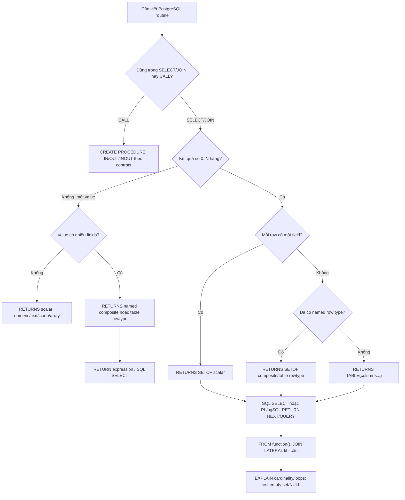

# Trả giá trị vô hướng, kiểu tổng hợp, TABLE và SETOF trong PostgreSQL

Khi viết hàm trong PostgreSQL, quyết định đầu tiên không chỉ là **tính toán gì**, mà còn là **trả về dữ liệu dưới hình dạng nào**. Một function có thể trả một số duy nhất, một giá trị `jsonb`, một bản ghi gồm nhiều trường, một hàng có kiểu của bảng, hoặc **nhiều hàng** có cấu trúc cố định. Những hình dạng này quyết định cách gọi function bằng `SELECT`, cách JOIN với dữ liệu khác, cách khai báo kiểu, cách xử lý kết quả ở JDBC và cả cách PostgreSQL tối ưu truy vấn.

Ví dụ cùng nghiệp vụ hóa đơn:

```sql
-- Một số:
SELECT demo_ret.paid_total(1);

-- Một bản ghi composite:
SELECT *
FROM demo_ret.customer_overview(1);

-- Nhiều hàng có cấu trúc cố định:
SELECT *
FROM demo_ret.list_invoices(1);

-- Nhiều hàng có kiểu của một bảng:
SELECT *
FROM demo_ret.paid_invoices(100);
```

Các function trên sẽ được tạo dần trong bài. Chúng minh họa bốn hợp đồng kết quả khác nhau.

Bài học thuộc chương **Hàm và thủ tục** của module *Database Engine Relational PostgreSQL*, tập trung đúng vào **trả giá trị vô hướng, kiểu tổng hợp (composite type), `RETURNS TABLE` và `SETOF`**. Bên cạnh cú pháp `LANGUAGE sql` và `LANGUAGE plpgsql`, bài đi sâu vào `RETURN`, `RETURN NEXT`, `RETURN QUERY`, `OUT` parameters, `record`, `LATERAL`, bản ghi NULL, giới hạn kiểu dữ liệu, hiệu năng và tích hợp Java/JDBC.

> **Phân biệt thuật ngữ:** *Kiểu tổng hợp* (*composite type*) là giá trị gồm nhiều trường có kiểu riêng; **không** phải *hàm tổng hợp* (*aggregate function*) như `SUM`, `COUNT` hay `AVG`. Một function trả composite có thể dùng aggregate bên trong, nhưng hai khái niệm độc lập.

Các câu SQL tạo bảng, function và procedure trong bài dùng schema `demo_ret` dành cho database thử nghiệm; không thực thi nguyên các bước ghi dữ liệu trên production.

---

## 1. Bốn trục cần phân biệt

Trước khi xem cú pháp, hãy phân biệt **số giá trị**, **số hàng**, **số cột** và **kiểu kết quả**.

| Hợp đồng return | Ví dụ | Kết quả khi gọi trong `FROM` |
|---|---|---|
| `RETURNS numeric` | Một tổng tiền | Một giá trị, thường một hàng |
| `RETURNS demo_ret.customer_overview` | Một bản ghi có 4 trường | Một hàng composite có các cột của type |
| `RETURNS SETOF bigint` | Nhiều ID | 0..N hàng, một cột |
| `RETURNS SETOF demo_ret.invoice` | Nhiều bản ghi hóa đơn | 0..N hàng với các cột của row type |
| `RETURNS TABLE(id bigint, name text)` | Nhiều hàng hai cột | 0..N hàng, hai cột đặt tên |
| `RETURNS record` | Một record được xác định ở nơi gọi | Phải cung cấp cấu trúc khi chưa có OUT type metadata |
| `RETURNS void` | Không có giá trị dữ liệu có nghĩa | Có thể gọi bằng `SELECT`, không phải tập hàng nghiệp vụ |

Điểm dễ nhầm: **một kết quả composite có nhiều trường không đồng nghĩa `SETOF`**. Ngược lại, `SETOF bigint` có nhiều hàng nhưng mỗi hàng chỉ là một giá trị.

### 1.1. Sơ đồ tư duy

```text
                 CREATE FUNCTION ...
                          │
                    Hình dạng return
                          │
        ┌─────────────────┼───────────────────┐
        ▼                 ▼                   ▼
   Một giá trị      Một composite         Nhiều hàng
   RETURNS T        RETURNS type          SETOF T / TABLE
        │                 │                   │
   numeric/text      ROW(a,b,c)       0, 1 hoặc N rows
   jsonb/array       hoặc table row       │
        │                 │               JOIN LATERAL
      RETURN             RETURN          RETURN NEXT/QUERY
```

PostgreSQL không tự chuyển từ “một bản ghi” thành “nhiều bản ghi” chỉ vì biểu thức SELECT bên trong có nhiều cột.

## 2. Function khác procedure như thế nào?

Trong PostgreSQL, **function** được dùng trong biểu thức SQL:

```sql
SELECT demo_ret.paid_total(1);
SELECT * FROM demo_ret.list_invoices(1);
```

Còn **procedure** được gọi bằng `CALL`:

```sql
CALL demo_ret.write_audit('Đã hoàn thành thao tác');
```

Một function khai báo kiểu trả về bằng `RETURNS ...` hoặc bằng `OUT` parameters. Procedure **không khai báo `RETURNS TABLE` hay `RETURNS SETOF`** theo cú pháp của function. Procedure có thể dùng `OUT`/`INOUT` parameters ở các phiên bản hỗ trợ để trả parameter values qua `CALL`, nhưng đó không phải một table-valued function để JOIN trong `FROM`.

### 2.1. Mốc phiên bản cần nhớ

- PostgreSQL 11 giới thiệu SQL procedures và `CALL`.
- `LANGUAGE sql` và `LANGUAGE plpgsql` hỗ trợ viết functions với cách trả kết quả khác nhau.
- `RETURNS TABLE`, `SETOF`, `OUT` không phải bốn cú pháp đồng nghĩa tuyệt đối.
- Tính năng và hành vi của thủ tục, transaction control, SQL-body syntax có thể khác theo major version; kiểm tra server đang triển khai.

Phần cuối bài có procedure minh họa, nhưng trọng tâm vẫn là **hợp đồng kết quả của function**.

## 3. Chuẩn bị schema thực hành

Dùng một mô hình nhỏ gồm khách hàng và hóa đơn để so sánh các kiểu trả về trên cùng dữ liệu.

```sql
CREATE SCHEMA IF NOT EXISTS demo_ret;

CREATE TABLE demo_ret.customer (
    customer_id BIGINT PRIMARY KEY,
    full_name TEXT NOT NULL,
    customer_tier TEXT NOT NULL
        CHECK (customer_tier IN ('STANDARD', 'VIP'))
);

CREATE TABLE demo_ret.invoice (
    invoice_id BIGINT PRIMARY KEY,
    customer_id BIGINT NOT NULL
        REFERENCES demo_ret.customer(customer_id),
    issued_at TIMESTAMPTZ NOT NULL,
    amount NUMERIC(12, 2) NOT NULL
        CHECK (amount >= 0),
    status TEXT NOT NULL
        CHECK (status IN ('NEW', 'PAID', 'CANCELLED'))
);
```

Dữ liệu lab:

```sql
INSERT INTO demo_ret.customer
    (customer_id, full_name, customer_tier)
VALUES
    (1, 'An',   'VIP'),
    (2, 'Bình', 'STANDARD'),
    (3, 'Chi',  'STANDARD'),
    (4, 'Dũng', 'VIP');

INSERT INTO demo_ret.invoice
    (invoice_id, customer_id, issued_at, amount, status)
VALUES
    (1001, 1, '2026-10-01 08:00:00+07', 120.00, 'PAID'),
    (1002, 1, '2026-11-02 08:00:00+07',  80.00, 'NEW'),
    (1003, 2, '2026-11-03 10:00:00+07', 200.00, 'PAID'),
    (1004, 2, '2026-11-04 10:00:00+07',  20.00, 'CANCELLED'),
    (1005, 4, '2026-11-05 09:00:00+07', 350.00, 'PAID');

ANALYZE demo_ret.customer;
ANALYZE demo_ret.invoice;
```

Bảng `customer` có **4 hàng**. Bảng `invoice` có **5 hàng**. Khách Chi (ID 3) **chưa có hóa đơn**. Đây là trường hợp kiểm thử quan trọng để phân biệt:

- Một function trả **NULL scalar**.
- Một function trả **composite với số đếm bằng 0**.
- Một function trả **0 dòng**.
- Một `LEFT JOIN LATERAL` giữ lại hàng cha khi function trả 0 dòng.

### 3.1. Xác minh dữ liệu

```sql
SELECT c.customer_id, c.full_name,
       COUNT(i.invoice_id) AS invoices
FROM demo_ret.customer AS c
LEFT JOIN demo_ret.invoice AS i
    ON i.customer_id = c.customer_id
GROUP BY c.customer_id, c.full_name
ORDER BY c.customer_id;
```

Kỳ vọng số lượng lần lượt là **2, 2, 0, 1**.

Nếu chạy lại các khối INSERT vào cùng schema, primary key có thể báo trùng; các ví dụ giả định lab khởi tạo một lần.

## 4. RETURNS scalar: một giá trị thuộc một kiểu

Dạng đơn giản:

```sql
CREATE FUNCTION demo_ret.apply_tax(
    p_amount NUMERIC,
    p_rate NUMERIC DEFAULT 0.10
)
RETURNS NUMERIC
LANGUAGE sql
IMMUTABLE
STRICT
AS $$
    SELECT round(p_amount * (1 + p_rate), 2);
$$;
```

Gọi:

```sql
SELECT demo_ret.apply_tax(100) AS amount_with_tax;
SELECT demo_ret.apply_tax(100, 0.08) AS amount_with_tax;
```

Kết quả lần lượt **110.00** và **108.00** theo cách làm tròn đã lập trình.

### 4.1. Đọc hợp đồng

- `RETURNS NUMERIC`: kết quả là **một giá trị numeric**, không phải bảng.
- `LANGUAGE sql`: thân function là SQL.
- `IMMUTABLE`: với cùng input và trong các điều kiện phù hợp, kết quả không phụ thuộc trạng thái database hoặc thời gian.
- `STRICT`: nếu một đối số đầu vào là SQL NULL, PostgreSQL trả NULL mà không gọi thân function.
- `DEFAULT 0.10`: khi người gọi không truyền `p_rate`, dùng giá trị mặc định.

### 4.2. Scalar không nhất thiết là số

Các ví dụ scalar types:

```text
RETURNS bigint
RETURNS boolean
RETURNS text
RETURNS date
RETURNS timestamptz
RETURNS numeric
RETURNS uuid
RETURNS jsonb
RETURNS integer[]
```

Một `jsonb` có thể chứa object hoặc array rất lớn, nhưng về mặt SQL nó vẫn là **một giá trị duy nhất**. `RETURNS jsonb` không đồng nghĩa trả nhiều hàng của table function.

## 5. Hàm scalar đọc dữ liệu trong bảng

Tạo function trả **tổng tiền các hóa đơn PAID** của một khách:

```sql
CREATE FUNCTION demo_ret.paid_total(
    p_customer_id BIGINT
)
RETURNS NUMERIC
LANGUAGE sql
STABLE
AS $$
    SELECT COALESCE(
        SUM(i.amount),
        0::numeric
    )
    FROM demo_ret.invoice AS i
    WHERE i.customer_id = p_customer_id
      AND i.status = 'PAID';
$$;
```

Gọi:

```sql
SELECT
    c.customer_id,
    c.full_name,
    demo_ret.paid_total(c.customer_id) AS paid_amount
FROM demo_ret.customer AS c
ORDER BY c.customer_id;
```

Kỳ vọng:

| Khách | paid_amount |
|---|---:|
| An | 120.00 |
| Bình | 200.00 |
| Chi | 0 |
| Dũng | 350.00 |

### 5.1. Vì sao STABLE mà không IMMUTABLE?

Kết quả phụ thuộc **dữ liệu của bảng invoice**. Cùng ID khách nhưng hóa đơn được thanh toán sau đó thì tổng có thể thay đổi. Vì thế `IMMUTABLE` là sai về ngữ nghĩa. `STABLE` phù hợp với kiểu đọc dữ liệu được coi nhất quán theo snapshot của statement.

### 5.2. COALESCE phân biệt NULL và số 0

`SUM` trên tập không có hàng phù hợp trả NULL. `COALESCE(...,0)` là **quyết định nghiệp vụ**: với khách chưa có hóa đơn PAID, báo tổng bằng 0.

Nếu yêu cầu phải phân biệt “không có dữ liệu” với “tổng bằng 0”, đừng tự động COALESCE.

### 5.3. Hàm tính tổng không chắc nhanh hơn JOIN/GROUP BY

Gọi `paid_total(customer_id)` cho 100.000 khách có thể khiến PostgreSQL phải thực thi nhiều phép tra cứu. Một phép `JOIN + GROUP BY` dạng set-based có thể hiệu quả hơn, tùy SQL-function inlining, index và planner.

Không coi function là cơ chế cache hoặc query optimizer riêng.

## 6. Scalar với PL/pgSQL và RETURN

`LANGUAGE plpgsql` thích hợp khi cần control flow:

```sql
CREATE FUNCTION demo_ret.customer_category(
    p_amount NUMERIC
)
RETURNS TEXT
LANGUAGE plpgsql
IMMUTABLE
AS $$
BEGIN
    IF p_amount IS NULL THEN
        RETURN 'UNKNOWN';
    ELSIF p_amount >= 300 THEN
        RETURN 'LARGE';
    ELSIF p_amount >= 100 THEN
        RETURN 'MEDIUM';
    ELSE
        RETURN 'SMALL';
    END IF;
END;
$$;
```

Gọi:

```sql
SELECT
    demo_ret.customer_category(450) AS c1,
    demo_ret.customer_category(150) AS c2,
    demo_ret.customer_category(20) AS c3,
    demo_ret.customer_category(NULL) AS c4;
```

Kỳ vọng: `LARGE`, `MEDIUM`, `SMALL`, `UNKNOWN`.

### 6.1. RETURN expression kết thúc function

Trong scalar PL/pgSQL:

```sql
RETURN some_expression;
```

vừa cung cấp giá trị, vừa **kết thúc ngay** lời gọi function đó.

Nếu function khai báo trả giá trị thông thường nhưng đi tới cuối mà không trả hợp lệ, PostgreSQL có thể báo lỗi runtime. Thiết kế nhánh `IF/CASE` sao cho mọi đường thực thi đều có contract rõ ràng.

### 6.2. STRICT sẽ đổi cách xử lý NULL

Nếu thêm `STRICT` vào `customer_category`, PostgreSQL trả SQL NULL ngay khi `p_amount=NULL`, **không chạy nhánh trả `'UNKNOWN'`**. Vì vậy không dùng `STRICT` trên hàm cần phân loại NULL theo nghiệp vụ.

## 7. Function trả void

Đôi khi function chỉ làm một thao tác phụ và không có dữ liệu có nghĩa để trả:

```sql
CREATE FUNCTION demo_ret.emit_notice(
    p_message TEXT
)
RETURNS void
LANGUAGE plpgsql
VOLATILE
AS $$
BEGIN
    RAISE NOTICE 'Message: %', p_message;
END;
$$;
```

Gọi:

```sql
SELECT demo_ret.emit_notice('Hello');
```

`void` là pseudo-type biểu thị không có một payload kết quả nghiệp vụ. Về mặt câu lệnh, function vẫn được gọi trong `SELECT`.

### 7.1. Khi nào nên dùng procedure?

Nếu mục tiêu chủ yếu là **thực hiện quy trình ghi dữ liệu**, đặc biệt cần transaction-control đặc thù của procedure, cân nhắc `CREATE PROCEDURE ... CALL` thay vì cố mô phỏng một table-valued function.

Tuy nhiên function và procedure **khác ngữ nghĩa giao dịch/cách gọi**, không đơn giản thay từ khóa này bằng từ khóa kia.

## 8. Một scalar SQL function gặp nhiều hàng thì sao?

Một SQL function khai báo `RETURNS bigint` nhưng câu SELECT cuối có thể tìm nhiều hàng:

```sql
-- Ví dụ thiết kế có thể gây hiểu nhầm:
CREATE FUNCTION demo_ret.any_invoice_id(
    p_customer_id BIGINT
)
RETURNS BIGINT
LANGUAGE sql
STABLE
AS $$
    SELECT i.invoice_id
    FROM demo_ret.invoice AS i
    WHERE i.customer_id = p_customer_id;
$$;
```

Với SQL-language function **không khai báo SETOF**, nếu câu truy vấn cuối trả nhiều hàng, PostgreSQL dùng **một hàng** làm kết quả scalar. Nếu không có hàng, kết quả là NULL.

### 8.1. Đừng dựa vào “một hàng bất kỳ”

Nếu muốn hóa đơn mới nhất, hãy quyết định rõ:

```sql
CREATE FUNCTION demo_ret.latest_invoice_id(
    p_customer_id BIGINT
)
RETURNS BIGINT
LANGUAGE sql
STABLE
AS $$
    SELECT i.invoice_id
    FROM demo_ret.invoice AS i
    WHERE i.customer_id = p_customer_id
    ORDER BY i.issued_at DESC, i.invoice_id DESC
    LIMIT 1;
$$;
```

`ORDER BY` cùng tiebreaker ID quyết định hàng nào được chọn. `LIMIT 1` làm ý định hiển nhiên cho người đọc.

### 8.2. “Không có kết quả” trong scalar

```sql
SELECT demo_ret.latest_invoice_id(3);
```

Khách Chi không có invoice, nên cột kết quả là **NULL** trong **một hàng SELECT**. Điều đó khác một function `SETOF` trả **0 hàng**.

## 9. SETOF scalar: một cột nhưng có thể nhiều hàng

`SETOF` là viết tắt của **set of** — một tập các giá trị thuộc kiểu đã khai báo.

```sql
CREATE FUNCTION demo_ret.paid_invoice_ids(
    p_customer_id BIGINT
)
RETURNS SETOF BIGINT
LANGUAGE sql
STABLE
AS $$
    SELECT i.invoice_id
    FROM demo_ret.invoice AS i
    WHERE i.customer_id = p_customer_id
      AND i.status = 'PAID'
    ORDER BY i.issued_at DESC, i.invoice_id DESC;
$$;
```

Gọi trong `FROM`:

```sql
SELECT s.invoice_id
FROM demo_ret.paid_invoice_ids(1) AS s(invoice_id);
```

Với An: một dòng chứa `1001`.

Với Chi:

```sql
SELECT *
FROM demo_ret.paid_invoice_ids(3);
```

Kết quả **không có dòng nào**, thay vì một dòng chứa SQL NULL.

### 9.1. SETOF scalar khác array scalar

```sql
RETURNS SETOF BIGINT   -- 0..N dòng, mỗi dòng một BIGINT.
RETURNS BIGINT[]       -- Một giá trị là mảng BIGINT[].
```

Hai kiểu này không được thay thế tùy ý. Nếu ứng dụng cần join mỗi ID với bảng khác, `SETOF BIGINT` thường thuận tiện hơn; nếu cần một JSON/array payload, bạn có thể aggregate thành một scalar tùy yêu cầu.

## 10. Ưu tiên gọi SRF trong FROM

PostgreSQL cho phép set-returning functions (SRFs) trong một số biểu thức `SELECT`:

```sql
SELECT demo_ret.paid_invoice_ids(1);
```

Nhưng với query có nhiều nguồn dữ liệu hoặc nhiều SRFs, cách viết này có thể khó theo dõi cardinality và lập kế hoạch.

Cách rõ ràng hơn:

```sql
SELECT ids.invoice_id
FROM demo_ret.paid_invoice_ids(1) AS ids(invoice_id);
```

Khi function liên quan một hàng khác:

```sql
SELECT
    c.customer_id,
    ids.invoice_id
FROM demo_ret.customer AS c
CROSS JOIN LATERAL
    demo_ret.paid_invoice_ids(c.customer_id) AS ids(invoice_id)
ORDER BY c.customer_id, ids.invoice_id;
```

`LATERAL` thể hiện function nhận `c.customer_id` của từng hàng phía trước. `CROSS JOIN` loại khách có function trả 0 dòng.

## 11. Kiểu tổng hợp (composite type) là gì?

Một composite type chứa **một số trường có tên và kiểu riêng**.

Ví dụ định nghĩa type độc lập:

```sql
CREATE TYPE demo_ret.customer_overview AS (
    customer_id BIGINT,
    full_name TEXT,
    paid_invoice_count BIGINT,
    paid_total NUMERIC
);
```

Một giá trị của type này giống một “record”:

```text
customer_id       = 1
full_name         = "An"
paid_invoice_count = 1
paid_total        = 120.00
```

Nó **không phải bốn kết quả scalar độc lập** và cũng không phải một bảng nhiều hàng.

### 11.1. Composite type không tự có primary key

`CREATE TYPE ... AS (...)` khai báo cấu trúc của một giá trị. Nó không tạo bảng chứa dữ liệu, không tự có `PRIMARY KEY`, `FOREIGN KEY`, `UNIQUE` hoặc indexes.

Đừng dùng một composite type thay cho bảng quan hệ nếu nghiệp vụ cần lưu/khóa/index từng row.

### 11.2. Composite type cũng được tạo tự động từ bảng

Khi tạo `demo_ret.customer` hoặc `demo_ret.invoice`, PostgreSQL có row type tương ứng với cấu trúc cột bảng. Bạn có thể dùng:

```sql
RETURNS demo_ret.customer
RETURNS demo_ret.invoice
```

mà không cần tạo `CREATE TYPE` khác có cùng fields.

## 12. Function trả một composite value

Tạo function trả tổng hợp thông tin của một khách:

```sql
CREATE FUNCTION demo_ret.customer_overview(
    p_customer_id BIGINT
)
RETURNS demo_ret.customer_overview
LANGUAGE sql
STABLE
AS $$
    SELECT ROW(
        c.customer_id,
        c.full_name,
        COUNT(i.invoice_id)
            FILTER (WHERE i.status = 'PAID'),
        COALESCE(
            SUM(i.amount)
                FILTER (WHERE i.status = 'PAID'),
            0::numeric
        )
    )::demo_ret.customer_overview
    FROM demo_ret.customer AS c
    LEFT JOIN demo_ret.invoice AS i
        ON i.customer_id = c.customer_id
    WHERE c.customer_id = p_customer_id
    GROUP BY c.customer_id, c.full_name;
$$;
```

Giải thích:

- `ROW(...)` tạo một composite/row expression.
- `::demo_ret.customer_overview` ép về named composite type mong muốn.
- `COUNT(...)` có kiểu `bigint`, khớp trường thứ ba.
- `SUM(numeric)` trả numeric; `COALESCE` xử lý khách chưa có hóa đơn PAID.
- `GROUP BY` tạo một row cho khách nếu tồn tại.
- `WHERE` không match khách nào thì scalar composite function có thể trả NULL.

### 12.1. Gọi composite function trong FROM

```sql
SELECT *
FROM demo_ret.customer_overview(1);
```

Các cột kết quả là `customer_id`, `full_name`, `paid_invoice_count` và `paid_total`.

### 12.2. Gọi như một giá trị

```sql
SELECT demo_ret.customer_overview(1) AS summary_value;
```

Lúc này SELECT có **một cột**, kiểu của cột là `demo_ret.customer_overview`. Client có thể hiển thị composite theo dạng văn bản record thay vì bốn cột tách riêng.

### 12.3. Vì sao hai cách gọi khác nhau?

`SELECT f()` xem kết quả là **một expression value**. `SELECT * FROM f()` xem function như một nguồn quan hệ và mở fields của composite thành columns.

Sự khác biệt ảnh hưởng cách đọc `ResultSet` trong JDBC và cách mapping ORM.

## 13. Truy cập field của composite

Nếu function trả composite, có thể truy cập một field:

```sql
SELECT
    (demo_ret.customer_overview(1)).full_name AS customer_name;
```

Dấu ngoặc quanh function call giúp PostgreSQL phân biệt cú pháp field access.

### 13.1. Cẩn thận khi viết (f()).*

Một cách viết:

```sql
SELECT (demo_ret.customer_overview(1)).*;
```

có thể được planner mở rộng theo từng field. Với expression phức tạp/volatile, một số cách mở rộng có thể dẫn tới **gọi function nhiều lần** nếu không được xử lý/định hình cẩn thận.

Để rõ hợp đồng “một lời gọi được dùng thành nhiều field”, ưu tiên đặt function trong `FROM`:

```sql
SELECT x.customer_id, x.full_name,
       x.paid_invoice_count, x.paid_total
FROM demo_ret.customer_overview(1) AS x;
```

Nếu cần kết hợp với customer table, dùng `LATERAL` ở phần sau.

### 13.2. Composite field cũng có thể NULL

Một composite không tự bảo đảm mọi field khác NULL. Ví dụ `full_name` trong type độc lập là `TEXT`, không phải bản sao constraints `NOT NULL` của bảng customer. Nếu function trả một field NULL, ứng dụng vẫn phải xử lý như dữ liệu có thể thiếu.

## 14. Function trả row type của bảng

Ta có bảng `demo_ret.customer` và row type cùng tên:

```sql
CREATE FUNCTION demo_ret.find_customer(
    p_customer_id BIGINT
)
RETURNS demo_ret.customer
LANGUAGE sql
STABLE
AS $$
    SELECT c
    FROM demo_ret.customer AS c
    WHERE c.customer_id = p_customer_id;
$$;
```

`SELECT c` chọn **whole-row value** của alias `c`.

Gọi:

```sql
SELECT *
FROM demo_ret.find_customer(2);
```

Kết quả gồm các cột hiện tại của bảng customer: ID, tên và tier.

### 14.1. Whole-row và field list

Đây là hai hình thức biểu diễn:

```sql
SELECT c
FROM demo_ret.customer AS c;

SELECT c.*
FROM demo_ret.customer AS c;
```

Trong câu thứ nhất, `c` là **một composite value**. Trong câu thứ hai, `c.*` mở fields thành các cột của SELECT. Khi khai báo function `RETURNS demo_ret.customer`, nên viết rõ ý định và kiểm tra shape/kiểu của SQL function body.

### 14.2. Row type phụ thuộc schema của bảng

`RETURNS demo_ret.customer` liên kết hợp đồng return với cấu trúc bảng. Nếu sau này `ALTER TABLE ADD COLUMN`, row type thay đổi và các bên tiêu thụ composite có thể chịu ảnh hưởng.

Đây là trade-off:

- Tiện: không lặp lại danh sách cột.
- Rủi ro: API database tự thay shape khi schema bảng tiến hóa.

Nếu function là public API cho nhiều client, dùng named composite type hoặc `RETURNS TABLE` chọn cột ổn định thường dễ version hóa hơn.

## 15. ROW constructor và ép kiểu composite

Ví dụ tự tạo một giá trị composite:

```sql
SELECT ROW(
    1::bigint,
    'An'::text,
    1::bigint,
    120::numeric
)::demo_ret.customer_overview AS overview;
```

Dấu `ROW(...)` tạo row expression. Ép kiểu tường minh giúp PostgreSQL biết cần một `customer_overview`, không chỉ record vô danh.

### 15.1. Số cột và thứ tự phải khớp

Với type gồm 4 fields, biểu thức dưới đây **không đúng shape**:

```sql
-- Chủ đích minh họa lỗi:
SELECT ROW(1::bigint, 'An'::text)
    ::demo_ret.customer_overview;
```

Không thể giả định thiếu hai field sẽ được PostgreSQL tự dùng defaults như INSERT vào một bảng. Composite type riêng không mang default values theo cách đó.

### 15.2. Numeric, bigint và text cần khớp

`COUNT(*)` trả `bigint`, còn `COUNT(*)::integer` có thể overflow trên dữ liệu lớn. Không ép đếm rows về integer chỉ để trùng một declaration tiện tay.

Nếu source là `varchar(n)` còn return field là `text`, hãy hiểu cơ chế cast đang dùng; đặc biệt trong PL/pgSQL `RETURN QUERY`, lỗi type mismatch có thể xuất hiện dù hai kiểu trông gần giống nhau.

## 16. Một composite NULL không đồng nghĩa một hàng có giá trị 0

`demo_ret.customer_overview(3)` trả một composite hợp lệ cho Chi:

```text
customer_id        = 3
full_name          = Chi
paid_invoice_count = 0
paid_total         = 0
```

`demo_ret.customer_overview(999)` không tìm thấy khách: function scalar không có hàng nguồn và trả **NULL composite value** theo semantics SQL function.

### 16.1. Tránh nhầm no customer với customer có 0 invoices

Không viết API mapping `COALESCE(...,0)` trên toàn bộ logical record nếu điều đó biến “không tồn tại khách” thành “khách tồn tại với tổng 0”.

Nên xử lý một điều kiện tồn tại rõ:

```sql
SELECT EXISTS (
    SELECT 1
    FROM demo_ret.customer
    WHERE customer_id = 999
) AS customer_exists;
```

### 16.2. Composite IS NULL có semantics đặc biệt

PostgreSQL xử lý `IS NULL` trên row/composite theo quy tắc khác một scalar: một row có **tất cả các fields NULL** cũng có thể được xem là NULL theo phép kiểm tra đó, còn row chứa kết hợp NULL/non-NULL có thể không thỏa cả `IS NULL` lẫn `IS NOT NULL`.

Ví dụ:

```sql
SELECT
    ROW(NULL::integer, NULL::text) IS NULL
        AS all_fields_null,
    ROW(NULL::integer, 'A'::text) IS NULL
        AS mixed_is_null,
    ROW(NULL::integer, 'A'::text) IS NOT NULL
        AS mixed_is_not_null;
```

Không dùng row `IS NULL` như một phương pháp tổng quát để phân biệt **NULL composite** với **record có tất cả fields NULL**. Nếu cần trạng thái tồn tại, dùng khóa ID hoặc cờ riêng.

## 17. OUT parameter: khai báo kết quả ngay ở chữ ký

Ngoài `RETURNS some_type`, PostgreSQL có **output parameters**:

```sql
CREATE FUNCTION demo_ret.paid_count_out(
    IN p_customer_id BIGINT,
    OUT paid_count BIGINT
)
LANGUAGE sql
STABLE
AS $$
    SELECT COUNT(*)
    FROM demo_ret.invoice AS i
    WHERE i.customer_id = p_customer_id
      AND i.status = 'PAID';
$$;
```

Gọi:

```sql
SELECT demo_ret.paid_count_out(1) AS count_value;
```

### 17.1. IN vs OUT

- `IN`: người gọi truyền vào; tham gia định danh chữ ký function.
- `OUT`: function cung cấp kết quả; người gọi thường không truyền giá trị cho OUT.
- `INOUT`: vừa nhận input vừa chứa output, tùy function/procedure contract.

Với một OUT parameter, kiểu trả về có thể suy ra từ parameter đó.

### 17.2. OUT không chỉ là đặt tên alias

OUT parameter là một phần khai báo result shape trong catalog. Nó ảnh hưởng cách function được mô tả và gọi, không chỉ là alias ở câu SELECT bên ngoài.

## 18. Nhiều OUT parameters: một composite-like record

Function trả số hóa đơn đã thanh toán và tổng tiền:

```sql
CREATE FUNCTION demo_ret.paid_metrics(
    IN p_customer_id BIGINT,
    OUT paid_count BIGINT,
    OUT paid_amount NUMERIC
)
LANGUAGE sql
STABLE
AS $$
    SELECT
        COUNT(*),
        COALESCE(SUM(i.amount), 0::numeric)
    FROM demo_ret.invoice AS i
    WHERE i.customer_id = p_customer_id
      AND i.status = 'PAID';
$$;
```

Gọi dưới dạng hai cột:

```sql
SELECT *
FROM demo_ret.paid_metrics(1);
```

Kết quả logic:

| paid_count | paid_amount |
|---:|---:|
| 1 | 120.00 |

Function dùng nhiều OUT parameters có result row shape được xác định tại khai báo. Điều này **khác** `RETURNS record` thuần túy không khai báo tên/kiểu fields ở chữ ký.

### 18.1. Không overload chỉ bằng OUT parameters

Function identity chủ yếu dựa trên tên cùng các kiểu input arguments. Bạn không thể tạo hai functions giống hệt tên và IN signature chỉ khác OUT names hoặc OUT return types rồi mong PostgreSQL chọn theo “context return type”.

### 18.2. OUT names và tên cột có thể trùng

Trong PL/pgSQL, output parameter names còn hoạt động như biến. Nếu tên biến `paid_count` trùng tên cột query, tham chiếu không định danh có thể ambiguous. Dùng alias bảng như `i.invoice_id` và tránh những tên vô nghĩa trùng hàng loạt cột.

## 19. RETURNS TABLE: tên cột và nhiều hàng

`RETURNS TABLE` khai báo các cột của tập kết quả ngay trong function signature.

```sql
CREATE FUNCTION demo_ret.list_invoices(
    p_customer_id BIGINT,
    p_status TEXT DEFAULT NULL
)
RETURNS TABLE (
    invoice_id BIGINT,
    issued_at TIMESTAMPTZ,
    amount NUMERIC,
    status TEXT
)
LANGUAGE sql
STABLE
AS $$
    SELECT
        i.invoice_id,
        i.issued_at,
        i.amount,
        i.status
    FROM demo_ret.invoice AS i
    WHERE i.customer_id = p_customer_id
      AND (
          p_status IS NULL
          OR i.status = p_status
      )
    ORDER BY i.issued_at DESC, i.invoice_id DESC;
$$;
```

Gọi:

```sql
SELECT *
FROM demo_ret.list_invoices(1);
```

Với An, trả hai hàng theo thời gian mới → cũ: hóa đơn 1002 (NEW), rồi 1001 (PAID).

### 19.1. Lọc theo tham số thứ hai

```sql
SELECT *
FROM demo_ret.list_invoices(1, 'PAID');
```

Chỉ trả hóa đơn 1001.

### 19.2. Mặc định NULL ở tham số lọc là một quyết định API

Ở ví dụ này `p_status=NULL` được hiểu là **không lọc theo status**. Nếu ứng dụng muốn ý nghĩa “status thực sự là NULL”, cần thiết kế khác. Bảng lab không cho status NULL, nhưng trong hệ thống tổng quát không được xem `NULL parameter` luôn có nghĩa “tất cả”.

### 19.3. RETURNS TABLE có thể trả 0 dòng

```sql
SELECT *
FROM demo_ret.list_invoices(3);
```

Với Chi, trả **0 rows**, không phải một row với bốn field NULL. Đây là contract set-returning.

## 20. RETURNS TABLE là cách nói “SETOF các hàng có tên”

Về mặt sử dụng, `RETURNS TABLE (id bigint, name text)` biểu đạt:

- Kết quả có thể có **0..N hàng**.
- Mỗi hàng gồm hai fields `id` và `name`.
- Các cột/kiểu được khai ngay trong chữ ký function.
- Trong PL/pgSQL, các tên cột output là những biến OUT mà function có thể gán.

Có thể xem nó tương đương về ý định với việc khai báo **OUT parameters + tập kết quả**, nhưng cú pháp `RETURNS TABLE` không thể trộn tùy tiện với một mệnh đề `RETURNS some_type` hoặc một danh sách OUT khác.

### 20.1. Khác với RETURNS record

`RETURNS TABLE` cho PostgreSQL và người gọi biết trước tên/kiểu cột, nên:

```sql
SELECT invoice_id, amount
FROM demo_ret.list_invoices(1);
```

không cần cung cấp column definition list.

### 20.2. Khác với RETURNS SETOF scalar

`RETURNS SETOF bigint` trả một cột giá trị kiểu bigint. `RETURNS TABLE(invoice_id bigint, amount numeric)` trả hai cột mỗi hàng.

### 20.3. RETURNS TABLE không nhất thiết trả ít nhất một dòng

Từ “TABLE” không bảo đảm tồn tại hàng. Nếu `WHERE` không match hoặc function cố ý trả tập rỗng, query không có row. Đây không phải lỗi return.

## 21. RETURNS SETOF named composite type

Dùng row type sẵn có của bảng:

```sql
CREATE FUNCTION demo_ret.paid_invoices(
    p_min_amount NUMERIC DEFAULT 0
)
RETURNS SETOF demo_ret.invoice
LANGUAGE sql
STABLE
AS $$
    SELECT i.*
    FROM demo_ret.invoice AS i
    WHERE i.status = 'PAID'
      AND i.amount >= p_min_amount
    ORDER BY i.issued_at DESC, i.invoice_id DESC;
$$;
```

Gọi:

```sql
SELECT
    p.invoice_id,
    p.customer_id,
    p.amount,
    p.status
FROM demo_ret.paid_invoices(100) AS p
ORDER BY p.amount DESC, p.invoice_id DESC;
```

### 21.1. Lúc nào dùng SETOF table_rowtype?

Nếu muốn function trả **toàn bộ cấu trúc hàng** của bảng, `SETOF demo_ret.invoice` tiện và giúp bớt lặp chữ ký cột.

Trade-off: thêm/bỏ/sửa cột bảng ảnh hưởng shape rowtype. Client phụ thuộc thứ tự/kiểu cột có thể cần cập nhật sau migration.

### 21.2. Lúc nào dùng RETURNS TABLE?

Nếu API chỉ muốn một số trường cố định:

```text
invoice_id, issued_at, amount, status
```

chứ không muốn mọi trường dữ liệu nội bộ, `RETURNS TABLE(...)` thường biểu đạt hợp đồng public rõ hơn.

### 21.3. Không tạo một TYPE mới cho mọi SELECT vô cớ

Nếu table rowtype sẵn có và ổn định, `SETOF table_type` có thể đủ. Nếu shape cần tái sử dụng nhiều function hoặc độc lập khỏi DDL của bảng, named composite type có lợi.

## 22. SETOF named composite type độc lập với bảng

Type `demo_ret.customer_overview` đã được tạo. Một function có thể trả **nhiều overview records**:

```sql
CREATE FUNCTION demo_ret.all_customer_overviews()
RETURNS SETOF demo_ret.customer_overview
LANGUAGE sql
STABLE
AS $$
    SELECT ROW(
        c.customer_id,
        c.full_name,
        COUNT(i.invoice_id)
            FILTER (WHERE i.status = 'PAID'),
        COALESCE(
            SUM(i.amount)
                FILTER (WHERE i.status = 'PAID'),
            0::numeric
        )
    )::demo_ret.customer_overview
    FROM demo_ret.customer AS c
    LEFT JOIN demo_ret.invoice AS i
        ON i.customer_id = c.customer_id
    GROUP BY c.customer_id, c.full_name
    ORDER BY c.customer_id;
$$;
```

Gọi:

```sql
SELECT *
FROM demo_ret.all_customer_overviews();
```

Đây là **4 hàng**, mỗi hàng có 4 fields. Chi vẫn xuất hiện với tổng 0 nhờ `LEFT JOIN`.

### 22.1. So với scalar composite function

`demo_ret.customer_overview(1)` trả một composite của một khách. `demo_ret.all_customer_overviews()` trả một **tập composite values**.

Cả hai cùng dùng type `customer_overview`, nhưng số lượng hàng khác nhau. Đừng suy ra `RETURNS composite` là set-returning chỉ vì type nhiều fields.

## 23. RETURNS record: shape xác định lúc gọi

`record` là một pseudo-type cho row structure không cố định ngay trong một named composite type.

Ví dụ function:

```sql
CREATE FUNCTION demo_ret.dynamic_customer_record(
    p_customer_id BIGINT
)
RETURNS record
LANGUAGE sql
STABLE
AS $$
    SELECT c.customer_id, c.full_name
    FROM demo_ret.customer AS c
    WHERE c.customer_id = p_customer_id;
$$;
```

Khi dùng trong `FROM`, vì chữ ký không công bố cụ thể field names/types, người gọi cần khai báo cột:

```sql
SELECT *
FROM demo_ret.dynamic_customer_record(1)
    AS r(customer_id BIGINT, full_name TEXT);
```

### 23.1. Nếu khai sai kiểu hoặc số cột?

SQL caller có thể báo mismatch khi nhận row có cấu trúc khác column definition list. `record` **không phải** “nhận dữ liệu kiểu gì cũng được rồi ép đại”.

### 23.2. Khi nào record phù hợp?

- Công cụ migration/report có schema đầu ra phụ thuộc runtime.
- Hàm generic với caller đã biết shape.
- Một số PL/pgSQL helper nội bộ.

Với public API ổn định, `RETURNS TABLE` hoặc named composite thường dễ đọc, dễ dùng với JDBC và dễ kiểm soát migration hơn.

## 24. RETURNS SETOF record: động cả shape lẫn số hàng

Có thể định nghĩa:

```sql
CREATE FUNCTION demo_ret.dynamic_invoice_pairs(
    p_customer_id BIGINT
)
RETURNS SETOF record
LANGUAGE sql
STABLE
AS $$
    SELECT i.invoice_id, i.amount
    FROM demo_ret.invoice AS i
    WHERE i.customer_id = p_customer_id
    ORDER BY i.invoice_id;
$$;
```

Gọi với shape tường minh:

```sql
SELECT *
FROM demo_ret.dynamic_invoice_pairs(1)
    AS x(invoice_id BIGINT, amount NUMERIC);
```

Với An, có hai hàng `(1001,120.00)` và `(1002,80.00)`.

### 24.1. So sánh hai lần khai báo

```text
RETURNS SETOF record
    → Caller thường phải cung cấp (column_name column_type, ...).

RETURNS TABLE(invoice_id bigint, amount numeric)
    → Function đã công bố shape, caller không phải khai lại.
```

Không chọn `record` chỉ vì câu trả lời có nhiều cột. Nhiều cột **đã biết trước** là use case rất tự nhiên cho `RETURNS TABLE`.

## 25. PL/pgSQL: RETURN cho scalar/composite

Trong PL/pgSQL, `RETURN expression;` trả một giá trị và kết thúc execution.

Ví dụ trả một composite:

```sql
CREATE FUNCTION demo_ret.make_overview_sample(
    p_customer_id BIGINT,
    p_name TEXT
)
RETURNS demo_ret.customer_overview
LANGUAGE plpgsql
IMMUTABLE
AS $$
DECLARE
    v_result demo_ret.customer_overview;
BEGIN
    v_result := ROW(
        p_customer_id,
        p_name,
        0::bigint,
        0::numeric
    )::demo_ret.customer_overview;

    RETURN v_result;
END;
$$;
```

Gọi:

```sql
SELECT *
FROM demo_ret.make_overview_sample(99, 'Thử nghiệm');
```

Kết quả là **một composite value** với 4 fields.

### 25.1. Biến có named composite type

`v_result demo_ret.customer_overview;` khai báo một biến mang cấu trúc của type. Có thể truy cập fields:

```plpgsql
v_result.full_name := p_name;
```

Đây là đoạn PL/pgSQL minh họa nằm trong function body, không phải câu SQL standalone.

### 25.2. RETURN NULL cho composite

Một function `RETURNS demo_ret.customer_overview` có thể trả SQL NULL nếu business logic cho phép “không tồn tại bản ghi”. Không tự trả một record có ID 0 và tên rỗng để thay cho NULL nếu điều đó có thể bị client hiểu là khách hợp lệ.

## 26. PL/pgSQL: RETURN NEXT khi function có SETOF

`RETURN NEXT` thêm **một giá trị/hàng** vào tập kết quả, rồi tiếp tục chạy function. Nó **không kết thúc function** như `RETURN expression` trong scalar function.

Ví dụ tạo dãy số chẵn:

```sql
CREATE FUNCTION demo_ret.even_numbers(
    p_max INTEGER
)
RETURNS SETOF INTEGER
LANGUAGE plpgsql
IMMUTABLE
AS $$
DECLARE
    v_num INTEGER;
BEGIN
    IF p_max IS NULL OR p_max < 2 THEN
        RETURN;
    END IF;

    FOR v_num IN 1..p_max LOOP
        IF v_num % 2 = 0 THEN
            RETURN NEXT v_num;
        END IF;
    END LOOP;

    RETURN;
END;
$$;
```

Gọi:

```sql
SELECT n
FROM demo_ret.even_numbers(10) AS x(n);
```

Kỳ vọng: 2, 4, 6, 8, 10.

### 26.1. Ba câu RETURN có ý nghĩa khác

| Lệnh PL/pgSQL | Áp dụng | Ý nghĩa |
|---|---|---|
| `RETURN expression;` | Function trả scalar/composite, không SETOF | Trả giá trị và kết thúc |
| `RETURN NEXT expression;` | SETOF với return không dùng output parameters | Thêm một hàng vào result set |
| `RETURN;` | SETOF hoặc void/output-parameter cases thích hợp | Kết thúc function, không thêm hàng |
| `RETURN QUERY sql_query;` | SETOF/RETURNS TABLE | Thêm mọi hàng từ query vào result set |

### 26.2. RETURN NEXT không tự gửi một row ngay cho client

PL/pgSQL set-returning functions thường tích lũy các rows trong một tuplestore trước khi trả hoàn chỉnh cho bên gọi. Với lượng kết quả rất lớn, có thể sử dụng bộ nhớ và temp storage; đừng hiểu RETURN NEXT là HTTP streaming theo từng câu lệnh.

## 27. PL/pgSQL: RETURN NEXT với RETURNS TABLE

Nếu function dùng `RETURNS TABLE`, các output fields là biến. Khi đó `RETURN NEXT` được viết **không có biểu thức**, sau khi gán output variables.

```sql
CREATE FUNCTION demo_ret.counter_labels(
    p_limit INTEGER
)
RETURNS TABLE (
    seq_no INTEGER,
    label TEXT
)
LANGUAGE plpgsql
IMMUTABLE
AS $$
DECLARE
    v_idx INTEGER;
BEGIN
    IF p_limit IS NULL OR p_limit < 1 THEN
        RETURN;
    END IF;

    FOR v_idx IN 1..p_limit LOOP
        seq_no := v_idx;
        label := 'Item ' || v_idx::text;
        RETURN NEXT;
    END LOOP;

    RETURN;
END;
$$;
```

Gọi:

```sql
SELECT *
FROM demo_ret.counter_labels(3);
```

Kết quả:

| seq_no | label |
|---:|---|
| 1 | Item 1 |
| 2 | Item 2 |
| 3 | Item 3 |

### 27.1. Vì sao không RETURN NEXT ROW(...) ở đây?

`seq_no` và `label` đã là OUT variables do `RETURNS TABLE` tạo ra. Trong dạng này, `RETURN NEXT;` lấy **giá trị hiện tại của output variables** để bổ sung một row. Không truyền thêm expression tùy ý theo cú pháp của SETOF scalar.

## 28. PL/pgSQL: RETURN QUERY cho tập dữ liệu

`RETURN QUERY` thường ngắn gọn và dễ tối ưu hơn vòng lặp `RETURN NEXT` cho các truy vấn có thể biểu đạt bằng SQL set-based.

```sql
CREATE FUNCTION demo_ret.invoice_page(
    p_customer_id BIGINT,
    p_min_amount NUMERIC DEFAULT 0
)
RETURNS TABLE (
    invoice_id BIGINT,
    amount NUMERIC,
    status TEXT
)
LANGUAGE plpgsql
STABLE
AS $$
BEGIN
    RETURN QUERY
    SELECT
        i.invoice_id,
        i.amount,
        i.status
    FROM demo_ret.invoice AS i
    WHERE i.customer_id = p_customer_id
      AND i.amount >= p_min_amount
    ORDER BY i.invoice_id;

    RETURN;
END;
$$;
```

Gọi:

```sql
SELECT *
FROM demo_ret.invoice_page(1, 50);
```

Trả hai hóa đơn 1001 và 1002 của An.

### 28.1. RETURN QUERY thêm hàng, không kết thúc ngay

Sau `RETURN QUERY`, function có thể tiếp tục chạy và thêm các rows khác bằng `RETURN QUERY`/`RETURN NEXT`. `RETURN;` ở cuối mới kết thúc.

### 28.2. Tránh nhân bản rows vô ý

Nếu viết hai `RETURN QUERY` với điều kiện chồng nhau, có thể tạo duplicate rows trừ khi bạn chủ động lọc chúng. Set-returning function không tự áp `DISTINCT` cho các lần append.

### 28.3. Tránh loop từng invoice khi một SELECT đủ

Thay vì:

```plpgsql
FOR r IN SELECT ... LOOP
    RETURN NEXT r;
END LOOP;
```

một câu `RETURN QUERY SELECT ...` thường rõ ý định và cho SQL executor cơ hội tối ưu phần SELECT tốt hơn.

## 29. RETURN QUERY EXECUTE cho SQL động

Khi cấu trúc hoặc điều kiện cần chọn động, PL/pgSQL hỗ trợ:

```plpgsql
RETURN QUERY EXECUTE some_sql_text
USING input_value_1, input_value_2;
```

Ví dụ một filter status an toàn:

```sql
CREATE FUNCTION demo_ret.dynamic_status_invoices(
    p_status TEXT
)
RETURNS TABLE (
    invoice_id BIGINT,
    amount NUMERIC
)
LANGUAGE plpgsql
STABLE
AS $$
BEGIN
    RETURN QUERY EXECUTE
        'SELECT i.invoice_id, i.amount
         FROM demo_ret.invoice AS i
         WHERE i.status = $1
         ORDER BY i.invoice_id'
    USING p_status;
END;
$$;
```

### 29.1. Ở đây SQL động là không cần thiết

Vì câu SELECT không có tên bảng/cột động, một `RETURN QUERY SELECT ... WHERE i.status = p_status` thông thường dễ đọc hơn. Ví dụ này chỉ giới thiệu `EXECUTE ... USING`.

### 29.2. Không nối raw input vào SQL string

`EXECUTE '... WHERE status = ''' || p_status || ''''` tiềm ẩn lỗi escaping và SQL injection. Dùng `USING` cho **giá trị** và chỉ dùng `format('%I', identifier)` với whitelist khi thật sự cần tên identifier động.

### 29.3. Dynamic shape không phù hợp tùy tiện với RETURNS TABLE cố định

Dù SQL text xây động, kết quả vẫn phải phù hợp các output columns đã khai báo. Nếu mỗi lần có số cột/kiểu khác nhau, cần thiết kế `record`/schema-aware contract khác; không kỳ vọng PostgreSQL chấp nhận mọi shape.

## 30. Khác biệt RETURN NEXT và RETURN QUERY

| Tiêu chí | `RETURN NEXT` | `RETURN QUERY` |
|---|---|---|
| Đơn vị thêm | Một scalar hoặc một composite row | Tất cả rows từ một SQL query |
| Dùng trong | SETOF/RETURNS TABLE thích hợp | SETOF/RETURNS TABLE |
| Hợp với | Loop có logic từng hàng | Dữ liệu có thể lấy theo set-based SELECT |
| Có kết thúc function? | Không | Không |
| Có thể gọi nhiều lần? | Có | Có |
| Có nghĩa stream trực tiếp? | Không mặc định | Không mặc định |

Dùng `RETURN NEXT` khi mỗi row cần được phát sinh qua một logic vòng lặp đặc thù. Dùng `RETURN QUERY` khi đã có SQL trả đúng tập hàng.

**Không dùng `RETURN QUERY` trong function chỉ khai báo `RETURNS numeric`**, vì nó là cơ chế cho set-returning results.

## 31. Function SQL với SETOF không cần RETURN QUERY

Trong `LANGUAGE sql`:

```sql
CREATE FUNCTION demo_ret.customer_ids_above(
    p_min_id BIGINT
)
RETURNS SETOF BIGINT
LANGUAGE sql
STABLE
AS $$
    SELECT c.customer_id
    FROM demo_ret.customer AS c
    WHERE c.customer_id > p_min_id
    ORDER BY c.customer_id;
$$;
```

Câu SELECT cuối cung cấp toàn bộ các rows cho kết quả function.

Trong `LANGUAGE plpgsql`, lại cần các cấu trúc `RETURN NEXT` hoặc `RETURN QUERY` để xây tập kết quả.

### 31.1. Đừng trộn hai loại body

`BEGIN ... END` và `RETURN QUERY` là cú pháp PL/pgSQL, không phải nội dung SQL query thuần kiểu `LANGUAGE sql AS $$ SELECT ... $$`.

Hãy chọn ngôn ngữ function theo nhu cầu logic. Với một SELECT đơn giản, `LANGUAGE sql` thường gọn và dễ được optimizer xem xét hơn.

## 32. So sánh đầy đủ: 7 kiểu trả về

| Khai báo | Số hàng logic | Số cột logic | Caller cần biết gì? |
|---|---|---|---|
| `RETURNS numeric` | Một scalar value | 1 | Numeric |
| `RETURNS integer[]` | Một array value | 1 | Array type |
| `RETURNS jsonb` | Một JSON value | 1 | JSONB |
| `RETURNS demo_ret.customer_overview` | Một composite value | 4 fields | Named composite type |
| `RETURNS SETOF bigint` | 0..N | 1 | Scalar element type |
| `RETURNS SETOF demo_ret.invoice` | 0..N | Rowtype fields | Named table rowtype |
| `RETURNS TABLE(id bigint, name text)` | 0..N | 2 | Đã biết tên/kiểu cột |
| `RETURNS record` | Một record | Theo caller | Column definition list nếu shape chưa công bố |
| `RETURNS SETOF record` | 0..N | Theo caller | Column definition list nếu shape chưa công bố |

Con số “một” của scalar/composite là **một function result value**, không nói rằng `SELECT * FROM f()` chắc chắn có một row dữ liệu có ý nghĩa khi function trả NULL.

## 33. NULL scalar, NULL composite và empty set

Ba trường hợp:

```sql
SELECT demo_ret.latest_invoice_id(3) AS missing_invoice;

SELECT demo_ret.customer_overview(999) AS missing_customer;

SELECT *
FROM demo_ret.list_invoices(3);
```

Ý nghĩa:

1. `latest_invoice_id(3)`: một cột scalar có giá trị NULL.
2. `customer_overview(999)`: một composite return value NULL.
3. `list_invoices(3)`: **0 rows**.

### 33.1. Không dùng COALESCE để chữa “0 rows”

Câu:

```sql
SELECT COALESCE(invoice_id, 0)
FROM demo_ret.list_invoices(3);
```

vẫn trả **0 rows**, vì `COALESCE` chỉ chạy trên những rows đã tồn tại.

Muốn hiển thị một row mặc định, cần thay đổi shape/JOIN logic phù hợp, chẳng hạn `LEFT JOIN LATERAL` hoặc một phép `UNION ALL` có điều kiện. Không xem đây là việc ép NULL.

### 33.2. COUNT(*) trên empty set

```sql
SELECT COUNT(*)
FROM demo_ret.list_invoices(3);
```

Trả **một hàng** với giá trị **0**, vì aggregate `COUNT(*)` trên tập rỗng vẫn có kết quả tổng hợp.

## 34. JOIN LATERAL với SETOF

Ta muốn mỗi khách đi cùng các hóa đơn:

```sql
SELECT
    c.customer_id,
    c.full_name,
    i.invoice_id,
    i.amount
FROM demo_ret.customer AS c
CROSS JOIN LATERAL demo_ret.list_invoices(c.customer_id)
    AS i
ORDER BY c.customer_id, i.invoice_id;
```

Với khách Chi, `list_invoices(3)` trả 0 rows, nên **CROSS JOIN loại khách Chi**.

### 34.1. Muốn giữ tất cả customers: LEFT JOIN LATERAL

```sql
SELECT
    c.customer_id,
    c.full_name,
    i.invoice_id,
    i.amount
FROM demo_ret.customer AS c
LEFT JOIN LATERAL demo_ret.list_invoices(c.customer_id)
    AS i ON TRUE
ORDER BY c.customer_id, i.invoice_id;
```

Chi vẫn xuất hiện với `i.invoice_id` và `i.amount` là NULL do outer join padding.

### 34.2. Function trong FROM có thể tham chiếu bảng trước

Đối với table functions trong `FROM`, PostgreSQL cho phép tham chiếu các cột từ các mục đứng trước theo semantics LATERAL, ngay cả khi không luôn viết keyword `LATERAL`. Tuy nhiên ghi `CROSS JOIN LATERAL` hoặc `LEFT JOIN LATERAL` giúp độc giả thấy rõ cardinality và dependency.

## 35. LATERAL với scalar composite function

Một scalar composite function cũng có thể cung cấp fields cho mỗi hàng khách:

```sql
SELECT
    c.customer_id,
    o.paid_invoice_count,
    o.paid_total
FROM demo_ret.customer AS c
CROSS JOIN LATERAL
    demo_ret.customer_overview(c.customer_id) AS o
ORDER BY c.customer_id;
```

Ở đây kết quả của một khách là một composite có fields, không phải tập invoice. Việc đặt function trong `FROM` giúp cách mở fields rõ ràng.

### 35.1. Khi trả bảng, nên biết số hàng tối đa

`customer_overview(p_id)` được thiết kế trả tối đa một composite value vì p_id là PK. `list_invoices(p_id)` có thể trả nhiều rows. Nếu JOIN với cả hai nhưng không đánh giá cardinality, một query có thể nhân rows ngoài dự định.

## 36. COUNT với LEFT JOIN LATERAL

`LEFT JOIN LATERAL` tạo một row padding cho khách có tập hóa đơn rỗng. Vì vậy:

```sql
SELECT
    c.customer_id,
    COUNT(*) AS output_rows,
    COUNT(i.invoice_id) AS actual_invoice_rows
FROM demo_ret.customer AS c
LEFT JOIN LATERAL demo_ret.list_invoices(c.customer_id)
    AS i ON TRUE
GROUP BY c.customer_id
ORDER BY c.customer_id;
```

Với Chi:

```text
output_rows         = 1
actual_invoice_rows = 0
```

Lý do: `COUNT(*)` đếm cả row placeholder của LEFT JOIN, còn `COUNT(i.invoice_id)` bỏ qua NULL padding.

Nếu set function thật sự trả một row với invoice_id NULL, cần một cột/marker đáng tin để đếm rows thật; không mặc định mọi NULL chỉ có một nguồn.

## 37. WITH ORDINALITY cho kết quả SETOF

Table function có thể dùng `WITH ORDINALITY` để thêm số thứ tự của các dòng do function phát ra:

```sql
SELECT
    x.invoice_id,
    x.issued_at,
    x.amount,
    x.pos
FROM demo_ret.list_invoices(1)
    WITH ORDINALITY AS x(invoice_id, issued_at, amount, status, pos)
ORDER BY x.pos;
```

`pos` đánh số từ 1 theo dòng function phát.

### 37.1. Ordinality không là primary key

Số `pos` là thứ tự phát trong lần gọi, không phải ID bền vững. Nếu data hoặc kế hoạch thay đổi, thứ tự có thể thay. Muốn hiển thị thứ tự ổn định, hãy định nghĩa `ORDER BY` phù hợp ở query cuối.

### 37.2. LATERAL đặt lại số thứ tự cho từng lần gọi

```sql
SELECT
    c.customer_id,
    x.invoice_id,
    x.pos
FROM demo_ret.customer AS c
CROSS JOIN LATERAL
    demo_ret.list_invoices(c.customer_id)
    WITH ORDINALITY AS x(
        invoice_id, issued_at, amount, status, pos
    )
ORDER BY c.customer_id, x.pos;
```

Ordinality của một function invocation bắt đầu từ 1. Nó không đánh số duy nhất trên toàn bộ output đã JOIN nhiều customers.

## 38. ORDER BY nằm ở đâu mới là hợp đồng cuối?

Function có thể viết:

```sql
SELECT ...
FROM ...
ORDER BY issued_at DESC;
```

Nhưng **relational result của outer query không có thứ tự được bảo đảm nếu outer query không yêu cầu `ORDER BY`**.

Ví dụ:

```sql
SELECT *
FROM demo_ret.list_invoices(1) AS i
ORDER BY i.issued_at DESC, i.invoice_id DESC;
```

Là cách nêu thứ tự mong muốn ở bên ngoài.

### 38.1. ORDER BY và LIMIT ở outer query

```sql
SELECT *
FROM demo_ret.paid_invoices(0) AS i
ORDER BY i.amount DESC, i.invoice_id DESC
LIMIT 3;
```

Chỉ muốn top 3? Outer LIMIT định nghĩa cardinality output, nhưng chưa chắc PostgreSQL có thể đẩy LIMIT vào trong PL/pgSQL function. Đo plan và chi phí ở cả hai tầng.

### 38.2. Không mặc định LIMIT làm function chạy ít hơn

Một set-returning PL/pgSQL function có thể materialize toàn bộ rows trước khi outer LIMIT cắt, nên `LIMIT 20` ngoài cùng **không bảo đảm** chỉ xử lý 20 rows bên trong.

Đối với danh sách rất lớn, cân nhắc đưa filter/limit vào SQL function/query hoặc dùng cursor/streaming phù hợp.

## 39. RETURNS TABLE khi cần phân trang: đưa điều kiện vào function

Ví dụ thêm giới hạn tối đa và cursor theo ID:

```sql
CREATE FUNCTION demo_ret.invoice_after_id(
    p_customer_id BIGINT,
    p_last_invoice_id BIGINT DEFAULT NULL,
    p_page_size INTEGER DEFAULT 20
)
RETURNS TABLE (
    invoice_id BIGINT,
    amount NUMERIC,
    status TEXT
)
LANGUAGE sql
STABLE
AS $$
    SELECT
        i.invoice_id,
        i.amount,
        i.status
    FROM demo_ret.invoice AS i
    WHERE i.customer_id = p_customer_id
      AND (
          p_last_invoice_id IS NULL
          OR i.invoice_id < p_last_invoice_id
      )
    ORDER BY i.invoice_id DESC
    LIMIT LEAST(GREATEST(p_page_size, 1), 100);
$$;
```

Gọi:

```sql
SELECT *
FROM demo_ret.invoice_after_id(1, NULL, 2);
```

Đây là **keyset theo invoice_id DESC**. Nếu nghiệp vụ sắp theo `issued_at`, cursor cần bao gồm thời gian và ID để giữ đúng total order, không tự dùng ID thay ngày phát hành.

### 39.1. NULL page size

Ví dụ chưa xử lý trường hợp `p_page_size=NULL` theo policy riêng: biểu thức `LEAST/GREATEST` có semantics với NULL của PostgreSQL; trước production hãy xác định rõ xử lý input null/negative/oversized và dùng constraint ở application API.

### 39.2. Giới hạn bên trong giúp tránh kết quả quá lớn

Khi function được dùng như API nhiều nơi, đặt page size cap ở contract có thể phòng truy vấn quá đắt. Nhưng với báo cáo phải xuất đủ dữ liệu, một hàm page có thể không thích hợp.

## 40. Hàm tổng hợp không giống kiểu tổng hợp

`SUM`, `AVG`, `COUNT` là **aggregate functions**:

```sql
SELECT
    COUNT(*) AS invoice_count,
    SUM(amount) AS invoice_total
FROM demo_ret.invoice;
```

Chúng biến nhiều input rows thành một result row theo nhóm.

Trong khi đó, composite type:

```sql
CREATE TYPE demo_ret.customer_overview AS (
    customer_id BIGINT,
    full_name TEXT,
    paid_invoice_count BIGINT,
    paid_total NUMERIC
);
```

chỉ mô tả cấu trúc giá trị. Function trả `customer_overview` có thể tính hai fields bằng aggregates, nhưng result vẫn là **một composite value** nếu không có SETOF.

### 40.1. jsonb_agg và array_agg cũng trả scalar

```sql
SELECT jsonb_agg(i.invoice_id ORDER BY i.invoice_id)
FROM demo_ret.invoice AS i
WHERE i.customer_id = 1;
```

Kết quả là **một giá trị JSONB array**, không phải `SETOF BIGINT`.

```sql
SELECT array_agg(i.invoice_id ORDER BY i.invoice_id)
FROM demo_ret.invoice AS i
WHERE i.customer_id = 1;
```

Kết quả là **một SQL bigint[] value**.

### 40.2. Zero input rows khác empty array

`jsonb_agg` hoặc `array_agg` trên tập không có hàng thường trả SQL NULL, không tự trả `[]` hay `{}`. Nếu contract muốn mảng rỗng:

```sql
SELECT COALESCE(
    jsonb_agg(i.invoice_id ORDER BY i.invoice_id),
    '[]'::jsonb
)
FROM demo_ret.invoice AS i
WHERE i.customer_id = 3;
```

Đừng đánh đồng empty set với NULL hoặc empty array.

## 41. Thay TABLE bằng JSONB có trade-off

Một API có thể trả:

```sql
RETURNS JSONB
```

và bên trong:

```sql
jsonb_build_object(
    'invoiceId', i.invoice_id,
    'amount', i.amount
)
```

Ưu điểm: shape linh hoạt cho HTTP JSON, có thể gói nested data.

Nhược điểm:

- PostgreSQL SQL caller khó JOIN theo các fields nếu phải parse JSON.
- Type checking yếu hơn cho mỗi key JSON.
- Order/NULL semantics cần quy ước rõ.
- Dễ biến function thành “đóng gói JSON blob” khó tối ưu.

Nếu function được gọi bởi **SQL queries khác**, `RETURNS TABLE`/`SETOF composite` thường cung cấp schema rõ hơn. Nếu function là boundary tạo JSON response, scalar JSONB có thể hợp lý.

## 42. Type mismatch trong RETURNS TABLE

PL/pgSQL `RETURN QUERY` phải trả đúng số cột và kiểu tương thích với phần khai báo.

Ví dụ minh họa lỗi:

```sql
-- Chủ đích minh họa, không tạo function này trên lab chính:
CREATE FUNCTION demo_ret.bad_column_type()
RETURNS TABLE (invoice_id INTEGER)
LANGUAGE plpgsql
AS $$
BEGIN
    RETURN QUERY
    SELECT i.invoice_id
    FROM demo_ret.invoice AS i;
END;
$$;
```

`i.invoice_id` là `BIGINT` nhưng `invoice_id` được khai `INTEGER`. Trong PL/pgSQL, `RETURN QUERY` có thể báo lỗi cấu trúc return (thường SQLSTATE `42804`) thay vì tự hạ bigint một cách âm thầm.

Dạng đúng:

```sql
CREATE FUNCTION demo_ret.good_column_type()
RETURNS TABLE (invoice_id BIGINT)
LANGUAGE plpgsql
STABLE
AS $$
BEGIN
    RETURN QUERY
    SELECT i.invoice_id
    FROM demo_ret.invoice AS i;
END;
$$;
```

### 42.1. Đừng dựa vào implicit casts mơ hồ

`VARCHAR(50)` và `TEXT`, `INTEGER` và `BIGINT`, `NUMERIC` với typmod, `TIMESTAMP` và `TIMESTAMPTZ` có thể gây lỗi hoặc mất semantics nếu dùng không đúng. Khai đúng kiểu thực, hoặc CAST rõ khi muốn chuyển đổi.

### 42.2. COUNT(*) thường trả bigint

```sql
SELECT pg_typeof(COUNT(*))
FROM demo_ret.invoice;
```

Kết quả là `bigint`. Nếu `RETURNS TABLE(invoice_count integer)` mà query dùng `COUNT(*)`, hãy đổi output sang bigint thay vì ép integer mạo hiểm.

## 43. Ambiguous column names trong PL/pgSQL TABLE output

Các tên sau `RETURNS TABLE` là biến PL/pgSQL:

```sql
RETURNS TABLE (
    invoice_id BIGINT,
    amount NUMERIC
)
```

Nếu thân function viết:

```sql
-- Dễ bị ambiguous trong PL/pgSQL:
SELECT invoice_id, amount
FROM demo_ret.invoice;
```

PostgreSQL có thể không biết `invoice_id` đang chỉ biến output hay cột bảng.

### 43.1. Cách khắc phục

Luôn qualify columns từ bảng bằng alias:

```sql
RETURN QUERY
SELECT i.invoice_id, i.amount
FROM demo_ret.invoice AS i;
```

Đặt input parameters tiền tố `p_`, biến local tiền tố `v_` cũng giúp tránh tên trùng.

### 43.2. Không tùy tiện đổi plpgsql.variable_conflict

Có các settings điều khiển cách giải ambiguous names, nhưng thay chính sách toàn hệ thống có thể che khuất bug. Tốt hơn là viết SQL rõ alias/biến.

## 44. RECORD biến nội bộ khác RETURNS record

PL/pgSQL có thể khai biến:

```plpgsql
DECLARE
    v_row RECORD;
```

Biến `RECORD` có thể nhận shape theo một SELECT/FETCH trong runtime. Điều đó **không đồng nghĩa** function phải khai `RETURNS record`.

Ví dụ function vẫn trả một scalar:

```sql
CREATE FUNCTION demo_ret.latest_invoice_amount(
    p_customer_id BIGINT
)
RETURNS NUMERIC
LANGUAGE plpgsql
STABLE
AS $$
DECLARE
    v_invoice RECORD;
BEGIN
    SELECT i.invoice_id, i.amount
    INTO v_invoice
    FROM demo_ret.invoice AS i
    WHERE i.customer_id = p_customer_id
    ORDER BY i.issued_at DESC, i.invoice_id DESC
    LIMIT 1;

    RETURN v_invoice.amount;
END;
$$;
```

Nếu không tìm thấy row, biến record/field khi được dùng cần xử lý cẩn trọng; trong code production bạn có thể dùng `FOUND` hoặc `SELECT INTO STRICT` theo contract.

### 44.1. FOUND sau SELECT INTO

`FOUND` có thể cho biết SELECT INTO đã tìm row trong PL/pgSQL:

```plpgsql
SELECT ... INTO v_invoice FROM ... LIMIT 1;
IF NOT FOUND THEN
    RETURN NULL;
END IF;
```

Không nhầm `FOUND` với số rows mà một function SETOF ở bên ngoài đã trả về.

## 45. SELECT INTO và RETURN QUERY khác vai trò

Trong PL/pgSQL:

```plpgsql
SELECT i.amount
INTO v_amount
FROM demo_ret.invoice AS i
WHERE i.invoice_id = p_invoice_id;
```

lấy dữ liệu vào **biến nội bộ**.

Còn:

```plpgsql
RETURN QUERY
SELECT i.invoice_id, i.amount
FROM demo_ret.invoice AS i;
```

thêm rows vào **tập kết quả của function**.

Đừng dùng `SELECT INTO` với kỳ vọng tự trả dữ liệu cho caller. Function phải có `RETURN`/`RETURN NEXT`/`RETURN QUERY` đúng hợp đồng.

### 45.1. SELECT INTO STRICT

`INTO STRICT` yêu cầu **chính xác một row**; 0 rows hoặc nhiều rows có thể gây lỗi phù hợp. Hữu ích khi business invariant là “một và chỉ một bản ghi” và bạn không muốn âm thầm chọn hàng đầu.

## 46. DDL thay return type và CREATE OR REPLACE FUNCTION

`CREATE OR REPLACE FUNCTION` cho phép cập nhật thân hoặc một số thuộc tính, nhưng **không cho tự ý đổi return type của function hiện có** chỉ bằng REPLACE với cùng input signature.

Ví dụ đã có:

```sql
CREATE FUNCTION demo_ret.latest_invoice_id(bigint)
RETURNS bigint ...
```

Không thể dùng:

```sql
-- Minh họa đổi contract không được REPLACE trực tiếp:
CREATE OR REPLACE FUNCTION demo_ret.latest_invoice_id(bigint)
RETURNS TABLE(invoice_id bigint, amount numeric)
...
```

mà kỳ vọng PostgreSQL tự đổi kiểu output giữ nguyên mọi dependency.

### 46.1. Migration đúng

- Tạo function mới có tên/version khác, ví dụ `latest_invoice_v2`.
- Cập nhật callers.
- Kiểm tra dependencies/GRANTs.
- Chỉ DROP function cũ khi không còn phụ thuộc.
- Nếu cần DROP/CREATE cùng tên, lập kế hoạch downtime, ownership và privileges.

Không dùng `DROP ... CASCADE` trên production chỉ để “chữa lỗi return type changed” mà chưa kiểm tra các views/functions phụ thuộc.

## 47. Function overloading không dựa vào kiểu trả về

Hai functions cùng tên có thể phân biệt theo **kiểu input arguments**:

```sql
CREATE FUNCTION demo_ret.identity_example(p_value INTEGER)
RETURNS INTEGER
LANGUAGE sql IMMUTABLE
AS $$ SELECT p_value; $$;

CREATE FUNCTION demo_ret.identity_example(p_value TEXT)
RETURNS TEXT
LANGUAGE sql IMMUTABLE
AS $$ SELECT p_value; $$;
```

Gọi:

```sql
SELECT demo_ret.identity_example(10::integer);
SELECT demo_ret.identity_example('abc'::text);
```

Không thể overload cùng tên + IN types mà chỉ đổi `RETURNS integer` thành `RETURNS text`.

### 47.1. Default arguments có thể gây nhập nhằng

Nếu nhiều overload có default parameters, một lời gọi ít đối số có thể match nhiều chữ ký. Trong API quan trọng, tránh overload nhiều cấp gây ambiguity và ép kiểu input rõ ràng.

### 47.2. Thông báo lỗi không tự là bug parser

Khi PostgreSQL báo function không tồn tại/ambiguous, kiểm tra kiểu bind thực (`integer` vs `bigint`), thứ tự/names parameters, search_path và overloads. Đừng sửa bằng cast bừa làm mất thông tin.

## 48. Output contract với ORDER BY, NULL và duplicates

Function trả `SETOF`/`TABLE` là một nguồn quan hệ. Hãy trả lời ba câu hỏi:

1. **Có thể có bao nhiêu rows?** 0, 1, hay N?
2. **Có thể có duplicate rows không?** SETOF không tự có uniqueness constraint.
3. **Thứ tự nào được yêu cầu?** Outer `ORDER BY` là hợp đồng kết quả cuối.

Ví dụ:

```sql
SELECT invoice_id, status
FROM demo_ret.list_invoices(1)
ORDER BY issued_at DESC, invoice_id DESC;
```

Nếu cần de-duplicate, dùng logic `DISTINCT`/`GROUP BY` đúng, không xem từ `SET` trong `SETOF` là lệnh SQL `DISTINCT`.

### 48.1. SETOF không loại duplicates tự động

Tên `SETOF` là thuật ngữ kiểu trả về trong PostgreSQL; output của SRF vẫn có thể chứa những rows giống nhau. SQL query có multiset/bag semantics trừ khi bạn áp `DISTINCT` phù hợp.

## 49. Function với array parameter và TABLE output

Một function có thể nhận **một mảng** nhưng trả **nhiều rows**:

```sql
CREATE FUNCTION demo_ret.lookup_customers(
    p_customer_ids BIGINT[]
)
RETURNS TABLE (
    customer_id BIGINT,
    full_name TEXT
)
LANGUAGE sql
STABLE
AS $$
    SELECT c.customer_id, c.full_name
    FROM demo_ret.customer AS c
    WHERE c.customer_id = ANY(p_customer_ids)
    ORDER BY c.customer_id;
$$;
```

Gọi:

```sql
SELECT *
FROM demo_ret.lookup_customers(ARRAY[1,3,4]::bigint[]);
```

Có 3 hàng.

### 49.1. Mảng input không quy định thứ tự output

`ANY(p_customer_ids)` kiểm tra membership, không có hợp đồng giữ thứ tự `[1,3,4]`. Nếu ứng dụng yêu cầu thứ tự đầu vào và duplicates, cần dùng `unnest(... ) WITH ORDINALITY` rồi JOIN theo pos.

### 49.2. Mảng input NULL và empty

`NULL::bigint[]` và `'{}'::bigint[]` khác nhau về giá trị SQL. Với predicate `= ANY(...)`, cả hai có thể không tạo row match trong tình huống này; hãy định nghĩa policy API để tránh nhầm “không lọc” với “lọc danh sách rỗng”.

## 50. Function dùng WITH ORDINALITY để giữ thứ tự input

```sql
CREATE FUNCTION demo_ret.lookup_customers_in_input_order(
    p_customer_ids BIGINT[]
)
RETURNS TABLE (
    input_position BIGINT,
    customer_id BIGINT,
    full_name TEXT
)
LANGUAGE sql
STABLE
AS $$
    SELECT
        u.pos,
        c.customer_id,
        c.full_name
    FROM unnest(p_customer_ids)
        WITH ORDINALITY AS u(customer_id, pos)
    LEFT JOIN demo_ret.customer AS c
        ON c.customer_id = u.customer_id
    ORDER BY u.pos;
$$;
```

Gọi:

```sql
SELECT *
FROM demo_ret.lookup_customers_in_input_order(
    ARRAY[4,1,4,999]::bigint[]
);
```

Kỳ vọng bốn rows theo input positions: 1 → Dũng, 2 → An, 3 → Dũng, 4 → không tìm thấy customer (ID ở bảng c NULL).

### 50.1. Không nhầm input id và lookup id

Trong function trên, `u.customer_id` là ID từ input. `c.customer_id` là ID từ bảng. Khi không match, `c.customer_id` NULL nhưng `u.customer_id` vẫn là 999.

Nếu cần trả cả ID được yêu cầu, mở thêm output column `requested_customer_id` hoặc lấy nó trong SELECT. Đừng thay `c.customer_id` bằng `u.customer_id` mà không xác định ý nghĩa cột public.

## 51. JDBC đọc scalar function

Một function `RETURNS numeric` thường đọc như một cột:

```java
String sql = "SELECT demo_ret.paid_total(?) AS paid_amount";

try (PreparedStatement ps = connection.prepareStatement(sql)) {
    ps.setLong(1, customerId);

    try (ResultSet rs = ps.executeQuery()) {
        if (rs.next()) {
            java.math.BigDecimal amount =
                rs.getBigDecimal("paid_amount");
            // amount có thể null nếu function contract cho phép.
            System.out.println(amount);
        }
    }
}
```

### 51.1. Không dùng double cho số tiền chính xác

`NUMERIC` thích hợp mapping sang `BigDecimal` để tránh sai số biểu diễn nhị phân của `double` trong nghiệp vụ tiền.

### 51.2. NULL scalar là một field null, không phải không có ResultSet row

`SELECT f(?)` thường có một row expression. Nếu function trả SQL NULL, `rs.next()` vẫn có thể true; hãy kiểm tra value null/`wasNull()` thay vì chỉ dùng có-row.

## 52. JDBC đọc RETURNS TABLE

Dùng `SELECT * FROM function(?)`:

```java
String sql = """
    SELECT invoice_id, issued_at, amount, status
    FROM demo_ret.list_invoices(?, ?)
    ORDER BY issued_at DESC, invoice_id DESC
    """;

try (PreparedStatement ps = connection.prepareStatement(sql)) {
    ps.setLong(1, customerId);
    ps.setString(2, statusFilter); // null = không lọc theo ví dụ.

    try (ResultSet rs = ps.executeQuery()) {
        while (rs.next()) {
            long invoiceId = rs.getLong("invoice_id");
            java.time.OffsetDateTime issuedAt =
                rs.getObject(
                    "issued_at",
                    java.time.OffsetDateTime.class
                );
            java.math.BigDecimal amount =
                rs.getBigDecimal("amount");
            String status = rs.getString("status");

            // Chuyển thành DTO; không giả định có ít nhất một row.
        }
    }
}
```

### 52.1. Empty set = không vòng lặp nào chạy

Khi customer 3 không có invoices, `rs.next()` false ngay. Không có DTO giả với các field null.

### 52.2. Mapping kiểu thời gian

`TIMESTAMPTZ` không lưu timezone name nguyên gốc; pgJDBC mapping `OffsetDateTime` cần được kiểm tra theo phiên bản driver. Không giả định dữ liệu `+07` ban đầu có thể được round-trip nguyên offset text từ server.

### 52.3. Function output là một hợp đồng API

Nếu đổi tên output `issued_at` thành `created_at` trong `RETURNS TABLE`, code `rs.getObject("issued_at")` sẽ hỏng. Version function contract như version một API.

## 53. Java gọi composite scalar

Một scalar composite function có thể trả một PostgreSQL composite value ở một cột:

```sql
SELECT demo_ret.customer_overview(?);
```

Một số JDBC drivers trả cấu trúc composite dạng database-specific object hoặc text representation; mapping thẳng thành Java record không tự xảy ra.

Với JDBC, đường rõ ràng hơn thường là:

```sql
SELECT customer_id, full_name,
       paid_invoice_count, paid_total
FROM demo_ret.customer_overview(?);
```

Sau đó map các cột thành DTO:

```java
record CustomerOverview(
    long customerId,
    String fullName,
    long paidInvoiceCount,
    java.math.BigDecimal paidTotal
) {}
```

### 53.1. Không parse composite text bằng split dấu phẩy

PostgreSQL composite textual representation có quy tắc quoting/escaping và có thể chứa dấu phẩy, ngoặc, NULL fields. Dùng query mở fields thành columns hoặc database-aware mapping thay vì `split(",")`.

## 54. Procedure với CALL không phải RETURNS TABLE

Tạo bảng log:

```sql
CREATE TABLE demo_ret.audit_log (
    audit_id BIGINT GENERATED ALWAYS AS IDENTITY PRIMARY KEY,
    logged_at TIMESTAMPTZ NOT NULL DEFAULT now(),
    message TEXT NOT NULL
);
```

Tạo procedure:

```sql
CREATE PROCEDURE demo_ret.write_audit(
    IN p_message TEXT
)
LANGUAGE plpgsql
AS $$
BEGIN
    INSERT INTO demo_ret.audit_log(message)
    VALUES (p_message);
END;
$$;
```

Gọi:

```sql
CALL demo_ret.write_audit('Đã xử lý hóa đơn');
```

Kiểm tra:

```sql
SELECT audit_id, logged_at, message
FROM demo_ret.audit_log
ORDER BY audit_id DESC;
```

### 54.1. CALL không biến procedure thành row source trong FROM

Không viết:

```sql
-- CỐ TÌNH SAI:
SELECT *
FROM demo_ret.write_audit('test');
```

`write_audit` là procedure, được gọi bằng `CALL`. Nó không trả `SETOF` hay `TABLE` để JOIN.

### 54.2. Procedure và transaction control

Một số procedures có thể thực hiện transaction control theo những điều kiện về top-level `CALL` và call stack. Điều này **khác function**, vốn không được tự commit transaction ngoài lời gọi theo cách procedure có thể. Không tự chèn `COMMIT` vào procedure được gọi bên trong transaction explicit mà chưa kiểm tra quy tắc PostgreSQL.

## 55. Procedure INOUT trả giá trị qua CALL

Một procedure có thể trả giá trị qua `INOUT` parameter:

```sql
CREATE PROCEDURE demo_ret.increment_value(
    INOUT p_value INTEGER
)
LANGUAGE plpgsql
AS $$
BEGIN
    p_value := p_value + 1;
END;
$$;
```

Gọi:

```sql
CALL demo_ret.increment_value(10);
```

Kết quả của `CALL` có thể gồm output parameter `p_value=11`. Đây vẫn là **procedure output parameters**, không phải `CREATE FUNCTION ... RETURNS INTEGER` hay `RETURNS TABLE`.

### 55.1. Chọn theo cách dùng

- Muốn dùng trong `SELECT`, `WHERE`, `JOIN`: **function**.
- Muốn xử lý một nghiệp vụ lệnh với `CALL` và transaction model phù hợp: **procedure**.
- Muốn nhiều rows có schema rõ để SELECT/JOIN: **RETURNS TABLE** hoặc **SETOF composite**.

## 56. Transaction và side effects trong function

Không phải function nào cũng read-only. Function `VOLATILE` có thể ghi dữ liệu khi được gọi trong ngữ cảnh được phép.

Nhưng function có side effects đặt trong `SELECT` cần cẩn thận:

- Planner có thể thay đổi thứ tự/khả năng đánh giá biểu thức theo SQL semantics và volatility declarations.
- Một query có thể gọi function nhiều lần trên các rows.
- Rollback transaction cũng rollback thay đổi do function thực hiện.
- Function không được dùng để quản lý giao dịch con bằng `COMMIT/ROLLBACK` theo cách top-level procedure có thể.

Nếu mục tiêu là xử lý một command có tác dụng phụ, procedure hoặc lệnh DML trực tiếp thường dễ hiểu và dễ giám sát hơn.

### 56.1. Không khai IMMUTABLE giả

Function đọc bảng, dùng `clock_timestamp()` hoặc sinh số ngẫu nhiên **không được coi IMMUTABLE** chỉ để planner caching. Khai volatility sai có thể làm kết quả không còn đúng.

## 57. STABLE, IMMUTABLE và VOLATILE cho function trả TABLE

| Volatility | Ý nghĩa khái quát | Ví dụ |
|---|---|---|
| `IMMUTABLE` | Kết quả phụ thuộc input, không đọc trạng thái thay đổi của DB/thời gian | `apply_tax(amount, rate)` |
| `STABLE` | Có thể đọc dữ liệu/snapshot và ổn định trong phạm vi statement theo semantics | `list_invoices(customer_id)` |
| `VOLATILE` | Có thể thay đổi giữa lần gọi, chứa side effects hoặc truy cập trạng thái thời gian thực | Function ghi audit hoặc gọi `random()` |

`STABLE` không có nghĩa function luôn trả cùng kết quả qua nhiều ngày. Một invoice mới được thêm sẽ thay đổi kết quả ở statement sau.

### 57.1. Planner có thể tối ưu theo volatility

Volatility ảnh hưởng function inlining, caching/constant folding và snapshot behavior. Vì thế deklaration sai không chỉ là comment sai; nó có thể gây kết quả sai thực sự.

### 57.2. Không ép STABLE cho function ghi

Function có lệnh DML cần `VOLATILE` phù hợp. Không dùng `STABLE` chỉ vì hệ thống chủ yếu đọc dù đôi khi vẫn có side effect.

## 58. STRICT và hàm SETOF

`STRICT` hay `RETURNS NULL ON NULL INPUT` có ý nghĩa:

- Với scalar/composite không SETOF: nếu input NULL, kết quả NULL mà không gọi thân function.
- Với set-returning function: khi input NULL, lời gọi có thể trả **0 rows** theo semantics của strict SRF.

Ví dụ:

```sql
CREATE FUNCTION demo_ret.positive_values(
    p_values INTEGER[]
)
RETURNS SETOF INTEGER
LANGUAGE sql
IMMUTABLE
STRICT
AS $$
    SELECT u.value
    FROM unnest(p_values) AS u(value)
    WHERE u.value > 0;
$$;
```

Gọi:

```sql
SELECT *
FROM demo_ret.positive_values(ARRAY[-2,0,3,5]::integer[]);
```

Kết quả 3 và 5.

Với `NULL::integer[]`, function strict không được chạy như thể đó là một mảng một phần tử NULL. **NULL array** và **array chứa phần tử NULL** không giống nhau.

### 58.1. STRICT không có nghĩa output không chứa NULL

`STRICT` kiểm tra **input arguments**. Nó không tự biến từng field composite hoặc mọi row output thành NOT NULL. Nếu result rows có NULL fields hợp lệ, contract vẫn cần xử lý.

## 59. COST và ROWS: gợi ý cho planner

PostgreSQL cho phép khai báo ước lượng chi phí và số hàng của function:

```sql
ALTER FUNCTION demo_ret.paid_invoices(NUMERIC)
COST 100
ROWS 50;
```

`ROWS` áp dụng cho **set-returning functions**, là số hàng ước lượng cho một lời gọi khi không có thông tin tốt hơn. Nó **không phải LIMIT**, không chặn function trả 500 rows.

### 59.1. Vì sao sai ROWS có thể gây plan xấu?

Nếu planner nghĩ function trả 10 rows nhưng thực ra 1 triệu rows, nó có thể chọn join algorithm/loop order rất tốn kém. Nếu khai ROWS quá cao, planner có thể né một chiến lược tốt khi kết quả thường nhỏ.

Đặt dựa trên thống kê/benchmark, không dùng giá trị tùy ý như cơ chế “tăng tốc”.

### 59.2. COST cũng không đo bằng mili giây

`COST` là đơn vị chi phí tương đối trong mô hình planner, không phải cam kết function chạy 100 ms. Hiểu chi phí qua `EXPLAIN`, actual rows, loops và I/O.

## 60. SQL-function inlining và PL/pgSQL materialization

Hai functions có thể trả giống nhau nhưng cho plan khác:

```sql
CREATE FUNCTION demo_ret.paid_invoices_sql(
    p_min_amount NUMERIC
)
RETURNS SETOF demo_ret.invoice
LANGUAGE sql
STABLE
AS $$
    SELECT i.*
    FROM demo_ret.invoice AS i
    WHERE i.status = 'PAID'
      AND i.amount >= p_min_amount;
$$;
```

So với PL/pgSQL:

```sql
CREATE FUNCTION demo_ret.paid_invoices_plpgsql(
    p_min_amount NUMERIC
)
RETURNS SETOF demo_ret.invoice
LANGUAGE plpgsql
STABLE
AS $$
BEGIN
    RETURN QUERY
    SELECT i.*
    FROM demo_ret.invoice AS i
    WHERE i.status = 'PAID'
      AND i.amount >= p_min_amount;
END;
$$;
```

### 60.1. SQL function có thể được inline

Trong các điều kiện phù hợp, planner có thể **inline SQL-language functions** vào truy vấn ngoài để hiểu điều kiện, đẩy predicates và chọn plan hiệu quả hơn.

Không hứa mọi SQL function được inline: volatility, body, SET options, SECURITY DEFINER và nhiều yếu tố khác ảnh hưởng khả năng đó.

### 60.2. PL/pgSQL return set có thể materialize

`RETURN QUERY` trong PL/pgSQL thường tạo tuplestore trước khi bên gọi nhận tập kết quả, nên có thể tốn bộ nhớ/temp files nếu rất lớn. Một function trả một triệu rows không tương đương streaming một triệu network packets ngay lập tức.

### 60.3. Benchmark hai đường

```sql
EXPLAIN (ANALYZE, BUFFERS)
SELECT *
FROM demo_ret.paid_invoices_sql(100);

EXPLAIN (ANALYZE, BUFFERS)
SELECT *
FROM demo_ret.paid_invoices_plpgsql(100);
```

Đọc plan thực tế, không chỉ nhìn kết quả giống nhau.

## 61. EXPLAIN: Function Scan và số lần gọi

Ví dụ:

```sql
EXPLAIN (ANALYZE, BUFFERS)
SELECT c.customer_id, i.invoice_id
FROM demo_ret.customer AS c
CROSS JOIN LATERAL demo_ret.list_invoices(c.customer_id) AS i;
```

Những điều cần chú ý:

- `Function Scan` có xuất hiện không?
- `loops` phản ánh function/scan được đánh giá bao nhiêu lần?
- `actual rows` của function/nhánh scan có lệch `rows` estimate?
- `Index Scan` nào nằm trong query được inline hoặc thân function?
- `shared hit/read`, `temp read/written`, `Execution Time`.
- `Nested Loop` khi thực thi function cho từng customer có hợp lý không?

### 61.1. Không tự suy chi phí chỉ từ tên node

`Function Scan` trên một function 3 rows có thể rất rẻ. `Index Scan` chạy hàng triệu loops cũng có thể tốn. Cần xem số rows, loops, buffers và query shape.

### 61.2. EXPLAIN ANALYZE thực thi câu lệnh

Dùng SELECT trong lab; với function VOLATILE có side effects, `EXPLAIN (ANALYZE) SELECT f()` **có thể thực thi side effects**. Đừng chạy trong production chỉ vì outer statement là SELECT.

## 62. Function hay view?

Nếu một query không cần parameters:

```sql
SELECT *
FROM demo_ret.all_customer_overviews();
```

có thể cân nhắc **VIEW**:

```sql
CREATE VIEW demo_ret.v_customer_overviews AS
SELECT
    c.customer_id,
    c.full_name,
    COUNT(i.invoice_id)
        FILTER (WHERE i.status = 'PAID')
        AS paid_invoice_count,
    COALESCE(
        SUM(i.amount)
            FILTER (WHERE i.status = 'PAID'),
        0::numeric
    ) AS paid_total
FROM demo_ret.customer AS c
LEFT JOIN demo_ret.invoice AS i
    ON i.customer_id = c.customer_id
GROUP BY c.customer_id, c.full_name;
```

### 62.1. Khi nào function hợp lý?

- Có input parameters (customerId, status, minAmount).
- Có control flow hoặc logic cần encapsulate.
- Muốn công bố chữ ký với volatility/permissions rõ.

### 62.2. Khi nào view hợp lý?

- Một query dùng chung không cần parameters.
- Muốn SQL caller tự thêm predicates/JOIN.
- Muốn schema kết quả được mô tả như relation chuẩn.

Một view không tự cache kết quả; materialized view có semantics refresh và storage khác. Không chọn function chỉ để thay mọi SELECT bằng một wrapper.

## 63. Function result không tự là bảng có index

`RETURNS TABLE(...)` khiến result **trông giống bảng** trong `FROM`, nhưng không tạo một physical table hoặc B-tree trên output đó.

Ví dụ:

```sql
SELECT *
FROM demo_ret.list_invoices(1)
ORDER BY amount DESC;
```

PostgreSQL có thể phải sort result. Index trên bảng nguồn `invoice` có thể giúp nếu planner tối ưu vào được phần query phù hợp, nhưng không có “CREATE INDEX ON function result” như với table.

### 63.1. Cần tái sử dụng kết quả lớn?

Có thể cân nhắc:

- Một temporary table trong transaction/job phù hợp.
- Materialized view.
- Cache layer với invalidation policy.
- Query set-based trực tiếp thay vì function trả tập rất lớn.
- Indexes trên base tables.

Không materialize mọi function result chỉ vì có nhiều hàng; đo workload trước.

## 64. Tối ưu query trả nhiều hàng

Checklist ngắn trước khi tạo function `SETOF`:

1. Filter có giới hạn đầu vào rõ không?
2. Có index trên các predicate chủ chốt?
3. Có cần page size cap?
4. Function có trả thêm những cột rất lớn không?
5. JOIN ngoài có gọi function cho mỗi hàng parent không?
6. Có đang dùng PL/pgSQL loop dù một SQL SELECT đủ?
7. Có thể inline SQL function?
8. `ROWS` estimate có gần thực tế?
9. Có ORDER BY cuối phù hợp?
10. Có phân biệt 0 rows với một composite null?
11. Dữ liệu thay đổi thì volatility declaration còn đúng?
12. Quyền EXECUTE có được giới hạn theo user/role?

Đây là câu hỏi thiết kế trước khi triển khai, không phải phần chấm điểm nội dung.

## 65. Quyền EXECUTE và SECURITY INVOKER

Theo mặc định, function thường chạy với quyền của **người gọi** (`SECURITY INVOKER`) trừ khi khai `SECURITY DEFINER`.

Một lời gọi:

```sql
SELECT *
FROM demo_ret.list_invoices(1);
```

không mặc nhiên cho user quyền xem dữ liệu mà user bị cấm. Nhưng các quyền, RLS và role context cụ thể cần được đánh giá theo cấu hình hệ thống.

### 65.1. Kiểm soát EXECUTE privileges

Mẫu quản trị:

```sql
-- Ví dụ quyền, chỉ chạy khi role phù hợp đã tồn tại.
REVOKE ALL ON FUNCTION demo_ret.list_invoices(BIGINT, TEXT)
FROM PUBLIC;

-- GRANT EXECUTE ON FUNCTION
-- demo_ret.list_invoices(BIGINT, TEXT) TO app_reader;
```

Trong PostgreSQL, newly created functions có thể được cấp quyền EXECUTE cho PUBLIC theo default privileges, nên migration bảo mật có thể cần REVOKE trong cùng transaction trước khi expose.

### 65.2. Function nhận ID không tự kiểm tra authorization

`p_customer_id=1` không có nghĩa bất kỳ user nào cũng được thấy invoices của khách 1. Application cần xác thực caller và enforce tenant/ownership; RLS và SQL privileges phải được thiết kế nhất quán.

## 66. SECURITY DEFINER có rủi ro nếu sai search_path

`SECURITY DEFINER` thực thi với quyền của function owner, nên hữu ích ở một số boundary nhưng dễ trở thành lỗ hổng nếu dynamic SQL/search_path không an toàn.

Ví dụ skeleton có kiểm soát:

```sql
CREATE FUNCTION demo_ret.count_customers_privileged()
RETURNS BIGINT
LANGUAGE sql
STABLE
SECURITY DEFINER
SET search_path = pg_catalog, demo_ret, pg_temp
AS $$
    SELECT COUNT(*) FROM demo_ret.customer;
$$;
```

### 66.1. Điểm cần kiểm soát

- Function owner là role được quản lý.
- Các table/functions được schema-qualified khi cần.
- `search_path` cố định loại bỏ những schema có thể bị untrusted users tạo objects trước trusted names.
- Không nối string SQL động từ input.
- Quyền EXECUTE chỉ cấp đúng roles.
- RLS/security semantics phải được kiểm thử, không dựa vào việc function “chạy được”.

Không chuyển toàn bộ read APIs sang SECURITY DEFINER chỉ để tránh cấp quyền hoặc sửa lỗi permission; điều đó có thể vượt kiểm soát dữ liệu.

## 67. Function return type là API contract

Nếu nhiều services gọi một function, thay đổi:

```text
RETURNS TABLE(invoice_id bigint, amount numeric)
```

thành:

```text
RETURNS TABLE(invoice_id text, amount numeric, currency text)
```

là **breaking change** ngay cả khi các bảng phía dưới còn tương thích.

### 67.1. Version chữ ký

Một hướng quản trị:

```text
demo_ret.get_invoice_v1(...)
demo_ret.get_invoice_v2(...)
```

hoặc phân chia schema API version rõ.

Giữ các version cũ trong một thời gian chuyển tiếp để clients cập nhật. Hạn chế drop table rowtype khi functions/views phụ thuộc còn dùng.

### 67.2. Không công bố SELECT * như public contract vô thời hạn

Nếu function trả table rowtype, `SELECT *` expose tất cả cột hiện có. API public thường nên chọn explicit fields để tránh lộ cột nội bộ mới thêm sau migration.

## 68. Dạng kết quả khi JOIN/aggregate bên ngoài

`RETURNS TABLE` làm function tham gia SQL như một quan hệ:

```sql
SELECT
    i.status,
    COUNT(*) AS invoice_count,
    SUM(i.amount) AS total_amount
FROM demo_ret.list_invoices(1) AS i
GROUP BY i.status
ORDER BY i.status;
```

Với An, output có một NEW và một PAID.

### 68.1. Aggregate ngoài function khác aggregate bên trong

Bạn có thể đặt aggregation trong function để trả một composite tổng hợp, hoặc trả raw rows rồi GROUP BY ở outer query. Hai cách có trade-off:

- Trong function: API summary rõ, có thể tái sử dụng.
- Ngoài function: caller có quyền biến đổi group/sort nhưng có thể xử lý nhiều rows.
- SQL function inlining và optimizer có thể làm khác biệt thực tế.

Không khẳng định cách nào luôn nhanh hơn mà không có `EXPLAIN`.

## 69. Java ORM mapping: tránh giả định entity

Một function `RETURNS TABLE(invoice_id, amount, status)` trả **projection** không chứa mọi cột của bảng invoice. ORM mapping nó trực tiếp thành entity đầy đủ có thể dẫn tới:

- Thiếu fields bắt buộc.
- Nhầm khóa chính/caching identity.
- Mặc định các giá trị không có trong result.
- Lazy loading không mong muốn.

Dùng DTO/projection phù hợp với output contract. Nếu function trả `SETOF demo_ret.invoice` đầy đủ và có PK hợp lệ, entity mapping có thể tự nhiên hơn, nhưng vẫn cần kiểm tra behavior ORM/driver thực tế.

## 70. Hàm có OUT params và JDBC metadata

Với:

```sql
SELECT * FROM demo_ret.paid_metrics(1);
```

JDBC nhận hai cột có tên `paid_count`, `paid_amount`. Đây là cách dùng thuận tiện hơn việc gọi composite như một cột rồi phải parse.

Tuy nhiên nếu ứng dụng cần giao tiếp với stored routine qua `CallableStatement`, cách hỗ trợ OUT parameters/function vs procedure còn phụ thuộc pgJDBC version và escape syntax mode. Không mặc định `registerOutParameter` cho mọi loại routine có hành vi giống Oracle/SQL Server.

Một lựa chọn rõ ràng trong PostgreSQL là **`PreparedStatement + SELECT * FROM function(?)`** với các output fields đã đặt tên.

## 71. Bài tập 1: scalar hay set?

Đề:

```sql
CREATE FUNCTION f() RETURNS bigint
LANGUAGE sql AS $$ SELECT 1::bigint; $$;
```

**Hỏi:** function trả một hay nhiều hàng?

**Gợi ý đáp án:** `RETURNS bigint` biểu thị scalar value, không phải tập kết quả. `SELECT f()` tạo một cột expression với giá trị 1.

## 72. Bài tập 2: SETOF scalar

Đề:

```sql
CREATE FUNCTION f() RETURNS SETOF integer
LANGUAGE sql AS $$ SELECT generate_series(1,3); $$;
```

**Đáp án:** `SELECT * FROM f()` có ba hàng, mỗi hàng một integer 1,2,3; khác `RETURNS integer[]` là một array value.

## 73. Bài tập 3: một composite nhưng nhiều fields

`demo_ret.customer_overview(1)` trả type gồm bốn fields.

**Hỏi:** nó tự động là SETOF không?

**Đáp án:** không. Function khai `RETURNS demo_ret.customer_overview` nên trả một composite value. Muốn 0..N overview rows, phải khai `RETURNS SETOF demo_ret.customer_overview` hoặc một table shape phù hợp.

## 74. Bài tập 4: COUNT trên empty set

```sql
SELECT COUNT(*)
FROM demo_ret.list_invoices(3);
```

**Đáp án:** một hàng chứa số 0. Function trả zero rows, nhưng aggregate COUNT(*) trên zero input rows trả scalar 0.

## 75. Bài tập 5: phân biệt scalar NULL

```sql
SELECT demo_ret.latest_invoice_id(3);
```

**Đáp án:** SELECT có một row với field NULL; không tương đương `SELECT * FROM demo_ret.list_invoices(3)` có zero rows.

## 76. Bài tập 6: viết TABLE function

Viết function nhận customer ID và trả `invoice_id bigint`, `amount numeric` cho các invoice.

**Gợi ý:**

```sql
CREATE FUNCTION demo_ret.simple_invoice_list(p_id BIGINT)
RETURNS TABLE(invoice_id BIGINT, amount NUMERIC)
LANGUAGE sql STABLE
AS $$
    SELECT i.invoice_id, i.amount
    FROM demo_ret.invoice AS i
    WHERE i.customer_id = p_id;
$$;
```

## 77. Bài tập 7: RETURNS TABLE có cần khai cột ở caller?

```sql
SELECT * FROM demo_ret.simple_invoice_list(1);
```

**Đáp án:** không. `RETURNS TABLE(invoice_id bigint, amount numeric)` đã xác định tên/kiểu output columns.

## 78. Bài tập 8: RETURNS record có cần định nghĩa cột?

```sql
SELECT *
FROM demo_ret.dynamic_customer_record(1)
    AS r(customer_id BIGINT, full_name TEXT);
```

**Đáp án:** cần trong tình huống function chỉ khai `RETURNS record` mà không có OUT shape metadata khác. Named composite/RETURNS TABLE sẽ đơn giản hơn cho public callers.

## 79. Bài tập 9: RETURN vs RETURN NEXT

Một PL/pgSQL function `RETURNS SETOF integer` nằm trong loop.

**Đáp án:** `RETURN NEXT n;` thêm n vào tập kết quả và tiếp tục loop. `RETURN;` kết thúc; còn `RETURN n;` không phải cách trả từng phần tử cho SETOF.

## 80. Bài tập 10: RETURN QUERY

```plpgsql
RETURN QUERY SELECT invoice_id, amount FROM ...;
```

**Hỏi:** nó có tự kết thúc function không?

**Đáp án:** không. Nó bổ sung mọi rows của SELECT vào result set; function tiếp tục cho tới `RETURN;`/cuối thân phù hợp.

## 81. Bài tập 11: RETURNS TABLE và RETURN NEXT

Function khai:

```sql
RETURNS TABLE(seq_no integer, label text)
```

**Đáp án:** trong PL/pgSQL, gán `seq_no := ...; label := ...;` rồi `RETURN NEXT;` không có expression, vì output fields đã là biến.

## 82. Bài tập 12: sai kiểu COUNT(*)

Một function khai `RETURNS TABLE(cnt integer)` nhưng `RETURN QUERY SELECT COUNT(*)`.

**Đáp án:** `COUNT(*)` là bigint. Đổi output sang bigint hoặc có CAST có chủ đích và chứng minh không overflow; không dựa vào implicit conversion không chắc chắn.

## 83. Bài tập 13: ambiguous output name

Function có output column `invoice_id`, SELECT bên trong chỉ viết `invoice_id` từ bảng invoice.

**Đáp án:** trong PL/pgSQL có thể ambiguous với biến output. Dùng `i.invoice_id` và alias table nhất quán.

## 84. Bài tập 14: left join lateral

Muốn trả cả Chi dù Chi chưa có invoice:

```sql
SELECT c.full_name, i.invoice_id
FROM demo_ret.customer c
LEFT JOIN LATERAL demo_ret.list_invoices(c.customer_id) i
    ON TRUE;
```

**Đáp án:** Chi xuất hiện với invoice_id NULL từ outer join padding; CROSS JOIN LATERAL sẽ loại Chi.

## 85. Bài tập 15: COUNT(*) có chính xác số invoices?

Trong `LEFT JOIN LATERAL`, khách Chi có một output row placeholder.

**Đáp án:** `COUNT(*)` cho 1, không phải 0. `COUNT(i.invoice_id)` cho 0 nếu invoice_id NOT NULL trên rows thật.

## 86. Bài tập 16: SELECT f() và FROM f()

```sql
SELECT demo_ret.customer_overview(1);
SELECT * FROM demo_ret.customer_overview(1);
```

**Đáp án:** câu đầu có một composite column; câu sau mở fields ra các columns tương ứng. Mapping JDBC khác nhau.

## 87. Bài tập 17: schema evolution

Bảng `invoice` thêm một cột mới. Function `RETURNS SETOF demo_ret.invoice` được dùng bởi API public.

**Đáp án:** table rowtype thay đổi, có thể làm result shape thay đổi và ảnh hưởng clients. Dùng DTO-like `RETURNS TABLE` với explicit fields nếu cần contract ổn định.

## 88. Bài tập 18: duplicate rows của SETOF

`SETOF` có tự loại duplicates như `DISTINCT` không?

**Đáp án:** không. Một function có thể phát hai rows giống hệt. Dùng `DISTINCT` hoặc logic dữ liệu đúng nếu uniqueness là yêu cầu.

## 89. Bài tập 19: volatility

`paid_total(customer_id)` đọc invoice table. Khai `IMMUTABLE` để query nhanh hơn có đúng?

**Đáp án:** không. Kết quả có thể đổi khi bảng invoice thay đổi. `STABLE` phù hợp hơn cho dữ liệu đọc theo snapshot statement; không khai volatility sai để ép planner.

## 90. Bài tập 20: performance vòng lặp

Một function PL/pgSQL dùng `FOR r IN SELECT ... LOOP RETURN NEXT r; END LOOP;` cho 1 triệu rows, caller thêm `LIMIT 20`.

**Đáp án:** không chắc function chỉ tạo 20 rows; PL/pgSQL SETOF có thể materialize toàn bộ kết quả. Cân nhắc SQL function/query có LIMIT/filter đúng và set-based execution.

## 91. Bài tập 21: ROWS estimate

Function thực trả khoảng 5000 hàng nhưng khai `ROWS 10`.

**Đáp án:** planner có thể đánh giá thấp join cardinality và chọn kế hoạch xấu. `ROWS` là estimate, không phải LIMIT. Đo số hàng thực và cập nhật hợp lý.

## 92. Bài tập 22: procedure trong FROM

```sql
SELECT * FROM demo_ret.write_audit('x');
```

**Đáp án:** không hợp lệ vì `write_audit` là procedure. Gọi bằng `CALL demo_ret.write_audit('x');`; muốn trả set rows cho JOIN thì viết function phù hợp.

## 93. Bài tập 23: OUT parameters

`paid_metrics` có IN customer_id và hai OUT fields. Người gọi có phải truyền ba arguments không?

**Đáp án:** không. Với function, OUT parameters mô tả output; lời gọi thông thường chỉ truyền IN/INOUT theo hợp đồng.

## 94. Bài tập 24: JSONB khác SETOF

Một function `RETURNS jsonb` trả `[{"id":1},{"id":2}]`.

**Đáp án:** đây là một JSONB value, không phải hai SQL rows. Nếu muốn JOIN theo id, có thể cần mở JSON hoặc thiết kế `RETURNS TABLE` ngay từ đầu.

## 95. Bài tập 25: security

Một function `SECURITY DEFINER` cho bất kỳ caller nào truyền customerId và xem invoices.

**Đáp án:** nguy cơ lộ dữ liệu nếu function không kiểm tra auth/tenant, grants và search_path. Không dùng SECURITY DEFINER như cách bỏ qua RLS mà không có security model được chứng minh.

## 96. Bảng tra cứu nhanh

| Muốn trả | Dùng |
|---|---|
| Một số | `RETURNS numeric` + `RETURN expr` / SELECT cuối |
| Một chuỗi | `RETURNS text` |
| Một JSON payload | `RETURNS jsonb` |
| Một SQL array | `RETURNS type[]` |
| Không có payload có nghĩa | `RETURNS void` |
| Một hàng nhiều fields, type độc lập | `CREATE TYPE ... AS (...)` + `RETURNS type` |
| Một hàng có shape của bảng | `RETURNS schema.table_name` |
| Nhiều ID | `RETURNS SETOF bigint` |
| Nhiều rows có shape của bảng | `RETURNS SETOF schema.table_name` |
| Nhiều rows có output fields cụ thể | `RETURNS TABLE(col type,...)` |
| Shape record do caller mô tả | `RETURNS record` / `SETOF record` |
| Một field output có tên | `OUT field type` |
| Nhiều output fields | Nhiều `OUT` parameters |
| Thêm từng row PL/pgSQL | `RETURN NEXT` |
| Thêm rows của query PL/pgSQL | `RETURN QUERY` |
| Dừng SETOF function | `RETURN;` |
| Function nhận giá trị từ bảng khác | `JOIN LATERAL function(...)` |
| Giữ parent khi function trả 0 rows | `LEFT JOIN LATERAL ... ON TRUE` |
| Gắn số thứ tự function rows | `WITH ORDINALITY` |
| Đọc các output columns từ JDBC | `SELECT * FROM function(?)` |
| Gọi procedure | `CALL procedure(...)` |

## 97. Sơ đồ chọn kiểu kết quả



## 98. Checklist trước khi dùng function trong ứng dụng

1. Đã xác định **một value** hay **0..N rows**?
2. Một composite có bị nhầm với SETOF không?
3. Có cần type ổn định độc lập với bảng?
4. Có dùng `RETURNS TABLE` khi output fields đã rõ?
5. `record` có thực sự cần shape động không?
6. Có tính đúng `COUNT(*)` là bigint không?
7. Có xử lý đúng numeric và timestamptz không?
8. Scalar function có thể trả NULL không?
9. SETOF function có thể trả 0 rows không?
10. `LEFT JOIN LATERAL` có được dùng khi cần giữ parent?
11. Có tránh đếm row placeholder bằng `COUNT(*)`?
12. Có tiebreaker `ORDER BY` cho kết quả hiển thị?
13. Có nhầm `RETURN` với `RETURN NEXT`/`RETURN QUERY` không?
14. Trong `RETURNS TABLE`, có dùng `RETURN NEXT;` không kèm expression?
15. Có alias đủ để tránh ambiguous OUT variable names?
16. Có dùng đúng số/kiểu cột trong `RETURN QUERY`?
17. Có tránh trả cả rowtype bảng khi chỉ cần vài public fields?
18. Có tránh khai `IMMUTABLE` cho function đọc bảng?
19. Có dùng `STABLE`/`VOLATILE` theo semantics thật?
20. Có tránh scalar function làm nhiều queries lặp trên N rows không?
21. Có kiểm tra `ROWS`/`COST` estimates của SRF không?
22. Có hiểu PL/pgSQL SETOF materialization vs SQL inlining không?
23. Có dùng LIMIT/filter đúng bên trong khi kết quả rất lớn?
24. Có test `EXPLAIN (ANALYZE, BUFFERS)` trên dữ liệu đại diện?
25. Có giới hạn quyền `EXECUTE`/`SECURITY DEFINER` hợp lý?
26. Có kiểm tra `search_path` và dynamic SQL injection?
27. Có version return contract khi đổi fields?
28. Có biết `CREATE OR REPLACE` không đổi return type tùy ý?
29. Có mapping DTO thích hợp trong JDBC/ORM?
30. Có phân biệt `CALL procedure` và `SELECT function`?
31. Có test hàm trên input NULL, customer không tồn tại, tập rỗng?
32. Có xác định việc trả JSON array hay SQL rows phù hợp consumer?
33. Có ghi rõ người dùng có thể nhận duplicates không?
34. Có kiểm thử lỗi quyền/transaction và rollback?
35. Có kế hoạch bảo trì khi schema bảng phụ thuộc rowtype thay đổi?

## 99. Tổng kết

PostgreSQL có một hệ thống kiểu trả về phong phú, và **chọn đúng hợp đồng return giúp câu SQL rõ nghĩa hơn, client dễ dùng hơn và planner có cơ hội tối ưu phù hợp hơn**.

Những điểm cốt lõi:

1. **Vô hướng:** `RETURNS numeric/text/boolean/jsonb/array` trả **một giá trị**; `RETURN expression;` kết thúc scalar PL/pgSQL function. Một JSON array vẫn là một scalar SQL value.
2. **Kiểu tổng hợp (composite):** `RETURNS named_type` hoặc `RETURNS table_rowtype` trả **một record có nhiều fields**. Composite nhiều trường không đồng nghĩa nhiều rows.
3. **SETOF:** `RETURNS SETOF scalar/composite` trả **0..N rows**. Không có match thì trả tập rỗng, không phải một scalar NULL.
4. **RETURNS TABLE:** khai báo trực tiếp danh sách output columns của **tập kết quả**. Đây là lựa chọn rõ ràng cho SQL APIs cần nhiều rows với shape cố định, không phải alias của `RETURNS record` động.
5. **OUT/record:** OUT parameters có thể mô tả fields của result; `record` hữu ích khi shape linh hoạt nhưng khiến caller phải biết/khai báo cấu trúc. Đừng chọn record khi schema đã cố định.
6. **PL/pgSQL:** `RETURN NEXT` thêm một row, `RETURN QUERY` thêm một tập rows, `RETURN;` kết thúc set-returning function. `RETURN QUERY` và `RETURN NEXT` không mặc định streaming trực tiếp.
7. **Gọi và kết hợp:** dùng `SELECT f()` cho scalar; `SELECT * FROM f()` để mở table/composite result; `JOIN LATERAL` khi kết quả function phụ thuộc một hàng cha. `LEFT JOIN LATERAL` giữ hàng cha nếu SETOF không trả row.
8. **Hiệu năng và bảo mật:** SQL function có thể được inline, PL/pgSQL set-returning function có thể materialize; volatility, `ROWS`, `COST` và `SECURITY DEFINER` ảnh hưởng planner và an toàn. Đo thực tế bằng `EXPLAIN`.
9. **Procedure không phải table function:** `CREATE PROCEDURE` được gọi qua `CALL`; INOUT/OUT parameters khác với `RETURNS TABLE/SETOF` dùng trong SELECT.

Một câu hỏi gói gọn cách quyết định là: **“Người gọi cần một value, một record, hay một quan hệ 0..N hàng với các cột đã biết?”** Nếu trả lời được và kiểm thử cả trường hợp NULL, empty set, type mismatch, query plan và quyền EXECUTE, bạn sẽ chọn đúng giữa `RETURNS scalar`, composite, `RETURNS TABLE` và `SETOF` mà không làm mờ hợp đồng dữ liệu.
