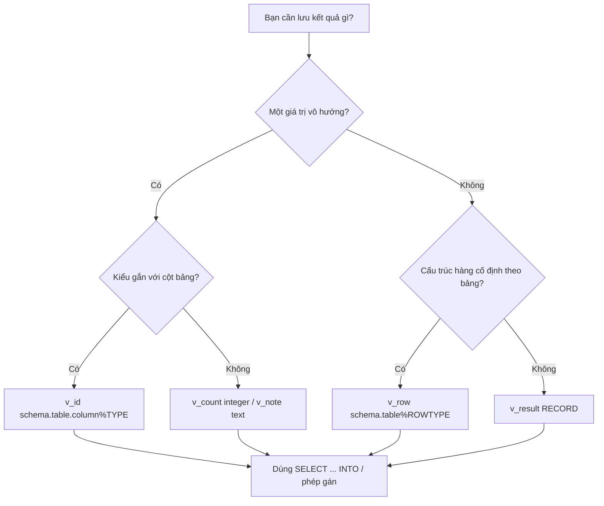

# Biến, hằng, %TYPE, %ROWTYPE và record trong PL/pgSQL

Khi viết hàm, thủ tục hoặc trigger trong PostgreSQL, bạn thường cần giữ tạm một mã đơn hàng, tính doanh thu, lấy thông tin khách hàng, hoặc xử lý một hàng kết quả từ truy vấn. Trong **PL/pgSQL**, việc chọn đúng loại biến quyết định chương trình có dễ đọc, an toàn trước thay đổi schema và dễ bảo trì hay không.

Ví dụ, cả ba khai báo sau đều liên quan dữ liệu đơn hàng, nhưng chúng không tương đương:

```sql
DECLARE
    v_total  numeric(12, 2);
    v_order  pl_lab.orders%ROWTYPE;
    v_result record;
```

- `v_total` là **biến vô hướng** có kiểu dữ liệu được khai báo cụ thể.
- `v_order` là **biến hàng có cấu trúc cố định** lấy từ bảng `pl_lab.orders`.
- `v_result` là **record linh hoạt**, nhận cấu trúc các cột từ kết quả mà nó được gán trong lúc thực thi.

Nếu muốn biến số tiền luôn theo đúng kiểu cột bảng, ta còn có `%TYPE`:

```sql
DECLARE
    v_total pl_lab.orders.total_amount%TYPE;
```

Bài học thuộc chương **PL/pgSQL**, tập trung vào năm nhóm khái niệm: **biến**, **hằng**, **`%TYPE`**, **`%ROWTYPE`** và **`record`**. Các ví dụ sử dụng SQL/PL/pgSQL có thể chạy trên một database học tập, giải thích cả trường hợp đúng, sai và những điểm dễ gây lỗi trong ứng dụng Java/JDBC.

## 1. Mục tiêu của bài học

Sau bài này, bạn có thể:

1. Viết khối PL/pgSQL có `DECLARE`, `BEGIN`, `END` và biến được khởi tạo đúng cách.
2. Phân biệt khai báo **biến thường**, **hằng với `CONSTANT`** và biến `NOT NULL`.
3. Dùng `%TYPE` để neo kiểu của biến theo **cột bảng** hoặc một biến đã có.
4. Dùng `%ROWTYPE` để chứa **một hàng có cấu trúc xác định**.
5. Dùng `record` để chứa kết quả có **danh sách cột linh hoạt**.
6. Đọc dữ liệu vào biến qua `SELECT ... INTO`, `... INTO STRICT` và `RETURNING INTO`.
7. Hiểu `FOUND`, các biến hệ thống và sự khác biệt giữa `SELECT INTO` với `EXECUTE ... INTO`.
8. Tránh xung đột tên cột/biến, dùng block lồng nhau và phạm vi biến một cách rõ ràng.
9. Viết hàm trả kết quả có kiểu, kiểm soát dữ liệu thiếu và lỗi nhiều dòng.
10. Lựa chọn loại biến phù hợp khi schema thay đổi, khi xử lý JOIN và khi gọi từ Java.

## 2. Sơ đồ tư duy: chọn loại biến nào?



| Nhu cầu | Lựa chọn thường hợp lý | Ví dụ |
| --- | --- | --- |
| Bộ đếm, cờ, thông báo | Biến kiểu cụ thể | `v_count integer`, `v_ok boolean` |
| Hệ số không được sửa trong một block | `CONSTANT` | `c_rate CONSTANT numeric := 0.05` |
| Mã đơn cần theo kiểu cột database | `%TYPE` | `v_id pl_lab.orders.order_id%TYPE` |
| Cả hàng `orders` | `%ROWTYPE` | `v_order pl_lab.orders%ROWTYPE` |
| Kết quả JOIN gồm vài cột, không giống một bảng | `record` | `v_summary record` |
| Nhiều hàng | Vòng `FOR`/`RETURN QUERY` hoặc cấu trúc tập hợp | `FOR r IN SELECT ... LOOP` |

**Không phải `record` là lựa chọn tốt nhất trong mọi trường hợp.** Nó linh hoạt hơn, nhưng mất sự rõ ràng về cấu trúc cho tới lúc chạy. Khi cấu trúc đã biết, biến có kiểu cụ thể hoặc `%ROWTYPE` thường giúp code dễ hiểu hơn.

## 3. PL/pgSQL chạy ở đâu?

Bạn có thể gặp khai báo biến trong:

- `DO`: khối vô danh chạy một lần, thích hợp để học và làm tác vụ quản trị có kiểm soát.
- `CREATE FUNCTION ... LANGUAGE plpgsql`: hàm có thể được gọi từ SQL.
- `CREATE PROCEDURE ... LANGUAGE plpgsql`: thủ tục có thể được gọi bằng `CALL`, với quy tắc transaction control khác hàm.
- Trigger function: nhận các biến ngữ cảnh như `NEW`, `OLD`, `TG_OP`.

Để thử khai báo nhanh mà không cần tạo hàm:

```sql
DO $$
DECLARE
    v_message text := 'Xin chào PL/pgSQL';
BEGIN
    RAISE NOTICE '%', v_message;
END;
$$ LANGUAGE plpgsql;
```

Trong `psql` hoặc một SQL client tương thích, thông báo sẽ có dạng:

```text
NOTICE:  Xin chào PL/pgSQL
```

`DO` thực thi **ở phía PostgreSQL server**, không phải cú pháp JavaScript hoặc block SQL chung của mọi hệ quản trị.

## 4. Tạo dữ liệu thực hành

Các ví dụ sau dùng schema riêng `pl_lab`. Chỉ chạy trên database học tập hoặc schema mới, không áp dụng các lệnh tạo/nạp mẫu cho môi trường production đang có dữ liệu nghiệp vụ.

### 4.1. Bảng khách hàng

```sql
CREATE SCHEMA IF NOT EXISTS pl_lab;

CREATE TABLE pl_lab.customers (
    customer_id bigint PRIMARY KEY,
    full_name text NOT NULL,
    tier text NOT NULL
        CHECK (tier IN ('standard', 'vip'))
);

INSERT INTO pl_lab.customers (customer_id, full_name, tier)
VALUES
    (101, 'An Nguyen', 'vip'),
    (102, 'Binh Tran', 'standard'),
    (103, 'Chi Le', 'vip');
```

### 4.2. Bảng đơn hàng

```sql
CREATE TABLE pl_lab.orders (
    order_id bigint PRIMARY KEY,
    customer_id bigint NOT NULL
        REFERENCES pl_lab.customers(customer_id),
    placed_at timestamptz NOT NULL,
    total_amount numeric(12, 2) NOT NULL
        CHECK (total_amount >= 0),
    status text NOT NULL
        CHECK (status IN ('pending', 'paid', 'cancelled')),
    note text
);

INSERT INTO pl_lab.orders
    (order_id, customer_id, placed_at, total_amount, status, note)
VALUES
    (1001, 101, TIMESTAMPTZ '2026-01-02 09:00:00+00',
        120.50, 'paid', 'First purchase'),
    (1002, 101, TIMESTAMPTZ '2026-01-03 10:00:00+00',
        250.00, 'pending', NULL),
    (1003, 102, TIMESTAMPTZ '2026-01-04 11:00:00+00',
        80.00, 'paid', 'Gift'),
    (1004, 103, TIMESTAMPTZ '2026-01-05 12:00:00+00',
        500.00, 'paid', 'Express delivery'),
    (1005, 101, TIMESTAMPTZ '2026-01-06 13:00:00+00',
        75.25, 'cancelled', NULL);

ANALYZE pl_lab.customers;
ANALYZE pl_lab.orders;
```

Dữ liệu gồm **3 khách hàng và 5 đơn hàng**. Dùng mã cố định để các ví dụ `WHERE order_id = 1001` có thể chạy lại trên **schema mới**.

### 4.3. Kiểm tra

```sql
SELECT
    o.order_id,
    c.full_name,
    o.total_amount,
    o.status
FROM pl_lab.orders AS o
JOIN pl_lab.customers AS c
  ON c.customer_id = o.customer_id
ORDER BY o.order_id;
```

Với bộ dữ liệu này, khách 101 có ba đơn: một paid, một pending, một cancelled. Một số bài sau dùng sự khác biệt đó để giải thích `SELECT INTO` và xử lý nhiều hàng.

> **Phạm vi:** Các hàm của bài được tạo trong schema `pl_lab`. Nếu chạy lại toàn bộ từ đầu, nên dùng một database/schema thực hành trống để tránh lỗi đối tượng đã tồn tại hoặc khóa chính trùng.

## 5. Cấu trúc một khối PL/pgSQL

Cú pháp khái quát:

```sql
[ <<label>> ]
[ DECLARE
    declarations ]
BEGIN
    statements;
[ EXCEPTION
    exception_handlers ]
END [ label ];
```

Trong đó:

- `DECLARE` khai báo các biến cục bộ. Có thể bỏ qua nếu không cần biến.
- `BEGIN` mở **phần câu lệnh** của khối, không tự đồng nghĩa với `BEGIN TRANSACTION` trong SQL.
- `END` kết thúc block.
- Một số câu lệnh PL/pgSQL phải có dấu `;`.
- `EXCEPTION` là phần tùy chọn cho xử lý lỗi.
- `<<label>>` là nhãn để phân biệt block, hữu ích khi lồng nhau.

Ví dụ:

```sql
DO $do$
DECLARE
    v_customer_id bigint := 101;
    v_order_count integer;
BEGIN
    SELECT COUNT(*)
    INTO v_order_count
    FROM pl_lab.orders AS o
    WHERE o.customer_id = v_customer_id;

    RAISE NOTICE 'Customer % has % orders',
        v_customer_id, v_order_count;
END;
$do$ LANGUAGE plpgsql;
```

Kỳ vọng thông báo khách 101 có **3 đơn**, nếu dữ liệu mẫu chưa bị sửa.

### 5.1. DECLARE không phải một statement bình thường bên trong BEGIN

Không viết:

```sql
DO $$
BEGIN
    DECLARE v_count integer; -- Sai vị trí khai báo biến.
    v_count := 1;
END;
$$;
```

Khai báo phải nằm trong phần `DECLARE` của **một block**. Khi muốn có biến tạm trong một phạm vi nhỏ bên trong phần thực thi, hãy tạo **subblock**:

```sql
DO $$
BEGIN
    DECLARE
        v_count integer := 1;
    BEGIN
        RAISE NOTICE 'Count = %', v_count;
    END;
END;
$$ LANGUAGE plpgsql;
```

Subblock có `DECLARE ... BEGIN ... END` riêng và các biến của nó kết thúc vòng đời khi rời block đó.

## 6. Cú pháp khai báo biến

Dạng khai báo chính:

```text
name [ CONSTANT ] type [ COLLATE collation_name ] [ NOT NULL ]
     [ { DEFAULT | := | = } expression ];
```

Ví dụ:

```sql
DO $$
DECLARE
    v_id bigint;
    v_status text DEFAULT 'pending';
    v_total numeric(12, 2) := 100.50;
    v_is_paid boolean = false;
    v_description text NOT NULL := 'new order';
BEGIN
    RAISE NOTICE 'id=%, status=%, total=%, paid=%, description=%',
        v_id, v_status, v_total, v_is_paid, v_description;
END;
$$ LANGUAGE plpgsql;
```

Cả `DEFAULT expression`, `:= expression` và `= expression` đều được dùng để **khởi tạo biến** trong khai báo PL/pgSQL.

### 6.1. Biến chưa khởi tạo có giá trị NULL

```sql
DO $$
DECLARE
    v_amount numeric;
BEGIN
    RAISE NOTICE 'Uninitialized amount: %', v_amount;
END;
$$;
```

`v_amount` mặc định là **SQL NULL** nếu không có giá trị khởi tạo và kiểu không yêu cầu giá trị khác.

Đừng tự hiểu biến số chưa khởi tạo là 0 hoặc biến boolean chưa khởi tạo là false. SQL có **three-valued logic**: `true`, `false` và `NULL`.

### 6.2. NOT NULL yêu cầu khởi tạo hợp lệ

Một biến `NOT NULL` phải nhận giá trị không NULL khi được khởi tạo, và những phép gán NULL sau này sẽ bị từ chối.

```sql
DO $$
DECLARE
    v_status text NOT NULL := 'pending';
BEGIN
    v_status := 'paid';
    RAISE NOTICE '%', v_status;
END;
$$;
```

Ví dụ **sai**:

```sql
DO $$
DECLARE
    v_status text NOT NULL;  -- Thiếu giá trị khởi tạo.
BEGIN
    NULL;
END;
$$;
```

Việc khai báo `NOT NULL` mà không cung cấp giá trị ban đầu thích hợp sẽ bị PostgreSQL từ chối. Tương tự, gán `NULL` cho biến `NOT NULL` gây lỗi.

### 6.3. Kiểu dữ liệu của biến là kiểu SQL

Bạn có thể khai:

```sql
DECLARE
    v_count integer;
    v_customer_id bigint;
    v_money numeric(12, 2);
    v_day date;
    v_created_at timestamptz;
    v_note text;
    v_flags boolean[];
    v_document jsonb;
```

PL/pgSQL không bắt buộc mọi biến là `text`. Chọn kiểu phù hợp với dữ liệu để PostgreSQL kiểm soát phép gán, toán tử và biểu thức.

## 7. Khởi tạo và gán lại giá trị

Một phép gán thông thường:

```sql
variable_name := expression;
```

Ví dụ:

```sql
DO $$
DECLARE
    v_quantity integer := 2;
    v_unit_price numeric(12, 2) := 40.00;
    v_amount numeric(12, 2);
BEGIN
    v_amount := v_quantity * v_unit_price;
    RAISE NOTICE 'Amount = %', v_amount;

    v_quantity := 3;
    v_amount := v_quantity * v_unit_price;
    RAISE NOTICE 'New amount = %', v_amount;
END;
$$;
```

Dự kiến: 80.00 rồi 120.00 theo cách PostgreSQL định dạng `numeric`.

### 7.1. Giá trị khởi tạo được tính khi vào block

```sql
DO $$
DECLARE
    v_started_at timestamptz := clock_timestamp();
BEGIN
    RAISE NOTICE 'Block started at %', v_started_at;
END;
$$;
```

Biểu thức khởi tạo được đánh giá mỗi lần block được đi vào; nó không phải một giá trị được tính từ lúc viết source code.

Điều này cũng đúng với một **hằng có biểu thức khởi tạo**: tính “hằng” có nghĩa không sửa giá trị sau khi khởi tạo **trong block activation đó**, không phải một constant toàn server hay toàn thời gian.

### 7.2. DEFAULT có thể dựa vào biến khác

```sql
DO $$
DECLARE
    v_subtotal numeric(12, 2) := 100.00;
    v_tax_rate numeric(5, 4) := 0.0800;
    v_tax numeric(12, 2) := v_subtotal * v_tax_rate;
BEGIN
    RAISE NOTICE 'Tax: %', v_tax;
END;
$$;
```

Để dễ hiểu, khai báo những biến được tham chiếu **trước** biến phụ thuộc chúng. Khi khởi tạo có điều kiện/phức tạp, có thể tách phép gán vào `BEGIN` để tránh phụ thuộc thứ tự khó đọc.

### 7.3. Gán có kiểm tra kiểu

```sql
DO $$
DECLARE
    v_count integer := 0;
BEGIN
    v_count := 4;
    RAISE NOTICE '%', v_count;
END;
$$;
```

Nếu biểu thức trả giá trị không chuyển được sang `integer`, PostgreSQL có thể phát sinh lỗi conversion/range. Không nên dựa vào cast ngầm từ dữ liệu người dùng; dùng kiểu bind đúng và ép kiểu rõ khi cần.

## 8. Hằng số với CONSTANT

Cú pháp:

```sql
name CONSTANT type := expression;
```

Ví dụ tính giảm giá:

```sql
DO $$
DECLARE
    c_vip_discount CONSTANT numeric(5, 4) := 0.1000;
    v_original_price numeric(12, 2) := 500.00;
    v_final_price numeric(12, 2);
BEGIN
    v_final_price := v_original_price * (1 - c_vip_discount);

    RAISE NOTICE 'Final price = %', v_final_price;
END;
$$;
```

`c_vip_discount` sau khi được khởi tạo không được gán giá trị mới.

### 8.1. Thử gán lại hằng là sai

```sql
DO $$
DECLARE
    c_max_retry CONSTANT integer := 3;
BEGIN
    c_max_retry := 5;  -- Không được gán lại CONSTANT.
END;
$$;
```

PostgreSQL từ chối phép gán như vậy. Mục tiêu của `CONSTANT` là ngăn biến thay đổi ngoài ý muốn **trong phạm vi PL/pgSQL**, không phải tạo ràng buộc cho một cột bảng.

### 8.2. Hằng không nhất thiết là literal bất biến toàn cầu

```sql
DO $$
DECLARE
    c_started_at CONSTANT timestamptz := clock_timestamp();
BEGIN
    RAISE NOTICE 'Started at %', c_started_at;
END;
$$;
```

Mỗi lần thực thi `DO`, `clock_timestamp()` có thể cho giá trị khác. Trong **một lần chạy block**, `c_started_at` không được gán lại.

### 8.3. CONSTANT không thay CHECK và UNIQUE của database

```sql
DECLARE
    c_valid_status CONSTANT text := 'paid';
```

không ngăn người khác chèn `status='unexpected'` vào một bảng khác. Muốn bảo vệ dữ liệu dùng **constraint, domain, foreign key hoặc logic nghiệp vụ được thực thi đúng nơi**.

### 8.4. Đặt tên hằng

Một quy ước dễ đọc:

- `c_...` cho hằng: `c_tax_rate`.
- `v_...` cho biến cục bộ: `v_total`.
- `p_...` cho tham số hàm: `p_order_id`.
- `r_...` hoặc `v_row` cho biến hàng/record.

Đây là **quy ước nhóm**, không phải cú pháp bắt buộc của PostgreSQL.

## 9. %TYPE: lấy kiểu từ cột bảng

Trong một cơ sở dữ liệu đang phát triển, kiểu cột có thể đổi từ `integer` sang `bigint`, hoặc từ `numeric(10,2)` sang một kiểu phù hợp với dữ liệu mới.

Nếu trong nhiều hàm PL/pgSQL luôn khai tay kiểu cột, rất dễ sinh tình trạng **schema dùng một kiểu, code khai kiểu khác**.

`%TYPE` giúp khai biến theo kiểu của một cột:

```sql
DECLARE
    v_order_id pl_lab.orders.order_id%TYPE;
    v_total pl_lab.orders.total_amount%TYPE;
    v_status pl_lab.orders.status%TYPE;
```

Bản chất: biến lấy **kiểu dữ liệu** từ thuộc tính được tham chiếu, không tự động lấy giá trị của hàng bất kỳ.

### 9.1. Ví dụ đọc tổng tiền theo order ID

```sql
DO $$
DECLARE
    v_order_id pl_lab.orders.order_id%TYPE := 1001;
    v_total pl_lab.orders.total_amount%TYPE;
BEGIN
    SELECT o.total_amount
    INTO v_total
    FROM pl_lab.orders AS o
    WHERE o.order_id = v_order_id;

    RAISE NOTICE 'Order % amount: %', v_order_id, v_total;
END;
$$;
```

Ở đây:

- `v_order_id` có cùng kiểu với cột `orders.order_id`.
- `v_total` có cùng kiểu với cột `orders.total_amount`.
- Query đưa **giá trị** vào `v_total` qua `SELECT ... INTO`.

### 9.2. %TYPE không phải phép truy xuất dữ liệu

Khai:

```sql
v_total pl_lab.orders.total_amount%TYPE;
```

không có nghĩa `v_total` tự chứa số tiền của đơn mới nhất. Nó chỉ xác định kiểu. Trước khi gán, giá trị vẫn là NULL theo quy tắc thông thường.

Muốn lấy dữ liệu phải thực hiện một câu truy vấn hoặc phép gán.

### 9.3. %TYPE có thể tham chiếu một biến đã khai báo

```sql
DO $$
DECLARE
    v_first_order_id pl_lab.orders.order_id%TYPE := 1001;
    v_second_order_id v_first_order_id%TYPE := 1002;
BEGIN
    RAISE NOTICE '% and %',
        v_first_order_id, v_second_order_id;
END;
$$;
```

Cách này hữu ích khi hai biến cần chia sẻ kiểu mà không lặp lại tên kiểu tường minh.

### 9.4. Không tự copy DEFAULT hay CHECK của cột

Cột nguồn có thể khai:

```sql
total_amount numeric(12, 2) NOT NULL CHECK (total_amount >= 0)
```

Nhưng khai:

```sql
DECLARE
    v_total pl_lab.orders.total_amount%TYPE;
```

**không tự sao chép** ràng buộc `NOT NULL` hay `CHECK (total_amount >= 0)` ở cấp cột bảng vào biến. Biến có thể NULL nếu không khai `NOT NULL` riêng, và có thể được gán một giá trị âm nếu kiểu numeric cho phép.

```sql
DO $$
DECLARE
    v_total pl_lab.orders.total_amount%TYPE;
BEGIN
    v_total := -5.00;
    RAISE NOTICE 'Temporary value: %', v_total;
END;
$$;
```

Ví dụ chỉ gán vào **biến trong bộ nhớ thực thi**; nó không chèn số âm vào bảng. Khi viết giá trị âm vào cột `orders.total_amount`, `CHECK` của bảng sẽ được kiểm tra.

**Ngoại lệ cần nhớ:** nếu cột có **kiểu domain**, `%TYPE` nhận chính kiểu domain; các ràng buộc là một phần của domain vẫn có thể được kiểm tra trong phép gán. Phải phân biệt **constraint của cột** với **constraint của kiểu dữ liệu domain**.

### 9.5. %TYPE không bảo đảm mọi thay đổi schema là vô hại

`%TYPE` giảm việc lặp kiểu, nhưng đổi cột từ `bigint` sang `uuid` có thể khiến:

- Biểu thức so sánh/cast cũ không còn hợp lệ.
- Giao diện hàm với tham số `bigint` không còn phù hợp.
- Java client gửi kiểu sai.
- Index và query khác phải thay đổi.

Do đó, khi thay schema, vẫn cần chạy migration test và kiểm tra các hàm/ứng dụng phụ thuộc.

## 10. Khi nào dùng kiểu cụ thể, khi nào dùng %TYPE?

| Trường hợp | Khai kiểu trực tiếp | `%TYPE` |
| --- | --- | --- |
| Bộ đếm số vòng lặp | `integer` là hợp lý | Thường không cần |
| Cờ logic | `boolean` | Thường không cần |
| Mã khách hàng lấy từ DB | Dễ lệch khi schema đổi | **Đáng cân nhắc** |
| Giá trị tiền của cột DB | Có thể cần biết typmod cụ thể | **Đáng cân nhắc** |
| Kết quả `COUNT(*)` | `bigint` phù hợp kiểu kết quả | Không nên neo tùy tiện vào cột ID |
| Kết quả `AVG(...)` | Chọn kiểu theo biểu thức aggregate | Không mặc định bằng kiểu cột gốc |
| Tham số hàm trong SQL signature | Khai kiểu SQL rõ ràng | `%TYPE` chủ yếu dùng phần `DECLARE` PL/pgSQL |

Ví dụ đếm đơn hàng:

```sql
DO $$
DECLARE
    v_count bigint;
BEGIN
    SELECT COUNT(*)
    INTO v_count
    FROM pl_lab.orders;

    RAISE NOTICE 'Total orders: %', v_count;
END;
$$;
```

`COUNT(*)` trả `bigint`, nên `v_count bigint` là lựa chọn trực tiếp và rõ ràng. Không phải biến nào cũng cần `%TYPE`.

## 11. %ROWTYPE: biến có cấu trúc của một hàng

Nếu cần nhiều cột cùng một bảng, thay vì khai sáu biến rời rạc, bạn có thể dùng:

```sql
DECLARE
    v_order pl_lab.orders%ROWTYPE;
```

`v_order` có **cấu trúc hàng** dựa trên các cột hiện có của `pl_lab.orders`:

- `v_order.order_id`.
- `v_order.customer_id`.
- `v_order.placed_at`.
- `v_order.total_amount`.
- `v_order.status`.
- `v_order.note`.

Các trường mang kiểu dữ liệu tương ứng với cột nguồn.

### 11.1. Đọc cả một hàng

```sql
DO $$
DECLARE
    v_order pl_lab.orders%ROWTYPE;
BEGIN
    SELECT o.*
    INTO v_order
    FROM pl_lab.orders AS o
    WHERE o.order_id = 1001;

    RAISE NOTICE 'Order %, status %, total %',
        v_order.order_id,
        v_order.status,
        v_order.total_amount;
END;
$$;
```

Kỳ vọng: order 1001, trạng thái paid, tổng 120.50.

Dùng `o.*` để trả **đúng cấu trúc cột của bảng orders** cho biến hàng; nó tránh trường hợp vô tình chọn những cột của một bảng JOIN vào row có kiểu khác.

### 11.2. Truy cập và sửa field của row variable

```sql
DO $$
DECLARE
    v_order pl_lab.orders%ROWTYPE;
BEGIN
    SELECT o.*
    INTO v_order
    FROM pl_lab.orders AS o
    WHERE o.order_id = 1002;

    v_order.note := 'Preview only';
    v_order.total_amount := v_order.total_amount + 10.00;

    RAISE NOTICE 'Local row: %, %, %',
        v_order.order_id,
        v_order.total_amount,
        v_order.note;
END;
$$;
```

Các phép gán ở trên **chỉ sửa biến `v_order`**, không thực hiện `UPDATE` trên bảng.

Nếu cần ghi trở lại database, phải dùng câu lệnh DML như `UPDATE` với điều kiện khóa phù hợp và xem xét transaction.

### 11.3. Khai báo row không đồng nghĩa đã có một hàng dữ liệu

```sql
DO $$
DECLARE
    v_order pl_lab.orders%ROWTYPE;
BEGIN
    RAISE NOTICE 'Initially: %', v_order.order_id;
END;
$$;
```

Bạn có thể truy cập field theo cấu trúc đã biết; giá trị chưa được gán thường là NULL. Đây là khác biệt quan trọng với `record` chưa được gán cấu trúc.

### 11.4. %ROWTYPE không mang đầy đủ constraint của bảng

Một `orders%ROWTYPE` biết **các tên cột và kiểu**, nhưng không trở thành một hàng bảng được kiểm tra mọi `PRIMARY KEY`, `FOREIGN KEY`, `CHECK` ngay khi sửa field trong biến.

Ví dụ việc gán `v_order.total_amount := -10` trong PL/pgSQL không tự chạy `CHECK` của cột bảng. Khi một câu DML ghi dữ liệu đó trở lại relation, các constraint của bảng mới được áp dụng theo quy tắc SQL.

Nếu trường có kiểu domain, ràng buộc domain vẫn liên quan tới giá trị kiểu đó.

### 11.5. %ROWTYPE làm kiểu hàng rõ ràng hơn

Nếu hàm chuyên xử lý **một hàng orders**, `%ROWTYPE` làm ý định hiển nhiên và giúp phát hiện việc truy cập field không thuộc cấu trúc mong đợi sớm hơn trong nhiều tình huống.

Khi SELECT trả một tổ hợp cột không đúng cấu trúc `orders`, `record` hoặc kiểu composite riêng thường phù hợp hơn.

## 12. %ROWTYPE và SELECT có danh sách cột khác

Hãy so sánh:

```sql
SELECT o.*
FROM pl_lab.orders AS o
WHERE o.order_id = 1001;
```

với:

```sql
SELECT
    o.order_id,
    o.total_amount
FROM pl_lab.orders AS o
WHERE o.order_id = 1001;
```

Query thứ nhất trả cả cấu trúc `orders`; query thứ hai chỉ trả **hai cột**.

Khi target là:

```sql
v_order pl_lab.orders%ROWTYPE;
```

hãy chọn các cột **phù hợp cấu trúc kiểu hàng**. PL/pgSQL yêu cầu kết quả gán vào row variable tương thích danh sách field/kiểu của row variable, và một query chỉ trả vài cột không phải là cách tự động “điền vài field, giữ nguyên những field khác”.

Muốn chỉ lấy hai field, nên dùng:

```sql
DO $$
DECLARE
    v_order_id pl_lab.orders.order_id%TYPE;
    v_total pl_lab.orders.total_amount%TYPE;
BEGIN
    SELECT o.order_id, o.total_amount
    INTO v_order_id, v_total
    FROM pl_lab.orders AS o
    WHERE o.order_id = 1001;

    RAISE NOTICE 'Order %, amount %', v_order_id, v_total;
END;
$$;
```

Hoặc dùng một `record` linh hoạt nếu danh sách cột là một kết quả trung gian có tên field riêng.

### 12.1. Không gán theo tên cột một cách mặc định

Khi gán kết quả SQL vào các target PL/pgSQL, số lượng và vị trí các giá trị có ý nghĩa. Không giả định PostgreSQL tự khớp cột theo tên để sửa đúng field nếu SELECT trả sai thứ tự.

Ví dụ dễ gây hiểu nhầm:

```sql
-- Không dùng danh sách cột đã đảo/thay đổi kiểu
-- để gán vào một biến hàng cố định rồi trông chờ
-- PostgreSQL tự sắp xếp theo tên cột.
SELECT o.total_amount, o.order_id
FROM pl_lab.orders AS o;
```

Với biến scalar, hãy nêu `INTO v_total, v_order_id` theo **cùng thứ tự** như `SELECT o.total_amount, o.order_id`. Với biến `%ROWTYPE`, chọn một danh sách đúng cấu trúc hoặc biến phù hợp khác.

## 13. RECORD: biến bản ghi có cấu trúc linh hoạt

Cú pháp:

```sql
DECLARE
    v_result record;
```

`record` là một **pseudo-type** PL/pgSQL có thể giữ một hàng kết quả với cấu trúc được xác định khi gán. Không cần gắn với cấu trúc một bảng duy nhất ở lúc khai báo.

### 13.1. RECORD rất phù hợp với kết quả JOIN

```sql
DO $$
DECLARE
    v_summary record;
BEGIN
    SELECT
        o.order_id,
        c.full_name AS customer_name,
        o.total_amount AS amount,
        o.status
    INTO v_summary
    FROM pl_lab.orders AS o
    JOIN pl_lab.customers AS c
      ON c.customer_id = o.customer_id
    WHERE o.order_id = 1001;

    RAISE NOTICE 'Order %, customer %, amount %, status %',
        v_summary.order_id,
        v_summary.customer_name,
        v_summary.amount,
        v_summary.status;
END;
$$;
```

`v_summary` có các field được tạo từ **danh sách output của SELECT**: `order_id`, `customer_name`, `amount`, `status`.

Không có bảng gốc nào trong schema có đúng cả bốn cột đó, nên `record` là một target thuận tiện.

### 13.2. Trước khi nhận giá trị, RECORD chưa biết danh sách field

Ví dụ **cố ý sai**:

```sql
DO $$
DECLARE
    v_rec record;
BEGIN
    RAISE NOTICE '%', v_rec.order_id;
END;
$$;
```

`v_rec` chưa nhận một row descriptor từ phép gán hoặc truy vấn. Truy cập field khi nó **chưa được gán cấu trúc** có thể gây lỗi kiểu “record ... is not assigned yet”.

So với `v_order pl_lab.orders%ROWTYPE`, cấu trúc của `v_order` đã biết từ khai báo nên khác về hành vi.

### 13.3. RECORD có thể thay đổi cấu trúc khi gán lần khác

```sql
DO $$
DECLARE
    v_rec record;
BEGIN
    SELECT
        o.order_id,
        o.total_amount
    INTO v_rec
    FROM pl_lab.orders AS o
    WHERE o.order_id = 1001;

    RAISE NOTICE 'First shape: %, %',
        v_rec.order_id, v_rec.total_amount;

    SELECT
        c.customer_id,
        c.full_name
    INTO v_rec
    FROM pl_lab.customers AS c
    WHERE c.customer_id = 101;

    RAISE NOTICE 'Second shape: %, %',
        v_rec.customer_id, v_rec.full_name;
END;
$$;
```

Sau lần gán thứ hai, `v_rec` có **cấu trúc mới**: `customer_id` và `full_name`.

Truy cập lại `v_rec.total_amount` sau thời điểm đó có thể lỗi vì field ấy không còn tồn tại trong record hiện tại.

### 13.4. RECORD linh hoạt nhưng không phải “mọi field đều optional”

Một record chỉ cho phép đọc field **thực sự có trong cấu trúc hiện tại**. Không có cú pháp magic `v_rec.anything` để trả NULL cho mọi field không tồn tại.

Phân biệt:

- Field **có trong record**, giá trị SQL NULL → đọc field thường trả NULL.
- Field **không có trong cấu trúc record hiện tại** → truy cập field là lỗi.
- Record **chưa được gán cấu trúc** → truy cập field là lỗi.

Đây là lý do record linh hoạt phù hợp code tổng quát, nhưng phải kiểm soát shape và điều kiện truy cập.

## 14. So sánh %ROWTYPE và RECORD

| Tiêu chí | `table%ROWTYPE` | `record` |
| --- | --- | --- |
| Biết cấu trúc khi khai báo | **Có**, theo row type của relation | **Không**, nhận khi gán |
| Field hợp lệ | Cột của table/view/composite row type tương ứng | Cột của kết quả được gán gần nhất |
| Dùng cho `SELECT table.*` | Rất phù hợp | Dùng được |
| Dùng cho JOIN trả cột tùy ý | Chỉ nếu khớp cấu trúc đã khai báo | **Rất phù hợp** |
| Có thể đổi shape giữa hai lần gán | Không theo ý muốn | **Có** |
| Field trước lần gán đầu | Có cấu trúc, giá trị thường NULL | Chưa có descriptor, truy cập field lỗi |
| Khi schema bảng thay đổi | Phụ thuộc kiểu hàng mới, cần xem tương thích | Shape phụ thuộc kết quả query được thực thi |
| Khả năng kiểm tra contract | Rõ ràng hơn | Dễ có lỗi field chỉ phát hiện lúc chạy |

**Nguyên tắc chọn:** nếu một function có hợp đồng làm việc với **đúng một hàng bảng**, ưu tiên `%ROWTYPE`. Nếu function nhận **kết quả JOIN, aggregate hoặc SELECT động** có cấu trúc riêng, `record` có thể hợp lý.

### 14.1. RECORD không tự nhanh hơn %ROWTYPE

Không có quy tắc `record` là cấu trúc nhẹ hơn hay nhanh hơn mọi row variable. Hiệu năng thực tế phụ thuộc câu SQL, số cột/hàng, plan, việc tạo kết quả và cách truy cập field.

Chọn kiểu chủ yếu theo **ngữ nghĩa dữ liệu và độ rõ ràng**, sau đó đo hiệu năng nếu đây là đoạn chạy rất thường xuyên.

## 15. SELECT ... INTO trong PL/pgSQL

Mẫu tổng quát:

```sql
SELECT expressions
INTO target_variable_or_row
FROM ...
WHERE ...;
```

Trong PL/pgSQL, `INTO` đưa **kết quả truy vấn** vào biến, danh sách biến, row variable hoặc record.

Ví dụ:

```sql
DO $$
DECLARE
    v_customer_id bigint;
    v_amount numeric(12, 2);
BEGIN
    SELECT
        o.customer_id,
        o.total_amount
    INTO v_customer_id, v_amount
    FROM pl_lab.orders AS o
    WHERE o.order_id = 1001;

    RAISE NOTICE 'Customer %, amount %',
        v_customer_id, v_amount;
END;
$$;
```

### 15.1. SELECT INTO trong PL/pgSQL không phải CREATE TABLE

Ở SQL thuần PostgreSQL, một hình thức `SELECT ... INTO new_table` là cách tạo bảng cũ/đặc thù.

Nhưng **bên trong PL/pgSQL**, `SELECT ... INTO` được hiểu là **gán kết quả vào biến**. Nếu muốn tạo bảng mới bên trong một hàm, dùng `CREATE TABLE ... AS SELECT ...` với quyền/hạn chế transaction phù hợp.

### 15.2. Không có hàng thì sao?

Nếu `SELECT INTO` **không dùng `STRICT`**:

- Nếu có ít nhất một hàng, target nhận **hàng đầu tiên**.
- Nếu không có hàng, target được đặt thành các giá trị NULL thích hợp.
- `FOUND` được đặt true hoặc false tương ứng.
- Nếu có nhiều hàng, các hàng sau **không được đưa vào target**.

Ví dụ:

```sql
DO $$
DECLARE
    v_status pl_lab.orders.status%TYPE := 'old value';
BEGIN
    SELECT o.status
    INTO v_status
    FROM pl_lab.orders AS o
    WHERE o.order_id = -999;

    RAISE NOTICE 'FOUND = %, status = %', FOUND, v_status;
END;
$$;
```

Kỳ vọng `FOUND=false`, `v_status=NULL`; giá trị khởi tạo `'old value'` **không được giữ lại** khi câu SELECT không tìm thấy hàng.

### 15.3. Nhiều hàng không có ORDER BY: hàng đầu không xác định

```sql
DO $$
DECLARE
    v_order_id bigint;
BEGIN
    SELECT o.order_id
    INTO v_order_id
    FROM pl_lab.orders AS o
    WHERE o.customer_id = 101;

    RAISE NOTICE 'One matching order: %', v_order_id;
END;
$$;
```

Khách 101 có **ba đơn**, nên query không `STRICT` chỉ lấy một trong các hàng theo execution order.

**Không được suy ra “hàng đầu” nghĩa “đơn cũ nhất”, “đơn mới nhất” hay “khóa nhỏ nhất” nếu không có `ORDER BY`.**

Muốn đơn mới nhất:

```sql
SELECT o.order_id
INTO v_order_id
FROM pl_lab.orders AS o
WHERE o.customer_id = 101
ORDER BY o.placed_at DESC, o.order_id DESC
LIMIT 1;
```

Đây là một câu lệnh minh họa **bên trong block PL/pgSQL** khi `v_order_id` đã được khai báo.

## 16. SELECT INTO STRICT: yêu cầu đúng một hàng

Khi nghiệp vụ yêu cầu query trả **chính xác một hàng**, dùng `STRICT`:

```sql
DO $$
DECLARE
    v_order pl_lab.orders%ROWTYPE;
BEGIN
    SELECT o.*
    INTO STRICT v_order
    FROM pl_lab.orders AS o
    WHERE o.order_id = 1001;

    RAISE NOTICE 'Found order %', v_order.order_id;
END;
$$;
```

Nếu truy vấn:

- Trả **0 hàng** → lỗi `NO_DATA_FOUND`.
- Trả **trên 1 hàng** → lỗi `TOO_MANY_ROWS`.
- Trả **đúng 1 hàng** → target được gán, `FOUND=true`.

### 16.1. Bắt lỗi trong một trường hợp được dự kiến

```sql
DO $$
DECLARE
    v_order pl_lab.orders%ROWTYPE;
BEGIN
    BEGIN
        SELECT o.*
        INTO STRICT v_order
        FROM pl_lab.orders AS o
        WHERE o.order_id = -999;

        RAISE NOTICE 'Order exists: %', v_order.order_id;
    EXCEPTION
        WHEN NO_DATA_FOUND THEN
            RAISE NOTICE 'Không tìm thấy đơn hàng';
    END;
END;
$$;
```

### 16.2. Bắt lỗi khi có nhiều hàng

```sql
DO $$
DECLARE
    v_order_id bigint;
BEGIN
    BEGIN
        SELECT o.order_id
        INTO STRICT v_order_id
        FROM pl_lab.orders AS o
        WHERE o.customer_id = 101;

        RAISE NOTICE 'One order: %', v_order_id;
    EXCEPTION
        WHEN TOO_MANY_ROWS THEN
            RAISE NOTICE 'Có nhiều hơn một đơn phù hợp';
    END;
END;
$$;
```

**Không dùng `STRICT` nếu mục tiêu thực sự là lấy nhiều hàng.** Khi đó dùng `FOR ... IN SELECT`, `RETURN QUERY`, cursor hoặc SQL set-based phù hợp.

### 16.3. STRICT không thay UNIQUE constraint

Một `SELECT INTO STRICT` có thể phát hiện nhiều hàng trong **một lần thực thi hàm**, nhưng không bảo đảm bất biến toàn database dưới mọi transaction. Nếu dữ liệu phải duy nhất, thiết kế `UNIQUE`/`PRIMARY KEY` ở bảng vẫn là cơ chế bảo vệ cần thiết.

## 17. FOUND và kiểm tra kết quả của SELECT INTO

PL/pgSQL cung cấp biến đặc biệt `FOUND` kiểu boolean. Nó được thiết lập bởi nhiều câu lệnh PL/pgSQL, trong đó có `SELECT INTO`.

```sql
DO $$
DECLARE
    v_status text;
BEGIN
    SELECT o.status
    INTO v_status
    FROM pl_lab.orders AS o
    WHERE o.order_id = 1001;

    IF FOUND THEN
        RAISE NOTICE 'Found status %', v_status;
    ELSE
        RAISE NOTICE 'Not found';
    END IF;
END;
$$;
```

### 17.1. Kiểm tra FOUND ngay sau câu lệnh liên quan

`FOUND` là trạng thái của **những câu lệnh PL/pgSQL có cập nhật nó**, không phải một cờ vĩnh viễn cho một query duy nhất.

Ví dụ dễ gây nhầm:

```sql
DO $$
DECLARE
    v_status text;
    v_count bigint;
BEGIN
    SELECT o.status INTO v_status
    FROM pl_lab.orders AS o
    WHERE o.order_id = -999;

    -- COUNT(*) luôn trả một hàng dù kết quả đếm bằng 0.
    SELECT COUNT(*) INTO v_count
    FROM pl_lab.orders AS o
    WHERE o.order_id = -999;

    RAISE NOTICE 'FOUND now = %, count = %',
        FOUND, v_count;
END;
$$;
```

Sau `SELECT COUNT(*) INTO v_count`, `FOUND` có thể là **true** vì aggregate không GROUP BY trả một hàng với `COUNT(*)=0`.

Nếu muốn biết lần SELECT đầu có tìm thấy hàng không, hãy lưu `FOUND` **ngay sau lần SELECT đầu**:

```sql
DO $$
DECLARE
    v_status text;
    v_found_order boolean;
    v_count bigint;
BEGIN
    SELECT o.status INTO v_status
    FROM pl_lab.orders AS o
    WHERE o.order_id = -999;

    v_found_order := FOUND;

    SELECT COUNT(*) INTO v_count
    FROM pl_lab.orders AS o
    WHERE o.order_id = -999;

    RAISE NOTICE 'Found order = %, count = %',
        v_found_order, v_count;
END;
$$;
```

### 17.2. FOUND khác “giá trị của biến không NULL”

Nếu một hàng tồn tại nhưng cột `note` là NULL:

```sql
DO $$
DECLARE
    v_note pl_lab.orders.note%TYPE;
BEGIN
    SELECT o.note INTO v_note
    FROM pl_lab.orders AS o
    WHERE o.order_id = 1002;

    RAISE NOTICE 'FOUND=%, note IS NULL=%',
        FOUND, v_note IS NULL;
END;
$$;
```

Kỳ vọng **FOUND=true** và **note IS NULL=true**. Đừng thay kiểm tra có hàng bằng `IF v_note IS NULL THEN...` vì giá trị NULL hợp lệ và hàng không tồn tại là hai vấn đề khác nhau.

### 17.3. SELECT INTO và PERFORM

Nếu muốn **chạy một query và chỉ kiểm tra có hàng hay không**, có thể dùng `PERFORM`:

```sql
DO $$
BEGIN
    PERFORM 1
    FROM pl_lab.orders AS o
    WHERE o.order_id = 1001;

    RAISE NOTICE 'Exists: %', FOUND;
END;
$$;
```

`PERFORM` đánh giá query nhưng không lưu các giá trị cột vào biến. Khi chỉ cần boolean existence từ SQL thuần, `EXISTS (SELECT ...)` cũng là lựa chọn rõ ràng.

## 18. Một hàm thực tế sử dụng %TYPE và CONSTANT

Viết hàm tính tiền sau giảm giá cho một order. Trong ví dụ này, VIP được giảm 10%, khách standard không giảm; đây là quy tắc **minh họa**, không phải chính sách thương mại chung.

```sql
CREATE OR REPLACE FUNCTION pl_lab.net_amount_for_order(
    p_order_id bigint
)
RETURNS numeric
LANGUAGE plpgsql
AS $fn$
DECLARE
    c_vip_discount CONSTANT numeric(5, 4) := 0.1000;

    v_amount pl_lab.orders.total_amount%TYPE;
    v_customer_tier pl_lab.customers.tier%TYPE;
    v_net_amount numeric(14, 2);
BEGIN
    SELECT
        o.total_amount,
        c.tier
    INTO STRICT
        v_amount,
        v_customer_tier
    FROM pl_lab.orders AS o
    JOIN pl_lab.customers AS c
      ON c.customer_id = o.customer_id
    WHERE o.order_id = p_order_id;

    IF v_customer_tier = 'vip' THEN
        v_net_amount := round(
            v_amount * (1 - c_vip_discount),
            2
        );
    ELSE
        v_net_amount := v_amount;
    END IF;

    RETURN v_net_amount;
END;
$fn$;
```

Gọi:

```sql
SELECT
    pl_lab.net_amount_for_order(1001) AS vip_order_net,
    pl_lab.net_amount_for_order(1003) AS standard_order_net;
```

Với dữ liệu mẫu:

- Order 1001 thuộc khách VIP: `120.50 × 0.9 = 108.45`.
- Order 1003 thuộc khách standard: `80.00`.

### 18.1. Vì sao dùng %TYPE cho hai trường?

Nếu kiểu `orders.total_amount` hoặc `customers.tier` thay đổi hợp lệ, declaration phụ thuộc schema sẽ giảm nguy cơ lệch kiểu khai tay. Nhưng logic so sánh `tier = 'vip'` và phép tính vẫn phải được kiểm tra khi schema/business rule thay đổi.

### 18.2. Vì sao RETURNS numeric được khai rõ?

Kiểu trả về là **hợp đồng của hàm với bên gọi**, nên được khai trong signature. `%TYPE` được dùng cho **biến cục bộ** trong phần `DECLARE`.

### 18.3. Xử lý order không tồn tại

Hàm dùng `SELECT INTO STRICT` nên nếu ID không tồn tại, PostgreSQL phát lỗi `NO_DATA_FOUND`. Đây là một quyết định API: caller phải xử lý hoặc hàm phải chuyển thành thông báo nghiệp vụ cụ thể.

Không có quy tắc một-hàm-phải-return-NULL cho mọi ID thiếu. Chọn behavior và ghi rõ trong hợp đồng.

## 19. Hàm trả một hàng typed bằng %ROWTYPE

Một function có thể trả về row type của bảng:

```sql
CREATE OR REPLACE FUNCTION pl_lab.get_order(
    p_order_id bigint
)
RETURNS pl_lab.orders
LANGUAGE plpgsql
AS $fn$
DECLARE
    v_order pl_lab.orders%ROWTYPE;
BEGIN
    SELECT o.*
    INTO v_order
    FROM pl_lab.orders AS o
    WHERE o.order_id = p_order_id;

    IF NOT FOUND THEN
        RETURN NULL;
    END IF;

    RETURN v_order;
END;
$fn$;
```

Gọi hàm như một relation-valued expression:

```sql
SELECT *
FROM pl_lab.get_order(1001);
```

Hoặc:

```sql
SELECT (pl_lab.get_order(1001)).*;
```

Câu gọi thứ hai minh họa cách truy cập các thuộc tính từ một kết quả composite trong SQL.

### 19.1. RETURNS table_name và table_name%ROWTYPE khác vị trí

- `RETURNS pl_lab.orders` là **khai kiểu kết quả trong chữ ký hàm**.
- `v_order pl_lab.orders%ROWTYPE` là **khai biến cục bộ PL/pgSQL**.

Chúng kết hợp với nhau để bảo đảm biến trả về có cấu trúc cùng loại với hợp đồng của function.

### 19.2. Khi không tìm thấy, nên trả NULL hay raise error?

Có hai lựa chọn thường thấy:

1. **`RETURN NULL`**: phù hợp API “tìm nếu có”.
2. **`SELECT ... INTO STRICT` và để lỗi `NO_DATA_FOUND`**: phù hợp API “bắt buộc tồn tại”.

Không chọn theo sở thích cú pháp; chọn theo semantics nghiệp vụ và xử lý lỗi của client.

### 19.3. Tránh SELECT * khi chỉ cần ít field

`%ROWTYPE` hợp lý cho hàm lấy cả một hàng. Nếu client chỉ cần `status` và `total_amount`, trả toàn bộ row có thể làm contract phụ thuộc mọi cột của bảng và truyền dữ liệu không cần thiết.

Khi chỉ cần vài field, cân nhắc `RETURNS TABLE(...)` hoặc query SQL trực tiếp có danh sách cột rõ ràng.

## 20. Hàm trả kết quả JOIN: record bên trong, kiểu trả rõ bên ngoài

Một `record` có thể giữ kết quả JOIN trong nội bộ, nhưng giao diện hàm vẫn nên có contract dễ tiêu thụ.

Ví dụ:

```sql
CREATE OR REPLACE FUNCTION pl_lab.order_card(
    p_order_id bigint
)
RETURNS TABLE (
    order_number bigint,
    customer_name text,
    amount numeric,
    order_status text
)
LANGUAGE plpgsql
AS $fn$
DECLARE
    v_card record;
BEGIN
    SELECT
        o.order_id AS order_number,
        c.full_name AS customer_name,
        o.total_amount AS amount,
        o.status AS order_status
    INTO v_card
    FROM pl_lab.orders AS o
    JOIN pl_lab.customers AS c
      ON c.customer_id = o.customer_id
    WHERE o.order_id = p_order_id;

    IF NOT FOUND THEN
        RETURN;
    END IF;

    order_number := v_card.order_number;
    customer_name := v_card.customer_name;
    amount := v_card.amount;
    order_status := v_card.order_status;

    RETURN NEXT;
END;
$fn$;
```

Gọi:

```sql
SELECT *
FROM pl_lab.order_card(1001);
```

Cấu trúc này minh họa ba tầng:

1. Query JOIN trả ra một hàng có cấu trúc riêng.
2. `v_card record` nhận các trường được SELECT.
3. `RETURNS TABLE(...)` công bố **tên và kiểu cột** cho bên gọi.

### 20.1. Các cột RETURNS TABLE cũng là biến PL/pgSQL

Trong hàm có `RETURNS TABLE (order_number ..., customer_name ...)`, các tên output được xem là các biến output. Vì vậy:

```sql
order_number := v_card.order_number;
RETURN NEXT;
```

có ý nghĩa “gán biến output, rồi thêm một hàng output”.

**Cẩn thận xung đột tên:** nếu trong SQL không qualify cột, tên output variable như `amount` có thể xung đột với tên cột. Dùng alias rõ `o.total_amount`, `c.full_name` và hạn chế tên quá chung.

### 20.2. RETURN QUERY có thể ngắn hơn

Với hàm chỉ chuyển một truy vấn thành tập kết quả, `RETURN QUERY SELECT ...` thường gọn hơn việc đi qua record:

```sql
CREATE OR REPLACE FUNCTION pl_lab.order_card_simple(
    p_order_id bigint
)
RETURNS TABLE (
    order_number bigint,
    customer_name text,
    amount numeric,
    order_status text
)
LANGUAGE plpgsql
AS $fn$
BEGIN
    RETURN QUERY
    SELECT
        o.order_id,
        c.full_name,
        o.total_amount,
        o.status
    FROM pl_lab.orders AS o
    JOIN pl_lab.customers AS c
      ON c.customer_id = o.customer_id
    WHERE o.order_id = p_order_id;
END;
$fn$;
```

Không phải mọi query nhiều cột đều cần `record`. Dùng nó khi **thực sự có xử lý trung gian cần truy cập từng field**.

## 21. FOR ... IN SELECT với record và %ROWTYPE

Khi một truy vấn trả nhiều hàng, vòng lặp có thể gán từng hàng vào target.

### 21.1. Duyệt nhiều đơn bằng RECORD

```sql
DO $$
DECLARE
    v_item record;
BEGIN
    FOR v_item IN
        SELECT
            o.order_id,
            o.total_amount,
            o.status
        FROM pl_lab.orders AS o
        WHERE o.customer_id = 101
        ORDER BY o.order_id
    LOOP
        RAISE NOTICE 'Order %, amount %, status %',
            v_item.order_id,
            v_item.total_amount,
            v_item.status;
    END LOOP;
END;
$$;
```

`v_item` nhận cấu trúc ba cột trong mỗi vòng lặp. Nó không bắt buộc có cùng shape như toàn bảng `orders`.

### 21.2. Duyệt cả hàng bằng %ROWTYPE

```sql
DO $$
DECLARE
    v_order pl_lab.orders%ROWTYPE;
BEGIN
    FOR v_order IN
        SELECT o.*
        FROM pl_lab.orders AS o
        WHERE o.customer_id = 101
        ORDER BY o.order_id
    LOOP
        RAISE NOTICE 'Order %, customer %',
            v_order.order_id,
            v_order.customer_id;
    END LOOP;
END;
$$;
```

Vì target là `orders%ROWTYPE` nên truy vấn trả đúng cấu trúc bảng.

### 21.3. Vòng lặp không phải lựa chọn tốt cho mọi phép tổng hợp

Nếu mục tiêu chỉ tính tổng tiền, SQL set-based thường ngắn và hiệu quả hơn:

```sql
SELECT
    customer_id,
    SUM(total_amount) AS total_amount
FROM pl_lab.orders
GROUP BY customer_id;
```

Đừng lấy từng row vào PL/pgSQL chỉ để cộng bằng tay khi một `SUM` hoặc `GROUP BY` có thể giải quyết rõ ràng. PL/pgSQL phù hợp cho **điều khiển luồng công việc**, không thay thế mọi phép tính set-based của SQL.

## 22. Phạm vi biến và shadowing

PL/pgSQL cho phép các block lồng nhau. Biến thuộc block ngoài có thể được truy cập từ block trong nếu không bị che bởi biến cùng tên.

```sql
DO $$
DECLARE
    v_message text := 'outer';
BEGIN
    RAISE NOTICE 'Before subblock: %', v_message;

    DECLARE
        v_message text := 'inner';
    BEGIN
        RAISE NOTICE 'Inside subblock: %', v_message;
    END;

    RAISE NOTICE 'After subblock: %', v_message;
END;
$$;
```

Kết quả logic:

```text
Before subblock: outer
Inside subblock: inner
After subblock: outer
```

Biến `v_message` trong subblock **che** biến cùng tên ở outer block trong phạm vi của nó.

### 22.1. Dùng nhãn để tham chiếu biến block ngoài

```sql
DO $$
<<outer_block>>
DECLARE
    v_limit integer := 10;
BEGIN
    DECLARE
        v_limit integer := 20;
    BEGIN
        RAISE NOTICE 'Outer: %, inner: %',
            outer_block.v_limit, v_limit;
    END;
END outer_block;
$$;
```

Nhãn `outer_block` giúp phân biệt rõ biến ở block ngoài.

### 22.2. Quy ước hạn chế shadowing

Mặc dù shadowing hợp lệ, nó dễ gây lỗi khi bảo trì. Nếu không có mục tiêu cụ thể, nên dùng tên khác nhau:

- `v_current_order_id`.
- `v_outer_total`.
- `v_row_total`.

Đừng tạo nhiều biến `count` hoặc `status` trùng tên trong những block lồng nhau phức tạp chỉ để viết ít ký tự.

### 22.3. Biến là cục bộ theo lần gọi

Một biến trong function không phải biến toàn cục chia sẻ giữa mọi sessions.

Hai lời gọi tới cùng function có block execution state riêng. Không dùng biến PL/pgSQL như một bộ nhớ chung để phối hợp nhiều request. Nếu cần state chung, cần cấu trúc database/transaction phù hợp.

## 23. Xung đột tên giữa biến và cột SQL

Đây là một bẫy rất phổ biến:

```sql
-- Cố ý minh họa kiểu code dễ gây ambiguity:
-- DECLARE
--     customer_id bigint;
-- BEGIN
--     SELECT customer_id INTO customer_id
--     FROM pl_lab.orders
--     WHERE order_id = 1001;
-- END;
```

Trong câu `SELECT`, `customer_id` có thể là **cột của bảng** hoặc **biến PL/pgSQL**. PostgreSQL có cơ chế xử lý xung đột tên, và mặc định thường báo lỗi đối với những tham chiếu thực sự mơ hồ.

### 23.1. Dùng tiền tố và alias

Cách rõ ràng:

```sql
DO $$
DECLARE
    v_customer_id pl_lab.orders.customer_id%TYPE;
    p_order_id bigint := 1001;
BEGIN
    SELECT o.customer_id
    INTO v_customer_id
    FROM pl_lab.orders AS o
    WHERE o.order_id = p_order_id;

    RAISE NOTICE 'Customer ID = %', v_customer_id;
END;
$$;
```

- `o.customer_id` và `o.order_id` rõ là **cột SQL**.
- `v_customer_id` là **biến local**.
- `p_order_id` là giá trị đầu vào/biến đóng vai trò parameter.

### 23.2. Không đổi cấu hình xử lý xung đột để che code mơ hồ

PL/pgSQL có cơ chế như `plpgsql.variable_conflict` và directive tương ứng trong những bối cảnh hỗ trợ. Nhưng thay chế độ để ưu tiên column/variable có thể làm SQL biểu diễn **ý nghĩa khác** nếu tên trùng nhau.

Ưu tiên **viết code không mơ hồ** bằng alias, prefix và label. Cách này dễ audit hơn khi có migration thêm tên cột mới.

### 23.3. RETURNS TABLE làm tên output xuất hiện trong scope

Nếu hàm trả `RETURNS TABLE (customer_id bigint, total numeric)`, những tên đó cũng có mặt như output variables trong PL/pgSQL.

Với truy vấn JOIN hoặc SELECT nhiều nguồn, hãy dùng alias đầy đủ để tránh hiểu nhầm biến output với cột. Đây là lý do những ví dụ trong bài viết `o.customer_id` thay vì chỉ `customer_id`.

## 24. DML RETURNING INTO và biến có kiểu

PL/pgSQL cho phép lấy giá trị từ `INSERT`, `UPDATE`, `DELETE` (và cú pháp DML hỗ trợ RETURNING ở phiên bản tương ứng) bằng `RETURNING ... INTO`.

Ví dụ cập nhật trạng thái một đơn trong transaction rồi rollback để không thay đổi dữ liệu mẫu:

```sql
BEGIN;

DO $$
DECLARE
    v_order_id pl_lab.orders.order_id%TYPE;
    v_new_status pl_lab.orders.status%TYPE;
BEGIN
    UPDATE pl_lab.orders AS o
    SET status = 'paid'
    WHERE o.order_id = 1002
    RETURNING o.order_id, o.status
    INTO v_order_id, v_new_status;

    IF FOUND THEN
        RAISE NOTICE 'Updated %, status %',
            v_order_id, v_new_status;
    ELSE
        RAISE NOTICE 'No order updated';
    END IF;
END;
$$;

ROLLBACK;
```

Trong ví dụ:

- DML chạy thật trong transaction.
- `RETURNING` trả các giá trị **sau UPDATE**.
- `INTO` đưa kết quả về hai biến.
- `ROLLBACK` hoàn tác UPDATE của transaction thực hành.

### 24.1. RETURNING nhiều hàng khác SELECT INTO

Với `SELECT ... INTO` không `STRICT`, nhiều hàng có thể bị lấy một hàng đầu tiên.

Nhưng đối với `INSERT/UPDATE/DELETE/MERGE ... RETURNING ... INTO` trong PL/pgSQL, PostgreSQL có quy tắc chặt hơn: nếu DML trả **nhiều hơn một hàng** cho target đơn, nó báo lỗi ngay cả khi không ghi `STRICT`.

Đây là điểm dễ nhầm. Khi DML có thể ảnh hưởng nhiều hàng:

- Dùng SQL set-based trực tiếp.
- Nếu cần tất cả hàng trả về, sử dụng thiết kế trả tập kết quả hoặc vòng lặp phù hợp.
- Không trông chờ `RETURNING INTO v_row` “lấy đại một hàng” như `SELECT INTO`.

### 24.2. UPDATE có thể ảnh hưởng 0 hàng

`FOUND` sau `UPDATE` sẽ phản ánh có hàng được tác động hay không theo quy tắc câu lệnh. Khi không có hàng, target của `RETURNING INTO` không mang một kết quả hàng hợp lệ.

Đừng suy điều kiện `WHERE order_id = p_order_id` luôn khớp chỉ vì p_order_id khác NULL. Dữ liệu có thể đã bị xóa hoặc ID không tồn tại.

### 24.3. Kiểm tra ROW_COUNT

`GET DIAGNOSTICS` có thể đọc số hàng mà câu lệnh SQL gần nhất xử lý:

```sql
DO $$
DECLARE
    v_affected bigint;
BEGIN
    UPDATE pl_lab.orders AS o
    SET note = o.note
    WHERE o.customer_id = -999;

    GET DIAGNOSTICS v_affected = ROW_COUNT;

    RAISE NOTICE 'Affected: %', v_affected;
END;
$$;
```

Truy vấn mẫu không khớp hàng nào nên thường báo 0. Trong tình huống thực, nhớ rằng UPDATE dù gán lại cùng giá trị logic cũng có thể tạo phiên bản hàng/chi phí ghi; không dùng câu UPDATE vô ích như cách đếm dữ liệu.

## 25. RECORD với EXECUTE ... INTO cho SQL động

Một lợi ích rõ của `record` là nhận kết quả có danh sách cột được xác định từ **dynamic SQL**.

Ví dụ chỉ cho phép đọc một trong hai cột text `status` hoặc `note`:

```sql
CREATE OR REPLACE FUNCTION pl_lab.order_text_field(
    p_order_id bigint,
    p_column_name text
)
RETURNS text
LANGUAGE plpgsql
AS $fn$
DECLARE
    v_rec record;
    v_row_count bigint;
BEGIN
    IF p_column_name NOT IN ('status', 'note') THEN
        RAISE EXCEPTION 'Unsupported column: %', p_column_name
            USING ERRCODE = '22023';
    END IF;

    EXECUTE format(
        'SELECT order_id, %I AS selected_value
         FROM pl_lab.orders
         WHERE order_id = $1',
        p_column_name
    )
    INTO v_rec
    USING p_order_id;

    GET DIAGNOSTICS v_row_count = ROW_COUNT;

    IF v_row_count = 0 THEN
        RETURN NULL;
    END IF;

    RETURN v_rec.selected_value;
END;
$fn$;
```

Gọi:

```sql
SELECT
    pl_lab.order_text_field(1001, 'status') AS status_value,
    pl_lab.order_text_field(1001, 'note') AS note_value;
```

Ở đây:

1. `p_column_name` được giới hạn bằng **whitelist**.
2. `format('%I', p_column_name)` quote **SQL identifier** phù hợp.
3. `USING p_order_id` truyền dữ liệu vào dynamic query như **tham số**, không nối thành literal.
4. `v_rec record` nhận cấu trúc gồm `order_id` và `selected_value`.
5. `GET DIAGNOSTICS ... ROW_COUNT` kiểm tra có hàng hay không.

### 25.1. Vì sao không dùng FOUND ngay sau EXECUTE?

Khác với `SELECT INTO` tĩnh, câu lệnh PL/pgSQL `EXECUTE` **không cập nhật `FOUND` theo cách SELECT INTO thông thường**. Khi muốn biết số hàng của dynamic query vừa chạy, dùng `GET DIAGNOSTICS ... ROW_COUNT` ngay sau nó.

Không viết:

```sql
EXECUTE dynamic_sql INTO v_rec;
IF FOUND THEN
    -- Dễ sai vì FOUND không phản ánh kết quả EXECUTE như mong đợi.
END IF;
```

### 25.2. Dynamic SQL không phải lý do bỏ validation

Ngay cả khi `format('%I', ...)` ngăn hỏng cú pháp identifier, nó không tự bảo đảm **người gọi được phép đọc cột đó**.

Bởi vậy, whitelist trong ví dụ quan trọng không kém kỹ thuật quote. Với truy vấn phức tạp có tên bảng/schema động, cần thêm kiểm soát quyền và `search_path`.

### 25.3. EXECUTE INTO STRICT cũng có quy tắc số hàng

`EXECUTE ... INTO STRICT` yêu cầu truy vấn trả đúng một hàng, tương tự `SELECT INTO STRICT`. Chỉ dùng khi business invariant bảo đảm tính duy nhất và caller cần được báo lỗi nếu không đạt.

## 26. RECORD và kiểu dữ liệu của từng field

Một record có thể chứa:

```sql
DO $$
DECLARE
    v_rec record;
BEGIN
    SELECT
        1001::bigint AS order_id,
        120.50::numeric(12, 2) AS amount,
        true AS is_paid
    INTO v_rec;

    RAISE NOTICE 'id=%, amount=%, paid=%',
        v_rec.order_id, v_rec.amount, v_rec.is_paid;
END;
$$;
```

Dù `record` không cố định row shape khi khai, **mỗi field sau khi nhận kết quả vẫn có một kiểu dữ liệu PostgreSQL**. Nó không biến mọi thứ thành text hay JSON.

### 26.1. RECORD không giống jsonb

`record` chứa các trường của **một tuple PostgreSQL**, trong khi `jsonb` là một **giá trị JSON** với cách truy cập bằng operator JSON.

Ví dụ:

```sql
DO $$
DECLARE
    v_rec record;
    v_json jsonb;
BEGIN
    SELECT
        1001::bigint AS order_id,
        'paid'::text AS status
    INTO v_rec;

    v_json := to_jsonb(v_rec);

    RAISE NOTICE 'record.order_id=%, json=%',
        v_rec.order_id, v_json;
END;
$$;
```

Cần nhớ:

- `v_rec.order_id` truy cập field của row/record.
- `v_json -> 'order_id'` truy cập một JSON field.
- `to_jsonb(v_rec)` là một phép chuyển đổi có chủ đích.

Không coi record là “dictionary động” có thể nhận mọi key tại runtime mà không cần có row descriptor.

### 26.2. Nếu cần cấu trúc contract ổn định, tạo composite type

Một alternative:

```sql
CREATE TYPE pl_lab.order_summary_type AS (
    order_id bigint,
    customer_name text,
    total_amount numeric
);
```

Sau đó:

```sql
DO $$
DECLARE
    v_summary pl_lab.order_summary_type;
BEGIN
    SELECT
        o.order_id,
        c.full_name,
        o.total_amount
    INTO v_summary
    FROM pl_lab.orders AS o
    JOIN pl_lab.customers AS c
      ON c.customer_id = o.customer_id
    WHERE o.order_id = 1001;

    RAISE NOTICE 'Summary: %, %, %',
        v_summary.order_id,
        v_summary.customer_name,
        v_summary.total_amount;
END;
$$;
```

Kiểu composite này có shape xác định độc lập với một bảng cụ thể. Nó là lựa chọn đáng cân nhắc khi nhiều function cần cùng một cấu trúc kết quả JOIN.

## 27. Các biến đặc biệt trong PL/pgSQL

Bên cạnh biến do lập trình viên khai báo, PL/pgSQL có một số biến/ngữ cảnh đặc biệt.

| Biến hoặc cấu trúc | Liên hệ |
| --- | --- |
| `FOUND` | Boolean phản ánh kết quả của những câu lệnh PL/pgSQL có cập nhật nó |
| `SQLSTATE` | Mã lỗi hiện tại trong khối `EXCEPTION` thích hợp |
| `SQLERRM` | Thông điệp lỗi hiện tại trong khối `EXCEPTION` thích hợp |
| `NEW` / `OLD` | Giá trị bản ghi trong trigger function (dạng record), tùy trigger event |
| `TG_OP` | Thao tác trigger như INSERT, UPDATE, DELETE, TRUNCATE tùy ngữ cảnh |
| `$1`, `$2` | Tham số theo vị trí của function nếu thích hợp |
| Output params | Biến được tạo từ `OUT`/`INOUT`/`RETURNS TABLE` |

### 27.1. Tham số hàm là biến

Ví dụ:

```sql
CREATE OR REPLACE FUNCTION pl_lab.double_amount(
    p_amount numeric
)
RETURNS numeric
LANGUAGE plpgsql
AS $fn$
BEGIN
    RETURN p_amount * 2;
END;
$fn$;
```

`p_amount` có thể được dùng như biến trong biểu thức PL/pgSQL/SQL. Chọn tên có tiền tố `p_` để tránh trùng cột.

### 27.2. NEW và OLD là record trong trigger

Trong trigger function, PostgreSQL cung cấp những record đại diện cho hàng mới/cũ theo loại trigger.

Ví dụ khái niệm:

```sql
-- Trong function RETURNS trigger:
-- NEW.status    : trạng thái hàng mới (nếu trigger event có NEW)
-- OLD.status    : trạng thái hàng cũ (nếu trigger event có OLD)
-- TG_OP         : tên thao tác trigger
```

Không dùng `NEW` hay `OLD` trong một `DO` thông thường và mong chúng tồn tại. Chúng là biến ngữ cảnh do trigger manager cấp, không phải biến global chung của PL/pgSQL.

### 27.3. Tên output là biến trong scope

Như ví dụ `RETURNS TABLE` ở phần trước, output parameters có thể được gán và dùng trong `RETURN NEXT`. Điều đó có ích nhưng cũng là nguồn xung đột tên với cột SQL.

## 28. Kiểu domain và NOT NULL của biến

Để thấy rõ ràng buộc thuộc **kiểu dữ liệu** khác với ràng buộc thuộc **cột bảng**, tạo domain:

```sql
CREATE DOMAIN pl_lab.nonnegative_money AS numeric(12, 2)
CHECK (VALUE >= 0);
```

Dùng domain trong PL/pgSQL:

```sql
DO $$
DECLARE
    v_money pl_lab.nonnegative_money := 5.00;
BEGIN
    RAISE NOTICE 'Valid money: %', v_money;
END;
$$;
```

Nếu thử gán một số âm:

```sql
DO $$
DECLARE
    v_money pl_lab.nonnegative_money := 5.00;
BEGIN
    v_money := -2.00; -- Domain CHECK có thể từ chối.
END;
$$;
```

Đây là giới hạn **của type domain** được áp dụng khi giá trị được chuyển/gán vào domain.

### 28.1. %TYPE từ một cột domain giữ type domain

Nếu một cột được khai bằng `pl_lab.nonnegative_money`, biến `table.column%TYPE` sẽ có domain type tương ứng, chứ không tự biến thành numeric thuần tùy ý.

Như vậy:

- `CHECK` khai riêng trên cột không được copy vào biến `%TYPE`.
- `CHECK` thuộc domain vẫn là một phần ngữ nghĩa của kiểu được tham chiếu.

### 28.2. Domain CHECK không thay validation đầy đủ

Một domain `CHECK (VALUE >= 0)` mặc định có thể chấp nhận SQL NULL nếu không có ràng buộc NOT NULL tương ứng; vì phép so sánh với NULL trả UNKNOWN, và CHECK coi UNKNOWN là hợp lệ.

Khi giá trị **bắt buộc có**, cần thiết kế NOT NULL thích hợp ở layer phù hợp, và kiểm tra nghiệp vụ.

## 29. NULL, COALESCE và phép gán

PL/pgSQL dùng ngữ nghĩa SQL NULL.

Ví dụ:

```sql
DO $$
DECLARE
    v_note text;
    v_label text;
BEGIN
    v_label := 'Note: ' || v_note;

    RAISE NOTICE 'Without COALESCE: %', v_label;

    v_label := 'Note: ' || COALESCE(v_note, '(none)');

    RAISE NOTICE 'With COALESCE: %', v_label;
END;
$$;
```

Thông thường:

- `text || NULL` trả NULL.
- `COALESCE(NULL, '(none)')` trả chuỗi `'(none)'`.

### 29.1. So sánh với NULL bằng IS NULL

Sai:

```sql
IF v_note = NULL THEN
    -- Điều kiện không hoạt động như so sánh thông thường.
END IF;
```

Đúng:

```sql
IF v_note IS NULL THEN
    RAISE NOTICE 'No note';
END IF;
```

Tương tự, `IS DISTINCT FROM` có thể giúp so sánh hai giá trị khi cần semantics rõ với NULL.

### 29.2. Boolean NULL trong IF

```sql
DO $$
DECLARE
    v_approved boolean;
BEGIN
    IF v_approved THEN
        RAISE NOTICE 'Approved';
    ELSE
        RAISE NOTICE 'Not approved or unknown';
    END IF;
END;
$$;
```

Biến `v_approved` chưa khởi tạo là NULL; `IF` chỉ vào nhánh THEN khi điều kiện **true**. Điều đó không biến NULL thành false về mặt dữ liệu; nó chỉ là quyết định rẽ nhánh của câu lệnh IF.

Khi phân biệt “bị từ chối” với “chưa kiểm tra”, nên có nhánh kiểm tra NULL tường minh.

## 30. EXCEPTION và vòng đời biến

Một block có `EXCEPTION` tạo phạm vi xử lý lỗi. PostgreSQL có cơ chế rollback các thay đổi database trong subtransaction của block có exception, nhưng **giá trị biến PL/pgSQL** đã được gán trước lỗi có thể vẫn phản ánh trạng thái ở thời điểm lỗi.

Ví dụ học tập:

```sql
DO $$
DECLARE
    v_step text := 'start';
BEGIN
    BEGIN
        v_step := 'before failure';

        INSERT INTO pl_lab.orders (
            order_id, customer_id, placed_at,
            total_amount, status
        )
        VALUES (
            1001, 101, clock_timestamp(),
            10.00, 'paid'
        );
        -- Khóa 1001 đã có => unique_violation.
    EXCEPTION
        WHEN unique_violation THEN
            RAISE NOTICE 'Database write rolled back in block';
            RAISE NOTICE 'Variable remains: %', v_step;
    END;
END;
$$;
```

Do `order_id=1001` đã tồn tại trong dataset, INSERT gây unique violation rồi được bắt.

Điểm học:

- Đường đi qua exception handler không tự đưa tất cả biến trở về giá trị trước subblock.
- Các database changes trong khối bị rollback theo cơ chế exception subtransaction.
- Không nên lạm dụng exception như lối điều khiển luồng thay cho kiểm tra dữ liệu thường xuyên; nó có overhead và làm logic khó đọc.

### 30.1. Không dùng EXCEPTION để che mọi lỗi

`WHEN OTHERS THEN RETURN NULL` có thể nuốt lỗi schema, lỗi permission, lỗi conversion và khiến ứng dụng không phân biệt “không tìm thấy” với “hệ thống hỏng”.

Bắt những lỗi **đã dự kiến**, xử lý hoặc báo lại kèm context. Đối với dữ liệu không tìm thấy, thường có thể dùng `FOUND`/`STRICT` với semantics rõ ràng.

## 31. Những thay đổi schema và ảnh hưởng đến %TYPE/%ROWTYPE

Giả sử mã hiện có:

```sql
DECLARE
    v_amount pl_lab.orders.total_amount%TYPE;
    v_order pl_lab.orders%ROWTYPE;
```

Sau một migration, bảng `orders` có thêm cột `currency text`. Những câu hỏi cần kiểm tra:

1. `v_order` giờ có field mới theo cấu trúc bảng không?
2. Những câu `SELECT o.* INTO v_order` có còn tương thích không?
3. Hàm `RETURNS pl_lab.orders` có ảnh hưởng đến clients không?
4. Ứng dụng Java đọc `SELECT *` có phụ thuộc thứ tự cột không?
5. Có function tự đặt danh sách cột theo thứ tự cũ không?
6. Có triggers hoặc dynamic SQL phụ thuộc kiểu hàng cũ không?

`%ROWTYPE` giúp khai báo hàng đi theo kiểu quan hệ, nhưng **không miễn phí mọi tác động khi đổi schema**. PostgreSQL có hệ thống invalidation/recompilation cho những đối tượng liên quan, nhưng logic SQL và contract của client vẫn phải được kiểm thử.

### 31.1. Kiểu ở interface nên ổn định khi cần

Một public function luôn trả `RETURNS pl_lab.orders` có thể lộ toàn bộ cấu trúc bảng ra client. Nếu thêm cột nội bộ, API có thể thay đổi shape.

Nếu interface cần ổn định, cân nhắc:

- `RETURNS TABLE(...)` với danh sách cột cố định.
- Composite type được quản lý như API contract.
- Query tường minh với column aliases.
- View thường hoặc DTO ở ứng dụng để che chi tiết schema.

### 31.2. %TYPE phù hợp với code gần schema

`%TYPE` đặc biệt hữu ích khi local variable phục vụ trực tiếp một cột bảng, nhưng ít hữu ích cho biến phản ánh **một phép tính độc lập** như tỷ lệ thuế, số vòng lặp hoặc tổng số hàng.

Không biến `%TYPE` thành nghi thức bắt buộc với mọi declaration.

## 32. Hiệu năng: chọn biến đúng trước, tối ưu SQL sau

Khi một hàm PL/pgSQL chậm, nguyên nhân thường nằm ở:

- Truy vấn trả quá nhiều hàng.
- Index thiếu hoặc statistics lệch.
- `SELECT *` lấy các cột lớn không cần thiết.
- Query được gọi lặp trong vòng loop quá nhiều lần.
- Truy cập data row-by-row thay vì SQL set-based.
- Dynamic SQL bị parse/plan lặp lại.
- Locks, I/O hoặc network từ các tầng khác.
- Trường hợp exception bị dùng quá thường xuyên.

Việc đổi `v_row orders%ROWTYPE` thành `v_row record` **không tự giải quyết** các nguyên nhân trên.

### 32.1. Tránh N+1 query trong PL/pgSQL

Cách có thể tốn công nếu có hàng triệu order:

```sql
FOR v_order IN
    SELECT o.* FROM pl_lab.orders AS o
LOOP
    -- Mỗi lần lặp lại SELECT sang customers để lấy tên.
END LOOP;
```

Nếu chỉ cần báo cáo, thường nên JOIN trong một câu SQL:

```sql
SELECT
    o.order_id,
    c.full_name,
    o.total_amount
FROM pl_lab.orders AS o
JOIN pl_lab.customers AS c
  ON c.customer_id = o.customer_id;
```

Nếu cần xử lý mỗi hàng trong PL/pgSQL vì có điều khiển luồng đặc biệt, vẫn có thể dùng `FOR v_rec IN SELECT JOIN ... LOOP` để tránh chạy query lookup lặp lại.

### 32.2. Kiểu biến có thể ảnh hưởng ép kiểu, nhưng query plan mới là trọng tâm

Nếu cột ID là `bigint` mà biến/parameter bị khai `text`, những cast hoặc biểu thức không tương thích có thể gây lỗi hoặc khiến truy vấn khó tối ưu hơn.

Khai đúng kiểu (`%TYPE`, bigint) làm logic rõ và giảm nguy cơ cast không cần thiết. Tuy vậy, hiệu năng phụ thuộc **toàn câu SQL và cách planner chọn index**, không phải tên kiểu biến riêng lẻ.

### 32.3. Dùng EXPLAIN cho câu query bên trong hàm

Trong bài học, bạn có thể lấy các câu `SELECT` được viết trong hàm và chạy:

```sql
EXPLAIN (ANALYZE, BUFFERS)
SELECT o.*
FROM pl_lab.orders AS o
WHERE o.order_id = 1001;
```

Nó giúp quan sát access path, actual rows và buffers của truy vấn tương ứng. Trên bảng nhỏ planner có thể chọn Seq Scan. Không suy từ đó `%ROWTYPE` là nguyên nhân query chậm.

Đối với phân tích nhiều statement trong PL/pgSQL, cần các cơ chế quan sát phù hợp môi trường/extension nếu được phép, không chỉ xem một plan SELECT bên ngoài hàm.

## 33. Code style thực tế cho PL/pgSQL

Một mẫu dễ bảo trì:

```sql
CREATE OR REPLACE FUNCTION pl_lab.is_high_value_order(
    p_order_id bigint,
    p_min_amount numeric
)
RETURNS boolean
LANGUAGE plpgsql
AS $fn$
DECLARE
    v_amount pl_lab.orders.total_amount%TYPE;
BEGIN
    IF p_min_amount IS NULL OR p_min_amount < 0 THEN
        RAISE EXCEPTION 'min_amount must be non-negative'
            USING ERRCODE = '22023';
    END IF;

    SELECT o.total_amount
    INTO v_amount
    FROM pl_lab.orders AS o
    WHERE o.order_id = p_order_id;

    IF NOT FOUND THEN
        RETURN false;
    END IF;

    RETURN v_amount >= p_min_amount;
END;
$fn$;
```

Gọi:

```sql
SELECT
    pl_lab.is_high_value_order(1004, 200.00) AS high_value,
    pl_lab.is_high_value_order(-999, 200.00) AS missing_is_false;
```

Đặc điểm:

- Tham số có tiền tố `p_`.
- Biến cục bộ có tiền tố `v_` và kiểu neo theo schema.
- Alias `o` làm điều kiện SELECT không mơ hồ.
- Kiểm tra parameter ở đầu hàm.
- `FOUND` được dùng ngay sau câu SELECT.
- Hợp đồng khi không tìm thấy ID được quy định rõ: trả false.

Với hệ thống thật, có thể chọn `NULL` hoặc lỗi cho ID không tồn tại thay vì false; điều quan trọng là **hợp đồng rõ và nhất quán**.

## 34. Java/JDBC: gọi hàm PL/pgSQL với kiểu đúng

Dù biến `%TYPE` và `%ROWTYPE` nằm trong server, Java client vẫn phải gửi các kiểu SQL phù hợp.

Ví dụ gọi hàm trả một scalar:

```java
import java.math.BigDecimal;
import java.sql.Connection;
import java.sql.PreparedStatement;
import java.sql.ResultSet;
import java.sql.SQLException;
import javax.sql.DataSource;

public class OrderFunctionsRepository {
    private final DataSource dataSource;

    public OrderFunctionsRepository(DataSource dataSource) {
        this.dataSource = dataSource;
    }

    public BigDecimal netAmount(long orderId) throws SQLException {
        String sql = """
            SELECT pl_lab.net_amount_for_order(?)
            """;

        try (Connection connection = dataSource.getConnection();
             PreparedStatement ps = connection.prepareStatement(sql)) {

            ps.setLong(1, orderId);

            try (ResultSet rs = ps.executeQuery()) {
                rs.next();
                return rs.getBigDecimal(1);
            }
        }
    }
}
```

### 34.1. Kiểu ở hai phía cần tương thích

- PostgreSQL cột `order_id bigint` → Java `long`/`setLong` thường hợp lý.
- PostgreSQL `numeric` → Java `BigDecimal` để giữ độ chính xác.
- PostgreSQL `timestamptz` → `OffsetDateTime` theo hỗ trợ PgJDBC hiện hành.
- PostgreSQL `boolean` → Java boolean/Boolean cần xử lý NULL phù hợp.

Khi server đổi type, `%TYPE` trong function có thể tự phản ánh kiểu mới ở declaration, nhưng **Java code không tự biết migration đã xảy ra**. Phải cập nhật/bảo đảm mapping và các SQL signatures phù hợp.

### 34.2. Gọi hàm trả hàng typed

```java
String sql = """
    SELECT order_id, customer_id, total_amount, status
    FROM pl_lab.get_order(?)
    """;
```

Với một ID không tồn tại, hành vi trả composite NULL và việc expand thành các cột có thể yêu cầu client phân biệt kết quả toàn NULL với một hàng có trường hợp lệ. Nếu đây là API quan trọng, thiết kế rõ hợp đồng “không tìm thấy” (ví dụ lỗi hoặc hàm `RETURNS TABLE` trả 0 hàng) thay vì dựa vào suy luận mơ hồ từ các cột NULL.

### 34.3. Không tự nối biến vào chuỗi SQL

Sai:

```java
String sql = "SELECT pl_lab.get_order(" + userInput + ")";
```

Đúng: dùng `PreparedStatement` với `?`. Đây là biện pháp chống thay đổi SQL ngoài ý muốn và giúp gửi parameter có kiểu đúng.

PL/pgSQL `%TYPE` hỗ trợ **code nội bộ**, không tự chống SQL injection ở layer ứng dụng.

## 35. Phân biệt RECORD với RETURNS record trong SQL

Một biến:

```sql
DECLARE
    v_any record;
```

là **biến nội bộ** của block.

Một hàm:

```sql
CREATE FUNCTION some_function(...) RETURNS record
```

công bố **kiểu trả về là record có cấu trúc chưa xác định ở chữ ký**. Điều này có thể buộc caller cung cấp column definition list hoặc ngữ cảnh kiểu phù hợp khi gọi.

Đừng suy rằng dùng `record` làm local target nghĩa caller của hàm sẽ tự biết tên/cột kết quả.

### 35.1. Ưu tiên interface rõ ràng cho ứng dụng

Thay vì tùy tiện `RETURNS record`, một API SQL thường rõ hơn với:

- `RETURNS pl_lab.orders` khi trả một hàng đúng kiểu bảng.
- `RETURNS TABLE (order_number bigint, customer_name text, ...)` khi trả cấu trúc báo cáo.
- `RETURNS SETOF some_composite_type` cho tập hàng kiểu cố định.

Dùng `record` nội bộ cho những công việc cần linh hoạt, nhưng **đầu ra nên có contract cụ thể nếu client cần dùng ổn định**.

## 36. Đọc những lỗi thường gặp

| Triệu chứng | Nguyên nhân có thể | Hướng khắc phục |
| --- | --- | --- |
| `record ... is not assigned yet` | Truy cập field trước khi record có row descriptor | `SELECT ... INTO record` hoặc dùng `%ROWTYPE` |
| `record ... has no field ...` | Shape record sau gán không có field ấy | Kiểm tra alias/danh sách SELECT và lần gán gần nhất |
| `column reference ... is ambiguous` | Biến PL/pgSQL và cột SQL trùng tên | Dùng `p_/v_` và alias `o.column` |
| `query returned no rows` / `NO_DATA_FOUND` | `INTO STRICT` không có hàng | Chọn xử lý missing theo nghiệp vụ |
| `TOO_MANY_ROWS` | `INTO STRICT` trả nhiều hàng | Đúng lại query/key hoặc dùng kiểu xử lý tập |
| Cùng biến nhận giá trị bất ngờ | `SELECT INTO` nhiều hàng không ORDER BY | Thêm ORDER BY/LIMIT hoặc STRICT |
| `FOUND=true` dù `COUNT(*)=0` | COUNT trả một hàng aggregate | Kiểm tra giá trị đếm, không dùng FOUND |
| `FOUND` không phản ánh `EXECUTE` | EXECUTE không cập nhật FOUND như SELECT INTO | `GET DIAGNOSTICS ROW_COUNT` |
| Gán NULL cho biến NOT NULL lỗi | Biến bắt buộc có giá trị | Khởi tạo và kiểm tra null |
| Gán lại CONSTANT lỗi | Hằng không được sửa | Đổi sang biến thường nếu cần cập nhật |
| Gán số âm cho %TYPE lại không lỗi | CHECK cấp cột không được copy vào biến | Validate trước DML hoặc dùng domain |
| Code vỡ khi thêm cột bảng | `%ROWTYPE` và SELECT list/contract thay đổi | Kiểm thử schema migration |
| Kết quả JOIN thiếu field | SELECT không alias đúng/record shape khác | Alias rõ và kiểm tra assignment |
| Hàm chậm khi dùng record | SQL bên trong hoặc loop có vấn đề | EXPLAIN, giảm N+1, dùng set-based |
| Java không parse được kết quả | SQL type/composite contract và mapping lệch | Chốt interface, mapping đúng kiểu |
| Hàm xử lý mọi lỗi bằng NULL | Exception handler quá rộng | Bắt lỗi dự kiến, giữ logs/SQLSTATE |

## 37. Bài thực hành

Dùng `pl_lab.customers` và `pl_lab.orders`. Mỗi bài yêu cầu dự đoán kết quả hoặc tình huống lỗi trước khi chạy.

### Bài 1 — Khai báo biến vô hướng

Viết một `DO` block có `v_count integer := 5`, `v_message text := 'hello'` và `v_ok boolean := true`. Dùng `RAISE NOTICE` hiển thị cả ba biến.

Sau đó bỏ khởi tạo `v_ok`. Giá trị mới là gì?

### Bài 2 — NOT NULL

Khai `v_status text NOT NULL := 'pending'`, sau đó thử `v_status := NULL` trong database học tập.

Dự đoán lỗi và giải thích vì sao `NOT NULL` ở biến khác `NOT NULL` ở cột bảng.

### Bài 3 — CONSTANT

Khai `c_tax_rate CONSTANT numeric(5,4) := 0.08`, dùng nó tính tiền thuế. Thử gán lại hằng và xem hành vi.

Hằng có phải được tính một lần từ lúc CREATE FUNCTION hay được khởi tạo khi vào block?

### Bài 4 — %TYPE theo ID

```sql
DO $$
DECLARE
    v_id pl_lab.orders.order_id%TYPE := 1001;
    v_status pl_lab.orders.status%TYPE;
BEGIN
    SELECT o.status INTO v_status
    FROM pl_lab.orders AS o
    WHERE o.order_id = v_id;

    RAISE NOTICE '%', v_status;
END;
$$;
```

Thay `v_id` thành một ID không tồn tại. `v_status` và `FOUND` có giá trị gì?

### Bài 5 — %TYPE theo một biến

Khai `v_first_id pl_lab.orders.order_id%TYPE`, sau đó khai `v_second_id v_first_id%TYPE`. Gán 1001 và 1002 rồi hiển thị.

Khi nào bạn vẫn nên dùng `bigint` trực tiếp thay vì %TYPE?

### Bài 6 — Constraint của cột không tự được copy

Khai `v_amount pl_lab.orders.total_amount%TYPE`, gán `-5` và hiển thị. Vì sao phép gán biến có thể thành công trong khi `UPDATE orders SET total_amount=-5` sẽ vi phạm CHECK?

Phân biệt trường hợp cột dùng domain type.

### Bài 7 — %ROWTYPE đọc cả hàng

```sql
DO $$
DECLARE
    v_order pl_lab.orders%ROWTYPE;
BEGIN
    SELECT o.* INTO v_order
    FROM pl_lab.orders AS o
    WHERE o.order_id = 1004;

    RAISE NOTICE '%, %, %',
        v_order.order_id,
        v_order.status,
        v_order.total_amount;
END;
$$;
```

Nêu các field mà `v_order` có thể truy cập và giải thích tại sao cấu trúc được biết từ khai báo.

### Bài 8 — Sửa row variable không phải UPDATE

Sau khi `SELECT o.* INTO v_order`, gán `v_order.total_amount := 1.00` rồi dùng SQL kiểm tra bảng.

Tại sao bảng không đổi? Muốn ghi trở lại cần lệnh SQL nào và nên đặt điều kiện khóa ra sao?

### Bài 9 — RECORD đọc JOIN

Dùng `v_card record` nhận các cột `o.order_id`, `c.full_name AS customer_name`, `o.total_amount AS amount`. Truy cập `v_card.customer_name` trong `RAISE NOTICE`.

Vì sao `orders%ROWTYPE` không có field `customer_name`?

### Bài 10 — RECORD chưa có cấu trúc

```sql
DO $$
DECLARE
    v_rec record;
BEGIN
    RAISE NOTICE '%', v_rec.customer_name;
END;
$$;
```

Dự đoán lỗi. Làm thế nào gán row descriptor trước khi đọc field?

### Bài 11 — RECORD thay shape

Gán `v_rec` bằng SELECT trả `order_id, total_amount`. Sau đó gán tiếp bằng SELECT trả `customer_id, full_name`.

Nếu truy cập `v_rec.total_amount` sau lần gán thứ hai, điều gì xảy ra?

### Bài 12 — SELECT INTO và nhiều hàng

```sql
DO $$
DECLARE
    v_id bigint;
BEGIN
    SELECT o.order_id INTO v_id
    FROM pl_lab.orders AS o
    WHERE o.customer_id = 101;

    RAISE NOTICE '%', v_id;
END;
$$;
```

Tại sao không được khẳng định kết quả là ID nhỏ nhất? Viết lại để lấy order mới nhất bằng `ORDER BY placed_at DESC, order_id DESC LIMIT 1`.

### Bài 13 — INTO STRICT: không tìm thấy

Dùng `SELECT o.* INTO STRICT v_order` với `order_id=-999`. Bắt `NO_DATA_FOUND` và ghi notice phù hợp.

Vì sao `STRICT` giúp biểu thị invariant “phải có đúng một hàng”?

### Bài 14 — INTO STRICT: nhiều hàng

Dùng `INTO STRICT` với query `WHERE customer_id = 101`. Bắt `TOO_MANY_ROWS`.

Vì sao không nên chỉ thêm `LIMIT 1` nếu nghiệp vụ thực sự yêu cầu kết quả duy nhất?

### Bài 15 — FOUND và COUNT(*)

Chạy `SELECT status INTO v_status` với ID không tồn tại, sau đó chạy `SELECT COUNT(*) INTO v_count` với cùng ID.

Giải thích vì sao `FOUND` sau câu thứ hai có thể true dù `v_count=0`, và cách lưu trạng thái của câu SELECT đầu.

### Bài 16 — Cột NULL nhưng hàng tồn tại

Chọn `note` của order 1002 vào biến `v_note`. Kiểm tra `FOUND` và `v_note IS NULL`.

Hai kết quả cùng true có mâu thuẫn không? Khi nào cần dùng `STRICT`?

### Bài 17 — Scope và nhãn

Tạo block `<<outer_block>>` có `v_limit=10`, subblock có `v_limit=20`.

In `outer_block.v_limit` và `v_limit` bên trong subblock, sau đó in biến outer sau khi subblock kết thúc.

### Bài 18 — Tránh xung đột tên

Thử viết code có biến `customer_id` và cột `orders.customer_id`. Sau đó đổi thành `v_customer_id`, `o.customer_id`.

Giải thích vì sao alias và prefix giúp review code dễ hơn là thay `plpgsql.variable_conflict`.

### Bài 19 — RETURNING INTO

Trong transaction rồi `ROLLBACK`, cập nhật `status` của order 1002 và lấy `order_id, status` qua `RETURNING ... INTO`.

Khi WHERE không khớp, `FOUND` thế nào? Nếu UPDATE RETURNING ảnh hưởng 3 hàng thì target đơn sẽ xử lý ra sao?

### Bài 20 — SQL động với RECORD

Viết function chỉ cho phép đọc `status` hoặc `note` theo tên cột. Dùng:

- Whitelist column names.
- `format('%I', ...)` cho identifier.
- `EXECUTE ... USING` cho giá trị.
- `v_rec record` nhận kết quả.
- `GET DIAGNOSTICS ... ROW_COUNT` khi cần biết có hàng.

Vì sao `FOUND` không phải lựa chọn đúng ngay sau `EXECUTE`?

### Bài 21 — Composite type so với RECORD

Tạo `TYPE (order_id bigint, customer_name text, total_amount numeric)` rồi so với `record` nhận cùng SELECT.

Khi nào nên chọn composite type để làm hợp đồng giữa nhiều function?

### Bài 22 — Hàm trả row typed

Viết function nhận `p_order_id bigint`, dùng `orders%ROWTYPE` và `RETURNS pl_lab.orders` để trả cả hàng.

Quy định rõ hành vi khi không tìm thấy: `RETURN NULL` hay lỗi. Vì sao hai lựa chọn có contract khác nhau?

### Bài 23 — Tối ưu vòng lặp

Một function chạy vòng lặp qua 10.000 order, mỗi vòng lại SELECT tên khách hàng. Viết lại thành một query JOIN trong `FOR v_rec IN SELECT ... LOOP` hoặc một SELECT set-based.

Cách mới tránh bao nhiêu query lookup? Vì sao chuyển từ `%ROWTYPE` sang `record` chỉ là một phần thiết kế, không phải nguyên nhân chính tăng tốc?

### Bài 24 — Java/JDBC và migration

Giả sử `orders.order_id` được đổi từ `bigint` sang `uuid` trong một dự án thực.

Hãy liệt kê tác động lên:

1. `%TYPE` variables.
2. Function signatures và những phép so sánh theo ID.
3. `RETURNS pl_lab.orders`.
4. Java `setLong`/`getLong`.
5. SQL casts, index và validation.
6. Test migration và kế hoạch rollback.

Vì sao `%TYPE` hữu ích nhưng không làm toàn hệ thống tự tương thích với kiểu mới?

## 38. Runbook kiểm tra trước khi đưa hàm PL/pgSQL lên production

Đối với một function sử dụng biến và record, hãy rà theo quy trình:

**Bước 1 — Nêu contract.** Hàm nhận những tham số nào, trả scalar/row/set, xử lý ID không tồn tại ra sao?

**Bước 2 — Chọn kiểu biến phù hợp.** Count dùng bigint, ID dùng kiểu phù hợp với schema; khi gắn chặt vào cột dùng `%TYPE`.

**Bước 3 — Chọn kiểu hàng rõ ràng.** `%ROWTYPE` nếu cần đúng cấu trúc table; `record` nếu query JOIN/động trả shape riêng; composite type nếu cần contract ổn định.

**Bước 4 — Xem initialization và nullability.** Biến `NOT NULL` cần giá trị khởi tạo; không suy một biến scalar chưa khởi tạo bằng 0 hoặc false.

**Bước 5 — Đặt tên và alias.** Tránh xung đột tên PL/pgSQL variables với cột SQL, nhất là `RETURNS TABLE` output params.

**Bước 6 — Kiểm soát số hàng.** Dùng `SELECT INTO STRICT` khi phải có đúng một hàng; dùng `ORDER BY ... LIMIT 1` khi chủ ý chọn một hàng theo tiêu chí; dùng set-based/loop khi nhiều hàng.

**Bước 7 — Đọc FOUND đúng thời điểm.** Không để câu SQL tiếp theo ghi đè trạng thái cần giữ; với `EXECUTE` dùng `ROW_COUNT` khi thích hợp.

**Bước 8 — Chặn SQL injection trong dynamic SQL.** `EXECUTE format('%I', ...) USING ...`, whitelist identifiers và kiểm soát quyền.

**Bước 9 — Giới hạn xử lý lỗi.** Không nuốt mọi lỗi bằng `WHEN OTHERS`; xử lý lỗi được dự kiến, quan sát SQLSTATE và log đủ thông tin cần thiết.

**Bước 10 — Kiểm tra query performance.** Ưu tiên SQL set-based, giảm N+1 query, xem index và plan trước khi tối ưu kiểu biến.

**Bước 11 — Chạy thử với dữ liệu đại diện.** Có hàng, không có hàng, nhiều hàng, NULL, kiểu dữ liệu biên, concurrent updates và schema migrations.

**Bước 12 — Kiểm tra client contract.** Java/JDBC bind/đọc đúng kiểu, đặc biệt `bigint`, `numeric`, `timestamptz` và composite results.

Bản runbook không đòi mọi hàm đều dài hoặc có exception handler. Mục tiêu là **đúng kiểu, đúng số hàng, đúng ngữ nghĩa và dễ bảo trì**.

## 39. Những nguyên tắc cần nhớ

- **Biến PL/pgSQL** được khai trong `DECLARE`; nếu không khởi tạo thì thông thường là SQL NULL.
- **`CONSTANT`** bảo vệ giá trị không bị gán lại trong mỗi lần block hoạt động; biểu thức khởi tạo vẫn có thể được tính khi vào block.
- **`NOT NULL`** trên biến cần giá trị hợp lệ và không cho phép gán NULL.
- **`%TYPE`** lấy kiểu từ cột hoặc biến đã khai, nhưng **không copy giá trị hay CHECK/DEFAULT cấp cột**. Domain constraints là câu chuyện riêng vì thuộc kiểu dữ liệu.
- **`%ROWTYPE`** tạo biến hàng có cấu trúc xác định theo table/view/composite row type thích hợp.
- **`record`** nhận cấu trúc động từ kết quả; trước khi gán cấu trúc, truy cập field có thể lỗi; sau khi gán shape khác, những field cũ có thể không còn.
- **`SELECT ... INTO`** gán hàng đầu nếu không STRICT; không có hàng đặt target về NULL; nhiều hàng cần `ORDER BY` nếu bạn quan tâm hàng nào được chọn.
- **`INTO STRICT`** yêu cầu chính xác một hàng, lỗi `NO_DATA_FOUND` hoặc `TOO_MANY_ROWS` nếu không đạt.
- **`FOUND`** phản ánh kết quả các câu lệnh có cập nhật nó; nên kiểm tra hoặc lưu ngay sau lệnh liên quan. `COUNT(*)=0` vẫn được trả dưới dạng một hàng.
- **`EXECUTE ... INTO`** không cập nhật `FOUND` như SELECT INTO tĩnh; dùng `GET DIAGNOSTICS ... ROW_COUNT` khi cần.
- **DML `RETURNING ... INTO`** vào target đơn không cho phép âm thầm bỏ qua nhiều hàng như SELECT INTO không STRICT.
- **Block lồng nhau có scope và shadowing**; dùng label hoặc tránh trùng tên.
- **Biến và cột SQL có thể xung đột tên**; dùng tiền tố `p_/v_/c_` và alias bảng.
- **Đổi schema vẫn phải test** dù đã dùng `%TYPE`/`%ROWTYPE`; chúng không tự bảo đảm function signature và Java mapping tương thích.
- **Chọn biến đúng trước, tối ưu SQL theo workload sau**; `record` không phải giải pháp chữa N+1 query hay thiếu index.

Nắm chắc năm khái niệm này sẽ giúp bạn viết PL/pgSQL có ranh giới dữ liệu rõ ràng: **giá trị đơn**, **hằng trong một block**, **kiểu neo theo schema**, **hàng cấu trúc cố định** và **record động cho kết quả linh hoạt**.

## 40. Tài liệu PostgreSQL tham khảo

- [PL/pgSQL Declarations — khai báo biến, CONSTANT, %TYPE, %ROWTYPE và RECORD](https://www.postgresql.org/docs/current/plpgsql-declarations.html)
- [PL/pgSQL Structure — cấu trúc block, scope và nhãn](https://www.postgresql.org/docs/current/plpgsql-structure.html)
- [PL/pgSQL Basic Statements — assignment, SELECT INTO, STRICT và EXECUTE](https://www.postgresql.org/docs/current/plpgsql-statements.html)
- [PL/pgSQL Control Structures — IF, LOOP, RETURN và EXCEPTION](https://www.postgresql.org/docs/current/plpgsql-control-structures.html)
- [PL/pgSQL Under the Hood — substitution và xung đột tên biến/cột](https://www.postgresql.org/docs/current/plpgsql-implementation.html)
- [Composite Types — các kiểu hàng trong PostgreSQL](https://www.postgresql.org/docs/current/rowtypes.html)
- [Data Types — kiểu SQL, NULL và domain](https://www.postgresql.org/docs/current/datatype.html)
- [CREATE FUNCTION — kiểu tham số và kết quả](https://www.postgresql.org/docs/current/sql-createfunction.html)

Các liên kết `current` trỏ tới tài liệu PostgreSQL mới nhất. Với hệ thống đang chạy một major version cụ thể, hãy đối chiếu tài liệu **đúng phiên bản server** trước khi áp dụng các chi tiết liên quan tới cú pháp, quyền và hành vi runtime.
