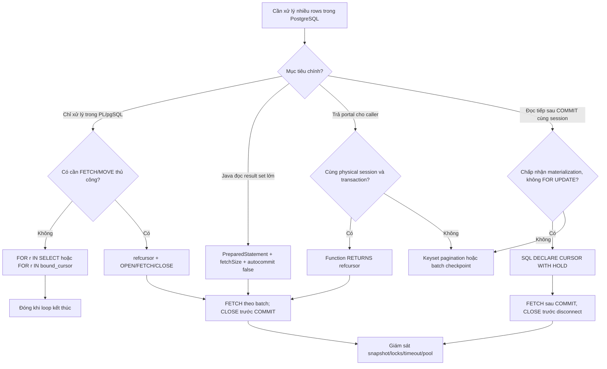

# Cursor, refcursor và vòng đời trong giao dịch trong PL/pgSQL

Khi một truy vấn PostgreSQL trả hàng trăm nghìn hoặc hàng triệu dòng, không phải lúc nào ứng dụng cũng cần nhận **toàn bộ kết quả trong một lần**. Một *cursor* cho phép giữ trạng thái thực thi/truy xuất của truy vấn ở phía PostgreSQL và đọc từng hàng hoặc từng lô qua `FETCH`. Trong PL/pgSQL, cursor còn giúp viết vòng lặp xử lý nhiều hàng, hoặc để một function **mở truy vấn rồi trả về một `refcursor`** cho caller tiếp tục đọc.

Tuy nhiên, cursor không chỉ là cú pháp “đọc từng trang”. Nó có **vòng đời gắn với session, transaction, portal, snapshot và tài nguyên server**. Một lỗi phổ biến:

```sql
-- Mỗi statement bị autocommit độc lập:
SELECT demo_cursor.open_paid_orders();
FETCH ALL FROM paid_orders_cursor;
```

Nếu cursor được mở bằng `OPEN` của PL/pgSQL và câu `SELECT` đầu đã kết thúc transaction, portal của nó thường **đã đóng** khi câu `FETCH` được gửi. Trả lại một chuỗi `refcursor` không làm portal sống qua `COMMIT`.

Bài học thuộc chương **PL/pgSQL** của module *Database Engine Relational PostgreSQL*. Nội dung giải thích từ SQL-level `DECLARE CURSOR` đến cursor variables của PL/pgSQL, thao tác `OPEN`/`FETCH`/`MOVE`/`CLOSE`, cursor có tham số, `refcursor` trả về từ function, `SCROLL`, `WITH HOLD`, tác động của `COMMIT`/`ROLLBACK`/savepoint, tương tác với procedures và cách fetch theo lô trong Java JDBC.

> **Trọng tâm cần nhớ:** `refcursor` là **giá trị tham chiếu đến tên portal**, không phải một bảng kết quả đã lưu độc lập. Muốn sử dụng một cursor thông thường, caller phải tiếp tục làm việc **trên cùng kết nối và trong giao dịch còn sống**. Chỉ những cursor SQL được khai báo holdable theo quy tắc phù hợp mới có thể tiếp tục được đọc sau `COMMIT` trong cùng session.

Các ví dụ dùng schema `demo_cursor` trong database thử nghiệm. Những khối chủ động gây lỗi được ghi rõ; không chạy các ví dụ cập nhật dữ liệu trên production.

---

## 1. Sau bài này, bạn cần nắm gì?

1. Phân biệt **cursor**, **portal**, **refcursor variable**, **cursor name** và **transaction**.
2. Biết dùng SQL `DECLARE ... CURSOR FOR` để mở cursor ở mức SQL.
3. Biết `FETCH NEXT`, `FETCH FORWARD n`, `FETCH ALL`, `MOVE` và `CLOSE`.
4. Khai báo **unbound `refcursor`** rồi `OPEN ... FOR SELECT` trong PL/pgSQL.
5. Khai báo **bound cursor** gắn sẵn câu query, có hoặc không có tham số.
6. Biết dùng `FOUND` đúng thời điểm trong vòng lặp `FETCH`.
7. Sử dụng `FOR record IN SELECT` và `FOR record IN bound_cursor(...)` khi muốn tự đóng cursor sau vòng lặp.
8. Trả `refcursor` từ function cho caller và đọc nó trong cùng transaction/session.
9. Phân biệt `SCROLL`, `NO SCROLL`, forward-only và những cảnh báo với hàm `VOLATILE`.
10. Giải thích chính xác **`WITHOUT HOLD`**, **`WITH HOLD`**, `COMMIT` và `ROLLBACK`.
11. Hiểu tại sao cursor có thể giữ transaction mở quá lâu, tạo snapshot/lock/resource pressure.
12. Không nhầm SQL cursor với **pgJDBC fetch-size cursor** hoặc REST/HTTP cursor.
13. Dùng `pg_cursors` để quan sát các portals trong session hiện tại.
14. Biết trường hợp `WHERE CURRENT OF` và `FOR UPDATE` khi cập nhật row theo cursor.
15. Có chiến lược phù hợp cho báo cáo lớn, batch processing và phân trang API.

## 2. Cursor không phải mảng hay bảng tạm

Một truy vấn thông thường:

```sql
SELECT order_id, total_amount
FROM demo_cursor.sales_order
ORDER BY order_id;
```

khi được client đọc theo cách thông thường có thể khiến driver/ứng dụng phải giữ nhiều rows trong bộ nhớ, phụ thuộc giao thức và cách client quản lý ResultSet.

Cursor cho phép truy vấn được mở và fetch:

```text
Client                            PostgreSQL session
  │                                       │
  ├── BEGIN ────────────────────────────► │
  ├── DECLARE c CURSOR FOR SELECT ... ─►  │  portal "c"
  ├── FETCH 2 FROM c ──────────────────►  │
  ◄── hai rows ──────────────────────────┤
  ├── FETCH 2 FROM c ──────────────────►  │
  ◄── hai rows tiếp theo ────────────────┤
  ├── CLOSE c ─────────────────────────►  │  portal đóng
  └── COMMIT ──────────────────────────►  │  transaction kết thúc
```

Cursor không phải một bản sao bảng có B-tree/index độc lập và không tự là một cache bền vững. Tùy kế hoạch truy vấn, PostgreSQL vẫn có thể cần sort, hash, materialize hay quét một lượng lớn dữ liệu **trước khi trả row đầu tiên**.

### 2.1. Bốn thực thể khác nhau

| Khái niệm | Ý nghĩa |
|---|---|
| **SQL cursor** | Đối tượng truy vấn mở bằng `DECLARE ... CURSOR FOR` hoặc tương đương |
| **Portal** | Cấu trúc bên trong server chứa trạng thái truy vấn/cursor |
| **`refcursor`** | Kiểu dữ liệu PL/pgSQL/SQL giữ **tên portal** |
| **Transaction** | Ranh giới mặc định quyết định khi cursor không holdable bị đóng |

Vì tên portal chỉ có ý nghĩa trong session đang chứa nó, **không thể đưa `refcursor` vào queue hoặc bảng dữ liệu rồi mong một kết nối khác `FETCH` được**.

### 2.2. Vì sao gọi là cursor?

Hình dung có một con trỏ vị trí trong dòng kết quả:

```text
Result theo ORDER BY: [row1] [row2] [row3] [row4] [row5]
Cursor position:           ^
FETCH NEXT   → row kế tiếp theo quy tắc positioning
FETCH PRIOR  → row trước nếu cursor hỗ trợ scroll
MOVE         → dịch vị trí, không trả payload rows
```

Để trình tự có ý nghĩa nghiệp vụ, hãy đặt `ORDER BY` có khóa phụ duy nhất trong query của cursor.

## 3. Tạo dữ liệu lab

Tạo schema và bảng đơn hàng. Dùng tên riêng `demo_cursor` để dễ dọn sau bài:

```sql
CREATE SCHEMA IF NOT EXISTS demo_cursor;

CREATE TABLE demo_cursor.customer (
    customer_id BIGINT PRIMARY KEY,
    customer_name TEXT NOT NULL
);

CREATE TABLE demo_cursor.sales_order (
    order_id BIGINT PRIMARY KEY,
    customer_id BIGINT NOT NULL
        REFERENCES demo_cursor.customer(customer_id),
    created_at TIMESTAMPTZ NOT NULL,
    total_amount NUMERIC(12, 2) NOT NULL
        CHECK (total_amount >= 0),
    status TEXT NOT NULL
        CHECK (status IN ('NEW', 'PAID', 'CANCELLED'))
);
```

Chèn dữ liệu:

```sql
INSERT INTO demo_cursor.customer
    (customer_id, customer_name)
VALUES
    (1, 'An'),
    (2, 'Bình'),
    (3, 'Chi');

INSERT INTO demo_cursor.sales_order
    (order_id, customer_id, created_at, total_amount, status)
VALUES
    (101, 1, '2026-10-01 08:00:00+07',  90.00, 'PAID'),
    (102, 1, '2026-10-02 09:00:00+07', 125.00, 'NEW'),
    (103, 2, '2026-10-03 10:00:00+07', 250.00, 'PAID'),
    (104, 2, '2026-10-04 11:00:00+07',  40.00, 'CANCELLED'),
    (105, 1, '2026-10-05 14:00:00+07', 180.00, 'PAID'),
    (106, 3, '2026-10-06 15:00:00+07',  60.00, 'PAID'),
    (107, 3, '2026-10-07 16:00:00+07', 450.00, 'NEW'),
    (108, 2, '2026-10-08 17:00:00+07', 320.00, 'PAID');

CREATE INDEX idx_demo_order_customer
ON demo_cursor.sales_order(customer_id, order_id);

CREATE INDEX idx_demo_order_status_created
ON demo_cursor.sales_order(status, created_at, order_id);

ANALYZE demo_cursor.sales_order;
```

Thử:

```sql
SELECT order_id, customer_id, total_amount, status
FROM demo_cursor.sales_order
ORDER BY order_id;
```

Tập dữ liệu có 8 orders, trong đó 5 có status `PAID` (101, 103, 105, 106, 108). Các ví dụ dùng con số nhỏ để dễ quan sát trạng thái từng `FETCH`.

## 4. SQL-level DECLARE: cursor đơn giản nhất

Trong **một session PostgreSQL**, chạy:

```sql
BEGIN;

DECLARE cur_orders CURSOR FOR
SELECT order_id, customer_id, total_amount
FROM demo_cursor.sales_order
ORDER BY order_id;

FETCH FORWARD 3 FROM cur_orders;

FETCH FORWARD 2 FROM cur_orders;

CLOSE cur_orders;

COMMIT;
```

Lần fetch đầu dự kiến có order IDs **101, 102, 103**. Lần thứ hai dự kiến có **104, 105**. Không có việc truy vấn tự chạy lại từ đầu ở mỗi `FETCH` như hai lần `SELECT ... LIMIT 3` độc lập.

### 4.1. Vì sao cần BEGIN?

Cursor SQL thông thường mặc định là **`WITHOUT HOLD`**, chỉ tồn tại trong transaction tạo ra nó.

Nếu client bật autocommit cho từng statement, `DECLARE ... CURSOR` không holdable ở ngoài explicit transaction không đem lại một cửa sổ để `FETCH` sau đó; PostgreSQL báo lỗi khi khai cursor `WITHOUT HOLD` ngoài transaction block.

### 4.2. Tên cursor phải duy nhất trong session

`cur_orders` là tên portal. Trong lúc portal này còn mở, bạn không thể đồng thời tạo một portal khác cùng tên trên session đó.

Các session khác có thể có cursor cùng tên vì portal namespace gắn với **session**, không phải database toàn cục.

### 4.3. Nếu thiếu ORDER BY?

Không có hợp đồng thứ tự ổn định. Hàng được phát phụ thuộc truy vấn và plan. Cursor giúp giữ trạng thái truy xuất, không tự quyết định thế nào là “đơn hàng đầu tiên”.

## 5. DECLARE là SQL, còn DECLARE trong PL/pgSQL là khai biến

Hai đoạn sau có ý nghĩa khác:

**SQL command:**

```sql
BEGIN;
DECLARE cur_orders CURSOR FOR
SELECT * FROM demo_cursor.sales_order ORDER BY order_id;
FETCH 2 FROM cur_orders;
CLOSE cur_orders;
COMMIT;
```

**PL/pgSQL block:**

```sql
DO $$
DECLARE
    cur_orders REFCURSOR;
BEGIN
    OPEN cur_orders FOR
        SELECT *
        FROM demo_cursor.sales_order
        ORDER BY order_id;
    CLOSE cur_orders;
END;
$$;
```

Trong PL/pgSQL, phần `DECLARE` sau `DO $$` là **khối khai báo biến**. `OPEN` mới tạo portal và thực thi tương đương khai cursor.

### 5.1. Không copy SQL DECLARE vào bên trong BEGIN PL/pgSQL

Đoạn:

```plpgsql
BEGIN
    DECLARE c CURSOR FOR SELECT ...;
END;
```

không phải cách khai cursor PL/pgSQL đúng. Dùng `DECLARE c CURSOR FOR ...;` trong phần khai báo biến, hoặc `c REFCURSOR; OPEN c FOR ...;`.

### 5.2. “BEGIN” trong PL/pgSQL không mở transaction SQL mới

`BEGIN ... END` của PL/pgSQL là **block điều khiển**, không phải `BEGIN; ... COMMIT;` của SQL. Function chạy trong transaction của caller; nó không tự tạo một transaction riêng cho từng block.

## 6. FETCH: đọc từng lô

Trong SQL:

```sql
BEGIN;

DECLARE cur_paid CURSOR FOR
SELECT order_id, total_amount
FROM demo_cursor.sales_order
WHERE status = 'PAID'
ORDER BY order_id;

FETCH NEXT FROM cur_paid;
FETCH FORWARD 2 FROM cur_paid;
FETCH ALL FROM cur_paid;

CLOSE cur_paid;
COMMIT;
```

Đối với tập 5 orders PAID:

- `FETCH NEXT` lấy 101.
- `FETCH FORWARD 2` lấy 103 và 105.
- `FETCH ALL` lấy phần còn lại: 106 và 108.

### 6.1. Các hướng FETCH hay dùng

| Cú pháp SQL | Tác dụng |
|---|---|
| `FETCH NEXT FROM c` | Lấy hàng tiếp theo |
| `FETCH PRIOR FROM c` | Lấy hàng trước, nếu scroll được |
| `FETCH FIRST FROM c` | Định vị/lấy hàng đầu |
| `FETCH LAST FROM c` | Lấy hàng cuối nếu hỗ trợ |
| `FETCH ABSOLUTE 3 FROM c` | Lấy hàng tại vị trí tuyệt đối 3 |
| `FETCH RELATIVE 2 FROM c` | Lấy hàng cách vị trí hiện tại 2 |
| `FETCH FORWARD 100 FROM c` | Lấy tối đa 100 hàng tiếp |
| `FETCH BACKWARD 5 FROM c` | Lấy hàng theo hướng ngược |
| `FETCH ALL FROM c` | Lấy mọi hàng còn lại theo hướng mặc định |
| `FETCH BACKWARD ALL FROM c` | Lấy tất cả hàng ngược khi hỗ trợ |

Các cú pháp tìm ngược/định vị tùy ý phải được kiểm tra với `SCROLL` và tính chất query, không mặc định mọi cursor hỗ trợ chúng.

### 6.2. FETCH ALL có thể tạo payload lớn

Dù đã mở cursor, `FETCH ALL` vẫn có thể trả hàng triệu rows về client. Nếu mục tiêu tránh memory spike, fetch theo lô và xử lý/giải phóng dữ liệu từng lô.

### 6.3. FETCH không sửa dữ liệu

`FETCH` lấy kết quả từ portal, không phải `DELETE` hoặc `UPDATE`. Tuy nhiên một cursor chạy query có `FOR UPDATE` có thể đặt row locks khi hàng được fetch; vì thế “chỉ FETCH” không luôn là thao tác không có tác động concurrency.

## 7. MOVE: thay vị trí nhưng không trả hàng

`MOVE` dùng khi muốn dịch cursor mà không cần trả payload:

```sql
BEGIN;

DECLARE cur_move SCROLL CURSOR FOR
SELECT order_id
FROM demo_cursor.sales_order
ORDER BY order_id;

MOVE FORWARD 3 FROM cur_move;

FETCH NEXT FROM cur_move;

MOVE BACKWARD 2 FROM cur_move;

FETCH NEXT FROM cur_move;

CLOSE cur_move;
COMMIT;
```

Sau `MOVE FORWARD 3`, cursor đã đi qua ba hàng đầu; `FETCH NEXT` đọc hàng tiếp theo.

### 7.1. MOVE khác OFFSET

`MOVE` thay **vị trí của portal đã mở**. `OFFSET` là một phần của câu SELECT độc lập. Chúng có thể có chi phí tương tự cho việc bỏ qua nhiều hàng tùy plan, nhưng không có cùng mô hình vòng đời.

### 7.2. MOVE không phải “seek theo khóa”

Muốn truy cập nhanh đơn hàng có ID lớn hơn một cursor key, có thể cần query keyset:

```sql
SELECT order_id, total_amount
FROM demo_cursor.sales_order
WHERE order_id > 1000
ORDER BY order_id
LIMIT 100;
```

Đây là query với predicate có thể dùng index, không phải `MOVE ABSOLUTE 1000`. Cursor position tính theo **thứ tự dòng**, không theo giá trị business key.

## 8. CLOSE: giải phóng portal sớm

`CLOSE cursor_name;` kết thúc cursor và giải phóng tài nguyên tương ứng.

```sql
BEGIN;

DECLARE cur_close CURSOR FOR
SELECT * FROM demo_cursor.sales_order;

FETCH 1 FROM cur_close;
CLOSE cur_close;

-- CỐ TÌNH GÂY LỖI: cursor đã đóng.
FETCH 1 FROM cur_close;

ROLLBACK;
```

Khi câu `FETCH` sau CLOSE báo lỗi, transaction có thể chuyển sang trạng thái aborted. `ROLLBACK` khôi phục session về trạng thái có thể thực thi query khác.

### 8.1. Có cần CLOSE nếu sắp COMMIT?

Cursor không holdable tự đóng khi transaction kết thúc. Dù vậy, nếu ứng dụng còn làm việc trong transaction sau khi dùng xong cursor, **đóng sớm** giúp server giải phóng portal và tránh nhầm tên.

### 8.2. CLOSE không COMMIT

`CLOSE` đóng portal; nó không tự hoàn thành transaction. Transaction vẫn chịu sự quản lý của `COMMIT` hoặc `ROLLBACK` từ caller.

## 9. SCROLL và NO SCROLL

Nếu cần đọc tiến/lùi, khai `SCROLL`:

```sql
BEGIN;

DECLARE cur_scroll SCROLL CURSOR FOR
SELECT order_id, total_amount
FROM demo_cursor.sales_order
ORDER BY order_id;

FETCH FORWARD 3 FROM cur_scroll;
FETCH PRIOR FROM cur_scroll;
FETCH FIRST FROM cur_scroll;
FETCH LAST FROM cur_scroll;

CLOSE cur_scroll;
COMMIT;
```

`SCROLL` cho phép định vị không tuần tự, nhưng có thể làm plan/tài nguyên tốn hơn.

Nếu chỉ cần đọc từ đầu tới cuối:

```sql
BEGIN;

DECLARE cur_forward NO SCROLL CURSOR FOR
SELECT order_id, total_amount
FROM demo_cursor.sales_order
ORDER BY order_id;

FETCH FORWARD 3 FROM cur_forward;

-- CỐ TÌNH KHÔNG ĐƯỢC HỖ TRỢ:
-- FETCH PRIOR FROM cur_forward;

CLOSE cur_forward;
COMMIT;
```

### 9.1. Mặc định không tương đương SCROLL

Với `DECLARE c CURSOR FOR ...` không ghi gì, PostgreSQL có thể cho backward fetch trong **một số kế hoạch**, nhưng không có cam kết giống chỉ định `SCROLL`.

Hãy viết `SCROLL` khi thật sự cần lùi và câu query phù hợp; viết `NO SCROLL` khi cần forward-only và muốn ý định rõ.

### 9.2. SCROLL có thể gây khác kết quả với VOLATILE

Một query chứa `random()`, `clock_timestamp()` hoặc các hàm volatile khác có thể không cho giá trị ổn định nếu scroll khiến một hàng được đọc lại theo cách thực thi lại expression.

Nếu cần deterministic values, tránh kết hợp scroll với volatile query, hoặc vật chất hóa kết quả theo một chính sách rõ. Không xem `SCROLL` là “chụp ảnh mọi expression value vĩnh viễn”.

### 9.3. SCROLL và FOR UPDATE có hạn chế

PostgreSQL không cho chỉ định `SCROLL` khi query chứa `FOR UPDATE`/`FOR SHARE` và không cho backward fetch kiểu đó. Nếu mục tiêu khóa các hàng để update, dùng forward-only query.

## 10. Cursor và ORDER BY ổn định

Khi xử lý đơn hàng theo thời gian:

```sql
SELECT order_id, created_at
FROM demo_cursor.sales_order
ORDER BY created_at, order_id;
```

Thêm `order_id` làm tie-breaker để hai orders cùng timestamp vẫn có thứ tự toàn phần.

### 10.1. Cursor không biến một ORDER BY thiếu tiebreaker thành ổn định qua lần mở khác

Nếu chỉ `ORDER BY created_at` và có nhiều hàng cùng `created_at`, hai lần mở cursor trong hai transactions có thể sắp nhóm bằng thời gian theo thứ tự khác nhau.

### 10.2. Không thay thế khóa chính bằng cursor position

Vị trí thứ 20 trong một cursor không phải định danh bền vững của một order. API/ETL phải lưu business key hoặc pagination cursor token riêng nếu cần tiếp tục sau khi transaction/session đóng.

## 11. PL/pgSQL dùng refcursor: khai báo unbound

Biến cursor trong PL/pgSQL có kiểu `refcursor`.

```sql
DO $$
DECLARE
    v_cursor REFCURSOR;
    v_row RECORD;
BEGIN
    OPEN v_cursor FOR
        SELECT order_id, total_amount, status
        FROM demo_cursor.sales_order
        WHERE status = 'PAID'
        ORDER BY order_id;

    LOOP
        FETCH v_cursor INTO v_row;
        EXIT WHEN NOT FOUND;

        RAISE NOTICE 'order=%, amount=%',
            v_row.order_id, v_row.total_amount;
    END LOOP;

    CLOSE v_cursor;
END;
$$;
```

Đặc điểm:

1. `v_cursor REFCURSOR`: lúc khai báo chưa gắn query cụ thể.
2. `OPEN v_cursor FOR SELECT ...`: tạo portal và mở query.
3. `FETCH v_cursor INTO v_row`: lấy một row vào biến RECORD.
4. `EXIT WHEN NOT FOUND`: dừng khi đã hết rows.
5. `CLOSE v_cursor`: đóng portal.

### 11.1. Vì sao gọi là unbound?

Unbound nghĩa là biến `refcursor` chưa được gắn query cố định trong khai báo. Bạn có thể chọn SELECT phù hợp ở thời điểm `OPEN`.

### 11.2. RECORD nhận shape từ FETCH

`v_row RECORD` có thể chứa fields của row được fetch. Vì query chọn `order_id`, `total_amount` và `status`, sau khi FETCH thành công có thể dùng `v_row.order_id` và `v_row.total_amount`.

Không truy cập field chưa có hoặc một RECORD chưa được gán cấu trúc phù hợp.

### 11.3. FETCH không tự dừng loop

Nếu thiếu `EXIT WHEN NOT FOUND`, function có thể lặp mãi khi không còn hàng, hoặc tiếp tục dùng biến không có dữ liệu mới. Luôn có điều kiện kết thúc rõ.

## 12. FOUND: kiểm tra kết quả FETCH ngay sau lệnh

Trong PL/pgSQL, `FETCH` cập nhật biến đặc biệt `FOUND`:

- `TRUE` khi fetch thành công một hàng.
- `FALSE` khi không có hàng theo hướng/position đã yêu cầu.

Mẫu:

```plpgsql
FETCH v_cursor INTO v_row;
EXIT WHEN NOT FOUND;
```

### 12.1. Không chèn SQL khác giữa FETCH và FOUND khi chưa rõ

`FOUND` cũng có thể bị cập nhật bởi các lệnh PL/pgSQL khác. Nếu:

```plpgsql
FETCH v_cursor INTO v_row;
PERFORM some_other_function();
EXIT WHEN NOT FOUND;
```

thì `FOUND` sau `PERFORM` có thể không còn phản ánh kết quả của `FETCH`.

Cách an toàn: kiểm tra `FOUND` **ngay** sau FETCH hoặc lưu trạng thái vào biến riêng trước khi thực thi thao tác khác.

### 12.2. RECORD có field NULL không có nghĩa FETCH thất bại

Một row thật có thể chứa `total_amount=NULL` trong schema khác. `FOUND=TRUE` vì có row, ngay cả khi một hoặc nhiều fields là SQL NULL.

Đừng thay `EXIT WHEN NOT FOUND` bằng `EXIT WHEN v_row.some_field IS NULL` nếu cột đó có thể nullable.

## 13. OPEN unbound cursor với biến đầu vào

Một function có thể dùng input parameter trong câu query:

```sql
CREATE FUNCTION demo_cursor.count_over_amount(
    p_threshold NUMERIC
)
RETURNS BIGINT
LANGUAGE plpgsql
STABLE
AS $$
DECLARE
    v_cursor REFCURSOR;
    v_order_id BIGINT;
    v_count BIGINT := 0;
BEGIN
    OPEN v_cursor FOR
        SELECT o.order_id
        FROM demo_cursor.sales_order AS o
        WHERE o.total_amount >= p_threshold
        ORDER BY o.order_id;

    LOOP
        FETCH v_cursor INTO v_order_id;
        EXIT WHEN NOT FOUND;
        v_count := v_count + 1;
    END LOOP;

    CLOSE v_cursor;
    RETURN v_count;
END;
$$;
```

Gọi:

```sql
SELECT demo_cursor.count_over_amount(200);
```

Với lab, kết quả dự kiến là **3** (250, 450, 320).

### 13.1. Đây là ví dụ cursor, không phải tối ưu tốt nhất

Với nghiệp vụ chỉ đếm:

```sql
SELECT COUNT(*)
FROM demo_cursor.sales_order
WHERE total_amount >= 200;
```

thường đơn giản và hiệu quả hơn việc fetch từng hàng rồi tăng biến đếm. Chỉ dùng explicit cursor khi cần logic xử lý từng row hoặc giao kết quả theo lô.

## 14. Bound cursor: gắn query ngay trong DECLARE

PL/pgSQL cũng cho phép khai một cursor **đã gắn sẵn query**:

```sql
DO $$
DECLARE
    v_row RECORD;

    cur_paid CURSOR FOR
        SELECT order_id, total_amount
        FROM demo_cursor.sales_order
        WHERE status = 'PAID'
        ORDER BY order_id;
BEGIN
    OPEN cur_paid;

    LOOP
        FETCH cur_paid INTO v_row;
        EXIT WHEN NOT FOUND;
        RAISE NOTICE 'paid order: %', v_row.order_id;
    END LOOP;

    CLOSE cur_paid;
END;
$$;
```

`cur_paid CURSOR FOR SELECT ...` vừa khai báo biến kiểu `refcursor`, vừa gắn query với nó.

### 14.1. OPEN bound không cần FOR SELECT

Vì query đã được khai ở phần `DECLARE`, chỉ viết:

```plpgsql
OPEN cur_paid;
```

Không lặp lại `OPEN cur_paid FOR SELECT ...` đối với bound cursor.

### 14.2. Khi nào dùng bound cursor?

- Query cố định, chỉ cần thay tham số.
- Function phức tạp dùng một query theo logic rõ.
- Muốn dùng cursor FOR-loop tự mở/tự đóng.
- Cần phân biệt cursor chuyên biệt với biến refcursor linh hoạt.

Nếu query chỉ dùng một lần và không cần xử lý thủ công, `FOR v_row IN SELECT ... LOOP` thường gọn hơn.

## 15. Bound cursor có tham số

Có thể đưa tham số vào ngay lúc khai cursor:

```sql
DO $$
DECLARE
    v_row RECORD;

    cur_by_customer CURSOR (p_customer BIGINT) FOR
        SELECT
            o.order_id,
            o.customer_id,
            o.total_amount
        FROM demo_cursor.sales_order AS o
        WHERE o.customer_id = p_customer
        ORDER BY o.order_id;
BEGIN
    OPEN cur_by_customer(1);

    LOOP
        FETCH cur_by_customer INTO v_row;
        EXIT WHEN NOT FOUND;

        RAISE NOTICE 'customer=%, order=%',
            v_row.customer_id, v_row.order_id;
    END LOOP;

    CLOSE cur_by_customer;
END;
$$;
```

### 15.1. Tại sao dùng p_customer khác tên cột?

Nếu tham số mang tên `customer_id` giống cột, tham chiếu trong query có thể nhập nhằng. Đặt tên rõ:

```sql
WHERE o.customer_id = p_customer
```

giúp PostgreSQL phân biệt variable và column.

### 15.2. Named arguments khi OPEN

```plpgsql
OPEN cur_by_customer(p_customer := 2);
```

Cách này thuận tiện nếu cursor có nhiều arguments và muốn giảm phụ thuộc vào thứ tự.

### 15.3. Giá trị tham số được xác định lúc OPEN

Khi `OPEN cur_by_customer(1)`, query được mở với giá trị hiện tại của tham số. Thay đổi biến bên ngoài sau khi OPEN **không khiến cursor đang mở tự đổi filter**.

Muốn truy vấn với customer ID khác, đóng cursor và mở lại với giá trị mới.

## 16. Cursor FOR-loop tự mở và tự đóng

Với bound cursor, không nhất thiết phải `OPEN` và `CLOSE` thủ công:

```sql
DO $$
DECLARE
    cur_by_customer CURSOR (p_customer BIGINT) FOR
        SELECT order_id, total_amount
        FROM demo_cursor.sales_order
        WHERE customer_id = p_customer
        ORDER BY order_id;
BEGIN
    FOR v_row IN cur_by_customer(2) LOOP
        RAISE NOTICE 'order=%, amount=%',
            v_row.order_id, v_row.total_amount;
    END LOOP;
END;
$$;
```

Trong cursor FOR-loop:

- PostgreSQL tự mở cursor cho query đã bound.
- Mỗi vòng nhận một row vào record loop variable.
- Khi loop kết thúc, cursor được tự đóng.

### 16.1. Đừng OPEN trước vòng FOR như trên

Cursor FOR-loop cần cursor chưa đang mở; nếu bạn `OPEN cur_by_customer(2)` rồi lại `FOR v_row IN cur_by_customer(2)`, không còn đúng mô hình tự mở.

### 16.2. FOR-loop không tạo table-valued output

`RAISE NOTICE` chỉ in thông báo từ PL/pgSQL; không phải result rows trả về cho SQL caller. Nếu muốn return rows từ function, dùng `RETURNS SETOF`/`RETURNS TABLE` kết hợp `RETURN NEXT` hoặc `RETURN QUERY`, hoặc trả `refcursor` cho caller.

## 17. FOR record IN SELECT: trường hợp đơn giản hơn cursor explicit

Một query chỉ cần duyệt lần lượt:

```sql
DO $$
BEGIN
    FOR v_row IN
        SELECT order_id, total_amount
        FROM demo_cursor.sales_order
        WHERE status = 'PAID'
        ORDER BY order_id
    LOOP
        RAISE NOTICE 'paid: %', v_row.order_id;
    END LOOP;
END;
$$;
```

PL/pgSQL sử dụng cơ chế cursor nội bộ để duyệt kết quả của FOR SELECT; bạn không cần khai `refcursor`, `FETCH`, `FOUND` hay `CLOSE`.

### 17.1. Khi nào KHÔNG cần explicit cursor?

- Chỉ xử lý toàn bộ row một lần trong function.
- Không cần trả portal name cho client.
- Không cần MOVE/PREV/ABSOLUTE.
- Không cần đổi giữa nhiều query theo runtime.
- Không cần pause/resume trong transaction giữa nhiều statements của caller.

Cursor explicit thêm độ phức tạp, nên dùng khi cần chức năng của nó.

### 17.2. FOR-loop giúp tránh tự code sai EXIT WHEN NOT FOUND

Khi không có hàng, loop đơn giản chạy 0 lần. Bạn không phải kiểm tra `FOUND` sau mỗi fetch.

## 18. Bound cursor và NO SCROLL/SCROLL trong PL/pgSQL

Có thể khai mức scroll ngay lúc bound cursor:

```plpgsql
DECLARE
    c_forward NO SCROLL CURSOR FOR
        SELECT ...;
    c_backward SCROLL CURSOR FOR
        SELECT ...;
```

Đây là cú pháp minh họa khai biến trong PL/pgSQL, không phải SQL standalone.

Với unbound cursor:

```plpgsql
OPEN v_cursor NO SCROLL FOR
    SELECT ...;
```

hoặc:

```plpgsql
OPEN v_cursor SCROLL FOR
    SELECT ...;
```

### 18.1. Chọn SCROLL ở đúng chỗ

- **Bound:** chỉ định ở **declaration**.
- **Unbound:** có thể chỉ định ở **OPEN**.
- Không cố ép `OPEN bound_cursor SCROLL` khi bound cursor đã xác định scrolling policy trong khai báo.

### 18.2. SCROLL cũng có chi phí với query phức tạp

Đòi backward seeking có thể khiến executor phải giữ hoặc tái đánh giá thêm trạng thái. Nếu client chỉ đọc forward theo batch, `NO SCROLL` giúp mô tả đúng nhu cầu.

## 19. OPEN FOR EXECUTE: câu query động

Unbound `refcursor` có thể nhận câu SQL được xây động:

```sql
CREATE FUNCTION demo_cursor.count_by_dynamic_status(
    p_status TEXT
)
RETURNS BIGINT
LANGUAGE plpgsql
STABLE
AS $$
DECLARE
    v_cursor REFCURSOR;
    v_order_id BIGINT;
    v_count BIGINT := 0;
BEGIN
    OPEN v_cursor FOR EXECUTE
        'SELECT order_id
         FROM demo_cursor.sales_order
         WHERE status = $1
         ORDER BY order_id'
    USING p_status;

    LOOP
        FETCH v_cursor INTO v_order_id;
        EXIT WHEN NOT FOUND;
        v_count := v_count + 1;
    END LOOP;

    CLOSE v_cursor;
    RETURN v_count;
END;
$$;
```

### 19.1. Đây là minh họa cú pháp, không cần SQL động để đếm

Vì query chỉ thay value `status`, câu `OPEN v_cursor FOR SELECT ... WHERE status = p_status` sẽ ngắn và dễ tối ưu hơn. `EXECUTE` hữu ích khi thật sự phải thay cấu trúc query.

### 19.2. Dùng USING cho dữ liệu

`USING p_status` truyền giá trị theo placeholder `$1` mà không nối text input vào SQL. Không viết:

```plpgsql
-- Không làm thế này với input tự do:
OPEN v_cursor FOR EXECUTE
    'SELECT ... WHERE status = ''' || p_status || '''';
```

Cách nối chuỗi có thể gây SQL injection hoặc lỗi escaping.

### 19.3. Identifier không dùng USING

Tên bảng/cột không được truyền qua `USING` như một parameter value. Nếu phải chọn một bảng theo runtime, áp whitelist nghiêm ngặt rồi dùng `format('%I', identifier)` hay schema-qualified identifiers phù hợp.

## 20. refcursor giữ tên portal, không giữ dữ liệu

Trong PL/pgSQL:

```plpgsql
DECLARE
    v_cursor REFCURSOR;
BEGIN
    OPEN v_cursor FOR SELECT ...;
    RETURN v_cursor;
END;
```

`RETURN v_cursor` trả **giá trị tên portal**, không chuyển rows của SELECT vào một object serializable lâu dài.

### 20.1. Portal phải còn mở

Nếu function:

```plpgsql
OPEN v_cursor FOR SELECT ...;
CLOSE v_cursor;
RETURN v_cursor;
```

thì caller chỉ nhận một tên **không còn trỏ tới portal đang mở**. Một refcursor variable tồn tại không có nghĩa portal còn tồn tại.

### 20.2. Cùng session mới truy cập được

Kết nối A mở portal `c`. Kết nối B dùng `FETCH FROM c` không truy cập được portal của A, dù cả hai kết nối đến cùng database/user.

### 20.3. Không lưu refcursor vào bảng làm job bookmark

Sau COMMIT hoặc connection close, tên portal từ session cũ không còn là con trỏ resume hợp lệ. Muốn tiếp tục job sau restart, lưu **business key, offset/token, trạng thái job** theo schema bền vững.

## 21. Function trả refcursor với tên portal cố định

Một ví dụ tối giản, chủ động đặt tên:

```sql
CREATE FUNCTION demo_cursor.open_paid_orders(
    p_min_amount NUMERIC DEFAULT 0
)
RETURNS REFCURSOR
LANGUAGE plpgsql
STABLE
AS $$
DECLARE
    v_cursor REFCURSOR := 'paid_orders_cursor';
BEGIN
    OPEN v_cursor FOR
        SELECT order_id, customer_id, total_amount
        FROM demo_cursor.sales_order
        WHERE status = 'PAID'
          AND total_amount >= p_min_amount
        ORDER BY order_id;

    RETURN v_cursor;
END;
$$;
```

**Gọi đúng vòng đời:**

```sql
BEGIN;

SELECT demo_cursor.open_paid_orders(100);

FETCH FORWARD 2 FROM paid_orders_cursor;
FETCH ALL FROM paid_orders_cursor;

CLOSE paid_orders_cursor;

COMMIT;
```

Kết quả của `SELECT open_paid_orders(100)` là tên portal `paid_orders_cursor`. Các `FETCH` tiếp theo dùng portal đó **trong cùng transaction và connection**.

### 21.1. Tên cố định tiện demo, dễ va chạm trong ứng dụng thật

Nếu một session mở `paid_orders_cursor` lần thứ hai **khi portal cùng tên còn đang mở**, PostgreSQL có thể báo tên cursor đã được sử dụng.

Một ứng dụng phục vụ nhiều câu truy vấn đồng thời trên cùng session không nên hard-code tên portal dùng chung mà không có cơ chế quản lý vòng đời.

### 21.2. Nếu SELECT function ở autocommit mode?

`SELECT open_paid_orders(...)` tự kết thúc transaction khi statement kết thúc. Non-holdable cursor mở trong đó bị đóng; câu `FETCH` sau sẽ báo cursor không tồn tại.

Không dùng `refcursor` API khi caller không thể giữ một transaction/session xuyên suốt các fetches.

## 22. Function trả refcursor với tên tự sinh

Bỏ việc gán một chuỗi tên cố định:

```sql
CREATE FUNCTION demo_cursor.open_customer_orders(
    p_customer_id BIGINT
)
RETURNS REFCURSOR
LANGUAGE plpgsql
STABLE
AS $$
DECLARE
    v_cursor REFCURSOR;
BEGIN
    OPEN v_cursor FOR
        SELECT order_id, total_amount, status
        FROM demo_cursor.sales_order
        WHERE customer_id = p_customer_id
        ORDER BY order_id;

    RETURN v_cursor;
END;
$$;
```

Gọi:

```sql
BEGIN;

SELECT demo_cursor.open_customer_orders(1) AS cursor_name;

-- Xem tên portal thực trả về, rồi dùng chính tên đó:
-- FETCH ALL FROM "<unnamed portal 1>";  -- tên này CHỈ là minh họa
-- CLOSE "<unnamed portal 1>";

ROLLBACK;
```

### 22.1. Không hard-code tên tự sinh

Portal name có thể có dấu cách, ký hiệu và thứ tự phát sinh không cố định. Kết quả có thể trông như `<unnamed portal 1>`, nhưng không được suy ra mọi session/lần chạy đều dùng đúng chuỗi đó.

Nếu dùng SQL thủ công, nhập **tên thực được trả về** vào `FETCH`, quote identifier đúng. Nếu dùng JDBC, cần một cách đóng gói/escape identifier an toàn.

### 22.2. PostgreSQL 16 thay đổi mặc định của bound cursor name

Trước PostgreSQL **16**, bound cursor variables trong PL/pgSQL thường được khởi tạo bằng **chính tên biến**, nên portal name mặc định có thể giống tên khai báo.

Từ PostgreSQL **16**, mặc định này thay đổi: bound cursor variables được để NULL để hệ thống sinh portal name, giảm nguy cơ xung đột.

Vì vậy không viết caller phụ thuộc vào `cur_by_customer` là portal name chỉ vì nó là tên bound variable. Hãy lấy đúng giá trị `refcursor` hoặc gán tên portal một cách tường minh khi cần giao tiếp bên ngoài.

## 23. Cùng transaction không đủ nếu khác connection

Ví dụ logic:

```text
Request A                         Pool
   ├── Connection 1
   │     BEGIN
   │     SELECT open_customer_orders(1)
   │     → portal "...1" trên session 1
   └── Release connection

Request B
   └── Connection 2
         FETCH FROM "...1"
         → Không tồn tại trong session 2
```

Ngay cả khi dùng cùng database user, portal namespace thuộc backend session. Nếu transaction quản lý bởi framework, phải bảo đảm **cùng physical connection** được giữ từ lúc `OPEN` đến `CLOSE`/`COMMIT`.

### 23.1. Connection pool không tự cho phép chuyển portal

Không lưu tên refcursor rồi mở connection mới từ pool để fetch. Nếu request qua HTTP tách rời transaction, hãy dùng keyset pagination hoặc job state bền vững thay vì refcursor.

### 23.2. Trả refcursor cho client không làm “stream qua Internet”

Client vẫn phải gửi các câu `FETCH` bằng giao thức SQL trên session đó. Server-side cursors không tự trở thành WebSocket/HTTP stream và không có built-in resume token qua reconnect.

## 24. Trả nhiều refcursors từ một function

Khi caller cần hai result sets riêng (ví dụ orders PAID và NEW), một function có thể trả **nhiều portal names**:

```sql
CREATE FUNCTION demo_cursor.open_two_order_groups(
    p_paid REFCURSOR,
    p_new REFCURSOR
)
RETURNS SETOF REFCURSOR
LANGUAGE plpgsql
STABLE
AS $$
BEGIN
    OPEN p_paid FOR
        SELECT order_id, total_amount
        FROM demo_cursor.sales_order
        WHERE status = 'PAID'
        ORDER BY order_id;

    RETURN NEXT p_paid;

    OPEN p_new FOR
        SELECT order_id, total_amount
        FROM demo_cursor.sales_order
        WHERE status = 'NEW'
        ORDER BY order_id;

    RETURN NEXT p_new;
END;
$$;
```

Gọi:

```sql
BEGIN;

SELECT *
FROM demo_cursor.open_two_order_groups(
    'paid_group',
    'new_group'
);

FETCH ALL FROM paid_group;
FETCH ALL FROM new_group;

CLOSE paid_group;
CLOSE new_group;

COMMIT;
```

### 24.1. Mỗi refcursor là một portal độc lập

Mỗi tên phải duy nhất trong session khi đang hoạt động. Nếu caller chỉ đóng một cursor, cursor kia vẫn giữ tài nguyên cho tới khi bị CLOSE hoặc transaction kết thúc.

### 24.2. SETOF refcursor là tập tên, không phải hợp nhất kết quả hai truy vấn

`RETURNS SETOF REFCURSOR` trả hai **giá trị refcursor**. Nó không trả chung tất cả các order rows. Caller phải `FETCH` từng portal.

### 24.3. Đừng dùng hai portals khi một SELECT hợp lý hơn

Nếu API chỉ muốn `status` và danh sách orders, một query `SELECT ... WHERE status IN ('PAID','NEW') ORDER BY ...` có thể đơn giản hơn. Multi-refcursor hữu ích khi cần hai stream/query shapes khác nhau dưới cùng transaction.

## 25. SQL cursor WITHOUT HOLD: vòng đời mặc định

Thử một giao dịch:

```sql
BEGIN;

DECLARE cur_short CURSOR WITHOUT HOLD FOR
SELECT order_id
FROM demo_cursor.sales_order
ORDER BY order_id;

FETCH 2 FROM cur_short;

COMMIT;

-- CỐ TÌNH GÂY LỖI:
-- FETCH ALL FROM cur_short;
```

Sau COMMIT, portal không holdable đã đóng. Việc giữ tên cursor trong biến client không tạo lại trạng thái truy vấn.

### 25.1. Bảng vòng đời

| Sự kiện | Non-holdable cursor |
|---|---|
| `DECLARE`/`OPEN` | Portal được tạo trong session |
| `FETCH` | Portal giữ/cập nhật vị trí |
| `CLOSE` | Portal bị đóng |
| `COMMIT` | Portal bị đóng tự động |
| `ROLLBACK` | Portal bị đóng tự động |
| Kết nối bị đóng | Portal biến mất |
| Kết nối khác `FETCH` cùng tên | Không truy cập được |

Đây là hành vi mặc định của cursor mở bằng PL/pgSQL `OPEN` và SQL `DECLARE` không `WITH HOLD`.

## 26. WITH HOLD: ngoại lệ cho SQL DECLARE

Ở SQL level:

```sql
BEGIN;

DECLARE cur_hold CURSOR WITH HOLD FOR
SELECT order_id, total_amount
FROM demo_cursor.sales_order
ORDER BY order_id;

FETCH FORWARD 2 FROM cur_hold;

COMMIT;

-- Vẫn trên CÙNG connection/session:
FETCH FORWARD 3 FROM cur_hold;
FETCH ALL FROM cur_hold;

CLOSE cur_hold;
```

**`WITH HOLD`** cho phép cursor tiếp tục được dùng sau khi **transaction tạo ra nó COMMIT thành công**, trên cùng session.

### 26.1. Những điều WITH HOLD không cho phép

- Không chuyển portal sang **session khác**.
- Không sống sau khi session/connection bị đóng.
- Không bảo đảm kết quả cập nhật theo dữ liệu mới của transaction tiếp theo.
- Không bỏ chi phí tạo kết quả: PostgreSQL phải giữ dữ liệu để đọc lại sau COMMIT.
- Không được dùng nếu query khai cursor chứa `FOR UPDATE`/`FOR SHARE`.

### 26.2. Cơ chế materialization ở COMMIT

PostgreSQL lưu những rows của held cursor vào bộ nhớ hoặc vùng lưu tạm để tiếp tục cung cấp sau COMMIT.

```text
BEGIN ── DECLARE WITH HOLD ── FETCH một phần ── COMMIT
                                             │
                                             ▼
                              Kết quả còn lại được vật chất hóa
                                             │
                                             ▼
                            Session tiếp tục FETCH trong txn sau
```

Do đó, `WITH HOLD` không phải “cursor mãi mãi streaming với chi phí O(1)”. Nó chuyển trade-off sang memory/temp storage, đặc biệt với kết quả lớn.

### 26.3. WITH HOLD là SQL-level option

`OPEN v_refcursor FOR SELECT ...` trong PL/pgSQL **không có tham số đơn giản `WITH HOLD`** tương đương SQL `DECLARE CURSOR WITH HOLD`. Nếu thật sự cần holdable cursor, thiết kế ở SQL-level và transaction boundary rõ; đừng nghĩ trả `refcursor` từ function tự làm nó holdable.

## 27. COMMIT và ROLLBACK với held cursor

| Sự kiện | SQL cursor `WITH HOLD` |
|---|---|
| Tạo trong transaction | Portal hoạt động |
| COMMIT thành công transaction tạo | Portal tiếp tục tồn tại trong cùng session |
| ROLLBACK transaction tạo trước commit | Portal bị loại bỏ |
| FETCH sau commit, cùng session | Có thể nếu chưa CLOSE |
| CLOSE | Portal bị đóng |
| Disconnect/session kết thúc | Portal bị đóng |
| Kết nối khác | Không đọc được portal |
| ROLLBACK của transaction đọc về sau | Phụ thuộc trạng thái portal đã hold; không biến portal thành dữ liệu dùng liên session |

### 27.1. ROLLBACK lúc tạo khác ROLLBACK sau khi đã hold

Thử:

```sql
BEGIN;

DECLARE cur_cancelled CURSOR WITH HOLD FOR
SELECT order_id
FROM demo_cursor.sales_order
ORDER BY order_id;

ROLLBACK;

-- CỐ TÌNH GÂY LỖI: transaction tạo bị hủy,
-- cursor chưa có COMMIT thành công.
-- FETCH 1 FROM cur_cancelled;
```

Với một held cursor đã qua COMMIT thành công, nó thuộc session và có thể được đọc trong transaction sau. Nhưng không nên xây ứng dụng phụ thuộc vào những edge-case vị trí sau failed FETCH/rollback nếu chưa kiểm thử chính xác phiên bản và driver.

### 27.2. Không xem WITH HOLD là cache nghiệp vụ

Ngay cả khi dùng sau commit, held cursor biểu diễn **kết quả tại thời điểm nó được tạo/materialize**, không phải một view luôn cập nhật theo dữ liệu mới.

## 28. So sánh nhanh: cursor thường, WITH HOLD, refcursor

| Đặc điểm | SQL `DECLARE ... WITHOUT HOLD` | SQL `DECLARE ... WITH HOLD` | PL/pgSQL `OPEN refcursor` |
|---|---|---|---|
| Có thể fetch nhiều lần trong transaction | Có | Có | Có |
| Sống qua COMMIT transaction tạo | Không | **Có**, cùng session | Không mặc định |
| Sống qua ROLLBACK transaction tạo | Không | Không | Không |
| Sống qua reconnect | Không | Không | Không |
| Có portal name | Có | Có | Có |
| Có thể chứa query state/position | Có | Có | Có |
| Vật chất hóa rows khi commit | Không theo cách held cursor | Có | Không có cơ chế `WITH HOLD` trực tiếp |
| Trả tên từ PL/pgSQL function | Qua refcursor name nếu phù hợp | Không nên coi function OPEN tạo hold | Có |
| Mục đích phổ biến | Batch fetch trong transaction | Fetch tiếp sau commit cùng session | Cursor loops và trả portal name |

**Câu hỏi thiết kế:** Bạn có thể giữ một physical connection và một transaction đủ lâu không? Nếu không, `refcursor` mặc định không phải giao diện phù hợp để phân trang giữa nhiều HTTP requests.

## 29. Snapshot: cursor có nhìn thấy dữ liệu thay đổi không?

Một cursor chạy một truy vấn dưới hệ thống MVCC của PostgreSQL. Kết quả và khả năng quan sát thay đổi phụ thuộc loại query, thời điểm query/snapshot, isolation level, khóa và việc materialize.

### 29.1. Không mặc định mỗi FETCH là một SELECT mới

`FETCH NEXT` của cùng portal không có nghĩa mỗi lần lại chạy lại toàn bộ `SELECT` với một snapshot mới như một câu SQL độc lập. Nó tiếp tục truy xuất trạng thái query đã mở.

### 29.2. READ COMMITTED không biến cursor thành “real-time feed”

Đừng dựa vào kỳ vọng “session khác INSERT order mới thì FETCH tiếp sẽ thấy ngay”. Kết quả cursor được xác định theo execution/snapshot của portal, không giống một subscription hay change-data-capture stream.

### 29.3. WITH HOLD càng không phải live cursor

Sau khi COMMIT materializes kết quả, những rows đã giữ là một tập đọc lại trong session; transaction khác cập nhật bảng không tự thay output của held cursor.

### 29.4. REPEATABLE READ và SERIALIZABLE

Ở isolation mạnh hơn, snapshot/serialization rules thay đổi phạm vi quan sát và khả năng abort. Một transaction giữ cursor lâu có thể gặp thêm áp lực cạnh tranh, transaction ID horizon và lỗi concurrency, cần retry transaction theo SQLSTATE phù hợp.

Không chỉ đổi isolation lên `SERIALIZABLE` để “giữ cursor luôn đúng” mà không có retry và hiểu về chi phí.

## 30. Cursor mở lâu có ảnh hưởng VACUUM và locks

Cursor/transaction lâu có thể:

- Giữ snapshot hoặc transaction horizon lâu hơn mong muốn.
- Khiến VACUUM không thể dọn một số old row versions đủ sớm.
- Tăng bloat, WAL và storage pressure.
- Giữ relation/row locks theo query/transaction.
- Chiếm connection trong pool.
- Tạo tài nguyên executor/temp files/portal ở server.

Không phải mọi cursor đều gây mọi tác động trên, nhưng **giữ transaction mở qua nhiều giây/phút** cần được xem như quyết định vận hành.

### 30.1. Không khóa transaction trong lúc gọi HTTP bên ngoài

Mẫu nguy hiểm:

```text
BEGIN
  OPEN cursor
  FETCH row
  Gọi API bên ngoài (có thể timeout 30 giây)
  FETCH row tiếp
  ...
COMMIT
```

Connection và transaction bị chiếm trong lúc đợi hệ thống ngoài, dễ dẫn tới pool starvation và dữ liệu cũ.

Đối với job lớn, cân nhắc chia batch theo khóa bền vững, commit từng batch và lưu progress an toàn.

## 31. SAVEPOINT và subtransactions

SQL có `SAVEPOINT`:

```sql
BEGIN;

SAVEPOINT sp_one;

DECLARE cur_sp CURSOR FOR
SELECT order_id
FROM demo_cursor.sales_order
ORDER BY order_id;

ROLLBACK TO SAVEPOINT sp_one;

-- Portal được tạo sau savepoint đã bị rollback,
-- nên không tiếp tục dùng cur_sp như thể nó còn mở.

COMMIT;
```

Đừng xem savepoint như “undo vị trí FETCH rồi replay cùng cursor”. PostgreSQL có những quy tắc riêng đối với trạng thái portal và position khi rollback tới savepoint.

### 31.1. Cảnh báo: FETCH/MOVE và rollback position

Một số thao tác đổi vị trí cursor không được rollback giống thay đổi dữ liệu. Vì vậy đừng dựa vào `ROLLBACK TO SAVEPOINT` để quay cursor position về đúng nơi trước đó.

### 31.2. EXCEPTION trong PL/pgSQL tạo subtransaction

Một block có `EXCEPTION` được thực thi trong cơ chế subtransaction. Cursor được mở trong một phạm vi bị rollback do exception có thể bị đóng/không còn hợp lệ.

Mẫu an toàn:

- Dùng cursor trong phạm vi có xử lý exception rõ.
- Sau exception, không mặc định portal vẫn usable.
- Nếu cần, mở lại một cursor mới từ **business key** đã lưu, không cố phục hồi vị trí portal đã hủy.

### 31.3. Không viết SAVEPOINT trực tiếp bên trong PL/pgSQL tùy tiện

PL/pgSQL không hỗ trợ các lệnh `SAVEPOINT`/`ROLLBACK TO SAVEPOINT`/`RELEASE SAVEPOINT` trực tiếp như SQL client thông thường; có thể dùng blocks có exception handlers cho nhu cầu subtransaction phù hợp.

## 32. SQL cursors và cập nhật WHERE CURRENT OF

Cursor còn có vai trò xử lý từng hàng và cập nhật chính hàng đang được fetch.

Ví dụ **trên lab có thay đổi dữ liệu**, bảo vệ bằng transaction có `ROLLBACK`:

```sql
BEGIN;

DECLARE cur_for_update NO SCROLL CURSOR FOR
SELECT order_id, total_amount, status
FROM demo_cursor.sales_order
WHERE status = 'NEW'
FOR UPDATE;

FETCH NEXT FROM cur_for_update;

UPDATE demo_cursor.sales_order
SET status = 'PAID'
WHERE CURRENT OF cur_for_update;

FETCH NEXT FROM cur_for_update;

CLOSE cur_for_update;

ROLLBACK;
```

### 32.1. Vì sao FOR UPDATE?

`FOR UPDATE` yêu cầu row lock khi các hàng được fetch, hạn chế transaction khác thay row trước khi bạn cập nhật nó.

Theo tài liệu PostgreSQL, `WHERE CURRENT OF` nên dùng cùng `FOR UPDATE` để tránh bất định nếu row đã bị sửa và để tăng khả năng cursor được xem là updatable.

### 32.2. Không dùng WITH HOLD với FOR UPDATE

PostgreSQL không cho `DECLARE ... CURSOR WITH HOLD FOR SELECT ... FOR UPDATE`. Row locks và transaction boundaries không phù hợp cơ chế giữ cursor qua commit.

### 32.3. Không dùng SCROLL với FOR UPDATE

Cursor dùng `FOR UPDATE` không hỗ trợ backward fetch theo cách SCROLL. Dùng forward-only và transaction ngắn.

### 32.4. Đừng dùng WHERE CURRENT OF với query JOIN/aggregate tùy ý

Một cursor dùng `GROUP BY`, `DISTINCT`, JOIN phức tạp hoặc query không simply updatable có thể không đủ điều kiện để định vị một row cần UPDATE. Đặt row lock và update theo primary key trong một thiết kế transaction rõ ràng nếu WHERE CURRENT OF không phù hợp.

## 33. FOR UPDATE SKIP LOCKED và work queue

Một ứng dụng queue có thể chọn các jobs chưa xử lý bằng:

```sql
SELECT job_id
FROM some_job_queue
WHERE status = 'PENDING'
ORDER BY job_id
FOR UPDATE SKIP LOCKED;
```

Cơ chế này có ích khi nhiều workers xử lý cùng queue mà không muốn chờ hàng đang bị lock.

Nhưng khi kết hợp cursor cần cẩn thận:

- Locks và snapshot/visibility chịu transaction rules.
- `SKIP LOCKED` có thể tạo cái nhìn không đồng nhất, phù hợp queue hơn báo cáo.
- Không giữ transaction mở trong suốt một tác vụ bên ngoài kéo dài.
- Nếu muốn commit từng job, cursor non-holdable sẽ không sống qua commit.

Một kiến trúc thường tốt hơn là **claim batch nhỏ trong transaction, COMMIT, xử lý, rồi ACK trạng thái trong transaction riêng** với idempotency/retry.

## 34. Procedure có COMMIT và cursor FOR-loop

PostgreSQL procedures được gọi bằng `CALL` từ phiên bản hỗ trợ có thể thực hiện transaction control trong những điều kiện nhất định.

Một tình huống đặc biệt: trong procedure, một vòng:

```plpgsql
FOR r IN SELECT ... LOOP
    ...
    COMMIT;
END LOOP;
```

có thể tiếp tục chạy sau COMMIT do PostgreSQL **tự chuyển cursor của vòng FOR đó thành holdable** khi COMMIT/ROLLBACK đầu tiên xảy ra.

### 34.1. Điều gì thực sự xảy ra?

Tài liệu PostgreSQL giải thích rằng tại `COMMIT`/`ROLLBACK` đầu tiên, cursor đứng sau vòng FOR đọc SELECT sẽ **được đánh giá đầy đủ** và giữ kết quả để tiếp tục loop, thay vì duy trì phương thức fetch-row-by-row ban đầu.

Hệ quả:

- Có thể dùng thêm bộ nhớ/temp file lớn.
- Snapshot và rows được giữ theo materialization lúc đó.
- Những locks mà query cursor đã lấy không còn được giữ sau COMMIT.
- Vòng FOR tự đóng cursor khi loop kết thúc.

### 34.2. Không nhầm với refcursor OPEN bình thường

Đây là một **cơ chế đặc thù của cursor FOR-loop trong procedure transaction control**, không biến mọi `refcursor` đã `OPEN` thành WITH HOLD khi procedure gọi COMMIT.

### 34.3. Không được COMMIT trong mọi call context

Transaction control chỉ được phép với top-level `CALL` hoặc chuỗi lồng `CALL`/`DO` phù hợp, không bị câu `SELECT` xen giữa theo những quy tắc cụ thể.

Nếu client đã bắt đầu explicit transaction block rồi gọi procedure cần COMMIT bên trong, lệnh có thể bị từ chối. Hãy kiểm thử caller và framework transaction management thực tế.

## 35. Ví dụ procedure có transaction control

Tạo bảng audit riêng:

```sql
CREATE TABLE demo_cursor.audit_scan (
    audit_id BIGINT GENERATED ALWAYS AS IDENTITY PRIMARY KEY,
    order_id BIGINT NOT NULL,
    scanned_at TIMESTAMPTZ NOT NULL DEFAULT clock_timestamp()
);
```

Procedure minh họa:

```sql
CREATE PROCEDURE demo_cursor.scan_paid_and_commit()
LANGUAGE plpgsql
AS $$
DECLARE
    v_row RECORD;
    v_count INTEGER := 0;
BEGIN
    FOR v_row IN
        SELECT order_id
        FROM demo_cursor.sales_order
        WHERE status = 'PAID'
        ORDER BY order_id
    LOOP
        INSERT INTO demo_cursor.audit_scan(order_id)
        VALUES (v_row.order_id);

        v_count := v_count + 1;

        IF v_count % 2 = 0 THEN
            COMMIT;
        END IF;
    END LOOP;
END;
$$;
```

Chỉ chạy câu sau trên lab **ở top level và không nằm trong explicit transaction block**:

```sql
CALL demo_cursor.scan_paid_and_commit();
```

### 35.1. Đây là ví dụ cơ chế, không phải recipe job production

Procedure trên có thể insert lại audit rows nếu chạy lại, và COMMIT ở giữa làm một phần kết quả bền vững ngay cả khi phần sau lỗi. Với job thực tế phải có:

- Idempotency key/unique constraint.
- Resume state bền vững.
- Retry policy và failure compensation.
- Batch sizing và monitoring.
- Kiểm thử tình huống exception/connection loss.
- Xác định liệu materialization ở COMMIT đầu có chấp nhận được không.

### 35.2. Không được COMMIT trong cursor loop của DML RETURNING

PostgreSQL không cho transaction commands trong loop cursor được dẫn bởi câu lệnh **không read-only**, chẳng hạn `UPDATE ... RETURNING`. Không tự mở một DML-driven loop rồi COMMIT từng row.

## 36. Khi nào nên dùng CURSOR WITH HOLD?

Có thể phù hợp khi:

- Cùng một database session cần đọc tiếp sau khi transaction tạo kết quả đã commit.
- Kết quả có kích thước vừa đủ để server materialize.
- Không cần row locks `FOR UPDATE/SHARE`.
- Dữ liệu sau commit có thể được đọc như một **snapshot kết quả đã giữ**, không cần cập nhật liên tục.
- Có quy trình `CLOSE` rõ ràng.

Không phù hợp khi:

- API requests sử dụng các connections khác nhau.
- Result set khổng lồ và temp storage hạn chế.
- Cần tiếp tục sau khi app restart.
- Cần transaction cùng row locks.
- Muốn kết quả live theo dữ liệu mới.

## 37. Khi nào nên dùng explicit refcursor?

Các tình huống đáng cân nhắc:

1. Function/procedure phức tạp cần điều khiển `FETCH`/`MOVE` cụ thể.
2. Stored function cần trao một portal để client đọc theo nhiều batch **trong cùng transaction**.
3. Một caller cần dùng nhiều cursors độc lập với các query shapes khác nhau.
4. Đường xử lý dữ liệu cần cơ chế cursor positioning.
5. Dùng JDBC/psql session có transaction management rõ ràng.

Nếu chỉ đọc nhiều hàng vào Java, **pgJDBC fetchSize** với `PreparedStatement` có thể đơn giản hơn explicit `refcursor` API.

## 38. pgJDBC: fetch theo lô không cần CREATE FUNCTION

Với pgJDBC, một `ResultSet` có thể dùng cursor-based fetching ở phía driver:

```java
import java.sql.Connection;
import java.sql.PreparedStatement;
import java.sql.ResultSet;

Connection conn = dataSource.getConnection();
try {
    conn.setAutoCommit(false);

    String sql = """
        SELECT order_id, customer_id, total_amount
        FROM demo_cursor.sales_order
        WHERE status = ?
        ORDER BY order_id
        """;

    try (PreparedStatement ps = conn.prepareStatement(
            sql,
            ResultSet.TYPE_FORWARD_ONLY,
            ResultSet.CONCUR_READ_ONLY)) {

        ps.setString(1, "PAID");
        ps.setFetchSize(200);

        try (ResultSet rs = ps.executeQuery()) {
            while (rs.next()) {
                long id = rs.getLong("order_id");
                long customerId = rs.getLong("customer_id");
                java.math.BigDecimal amount =
                    rs.getBigDecimal("total_amount");

                // Xử lý từng row hoặc gom batch nhỏ.
                System.out.println(id + " / " + customerId
                    + " / " + amount);
            }
        }
    }

    conn.commit();
} catch (Exception ex) {
    conn.rollback();
    throw ex;
} finally {
    conn.close();
}
```

### 38.1. Những điều kiện quan trọng của cursor-based ResultSet

Theo hướng dẫn pgJDBC, cursor-based fetching chỉ hoạt động khi có đủ điều kiện, đáng chú ý:

- **Autocommit tắt** để transaction có thể sống qua nhiều fetch rounds.
- ResultSet **forward-only**.
- Fetch size dương, ví dụ `ps.setFetchSize(200)`.
- Giao thức/query conditions tương thích với driver.
- Nếu không đáp ứng điều kiện, driver có thể **fallback lấy toàn bộ rows**.

### 38.2. setFetchSize không phải LIMIT

`setFetchSize(200)` không giới hạn tổng kết quả ở 200. Nó gợi ý số rows mỗi đợt driver lấy. Nếu query có 2 triệu rows, vòng `while (rs.next())` vẫn có thể đọc hết 2 triệu.

### 38.3. Đóng ResultSet trước COMMIT

Khi kết quả chưa được đọc hết, transaction kết thúc có thể đóng portal. Cấu trúc `try-with-resources` cho `ResultSet` và `PreparedStatement` trước `conn.commit()` giúp lifecycle dễ kiểm soát hơn.

### 38.4. Không gọi HTTP chậm trong transaction

Dù client chỉ giữ 200 rows, transaction và connection vẫn tồn tại trong suốt vòng đọc. Nếu mỗi row gọi dịch vụ ngoài 2 giây, hệ thống có thể bị pool starvation hoặc VACUUM pressure.

## 39. pgJDBC CallableStatement trả refcursor có giới hạn riêng

pgJDBC hỗ trợ lấy `refcursor` từ function bằng `CallableStatement`, nhưng tài liệu driver lưu ý: **ResultSet nhận từ refcursor qua cách hỗ trợ này có thể được tải và cache toàn bộ ở phía client**, và `setFetchSize` bị bỏ qua trên đường này.

Ví dụ định hướng:

```java
import java.sql.CallableStatement;
import java.sql.ResultSet;
import java.sql.Types;

conn.setAutoCommit(false);

try (CallableStatement cs =
         conn.prepareCall("{ ? = call demo_cursor.open_paid_orders(?) }")) {

    cs.registerOutParameter(1, Types.OTHER);
    cs.setBigDecimal(2, new java.math.BigDecimal("100"));
    cs.execute();

    try (ResultSet rs = (ResultSet) cs.getObject(1)) {
        while (rs.next()) {
            System.out.println(rs.getLong("order_id"));
        }
    }
}

conn.commit();
```

### 39.1. Đừng mặc định đoạn này streaming hiệu quả hàng triệu rows

`CallableStatement#getObject` với refcursor không có hành vi memory giống một forward-only `PreparedStatement` cursor-based query. Nếu mục tiêu chính là tiết kiệm RAM cho tập lớn, ưu tiên đo và dùng `PreparedStatement` với fetch-size cursor hoặc một cơ chế fetch SQL rõ ràng.

### 39.2. Callable syntax và driver configuration

Cách gọi function/procedure qua JDBC escape syntax phụ thuộc pgJDBC driver version và thiết lập `escapeSyntaxCallMode`. Ví dụ trên nhằm minh họa hướng truy cập refcursor. Nếu ứng dụng dùng nhiều kiểu routines, kiểm thử driver thật và chọn `SELECT function(...)`/`CALL procedure(...)` rõ ràng khi phù hợp.

## 40. JDBC gọi refcursor bằng SQL SELECT và FETCH

Với portal có tên cố định **do server kiểm soát**, client có thể:

1. `setAutoCommit(false)`.
2. Gọi `SELECT demo_cursor.open_paid_orders(?)`.
3. Gửi `FETCH FORWARD n FROM paid_orders_cursor` nhiều lần.
4. `CLOSE paid_orders_cursor`.
5. `commit()`.

Mẫu logic:

```java
conn.setAutoCommit(false);

try {
    try (PreparedStatement open =
             conn.prepareStatement(
                 "SELECT demo_cursor.open_paid_orders(?)")) {
        open.setBigDecimal(
            1, new java.math.BigDecimal("100")
        );

        try (ResultSet rs = open.executeQuery()) {
            rs.next();
            String portal = rs.getString(1);
            // Tên portal từ server phải là tên được backend tin cậy.
            System.out.println("Portal = " + portal);
        }
    }

    // Ví dụ chỉ dùng với function cố ý đặt tên
    // portal = paid_orders_cursor.
    boolean more = true;

    while (more) {
        int batchCount = 0;

        try (java.sql.Statement fetch =
                 conn.createStatement();
             ResultSet batch = fetch.executeQuery(
                 "FETCH FORWARD 2 FROM paid_orders_cursor")) {
            while (batch.next()) {
                batchCount++;
                long orderId = batch.getLong("order_id");
                System.out.println(orderId);
            }
        }

        more = batchCount > 0;
    }

    try (java.sql.Statement close =
             conn.createStatement()) {
        close.execute("CLOSE paid_orders_cursor");
    }

    conn.commit();
} catch (Exception ex) {
    conn.rollback();
    throw ex;
}
```

### 40.1. Không truyền cursor name bằng SQL placeholder

Tên cursor trong `FETCH ... FROM cursor_identifier` là **identifier**, không phải bind value kiểu:

```sql
-- Không phải cách bind identifier:
FETCH 100 FROM ?;
```

Nếu portal name tự sinh, phải quote identifier an toàn bằng API/utility phù hợp và chỉ chấp nhận tên lấy từ server/trusted contract. Không nối một tên do user tự nhập vào SQL.

### 40.2. Vì sao ví dụ dùng tên cố định?

Để minh họa SQL FETCH mà không phải giả định cách escape tên như `<unnamed portal 1>`. Trong production, static name không phù hợp nếu cùng session cần mở nhiều portal đồng thời; cân nhắc quản lý portal names riêng hoặc chọn driver-managed fetchSize.

## 41. Transaction framework và autoCommit

Trong Spring/JPA hoặc framework tương tự, một method có transaction annotation không bảo đảm mọi thao tác query/cursor đều ở cùng physical connection nếu code vượt scope, xử lý async hoặc trao ResultSet ra ngoài method đã đóng transaction.

Mẫu nguy hiểm:

```text
@Transactional
openCursor() returns refcursor name

HTTP response sent; transaction commits

Later request: fetchCursor(name)
   → portal đã đóng
```

### 41.1. Không trả ResultSet/lazy stream ra khỏi transaction scope

Nếu stream dữ liệu sau khi EntityManager/Connection đã đóng, đọc tiếp có thể lỗi. Thiết kế component tiêu thụ dữ liệu **bên trong** transaction scope hoặc chuyển sang cách phân trang bền vững.

### 41.2. Connection pool leak

Nếu code không `close()` ResultSet/Statement/Connection khi exception, cursor hoặc transaction có thể giữ tài nguyên. Dùng try-with-resources, rollback và close trong mọi đường đi.

## 42. Server-side cursor không thay thế keyset pagination

Một cursor SQL dùng:

```sql
DECLARE c CURSOR FOR
SELECT order_id
FROM demo_cursor.sales_order
ORDER BY order_id;
```

chỉ tồn tại gắn với transaction/session.

Trong một REST API, người dùng có thể yêu cầu trang 1 hôm nay, trang 2 sau vài giây trên connection khác; nên dùng **keyset pagination** với last seen key:

```sql
SELECT order_id, total_amount
FROM demo_cursor.sales_order
WHERE order_id > :last_seen_order_id
ORDER BY order_id
LIMIT 100;
```

Câu này không cần giữ PostgreSQL transaction/cursor qua HTTP requests.

### 42.1. Keyset phải có total ordering

Nếu sort theo `created_at DESC`, dùng tie-breaker `order_id DESC` và cursor key ghép:

```sql
SELECT order_id, created_at, total_amount
FROM demo_cursor.sales_order
WHERE (created_at, order_id)
    < (:last_created_at, :last_order_id)
ORDER BY created_at DESC, order_id DESC
LIMIT 100;
```

Trên dữ liệu có NULL/mixed directions, cursor predicates phức tạp hơn; phải thiết kế đúng.

### 42.2. Cursor không giải quyết consistency của pagination API một cách lâu dài

Một transaction giữ snapshot cho nhiều fetches có thể đảm bảo góc nhìn nhất định, nhưng API stateless không thể giữ portal qua reconnect. Nếu cần snapshot export nhất quán, dùng job xuất dữ liệu/ETL với hợp đồng riêng.

## 43. Bất đồng bộ và worker batch: nên lưu business progress

Một job xuất hoặc xử lý 10 triệu đơn hàng có thể:

```text
Cursor mở → xử lý 10 triệu rows → COMMIT
```

Cách này có thể giữ transaction quá dài.

Một phương án khác:

```text
last_order_id = 0
LOOP:
    BEGIN
      SELECT next 1000 IDs WHERE order_id > last_order_id
      xử lý/ghi tiến độ phù hợp
    COMMIT
    cập nhật durable checkpoint
UNTIL hết
```

### 43.1. Tránh thất thoát và xử lý trùng

Khi crash giữa xử lý và lưu checkpoint, có thể xảy ra duplicate work. Thiết kế:

- Idempotent operations.
- Checkpoint trong transaction hoặc cơ chế outbox.
- Retry có backoff.
- Unique constraints trên side effects cần tránh trùng.
- Monitoring offset/business key và tiến độ.

### 43.2. Không lạm dụng OFFSET sâu

`OFFSET 1000000` thường phải đi qua nhiều hàng trước khi tìm trang hiện tại. Keyset với index phù hợp có thể tốt hơn cho batch dài, nếu business key/cursor condition được thiết kế chính xác.

## 44. Cursor và tham số planner: cursor_tuple_fraction

PostgreSQL có tham số planner `cursor_tuple_fraction` để ước lượng **tỷ lệ rows mà query cursor sẽ được fetch**. Nó ảnh hưởng cách planner cân nhắc startup cost so với total cost khi có cursor.

```sql
SHOW cursor_tuple_fraction;
```

Không có công thức “tăng cursor_tuple_fraction thì luôn nhanh”. Nếu application thường fetch rất ít rows rồi CLOSE, plan tối ưu startup có thể có lợi. Nếu luôn fetch hết, kế hoạch tối ưu tổng chi phí có thể hợp lý hơn.

### 44.1. Đo theo workload

- Số rows của query.
- Số rows thực tế được fetch.
- Filter selectivity.
- Index access path.
- Chi phí SORT/HASH/AGGREGATE.
- Network round trips mỗi batch.
- Memory/temp reads/writes.

Tuning phải dựa trên dữ liệu đại diện và chỉ thay settings trong scope kiểm soát, không áp database-wide một cách mù quáng.

## 45. Tại sao có cursor vẫn có thể chậm ở lần FETCH đầu?

Một query:

```sql
SELECT customer_id, SUM(total_amount)
FROM demo_cursor.sales_order
GROUP BY customer_id
ORDER BY SUM(total_amount) DESC;
```

có thể phải đọc và aggregate phần lớn dữ liệu trước khi trả nhóm đầu tiên. Đặt nó sau `DECLARE CURSOR` không biến tất cả aggregates/sorts thành thao tác O(1) từng row.

### 45.1. Query plan quyết định

Các nodes như `Sort`, `HashAggregate`, `Materialize` và join strategy có thể phải xử lý nhiều rows trước output. Dùng `EXPLAIN (ANALYZE, BUFFERS)` trên **SELECT gốc** và đo thời gian fetch thực tế.

### 45.2. LIMIT khác FETCH-size

Nếu business chỉ cần 100 records, thêm `LIMIT 100` bên trong query phù hợp có thể giảm tổng work. `FETCH 100` bên ngoài cursor không luôn giảm mọi hoạt động blocking của query bên trong.

## 46. Kiểm tra cursor đang mở bằng pg_cursors

PostgreSQL có view `pg_cursors` cho session hiện tại:

```sql
BEGIN;

DECLARE cur_inspect SCROLL CURSOR FOR
SELECT order_id
FROM demo_cursor.sales_order
ORDER BY order_id;

SELECT
    name,
    statement,
    is_holdable,
    is_binary,
    is_scrollable,
    creation_time
FROM pg_cursors
ORDER BY creation_time;

CLOSE cur_inspect;
COMMIT;
```

### 46.1. Những cột quan trọng

| Cột | Ý nghĩa |
|---|---|
| `name` | Portal name |
| `statement` | SQL statement dùng khi tạo cursor |
| `is_holdable` | Có thể đọc sau commit transaction tạo không |
| `is_binary` | Cursor có chế độ binary theo khai báo/giao thức liên quan |
| `is_scrollable` | Có hỗ trợ truy cập không tuần tự không |
| `creation_time` | Thời điểm cursor được tạo |

### 46.2. pg_cursors không phải view toàn bộ sessions

`pg_cursors` liệt kê cursors có thể truy cập từ **session hiện tại**, gồm một số portal nội bộ của server/driver. Nó không phải inventory của mọi cursor đang mở trong database.

Muốn điều tra các transaction giữ lâu trong hệ thống, xem `pg_stat_activity` và công cụ monitoring tương ứng.

## 47. pg_stat_activity và transaction mở quá lâu

Query theo dõi ở mức session:

```sql
SELECT
    pid,
    usename,
    application_name,
    state,
    xact_start,
    now() - xact_start AS transaction_age,
    wait_event_type,
    wait_event,
    left(query, 180) AS recent_sql
FROM pg_stat_activity
WHERE datname = current_database()
ORDER BY xact_start NULLS LAST;
```

Những session `idle in transaction` trong thời gian dài có thể giữ transaction/snapshot/locks, ảnh hưởng toàn hệ thống.

### 47.1. Không suy ra tất cả là do cursor

Session giữ transaction vì nhiều lý do: xử lý ứng dụng chậm, row lock, chương trình không commit, debug, prepared statement hoặc cursor. Dùng thêm logs, query traces và application context để xác định nguyên nhân.

### 47.2. Đừng tự terminate backend

`pg_terminate_backend` có thể hủy transaction công việc và gây ảnh hưởng nghiệp vụ. Thao tác DBA cần quy trình/ủy quyền phù hợp; khi học, chỉ quan sát.

## 48. Đặt statement_timeout và idle_in_transaction_session_timeout

Trong môi trường có nguy cơ long-running cursors, cân nhắc các timeout thích hợp:

- `statement_timeout`: giới hạn thời gian statement.
- `idle_in_transaction_session_timeout`: giới hạn thời gian session idle khi còn trong transaction.
- `lock_timeout`: giới hạn thời gian chờ lock cho statement.

Các timeout có thể giúp chống transaction treo, nhưng **cũng có thể làm cursor/job bị cắt giữa chừng**. Thiết kế retries và idempotency thay vì đơn giản đặt timeout cực nhỏ.

### 48.1. FETCH cũng là statement

`FETCH` có thể đợi lock/I/O hoặc thực thi tiếp plan. Thời gian tiêu thụ không chỉ nằm ở `DECLARE`/`OPEN`.

### 48.2. Idle là thời gian giữa các lệnh

Một client xử lý batch quá lâu trước khi gửi FETCH kế tiếp có thể khiến session ở trạng thái idle in transaction, tạo áp lực resource. Không giữ cursor mở qua thời gian dài chỉ để đợi user tương tác.

## 49. Resource cleanup khi có exception

Một function xử lý cursor có thể gặp lỗi trong loop. Khi exception không được xử lý, transaction có thể bị abort và portals được dọn theo transaction/subtransaction lifecycle.

Nếu function có exception handler, không mặc định có thể tiếp tục dùng cursor đã mở trong block bị rollback.

Mẫu thiết kế:

```plpgsql
DECLARE
    v_cursor refcursor;
BEGIN
    OPEN v_cursor FOR SELECT ...;

    -- Xử lý dữ liệu ở đây.

    CLOSE v_cursor;
EXCEPTION
    WHEN OTHERS THEN
        -- Sau subtransaction rollback, trạng thái portal
        -- có thể đã đổi/đóng; không CLOSE mù quáng.
        RAISE;
END;
```

Đây là **mẫu tư duy** chứ không phải block SQL standalone hoàn chỉnh. Trong trường hợp exception xảy ra, cách an toàn nhất thường là rollback transaction tại caller, log/catch phù hợp rồi mở lại job từ checkpoint bền vững.

### 49.1. Tránh EXCEPTION WHEN OTHERS THEN NULL

Nuốt mọi lỗi có thể làm application tưởng batch xử lý thành công dù portal đã hỏng hoặc ghi dữ liệu chưa hoàn tất. Ghi rõ điều kiện có thể hồi phục và đảm bảo transaction state hợp lệ.

## 50. Cursor và security

`refcursor` chỉ là tên portal, không phải capability token độc lập có thể chia sẻ tùy ý cho client.

Những câu hỏi bảo mật:

- Query đang chạy với role/privileges nào?
- Function là `SECURITY INVOKER` hay `SECURITY DEFINER`?
- Có lọc đúng tenant/user không?
- Cursor có trả thêm cột không được phép công khai?
- Portal name có được suy đoán/đưa ra ngoài session không?
- SQL động có ghép dữ liệu client vào identifier/query text không?
- Transaction có được giữ riêng từng request/tenant không?

### 50.1. SECURITY DEFINER đặc biệt nhạy cảm

Function `SECURITY DEFINER` mở cursor có thể đọc dữ liệu với quyền owner của function. Một caller có quyền EXECUTE không nên vô tình lấy thêm dữ liệu vượt phạm vi được phép.

Cần thiết kế SQL predicate auth, RLS/role semantics, `search_path` cố định và quyền EXECUTE phù hợp. Không biến return refcursor thành đường vòng qua authorization.

### 50.2. Tên portal không thay authorization

Cùng một session có thể chứa nhiều portals. Không cho client tùy ý gửi tên portal để FETCH khi API chia sẻ physical connection giữa những context bảo mật khác nhau.

## 51. Cursor với SELECT FOR UPDATE và deadlocks

Một cursor dùng `FOR UPDATE` có thể khóa các rows theo thứ tự fetch. Nếu hai transactions xử lý rows theo thứ tự ngược nhau, deadlock có thể xảy ra.

Ví dụ ý tưởng:

```text
Transaction A                 Transaction B
Fetch & lock order 101        Fetch & lock order 102
Cần lock order 102            Cần lock order 101
          \                     /
              deadlock risk
```

### 51.1. Giảm rủi ro

- Dùng một thứ tự khóa nhất quán theo primary key.
- Giữ transaction ngắn.
- Không gọi mạng bên ngoài trong lúc giữ row locks.
- Dùng lock timeout và retry policy phù hợp.
- Với work queue, cân nhắc `SKIP LOCKED` đúng use case.
- Tránh UPDATE trên bảng khác theo thứ tự không ổn định trong mỗi iteration.

## 52. Cursor và ORDER BY dưới concurrent updates

Khi query có `FOR UPDATE`, PostgreSQL có quy tắc đọc phiên bản hàng mới/khóa hàng tại thời điểm fetch. Ở `READ COMMITTED`, cạnh tranh cập nhật có thể làm kết quả quan sát không còn trực quan như một danh sách cố định đã sort ban đầu trong mọi tình huống.

Đừng dùng cursor với row locks như một snapshot báo cáo bất biến. Nếu ưu tiên xuất báo cáo nhất quán, không dùng `FOR UPDATE`; xác định isolation và snapshot phù hợp.

## 53. SQL-level FETCH khác PL/pgSQL FETCH INTO

Trong **SQL client**:

```sql
FETCH FORWARD 2 FROM cur_orders;
```

trả một result set về client.

Trong **PL/pgSQL body**:

```plpgsql
FETCH cur_orders INTO v_row;
```

đưa một hàng vào biến trong function/block. Đây là lý do cùng tên `FETCH` xuất hiện ở hai ngữ cảnh nhưng cách lấy dữ liệu khác nhau.

### 53.1. PL/pgSQL đọc nhiều hàng?

Trong loop PL/pgSQL thường dùng `FETCH ... INTO v_row` mỗi lần một hàng. Nếu cần trả hàng cho client theo lô, hãy cân nhắc SQL `FETCH n` ở ngoài hoặc forward-only pgJDBC cursor.

### 53.2. MOVE trong PL/pgSQL

PL/pgSQL hỗ trợ `MOVE` với cú pháp liên quan direction để thay vị trí cursor mà không trả row. Nhưng nếu code chỉ duyệt forward một lần, bỏ MOVE để tránh tăng độ phức tạp.

## 54. Về việc mở cursor trước khi chạy function body

Một `refcursor` variable mới khai chưa trỏ portal nếu chưa `OPEN`. Bạn không thể:

```plpgsql
DECLARE
    v_cursor refcursor;
BEGIN
    FETCH v_cursor INTO v_row;
END;
```

mà không mở một portal hợp lệ. Dù refcursor variable có chứa một chuỗi tên, portal tên đó phải tồn tại trong session.

### 54.1. Bound cursor cũng phải OPEN

Khai:

```plpgsql
DECLARE
    c CURSOR FOR SELECT ...;
```

không tự thực thi SELECT. Phải `OPEN c` hoặc duyệt qua cursor FOR-loop tự mở.

## 55. Cursor có thể tái sử dụng biến sau CLOSE

Sau khi đóng một portal, có thể dùng cùng cursor variable để mở một portal khác theo quy tắc hợp lệ:

```sql
DO $$
DECLARE
    v_cursor REFCURSOR;
    v_row RECORD;
BEGIN
    OPEN v_cursor FOR
        SELECT order_id
        FROM demo_cursor.sales_order
        WHERE status = 'NEW';

    FETCH v_cursor INTO v_row;
    CLOSE v_cursor;

    -- Chọn một tên khác hoặc reset biến nếu cần.
    v_cursor := NULL;

    OPEN v_cursor FOR
        SELECT order_id
        FROM demo_cursor.sales_order
        WHERE status = 'PAID';

    FETCH v_cursor INTO v_row;
    CLOSE v_cursor;
END;
$$;
```

### 55.1. Biến refcursor và portal là hai thứ riêng

`CLOSE v_cursor` không phải một lệnh SQL làm mọi tham chiếu text cùng tên trên thế giới trở thành NULL. Nếu bạn giữ một chuỗi portal name cũ trong biến khác, nó vẫn là chuỗi nhưng portal đã đóng.

## 56. Chuyển cursor theo function call chain

Có thể function A mở refcursor, trả tên cho function B xử lý **trong cùng transaction/session**; PL/pgSQL cho phép thao tác cursor không nhất thiết nằm trong cùng function đã mở portal.

Tuy nhiên khi functions lồng nhau:

- Phải biết function nào chịu trách nhiệm `CLOSE`.
- Không gọi COMMIT ở giữa rồi kỳ vọng non-holdable portal vẫn còn.
- Không để tên portal cố định bị trùng.
- Không nuốt exception làm mất trạng thái cursor.

Có thể xây một ownership contract như **“function mở, caller đóng”** hoặc **“function mở và đóng trước khi return scalar”**. Hãy ghi rõ để tránh resource leaks.

## 57. So sánh refcursor với RETURNS TABLE/SETOF

| Tiêu chí | `RETURNS TABLE/SETOF` | `RETURNS refcursor` |
|---|---|---|
| Caller lấy dữ liệu | `SELECT * FROM function(...)` | Lấy tên portal, rồi `FETCH` |
| Hình dạng return chính | Rows đã công bố theo type | Một portal-name value |
| Cần transaction xuyên nhiều statements | Không bắt buộc để đọc một SELECT đơn | **Có** với non-holdable cursor |
| Có thể dùng trực tiếp trong JOIN | Có | Không trực tiếp, phải FETCH qua portal |
| Phù hợp SQL APIs | Thường rõ hơn | Đặc thù session/transaction |
| Kiểm soát đọc theo lô ở client | Tùy driver/fetchSize | SQL FETCH hoặc API driver |
| Rủi ro lifecycle | Kết thúc sau query | Portal phải còn mở/cùng session |
| PL/pgSQL SETOF materialization | Có thể tuplestore | Portal fetch có thể giảm client memory |

### 57.1. Không chọn refcursor chỉ vì function trả nhiều hàng

Nếu muốn:

```sql
SELECT * FROM demo_cursor.list_paid_orders(100);
```

và consumer là các SQL queries khác, `RETURNS TABLE` có thể tự nhiên hơn. Nếu consumer cần mở một portal cho nhiều `FETCH` theo cùng transaction, refcursor có vai trò rõ hơn.

### 57.2. RETURNS TABLE không tự streaming trong PL/pgSQL

Một PL/pgSQL function dùng `RETURN QUERY` có thể tích lũy tuplestore trước khi trả, nên so sánh hiệu năng cần dựa trên implementation cụ thể, không chỉ return signature.

## 58. Lab: function TABLE để đối chiếu cursor

```sql
CREATE FUNCTION demo_cursor.list_paid_orders(
    p_min_amount NUMERIC DEFAULT 0
)
RETURNS TABLE (
    order_id BIGINT,
    customer_id BIGINT,
    total_amount NUMERIC
)
LANGUAGE sql
STABLE
AS $$
    SELECT o.order_id, o.customer_id, o.total_amount
    FROM demo_cursor.sales_order AS o
    WHERE o.status = 'PAID'
      AND o.total_amount >= p_min_amount
    ORDER BY o.order_id;
$$;
```

Gọi:

```sql
SELECT *
FROM demo_cursor.list_paid_orders(100);
```

Kết quả cùng ý nghĩa với query phía trong `open_paid_orders(100)` nhưng không yêu cầu caller FETCH portal name qua nhiều statements.

### 58.1. Lựa chọn phụ thuộc consumer

- SQL/JOIN hoặc một HTTP request trả đủ page: table function thường tiện.
- Cursor reader trong một transaction: refcursor/driver cursor.
- Stateless pagination nhiều requests: keyset token dựa trên business keys.

## 59. EXPLAIN và đo thời gian của cursor

Dùng EXPLAIN cho query gốc:

```sql
EXPLAIN (ANALYZE, BUFFERS)
SELECT order_id, customer_id, total_amount
FROM demo_cursor.sales_order
WHERE status = 'PAID'
  AND total_amount >= 100
ORDER BY order_id;
```

Sau đó đo thực tế:

```sql
BEGIN;

DECLARE cur_bench CURSOR FOR
SELECT order_id, customer_id, total_amount
FROM demo_cursor.sales_order
WHERE status = 'PAID'
  AND total_amount >= 100
ORDER BY order_id;

FETCH FORWARD 2 FROM cur_bench;
FETCH FORWARD 2 FROM cur_bench;
FETCH FORWARD 2 FROM cur_bench;

CLOSE cur_bench;
COMMIT;
```

Trong `psql` có thể bật:

```text
\timing on
```

để quan sát thời gian từng command.

### 59.1. Tại sao không chỉ đo một FETCH?

Thời gian tổng bao gồm:

- Lập kế hoạch và OPEN/DECLARE.
- Thời gian thực thi query cho các chunks.
- Chuyển đổi dữ liệu và network.
- App processing.
- CLOSE/COMMIT.
- Chi phí materialization nếu dùng WITH HOLD.

### 59.2. Lab 8 rows không chứng minh throughput

Kết quả chức năng trên dữ liệu nhỏ là đủ để học cú pháp, nhưng muốn so 100 vs 1000 fetch size cần dataset đủ lớn và môi trường network/driver đại diện.

## 60. Chọn fetch batch size

Batch size nhỏ:

- Ít RAM tại client.
- Nhiều network round trips.
- Có thể tăng latency tổng.

Batch size lớn:

- Ít round trips.
- RAM/payload mỗi đợt lớn hơn.
- Có thể gây GC pressure trong Java hoặc làm chậm xử lý từng batch.

Không có con số tối ưu tuyệt đối. Hãy đo với page/row size, RTT, throughput, backend capacity và SLA thực tế.

### 60.1. Đừng chọn batch size chỉ bằng số rows

100 rows có một cột JSONB vài MB mỗi row vẫn có thể rất lớn. Cần đánh giá **số bytes**, không chỉ row count.

## 61. Nhận diện lỗi cursor đã đóng

Các triệu chứng thường gặp:

```text
ERROR: cursor "..." does not exist
SQLSTATE: 34000  (invalid_cursor_name)
```

Nguyên nhân có thể là:

- `COMMIT` trước `FETCH` đối với non-holdable cursor.
- Function tự `CLOSE` trước khi return refcursor.
- Kết nối khác trong pool.
- `ROLLBACK` sau khi tạo cursor.
- `ROLLBACK TO SAVEPOINT` xóa portal tạo sau savepoint.
- Tên portal gõ sai/chưa quote.
- Cursor đã được CLOSE bởi caller.
- Client reconnect sau network error.

### 61.1. Quy trình chẩn đoán

1. Kiểm tra application autoCommit và transaction boundaries.
2. Kiểm tra physical connection ID/session.
3. Kiểm tra giá trị `refcursor` thực trả.
4. Query `pg_cursors` trong **cùng session**.
5. Kiểm tra function/procedure có CLOSE/COMMIT/exception không.
6. Kiểm tra session timeout/pool hoặc connection close.

Đừng chỉ “retry FETCH” trên một connection mới mà không có durable checkpoint.

## 62. Phân biệt tên portal và tên biến PL/pgSQL

Ví dụ:

```plpgsql
DECLARE
    v_cursor refcursor := 'my_portal';
```

Ở đây:

- `v_cursor` là **tên biến** trong PL/pgSQL.
- `my_portal` là **giá trị của biến**, được dùng làm **portal name** khi mở.

Caller SQL phải fetch:

```sql
FETCH ALL FROM my_portal;
```

không phải `FETCH ALL FROM v_cursor`, trừ khi portal name thực sự được đặt là `v_cursor`.

### 62.1. PG16+ càng nên dùng tên portal thực

Vì thay đổi mặc định bound cursor name, quy tắc an toàn nhất là: **đọc và dùng giá trị `refcursor` thật**, không suy từ tên biến trong source code.

## 63. Refcursor và kiểu dữ liệu

PostgreSQL có type `refcursor` dùng để truyền portal name. Về bản chất, nó đại diện một tên hơn là một handle tài nguyên cross-session.

Ví dụ:

```sql
SELECT 'paid_orders_cursor'::refcursor;
```

Câu SELECT này chỉ tạo **một giá trị có kiểu refcursor**. Nó **không tự mở** portal `paid_orders_cursor`.

### 63.1. Đừng nhầm với server-side prepared statement

Prepared statement lưu một kế hoạch/cấu trúc prepared query trong session; portal là instance thực thi query với trạng thái kết quả. Một prepared statement có thể được dùng nhiều lần, còn cursor portal có lifecycle riêng.

## 64. Cursor và temp tables

Một cursor có thể SELECT từ temp table trong session hiện tại:

```sql
BEGIN;

CREATE TEMP TABLE tmp_order_ids ON COMMIT DROP AS
SELECT order_id
FROM demo_cursor.sales_order
WHERE status = 'PAID';

DECLARE cur_temp CURSOR FOR
SELECT order_id FROM tmp_order_ids ORDER BY order_id;

FETCH ALL FROM cur_temp;

CLOSE cur_temp;
COMMIT;
```

### 64.1. TEMP TABLE và WITH HOLD phải thiết kế cẩn thận

Nếu một temp table bị drop/truncate tại commit, held cursor dựa trên dữ liệu đó phải tuân theo cơ chế materialization và DDL dependencies của PostgreSQL; không thiết kế dựa trên giả định mơ hồ rằng temp table vẫn tồn tại sau commit.

Nếu cần export result sau commit, kiểm chứng quy trình `WITH HOLD` cùng temp table/transaction target version trước khi dùng thật.

## 65. Cursor và transaction isolation: bảng định hướng

| Mối quan tâm | Câu hỏi |
|---|---|
| `READ COMMITTED` | Query cursor lấy snapshot/row locks lúc nào? |
| `REPEATABLE READ` | Transaction giữ cùng snapshot có gây bloat khi lâu không? |
| `SERIALIZABLE` | Có retry khi serialization failure không? |
| `FOR UPDATE` | Có chặn writer và tạo deadlock risk không? |
| `WITH HOLD` | Materialized data sau commit còn phản ánh changes mới không? |
| Timeouts | Có thể làm session/cursor bị đóng giữa chừng không? |
| Autocommit | Cursor non-holdable có bị đóng ngay sau statement không? |

Không chỉ nhìn isolation level để quyết định cursor strategy; cần xét toàn bộ workflow.

## 66. Lựa chọn giữa CURSOR và streaming ngoài database

Khi xuất nhiều dữ liệu, các giải pháp có thể gồm:

- SQL cursor với FETCH theo batch.
- Driver-managed forward-only ResultSet.
- `COPY (SELECT ...) TO STDOUT` qua protocol/driver API khi phù hợp.
- Application pagination theo keyset.
- Batch ETL với durable checkpoint.
- Materialized/reporting pipeline.

### 66.1. COPY có thể hiệu quả cho export

Nếu mục tiêu chỉ xuất dữ liệu có cấu trúc sang file/stream, `COPY ... TO STDOUT` qua một API driver hỗ trợ thường đáng cân nhắc. Nó có protocol và quyền truy cập riêng, không phải con đường thay thế hoàn toàn cho cursor cần per-row business processing.

### 66.2. Cursor là một công cụ, không phải default cho mọi truy vấn

Với 100 rows, một SELECT và ResultSet thông thường thường đủ đơn giản. Không thêm explicit refcursor và transaction lifecycle phức tạp nếu không có lợi ích thực tế.

## 67. Bài tập 1: cursor tồn tại qua COMMIT?

```sql
BEGIN;
DECLARE c CURSOR FOR SELECT generate_series(1,5);
FETCH 2 FROM c;
COMMIT;
-- FETCH 1 FROM c;
```

**Đáp án:** không; mặc định `WITHOUT HOLD`. Sau COMMIT, portal đã đóng.

## 68. Bài tập 2: WITH HOLD có còn sau disconnect?

```sql
BEGIN;
DECLARE c CURSOR WITH HOLD FOR SELECT 1;
COMMIT;
-- Disconnect rồi tạo connection khác.
```

**Đáp án:** không. `WITH HOLD` cho phép sau COMMIT trong **cùng session**, không cho phép qua reconnect.

## 69. Bài tập 3: gọi function rồi FETCH ở autocommit

```sql
SELECT demo_cursor.open_paid_orders(100);
FETCH ALL FROM paid_orders_cursor;
```

**Đáp án:** nếu mỗi statement autocommit độc lập, non-holdable portal được đóng sau câu SELECT đầu. Cần explicit transaction trên cùng connection.

## 70. Bài tập 4: refcursor có mang toàn bộ rows không?

Function `RETURNS refcursor` mở SELECT 1 triệu rows.

**Đáp án:** giá trị trả ra là **portal name**, không phải JSON/array chứa 1 triệu records. Portal và execution state tồn tại ở server, caller cần FETCH trong cùng session/transaction phù hợp.

## 71. Bài tập 5: CLOSE trước RETURN

Function:

```plpgsql
OPEN v_cur FOR SELECT ...;
CLOSE v_cur;
RETURN v_cur;
```

**Đáp án:** tên trả về không còn một portal active để caller fetch. Phải xác định ownership: function đóng trong nội bộ và trả scalar/table data, hoặc function trả tên để caller đóng sau.

## 72. Bài tập 6: tên biến và tên portal

```plpgsql
v_cur refcursor := 'report_portal';
```

**Hỏi:** SQL caller FETCH từ tên gì?

**Đáp án:** `report_portal`, không phải `v_cur`.

## 73. Bài tập 7: PG16 bound cursor

Một function PostgreSQL 16+ khai `c1 CURSOR FOR SELECT...` mà không gán portal name.

**Đáp án:** không giả định portal mặc định tên c1. Từ PG16, bound cursor variable không còn được mặc định khởi tạo bằng tên biến; cần đọc giá trị portal thực hoặc gán tên một cách tường minh.

## 74. Bài tập 8: FETCH 2 rồi FETCH 2

Một cursor sắp `ORDER BY order_id` có 101..108.

**Đáp án:** hai lần `FETCH FORWARD 2` đọc lần lượt 101,102 rồi 103,104; nó không tự về đầu sau mỗi FETCH.

## 75. Bài tập 9: vì sao FETCH ALL có thể thiếu RAM?

**Đáp án:** FETCH ALL lấy toàn bộ phần kết quả còn lại trong một statement, có thể buộc driver/client giữ rất nhiều rows. Dùng fetch theo batch và đóng resources đúng cách nếu mục tiêu là bounded memory.

## 76. Bài tập 10: NO SCROLL và PRIOR

```sql
DECLARE c NO SCROLL CURSOR FOR SELECT ...;
FETCH PRIOR FROM c;
```

**Đáp án:** không hỗ trợ backward fetch. Nếu cần định vị ngược và query phù hợp, dùng SCROLL; không dựa vào default implicit behavior.

## 77. Bài tập 11: SCROLL với random()

**Đáp án:** query có volatile function có thể cho giá trị khác khi re-fetch row theo scroll path. Ưu tiên NO SCROLL hoặc chủ động materialize kết quả với semantics được kiểm chứng.

## 78. Bài tập 12: SCROLL và FOR UPDATE

**Đáp án:** PostgreSQL không cho SCROLL/backward fetch với query `FOR UPDATE`/`FOR SHARE`. Dùng forward cursor nếu cần khóa row.

## 79. Bài tập 13: FOUND bị đổi

```plpgsql
FETCH c INTO v_row;
PERFORM do_something();
EXIT WHEN NOT FOUND;
```

**Đáp án:** FOUND có thể đã bị `PERFORM` thay đổi. Kiểm tra ngay sau FETCH hoặc lưu trạng thái trước khi gọi lệnh khác.

## 80. Bài tập 14: bound cursor và OPEN

```plpgsql
DECLARE
    c CURSOR (p_id bigint) FOR
        SELECT * FROM demo_cursor.sales_order
        WHERE customer_id = p_id;
BEGIN
    OPEN c(1);
END;
```

**Đáp án:** bound cursor nhận giá trị p_id khi OPEN. Muốn đọc dữ liệu, FETCH hoặc dùng `FOR r IN c(1) LOOP` khi c chưa mở.

## 81. Bài tập 15: FOR-loop đã đóng cursor chưa?

```plpgsql
FOR r IN c(1) LOOP
    ...
END LOOP;
```

**Đáp án:** với bound cursor, vòng FOR tự mở và tự đóng cursor. Không cần CLOSE thêm cùng portal sau khi loop kết thúc.

## 82. Bài tập 16: muốn đếm orders

Function mở cursor, FETCH từng order và tăng count.

**Đáp án định hướng:** `SELECT COUNT(*)` trực tiếp thường đơn giản và nhanh hơn. Cursor có lý do rõ khi per-row processing/streaming cần thiết, không chỉ để mô phỏng aggregate.

## 83. Bài tập 17: tên portal từ session khác

Connection A nhận `'<unnamed portal 1>'` từ function, Connection B dùng `FETCH` cùng tên.

**Đáp án:** portal chỉ có trong session A. Không thể dùng ở B.

## 84. Bài tập 18: WITH HOLD và FOR UPDATE

```sql
DECLARE c CURSOR WITH HOLD FOR
SELECT * FROM demo_cursor.sales_order FOR UPDATE;
```

**Đáp án:** không hợp lệ. `WITH HOLD` không được kết hợp với `FOR UPDATE`/`FOR SHARE` ở SQL cursor query.

## 85. Bài tập 19: held cursor nhận dữ liệu mới?

Transaction A tạo `WITH HOLD`, COMMIT, transaction B insert order mới; session A FETCH tiếp.

**Đáp án:** held cursor đọc tập kết quả đã giữ/materialize, không phải live query cập nhật theo lần INSERT mới.

## 86. Bài tập 20: transaction lâu và VACUUM

Một session giữ cursor + transaction mở 2 giờ khi xử lý file.

**Đáp án:** có thể gây snapshot/lock retention, bloat/vacuum pressure và chiếm pool connection. Chia batch, xử lý ngoài transaction hoặc dùng checkpoint bền vững theo workload.

## 87. Bài tập 21: pg_cursors thấy portal của session khác?

**Đáp án:** không; `pg_cursors` cho cursor có thể truy cập trong session hiện tại. Để điều tra cluster/session khác, dùng monitoring và `pg_stat_activity` phù hợp.

## 88. Bài tập 22: procedure COMMIT trong FOR SELECT

Một procedure dùng `FOR r IN SELECT ... LOOP ... COMMIT; END LOOP`.

**Đáp án:** trong điều kiện transaction control được phép, cursor của FOR loop sẽ tự chuyển thành holdable ở COMMIT đầu, và phần kết quả được đánh giá/materialize toàn bộ; không còn streaming từng row như trước. Không nhầm với refcursor OPEN thông thường.

## 89. Bài tập 23: CALL trong explicit transaction

Client `BEGIN; CALL procedure_that_commits(); COMMIT;`.

**Đáp án:** procedure không được tự COMMIT trong mọi call context; một CALL bên trong explicit transaction block có thể bị từ chối nếu procedure cố transaction control. Kiểm thử top-level CALL rules.

## 90. Bài tập 24: pgJDBC fetchSize

`ps.setFetchSize(500)` với `conn.setAutoCommit(true)`.

**Đáp án:** cursor-based ResultSet có điều kiện, và autoCommit=true có thể khiến driver fallback tải toàn bộ dữ liệu. Dùng transaction và forward-only ResultSet đúng hướng dẫn driver.

## 91. Bài tập 25: CallableStatement refcursor và memory

pgJDBC trả refcursor bằng `CallableStatement#getObject` và `setFetchSize(100)`.

**Đáp án:** theo tài liệu pgJDBC, đường này có giới hạn hiện tại: có thể fetch/cache toàn bộ data vào client, fetch size bị bỏ qua. Đừng mặc định đây là streaming bounded-memory.

## 92. Bài tập 26: phân trang API nhiều requests

Một REST request tạo cursor và trả tên cho trình duyệt; request sau dùng connection mới để FETCH.

**Đáp án:** thiết kế không hợp lệ cho refcursor session-scoped. Dùng keyset token/offset đúng business rules hoặc một batch export service có connection lifecycle được quản lý.

## 93. Bài tập 27: SAVEPOINT có rewind position không?

Một transaction FETCH 3 rows, SAVEPOINT và ROLLBACK TO SAVEPOINT.

**Đáp án:** đừng xem savepoint là “rewind cursor position”; cursor positioning có rules riêng và không đơn giản rollback như table updates. Nếu cần khởi động lại traversal, reopen cursor từ business key đã lưu.

## 94. Bài tập 28: WHERE CURRENT OF

Một cursor muốn update chính row vừa FETCH.

**Đáp án:** dùng cursor query phù hợp với `FOR UPDATE` và `UPDATE table ... WHERE CURRENT OF cursor_name` trong cùng transaction. Không dùng WITH HOLD/SCROLL cho cursor locked như vậy.

## 95. Bài tập 29: COUNT trên outer join

Một function trả refcursor không chứa rows; caller phải đọc result set.

**Đáp án:** `FETCH` trả 0 rows khi hết. Nếu xử lý qua JDBC, vòng `rs.next()` ngừng; không tự tạo một placeholder NULL như LEFT JOIN. Đừng nhầm “không có row” với “một row có NULL field”.

## 96. Bài tập 30: function mở hai portals

`open_two_order_groups('paid_group','new_group')`.

**Đáp án:** function trả hai portal names. Caller phải FETCH/CLOSE cả hai, và mỗi portal tuân theo transaction/session lifecycle riêng.

## 97. Bảng tra cứu nhanh

| Muốn làm | Cú pháp |
|---|---|
| Mở SQL cursor | `DECLARE c CURSOR FOR SELECT ...` |
| Cursor forward-only tường minh | `DECLARE c NO SCROLL CURSOR FOR ...` |
| Cursor hỗ trợ đọc ngược | `DECLARE c SCROLL CURSOR FOR ...` |
| Cursor qua COMMIT | `DECLARE c CURSOR WITH HOLD FOR ...` |
| Đọc 1 row SQL | `FETCH NEXT FROM c` |
| Đọc N rows SQL | `FETCH FORWARD n FROM c` |
| Đọc toàn bộ còn lại | `FETCH ALL FROM c` |
| Đọc ngược | `FETCH PRIOR FROM c` khi hỗ trợ |
| Di chuyển không trả rows | `MOVE FORWARD n FROM c` |
| Đóng portal | `CLOSE c` |
| PL/pgSQL unbound variable | `v_cursor REFCURSOR;` |
| PL/pgSQL mở query | `OPEN v_cursor FOR SELECT ...` |
| PL/pgSQL dynamic query | `OPEN v_cursor FOR EXECUTE sql USING ...` |
| PL/pgSQL lấy một row | `FETCH v_cursor INTO v_row;` |
| Biết FETCH đã hết | `EXIT WHEN NOT FOUND;` ngay sau FETCH |
| Bound cursor | `c CURSOR FOR SELECT ...;` |
| Bound cursor có tham số | `c CURSOR (p bigint) FOR SELECT ...;` |
| Mở bound cursor | `OPEN c(value);` |
| Tự đóng khi loop xong | `FOR r IN c(value) LOOP ... END LOOP;` |
| Loop query không explicit cursor | `FOR r IN SELECT ... LOOP ... END LOOP;` |
| Trả portal name cho caller | `RETURNS refcursor` + `RETURN v_cursor` |
| Trả nhiều portal names | `RETURNS SETOF refcursor` + `RETURN NEXT` |
| Xem cursors của session | `SELECT * FROM pg_cursors` |
| Kiểm tra transaction lâu | `pg_stat_activity` |
| JDBC fetch theo lô | `setAutoCommit(false)` + `setFetchSize(n)` |
| Đọc tiếp qua HTTP reconnect | **Không dùng refcursor**; dùng keyset/bookmark |
| Transaction control procedure | `CALL` phù hợp call context |
| Update row hiện tại | `UPDATE ... WHERE CURRENT OF c`, query dùng `FOR UPDATE` |

## 98. Sơ đồ chọn công cụ



## 99. Checklist vận hành

1. Cursor được tạo bằng **SQL DECLARE** hay **PL/pgSQL OPEN**?
2. Nếu là refcursor variable, portal đã thực sự OPEN chưa?
3. Giá trị `refcursor` có phải portal name thực hay chỉ là tên biến?
4. Server đang chạy PostgreSQL major version nào?
5. Có phụ thuộc vào tên bound cursor mặc định trước PG16 không?
6. Client có giữ **cùng physical connection** khi FETCH không?
7. Autocommit có vô tình đóng transaction sau khi OPEN không?
8. Có `BEGIN`/`COMMIT`/`ROLLBACK` rõ ràng không?
9. Cursor cần sống qua COMMIT hay không?
10. Nếu dùng `WITH HOLD`, có chấp nhận vật chất hóa toàn bộ result không?
11. Có dùng `WITH HOLD` cùng `FOR UPDATE` không (không hợp lệ)?
12. Có cần `SCROLL` thật không?
13. Query dùng VOLATILE functions có tương thích scroll semantics không?
14. Có ORDER BY total order và khóa phụ duy nhất không?
15. Có biết `FETCH ALL` có thể lấy rất nhiều rows về client không?
16. Có dùng `FOUND` ngay sau FETCH trong PL/pgSQL không?
17. Có cursor FOR-loop khi chỉ cần duyệt một lần không?
18. Có dùng `CLOSE` đúng ownership contract?
19. Có retry sau exception bằng business key thay vì portal name cũ không?
20. Có tính đến savepoint/subtransaction khi cursor có thể bị đóng không?
21. Có timeout cho transaction/statement phù hợp không?
22. Có kiểm tra session `idle in transaction` lâu không?
23. Có đo tác động tới VACUUM/locks/connection pool không?
24. Với work queue, có cân nhắc transaction ngắn và idempotent batch không?
25. Với JDBC, có dùng forward-only và fetchSize dương không?
26. Có kiểm tra refcursor CallableStatement caching khác fetchSize behavior không?
27. Có đóng ResultSet/Statement/Connection với try-with-resources không?
28. Có tránh gọi HTTP dài trong khi transaction đang mở không?
29. Có check `pg_cursors` trong chính session đang debug không?
30. Có kiểm tra `pg_stat_activity` thay vì suy mọi cursor đều giữ lock không?
31. Có benchmark cả thời gian OPEN, từng FETCH và COMMIT không?
32. Có đo query plan của SELECT gốc không?
33. Có kiểm thử data changes concurrent dưới isolation level thực tế không?
34. Có xác định `WHERE CURRENT OF` có cần row lock/không SCROLL không?
35. Có bảo vệ authorization/tenant khi function trả portal không?
36. Có tránh SQL injection khi tạo dynamic query/cursor identifier không?
37. Có tránh lưu portal name làm resume token bền vững không?
38. Có lựa chọn keyset pagination cho nhiều HTTP requests không?
39. Có hiểu procedure COMMIT trong FOR loop sẽ convert cursor thành holdable không?
40. Có tránh transaction control trong context `CALL` không cho phép không?
41. Có tài liệu hóa index và batch size cho đường query cursor không?
42. Có xác định cách phục hồi job khi connection bị đứt giữa batch không?

## 100. Nguồn tham khảo chính thức

- [PostgreSQL 18 — PL/pgSQL Cursors](https://www.postgresql.org/docs/18/plpgsql-cursors.html): cursor variables, bound/unbound, OPEN, FETCH, MOVE, CLOSE, returning cursors.
- [PostgreSQL 18 — SQL DECLARE](https://www.postgresql.org/docs/18/sql-declare.html): `WITH HOLD`, `SCROLL`, limitations và snapshots.
- [PostgreSQL 18 — SQL FETCH](https://www.postgresql.org/docs/18/sql-fetch.html): fetch directions và cách vị trí thay đổi.
- [PostgreSQL 18 — SQL MOVE](https://www.postgresql.org/docs/18/sql-move.html): cursor positioning không trả payload.
- [PostgreSQL 18 — SQL CLOSE](https://www.postgresql.org/docs/18/sql-close.html): đóng cursor.
- [PostgreSQL 18 — PL/pgSQL Transaction Management](https://www.postgresql.org/docs/18/plpgsql-transactions.html): COMMIT trong procedures và auto-hold cursor FOR-loop.
- [PostgreSQL 18 — pg_cursors](https://www.postgresql.org/docs/18/view-pg-cursors.html): session view các portal.
- [pgJDBC — Issuing a Query and Processing the Result](https://jdbc.postgresql.org/documentation/query/): cursor-based ResultSet và fetch size.
- [pgJDBC — Calling Stored Functions and Procedures](https://jdbc.postgresql.org/documentation/callproc/): `refcursor`/`CallableStatement` và giới hạn driver.

Luôn đối chiếu với **major/minor version** của server và pgJDBC đang triển khai. Cách Java driver tối ưu fetching không thể suy ra từ một mô tả của PostgreSQL server.

## 101. Tổng kết

**Cursor là một cách quản lý quá trình đọc kết quả truy vấn, còn `refcursor` chỉ là tên tham chiếu đến portal đang mở trong session.** Để dùng đúng, phải hiểu cả cú pháp lẫn vòng đời:

1. **SQL cursor:** `DECLARE ... CURSOR FOR SELECT`, rồi `FETCH`/`MOVE`/`CLOSE`. Không có `WITH HOLD` thì cần transaction đang mở và cursor bị đóng khi COMMIT/ROLLBACK.
2. **PL/pgSQL cursor:** khai `refcursor` unbound hoặc bound cursor gắn sẵn query. `OPEN` tạo portal, `FETCH ... INTO` đọc một row, `FOUND` báo fetch thành công, `CLOSE` giải phóng. Với chỉ một vòng duyệt, `FOR ... IN SELECT` hoặc cursor FOR-loop thường gọn hơn.
3. **`refcursor` trả từ function:** caller nhận **portal name**, không phải danh sách rows; cần `FETCH` trên **cùng session và transaction**. Tên portal cố định có thể trùng; tên tự sinh phải đọc đúng. Từ PostgreSQL 16, không suy ra portal name từ tên bound cursor variable.
4. **`WITH HOLD`:** chỉ định ở SQL `DECLARE` cho cursor cần sống sau COMMIT thành công **trong cùng session**. Cơ chế này vật chất hóa kết quả, không sống qua reconnect, không dùng với `FOR UPDATE/SHARE` và không tạo live feed.
5. **Transaction, snapshot và tài nguyên:** cursor/transaction mở lâu có thể ảnh hưởng VACUUM, locks, pool connections và temp storage. Trong procedures, COMMIT bên trong `FOR r IN SELECT` có cơ chế tự chuyển cursor loop thành holdable và đánh giá toàn bộ rows ở commit đầu.
6. **JDBC:** `PreparedStatement` với `setAutoCommit(false)`, `TYPE_FORWARD_ONLY` và `setFetchSize(n)` thường là lựa chọn thực tế cho việc đọc nhiều rows. `CallableStatement` trả refcursor có thể cache toàn bộ kết quả ở client, nên không coi hai cách tương đương memory.
7. **Thiết kế API:** cursor không phải bookmark bền vững. Muốn phân trang qua nhiều HTTP requests hoặc chạy job có thể restart, dùng keyset pagination/durable checkpoints và cơ chế idempotency.

Trước khi chọn cursor, hãy hỏi: **“Ai sở hữu portal, transaction nào đang giữ nó, connection nào sẽ FETCH tiếp, và khi nào tài nguyên được giải phóng?”** Nếu chưa trả lời rõ bốn câu này, một cursor dù viết đúng SQL vẫn có thể gây lỗi “cursor does not exist”, giữ transaction lâu hoặc tạo tải bộ nhớ không mong muốn.
