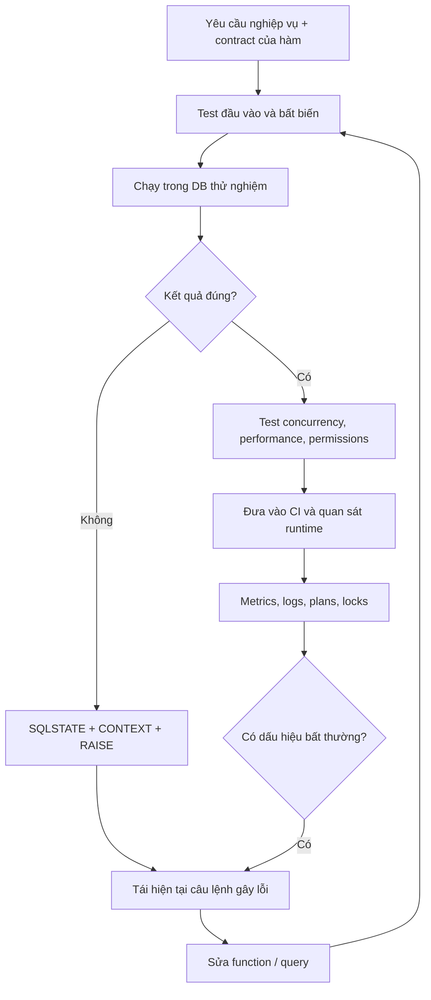

# Kiểm thử, quan sát và gỡ lỗi hàm PL/pgSQL trong PostgreSQL

Một hàm PL/pgSQL có thể trông đúng khi chạy với một bộ dữ liệu đẹp, nhưng thất bại khi **đầu vào NULL**, một hàng không tồn tại, có nhiều hàng ngoài dự kiến, hai phiên đồng thời cùng cập nhật hoặc một câu SQL bên trong hàm chậm trên dữ liệu thật. Vì thế, viết xong `CREATE FUNCTION` chưa phải là hoàn thành công việc: cần **kiểm thử hành vi, quan sát khi chạy và có phương pháp gỡ lỗi có thể lặp lại**.

Trong PostgreSQL, ba hoạt động này có vai trò khác nhau:

- **Kiểm thử (*testing*):** cho hàm những đầu vào và trạng thái dữ liệu đã biết, khẳng định kết quả hoặc lỗi mong đợi, kiểm tra các thay đổi trong database.
- **Quan sát (*observability*):** theo dõi các lần gọi thật, thời gian, số hàng bị tác động, thông báo, lock, wait, truy vấn bên trong và mức độ sử dụng tài nguyên.
- **Gỡ lỗi (*debugging*):** xác định nguyên nhân khi kết quả, SQLSTATE, thứ tự thực thi hoặc hiệu năng khác với mong muốn; tái hiện lỗi rồi sửa đúng điểm gây ra.

Một số công cụ cốt lõi:

```sql
-- Thông báo và lỗi từ PL/pgSQL:
RAISE NOTICE 'account_id=%', account_id;
RAISE EXCEPTION 'invalid amount: %', amount;

-- Chẩn đoán câu SQL vừa chạy:
GET DIAGNOSTICS affected_rows = ROW_COUNT;

-- Chẩn đoán lỗi bên trong EXCEPTION handler:
GET STACKED DIAGNOSTICS
    error_code = RETURNED_SQLSTATE,
    error_message = MESSAGE_TEXT,
    error_context = PG_EXCEPTION_CONTEXT;

-- Kiểm tra bất biến khi chạy test/debug:
ASSERT expected_condition, 'assertion failed';
```

Những đoạn trên là **các mệnh đề trong thân PL/pgSQL**, không phải câu SQL độc lập có thể chạy trực tiếp bên ngoài function/`DO`.

Bài học xây dựng một hệ thống chuyển tiền giả lập, từ đó diễn giải `RAISE`, `ASSERT`, `FOUND`, `GET DIAGNOSTICS`, `GET STACKED DIAGNOSTICS`, `SELECT INTO STRICT`, transaction rollback, catalog, `pg_stat_activity`, `pg_stat_user_functions`, `pg_stat_statements`, `auto_explain`, JDBC, kiểm thử đồng thời, bảo mật log và quy trình điều tra sự cố.

> **Phạm vi:** các ví dụ sử dụng một schema thử nghiệm riêng. Không chạy hàm thay đổi dữ liệu, `EXPLAIN ANALYZE` trên hàm có tác dụng phụ, bật logging chi tiết toàn hệ thống hoặc điều chỉnh cấu hình production chỉ để học.

## 1. Mục tiêu học tập

Sau bài học, bạn có thể:

1. Phân biệt lỗi cú pháp, lỗi biên dịch PL/pgSQL, lỗi SQL lúc chạy, lỗi nghiệp vụ và lỗi concurrency.
2. Thiết kế test cho **đầu vào, kết quả trả về, thay đổi hàng, SQLSTATE và rollback**.
3. Dùng transaction/rollback, savepoint và exception block để cô lập các ca kiểm thử.
4. Dùng `RAISE DEBUG/NOTICE/WARNING/EXCEPTION` với message an toàn và nhất quán.
5. Hiểu `client_min_messages`, logging phía server và khác biệt giữa thông báo client với audit bền vững.
6. Dùng `ASSERT` để tìm lỗi giả định trong quá trình phát triển nhưng không thay validation nghiệp vụ.
7. Dùng `FOUND` và `GET DIAGNOSTICS ... ROW_COUNT` đúng thời điểm.
8. Dùng `SELECT INTO STRICT` và xử lý `NO_DATA_FOUND`, `TOO_MANY_ROWS`.
9. Bắt lỗi bằng `EXCEPTION`, đọc `SQLSTATE`, `SQLERRM` và `GET STACKED DIAGNOSTICS`, rồi `RAISE;` lại lỗi khi cần.
10. Đọc ngữ cảnh thực thi với `PG_CONTEXT` và `PG_EXCEPTION_CONTEXT`.
11. Phân biệt **subtransaction** của exception block với COMMIT/ROLLBACK ở client.
12. Quan sát thời gian, số lần gọi và các query bên trong function bằng công cụ phù hợp.
13. Đọc `pg_stat_activity`, `pg_locks` và `pg_blocking_pids` khi hàm chờ khóa.
14. Biết `EXPLAIN SELECT my_function(...)` chưa đủ để nhìn mọi SQL thực thi bên trong PL/pgSQL.
15. Hiểu plan caching, parameter-sensitive queries và SQL động trong function.
16. Tạo test điều kiện biên và test hai phiên đồng thời để bắt lost update/deadlock.
17. Kiểm thử qua Java/JDBC và nhận diện lỗi theo SQLSTATE, không parse chuỗi thông báo.
18. Hiểu công cụ tùy chọn như `pgTAP`, `plpgsql_check`, profiler/debugger và giới hạn triển khai.
19. Xây checklist quan sát và runbook khi một function sai kết quả hoặc chậm.

## 2. Bức tranh toàn diện: từ yêu cầu đến bằng chứng



Một function được kiểm thử tốt cần có **bằng chứng** thay vì chỉ dựa vào cảm giác “chạy SELECT thấy không lỗi”:

| Vấn đề | Bằng chứng phù hợp |
| --- | --- |
| Giá trị trả về đúng | Assertion so với expected result |
| Dữ liệu cập nhật đúng | Kiểm tra các hàng trước/sau và tổng bất biến |
| Đầu vào sai bị từ chối | SQLSTATE, không có side effect ngoài mong đợi |
| Transaction lỗi được rollback | Snapshot dữ liệu sau rollback |
| Đúng khi hai phiên gọi đồng thời | Concurrency test, kết quả và lock behavior |
| Chậm ở đâu | Timings, nested SQL plans, wait events |
| Có bị gọi quá nhiều lần không | Metrics/counters/statistics tương ứng |
| Bắt được lỗi có đủ ngữ cảnh không | Exception diagnostics, correlation ID, redaction |
| Có tái hiện được không | Fixtures, phiên bản schema, input, isolation, plan/config |

## 3. Các loại lỗi trong hàm PL/pgSQL

### 3.1. Lỗi định nghĩa hoặc cú pháp

Ví dụ thiếu `END IF;` trong `IF` hoặc sai cú pháp `DECLARE`. PostgreSQL có thể báo khi tạo function hoặc khi đường thực thi/SQL statement liên quan được biên dịch/chạy.

### 3.2. Lỗi về đối tượng và kiểu dữ liệu

Ví dụ tên cột đổi, bảng bị drop hoặc expression chuyển kiểu không hợp lệ. Một số lỗi chỉ lộ ra khi câu SQL bên trong function thực sự được thực thi.

### 3.3. Lỗi nghiệp vụ

Ví dụ chuyển số tiền âm, tài khoản không tồn tại, thiếu số dư, chuyển cho chính mình. Các lỗi này nên có validation và mã lỗi có thể nhận diện.

### 3.4. Lỗi truy vấn không đúng số hàng

`SELECT INTO` không `STRICT` có thể bỏ qua nhiều row và lấy một row đầu tiên không bảo đảm thứ tự nếu thiếu `ORDER BY`. Khi contract yêu cầu đúng một hàng, nên dùng `INTO STRICT` hoặc kiểm tra rõ.

### 3.5. Lỗi concurrency và transaction

Ví dụ:

- Deadlock khi các transaction khóa tài nguyên theo thứ tự khác nhau.
- Serialization failure ở isolation phù hợp.
- Lock timeout.
- Đọc dữ liệu bị thay đổi giữa các statement.
- Retry không idempotent gây ghi lặp.

### 3.6. Lỗi hiệu năng

Function trả kết quả đúng nhưng:

- Gọi SQL bên trong loop hàng chục nghìn lần.
- Thiếu index.
- Kế hoạch generic không phù hợp một bộ tham số.
- Chờ row/table lock.
- Dùng exception handler thay cho nhánh điều kiện thường xuyên.
- Ghi NOTICE quá nhiều.

**Phải phân biệt lỗi correctness và lỗi performance**: một query chậm không nhất thiết sai, và một query rất nhanh vẫn có thể ghi sai dữ liệu.

## 4. Thiết lập schema thử nghiệm an toàn

Ví dụ xuyên suốt là một hệ thống chuyển tiền trong **database học tập**. Mục đích là minh họa behavior của PostgreSQL; không dùng trực tiếp làm lõi nghiệp vụ tài chính production.

### 4.1. Tạo schema

```sql
CREATE SCHEMA IF NOT EXISTS plpgsql_debug_lab;
```

### 4.2. Tạo bảng tài khoản

```sql
CREATE TABLE plpgsql_debug_lab.accounts (
    account_id bigint PRIMARY KEY,
    owner_label text NOT NULL,
    balance numeric(14, 2) NOT NULL
        CHECK (balance >= 0),
    updated_at timestamptz NOT NULL DEFAULT now()
);
```

### 4.3. Tạo bảng ghi giao dịch thành công

```sql
CREATE TABLE plpgsql_debug_lab.transfers (
    transfer_id bigint GENERATED ALWAYS AS IDENTITY PRIMARY KEY,
    source_account_id bigint NOT NULL
        REFERENCES plpgsql_debug_lab.accounts(account_id),
    destination_account_id bigint NOT NULL
        REFERENCES plpgsql_debug_lab.accounts(account_id),
    amount numeric(14, 2) NOT NULL CHECK (amount > 0),
    created_at timestamptz NOT NULL DEFAULT clock_timestamp(),
    CHECK (source_account_id <> destination_account_id)
);
```

### 4.4. Tạo dữ liệu mẫu

```sql
INSERT INTO plpgsql_debug_lab.accounts
    (account_id, owner_label, balance)
VALUES
    (1, 'Account A', 1000.00),
    (2, 'Account B', 500.00),
    (3, 'Account C', 0.00);
```

Tổng số dư ba tài khoản là **1.500,00**. Trong các test chỉ chuyển tiền nội bộ, **tổng số dư phải giữ nguyên**. Đây là một invariant hữu ích để kiểm thử.

### 4.5. Xem trạng thái đầu vào

```sql
SELECT account_id, owner_label, balance
FROM plpgsql_debug_lab.accounts
ORDER BY account_id;

SELECT COUNT(*) AS transfer_count
FROM plpgsql_debug_lab.transfers;
```

Nếu bạn đã chạy những thí nghiệm có COMMIT, dữ liệu thực tế sẽ khác. Các ca test bên dưới thường dùng `BEGIN ... ROLLBACK` để tránh gây nhiễu cho lần học tiếp theo.

## 5. Viết hàm chuyển tiền có contract rõ ràng

Hàm mẫu:

```sql
CREATE FUNCTION plpgsql_debug_lab.transfer_money(
    p_from_id bigint,
    p_to_id bigint,
    p_amount numeric
)
RETURNS bigint
LANGUAGE plpgsql
VOLATILE
CALLED ON NULL INPUT
PARALLEL UNSAFE
AS $func$
DECLARE
    v_balance numeric(14, 2);
    v_rows bigint;
    v_transfer_id bigint;
    v_id bigint;
BEGIN
    -- 1. Validate input. Không STRICT vì muốn báo lỗi cụ thể.
    IF p_from_id IS NULL
       OR p_to_id IS NULL
       OR p_amount IS NULL
       OR p_amount <= 0
    THEN
        RAISE EXCEPTION USING
            ERRCODE = '22023',
            MESSAGE = 'Invalid transfer parameters';
    END IF;

    IF p_from_id = p_to_id THEN
        RAISE EXCEPTION USING
            ERRCODE = '22023',
            MESSAGE = 'Source and destination must differ';
    END IF;

    -- 2. Khóa theo thứ tự ID để giảm nguy cơ deadlock.
    FOR v_id IN
        SELECT x.account_id
        FROM (
            VALUES (p_from_id), (p_to_id)
        ) AS x(account_id)
        ORDER BY x.account_id
    LOOP
        PERFORM 1
        FROM plpgsql_debug_lab.accounts AS a
        WHERE a.account_id = v_id
        FOR UPDATE;

        IF NOT FOUND THEN
            RAISE EXCEPTION USING
                ERRCODE = 'PZ002',
                MESSAGE = 'Account does not exist';
        END IF;
    END LOOP;

    -- 3. Kiểm tra số dư sau khi đã khóa hai tài khoản.
    SELECT a.balance
    INTO STRICT v_balance
    FROM plpgsql_debug_lab.accounts AS a
    WHERE a.account_id = p_from_id;

    IF v_balance < p_amount THEN
        RAISE EXCEPTION USING
            ERRCODE = 'PZ001',
            MESSAGE = 'Insufficient funds';
    END IF;

    -- 4. Trừ tiền; kiểm tra chính xác số hàng cập nhật.
    UPDATE plpgsql_debug_lab.accounts
    SET balance = balance - p_amount,
        updated_at = clock_timestamp()
    WHERE account_id = p_from_id;

    GET DIAGNOSTICS v_rows = ROW_COUNT;

    IF v_rows <> 1 THEN
        RAISE EXCEPTION 'Unexpected source update count: %',
            v_rows;
    END IF;

    -- 5. Cộng tiền.
    UPDATE plpgsql_debug_lab.accounts
    SET balance = balance + p_amount,
        updated_at = clock_timestamp()
    WHERE account_id = p_to_id;

    GET DIAGNOSTICS v_rows = ROW_COUNT;

    IF v_rows <> 1 THEN
        RAISE EXCEPTION 'Unexpected destination update count: %',
            v_rows;
    END IF;

    -- 6. Ghi nhận giao dịch thành công trong cùng transaction.
    INSERT INTO plpgsql_debug_lab.transfers (
        source_account_id,
        destination_account_id,
        amount
    )
    VALUES (p_from_id, p_to_id, p_amount)
    RETURNING transfer_id INTO v_transfer_id;

    RETURN v_transfer_id;
END;
$func$;
```

### 5.1. Contract của hàm

| Điều kiện | Kết quả kỳ vọng |
| --- | --- |
| Hai tài khoản tồn tại; số tiền dương; đủ số dư | Chuyển tiền thành công, trả `transfer_id` |
| Số tiền `NULL`, 0 hoặc âm | Lỗi `22023`, không chuyển tiền |
| ID tài khoản `NULL` hoặc trùng nhau | Lỗi `22023` |
| Một tài khoản không tồn tại | Lỗi tùy chỉnh `PZ002` |
| Số dư không đủ | Lỗi tùy chỉnh `PZ001` |
| Update không đúng một hàng | Lỗi bất biến, không commit giao dịch lỗi |
| Bất kỳ statement nào thất bại | Các thay đổi của lời gọi thất bại không được commit |

### 5.2. Vì sao VOLATILE và PARALLEL UNSAFE?

Hàm ghi bảng `accounts` và `transfers`. Nó không thể là STABLE hoặc IMMUTABLE, và không an toàn khi chạy bên trong parallel worker.

### 5.3. Vì sao không STRICT?

Nếu chọn `STRICT`, PostgreSQL có thể trả `NULL` ngay khi bất kỳ input là NULL và **không chạy validation**. Ở đây business yêu cầu báo lỗi có SQLSTATE 22023, nên ta dùng `CALLED ON NULL INPUT` và kiểm tra tường minh.

### 5.4. Vì sao khóa theo thứ tự?

Hai phiên chuyển tiền 1 → 2 và 2 → 1 có thể tranh chấp cùng hai row. Nếu một phiên khóa row 1 trước và phiên kia khóa row 2 trước, nguy cơ deadlock tăng. Hàm cố gắng khóa account theo thứ tự account_id tăng dần.

Đây là một kỹ thuật giảm nguy cơ deadlock **trong phạm vi những đường ghi tuân thủ cùng thứ tự**. Nó không bảo đảm toàn hệ thống không bao giờ deadlock nếu còn code khác khóa các bảng/hàng theo thứ tự khác.

### 5.5. Vì sao hàm không COMMIT?

`CREATE FUNCTION` PL/pgSQL được gọi như một expression trong statement. Hàm không tùy ý điều khiển transaction bằng `COMMIT/ROLLBACK` như code ở client. Ứng dụng/transaction manager quyết định commit lời gọi. Các thủ tục gọi bằng `CALL` có quy tắc quản lý transaction riêng trong những ngữ cảnh được phép.

## 6. Kiểm thử đường thành công với transaction và rollback

Mục tiêu: chuyển 125 từ A sang B, xác minh:

- A: 1000 → 875.
- B: 500 → 625.
- C: giữ 0.
- Tổng A+B+C: vẫn 1500.
- Có một row trong `transfers` trong transaction.

```sql
BEGIN;

SELECT plpgsql_debug_lab.transfer_money(
    1, 2, 125.00
) AS new_transfer_id;

SELECT
    account_id,
    balance
FROM plpgsql_debug_lab.accounts
ORDER BY account_id;

SELECT SUM(balance) AS invariant_total_balance
FROM plpgsql_debug_lab.accounts;

SELECT
    transfer_id,
    source_account_id,
    destination_account_id,
    amount
FROM plpgsql_debug_lab.transfers
ORDER BY transfer_id DESC
LIMIT 1;

ROLLBACK;
```

### 6.1. ROLLBACK giúp gì?

Thao tác chuyển tiền và INSERT vào `transfers` nằm trong cùng transaction, nên `ROLLBACK` hoàn tác những thay đổi row của transaction. Các test sau có thể bắt đầu từ dữ liệu mẫu.

### 6.2. ROLLBACK không hoàn tác mọi thứ

Các giá trị được cấp bởi sequence/identity thường **không được hoàn lại** khi transaction rollback. Vì vậy lần test sau có thể trả `transfer_id` lớn hơn dù bảng `transfers` không giữ bản ghi test trước.

Không viết assertion “transfer_id luôn bằng 1” sau nhiều lần rollback. Hãy kiểm tra ID hợp lệ và tham chiếu đúng hàng mới trong transaction.

### 6.3. Không chỉ kiểm tra hàm trả ID

Một hàm lỗi có thể trả ID nhưng trừ tiền hai lần, không cộng tiền hoặc ghi sai người nhận. Test phải nhìn vào **trạng thái dữ liệu và invariant**, không chỉ return value.

## 7. Kiểm thử đầu vào sai và SQLSTATE

PostgreSQL cung cấp mã SQLSTATE dài năm ký tự để phân loại lỗi mà không phụ thuộc hoàn toàn vào nội dung tiếng Anh của thông báo.

Ví dụ test số tiền không hợp lệ:

```sql
BEGIN;

SELECT plpgsql_debug_lab.transfer_money(
    1, 2, -10.00
);

-- Câu trên dự kiến lỗi 22023.
-- Sau lỗi hãy ROLLBACK trong client.
ROLLBACK;
```

Một phiên PostgreSQL sau lỗi statement trong transaction có thể ở trạng thái aborted. Bạn phải `ROLLBACK` hoặc rollback về savepoint phù hợp trước khi thực thi các truy vấn thông thường khác.

### 7.1. SQLSTATE trong lab

| SQLSTATE | Ý nghĩa trong ví dụ |
| --- | --- |
| `22023` | Invalid parameter value |
| `PZ001` | Mã nghiệp vụ do lab chọn: thiếu số dư |
| `PZ002` | Mã nghiệp vụ do lab chọn: không tìm thấy account |
| `23514` | Check violation của constraint bảng |
| `23505` | Unique violation |
| `23503` | Foreign-key violation |
| `40P01` | Deadlock detected |
| `40001` | Serialization failure |
| `55P03` | Lock not available, ví dụ liên quan lock timeout |
| `P0002` | NO_DATA_FOUND từ PL/pgSQL `INTO STRICT` |
| `P0003` | TOO_MANY_ROWS từ PL/pgSQL `INTO STRICT` |

`PZ001` và `PZ002` là **mã lỗi tự đặt của bài lab**, không phải lỗi PostgreSQL built-in.

### 7.2. Chọn mã tùy chỉnh thế nào?

PostgreSQL cho phép nêu SQLSTATE tùy chỉnh gồm năm chữ số/chữ cái phù hợp. Không dùng `00000` (thành công) hoặc mã kết thúc bằng ba chữ số 0 như một mã tình huống cụ thể vì nó có thể biểu thị lớp lỗi.

Với ứng dụng lớn, nên có **bảng quy ước mã lỗi** và ổn định qua migration. Không dùng chung một code cho nhiều tình huống mà client phải xử lý khác nhau.

## 8. Test lỗi mong đợi mà không làm hỏng toàn phiên

Trong PL/pgSQL, một khối `BEGIN ... EXCEPTION ... END` có thể bắt lỗi của một khối con. Ta dùng cách này để khẳng định hàm thực sự ném lỗi mong đợi.

```sql
DO $test$
DECLARE
    v_state text;
    v_message text;
BEGIN
    BEGIN
        PERFORM plpgsql_debug_lab.transfer_money(
            1, 2, -10.00
        );

        -- Nếu không có lỗi, test phải thất bại.
        RAISE EXCEPTION 'TEST FAILED: expected SQLSTATE 22023';

    EXCEPTION
        WHEN SQLSTATE '22023' THEN
            GET STACKED DIAGNOSTICS
                v_state = RETURNED_SQLSTATE,
                v_message = MESSAGE_TEXT;

            RAISE NOTICE 'EXPECTED ERROR: state=%, message=%',
                v_state, v_message;
    END;
END;
$test$;
```

Nếu hàm ném `22023`, nhánh handler xác nhận lỗi và in thông báo. Nếu không ném lỗi, lệnh `RAISE EXCEPTION 'TEST FAILED...'` tạo mã lỗi khác nên **không bị nhánh `WHEN SQLSTATE '22023'` nuốt mất**.

### 8.1. Đừng bắt WHEN OTHERS rồi luôn PASS

Sai:

```sql
EXCEPTION WHEN OTHERS THEN
    RAISE NOTICE 'PASS';
```

Đoạn này có thể che giấu lỗi hoàn toàn không liên quan: permission denied, missing table, division by zero hoặc lỗi code mới.

Trong test, **chỉ bắt lỗi đúng kỳ vọng**; lỗi khác phải được truyền ra để test thất bại.

### 8.2. Handler không phải bằng chứng trạng thái dữ liệu

Ngay cả khi đúng SQLSTATE, nên kiểm tra bảng `accounts` và `transfers` không đổi ngoài mong muốn. Với hàm có nhiều câu DML, trạng thái rollback là phần quan trọng của contract.

## 9. Ghi assertion trực tiếp bằng DO

Nếu không dùng framework test, `DO` có thể thực thi assertions đơn giản:

```sql
BEGIN;

DO $test$
DECLARE
    v_before numeric;
    v_after numeric;
    v_transfer_id bigint;
BEGIN
    SELECT SUM(balance) INTO v_before
    FROM plpgsql_debug_lab.accounts;

    v_transfer_id :=
        plpgsql_debug_lab.transfer_money(1, 2, 125.00);

    SELECT SUM(balance) INTO v_after
    FROM plpgsql_debug_lab.accounts;

    IF v_transfer_id IS NULL THEN
        RAISE EXCEPTION 'TEST FAILED: missing transfer_id';
    END IF;

    IF v_before IS DISTINCT FROM v_after THEN
        RAISE EXCEPTION
            'TEST FAILED: sum before %, after %',
            v_before, v_after;
    END IF;

    RAISE NOTICE 'PASS: total balance preserved';
END;
$test$;

ROLLBACK;
```

### 9.1. IS DISTINCT FROM tránh vấn đề NULL

`a <> b` trả UNKNOWN nếu một bên NULL. `a IS DISTINCT FROM b` so sánh có semantics rõ với NULL, hữu ích cho assertions.

### 9.2. Test không được chỉ kiểm tra invariant quá yếu

Tổng số dư không đổi **chưa đủ**: một hàm sai có thể trừ từ A rồi cộng vào C thay vì B mà tổng vẫn 1500. Cần thêm assertions từng account và row ghi giao dịch.

### 9.3. Dùng vòng test nhỏ, độc lập

Một test nạp fixture riêng, chạy một tình huống, xác minh kết quả rồi rollback/cleanup sẽ dễ gỡ lỗi hơn một test khổng lồ phụ thuộc kết quả của 30 test trước.

## 10. EXCEPTION block hoạt động như một subtransaction

Trong PL/pgSQL, khi một khối có `EXCEPTION` bắt lỗi, **các thay đổi database thực hiện bên trong khối đó được hoàn tác** trước khi chạy handler. Tuy nhiên, giá trị **biến PL/pgSQL** có thể giữ trạng thái được gán trước lỗi.

Thử:

```sql
DO $block$
DECLARE
    v_counter integer := 0;
    v_balance_before numeric;
    v_balance_after numeric;
BEGIN
    SELECT balance INTO v_balance_before
    FROM plpgsql_debug_lab.accounts
    WHERE account_id = 1;

    BEGIN
        v_counter := 1;

        UPDATE plpgsql_debug_lab.accounts
        SET balance = balance - 20
        WHERE account_id = 1;

        RAISE EXCEPTION 'Simulated failure';

    EXCEPTION WHEN OTHERS THEN
        SELECT balance INTO v_balance_after
        FROM plpgsql_debug_lab.accounts
        WHERE account_id = 1;

        RAISE NOTICE
            'counter=%, balance before=%, balance after=%',
            v_counter, v_balance_before, v_balance_after;
    END;
END;
$block$;
```

Kỳ vọng:

- `v_counter=1` còn được giữ.
- Thay đổi row balance trong inner block được rollback.
- `v_balance_after = v_balance_before`.

### 10.1. Tại sao có ích?

Điều này giải thích vì sao bạn có thể:

- Bắt lỗi một thao tác trong function.
- Thu thập SQLSTATE/context.
- Tiếp tục xử lý những phần bên ngoài inner block khi đó là hành vi được thiết kế.

### 10.2. Không nên dùng EXCEPTION như vòng lặp bình thường

Exception block tạo chi phí quản lý subtransaction và làm logic khó theo dõi hơn. Đừng dùng `EXCEPTION WHEN OTHERS` thay cho `IF` trong luồng dữ liệu bình thường.

### 10.3. Không phải mọi side effect đều rollback

Sequence increments, thông báo gửi ra client và các tác động ngoài database không được hoàn tác theo cùng cách với UPDATE rows. Nếu trigger/extension gọi API ngoài hoặc gửi thông báo, phải xét side effect riêng.

## 11. RAISE: công cụ quan sát cơ bản trong PL/pgSQL

PL/pgSQL không có `console.log` hay `print` giống JavaScript/Python. Để báo thông tin, dùng `RAISE`:

```sql
RAISE DEBUG 'Checking row %', v_id;
RAISE LOG 'Transfer flow reached stage %', stage_name;
RAISE INFO 'Processed % rows', v_rows;
RAISE NOTICE 'Balance before=%', v_balance;
RAISE WARNING 'Unexpected optional value: %', v_value;
RAISE EXCEPTION 'Invalid state for account %', p_from_id;
```

### 11.1. Phân biệt mức độ

| Mức | Cách sử dụng thường gặp |
| --- | --- |
| `DEBUG` | Dấu vết chi tiết khi gỡ lỗi |
| `LOG` | Thông tin log backend theo cấu hình |
| `INFO` | Thông tin hoạt động cho người gọi |
| `NOTICE` | Thông báo không làm statement thất bại |
| `WARNING` | Cảnh báo về trạng thái đáng chú ý |
| `EXCEPTION` | Ném lỗi, làm nhánh bình thường dừng |

Không dùng `RAISE EXCEPTION` cho log vô hại: nó thay đổi luồng điều khiển và transaction behavior.

### 11.2. Placeholder trong RAISE

```sql
RAISE NOTICE 'Account %, amount %, stage %',
    p_from_id, p_amount, 'validated';
```

Dấu `%` trong format string là chỗ đưa argument vào. Muốn in một dấu phần trăm literal trong format, dùng `%%` theo cú pháp RAISE.

### 11.3. Đừng nối SQL string chỉ để log

```sql
RAISE NOTICE 'processed id=% status=%', v_id, v_status;
```

dễ đọc hơn concat nhiều đoạn. Nếu dữ liệu có bí mật (token, PII, số tài khoản thực), cần **ẩn hoặc hạn chế giá trị** chứ không log nguyên văn.

## 12. client_min_messages và log_min_messages

Một thông báo `RAISE NOTICE` có thể được gửi đến client nếu cấu hình thông báo cho phép. PostgreSQL có những GUC khác nhau:

- `client_min_messages`: điều khiển mức thông báo gửi về client.
- `log_min_messages`: điều khiển mức thông báo được ghi vào server log.

Ví dụ trong session lab:

```sql
SHOW client_min_messages;

SET client_min_messages = NOTICE;

DO $$
BEGIN
    RAISE DEBUG 'debug only';
    RAISE NOTICE 'notice visible when allowed';
    RAISE WARNING 'warning example';
END;
$$;

RESET client_min_messages;
```

### 12.1. Không mặc định NOTICE sẽ có trong server log

Việc một client nhìn thấy NOTICE **không chứng minh** server log đang ghi NOTICE. Cấu hình và môi trường log backend khác nhau.

### 12.2. Không bật DEBUG toàn hệ thống để điều tra một lời gọi

Tăng mức log chi tiết trên production có thể:

- Tạo lượng log khổng lồ.
- Làm tăng I/O và CPU.
- Lộ tham số hoặc thông tin nhạy cảm.
- Khiến sự cố hiệu năng trầm trọng hơn.

Ưu tiên thay đổi **có phạm vi session/role/đường gọi**, thời hạn rõ, được phê duyệt và có kế hoạch tắt lại.

### 12.3. Thông báo không phải audit log tin cậy

Một NOTICE gửi tới client không tương đương với một sự kiện audit có durability, retention và exactly-once semantics. Audit cần thiết kế riêng theo yêu cầu pháp lý/nghiệp vụ.

## 13. ASSERT: phát hiện bất biến trong quá trình phát triển

PL/pgSQL hỗ trợ:

```sql
ASSERT boolean_condition, 'explanation';
```

Ví dụ:

```sql
CREATE FUNCTION plpgsql_debug_lab.nonnegative_double(
    p_value numeric
)
RETURNS numeric
LANGUAGE plpgsql
IMMUTABLE
AS $$
DECLARE
    v_result numeric;
BEGIN
    v_result := p_value * 2;
    ASSERT v_result >= 0, 'Result must be nonnegative';
    RETURN v_result;
END;
$$;
```

Nếu truyền giá trị âm, assertion có thể phát hiện giả định không đúng khi assertions đang bật.

### 13.1. ASSERT không thay validation input

`plpgsql.check_asserts` có thể điều khiển việc đánh giá assertions trong PL/pgSQL. Vì có thể tắt, **không dùng ASSERT để cưỡng chế quy tắc kinh doanh hoặc kiểm tra quyền bảo mật**.

Đối với hàm chuyển tiền, điều kiện `p_amount > 0` phải được kiểm tra bằng `IF ... RAISE EXCEPTION` hoặc constraints phù hợp, không chỉ ASSERT.

### 13.2. Bật/tắt trong môi trường test

```sql
SHOW plpgsql.check_asserts;
```

Việc thay đổi setting phụ thuộc quyền, version và chính sách hệ thống. Không dựa vào giá trị mặc định trong mọi môi trường; kiểm thử phải xác nhận assertions đang hoạt động khi bạn dùng chúng để debug.

### 13.3. ASSERT và NULL

Một biểu thức logic có kết quả không TRUE có thể khiến assertion thất bại khi được kiểm tra. Nếu NULL có ý nghĩa nghiệp vụ riêng, viết điều kiện rõ ràng thay vì mong SQL tự coi NULL là FALSE trong mọi ngữ cảnh.

## 14. Ghi thời gian bằng clock_timestamp()

Để đo thời gian thực trôi qua **trong một lời gọi**, dùng `clock_timestamp()`, không chỉ `now()`.

```sql
CREATE FUNCTION plpgsql_debug_lab.debug_wait(
    p_delay_seconds numeric
)
RETURNS numeric
LANGUAGE plpgsql
VOLATILE
AS $$
DECLARE
    v_started timestamptz := clock_timestamp();
    v_elapsed_ms numeric;
BEGIN
    IF p_delay_seconds IS NULL
       OR p_delay_seconds < 0
       OR p_delay_seconds > 1
    THEN
        RAISE EXCEPTION 'Delay must be between 0 and 1 second';
    END IF;

    PERFORM pg_sleep(p_delay_seconds::double precision);

    v_elapsed_ms :=
        EXTRACT(EPOCH FROM
            (clock_timestamp() - v_started)) * 1000;

    RAISE NOTICE 'debug_wait elapsed_ms=%', v_elapsed_ms;
    RETURN v_elapsed_ms;
END;
$$;
```

Thử trên database học tập:

```sql
SELECT plpgsql_debug_lab.debug_wait(0.05);
```

### 14.1. Vì sao không dùng now() để đo đoạn code?

`now()` là transaction timestamp. Trong cùng transaction, `now() - now()` thường bằng 0 dù function đã chạy một lúc.

`clock_timestamp()` lấy đồng hồ tại thời điểm gọi nên phù hợp hơn để đo wall-clock elapsed time.

### 14.2. Đo thời gian không đồng nghĩa tìm nguyên nhân chậm

Elapsed 500 ms có thể gồm:

- Chạy CPU.
- Chờ lock.
- Đọc đĩa.
- Chờ network/FDW.
- Chờ worker hoặc I/O.

Cần phối hợp `pg_stat_activity`, query plan, buffers và stats để xác định thời gian đi đâu.

### 14.3. Tránh log từng row trong loop lớn

Nếu một function xử lý 100.000 rows và RAISE NOTICE từng row, chính logging có thể trở thành bottleneck. Ưu tiên log **theo giai đoạn**, tổng hợp số lượng hoặc sampling.

## 15. FOUND: kết quả của một số câu lệnh vừa thực thi

PL/pgSQL có biến đặc biệt `FOUND` kiểu boolean. Nó phản ánh việc một số loại câu lệnh vừa thực thi có tìm thấy hoặc tác động hàng hay không.

Ví dụ:

```sql
DO $$
DECLARE
    v_balance numeric;
BEGIN
    SELECT balance
    INTO v_balance
    FROM plpgsql_debug_lab.accounts
    WHERE account_id = 1;

    IF FOUND THEN
        RAISE NOTICE 'Account found, balance=%', v_balance;
    ELSE
        RAISE NOTICE 'Account not found';
    END IF;
END;
$$;
```

### 15.1. FOUND có thể bị thay đổi bởi câu lệnh tiếp theo

Sai về mặt ý tưởng:

```sql
SELECT balance INTO v_balance FROM accounts WHERE ...;
PERFORM another_query();
IF FOUND THEN
    -- Không còn chắc FOUND của SELECT đầu tiên.
END IF;
```

Hãy kiểm tra hoặc lưu `FOUND` **ngay sau câu cần quan sát**.

### 15.2. Những câu lệnh thường tác động FOUND

Trong PL/pgSQL, những loại câu lệnh như `SELECT INTO`, `PERFORM`, `INSERT`, `UPDATE`, `DELETE`, một số vòng lặp/`RETURN QUERY` có thể cập nhật FOUND theo semantics tương ứng.

### 15.3. FOUND không phải row count

FOUND chỉ là boolean. Nếu UPDATE hai hàng và bạn kỳ vọng đúng một hàng, FOUND=TRUE **không đủ**. Dùng `GET DIAGNOSTICS ... ROW_COUNT`.

### 15.4. EXECUTE động và FOUND

Một câu `EXECUTE dynamic_command` trong PL/pgSQL **không tự cập nhật FOUND theo cùng cách với một số câu DML tĩnh**. Khi cần số hàng ảnh hưởng bởi SQL động, dùng `GET DIAGNOSTICS ... ROW_COUNT` ngay sau `EXECUTE`.

## 16. GET DIAGNOSTICS ROW_COUNT: số hàng tác động

Sau DML:

```sql
UPDATE plpgsql_debug_lab.accounts
SET updated_at = clock_timestamp()
WHERE account_id = p_from_id;

GET DIAGNOSTICS v_rows = ROW_COUNT;
```

`ROW_COUNT` phản ánh số hàng được xử lý bởi câu SQL liên quan gần nhất. Biến nhận nên phù hợp kiểu `bigint`.

### 16.1. Khác FOUND

| Kết quả UPDATE | FOUND | ROW_COUNT |
| --- | --- | ---: |
| 0 hàng | FALSE | 0 |
| 1 hàng | TRUE | 1 |
| 5 hàng | TRUE | 5 |

Nếu contract bắt buộc **đúng một hàng**:

```sql
IF v_rows <> 1 THEN
    RAISE EXCEPTION 'Expected one updated row, got %', v_rows;
END IF;
```

### 16.2. Lấy ROW_COUNT ngay sau lệnh cần đo

Không chèn một câu SQL khác rồi mới lấy ROW_COUNT, vì giá trị chẩn đoán có thể phản ánh câu gần nhất thay vì câu bạn muốn kiểm tra.

### 16.3. UPDATE 0 rows không tự tạo exception

`UPDATE ... WHERE account_id=9999` có thể thành công về mặt SQL và ảnh hưởng **0 rows**. Nếu nghiệp vụ yêu cầu account tồn tại, phải kiểm tra ROW_COUNT hoặc dùng một cách xác minh khác.

## 17. SELECT INTO và SELECT INTO STRICT

Trong PL/pgSQL:

```sql
SELECT balance
INTO v_balance
FROM plpgsql_debug_lab.accounts
WHERE account_id = p_from_id;
```

đặt kết quả vào biến.

Nếu query không trả hàng, biến có thể nhận NULL và `FOUND=FALSE`. Nếu query trả nhiều hàng, `SELECT INTO` không STRICT có thể lấy một row đầu tiên, **không bảo đảm row nào nếu không có ORDER BY phù hợp**.

### 17.1. Khi contract yêu cầu đúng một hàng

```sql
SELECT balance
INTO STRICT v_balance
FROM plpgsql_debug_lab.accounts
WHERE account_id = p_from_id;
```

`INTO STRICT` yêu cầu **đúng một row**:

- 0 row → `NO_DATA_FOUND`, SQLSTATE `P0002`.
- Hơn 1 row → `TOO_MANY_ROWS`, SQLSTATE `P0003`.
- Đúng 1 row → gán dữ liệu, `FOUND=TRUE`.

### 17.2. Khóa chính có thể làm TOO_MANY_ROWS không xuất hiện

Query tìm `account_id` trong bảng lab có primary key, nên không thể trả hai row có cùng ID. Để kiểm thử TOO_MANY_ROWS, dùng query theo điều kiện không unique hoặc bảng mẫu khác.

### 17.3. Ví dụ INTO STRICT thất bại

```sql
DO $$
DECLARE
    v_id bigint;
BEGIN
    BEGIN
        SELECT account_id INTO STRICT v_id
        FROM plpgsql_debug_lab.accounts
        WHERE balance >= 0;

        RAISE EXCEPTION 'TEST FAILED: expected TOO_MANY_ROWS';

    EXCEPTION WHEN TOO_MANY_ROWS THEN
        RAISE NOTICE 'EXPECTED TOO_MANY_ROWS';
    END;
END;
$$;
```

Trong lab có ba hàng balance không âm nên câu SELECT trả nhiều rows và nhánh handler chạy.

### 17.4. INTO STRICT không giải quyết mọi vấn đề dữ liệu

Nếu query trả đúng một row nhưng dữ liệu thuộc nhầm tenant, amount âm hoặc role không đủ quyền, INTO STRICT không tự phát hiện. Nó chỉ kiểm tra **số hàng**, không kiểm chứng mọi điều kiện nghiệp vụ.

## 18. plpgsql.print_strict_params: xem tham số gây lỗi

Khi `SELECT INTO STRICT` thất bại, đôi khi cần biết **tham số nào** làm query không trả row hoặc trả quá nhiều rows.

PostgreSQL có tùy chọn:

```sql
SHOW plpgsql.print_strict_params;
```

Trong định nghĩa function có thể sử dụng directive:

```sql
CREATE FUNCTION plpgsql_debug_lab.lookup_account_strict(
    p_account_id bigint
)
RETURNS numeric
LANGUAGE plpgsql
STABLE
AS $$
#print_strict_params on
DECLARE
    v_balance numeric;
BEGIN
    SELECT balance
    INTO STRICT v_balance
    FROM plpgsql_debug_lab.accounts
    WHERE account_id = p_account_id;

    RETURN v_balance;
END;
$$;
```

Thử:

```sql
SELECT plpgsql_debug_lab.lookup_account_strict(9999);
```

Hàm dự kiến báo `NO_DATA_FOUND` và có thể có chi tiết về tham số theo cơ chế `print_strict_params`.

### 18.1. Cẩn trọng với dữ liệu nhạy cảm

Thông tin tham số trong lỗi hoặc server log có thể chứa email, access token, customer ID, dữ liệu tài chính. Không bật logging tham số rộng trên production mà thiếu cơ chế redaction, access control và retention thích hợp.

### 18.2. Directive và GUC

`#print_strict_params on` là directive thuộc mã PL/pgSQL của function; `plpgsql.print_strict_params` là cấu hình liên quan ở mức session/system. Chúng hỗ trợ điều tra `INTO STRICT`, không thay thế contract query và tests.

## 19. EXCEPTION: bắt đúng lỗi, không che giấu lỗi mới

Ví dụ một handler:

```sql
DO $$
BEGIN
    BEGIN
        PERFORM plpgsql_debug_lab.transfer_money(1, 2, 999999.00);
    EXCEPTION
        WHEN SQLSTATE 'PZ001' THEN
            RAISE NOTICE 'Expected business error: insufficient funds';
    END;
END;
$$;
```

Hàm trả error `PZ001` khi số tiền vượt số dư. Handler này bắt đúng lỗi nghiệp vụ để test.

### 19.1. Điều không nên làm

```sql
EXCEPTION WHEN OTHERS THEN
    RETURN NULL;
```

nếu đó không phải contract rõ. Nó có thể biến:

- Permission denied.
- Deadlock/serialization conflict.
- Missing table sau migration.
- Wrong column type.
- Internal programming bug.

thành “hàm trả NULL”, khiến client không biết có sự cố thật.

### 19.2. Bắt cụ thể và truyền tiếp lỗi khác

```sql
EXCEPTION
    WHEN unique_violation THEN
        -- Có thể map một lỗi trùng cụ thể.
        -- Phải xét constraint nào thực sự bị vi phạm.
        RAISE;
    WHEN OTHERS THEN
        -- Ghi ngữ cảnh tối thiểu, sau đó chuyển nguyên lỗi đi.
        RAISE;
```

Ví dụ này chỉ minh họa cấu trúc handler. Nếu không làm gì ngoài `RAISE;`, thường có thể bỏ handler hoàn toàn và để lỗi tự đi lên.

### 19.3. WHEN OTHERS có ngoại lệ riêng

Trong PL/pgSQL, `OTHERS` bắt đa số lỗi nhưng không bao gồm một số điều kiện đặc biệt như `QUERY_CANCELED` và `ASSERT_FAILURE` theo quy tắc tài liệu PostgreSQL. Không coi nó là cam kết “bắt được mọi lỗi dưới mọi hình thức”.

## 20. SQLSTATE và SQLERRM trong handler

Bên trong nhánh `EXCEPTION`, PL/pgSQL cung cấp:

- `SQLSTATE`: mã SQLSTATE của lỗi đang được xử lý.
- `SQLERRM`: thông báo lỗi chính.

Ví dụ:

```sql
DO $$
BEGIN
    BEGIN
        PERFORM plpgsql_debug_lab.transfer_money(
            1, 2, -1
        );
    EXCEPTION WHEN OTHERS THEN
        RAISE NOTICE 'state=%, message=%', SQLSTATE, SQLERRM;
    END;
END;
$$;
```

### 20.1. Hạn chế của chỉ SQLERRM

Một thông báo có thể không chứa:

- Tên constraint.
- Table/schema.
- Detail, hint.
- Chính xác dòng PL/pgSQL hoặc SQL statement bên trong gây lỗi.

Để điều tra sâu hơn, dùng `GET STACKED DIAGNOSTICS`.

### 20.2. Không parse message thay cho SQLSTATE

Thông báo có thể thay đổi theo phiên bản/cấu hình. Dùng SQLSTATE để nhận diện loại lỗi, và chỉ hiển thị message đã được ánh xạ/sanitized khi trả API.

## 21. GET STACKED DIAGNOSTICS: thông tin lỗi đầy đủ

Trong **EXCEPTION handler**, có thể lấy các trường:

- `RETURNED_SQLSTATE`.
- `MESSAGE_TEXT`.
- `PG_EXCEPTION_DETAIL`.
- `PG_EXCEPTION_HINT`.
- `PG_EXCEPTION_CONTEXT`.
- `CONSTRAINT_NAME`, `TABLE_NAME`, `SCHEMA_NAME`, `COLUMN_NAME`, `PG_DATATYPE_NAME` khi lỗi có thông tin tương ứng.

Ví dụ:

```sql
DO $demo$
DECLARE
    v_state text;
    v_message text;
    v_detail text;
    v_hint text;
    v_context text;
BEGIN
    BEGIN
        PERFORM plpgsql_debug_lab.transfer_money(
            1, 2, -10.00
        );

    EXCEPTION WHEN OTHERS THEN
        GET STACKED DIAGNOSTICS
            v_state = RETURNED_SQLSTATE,
            v_message = MESSAGE_TEXT,
            v_detail = PG_EXCEPTION_DETAIL,
            v_hint = PG_EXCEPTION_HINT,
            v_context = PG_EXCEPTION_CONTEXT;

        RAISE NOTICE 'SQLSTATE: %', v_state;
        RAISE NOTICE 'Message : %', v_message;
        RAISE NOTICE 'Detail  : %', v_detail;
        RAISE NOTICE 'Hint    : %', v_hint;
        RAISE NOTICE 'Context : %', v_context;
    END;
END;
$demo$;
```

### 21.1. PG_EXCEPTION_CONTEXT chỉ ra nơi lỗi xảy ra

Giá trị có thể chứa:

```text
PL/pgSQL function ... line ... at RAISE
SQL statement ...
PL/pgSQL function ... line ... at PERFORM
```

Nó rất hữu ích khi function gọi function khác hoặc truy vấn bên trong phát sinh lỗi.

### 21.2. Đây là context của lỗi, không phải stack trace Java

Nó mô tả ngữ cảnh thực thi PostgreSQL/PL/pgSQL tại thời điểm lỗi, không bao gồm toàn bộ call stack của ứng dụng Java hay HTTP request.

Muốn liên hệ request tới lỗi database, application phải giữ **correlation ID/trace ID** ngoài database và truyền context theo thiết kế an toàn.

### 21.3. Không log toàn bộ detail/context cho mọi request

Thông tin lỗi có thể chứa giá trị row, object names hoặc SQL text nhạy cảm. Trong production, cần chính sách dữ liệu log, redaction và quyền truy cập.

## 22. GET DIAGNOSTICS PG_CONTEXT: ngữ cảnh khi đang chạy

`GET DIAGNOSTICS` có thể đọc thông tin thực thi hiện tại, ví dụ:

```sql
CREATE FUNCTION plpgsql_debug_lab.current_context()
RETURNS text
LANGUAGE plpgsql
VOLATILE
AS $$
DECLARE
    v_context text;
BEGIN
    GET DIAGNOSTICS v_context = PG_CONTEXT;
    RETURN v_context;
END;
$$;

SELECT plpgsql_debug_lab.current_context();
```

Phân biệt:

- `PG_CONTEXT`: ngữ cảnh stack **tại chỗ lấy diagnostic**.
- `PG_EXCEPTION_CONTEXT`: ngữ cảnh **nơi lỗi phát sinh**, chỉ dùng trong handler thích hợp.

### 22.1. Vì sao có thể dùng PG_CONTEXT?

Khi trace một đường gọi nhiều function, ngữ cảnh này giúp bạn biết function đang được gọi qua nhánh nào. Nhưng nó không phải profiler đo CPU từng dòng.

### 22.2. Không dựa vào chuỗi context như giao thức máy-máy

Tên hàm, số dòng và format thông báo có thể thay đổi theo migration/phiên bản. Với logging có cấu trúc, nên có fields riêng như operation, trace ID, stage, SQLSTATE thay vì parse stack string làm dữ liệu nghiệp vụ.

## 23. RAISE; để giữ nguyên lỗi gốc

Một kỹ thuật quan trọng:

```sql
EXCEPTION WHEN OTHERS THEN
    -- Lấy thêm diagnostics hoặc ghi thông báo có kiểm soát.
    RAISE;
```

`RAISE;` trong handler **ném lại lỗi đang xử lý**, thay vì tạo lỗi mới không liên quan.

### 23.1. Khi nào cần?

- Muốn thêm context trong log.
- Muốn metrics đếm lỗi.
- Muốn cleanup trạng thái không có side effects trái transaction.
- Nhưng vẫn phải báo lỗi lên caller và giữ nguyên semantics.

### 23.2. Tại sao không viết RAISE EXCEPTION '%', SQLERRM?

Nếu tạo exception mới chỉ với message cũ, bạn có thể mất SQLSTATE, detail, hint hoặc context gốc, khiến việc chẩn đoán và xử lý ở tầng client khó hơn.

### 23.3. Quy tắc nghiệp vụ

Nếu cố ý **map** một lỗi DB sang mã business mới, hãy thiết kế điều đó có chủ đích, lưu nguyên nhân ở log an toàn và kiểm thử contract; không làm như một cách “sửa” mọi lỗi cho gọn.

## 24. Exception handling và biến đã được gán

Trong PL/pgSQL, inner block có EXCEPTION handler tạo một subtransaction cho các thay đổi database, nhưng **biến của function không tự trở về giá trị cũ**.

Ví dụ:

```sql
DO $demo$
DECLARE
    v_stage text := 'start';
BEGIN
    BEGIN
        v_stage := 'after-update';
        UPDATE plpgsql_debug_lab.accounts
        SET balance = balance + 50
        WHERE account_id = 3;

        RAISE EXCEPTION 'simulate failure';
    EXCEPTION WHEN OTHERS THEN
        RAISE NOTICE 'stage variable still=%', v_stage;
    END;

    -- Update bên trong block lỗi đã bị rollback,
    -- nhưng biến v_stage vẫn là after-update.
END;
$demo$;
```

### 24.1. Hệ quả khi retry trong handler

Nếu retry dựa vào biến `v_stage`, bạn phải biết biến đã thay đổi dù rows đã rollback. Một retry sai có thể bỏ qua bước hoặc lặp side effect.

### 24.2. Không dùng EXCEPTION block để commit một phần giao dịch sai

Nếu một lệnh quan trọng thất bại nhưng handler nuốt lỗi, outer transaction có thể tiếp tục. Điều đó chỉ đúng khi nghiệp vụ **chấp nhận** rollback phần inner block và vẫn cho phép phần khác commit.

Với chuyển tiền, không được nuốt lỗi ở bước cộng tiền rồi commit phần trừ tiền.

## 25. Thiết kế test theo ma trận đầu vào

Đối với `transfer_money`, test ít nhất:

| Nhóm | Input | Kỳ vọng |
| --- | --- | --- |
| Thành công | `1 → 2, 125` | A giảm 125, B tăng 125, tạo transfer |
| Biên đủ tiền | `1 → 2, 1000` | A về 0, B tăng 1000 |
| Vượt số dư | `1 → 2, 1000.01` | `PZ001`; dữ liệu không đổi |
| Số tiền 0 | `1 → 2, 0` | `22023` |
| Số tiền âm | `1 → 2, -1` | `22023` |
| NULL amount | `1 → 2, NULL` | `22023` |
| NULL source ID | `NULL → 2` | `22023` |
| NULL destination ID | `1 → NULL` | `22023` |
| Cùng tài khoản | `1 → 1` | `22023` |
| Source không tồn tại | `999 → 2` | `PZ002` |
| Destination không tồn tại | `1 → 999` | `PZ002` |
| Tài khoản có 0 đồng | `3 → 1, 1` | `PZ001` |
| Gọi hai lần liên tiếp | Hai transfer hợp lệ | Tổng bất biến, có hai records |
| Hai session đồng thời | Chuyển ngược chiều | Không mất tiền, có thể chờ lock |

### 25.1. Không test dựa vào thứ tự hàng ngầm định

Khi kiểm tra rows, luôn `ORDER BY` theo khóa nếu test phụ thuộc thứ tự. Không coi thứ tự vật lý heap hay thứ tự kết quả SELECT không ORDER BY là ổn định.

### 25.2. Hạn chế phụ thuộc thời gian thực

Nếu function dùng `now()` hoặc `clock_timestamp()`, test không nên khẳng định timestamp bằng một giá trị cố định. Có thể kiểm tra timestamp nằm trong khoảng trước/sau gọi hoặc tách thời điểm thành tham số để test deterministic.

### 25.3. Ràng buộc dữ liệu phải được kiểm tra sau lỗi

Một test ném đúng `PZ001` chưa đủ nếu trước khi ném đã ghi một audit event sai hoặc thay đổi giá trị trong object ngoài transaction. Hãy xác minh cả database state và những side effects liên quan.

## 26. Thiết kế test dữ liệu cô lập

Một bộ test chạy được nhiều lần nên không phụ thuộc:

- Sequence luôn bắt đầu bằng 1.
- Bảng không có dữ liệu từ test khác.
- Đồng hồ hệ thống tại ngày cố định.
- Các test chạy theo đúng thứ tự.
- Một session khác không ghi cùng rows.

### 26.1. Transaction per test

Mẫu:

```sql
BEGIN;

-- Tạo fixture hoặc dùng những row ID riêng.
-- Gọi function.
-- Kiểm tra kết quả.

ROLLBACK;
```

Thường hiệu quả trên một database test cố định.

### 26.2. Schema/database riêng

Với CI, sử dụng schema hoặc database thử nghiệm độc lập giúp tránh hai pipeline đồng thời can thiệp cùng dữ liệu. Nếu cần test quyền, RLS, lock và isolation, có thể cần nhiều connections tới cùng database test nhưng dữ liệu vẫn nên được cô lập.

### 26.3. Cleanup không phải lúc nào cũng thay ROLLBACK được

DELETE fixtures sau test có thể để lại sequence gaps, audit rows từ trigger hoặc thay đổi metadata. Rollback có ưu thế với ordinary table writes, nhưng cũng không hoàn tác sequence/external side effects.

## 27. Test thủ công bằng psql

`psql` là công cụ dòng lệnh PostgreSQL, hữu ích để chạy function/test và xem lỗi trực tiếp.

Một số lệnh meta-command:

```text
\timing on
\set VERBOSITY verbose
\set ON_ERROR_STOP on
\df+ plpgsql_debug_lab.*
\sf plpgsql_debug_lab.transfer_money(bigint, bigint, numeric)
```

### 27.1. \timing

Giúp xem thời gian trả về của từng statement do psql chạy. Đây là **end-to-end statement timing** ở client, không phải CPU time từng dòng PL/pgSQL.

### 27.2. VERBOSITY verbose

Hiển thị thêm thông tin lỗi như SQLSTATE và vị trí/context khi có. Hữu ích khi debug lỗi khó tái hiện.

### 27.3. ON_ERROR_STOP

Khi chạy script test trong CI, bật `ON_ERROR_STOP` khiến psql dừng khi gặp lỗi SQL ngoài mong đợi, thay vì tiếp tục chạy rồi che lấp thất bại.

**Quan trọng:** với test **chủ đích ném lỗi**, phải bắt lỗi mong đợi trong DO/EXCEPTION hoặc harness để script không dừng sai.

### 27.4. \errverbose

Trong các phiên bản psql hỗ trợ, `\errverbose` có thể hiển thị chi tiết lỗi gần nhất theo chế độ verbose để điều tra sau khi một statement thất bại.

### 27.5. \sf và \df+

Giúp xem định nghĩa function và thông tin chữ ký, ngôn ngữ, tham số. Khi tên hàm bị overload, dùng signature chính xác để không đọc nhầm.

## 28. Lấy định nghĩa function từ catalog

Ngoài `\sf`, có thể dùng SQL:

```sql
SELECT pg_get_functiondef(
    'plpgsql_debug_lab.transfer_money(bigint,bigint,numeric)'
        ::regprocedure
) AS function_ddl;
```

### 28.1. Vì sao nên đọc function thật đang chạy?

Môi trường production có thể chưa được migrate, có function overload hoặc body đã đổi. Gỡ lỗi phải bắt đầu từ **định nghĩa hiện có trên database đích**, không chỉ code trong Git ở nhánh bạn đang xem.

### 28.2. Tra pg_proc

```sql
SELECT
    p.oid::regprocedure AS signature,
    l.lanname AS language,
    p.provolatile,
    p.proisstrict,
    p.proparallel,
    p.prosecdef
FROM pg_proc AS p
JOIN pg_namespace AS n
  ON n.oid = p.pronamespace
JOIN pg_language AS l
  ON l.oid = p.prolang
WHERE n.nspname = 'plpgsql_debug_lab'
  AND p.prokind = 'f'
ORDER BY p.proname;
```

Điều này giúp phát hiện metadata quan trọng:

- `VOLATILE/STABLE/IMMUTABLE`.
- `STRICT` hay không.
- `PARALLEL SAFE/RESTRICTED/UNSAFE`.
- `SECURITY DEFINER` hay không.

Metadata có thể ảnh hưởng planner, quyền thực thi và lỗi; không chỉ là annotation trang trí.

## 29. PL/pgSQL warnings và errors khi biên dịch

PostgreSQL có các cấu hình:

```sql
SHOW plpgsql.extra_warnings;
SHOW plpgsql.extra_errors;
```

Các kiểm tra bổ sung tùy phiên bản bao gồm những nhóm như:

- `shadowed_variables`: biến bị khai báo trùng tên và che khuất biến ở phạm vi ngoài.
- `strict_multi_assignment`: sự không khớp nghiêm trọng giữa số/loại giá trị khi gán nhiều biến.
- `too_many_rows`: cảnh báo hoặc lỗi khi một truy vấn gán vào biến trả nhiều rows trong tình huống phù hợp.

### 29.1. Bật cảnh báo trong session phát triển

Ví dụ:

```sql
SET plpgsql.extra_warnings =
    'shadowed_variables,strict_multi_assignment,too_many_rows';
```

Chạy/biên dịch function trong môi trường thử nghiệm sau khi thiết lập để phát hiện các mẫu code đáng nghi. Đừng mặc định những kiểm tra này bao phủ toàn bộ bug hoặc áp dụng chính xác như một static analyzer hoàn chỉnh.

### 29.2. Cảnh báo khác lỗi runtime

Một warning không nhất thiết chặn tạo/chạy function. Khi dùng `plpgsql.extra_errors` để nâng các kiểm tra lên lỗi, cần đánh giá impact lên migrations và functions đang tồn tại.

### 29.3. Biên dịch function có thể xảy ra theo ngữ cảnh chạy

PL/pgSQL không kiểm tra mọi câu SQL phụ thuộc schema ở thời điểm `CREATE FUNCTION` như một compiler tĩnh đầy đủ. Có lỗi tên bảng/cột hoặc nhánh ít dùng chỉ xuất hiện khi hàm được thực thi/SQL statement được chuẩn bị.

Vì vậy, sau migration cần **chạy test thật** cho các nhánh quan trọng, không chỉ kiểm tra DDL thành công.

## 30. Lỗi biến và tên cột mơ hồ

Trong PL/pgSQL, một tên không được phân biệt rõ có thể vừa là **biến** vừa là **tên cột**.

Sai về ý tưởng:

```sql
-- Trong function có biến account_id và bảng có cột account_id:
-- SELECT balance INTO v_balance
-- FROM plpgsql_debug_lab.accounts
-- WHERE account_id = account_id;
```

Tùy chính sách giải quyết tên của PL/pgSQL, đây có thể là biểu thức mơ hồ hoặc không lọc đúng row như tác giả nghĩ.

### 30.1. Dùng alias và tiền tố biến

```sql
SELECT a.balance
INTO v_balance
FROM plpgsql_debug_lab.accounts AS a
WHERE a.account_id = p_from_id;
```

Quy ước:

- `p_`: input parameters.
- `v_`: local variables.
- Alias bảng rõ ràng: `a.account_id`.

### 30.2. Đừng tắt lỗi ambiguity một cách mù quáng

Có cấu hình/directive như `plpgsql.variable_conflict` nhưng giải pháp dễ bảo trì nhất thường là **viết tên tường minh**. Việc đổi chính sách phân giải tên toàn session có thể khiến code cũ diễn giải khác.

### 30.3. Vì sao nguy hiểm?

Một UPDATE sai WHERE có thể tác động nhiều hơn một account, hoặc SELECT trả một row bất kỳ. `GET DIAGNOSTICS ROW_COUNT` và test đa hàng có thể phát hiện, nhưng phòng ngừa bằng SQL có alias đúng vẫn tốt hơn.

## 31. EXPLAIN của lời gọi function không hiện hết SQL bên trong

Thử:

```sql
EXPLAIN
SELECT plpgsql_debug_lab.lookup_account_strict(1);
```

Kế hoạch bên ngoài có thể chỉ có node `Result` và một biểu thức function. Nó không tự hiển thị chi tiết SELECT bên trong hàm PL/pgSQL như:

```sql
SELECT balance
FROM plpgsql_debug_lab.accounts
WHERE account_id = p_account_id;
```

### 31.1. Vì sao?

PL/pgSQL có executor và các câu SQL bên trong có kế hoạch riêng; thông thường optimizer của truy vấn ngoài không inline toàn bộ thân hàm procedural như một SQL expression đơn giản.

### 31.2. Hướng phân tích

- Lấy SQL cụ thể từ thân hàm và `EXPLAIN` riêng với tham số đại diện.
- Dùng `auto_explain` với nested statements khi có quyền và phù hợp.
- Dùng `pg_stat_statements` với nested tracking khi được cấu hình.
- Dùng timing quanh các giai đoạn để xác định SQL nào đáng điều tra.

### 31.3. EXPLAIN ANALYZE SELECT gọi function ghi dữ liệu vẫn tạo side effect

```sql
-- KHÔNG chạy để “chỉ xem plan” trên production:
-- EXPLAIN (ANALYZE, BUFFERS)
-- SELECT plpgsql_debug_lab.transfer_money(1,2,100);
```

`ANALYZE` **thực thi lời gọi thật**. Chuyển tiền sẽ xảy ra, hoặc lỗi sẽ được ném. Nếu cần kiểm tra trên lab, bao trong transaction rồi rollback, nhớ rằng sequence và side effects ngoài database có thể không rollback.

## 32. EXPLAIN SQL nội bộ một cách độc lập

Ví dụ một câu đọc balance trong function:

```sql
EXPLAIN (ANALYZE, BUFFERS)
SELECT a.balance
FROM plpgsql_debug_lab.accounts AS a
WHERE a.account_id = 1;
```

Với bảng nhỏ, PostgreSQL có thể dùng `Seq Scan`. Khi dữ liệu lớn, PK index có thể được chọn nếu cost phù hợp.

### 32.1. Khi nào dùng index?

Các chỉ số cần xem:

- `Index Cond`.
- `Filter`.
- `Rows Removed by Filter`.
- Ước lượng rows so với actual rows.
- `shared hit/read`.
- Thời gian mỗi node và số loops.

### 32.2. SQL nội bộ có tham số

Khi function chạy query với `p_from_id`, plan có thể là custom/generic tùy PL/pgSQL plan caching. EXPLAIN bằng literal 1 chưa chắc phản ánh hoàn toàn plan của parameterized statement trong mọi tình huống.

### 32.3. Không dùng EXPLAIN ANALYZE với câu ghi dữ liệu mà không dự phòng

Với `UPDATE`, `INSERT` hoặc `DELETE`, ANALYZE thực hiện DML thật. Có thể thử trong database test dưới transaction/rollback được kiểm soát, nhưng không coi đó là một bản preview vô hại.

## 33. pg_stat_user_functions: đếm lời gọi và thời gian hàm

PostgreSQL có thống kê function ở các view như `pg_stat_user_functions`, nhưng chỉ có số liệu hữu ích khi cấu hình thu thập được bật phù hợp.

Trước tiên:

```sql
SHOW track_functions;
```

Các cấu hình liên quan thường là:

- `none`: không theo dõi function calls theo cơ chế này.
- `pl`: theo dõi các function thuộc procedural languages.
- `all`: theo dõi rộng hơn, tùy cách function được gọi/inlined.

### 33.1. Đọc statistics

```sql
SELECT
    schemaname,
    funcname,
    calls,
    ROUND(total_time::numeric, 2) AS total_ms,
    ROUND(self_time::numeric, 2) AS self_ms
FROM pg_stat_user_functions
WHERE schemaname = 'plpgsql_debug_lab'
ORDER BY total_time DESC;
```

Ý nghĩa:

- `calls`: số lần gọi function được thống kê.
- `total_time`: tổng thời gian function bao gồm các function khác được gọi theo semantics view.
- `self_time`: thời gian riêng của function, không bao gồm thời gian của các function được gọi bên trong theo cách PostgreSQL tính.

### 33.2. Vì sao calls có thể là 0?

- `track_functions` chưa bật.
- Function chưa được gọi kể từ khi stats bắt đầu được ghi.
- Stats reset.
- SQL functions được inline hoặc có loại function không được theo dõi như kỳ vọng.
- Quyền/độ trễ hiển thị thống kê.

### 33.3. Không bật global tracking chỉ vì thiếu số liệu

Thay đổi `track_functions` trên môi trường chung cần đánh giá overhead và quyền. Có thể được cấu hình bởi quản trị viên theo session hoặc toàn server tùy chính sách và thông số.

### 33.4. pg_stat_xact_user_functions

PostgreSQL có view liên quan tới function statistics trong phạm vi transaction đang chạy, hữu ích cho một số quan sát. Tính sẵn có và ý nghĩa số liệu cần kiểm tra trên phiên bản server và việc track_functions được bật.

## 34. pg_stat_statements: nhìn workload SQL được thống kê

Extension `pg_stat_statements` giúp ghi nhận thống kê những statement đã thực thi:

- Số lần gọi.
- Tổng/trung bình thời gian thực thi.
- Số rows.
- Buffers và những chỉ số khác tùy phiên bản.

### 34.1. Điều kiện triển khai

Không phải mọi PostgreSQL instance đều có sẵn view này. Thường cần:

- Module được cài và cấu hình trong môi trường PostgreSQL.
- Cấu hình `shared_preload_libraries` phù hợp, thường cần restart để có module theo dõi.
- `CREATE EXTENSION pg_stat_statements` trong database cần dùng, với quyền tương ứng.
- Cấu hình `pg_stat_statements.track` phù hợp.

Không tự bật extension và restart production từ bài tập này.

### 34.2. Top statements

Khi extension đã hoạt động:

```sql
SELECT
    calls,
    ROUND(total_exec_time::numeric, 2) AS total_exec_ms,
    ROUND(mean_exec_time::numeric, 2) AS mean_exec_ms,
    rows,
    query
FROM pg_stat_statements
ORDER BY total_exec_time DESC
LIMIT 20;
```

### 34.3. Nested statements

Nếu muốn có cơ hội quan sát SQL chạy **bên trong PL/pgSQL function**, cần đánh giá cấu hình:

```sql
SHOW pg_stat_statements.track;
```

Thông thường `top` chỉ theo dõi top-level statements, còn `all` có thể theo dõi nested statements. Không dựa vào việc chỉ thấy `SELECT transfer_money(...)` ở top level để kết luận hàm không thực thi UPDATE nội bộ.

### 34.4. Không coi thống kê là audit log

`pg_stat_statements` tổng hợp/chuẩn hóa các truy vấn, không bảo đảm lưu từng lời gọi và đầy đủ tham số. Stats có thể reset, query text có thể bị cắt hoặc không có thông tin theo từng request. Nó là công cụ performance/diagnostics, không phải nhật ký giao dịch.

## 35. auto_explain: ghi kế hoạch các statement chậm

Khi một hàm PL/pgSQL chứa nhiều query và thời gian chậm, `auto_explain` có thể hỗ trợ ghi **query plans** vào server log theo ngưỡng thời gian.

Một số settings:

```sql
-- Mẫu minh họa cho môi trường có module và quyền thích hợp.
-- Các thay đổi logging phải được vận hành phê duyệt.
--
-- LOAD 'auto_explain';
-- SET auto_explain.log_min_duration = '100ms';
-- SET auto_explain.log_nested_statements = on;
-- SET auto_explain.log_analyze = on;
-- SET auto_explain.log_buffers = on;
```

### 35.1. log_nested_statements

Đây là setting rất đáng chú ý khi điều tra PL/pgSQL: nó cho phép ghi kế hoạch của **các statement bên trong function** theo cơ chế module, thay vì chỉ kế hoạch SELECT gọi function ở bên ngoài.

### 35.2. Tại sao phải có threshold?

Nếu ghi plan của mọi statement rất nhỏ trong một hàm được gọi hàng triệu lần, log volume và overhead có thể khổng lồ.

### 35.3. ANALYZE trên auto_explain có overhead

`auto_explain.log_analyze` có thể làm hệ thống thu thập timing/instrumentation chi tiết hơn khi statement được thực thi, gây overhead. Cần dùng sampling/duration threshold và kiểm tra mức ảnh hưởng.

### 35.4. Không đọc log mà quên request context

Một kế hoạch chậm chỉ hữu ích khi biết database, session, application_name, thời điểm, input class và trạng thái workload liên quan. Phần log chi tiết phải được bảo vệ vì có thể lộ SQL hoặc tham số.

## 36. plpgsql function plan caching

PL/pgSQL thường chuẩn bị và tái sử dụng kế hoạch cho những câu SQL nội bộ theo cơ chế PostgreSQL/SPI thích hợp.

Ví dụ:

```sql
CREATE FUNCTION plpgsql_debug_lab.count_transfers_for_account(
    p_account_id bigint
)
RETURNS bigint
LANGUAGE plpgsql
STABLE
AS $$
DECLARE
    v_count bigint;
BEGIN
    SELECT COUNT(*)
    INTO v_count
    FROM plpgsql_debug_lab.transfers
    WHERE source_account_id = p_account_id;

    RETURN v_count;
END;
$$;
```

### 36.1. Một plan không tối ưu cho mọi tham số

Giả sử có một account có 10 triệu transfers và các account khác chỉ có 10. Query cùng statement nhưng có thể cần những kế hoạch tốt khác nhau theo giá trị `p_account_id`.

PostgreSQL có thể cân nhắc **generic** và **custom plans** trong những trường hợp dùng prepared execution.

### 36.2. Vì sao debug với một account có thể bỏ sót lỗi?

Nếu bạn chỉ test account 1 nhỏ, query trông rất nhanh. Một tài khoản “hot” nhiều dữ liệu có thể gặp plan xấu hoặc disk I/O lớn. Test performance nên bao gồm **tham số lệch phân bố**.

### 36.3. plan_cache_mode

PostgreSQL có thiết lập:

```sql
SHOW plan_cache_mode;
```

Trong lab, có thể thử các chế độ plan cache để phân tích generic/custom plan; không đặt `force_custom_plan` hoặc `force_generic_plan` toàn hệ thống chỉ vì một query chưa được chẩn đoán.

### 36.4. Dynamic EXECUTE thường lập kế hoạch lại

Trong PL/pgSQL, `EXECUTE command-string` dùng SQL động, và query sẽ được lập kế hoạch cho lần chạy đó thay vì tái sử dụng cached plan theo cách của một SQL statement tĩnh trong PL/pgSQL.

Điều này có thể hữu ích khi cần parameter-specific plan nhưng có overhead và nguy cơ SQL injection nếu ghép chuỗi sai.

## 37. SQL động an toàn trong PL/pgSQL

Ví dụ function đếm rows trong một bảng được **kiểm soát bằng whitelist**:

```sql
CREATE FUNCTION plpgsql_debug_lab.count_rows_in_table(
    p_table_name text
)
RETURNS bigint
LANGUAGE plpgsql
STABLE
AS $$
DECLARE
    v_result bigint;
BEGIN
    IF p_table_name NOT IN ('accounts', 'transfers') THEN
        RAISE EXCEPTION USING
            ERRCODE = '22023',
            MESSAGE = 'Unsupported table';
    END IF;

    EXECUTE format(
        'SELECT count(*) FROM %I.%I',
        'plpgsql_debug_lab',
        p_table_name
    )
    INTO v_result;

    RETURN v_result;
END;
$$;
```

### 37.1. Vì sao dùng format %I?

Tên schema/table là **identifier**, không thể bind trực tiếp như giá trị bằng `USING`. `format('%I', name)` quote identifier đúng cách.

### 37.2. Với giá trị dữ liệu thì dùng USING

```sql
EXECUTE format(
    'SELECT count(*) FROM %I.%I WHERE account_id = $1',
    'plpgsql_debug_lab',
    'accounts'
)
INTO v_result
USING p_account_id;
```

Đây là **đoạn minh họa trong function**, không phải statement chạy trực tiếp ngoài PL/pgSQL. `USING` bind giá trị, tránh nối raw input vào SQL text.

### 37.3. Đừng lấy SQL động làm cách chữa mọi function chậm

Dynamic SQL có overhead parse/plan và làm khó kiểm chứng dependency, security, test và logging. Hãy dùng khi thực sự cần thay cấu trúc query hoặc per-parameter planning.

## 38. Quan sát lock và wait events

Khi một function “treo” không trả kết quả, nó có thể **đang chờ khóa** thay vì chạy CPU.

Query:

```sql
SELECT
    pid,
    usename,
    application_name,
    state,
    wait_event_type,
    wait_event,
    pg_blocking_pids(pid) AS blocking_pids,
    query_start,
    now() - query_start AS query_age,
    query
FROM pg_stat_activity
WHERE datname = current_database()
  AND state <> 'idle'
ORDER BY query_start;
```

### 38.1. wait_event_type = Lock

Nếu session đang đợi lock, bạn có thể thấy `wait_event_type='Lock'` và `pg_blocking_pids(pid)` trả danh sách PID đang cản trở.

### 38.2. Cần quyền xem thông tin của session khác

PostgreSQL có các quy tắc bảo vệ thông tin thống kê và quyền như `pg_read_all_stats`. Một role bình thường có thể không thấy đầy đủ query text/session details của user khác.

### 38.3. Đừng kill session vì thấy chạy lâu

Một statement chạy lâu có thể là migration, backup hoặc báo cáo hợp lệ. Cần xác định owner, transaction state và tác động trước khi cancel/terminate; không chạy thao tác can thiệp chỉ dựa vào một dòng `pg_stat_activity`.

## 39. pg_locks và pg_blocking_pids

Để quan sát lock:

```sql
SELECT
    l.pid,
    l.locktype,
    l.mode,
    l.granted,
    l.relation::regclass AS relation_name
FROM pg_locks AS l
WHERE l.pid = pg_backend_pid()
ORDER BY l.granted, l.mode;
```

### 39.1. pg_locks là ảnh chụp tức thời

Lock state có thể thay đổi giữa hai query; nó không phải lịch sử lock hoàn chỉnh.

### 39.2. Vì sao pg_blocking_pids hữu ích?

Việc suy luận blocker từ `pg_locks` bằng self-join có thể khó với lock modes và lock queue. `pg_blocking_pids(pid)` là trợ giúp được PostgreSQL cung cấp để xác định PID chặn session trong tình huống tương ứng.

### 39.3. Thực hành hai phiên

**Session A**:

```sql
BEGIN;

SELECT account_id
FROM plpgsql_debug_lab.accounts
WHERE account_id = 1
FOR UPDATE;

SELECT pg_sleep(5);

COMMIT;
```

**Session B** (chạy khi A đang giữ lock):

```sql
BEGIN;
SET LOCAL lock_timeout = '1s';

SELECT plpgsql_debug_lab.transfer_money(
    1, 2, 10.00
);

-- Có thể gặp lock timeout 55P03 nếu vẫn bị A chặn.
ROLLBACK;
```

Chạy trong database học tập với hai connections. Kết quả phụ thuộc timing thực tế; nếu Session A đã COMMIT trước khi B cần lock, B có thể thành công.

## 40. Deadlock và serialization failure

Hai transaction có thể khóa rows/tables theo thứ tự gây vòng chờ. PostgreSQL phát hiện deadlock và hủy một transaction để phá vòng.

### 40.1. Deadlock khác lock wait thông thường

```text
Lock wait:
    T1 giữ lock, T2 chờ T1 rồi tiếp tục sau khi T1 xong.

Deadlock:
    T1 chờ tài nguyên T2 giữ,
    T2 chờ tài nguyên T1 giữ.
```

### 40.2. Các SQLSTATE quan trọng

- `40P01`: deadlock detected.
- `40001`: serialization failure.
- `55P03`: lock not available, có thể xuất hiện với lock_timeout.

### 40.3. Retry đúng cấp

Với những lỗi concurrency cần retry, thường phải **retry cả transaction nghiệp vụ** ở client/service, không chỉ chạy lại một SQL statement bên trong transaction đã bị abort.

### 40.4. Retry phải có idempotency

Nếu caller timeout sau khi DB commit nhưng chưa nhận response, việc gọi lại cùng transfer có thể tạo **hai transfer** nếu không có request idempotency key/unique constraint và logic phù hợp.

Điều này không được giải quyết chỉ bằng `EXCEPTION WHEN deadlock_detected`. Thiết kế production cần request ID và giao thức retry rõ.

## 41. Đo từng giai đoạn thay vì log từng row

Một function phức tạp có thể được chia thành:

```text
stage 1: validate input
stage 2: lock rows
stage 3: fetch source balance
stage 4: update source
stage 5: update destination
stage 6: insert transfer
```

Khi điều tra, nên đo thời gian ở các **ranh giới quan trọng** và log ở mức được bật có chủ đích.

Ví dụ snippet trong PL/pgSQL:

```sql
v_started := clock_timestamp();

-- Work...

v_elapsed_ms :=
    EXTRACT(EPOCH FROM clock_timestamp() - v_started) * 1000;

RAISE DEBUG 'stage=% elapsed_ms=%',
    'update_destination',
    v_elapsed_ms;
```

### 41.1. Vì sao stage-based instrumentation tốt?

- Ít overhead hơn log từng row.
- Có thể so “chờ lock” với “chạy query”.
- Dễ ánh xạ với span trong distributed tracing.
- Dễ thấy thay đổi sau migration.

### 41.2. Ghi đủ ngữ cảnh nhưng không lộ dữ liệu

Trường hữu ích:

- Tên function và version/deployment.
- Stage.
- Correlation/request ID do application cung cấp an toàn.
- Elapsed time.
- Số hàng tác động.
- SQLSTATE khi lỗi.

Tránh log nguyên token, thông tin đăng nhập, email, dữ liệu thanh toán, payload bí mật hoặc query chứa giá trị nhạy cảm.

## 42. Dùng application_name để tương quan request và DB session

Trong PostgreSQL có `application_name` để ghi nhãn ứng dụng/kết nối:

```sql
SHOW application_name;

SET application_name = 'learning-plpgsql-debug';
```

Các thông tin này có thể xuất hiện trong `pg_stat_activity` và log nếu log prefix được cấu hình tương ứng.

### 42.1. Connection pool cần cẩn thận

Nếu thay application_name hoặc custom session GUC theo request:

- Phải phục hồi/cleanup khi trả connection về pool.
- Không để request sau kế thừa thông tin request trước.
- Không dùng input client không tin cậy làm tên ứng dụng mà không sanitize/giới hạn.

### 42.2. SET LOCAL

Trong một transaction:

```sql
BEGIN;
SET LOCAL application_name = 'transfer-lab-check';
SELECT plpgsql_debug_lab.lookup_account_strict(1);
ROLLBACK;
```

`SET LOCAL` có phạm vi transaction phù hợp và hạn chế rò state qua lần dùng connection tiếp theo, khi workflow transaction được quản lý đúng.

### 42.3. Tracing end-to-end

Nếu cần biết SQL nào thuộc HTTP request nào, application nên truyền correlation ID theo cơ chế thiết kế an toàn; PostgreSQL không tự biết ID request của tầng Java/HTTP.

## 43. Security: SECURITY DEFINER và search_path

Một function `SECURITY DEFINER` chạy với quyền owner theo quy tắc PostgreSQL. Nó có thể có quyền ghi bảng mà caller không có.

### 43.1. Rủi ro khi debug

Test chỉ chạy với superuser có thể bỏ lỡ:

- Role ứng dụng không có `EXECUTE`.
- Hàm invoker không có quyền trên bảng.
- RLS chặn các rows.
- Search_path trỏ tới object khác.
- SECURITY DEFINER bị lợi dụng qua object/function không được schema-qualified.

### 43.2. Dùng schema qualification

Trong function mẫu, mọi bảng được tham chiếu với schema `plpgsql_debug_lab`. Điều này làm lookup minh bạch hơn và giảm rủi ro gọi nhầm object.

### 43.3. Nếu dùng SECURITY DEFINER

Cần đặt `search_path` an toàn (chỉ trusted schemas và xử lý pg_temp đúng), hạn chế quyền tạo đối tượng ở schema liên quan, kiểm soát quyền EXECUTE và audit migration. Volatility và parallel labels không thay thế security review.

### 43.4. Test dưới role ứng dụng

Một function “chạy đúng” dưới owner nhưng lỗi dưới role service chưa được coi là đạt yêu cầu triển khai.

## 44. Test Java/JDBC: giá trị, lỗi và transaction

Java có thể gọi một function PostgreSQL bằng `PreparedStatement`:

```java
String sql = """
    SELECT plpgsql_debug_lab.transfer_money(?, ?, ?)
    """;

boolean previousAutoCommit = connection.getAutoCommit();
connection.setAutoCommit(false);

try (PreparedStatement ps = connection.prepareStatement(sql)) {
    ps.setLong(1, 1L);
    ps.setLong(2, 2L);
    ps.setBigDecimal(3, new BigDecimal("125.00"));

    try (ResultSet rs = ps.executeQuery()) {
        if (!rs.next()) {
            throw new IllegalStateException("Missing transfer result");
        }

        long transferId = rs.getLong(1);
        System.out.println("Created transfer ID: " + transferId);
    }

    connection.commit();
} catch (SQLException | RuntimeException e) {
    connection.rollback();
    throw e;
} finally {
    connection.setAutoCommit(previousAutoCommit);
}
```

Đây là ví dụ minh họa trong method đã khai báo/đóng gói checked exceptions; `connection` được tạo bên ngoài. Trong Spring hoặc framework có transaction manager, hãy dùng cơ chế transaction của framework thay vì điều chỉnh autocommit tùy tiện.

### 44.1. Dùng BigDecimal cho tiền

Không dùng `double` cho các phép tính tài chính cần chính xác decimal. `BigDecimal` phù hợp để bind `NUMERIC` với scale/rounding được kiểm soát.

### 44.2. Đọc SQLSTATE

```java
catch (SQLException e) {
    String state = e.getSQLState();

    if ("PZ001".equals(state)) {
        // Ánh xạ lỗi thiếu số dư.
    } else if ("PZ002".equals(state)) {
        // Ánh xạ lỗi tài khoản không tồn tại.
    } else if ("40001".equals(state) || "40P01".equals(state)) {
        // Retry TOÀN transaction ở tầng phù hợp,
        // với idempotency và backoff.
    }

    // Rollback/propagate theo transaction manager.
}
```

### 44.3. NOTICE không phải ResultSet

Thông báo `RAISE NOTICE` đi qua cơ chế warnings/messages của driver, không phải một hàng dữ liệu do `SELECT` trả. Với PostgreSQL JDBC, có thể xem `SQLWarning` chain khi phù hợp; không xây business logic dựa trên việc parsing NOTICE.

### 44.4. Không ghi nguyên SQL exception ra HTTP response

Database error có thể chứa detail, row values, object names, SQL text. Application nên map sang lỗi ổn định và lưu logs an toàn theo policy.

## 45. Test tự động bằng JUnit và database thật

Với PL/pgSQL, **unit test chỉ mock Java repository không kiểm thử thực sự hàm trong PostgreSQL**. Nên có integration tests chạy trên một PostgreSQL instance thử nghiệm đúng major version càng gần production càng tốt.

### 45.1. Test scenarios

Một JUnit test có thể:

1. Tạo dữ liệu fixture hoặc mở transaction độc lập.
2. Dùng JDBC gọi `transfer_money`.
3. Query bảng accounts/transfers để assert.
4. Rollback khi test kết thúc.
5. Test các SQLSTATE với đầu vào lỗi.

### 45.2. Pseudocode JUnit

```java
@Test
void transfersMoneyAtomically() throws Exception {
    try (Connection c = dataSource.getConnection()) {
        c.setAutoCommit(false);
        try {
            BigDecimal before = querySumBalances(c);

            long transferId = callTransfer(c, 1L, 2L,
                new BigDecimal("125.00"));

            assertTrue(transferId > 0);
            assertEquals(new BigDecimal("875.00"),
                queryBalance(c, 1L));
            assertEquals(new BigDecimal("625.00"),
                queryBalance(c, 2L));
            assertEquals(0, before.compareTo(querySumBalances(c)));
        } finally {
            c.rollback();
        }
    }
}
```

Đây là mã **minh họa cấu trúc**, giả định các helper `querySumBalances`, `callTransfer` và `queryBalance` đã được triển khai. Không phải một file test biên dịch độc lập.

### 45.3. Testcontainers hoặc database dùng riêng

Có thể dùng môi trường PostgreSQL chạy bằng Testcontainers/container test hoặc CI database có schema riêng để đảm bảo test isolation. Cần version/extensions/collation gần production.

### 45.4. Test thông qua migration thật

Thay vì tạo function bằng một bản SQL khác so với sản phẩm, nên chạy migrations đang được phát hành rồi mới thực hiện tests. Như vậy sẽ bắt lỗi dependency, search_path, quyền và metadata sau deploy.

## 46. pgTAP: framework kiểm thử SQL tùy chọn

`pgTAP` là công cụ mở rộng phổ biến để viết assertions ở cấp PostgreSQL. Nó **không phải thành phần luôn được cài sẵn** của mọi database.

Trong môi trường có pgTAP:

```sql
-- Ví dụ định hướng; cần extension pgTAP đã được cài và quyền phù hợp.
-- SELECT plan(2);
-- SELECT is(
--     (SELECT balance
--      FROM plpgsql_debug_lab.accounts
--      WHERE account_id = 1),
--     1000.00::numeric,
--     'Initial balance of A'
-- );
-- SELECT throws_ok(
--     'SELECT plpgsql_debug_lab.transfer_money(1,2,-1)',
--     '22023'
-- );
-- SELECT * FROM finish();
```

### 46.1. Lợi ích

- Test ở gần database logic.
- Assertions có tên và kết quả dễ đọc.
- Có thể chạy như một suite trong CI.
- Giúp kiểm thử SQLSTATE, constraints, kết quả và schema.

### 46.2. Hạn chế

- Phụ thuộc extension và deployment.
- Một test vẫn cần quản lý dữ liệu cô lập.
- Cần biết helper nào rollback/giữ side effect.
- Không thay thế end-to-end test qua ứng dụng, quyền, concurrency và tải thật.

### 46.3. Không tự cài extension vào production

Chỉ dùng khi có quyền và quy trình quản lý extension phù hợp; nếu môi trường không hỗ trợ, vẫn có thể test bằng DO/JDBC/psql.

## 47. plpgsql_check và debugger tùy chọn

Một số hệ sinh thái công cụ cung cấp **kiểm tra tĩnh, profiler hoặc interactive debugging** cho PL/pgSQL, ví dụ extension `plpgsql_check` hoặc các debugger được hỗ trợ trong một số bản phân phối/công cụ quản trị.

### 47.1. Static analysis khác runtime test

Static analysis có thể phát hiện:

- Kiểu dữ liệu không khớp.
- Biến chưa dùng.
- SQL tham chiếu cột/bảng sai.
- Một số đường thực thi đáng nghi.

Nhưng không chứng minh:

- Transaction isolation đúng dưới concurrency.
- Kết quả nghiệp vụ đúng cho mọi dữ liệu.
- API authorization đúng.
- Hiệu năng tốt với tenant lớn.

### 47.2. Interactive breakpoints không phải tính năng mặc định ở mọi server

Không mặc định PostgreSQL server tự có debugger PL/pgSQL kiểu IDE với breakpoint/step/inspect như Java. Các công cụ đó có điều kiện cài đặt, extension và privilege riêng.

Nếu không có debugger, vẫn có thể điều tra hiệu quả bằng:

- Tests tối thiểu tái hiện lỗi.
- `RAISE DEBUG/NOTICE` có giới hạn.
- Exception diagnostics.
- Function source/line context.
- Nested statement plans.
- Locks/statistics.

### 47.3. Profiler cũng có overhead

Thu thập profile ở độ chi tiết từng lệnh có thể làm chậm hàm. Chỉ bật theo phạm vi/đợt điều tra có kế hoạch.

## 48. Phân biệt kiểm thử chức năng và kiểm thử hiệu năng

Một hàm có thể pass:

```text
Input đúng -> Output đúng
```

nhưng vẫn chậm do:

- Sequential scan bảng lớn.
- Nested loop sai cardinality.
- Truy cập bảng trong loop.
- Lock contention.
- Chuỗi SQL động liên tục replan.
- RAISE NOTICE quá nhiều.

### 48.1. Test chức năng

Ưu tiên:

- Exact expected values.
- SQLSTATE.
- Table state/side effects.
- Isolation và retry behavior.
- Permission boundaries.

### 48.2. Test hiệu năng

Ưu tiên:

- Dữ liệu phân phối gần thực tế.
- Số lần gọi trên một request.
- P50/P95/P99 latency.
- Nested query plans và buffers.
- Số rows xử lý.
- Lock wait / I/O.
- Chi phí ghi log/instrumentation.

### 48.3. Không đặt ngưỡng ms cứng trên máy CI yếu

Một assertion “hàm phải chạy dưới 5ms” có thể flaky khi máy CI chia sẻ tài nguyên. Dùng benchmark/test environment kiểm soát được, báo cáo xu hướng và đặt SLA theo bối cảnh.

## 49. Một ví dụ lỗi hiệu năng: N+1 trong PL/pgSQL loop

Ví dụ không tối ưu:

```sql
CREATE FUNCTION plpgsql_debug_lab.total_product_prices_slow()
RETURNS numeric
LANGUAGE plpgsql
STABLE
AS $$
DECLARE
    v_row record;
    v_total numeric := 0;
    v_price numeric;
BEGIN
    FOR v_row IN
        SELECT product_id
        FROM plpgsql_debug_lab.accounts
    LOOP
        -- Đây chỉ là sơ đồ: bảng accounts không có product_id.
        -- Không dùng trong lab như một function hoàn chỉnh.
        NULL;
    END LOOP;
    RETURN v_total;
END;
$$;
```

Ví dụ trên **không phải đoạn lab nên chạy** vì bảng `accounts` không có `product_id`. Ý tưởng anti-pattern được mô tả:

```text
FOR mỗi row trong một tập lớn:
    SELECT một giá trị từ bảng khác theo key
    cộng vào accumulator
END LOOP
```

Nếu có thể làm một phép `JOIN`/`SUM` theo tập hợp, thường dễ để planner tối ưu hơn nhiều lời gọi SELECT lặp lại.

### 49.1. Phiên bản SQL theo tập hợp

Trong bảng `transfers` của lab, tổng tiền chuyển đi từ mỗi account:

```sql
SELECT
    source_account_id,
    SUM(amount) AS total_sent
FROM plpgsql_debug_lab.transfers
GROUP BY source_account_id
ORDER BY source_account_id;
```

Không cần loop qua từng transfer rồi SELECT/update một biến cho mỗi row.

### 49.2. Quan sát loop thực tế

Nếu function có FOR LOOP dài:

- Đếm số vòng bằng biến counter.
- Đo elapsed time theo giai đoạn.
- Dùng `pg_stat_statements.track=all` nếu được phép để phát hiện cùng SQL nội bộ gọi nhiều lần.
- EXPLAIN query nội bộ với tham số “hot”.

Không chỉ tăng memory hoặc thêm index ngẫu nhiên trước khi xác định repeated work.

## 50. Giám sát tiến trình xử lý trong function dài

Một function xử lý batch lớn có thể cần báo tiến độ:

```sql
RAISE NOTICE 'batch progress: processed=%', v_processed;
```

Nhưng nếu function chạy trong một transaction dài:

- Row changes chưa commit, phiên khác có thể chưa nhìn thấy.
- Các câu UPDATE làm tăng WAL/locks.
- NOTICE có thể gửi về client trước khi transaction kết thúc.
- Nếu transaction thất bại sau đó, thông báo “processed=...” không có nghĩa dữ liệu đã được commit.

### 50.1. Tiến độ có hai mức

1. **Rows đã thử/xử lý bên trong transaction.**
2. **Rows đã commit thành công và bền vững.**

Hai số này khác nhau khi có lỗi và rollback.

### 50.2. Batch transaction có thể tốt hơn khối khổng lồ

Nếu nghiệp vụ cho phép chia work, có thể dùng job runner ở ứng dụng với các batches có idempotency/commit độc lập. Nhưng không tự chia một thao tác cần atomicity toàn bộ thành nhiều COMMIT nhỏ.

## 51. Quan sát slow function qua chỉ số nhiều lớp

Một hệ thống vận hành nên nhìn:

| Lớp | Tín hiệu | Công cụ |
| --- | --- | --- |
| API | Request latency, error rate | Application metrics/traces |
| JDBC | Connection pool wait, query timing | Driver/pool instrumentation |
| Function | Calls, total/self time | `pg_stat_user_functions` khi bật |
| SQL bên trong | Query count, execution time | `pg_stat_statements` nested tracking |
| Plan | Scan, join, buffers, rows | `EXPLAIN`/`auto_explain` |
| Lock | Wait event, blocking PIDs | `pg_stat_activity`/`pg_locks` |
| Database resources | CPU, I/O, memory, WAL | Server/host monitoring |
| Data correctness | SQLSTATE, invariants, audit | Assertions/tests/business metrics |

### 51.1. Không kết luận “PL/pgSQL chậm” từ tổng request time

Một request 2 giây có thể chờ JDBC connection pool 1,5 giây và chỉ chạy function 10 ms. Phải đo từng lớp.

### 51.2. Ngược lại, function time chậm chưa chắc CPU-bound

Một function có total_time cao nhưng process mostly chờ lock cần giải quyết blocking transaction; viết lại thuật toán tính toán có thể không giúp.

### 51.3. Kết hợp time window

Metrics trong các hệ thống khác nhau có thể có đồng hồ/timezone khác. Khi điều tra, dùng timestamps UTC và correlation IDs nhất quán để đối chiếu.

## 52. Quan sát khi lỗi do schema migration

Giả sử một migration đổi tên cột `balance` thành `available_balance` nhưng function vẫn SELECT `balance`.

### 52.1. Có thể thấy lỗi muộn

Một số PL/pgSQL statements được chuẩn bị khi thực thi, nên function có thể CREATE thành công nhưng lỗi khi nhánh dùng cột cũ được gọi.

### 52.2. Quy trình xử lý

1. Đọc lỗi SQLSTATE và PG_EXCEPTION_CONTEXT.
2. Lấy body hiện tại bằng `pg_get_functiondef`.
3. Xem schema thật của bảng qua catalog/information_schema.
4. Kiểm tra migration order và deploy version.
5. Sửa function/schema theo contract đã phê duyệt.
6. Chạy test hồi quy ở cả các nhánh ít dùng.

### 52.3. Không sửa trực tiếp production rồi quên source control

Nếu dùng `CREATE OR REPLACE FUNCTION` để hotfix, phải phản ánh thay đổi vào migration/source, theo dõi owner/version, và kiểm thử lại quyền/volatility/strict/parallel declarations.

## 53. Gỡ lỗi lỗi kiểu dữ liệu và ép kiểu

PL/pgSQL có assignment/coercion. Một biến được khai báo sai kiểu hoặc dữ liệu vượt scale/range có thể lỗi:

```sql
DO $$
DECLARE
    v_quantity integer;
BEGIN
    v_quantity := 'not-an-integer';
    RAISE NOTICE '%', v_quantity;
END;
$$;
```

Câu trên dự kiến lỗi chuyển kiểu; dùng trên lab để quan sát error code/context.

### 53.1. Sử dụng %TYPE

Thay vì hard-code kiểu:

```sql
DECLARE
    v_balance plpgsql_debug_lab.accounts.balance%TYPE;
```

giúp biến gắn với kiểu cột theo khai báo, giảm một số lỗi khi cột đổi type. Tuy vậy migration còn có thể ảnh hưởng semantics, constraints, precision và body; `%TYPE` không thay thế regression tests.

### 53.2. Không che lỗi bằng ép kiểu tùy ý

`CAST(text AS numeric)` hoặc `::integer` nên có chính sách với dữ liệu xấu. Không đổi mọi input lỗi sang 0 chỉ để function không ném exception nếu nghiệp vụ cần phát hiện dữ liệu sai.

## 54. RAISE custom exception và HINT/DETAIL

Khi cần thông báo có cấu trúc hơn:

```sql
DO $$
BEGIN
    RAISE EXCEPTION USING
        ERRCODE = 'PZ003',
        MESSAGE = 'Transfer rejected by business rule',
        DETAIL = 'Destination account is not eligible',
        HINT = 'Check account status before retrying';
END;
$$;
```

Mã `PZ003` là mã lab tự đặt.

### 54.1. Tách thông điệp cho developer và user

- SQLSTATE: máy/ứng dụng phân loại.
- MESSAGE: mô tả chính.
- DETAIL: thông tin hỗ trợ debug, có thể nhạy cảm.
- HINT: gợi ý khắc phục.

Không trả nguyên DETAIL chứa dữ liệu nội bộ cho người dùng cuối nếu không phù hợp.

### 54.2. Kiểm thử SQLSTATE trước, message sau

Test dựa vào `PZ003` bền hơn so với so chuỗi exact tiếng Anh trong nhiều môi trường. Nếu cần contract message cho API, nên chuẩn hóa tại application layer.

## 55. Timeouts và hủy truy vấn

Đối với một function có nguy cơ lâu:

```sql
BEGIN;
SET LOCAL statement_timeout = '2s';
SET LOCAL lock_timeout = '500ms';

SELECT plpgsql_debug_lab.lookup_account_strict(1);

COMMIT;
```

Đây là ví dụ giá trị cho môi trường học tập; không phải SLA mặc định cho production.

### 55.1. statement_timeout

Giới hạn thời gian thực thi một statement ở server. Một SELECT gọi PL/pgSQL function được tính trong statement đó.

### 55.2. lock_timeout

Giới hạn thời gian chờ lấy lock cho mỗi nỗ lực lock tương ứng. Nó **không giới hạn tổng thời gian chạy function**.

### 55.3. Cancellation và transaction

Khi statement bị cancel hoặc timeout, cần xử lý transaction rollback/sự sẵn sàng của connection theo driver/framework. Không bắt mọi `QUERY_CANCELED` và tiếp tục chạy như chưa có gì xảy ra.

### 55.4. Không tăng timeout trước khi biết nguyên nhân

Một function chờ lock 30 giây không nhất thiết cần timeout 5 phút; nguyên nhân có thể là transaction quên COMMIT. Quan sát wait_event/blocker trước.

## 56. Runbook: function trả giá trị sai

1. **Xác nhận contract.** Cần trả gì, dữ liệu nào phải đổi?
2. **Lấy input và trạng thái dữ liệu an toàn.** Không ghi bí mật vào log.
3. **Tái hiện trên DB test** cùng major version, schema, settings, role và isolation nếu có thể.
4. **Đọc body thật** bằng `pg_get_functiondef`.
5. **Khoanh vùng nhánh sai** bằng assertions/RAISE có kiểm soát.
6. **Kiểm tra FOUND, ROW_COUNT, INTO STRICT**, null và implicit casts.
7. **Kiểm tra transaction/exception behavior**, nhất là handler nuốt lỗi.
8. **So trạng thái trước/sau** của mọi bảng có side effects.
9. **Viết regression test**, sửa code, xác minh lại.
10. **Đánh giá security và performance** nếu thay đổi cách thực thi.

Đừng chỉ “đổi một IF cho qua test” nếu chưa hiểu nguyên nhân dữ liệu sai.

## 57. Runbook: function chậm hoặc chờ lâu

1. Ghi nhận database, function signature, query class, timestamp, duration.
2. Kiểm tra API connection-pool wait vs database execution time.
3. Tra `pg_stat_activity`: state, wait_event, blocking_pids.
4. Nếu đang chờ lock, tìm transaction giữ lock và owner.
5. Nếu không chờ lock, xem stats và nested SQL work.
6. Đọc function body, tìm loop, dynamic SQL, repeated queries.
7. Dùng EXPLAIN trên SQL nội bộ với tham số đại diện.
8. So estimates/actual rows, index/filter, buffers.
9. Đánh giá generic/custom plan và phân bố dữ liệu lệch.
10. Thử tối ưu trên test/staging, đo lại end-to-end và write overhead.
11. Deploy an toàn, giám sát P95/errors, có rollback plan.

### 57.1. Không bật logging/auto_explain vô thời hạn

Sau điều tra, phải khôi phục cấu hình logging/tracing về mức đã được phê duyệt, tránh overhead và rò rỉ dữ liệu lâu dài.

### 57.2. Không kết luận chỉ từ một EXPLAIN

Một plan trên dữ liệu test 3 hàng không đại diện production. Cần stats, dữ liệu phân bố tương đồng và mức tải gần thực tế.

## 58. Runbook: function lỗi chỉ khi chạy đồng thời

1. Xác định isolation level, số connections, transaction boundaries.
2. Xem SQLSTATE `40001`, `40P01`, `55P03` hoặc các lỗi liên quan.
3. Dựng test **hai phiên** với dữ liệu độc lập và lịch interleaving có chủ đích.
4. Xem thứ tự lấy locks và thời gian transaction giữ khóa.
5. Kiểm tra UPDATE được bảo vệ bằng điều kiện đủ mạnh, số hàng ảnh hưởng và constraints.
6. Dùng order locks nhất quán khi hợp lệ, giảm transaction duration.
7. Thiết kế retry **toàn transaction** với backoff/idempotency.
8. Chạy lại test để chứng minh không lost update hoặc duplicate transfer.
9. Theo dõi deadlock/serialization metrics sau triển khai.

Không “chữa” deadlock bằng cách tắt transaction hoặc bỏ FOR UPDATE khi chưa đánh giá correctness.

## 59. Những anti-pattern phổ biến

| Anti-pattern | Hậu quả | Cách làm phù hợp |
| --- | --- | --- |
| Chỉ test function bằng `SELECT fn(...)` một lần | Bỏ qua đầu vào biên và side effects | Test matrix, assertions bảng |
| Không ROLLBACK sau test DML | Dữ liệu mẫu bị thay đổi | Transaction/test database độc lập |
| Tin rollback làm sequence quay lại | ID vẫn tăng | Không assert ID liên tục |
| `EXCEPTION WHEN OTHERS THEN NULL` | Che lỗi thật | Bắt lỗi cụ thể, RAISE lại khi cần |
| Xử lý mọi lỗi như business rejection | Nuốt permission/deadlock/schema bug | Phân loại SQLSTATE |
| Dùng ASSERT để validation production | Assertion có thể bị tắt | IF/RAISE/constraint |
| Dùng STRICT cho hàm cần báo lỗi NULL | Body bị bỏ qua | CALLED ON NULL INPUT |
| Chỉ dùng FOUND kiểm tra đúng một hàng | Không phát hiện UPDATE nhiều rows | ROW_COUNT/INTO STRICT |
| Đọc FOUND quá muộn | Giá trị bị statement khác thay | Kiểm tra ngay sau SQL |
| SELECT INTO không STRICT khi cần đúng một hàng | Lấy row bất kỳ, mất bug | INTO STRICT/UNIQUE |
| RAISE NOTICE từng row trong loop lớn | Log storm, chậm | Sampling/stage totals |
| Log access token/PII trong DETAIL | Rò rỉ dữ liệu | Redaction và access controls |
| Chỉ nhìn `EXPLAIN SELECT fn()` | Không thấy nested SQL | EXPLAIN bên trong/auto_explain |
| Dùng EXPLAIN ANALYZE với hàm ghi production | Thực thi side effects | EXPLAIN only hoặc lab |
| Nghĩ function time luôn là CPU time | Có thể đang chờ lock/I/O | pg_stat_activity/buffers |
| Không bật track_functions mà đọc 0 calls | Đo không có dữ liệu | Kiểm tra cấu hình/độ trễ |
| Dùng pg_stat_statements như audit log | Không theo từng transaction/request | Audit/tracing riêng |
| Bật auto_explain nested mọi statement không giới hạn | Log volume và overhead | Threshold/sampling/session scope |
| SQL động nối raw tên bảng và input | SQL injection/object confusion | Whitelist, format %I, USING |
| Debug với account nhỏ duy nhất | Bỏ qua skew/generic plan | Test tham số lớn/nhỏ |
| Test concurrency chỉ một session | Bỏ qua deadlock/race | Hai hay nhiều connections |
| Retry một statement trong transaction aborted | Không phục hồi đúng | Rollback và retry toàn transaction |
| Retry transfer không idempotency | Có thể chuyển tiền hai lần | Request key/unique strategy |
| Thay schema mà không chạy nhánh ít dùng | Lỗi SQL xuất hiện muộn | Regression tests sau migration |
| Dùng superuser test tất cả quyền | Không thấy lỗi role/RLS | Test role ứng dụng |
| Tắt statement_timeout để function “không lỗi” | Che bottleneck | Điều tra nguyên nhân |
| Bỏ qua log cleanup sau điều tra | Overhead/rò rỉ kéo dài | Reset có quy trình |
| Test so row order không ORDER BY | Flaky | Order theo khóa |
| Test timestamp bằng exact clock wall time | Flaky | Khoảng thời gian/tiêm clock |
| Đánh dấu PASS khi chỉ có NOTICE | Không có assertions | Test phải fail nếu lệch expected |

## 60. Bài tập thực hành PostgreSQL

Thực hiện trong database học tập, không chạy các bài chủ đích ném lỗi/giữ lock/ghi dữ liệu trên production.

1. **Khái niệm:** phân biệt testing, observability và debugging cho hàm PL/pgSQL.
2. **Setup:** tạo schema `plpgsql_debug_lab` và bảng accounts/transfers.
3. **Fixture:** nạp ba tài khoản, ghi lại tổng 1500.
4. **Contract:** xác định input/output/side effects của `transfer_money`.
5. **Valid transfer:** chạy 1 → 2, số tiền 125 trong transaction và kiểm tra từng balance.
6. **Invariant:** khẳng định tổng số dư ba tài khoản không đổi sau transfer.
7. **Rollback:** chạy ROLLBACK rồi kiểm tra balances trở về ban đầu.
8. **Sequence:** giải thích vì sao transfer_id có thể tăng dù giao dịch test rollback.
9. **Invalid amount:** gọi amount = -1, ghi nhận SQLSTATE.
10. **Zero amount:** chứng minh amount = 0 bị từ chối.
11. **NULL:** thử p_from_id=NULL và p_amount=NULL; tại sao không chọn STRICT cho hàm này?
12. **Same source/destination:** kiểm tra 1 → 1 bị từ chối.
13. **Missing source:** gọi 999 → 2, kiểm tra mã `PZ002`.
14. **Missing destination:** gọi 1 → 999, kiểm tra dữ liệu không đổi sau lỗi.
15. **Insufficient funds:** gọi 1 → 2, 1000.01 và bắt `PZ001`.
16. **Expected error:** viết DO block bắt riêng `SQLSTATE '22023'` và fail nếu không ném lỗi.
17. **Unexpected error:** giải thích vì sao `WHEN OTHERS THEN RAISE NOTICE 'PASS'` là test sai.
18. **RAISE format:** in tên stage, account ID giả và elapsed time bằng NOTICE.
19. **Severity:** phân biệt DEBUG/INFO/NOTICE/WARNING/EXCEPTION.
20. **client messages:** dùng SHOW/SET/RESET client_min_messages trong session test.
21. **Server log:** giải thích vì sao nhìn thấy NOTICE không có nghĩa server đã ghi nó vào log.
22. **ASSERT:** viết ASSERT bất biến balance không âm; tại sao không thay CHECK constraint?
23. **Assertions disabled:** nêu rủi ro nếu dựa vào ASSERT để bảo vệ chuyển tiền khi plpgsql.check_asserts bị tắt.
24. **Timing:** dùng clock_timestamp() đo một đoạn PL/pgSQL.
25. **now vs clock_timestamp:** vì sao now()-now() không đo được thời gian chạy trong cùng transaction?
26. **FOUND:** SELECT INTO một account tồn tại và một account không tồn tại, kiểm tra FOUND.
27. **FOUND overwritten:** tạo ví dụ trong đó PERFORM làm thay đổi FOUND trước IF.
28. **ROW_COUNT:** UPDATE đúng 1 account, lấy ROW_COUNT bằng GET DIAGNOSTICS.
29. **UPDATE zero rows:** UPDATE account 999, giải thích vì sao không tự ném lỗi.
30. **INTO STRICT:** SELECT account 9999 và bắt NO_DATA_FOUND.
31. **TOO_MANY_ROWS:** SELECT INTO STRICT từ accounts WHERE balance >= 0 và bắt TOO_MANY_ROWS.
32. **Print strict params:** bật `#print_strict_params on` cho function lab rồi điều tra lỗi.
33. **Data sensitivity:** vì sao không bật print_strict_params rộng với input chứa PII?
34. **SQLERRM:** viết handler in SQLSTATE và SQLERRM.
35. **Stacked diagnostics:** lấy RETURNED_SQLSTATE, MESSAGE_TEXT, PG_EXCEPTION_CONTEXT.
36. **Detail/hint:** tạo RAISE EXCEPTION có SQLSTATE tùy chỉnh và DETAIL/HINT.
37. **Rethrow:** dùng RAISE; sau khi ghi diagnostics để giữ nguyên lỗi gốc.
38. **Current stack:** lấy PG_CONTEXT và phân biệt PG_EXCEPTION_CONTEXT.
39. **Subtransaction:** UPDATE account trong inner block, RAISE lỗi, kiểm tra row đã rollback.
40. **PL variables:** trong bài 39, chứng minh biến PL/pgSQL vẫn giữ giá trị đã gán trước lỗi.
41. **Savepoint:** dùng SAVEPOINT ở client để phục hồi một test lỗi mà không rollback toàn transaction.
42. **psql:** sử dụng \timing, \set VERBOSITY verbose, \sf và \errverbose.
43. **Catalog:** dùng pg_get_functiondef để lấy body function đang chạy.
44. **pg_proc:** kiểm tra volatility, strictness, parallel safety và SECURITY DEFINER.
45. **Compile warnings:** thử plpgsql.extra_warnings trên một function có shadowed variable.
46. **Ambiguous names:** viết câu SELECT mơ hồ giữa biến account_id và cột account_id, rồi sửa bằng alias/p_ prefix.
47. **EXPLAIN outer:** chạy EXPLAIN SELECT lookup_account_strict(1) và mô tả vì sao không thấy mọi nested SQL.
48. **EXPLAIN nested:** lấy một query trong function rồi chạy EXPLAIN (ANALYZE, BUFFERS) riêng.
49. **Side effects:** vì sao EXPLAIN ANALYZE SELECT transfer_money(...) có thể tạo giao dịch thật?
50. **Function statistics:** kiểm tra track_functions, rồi xem pg_stat_user_functions khi được bật.
51. **Calls & timing:** phân biệt total_time và self_time.
52. **Statement stats:** giải thích `pg_stat_statements.track=all` và mục đích theo dõi nested statements.
53. **auto_explain:** nêu vai trò log_nested_statements và rủi ro log_analyze ở production.
54. **Plan cache:** giải thích custom/generic plan của truy vấn nội bộ PL/pgSQL.
55. **Parameter skew:** xây dữ liệu có một account nhiều transfers, kiểm tra plan/count query với ID khác nhau.
56. **Dynamic EXECUTE:** viết function SQL động với whitelist tên bảng và format %I.
57. **USING:** vì sao bind values bằng EXECUTE ... USING an toàn hơn nối literal vào SQL text?
58. **Lock wait:** dùng hai psql sessions, giữ FOR UPDATE rồi thử transfer với lock_timeout.
59. **Blocking PIDs:** quan sát pg_stat_activity và pg_blocking_pids trong lúc chờ.
60. **Deadlock:** mô tả vòng chờ T1/T2 và vì sao khóa hai accounts theo thứ tự nhất quán giảm rủi ro.
61. **Retry:** giải thích vì sao deadlock/serialization failure thường phải retry cả transaction.
62. **Idempotency:** thiết kế request_key unique cho chức năng transfer để tránh retry ghi lặp.
63. **Timeout:** so statement_timeout với lock_timeout.
64. **Application name:** dùng SET LOCAL application_name trong transaction và tìm trong pg_stat_activity.
65. **JDBC:** viết PreparedStatement gọi transfer_money và đọc transfer_id.
66. **SQLSTATE mapping:** xử lý PZ001, PZ002, 40001, 40P01 qua SQLException.getSQLState().
67. **Java test:** viết JUnit integration test assert balances và rollback.
68. **pgTAP:** nêu ưu/nhược điểm của framework test SQL qua extension.
69. **plpgsql_check:** phân biệt static analysis với runtime integration testing.
70. **Security:** test function dưới role ứng dụng khác owner, xét search_path/RLS/EXECUTE.
71. **Migration:** mô tả trường hợp cột balance bị đổi tên và test nào bắt lỗi.
72. **N+1:** đề xuất cách tìm repeated SQL trong loop và chuyển sang set-based query.
73. **Observability:** thiết kế dashboard function calls, latency, SQLSTATE, lock wait, nested SQL duration.
74. **Failure log:** thiết kế logging vừa đủ context nhưng không lộ amount/token/PII.
75. **Runbook correctness:** lập quy trình điều tra khi function trả đúng ID nhưng số dư bị sai.
76. **Runbook performance:** lập quy trình điều tra function chậm vì block thay vì CPU.
77. **Concurrency test:** tạo kế hoạch hai sessions chạy chuyển tiền ngược chiều, giữ invariant total.
78. **Recovery:** thiết kế cách rollback migration function và xác minh lại pg_get_functiondef.
79. **Review anti-pattern:** chọn năm anti-pattern trong bảng và viết test ngăn tái diễn.
80. **Thiết kế tổng hợp:** hoàn thiện quy trình CI và production observability cho transfer_money gồm fixtures, SQLSTATE, concurrency, log, metrics, nested plans, permissions và rollback.

## 61. Checklist review trước khi đưa function lên production

Một danh sách đánh giá có thể dùng trong code review và migration:

1. **Contract rõ:** input, output, các bảng được thay đổi, SQLSTATE, invariants.
2. **Validation đủ:** NULL, 0, âm, giá trị lớn, không tồn tại, duplicate.
3. **SQL đúng:** alias rõ, tránh ambiguous names, dùng INTO STRICT khi cần đúng một row.
4. **Row count:** GET DIAGNOSTICS ROW_COUNT tại nơi cần chính xác một hàng.
5. **Transaction:** không commit phần thay đổi sai; exception block không nuốt lỗi bừa bãi.
6. **Retry:** có xử lý 40001/40P01 và idempotency ở tầng phù hợp.
7. **Concurrency:** khóa theo thứ tự nhất quán, test hai sessions.
8. **Security:** role ứng dụng, SECURITY DEFINER/search_path, RLS và object privileges.
9. **Metadata:** pg_get_functiondef, pg_proc flags, search_path/config assumptions.
10. **Test:** unit/integration tại PostgreSQL thật, fixtures độc lập và assertions rõ.
11. **Regression:** test sau migration body/schema, không chỉ CREATE FUNCTION thành công.
12. **Logging:** severity hợp lý, structured context, không lộ bí mật.
13. **Diagnostics:** SQLSTATE, PG_EXCEPTION_CONTEXT và server/client logs khi cần.
14. **Performance:** EXPLAIN SQL nội bộ, loops, cardinality, buffers, plan caching.
15. **Stats:** track_functions/pg_stat_statements/auto_explain chỉ khi được cấu hình và phê duyệt.
16. **Locks:** quan sát wait_event, blockers, transaction duration.
17. **Timeout:** statement_timeout và lock_timeout phù hợp SLA.
18. **Operations:** có owner, runbook, release verification, rollback plan và post-deploy monitoring.
19. **Tests chạy lặp:** không phụ thuộc sequence bắt đầu từ 1 hoặc timestamp chính xác.
20. **Không lạm dụng tools:** EXPLAIN ANALYZE và profiling không chạy side effects vô ý ở production.

## 62. Tổng kết

Một quy trình gỡ lỗi PL/pgSQL hiệu quả có thể tóm tắt:

```text
1. ĐỊNH NGHĨA ĐÚNG
   Input, output, side effects, business invariants, SQLSTATE

2. TÁI HIỆN
   Test database, fixture, role, isolation, transaction
   Normal case + NULL + missing row + duplicate + concurrency

3. CHẨN ĐOÁN
   RAISE / ASSERT (khi thích hợp)
   FOUND / GET DIAGNOSTICS ROW_COUNT
   INTO STRICT / SQLSTATE / SQLERRM
   GET STACKED DIAGNOSTICS / PG_EXCEPTION_CONTEXT

4. QUAN SÁT
   pg_stat_user_functions / pg_stat_statements
   pg_stat_activity / pg_locks / pg_blocking_pids
   EXPLAIN nested SQL / auto_explain (khi được phép)
   Application tracing, timings, metrics

5. KHẮC PHỤC
   Sửa đúng code/SQL/plan/lock/security
   Regression tests + migration verification
   Deploy với rollback plan và post-deploy monitoring
```

Những nguyên tắc cần nhớ:

- **Kiểm thử một function không chỉ là kiểm tra giá trị trả về.** Cần xác minh dữ liệu đã thay đổi, các invariants, error codes và rollback.
- **RAISE giúp quan sát, ASSERT giúp phát hiện giả định sai khi debug, nhưng cả hai không thay thế validation nghiệp vụ và constraints.**
- **FOUND cho biết có hàng phù hợp hay không; ROW_COUNT cho biết bao nhiêu hàng; INTO STRICT bảo vệ yêu cầu đúng một row.** Dùng đúng công cụ cho đúng invariant.
- **GET STACKED DIAGNOSTICS và PG_EXCEPTION_CONTEXT** giúp xác định SQLSTATE, thông báo và nơi lỗi phát sinh; khi cần giữ lỗi gốc, sử dụng `RAISE;`.
- **Một EXCEPTION block có thể rollback các thay đổi database bên trong nhưng không tự hoàn nguyên biến PL/pgSQL, sequence hoặc side effects bên ngoài.**
- **EXPLAIN ANALYZE thật sự thực thi statement**, kể cả SELECT gọi function ghi dữ liệu. Không dùng nó như nút “xem trước không ảnh hưởng”.
- **pg_stat_user_functions, pg_stat_statements và auto_explain** có mục đích khác nhau và cần cấu hình phù hợp. Khi debug function, đừng bỏ qua nested SQL và plan caching.
- **Một hàm chậm có thể đang đợi lock**, không phải thiếu index. Quan sát wait_event và blockers trước khi sửa thuật toán.
- **Regression tests phải chạy dưới role và schema thật của ứng dụng**, xét concurrency, transaction isolation, quyền, search_path và idempotency.
- **Log phải vừa đủ để điều tra mà không lộ dữ liệu**, với correlation ID, severity, sampling/threshold và quy trình tắt debug sau sự cố.

PL/pgSQL là công cụ mạnh để đưa logic gần dữ liệu. Để sử dụng bền vững, hãy coi mỗi function như một thành phần phần mềm có **contract, test, telemetry và runbook** rõ ràng. Khi kiểm thử đúng, quan sát được điều đang diễn ra và gỡ lỗi dựa trên bằng chứng từ PostgreSQL, bạn có thể sửa lỗi nhanh hơn mà vẫn giữ được tính đúng và tính toàn vẹn của dữ liệu.
