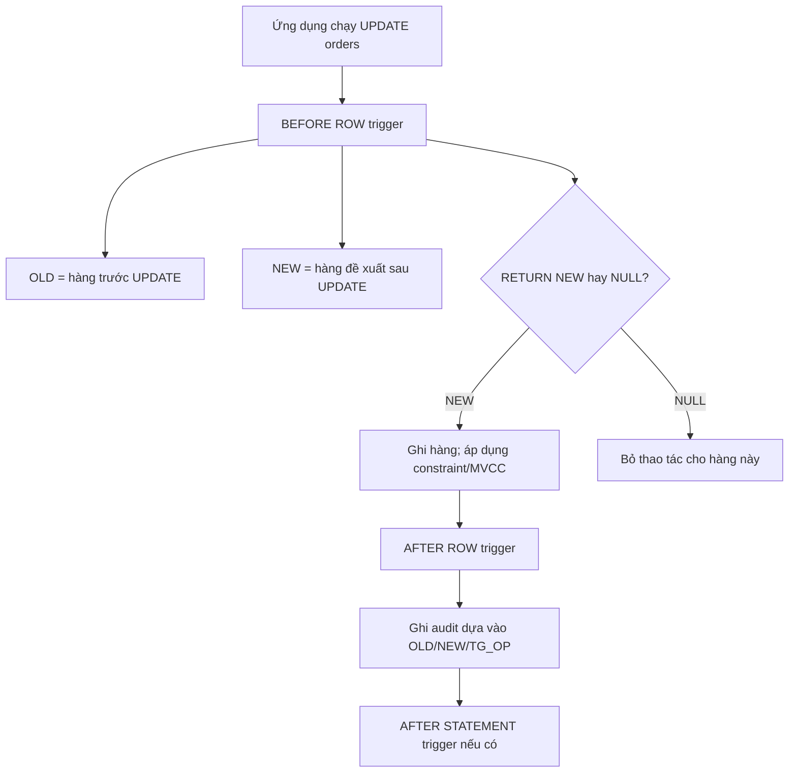

# NEW, OLD, TG_OP và ngữ cảnh hàm trigger trong PostgreSQL

Khi một đơn hàng được tạo, cập nhật hoặc xóa, PostgreSQL có thể tự gọi một **trigger function**. Bên trong hàm đó, lập trình viên thường cần trả lời ba câu hỏi:

1. **Sự kiện gì đang xảy ra?** `INSERT`, `UPDATE`, `DELETE` hay `TRUNCATE`?
2. **Hàng nào đang được xử lý?** Giá trị trước thay đổi và sau thay đổi là gì?
3. **Trigger chạy ở đâu và vào lúc nào?** Trước hay sau thao tác, theo từng hàng hay theo cả câu lệnh, trên bảng hay trên view?

Ba tên quan trọng nhất là:

- **`NEW`:** giá trị hàng *mới* của `INSERT` hoặc `UPDATE` ở trigger **theo hàng**.
- **`OLD`:** giá trị hàng *cũ* của `UPDATE` hoặc `DELETE` ở trigger **theo hàng**.
- **`TG_OP`:** chuỗi mô tả thao tác kích hoạt trigger, ví dụ `'INSERT'` hoặc `'DELETE'`.

Cùng với `TG_WHEN`, `TG_LEVEL`, `TG_NAME`, `TG_TABLE_NAME`, `TG_TABLE_SCHEMA` và `TG_ARGV`, chúng tạo thành **ngữ cảnh tự động** của một lần gọi trigger.

Bài học thuộc chương **Trigger và luật** của PostgreSQL. Chúng ta sẽ xây một hệ thống đơn hàng nhỏ, từ trigger chuẩn hóa dữ liệu trước ghi, trigger audit sau ghi, đến statement-level trigger, transition tables, `INSTEAD OF` trigger trên view, ngăn chặn thao tác bằng `RETURN NULL`, kiểm tra dữ liệu đổi bằng `IS DISTINCT FROM` và các lỗi thường gặp.

> **Nguyên tắc xuyên suốt:** `NEW`, `OLD` và `TG_OP` chỉ có ý nghĩa đúng trong **ngữ cảnh trigger**. Không được hiểu `NEW` là một bảng vật lý, không được truy cập `NEW` trong sự kiện `DELETE`, và không được xem `TG_OP` là tên cột chứa trạng thái nghiệp vụ.

## 1. Trigger là gì?

Một trigger kết nối ba thành phần:

- **Sự kiện** xảy ra trên bảng/view: `INSERT`, `UPDATE`, `DELETE` hoặc `TRUNCATE`.
- **Điểm kích hoạt**: `BEFORE`, `AFTER` hoặc `INSTEAD OF` theo khả năng của đối tượng.
- **Hàm thực thi**: một function khai báo `RETURNS trigger`, được PostgreSQL gọi tự động.

Ví dụ sơ đồ:



Sơ đồ chỉ diễn giải đường đi của một `UPDATE` đơn giản. Trong hệ thống thật còn có foreign keys, constraint triggers, nhiều triggers cùng thời điểm, partition routing, statement triggers và những quy tắc riêng cho từng loại thao tác.

### 1.1. Trigger function không phải là trigger

Hai câu lệnh khác nhau:

```sql
CREATE FUNCTION ... RETURNS trigger ...
```

tạo **function**.

```sql
CREATE TRIGGER ... ON some_table
EXECUTE FUNCTION some_function();
```

gắn **trigger** lên đối tượng để PostgreSQL tự gọi function đó.

Một trigger function có thể được dùng cho nhiều bảng hoặc nhiều sự kiện, **nếu** nội dung của hàm xử lý đúng ngữ cảnh và cấu trúc hàng tương ứng.

### 1.2. Trigger khác CHECK constraint và default

| Nhu cầu | Cơ chế thường phù hợp |
| --- | --- |
| Không cho số tiền âm | `CHECK (amount >= 0)` |
| Bắt buộc có trạng thái | `NOT NULL` |
| Tự cấp thời gian tạo mặc định | `DEFAULT clock_timestamp()` |
| Chuẩn hóa nhiều field trước ghi | `BEFORE ROW` trigger |
| Lưu lịch sử những lần đổi trạng thái | `AFTER ROW` trigger hoặc kiến trúc audit phù hợp |
| Ghi thống kê sau một lệnh cập nhật nhiều hàng | `AFTER STATEMENT` và có thể dùng transition tables |
| Chặn/biến đổi thao tác trên một view | `INSTEAD OF ROW` trigger |
| Bảo vệ nghiệp vụ xuyên nhiều hàng và concurrent transactions | Ràng buộc, giao dịch, khóa và thiết kế dữ liệu thích hợp; không chỉ trigger |

Không nên dùng trigger cho mọi yêu cầu nếu ràng buộc khai báo hoặc SQL thông thường diễn đạt rõ hơn.

## 2. Các chiều của ngữ cảnh: sự kiện, thời điểm, cấp độ

### 2.1. Sự kiện: TG_OP

`TG_OP` là chuỗi kiểu `text`, có thể nhận:

- `'INSERT'`.
- `'UPDATE'`.
- `'DELETE'`.
- `'TRUNCATE'`.

Nó nói thao tác SQL kích hoạt trigger, **không phải** giá trị của cột `status`, cũng không phải operation của transaction manager.

### 2.2. Thời điểm: TG_WHEN

`TG_WHEN` mang giá trị:

- `'BEFORE'`.
- `'AFTER'`.
- `'INSTEAD OF'`.

Không phải mọi tổ hợp đều hợp lệ. `INSTEAD OF` trigger dành cho **view** và ở cấp **ROW**. `TRUNCATE` chỉ hỗ trợ trigger ở cấp **STATEMENT**.

### 2.3. Cấp độ: TG_LEVEL

`TG_LEVEL` có giá trị:

- `'ROW'`: function được gọi theo từng hàng mà thao tác tác động.
- `'STATEMENT'`: function được gọi một lần theo câu lệnh cho một trigger/sự kiện phù hợp, kể cả khi lệnh không tác động hàng nào.

Một trigger theo hàng và trigger theo câu lệnh không dùng `NEW`/`OLD` giống nhau. Đây là khác biệt cơ bản nhất khi thiết kế function dùng lại.

## 3. Bảng sự thật: khi nào NEW và OLD tồn tại?

| Sự kiện | Cấp độ | `NEW` | `OLD` | `TG_OP` |
| --- | --- | --- | --- | --- |
| `INSERT` | ROW | **Hàng mới** | Không có hàng cũ | `INSERT` |
| `UPDATE` | ROW | **Hàng mới** | **Hàng cũ** | `UPDATE` |
| `DELETE` | ROW | Không có hàng mới | **Hàng cũ** | `DELETE` |
| `TRUNCATE` | STATEMENT | Không có hàng đơn lẻ | Không có hàng đơn lẻ | `TRUNCATE` |
| `INSERT`/`UPDATE`/`DELETE` | STATEMENT | Không có hàng đơn lẻ | Không có hàng đơn lẻ | Tên sự kiện tương ứng |
| `INSERT`/`UPDATE`/`DELETE` trên view | INSTEAD OF ROW | Theo INSERT/UPDATE | Theo UPDATE/DELETE | Tên sự kiện tương ứng |

Theo tài liệu PostgreSQL, `NEW` và `OLD` là những giá trị kiểu `record` được cấp trong trigger function. Khi không áp dụng, chúng có giá trị không khả dụng/NULL về mặt ngữ cảnh; **đừng truy cập field của record không có hàng tương ứng**.

Ví dụ **sai** trong DELETE trigger:

```sql
RAISE NOTICE 'Deleted order %', NEW.order_id;
```

Đúng:

```sql
RAISE NOTICE 'Deleted order %', OLD.order_id;
```

Tương tự, một trigger `AFTER INSERT FOR EACH STATEMENT` không nhận `NEW.order_id`, dù statement vừa thêm nhiều dòng.

## 4. Khai báo một trigger function đúng cách

Một hàm data-change trigger trong PL/pgSQL phải:

1. Được khai bằng `CREATE FUNCTION`.
2. **Không có tham số khai báo thông thường** trong chữ ký.
3. Trả về pseudo-type `trigger`.
4. Có phần `LANGUAGE plpgsql`.
5. Trả `NEW`, `OLD` hoặc `NULL` theo thời điểm/sự kiện/cấp độ.

Khung:

```sql
CREATE OR REPLACE FUNCTION my_schema.my_trigger_function()
RETURNS trigger
LANGUAGE plpgsql
AS $fn$
BEGIN
    IF TG_OP = 'INSERT' THEN
        -- Dùng NEW khi đây là ROW trigger.
        RETURN NEW;
    ELSIF TG_OP = 'UPDATE' THEN
        -- Dùng OLD và NEW khi đây là ROW trigger.
        RETURN NEW;
    ELSIF TG_OP = 'DELETE' THEN
        -- Dùng OLD khi đây là ROW trigger.
        RETURN OLD;
    END IF;

    RETURN NULL;
END;
$fn$;
```

Đây là **mẫu khái niệm**, không phải hàm gắn sẵn vào bảng học tập. Phần sau sẽ tạo function có kiểm tra `TG_LEVEL`/`TG_WHEN` rõ ràng và dữ liệu cụ thể.

### 4.1. Không gọi trigger function như một hàm nghiệp vụ thông thường

Đừng viết:

```sql
SELECT my_schema.my_trigger_function();
```

và mong PostgreSQL tự có một `NEW` từ application request. Trigger function cần được gọi trong ngữ cảnh do trigger manager cấp.

Nếu bạn muốn tái sử dụng logic chuẩn hóa/truy vấn, hãy tách thành một **hàm bình thường** nhận các tham số rõ ràng, rồi gọi nó từ trigger function.

### 4.2. TG_OP không phải parameter do client truyền

Không khai:

```sql
CREATE FUNCTION fn_trigger(p_tg_op text)
RETURNS trigger ...
```

để mô phỏng `TG_OP`. Các tham số của `CREATE TRIGGER ... EXECUTE FUNCTION fn('value')` được truy cập bằng `TG_ARGV`; chúng **không trở thành tham số trong chữ ký hàm**.

## 5. Bộ dữ liệu thực hành

Dùng schema `trigger_lab` trong database học tập. Các lệnh tạo đối tượng và nạp dữ liệu ở phần này chỉ nên chạy một lần trên schema chưa có những đối tượng đó.

### 5.1. Tạo bảng đơn hàng

```sql
CREATE SCHEMA IF NOT EXISTS trigger_lab;

CREATE TABLE trigger_lab.orders (
    order_id bigint PRIMARY KEY,
    customer_id bigint NOT NULL,
    status text NOT NULL
        CHECK (status IN ('pending', 'paid', 'cancelled')),
    amount numeric(12, 2) NOT NULL
        CHECK (amount >= 0),
    note text,
    created_at timestamptz NOT NULL DEFAULT clock_timestamp(),
    updated_at timestamptz NOT NULL DEFAULT clock_timestamp()
);
```

Trạng thái hợp lệ là ba chuỗi chữ thường. Một trigger sẽ nhận trạng thái `' PAID '` rồi chuẩn hóa thành `'paid'` **trước khi** `CHECK` được kiểm tra trên hàng chuẩn bị ghi.

### 5.2. Tạo bảng audit

```sql
CREATE TABLE trigger_lab.order_audit (
    audit_id bigint GENERATED ALWAYS AS IDENTITY PRIMARY KEY,
    order_id bigint NOT NULL,
    operation text NOT NULL,
    old_status text,
    new_status text,
    old_amount numeric(12, 2),
    new_amount numeric(12, 2),
    source_table text NOT NULL,
    trigger_name text NOT NULL,
    recorded_at timestamptz NOT NULL DEFAULT clock_timestamp()
);
```

Bảng audit chỉ lưu các field được lựa chọn, tránh chép toàn bộ hàng có thể chứa thông tin nhạy cảm. `order_id` cố ý **không phải foreign key** tới `orders`: khi xóa một đơn, bản ghi audit vẫn có thể được lưu để phục vụ lịch sử.

`audit_id` là identity sequence; nó định danh hàng audit, **không bảo đảm thứ tự commit của các giao dịch đồng thời**.

## 6. BEFORE INSERT/UPDATE: dùng NEW để chuẩn hóa

Tạo hàm:

```sql
CREATE OR REPLACE FUNCTION trigger_lab.fn_prepare_order()
RETURNS trigger
LANGUAGE plpgsql
AS $fn$
BEGIN
    IF TG_LEVEL <> 'ROW' OR TG_WHEN <> 'BEFORE' THEN
        RAISE EXCEPTION
            'fn_prepare_order must run as BEFORE ROW trigger';
    END IF;

    IF TG_OP NOT IN ('INSERT', 'UPDATE') THEN
        RAISE EXCEPTION 'Unsupported TG_OP: %', TG_OP;
    END IF;

    -- NEW có ý nghĩa trong INSERT và UPDATE ở cấp ROW.
    NEW.status := lower(btrim(NEW.status));

    IF TG_OP = 'UPDATE' THEN
        NEW.updated_at := clock_timestamp();
    END IF;

    -- Hàng sau khi chuẩn hóa được phép đi tiếp.
    RETURN NEW;
END;
$fn$;
```

Gắn function vào bảng:

```sql
CREATE TRIGGER trg_10_prepare_order
BEFORE INSERT OR UPDATE
ON trigger_lab.orders
FOR EACH ROW
EXECUTE FUNCTION trigger_lab.fn_prepare_order();
```

### 6.1. Tại sao dùng NEW chứ không sửa trực tiếp bảng bằng UPDATE?

Trong một `BEFORE ROW UPDATE` trigger, `NEW` là **hàng sẽ được ghi** nếu thao tác tiếp tục. Sửa field:

```sql
NEW.status := lower(btrim(NEW.status));
```

rồi `RETURN NEW` là cách thông thường để sửa giá trị đề xuất.

Nếu thay bằng:

```sql
UPDATE trigger_lab.orders
SET status = lower(status)
WHERE order_id = NEW.order_id;
```

ngay trong trigger trên cùng bảng, bạn có nguy cơ tạo **các thao tác UPDATE lồng nhau/trigger recursion**, thêm khóa, thêm WAL và gây hành vi khó hiểu. Để chỉnh hàng đang xử lý ở BEFORE ROW trigger, ưu tiên sửa `NEW`.

### 6.2. TG_WHEN và TG_LEVEL làm rõ hợp đồng hàm

Hàm này chỉ được thiết kế cho:

```text
TG_WHEN = 'BEFORE'
TG_LEVEL = 'ROW'
TG_OP in ('INSERT', 'UPDATE')
```

Những phép kiểm tra đầu hàm là một cách làm rõ hợp đồng nếu ai đó tái sử dụng function trên trigger khác. Không phải trigger nào cũng cần check ba biến này, nhưng khi hàm phụ thuộc mạnh vào `NEW` thì việc kiểm tra giúp phát hiện cấu hình sai.

### 6.3. Thời điểm NOW và clock_timestamp

`clock_timestamp()` cho thời điểm thực của lần gọi hàm; `now()`/`transaction_timestamp()` gắn với thời điểm bắt đầu transaction. Chúng có ngữ nghĩa khác nhau.

Nếu `updated_at` cần đại diện thời điểm transaction, có thể dùng `now()`; nếu cần thời điểm function thực thi, dùng `clock_timestamp()`. Chọn theo hợp đồng dữ liệu, không thay đổi tùy ý.

## 7. AFTER INSERT/UPDATE/DELETE: dùng TG_OP, OLD và NEW để audit

Một trigger audit nên xử lý ba sự kiện mà **không truy cập sai record**.

```sql
CREATE OR REPLACE FUNCTION trigger_lab.fn_audit_order()
RETURNS trigger
LANGUAGE plpgsql
AS $fn$
BEGIN
    IF TG_LEVEL <> 'ROW' OR TG_WHEN <> 'AFTER' THEN
        RAISE EXCEPTION
            'fn_audit_order must run as AFTER ROW trigger';
    END IF;

    IF TG_OP = 'INSERT' THEN
        INSERT INTO trigger_lab.order_audit (
            order_id, operation,
            old_status, new_status,
            old_amount, new_amount,
            source_table, trigger_name
        )
        VALUES (
            NEW.order_id, TG_OP,
            NULL, NEW.status,
            NULL, NEW.amount,
            TG_TABLE_SCHEMA || '.' || TG_TABLE_NAME,
            TG_NAME
        );

    ELSIF TG_OP = 'UPDATE' THEN
        -- Chỉ log khi hai trường nghiệp vụ đã đổi thật.
        IF OLD.status IS DISTINCT FROM NEW.status
           OR OLD.amount IS DISTINCT FROM NEW.amount THEN

            INSERT INTO trigger_lab.order_audit (
                order_id, operation,
                old_status, new_status,
                old_amount, new_amount,
                source_table, trigger_name
            )
            VALUES (
                NEW.order_id, TG_OP,
                OLD.status, NEW.status,
                OLD.amount, NEW.amount,
                TG_TABLE_SCHEMA || '.' || TG_TABLE_NAME,
                TG_NAME
            );
        END IF;

    ELSIF TG_OP = 'DELETE' THEN
        INSERT INTO trigger_lab.order_audit (
            order_id, operation,
            old_status, new_status,
            old_amount, new_amount,
            source_table, trigger_name
        )
        VALUES (
            OLD.order_id, TG_OP,
            OLD.status, NULL,
            OLD.amount, NULL,
            TG_TABLE_SCHEMA || '.' || TG_TABLE_NAME,
            TG_NAME
        );

    ELSE
        RAISE EXCEPTION 'Unexpected TG_OP: %', TG_OP;
    END IF;

    -- Giá trị trả về của AFTER ROW trigger bị bỏ qua.
    RETURN NULL;
END;
$fn$;
```

Gắn trigger:

```sql
CREATE TRIGGER trg_90_audit_order
AFTER INSERT OR UPDATE OR DELETE
ON trigger_lab.orders
FOR EACH ROW
EXECUTE FUNCTION trigger_lab.fn_audit_order();
```

### 7.1. Vì sao audit phải phân nhánh theo TG_OP?

Nếu viết:

```sql
INSERT INTO audit (...old_status, new_status...)
VALUES (OLD.status, NEW.status);
```

cho **mọi** sự kiện, bạn sẽ truy cập `OLD.status` khi INSERT hoặc `NEW.status` khi DELETE. Hai record đó không có ý nghĩa ở những nhánh tương ứng.

Phân nhánh rõ:

- `INSERT` → chỉ dùng `NEW`.
- `UPDATE` → dùng cả `OLD` và `NEW`.
- `DELETE` → chỉ dùng `OLD`.

Đó cũng là lý do `TG_OP` đặc biệt hữu ích khi **một function phục vụ nhiều events**.

### 7.2. AFTER trigger có thể ghi bảng audit, nhưng không chỉnh được hàng nguồn qua NEW

Ở `AFTER ROW`, việc sửa `NEW.status` trong biến không thay đổi hàng nguồn đã được xử lý. Muốn chuẩn hóa giá trị **trước khi ghi**, dùng `BEFORE ROW`.

Một `AFTER` trigger hợp lý cho audit, outbox, thống kê liên quan hoặc thao tác phụ theo transaction, nhưng phải cân nhắc chi phí và khả năng recursion.

### 7.3. Vì sao RETURN NULL vẫn đúng?

Giá trị trả về từ trigger ở cấp **AFTER ROW** bị PostgreSQL bỏ qua. Việc `RETURN NULL` là quy ước thường dùng.

Đừng chuyển trực tiếp quy tắc ấy sang `BEFORE ROW`: ở BEFORE ROW, `RETURN NULL` có ý nghĩa **bỏ qua thao tác cho hàng hiện tại**.

## 8. Nạp dữ liệu: thấy BEFORE và AFTER cùng hoạt động

Sau khi đã tạo hai trigger, nạp dữ liệu:

```sql
INSERT INTO trigger_lab.orders
    (order_id, customer_id, status, amount, note)
VALUES
    (1001, 101, ' PAID ', 120.50, 'First order'),
    (1002, 101, 'pending', 80.00, NULL),
    (1003, 102, 'paid', 200.00, 'Gift')
RETURNING
    order_id, customer_id, status, amount;
```

**Kỳ vọng:**

- Order 1001 được lưu với `status='paid'`, dù đầu vào là `' PAID '`.
- `CHECK` của bảng không từ chối giá trị đã được chuẩn hóa.
- Mỗi hàng INSERT tạo một audit event `operation='INSERT'`.

Đọc lại:

```sql
SELECT
    order_id,
    status,
    amount,
    updated_at
FROM trigger_lab.orders
ORDER BY order_id;

SELECT
    audit_id, order_id, operation,
    old_status, new_status,
    old_amount, new_amount,
    trigger_name
FROM trigger_lab.order_audit
ORDER BY audit_id;
```

Với schema trống và nạp một lần, bảng audit có ba event INSERT. Những event xảy ra trong **cùng transaction** với lệnh INSERT nguồn.

### 8.1. Thí nghiệm UPDATE có thể rollback

```sql
BEGIN;

UPDATE trigger_lab.orders
SET
    status = ' PAID ',
    amount = 95.00
WHERE order_id = 1002
RETURNING order_id, status, amount;

SELECT
    audit_id, order_id, operation,
    old_status, new_status,
    old_amount, new_amount
FROM trigger_lab.order_audit
WHERE order_id = 1002
ORDER BY audit_id;

ROLLBACK;
```

Trước khi rollback, audit event UPDATE cho thấy:

- `OLD.status = 'pending'`.
- `NEW.status = 'paid'` sau khi BEFORE trigger chuẩn hóa.
- `OLD.amount = 80.00`.
- `NEW.amount = 95.00`.

Sau `ROLLBACK`, cả UPDATE trên `orders` và audit INSERT tương ứng trong transaction đều bị hoàn tác. **Sequence của `audit_id` có thể vẫn có khoảng trống**, vì sequence advancement không được rollback giống hàng.

### 8.2. Thí nghiệm DELETE có thể rollback

```sql
BEGIN;

DELETE FROM trigger_lab.orders
WHERE order_id = 1003
RETURNING order_id, status;

SELECT
    order_id, operation,
    old_status, new_status
FROM trigger_lab.order_audit
WHERE order_id = 1003
ORDER BY audit_id;

ROLLBACK;
```

Trong DELETE event mới, `OLD` đại diện hàng trước xóa; không có `NEW` của hàng sau xóa.

## 9. NEW và OLD là record, không phải bảng

Trong PL/pgSQL trigger, `NEW` và `OLD` có kiểu **`record`**. Khi sự kiện có hàng tương ứng, chúng có các field theo cấu trúc relation đang xử lý:

```sql
NEW.order_id
NEW.status
NEW.amount

OLD.order_id
OLD.status
OLD.amount
```

Điều đó khác với:

```sql
SELECT * FROM NEW;
```

Không có bảng thường tên `NEW` chỉ vì trigger tồn tại. Những **transition relations** có thể được cấp bằng `REFERENCING NEW TABLE AS ...` là cơ chế khác, sẽ được trình bày sau.

### 9.1. Record và kiểu dữ liệu của từng trường

`NEW.amount` là giá trị cột `amount` theo kiểu PostgreSQL, ở ví dụ là `numeric(12,2)`. `NEW.status` là text. Chúng không tự trở thành chuỗi chỉ vì record linh hoạt.

Bạn có thể dùng toán tử SQL/PL/pgSQL phù hợp:

```sql
IF NEW.amount > 100 THEN
    -- ...
END IF;
```

### 9.2. Không assume mọi bảng có cùng field

Một function dùng:

```sql
NEW.status
```

chỉ nên được gắn lên những relation có trường `status` phù hợp. Nếu attach function đó lên bảng không có cột status, lỗi có thể chỉ xuất hiện khi trigger chạy.

`TG_TABLE_NAME` cho biết bảng nào kích hoạt; nó **không tự đổi cấu trúc NEW/OLD thành schema bạn mong muốn**.

### 9.3. Đọc record dưới dạng JSON để debug có kiểm soát

Trong môi trường học tập:

```sql
RAISE NOTICE 'NEW JSON: %', to_jsonb(NEW);
```

Có thể giúp quan sát hình dạng hàng. Tuy nhiên, nếu row chứa email, token, địa chỉ hoặc dữ liệu nhạy cảm, việc log toàn bộ `NEW`/`OLD` có thể gây lộ thông tin. Trong production, chỉ ghi các field đã được phép và cần thiết.

## 10. TG_OP với UPDATE: OLD và NEW có thể giống nhau ở nhiều cột

Một câu:

```sql
UPDATE trigger_lab.orders
SET amount = amount
WHERE order_id = 1001;
```

vẫn là thao tác `UPDATE` nếu hàng được xử lý. `TG_OP` vẫn là `'UPDATE'`, cho dù số tiền trước và sau bằng nhau.

Không dùng:

```sql
IF TG_OP = 'UPDATE' THEN
    -- Tưởng rằng status chắc chắn đã đổi.
END IF;
```

để suy rằng một cột nghiệp vụ cụ thể thay đổi.

### 10.1. Dùng IS DISTINCT FROM thay cho <>

SQL có ba-valued logic với NULL. Biểu thức:

```sql
OLD.note <> NEW.note
```

có thể trả **NULL** nếu một bên là NULL, chứ không phải true/false chắc chắn.

Dùng:

```sql
OLD.note IS DISTINCT FROM NEW.note
```

để kiểm tra hai giá trị **có khác nhau hay không, kể cả khi một phía là NULL**.

Ví dụ các trường hợp:

| OLD.note | NEW.note | `OLD.note <> NEW.note` | `OLD.note IS DISTINCT FROM NEW.note` |
| --- | --- | --- | --- |
| `'A'` | `'B'` | true | true |
| `'A'` | `'A'` | false | false |
| SQL NULL | `'A'` | SQL NULL | true |
| SQL NULL | SQL NULL | SQL NULL | false |

Vì vậy hàm audit phía trên dùng `IS DISTINCT FROM` khi kiểm tra trạng thái và số tiền.

### 10.2. So sánh cả row

Có thể cân nhắc:

```sql
IF ROW(OLD.status, OLD.amount, OLD.note)
   IS DISTINCT FROM
   ROW(NEW.status, NEW.amount, NEW.note) THEN
    -- Một trong ba field đổi.
END IF;
```

Chọn tập field nghiệp vụ cần audit. Không nhất thiết so toàn bộ row, vì `updated_at` có thể được BEFORE trigger chỉnh cho mọi UPDATE và dẫn tới audit rất nhiều thay đổi không quan trọng.

## 11. BEFORE ROW: giá trị RETURN ảnh hưởng thao tác

Một `BEFORE ROW` trigger có thể:

- `RETURN NEW` khi INSERT/UPDATE để cho thao tác tiếp tục với hàng mới.
- `RETURN OLD` khi DELETE để cho phép xóa hàng cũ.
- `RETURN NULL` để **bỏ qua thao tác đối với hàng hiện tại**.

| Timing/event | Giá trị thường trả | Hậu quả |
| --- | --- | --- |
| BEFORE INSERT ROW | `NEW` | Tiếp tục INSERT; sửa NEW được phản ánh |
| BEFORE UPDATE ROW | `NEW` | Tiếp tục UPDATE; sửa NEW được phản ánh |
| BEFORE DELETE ROW | `OLD` | Tiếp tục DELETE |
| BEFORE ROW bất kỳ | `NULL` | Bỏ xử lý hàng đó; những row trigger phía sau cho hàng đó không được gọi |
| AFTER ROW | Thường `NULL` | Giá trị trả về bị bỏ qua |
| AFTER/BEFORE STATEMENT | Thường `NULL` | Giá trị trả về bị bỏ qua |
| INSTEAD OF ROW trên view | `NEW`/`OLD` hay `NULL` theo event | Non-NULL báo hàng đã xử lý; NULL nghĩa bỏ qua hàng |

### 11.1. Ví dụ bỏ qua một INSERT có điều kiện

Tạo bảng riêng để không ảnh hưởng dữ liệu `orders`:

```sql
CREATE TABLE trigger_lab.inbox (
    message_id bigint PRIMARY KEY,
    state text NOT NULL,
    note text
);
```

Function:

```sql
CREATE OR REPLACE FUNCTION trigger_lab.fn_inbox_policy()
RETURNS trigger
LANGUAGE plpgsql
AS $fn$
BEGIN
    IF TG_OP <> 'INSERT' OR TG_LEVEL <> 'ROW'
       OR TG_WHEN <> 'BEFORE' THEN
        RAISE EXCEPTION 'Unsupported trigger context';
    END IF;

    IF NEW.state = 'ignored' THEN
        RETURN NULL;
    END IF;

    RETURN NEW;
END;
$fn$;
```

Trigger:

```sql
CREATE TRIGGER trg_inbox_policy
BEFORE INSERT ON trigger_lab.inbox
FOR EACH ROW
EXECUTE FUNCTION trigger_lab.fn_inbox_policy();
```

Thử:

```sql
INSERT INTO trigger_lab.inbox
    (message_id, state, note)
VALUES
    (1, 'ready', 'keep'),
    (2, 'ignored', 'skip'),
    (3, 'ready', 'keep again')
RETURNING message_id, state;

SELECT * FROM trigger_lab.inbox ORDER BY message_id;
```

Kỳ vọng chỉ hàng `1` và `3` được ghi. Hàng `2` bị trigger bỏ qua; không có row INSERT thành công cho hàng đó.

### 11.2. RETURN NULL không phải RAISE EXCEPTION

- `RETURN NULL` ở BEFORE ROW **bỏ qua hàng**; câu lệnh có thể tiếp tục xử lý những hàng khác.
- `RAISE EXCEPTION` phát lỗi và làm câu lệnh/transaction thất bại theo cơ chế xử lý lỗi.

Nếu chính sách nghiệp vụ yêu cầu **toàn bộ request phải thất bại** khi gặp một hàng không hợp lệ, im lặng `RETURN NULL` có thể gây mất dữ liệu đầu vào không được nhận biết.

Trong tình huống validation, nhiều hệ thống nên **raise error rõ ràng** thay vì âm thầm skip.

### 11.3. DELETE cần RETURN OLD, không phải NEW

Trong một BEFORE DELETE trigger:

```sql
CREATE OR REPLACE FUNCTION trigger_lab.fn_guard_delete()
RETURNS trigger
LANGUAGE plpgsql
AS $fn$
BEGIN
    IF TG_OP <> 'DELETE' THEN
        RAISE EXCEPTION 'DELETE trigger only';
    END IF;

    IF OLD.status = 'paid' THEN
        RAISE EXCEPTION
            'Cannot delete paid order %', OLD.order_id
            USING ERRCODE = '23514';
    END IF;

    RETURN OLD;
END;
$fn$;
```

Đây là ví dụ một chính sách riêng. **Không gắn function này** nếu còn muốn thực hiện bài thực hành DELETE trên đơn paid; nếu quyết định triển khai phải thay đổi test tương ứng. Đừng dùng `RETURN NEW`: trong DELETE trigger không có hàng mới.

## 12. AFTER ROW: RETURN không sửa dữ liệu vừa ghi

Xem một đoạn logic:

```sql
-- Trong hàm AFTER UPDATE:
NEW.status := 'paid';
RETURN NEW;
```

Ở AFTER trigger, hai dòng này **không làm thay đổi hàng nguồn đã UPDATE**. PostgreSQL bỏ qua return value của AFTER ROW trigger.

Nếu thực sự cần cập nhật dữ liệu nguồn sau một thao tác, có thể dùng DML riêng, nhưng phải đánh giá locks, recursion và trigger chaining. Nếu chỉ cần **sửa giá trị dự định ghi cho cùng một hàng**, hãy đặt logic ở BEFORE ROW trigger.

### 12.1. AFTER ROW trigger hữu ích cho audit

Bởi vì `OLD`/`NEW` thể hiện hai trạng thái của hàng trong thao tác UPDATE, AFTER trigger rất phù hợp để lưu lịch sử ở bảng khác.

Nhưng audit bằng trigger có giới hạn:

- Được thực hiện trong cùng transaction, nên rollback sẽ rollback audit.
- Một transaction thất bại không thể để lại audit row bình thường trong cùng database transaction.
- Không tự ghi nhận SELECT hay thay đổi diễn ra ngoài phạm vi sự kiện trigger.
- Nếu muốn audit phục vụ kiểm toán hoặc yêu cầu chống sửa/xóa đặc biệt, cần thiết kế quyền, lưu trữ và hệ thống quản trị phù hợp.

## 13. Các biến TG_* khác ngoài TG_OP

PostgreSQL tạo nhiều biến ngữ cảnh tự động trong trigger function.

| Biến | Kiểu thường gặp | Ý nghĩa |
| --- | --- | --- |
| `TG_NAME` | `name` | Tên trigger đã kích hoạt |
| `TG_WHEN` | `text` | `BEFORE`, `AFTER`, `INSTEAD OF` |
| `TG_LEVEL` | `text` | `ROW` hoặc `STATEMENT` |
| `TG_OP` | `text` | `INSERT`, `UPDATE`, `DELETE`, `TRUNCATE` |
| `TG_RELID` | `oid` | OID của relation gây trigger |
| `TG_TABLE_NAME` | `name` | Tên relation |
| `TG_TABLE_SCHEMA` | `name` | Tên schema |
| `TG_NARGS` | `integer` | Số tham số dạng literal trong `CREATE TRIGGER` |
| `TG_ARGV` | `text[]` | Mảng tham số trigger, **đánh chỉ số từ 0** |
| `NEW` | `record` | Hàng mới khi có |
| `OLD` | `record` | Hàng cũ khi có |

`TG_RELNAME` từng được hỗ trợ như tên relation nhưng đã **deprecated**; nên dùng `TG_TABLE_NAME`.

### 13.1. Đọc tên bảng/sự kiện

Trong function có thể:

```sql
RAISE NOTICE
    'Trigger %, op %, when %, level %, table %.%',
    TG_NAME,
    TG_OP,
    TG_WHEN,
    TG_LEVEL,
    TG_TABLE_SCHEMA,
    TG_TABLE_NAME;
```

Thông báo này phù hợp cho bài học/debug. Trên production có tải lớn, `RAISE NOTICE` cho mọi hàng có thể làm log/noise rất nhiều và giảm hiệu năng.

### 13.2. TG_RELID và định danh object

`TG_RELID` là OID trong catalog `pg_class`. Có thể chuyển sang `regclass` để hiển thị:

```sql
RAISE NOTICE 'Relation: %', TG_RELID::regclass;
```

Không dùng OID như một khóa nghiệp vụ bất biến qua dump/restore hoặc rebuild môi trường. Nếu cần tên theo schema, dùng `TG_TABLE_SCHEMA` và `TG_TABLE_NAME`.

### 13.3. TG_NAME là tên trigger, không phải function

Một function có thể được gắn với các trigger có tên khác nhau. `TG_NAME` nói trigger nào thực sự được kích hoạt, hữu ích cho logging hoặc nhánh xử lý có chủ đích.

Nhưng không nên lạm dụng `TG_NAME` như một hệ thống cấu hình khó kiểm soát. Nếu logic khác nhau đáng kể, cân nhắc các function riêng.

## 14. TG_NARGS và TG_ARGV: truyền tham số cho trigger

Hàm trigger **không khai đối số như hàm SQL thường**:

```sql
CREATE FUNCTION trigger_lab.fn_mark_source()
RETURNS trigger ...
```

Nhưng lệnh tạo trigger có thể truyền các chuỗi literal:

```sql
CREATE TRIGGER trg_mark_source
BEFORE INSERT ON trigger_lab.some_table
FOR EACH ROW
EXECUTE FUNCTION trigger_lab.fn_mark_source('api', 'v1');
```

Khi function chạy:

- `TG_NARGS = 2`.
- `TG_ARGV[0] = 'api'`.
- `TG_ARGV[1] = 'v1'`.
- `TG_ARGV[2]` trả NULL vì vượt phạm vi.

**Chỉ số của TG_ARGV bắt đầu từ 0**, khác với thói quen mảng SQL thường có chỉ số bắt đầu từ 1.

### 14.1. Ví dụ tự chứa với bảng inbox thứ hai

Dùng bảng `inbox` đã tạo:

```sql
CREATE OR REPLACE FUNCTION trigger_lab.fn_add_source_label()
RETURNS trigger
LANGUAGE plpgsql
AS $fn$
DECLARE
    v_label text;
BEGIN
    IF TG_LEVEL <> 'ROW' OR TG_OP <> 'INSERT' THEN
        RAISE EXCEPTION 'Expected INSERT ROW trigger';
    END IF;

    IF TG_NARGS < 1 THEN
        RAISE EXCEPTION 'Missing source label';
    END IF;

    v_label := TG_ARGV[0];

    NEW.note := concat_ws(
        ' ',
        NEW.note,
        '[' || v_label || ']'
    );

    RETURN NEW;
END;
$fn$;
```

Gắn trigger có tên **đứng trước** trigger lọc `trg_inbox_policy` theo thứ tự alphabet:

```sql
CREATE TRIGGER trg_00_add_source_label
BEFORE INSERT ON trigger_lab.inbox
FOR EACH ROW
EXECUTE FUNCTION trigger_lab.fn_add_source_label('web-ui');
```

Thử:

```sql
INSERT INTO trigger_lab.inbox (message_id, state, note)
VALUES (4, 'ready', 'incoming')
RETURNING *;
```

Kỳ vọng `note` có thêm `[web-ui]`.

**Lưu ý thứ tự:** các trigger cùng timing/event trên cùng relation thường được kích hoạt **theo thứ tự tên trigger**. Vì `trg_00_add_source_label` đứng trước `trg_inbox_policy`, việc sửa NEW ở trigger trước có thể được nhìn thấy bởi trigger sau.

### 14.2. TG_ARGV chỉ chứa text, không phải typed parameters

Dù truyền số trong `CREATE TRIGGER`, các arguments được chuyển thành text.

Nếu cần số:

```sql
v_threshold := TG_ARGV[0]::numeric;
```

Cần xử lý giá trị không hợp lệ hoặc ngoài miền. Đừng mặc định parser sẽ tự kiểm tra cấu hình kiểu số khi tạo trigger.

### 14.3. Không lấy TG_ARGV từ dữ liệu người dùng một cách tùy tiện

`TG_ARGV` đến từ **định nghĩa trigger DDL**; nó không phải request parameter động cho từng hàng. Nếu muốn dữ liệu thay đổi từng hàng, lấy từ `NEW`/`OLD` hoặc bảng cấu hình/luồng nghiệp vụ phù hợp.

Đừng ghép giá trị `TG_ARGV` vào SQL động mà không kiểm tra/quote khi nó được dùng như identifier hoặc expression.

## 15. ROW trigger so với STATEMENT trigger

Xét:

```sql
UPDATE trigger_lab.orders
SET amount = amount + 1
WHERE customer_id = 101;
```

Giả sử có 2 hàng được cập nhật:

- `FOR EACH ROW` trigger có thể chạy **2 lần**, mỗi lần một cặp `OLD`/`NEW`.
- `FOR EACH STATEMENT` trigger chạy **1 lần** cho câu UPDATE tương ứng.

Nếu câu:

```sql
UPDATE trigger_lab.orders
SET amount = amount + 1
WHERE order_id = -999;
```

không ảnh hưởng hàng nào:

- Row-level triggers không được kích hoạt cho hàng không tồn tại.
- Statement-level trigger vẫn có thể được kích hoạt **một lần**, dù 0 rows affected.

### 15.1. Statement trigger không có NEW.order_id

Sai:

```sql
CREATE OR REPLACE FUNCTION trigger_lab.fn_bad_statement()
RETURNS trigger
LANGUAGE plpgsql
AS $fn$
BEGIN
    RAISE NOTICE '%', NEW.order_id;
    RETURN NULL;
END;
$fn$;
```

Nếu gắn vào `FOR EACH STATEMENT`, không có “hàng mới” đơn lẻ để đọc. Hàm có thể tạo thành công nhưng lỗi khi chạy trigger.

Dùng `TG_OP` và `TG_LEVEL` để mô tả **câu lệnh**. Nếu cần dữ liệu của tất cả hàng bị thay đổi, xem **transition tables**, không dùng NEW như một mảng tự tạo.

## 16. Ví dụ statement trigger ghi nhật ký câu lệnh

Tạo bảng:

```sql
CREATE TABLE trigger_lab.statement_events (
    event_id bigint GENERATED ALWAYS AS IDENTITY PRIMARY KEY,
    operation text NOT NULL,
    trigger_name text NOT NULL,
    table_name text NOT NULL,
    fired_at timestamptz NOT NULL DEFAULT clock_timestamp()
);
```

Function:

```sql
CREATE OR REPLACE FUNCTION trigger_lab.fn_log_statement()
RETURNS trigger
LANGUAGE plpgsql
AS $fn$
BEGIN
    IF TG_LEVEL <> 'STATEMENT' THEN
        RAISE EXCEPTION 'Expected STATEMENT trigger';
    END IF;

    INSERT INTO trigger_lab.statement_events (
        operation, trigger_name, table_name
    )
    VALUES (
        TG_OP,
        TG_NAME,
        TG_TABLE_SCHEMA || '.' || TG_TABLE_NAME
    );

    RETURN NULL;
END;
$fn$;
```

Trigger:

```sql
CREATE TRIGGER trg_orders_statement_log
AFTER INSERT OR UPDATE OR DELETE OR TRUNCATE
ON trigger_lab.orders
FOR EACH STATEMENT
EXECUTE FUNCTION trigger_lab.fn_log_statement();
```

Chạy:

```sql
BEGIN;

UPDATE trigger_lab.orders
SET amount = amount
WHERE order_id = -999;

SELECT event_id, operation, table_name
FROM trigger_lab.statement_events
ORDER BY event_id;

ROLLBACK;
```

Dù không có hàng nào bị UPDATE, statement-level trigger vẫn ghi event trong transaction. Sau rollback, hàng log đó cũng bị hoàn tác.

### 16.1. TG_OP = TRUNCATE

`TRUNCATE` có trigger sự kiện riêng ở cấp STATEMENT, không phải một tập `DELETE` row triggers.

```sql
BEGIN;

TRUNCATE TABLE trigger_lab.orders;

SELECT operation
FROM trigger_lab.statement_events
ORDER BY event_id DESC
LIMIT 1;

ROLLBACK;
```

Trong transaction, `TG_OP` của trigger log là `'TRUNCATE'`. `ROLLBACK` khôi phục dữ liệu đã truncate theo cơ chế PostgreSQL.

**Không chạy TRUNCATE ngoài transaction thực hành** trên bảng có dữ liệu cần giữ; nó có tác động khóa lớn và khác DELETE.

### 16.2. AFTER STATEMENT không tự có số hàng bị ảnh hưởng

`TG_OP='UPDATE'` và `TG_LEVEL='STATEMENT'` không nói có bao nhiêu row được cập nhật. Muốn đếm đúng những hàng của statement, cân nhắc **transition relations** theo giới hạn PostgreSQL, hoặc kiến trúc phù hợp.

## 17. Transition tables: OLD TABLE và NEW TABLE

Khi cần nhìn **tập nhiều hàng** được thay đổi trong một statement, PostgreSQL hỗ trợ transition relations cho những kiểu `AFTER` trigger phù hợp.

Đây là cơ chế **khác** với `OLD`/`NEW` records:

| Tên | Ý nghĩa |
| --- | --- |
| `OLD` | Một hàng trước thay đổi trong ROW trigger |
| `NEW` | Một hàng mới trong ROW trigger |
| `OLD TABLE AS old_rows` | Tập hàng trước thay đổi được đặt tên `old_rows` |
| `NEW TABLE AS new_rows` | Tập hàng sau thay đổi được đặt tên `new_rows` |

### 17.1. Tạo bảng thống kê statement UPDATE

```sql
CREATE TABLE trigger_lab.update_batches (
    batch_id bigint GENERATED ALWAYS AS IDENTITY PRIMARY KEY,
    old_row_count bigint NOT NULL,
    new_row_count bigint NOT NULL,
    changed_status_count bigint NOT NULL,
    recorded_at timestamptz NOT NULL DEFAULT clock_timestamp()
);
```

Function:

```sql
CREATE OR REPLACE FUNCTION trigger_lab.fn_log_update_batch()
RETURNS trigger
LANGUAGE plpgsql
AS $fn$
DECLARE
    v_old_count bigint;
    v_new_count bigint;
    v_changed_status bigint;
BEGIN
    SELECT COUNT(*) INTO v_old_count FROM old_rows;
    SELECT COUNT(*) INTO v_new_count FROM new_rows;

    SELECT COUNT(*)
    INTO v_changed_status
    FROM old_rows AS o
    JOIN new_rows AS n USING (order_id)
    WHERE o.status IS DISTINCT FROM n.status;

    INSERT INTO trigger_lab.update_batches (
        old_row_count,
        new_row_count,
        changed_status_count
    )
    VALUES (
        v_old_count,
        v_new_count,
        v_changed_status
    );

    RETURN NULL;
END;
$fn$;
```

Trigger:

```sql
CREATE TRIGGER trg_orders_update_batch
AFTER UPDATE ON trigger_lab.orders
REFERENCING
    OLD TABLE AS old_rows
    NEW TABLE AS new_rows
FOR EACH STATEMENT
EXECUTE FUNCTION trigger_lab.fn_log_update_batch();
```

Thử trong transaction:

```sql
BEGIN;

UPDATE trigger_lab.orders
SET status = 'paid'
WHERE customer_id = 101;

SELECT *
FROM trigger_lab.update_batches
ORDER BY batch_id DESC
LIMIT 1;

ROLLBACK;
```

Câu truy vấn `old_rows` và `new_rows` chỉ hợp lệ **khi function chạy trong trigger có REFERENCING tương ứng**. Đừng gọi `SELECT * FROM old_rows` từ một session bình thường rồi mong có bảng tồn tại mãi.

### 17.2. Các hạn chế cần nhớ

- Transition tables chỉ áp dụng cho những cấu hình trigger và event PostgreSQL hỗ trợ.
- Chúng dùng với **AFTER** triggers, không phải toàn bộ BEFORE triggers.
- Một trigger yêu cầu transition relation không được khai danh sách event kiểu `INSERT OR UPDATE` trong cùng một định nghĩa như ví dụ log statement ở phần trước.
- Với `UPDATE` có transition tables, **không dùng `UPDATE OF column_list`** trong định nghĩa trigger đó.
- Không áp dụng transition relations cho mọi constraint trigger hoặc mọi loại relation theo cùng cách.
- Tham khảo tài liệu của major version đang chạy khi dùng partitioned tables/foreign tables và đặc tính nâng cao.

### 17.3. Đếm hàng thực sự đổi hay chỉ được UPDATE?

`old_rows` và `new_rows` cho tập hàng được tác động bởi câu UPDATE. Câu `UPDATE status = status` vẫn có thể được tính vào affected rows.

Trong ví dụ, `changed_status_count` so `OLD.status` với `NEW.status` bằng `IS DISTINCT FROM` để chỉ đếm trạng thái **đổi giá trị thật**.

Việc join theo `order_id` giả định khóa không bị thay đổi trong statement; nếu statement có thể sửa khóa, cần thiết kế tương quan trước/sau phù hợp thay vì join máy móc theo khóa đã đổi.

## 18. Trigger WHEN: lọc điều kiện kích hoạt

Thay vì gọi function cho mọi UPDATE rồi kiểm tra bên trong, một trigger có thể có `WHEN`.

Ví dụ chỉ audit thay đổi status:

```sql
CREATE TABLE trigger_lab.status_change_events (
    event_id bigint GENERATED ALWAYS AS IDENTITY PRIMARY KEY,
    order_id bigint NOT NULL,
    old_status text,
    new_status text
);
```

Function:

```sql
CREATE OR REPLACE FUNCTION trigger_lab.fn_status_change()
RETURNS trigger
LANGUAGE plpgsql
AS $fn$
BEGIN
    INSERT INTO trigger_lab.status_change_events (
        order_id, old_status, new_status
    )
    VALUES (
        NEW.order_id, OLD.status, NEW.status
    );

    RETURN NULL;
END;
$fn$;
```

Gắn với `WHEN`:

```sql
CREATE TRIGGER trg_status_change_only
AFTER UPDATE ON trigger_lab.orders
FOR EACH ROW
WHEN (OLD.status IS DISTINCT FROM NEW.status)
EXECUTE FUNCTION trigger_lab.fn_status_change();
```

Với một UPDATE chỉ thay `note`, function này không cần chạy cho hàng không đổi status.

### 18.1. WHEN và IF trong function khác nhau ở đâu?

- `WHEN` quyết định **có gọi trigger function cho row hay không** khi điều kiện đúng.
- `IF` bên trong function được đánh giá **sau khi function đã được gọi**.

Đặc biệt, một `AFTER ROW WHEN` phù hợp có thể tránh việc xếp hàng và thực thi một số event không cần thiết. Nhưng tối ưu thế nào phụ thuộc workload/phiên bản, không biến `WHEN` thành thay thế mọi validation trong function.

### 18.2. Không dùng OLD trong INSERT WHEN

Với `INSERT`, không có `OLD`. Với `DELETE`, không có `NEW`. Điều kiện `WHEN` phải phù hợp với sự kiện.

### 18.3. INSTEAD OF trigger không có WHEN clause

PostgreSQL không cho dùng `WHEN` theo cách trên với `INSTEAD OF` triggers. Nếu cần kiểm tra điều kiện cho thao tác trên view, xử lý trong function.

## 19. UPDATE OF column khác kiểm tra giá trị thực sự đổi

Một trigger có thể được khai:

```sql
CREATE TRIGGER trg_update_status_targeted
AFTER UPDATE OF status
ON trigger_lab.orders
FOR EACH ROW
EXECUTE FUNCTION trigger_lab.fn_status_change();
```

**Nhưng không nên chạy ví dụ này cùng `trg_status_change_only` trong bài** nếu không muốn ghi thêm các event status_change không đúng ý, vì function giả định status thực sự thay đổi.

Điểm học: `UPDATE OF status` thường nghĩa là **cột status được nhắc trong danh sách SET** của lệnh UPDATE, không đảm bảo `OLD.status <> NEW.status`.

Ví dụ:

```sql
UPDATE trigger_lab.orders
SET status = status
WHERE order_id = 1001;
```

vẫn nhắc `status` trong `SET`; dù giá trị không đổi, trigger `UPDATE OF status` vẫn có thể được gọi.

Ngược lại, nếu một `BEFORE UPDATE` trigger chỉnh `NEW.status` khi câu UPDATE ban đầu chỉ liệt kê cột khác, `UPDATE OF status` không nhất thiết được kích hoạt chỉ vì giá trị status đã bị trigger khác sửa.

**Kết luận:** nếu cần kiểm tra **giá trị thực sự đổi**, dùng `OLD.status IS DISTINCT FROM NEW.status`, thường cùng `WHEN` hoặc logic trong function.

## 20. INSTEAD OF trigger trên view

Trên một **view**, `INSTEAD OF` trigger cho phép định nghĩa cách xử lý `INSERT`, `UPDATE` hoặc `DELETE` thay vì PostgreSQL tự thực hiện trên view đó.

Tạo một view đơn giản cho demo:

```sql
CREATE VIEW trigger_lab.order_entry AS
SELECT
    order_id,
    customer_id,
    status,
    amount,
    note
FROM trigger_lab.orders;
```

Function cho INSERT vào view:

```sql
CREATE OR REPLACE FUNCTION trigger_lab.fn_order_entry_insert()
RETURNS trigger
LANGUAGE plpgsql
AS $fn$
BEGIN
    IF TG_WHEN <> 'INSTEAD OF'
       OR TG_LEVEL <> 'ROW'
       OR TG_OP <> 'INSERT' THEN
        RAISE EXCEPTION 'Expected INSTEAD OF INSERT ROW';
    END IF;

    INSERT INTO trigger_lab.orders (
        order_id, customer_id, status, amount, note
    )
    VALUES (
        NEW.order_id,
        NEW.customer_id,
        NEW.status,
        NEW.amount,
        NEW.note
    );

    -- Non-NULL: báo đã xử lý hàng view thành công.
    RETURN NEW;
END;
$fn$;
```

Gắn trigger:

```sql
CREATE TRIGGER trg_order_entry_insert
INSTEAD OF INSERT
ON trigger_lab.order_entry
FOR EACH ROW
EXECUTE FUNCTION trigger_lab.fn_order_entry_insert();
```

Thử:

```sql
BEGIN;

INSERT INTO trigger_lab.order_entry (
    order_id, customer_id, status, amount, note
)
VALUES (
    2001, 201, 'pending', 55.00, 'Inserted through view'
);

SELECT *
FROM trigger_lab.orders
WHERE order_id = 2001;

ROLLBACK;
```

Function định tuyến thao tác INSERT trên view vào bảng nguồn. Các trigger trên bảng `orders` vẫn được kích hoạt bởi câu INSERT thực hiện bên trong function.

### 20.1. RETURN NEW/OLD trong INSTEAD OF

Trong `INSTEAD OF ROW` trigger:

- Trả giá trị hàng không NULL (thường `NEW` cho INSERT/UPDATE, `OLD` cho DELETE) báo rằng thao tác cho hàng view đã được xử lý; ảnh hưởng tới thống kê số hàng và `RETURNING`.
- `RETURN NULL` báo bỏ qua hàng tương ứng.

Không áp dụng quy tắc “AFTER trigger return ignored” cho `INSTEAD OF`.

### 20.2. View tự cập nhật được không có nghĩa luôn cần trigger

Một số view đơn giản của PostgreSQL là **automatically updatable**, nên có thể xử lý INSERT/UPDATE/DELETE mà không cần `INSTEAD OF` trigger.

Ở ví dụ này, trigger được tạo để **minh họa ngữ cảnh và giá trị RETURN**; trên một view đơn giản thật, thêm trigger chỉ để copy mọi thao tác có thể là dư thừa.

## 21. TRUNCATE không kích hoạt từng DELETE trigger

Đây là bẫy audit lớn:

```sql
DELETE FROM trigger_lab.orders;
```

là câu DELETE, có thể kích hoạt row-level DELETE triggers trên từng hàng bị xóa.

Ngược lại:

```sql
TRUNCATE TABLE trigger_lab.orders;
```

là sự kiện `TRUNCATE`, không chạy row-level DELETE trigger cho từng hàng như thể toàn bộ DELETE được thực hiện.

Nếu chỉ có audit `AFTER DELETE FOR EACH ROW`, một TRUNCATE có thể xóa dữ liệu mà không sinh từng audit event DELETE mong đợi.

Biện pháp phù hợp phụ thuộc yêu cầu:

- Hạn chế quyền `TRUNCATE`.
- Khai `BEFORE/AFTER TRUNCATE FOR EACH STATEMENT` trigger để chặn/ghi sự kiện, nếu cần.
- Bảo vệ bảng chứa dữ liệu audit bằng quyền hạn và cơ chế vận hành phù hợp.
- Không coi row-trigger audit là hệ thống audit toàn diện ở mọi đường thay đổi dữ liệu.

## 22. Thứ tự nhiều trigger trên cùng đối tượng

Khi có nhiều trigger cùng event và timing trên một relation, PostgreSQL kích hoạt chúng **theo thứ tự alphabet của tên trigger**, không phải thứ tự bạn tạo.

Ví dụ đã dùng:

```text
BEFORE INSERT trên inbox:
  trg_00_add_source_label
  trg_inbox_policy
```

Trigger đầu có thể thay `NEW.note`; trigger sau nhận hàng đã được chỉnh.

### 22.1. Vì sao naming convention có ích?

Tên như:

```text
trg_10_normalize
trg_20_validate
trg_90_audit
```

giúp thể hiện thứ tự mong muốn **khi các trigger cùng thời điểm và sự kiện**. Tuy vậy, audit ở AFTER có timing khác BEFORE, nên việc đánh số không thay đổi thứ tự các pha.

Đừng giả định trigger cũ luôn chạy trước trigger mới chỉ vì nó được tạo trước.

### 22.2. RETURN NULL chặn row-level triggers phía sau cho hàng đó

Trong BEFORE ROW, nếu một trigger trả NULL để skip hàng, các trigger row-level phía sau cho chính hàng đó cũng không được chạy. Điều này ảnh hưởng logic validation/audit nếu bạn đặt nhiều trigger và phụ thuộc vào việc tất cả đều luôn được gọi.

Khi skip là một phần nghiệp vụ, hãy mô tả rõ ảnh hưởng này trong thiết kế.

### 22.3. Constraint triggers và thứ tự đặc biệt

Foreign keys và constraint triggers có quy tắc kích hoạt/thời điểm riêng, và một số constraint trigger có thể deferred. Không suy một thứ tự tổng quát đơn giản cho mọi trigger, FK action và trigger hệ thống chỉ từ tên các trigger do bạn tự tạo.

## 23. BEFORE/AFTER và constraints

### 23.1. Chuẩn hóa trước CHECK

Trong bộ dữ liệu mẫu:

```sql
INSERT INTO trigger_lab.orders (
    order_id, customer_id, status, amount
)
VALUES (3001, 301, ' PAID ', 10.00);
```

`BEFORE INSERT` trigger chuẩn hóa `NEW.status` thành `paid`, nên constraint `CHECK (status IN (...))` có thể chấp nhận. Nếu không có trigger, input `' PAID '` không đúng ba chuỗi đã khai báo.

### 23.2. CHECK vẫn là tuyến phòng thủ ở database

Đừng bỏ `CHECK` vì đã có trigger. Trigger có thể bị disable bởi người quản trị có quyền, định nghĩa thay đổi hoặc đường ghi đặc biệt cần xem xét.

Constraint khai báo thường dễ quan sát, được bảo vệ bởi PostgreSQL và phù hợp cho những bất biến hàng đơn giản.

### 23.3. BEFORE trigger không thấy hoàn chỉnh mọi giá trị generated column

Nếu bảng dùng generated columns, giá trị của generated column được tính theo những quy tắc thời điểm của PostgreSQL; không nên đọc giá trị generated **mới** trong BEFORE trigger rồi mặc định nó đã hoàn chỉnh như AFTER trigger.

Khi cần thông tin được tạo sau bước chuẩn bị hàng, xem thời điểm phù hợp của trigger và tài liệu version.

## 24. Trigger function nên sử dụng schema và quyền rõ ràng

Trigger chạy trong ngữ cảnh role/quyền của PostgreSQL theo định nghĩa function và đối tượng; mặc định function là **SECURITY INVOKER**, còn `SECURITY DEFINER` chạy với quyền của owner function theo quy tắc PostgreSQL.

Nếu muốn trigger ghi bảng audit mà ứng dụng không được ghi trực tiếp, bạn có thể thiết kế một function `SECURITY DEFINER`, nhưng phải làm thật cẩn trọng:

- Owner function phải có quyền tối thiểu cần thiết.
- `search_path` cần được khóa an toàn đối với function quyền cao.
- Tên bảng/function trong SQL nên schema-qualify.
- Không ghép SQL động từ dữ liệu không tin cậy.
- Kiểm soát quyền `EXECUTE`, quyền gắn trigger và những role có khả năng thay đổi DDL.
- Không tự cấp quyền rộng cho role ứng dụng chỉ để tránh lỗi permission.

### 24.1. Mẫu SET search_path cho function quyền cao

```sql
-- Mẫu cấu trúc; không tự áp dụng SECURITY DEFINER
-- nếu chưa có mô hình quyền và review bảo mật.
CREATE OR REPLACE FUNCTION trigger_lab.fn_secure_example()
RETURNS trigger
LANGUAGE plpgsql
SECURITY DEFINER
SET search_path = pg_catalog, trigger_lab, pg_temp
AS $fn$
BEGIN
    RETURN NEW;
END;
$fn$;
```

Đoạn này chỉ minh họa vị trí cấu hình bảo mật và việc cần xem xét `pg_temp`. Nó không được gắn trigger; với DELETE/AFTER/statement events, `RETURN NEW` không phải cách xử lý chung. Nếu không cần nâng quyền, thường không nên dùng SECURITY DEFINER.

### 24.2. Đừng dùng trigger để che hết hệ thống phân quyền

Một trigger có thể kiểm tra hoặc ghi log, nhưng không thay thế ACL, row-level security, transaction isolation và nguyên tắc least privilege.

Đặc biệt, một function có thể đọc được `NEW` không có nghĩa client ngoài database được phép truy cập mọi field trong hàng.

## 25. Trigger và transaction

Trigger thông thường thực thi **trong transaction của câu lệnh kích hoạt**.

Ví dụ:

```sql
BEGIN;

INSERT INTO trigger_lab.orders (
    order_id, customer_id, status, amount
)
VALUES (4001, 401, 'pending', 42.00);

SELECT *
FROM trigger_lab.order_audit
WHERE order_id = 4001;

ROLLBACK;
```

Trong transaction, bạn thấy cả order mới và audit event INSERT. Sau rollback, cả hai bị hoàn tác.

### 25.1. Không COMMIT tùy ý trong trigger function

Không viết `COMMIT`/`ROLLBACK` tùy ý trong trigger function PL/pgSQL để tách một audit transaction. Trigger chạy trong bối cảnh câu lệnh đang xử lý, không phải một service riêng tự quản trị transaction.

Nếu cần audit không bị mất khi transaction nguồn rollback, cần kiến trúc khác như database logs, external auditing hoặc hệ thống có ranh giới transaction độc lập được thiết kế đúng. Cũng không nên gọi dịch vụ bên ngoài trực tiếp từ trigger mà không cân nhắc khả năng retry/rollback/at-least-once.

### 25.2. RAISE NOTICE không phải audit bền vững

`RAISE NOTICE` có thể xuất hiện trong log/client messages, và không có semantics “hàng audit được commit theo đúng business transaction”.

Dùng `RAISE NOTICE` để học/debug ở môi trường phù hợp; không coi nó là bản ghi audit nghiệp vụ đáng tin cậy.

### 25.3. BEFORE trigger và concurrent updates

Trong môi trường nhiều transaction, các row được lock/update theo quy tắc MVCC/isolation của PostgreSQL. `OLD`/`NEW` là ngữ cảnh của hàng trong lần kích hoạt trigger; không nên suy chúng luôn đại diện một snapshot toàn hệ thống hoặc thay thế kiểm tra race condition.

Đối với invariant xuyên hàng như “tổng đặt chỗ không vượt sức chứa”, dùng thiết kế concurrency control và ràng buộc/giao dịch phù hợp, thay vì chỉ SELECT đếm trong một trigger không khóa.

## 26. Trigger có thể gây recursion

Một lỗi phổ biến:

```sql
CREATE OR REPLACE FUNCTION trigger_lab.fn_bad_recursive()
RETURNS trigger
LANGUAGE plpgsql
AS $fn$
BEGIN
    UPDATE trigger_lab.orders
    SET updated_at = clock_timestamp()
    WHERE order_id = NEW.order_id;

    RETURN NEW;
END;
$fn$;
```

**Không gắn function này làm BEFORE/AFTER UPDATE trigger trên `orders`**. Nó thực hiện UPDATE lên đúng bảng đang kích hoạt, có thể kích hoạt trigger lặp lại và dẫn tới recursion, khóa hoặc lỗi stack depth.

### 26.1. Cách phù hợp cho updated_at

Ở BEFORE UPDATE ROW:

```sql
NEW.updated_at := clock_timestamp();
RETURN NEW;
```

như `fn_prepare_order` đã làm. Không cần một UPDATE bổ sung chỉ để thay field của cùng hàng.

### 26.2. pg_trigger_depth()

PostgreSQL có hàm `pg_trigger_depth()` để quan sát độ sâu lồng nhau của trigger:

```sql
SELECT pg_trigger_depth();
```

Bên ngoài trigger thường là 0; bên trong các trigger lồng nhau giá trị có thể khác.

Tuy vậy, **không coi `IF pg_trigger_depth() > 1 THEN RETURN NEW` là giải pháp chung**. Nó có thể bỏ qua logic hợp lệ khi trigger được gọi qua FK cascade, những trigger khác hoặc DML nội bộ.

Tốt hơn là thiết kế hàm có tác dụng rõ ràng, tránh tự UPDATE relation khi có thể chỉnh `NEW` và dùng điều kiện thay đổi cụ thể.

## 27. Một function dùng cho nhiều bảng: lợi ích và giới hạn

`TG_TABLE_SCHEMA` và `TG_TABLE_NAME` cho phép function biết relation đã kích hoạt.

Ví dụ function log metadata statement từ phần 16 có thể dùng lại cho nhiều bảng:

```sql
-- Mẫu: chỉ dùng cho bảng thực sự tồn tại
-- và đã đánh giá việc ghi statement_events.
CREATE TRIGGER trg_orders_statement_log
AFTER INSERT OR UPDATE OR DELETE
ON another_schema.another_table
FOR EACH STATEMENT
EXECUTE FUNCTION trigger_lab.fn_log_statement();
```

Đây là **template**, không chạy nguyên văn vì `another_schema.another_table` không tồn tại trong bộ dữ liệu mẫu; đồng thời tên trigger trùng ở bảng khác vẫn có thể hợp lệ do tên trigger chỉ cần duy nhất trong một relation.

### 27.1. Hàm generic cần tránh giả định NEW có cột cố định

Function chỉ dùng `TG_OP`, `TG_TABLE_NAME`, `TG_WHEN` và `TG_LEVEL` thường dễ chia sẻ hơn function dùng `NEW.amount`.

Nếu gắn function dùng `NEW.amount` lên bảng không có amount, nó sẽ lỗi lúc chạy.

### 27.2. Khác biệt giữa table name và OID

`TG_TABLE_NAME` và `TG_TABLE_SCHEMA` là tên ở ngữ cảnh relation. `TG_RELID` là OID relation. Khi bảng đổi tên, tên hiển thị có thể thay đổi; khi dump/restore, OID có thể không ổn định.

Không lưu OID như một business ID bất biến trong hệ thống phân tán.

## 28. Trigger và partitioned tables

Đối với bảng có declarative partitioning, cần xem xét cả parent và partitions:

- Row-level triggers trên partitioned parent có các quy tắc clone/triển khai tới partitions trong PostgreSQL hiện đại.
- Statement-level triggers gắn trên relation được nêu trong câu SQL; không mặc định mọi trigger statement trên parent sẽ được gọi khi ghi trực tiếp từng child partition.
- `TG_TABLE_NAME`/`TG_RELID` phản ánh relation gây kích hoạt theo cơ chế cụ thể; không được hardcode tên parent mà không kiểm tra.
- Chuyển hàng giữa partitions qua UPDATE partition key có thể có ngữ nghĩa trigger phức tạp hơn UPDATE thông thường.
- Foreign keys, transition tables và statement triggers có giới hạn theo version.

**Không lấy ví dụ một bảng thường rồi suy mọi hành vi y hệt trên bảng phân vùng.** Khi áp dụng audit cho partitioned tables, thử INSERT/UPDATE/DELETE cả qua parent và trực tiếp partition trên đúng major version.

## 29. Phân biệt DML trigger và event trigger

Bài này nghiên cứu **data-change triggers**: các thao tác INSERT/UPDATE/DELETE/TRUNCATE trên relation.

PostgreSQL còn có **event triggers** dành cho các sự kiện DDL như tạo/đổi/xóa đối tượng. Chúng có:

- Kiểu trả về `event_trigger`, không phải `trigger`.
- Hàm và biến ngữ cảnh khác (`TG_EVENT`, `TG_TAG` trong phạm vi phù hợp).
- Quyền và mục tiêu vận hành khác.

Không dùng `NEW`/`OLD` của DML row trigger để bắt toàn bộ `ALTER TABLE` hoặc `DROP TABLE`. Đó là bài toán event trigger/DDL audit riêng.

## 30. Trigger và RULE: không phải một thứ

PostgreSQL cũng có hệ thống **rules**/query rewrite. Một rule có thể biến đổi câu SQL trước khi execution; trigger là function được gọi trong quá trình thực thi thay đổi dữ liệu.

| Khía cạnh | Trigger | Rule |
| --- | --- | --- |
| Cơ chế chính | Thực thi function theo sự kiện/thời điểm | Rewrite query theo định nghĩa |
| Có `NEW`/`OLD` record runtime trong PL/pgSQL | **Có**, ở row trigger thích hợp | Không cùng cơ chế biến PL/pgSQL |
| Dùng `TG_OP` | **Có** | Không |
| Phù hợp kiểm tra/chỉnh từng hàng | BEFORE ROW trigger | Không tương đương |
| Phù hợp ghi audit nghiệp vụ | AFTER trigger hoặc kiến trúc audit | Không thường là công cụ chính |
| Rủi ro khi hiểu nhầm | Recursion, trigger order, row vs statement | Query rewriting có thể tạo semantics bất ngờ |

Tên chương “Trigger và luật” không có nghĩa `NEW` trong trigger và mọi cách gọi NEW trong rule đều cùng một biến runtime. Cần phân biệt hai cơ chế.

## 31. Kiểm tra trigger nào đang tồn tại

Trong psql, có thể dùng lệnh meta:

```text
\d trigger_lab.orders
```

Hoặc tra catalog SQL:

```sql
SELECT
    t.tgname AS trigger_name,
    c.oid::regclass AS on_relation,
    p.oid::regprocedure AS trigger_function,
    pg_get_triggerdef(t.oid, true) AS definition,
    t.tgenabled AS enabled_state
FROM pg_trigger AS t
JOIN pg_class AS c
    ON c.oid = t.tgrelid
JOIN pg_proc AS p
    ON p.oid = t.tgfoid
WHERE t.tgrelid = 'trigger_lab.orders'::regclass
  AND NOT t.tgisinternal
ORDER BY t.tgname;
```

Các trường:

- `tgname`: tên trigger.
- `tgrelid`: relation gắn trigger.
- `tgfoid`: function được gọi.
- `tgenabled`: trạng thái enable/disable theo cơ chế catalog.
- `pg_get_triggerdef`: dựng lại cú pháp định nghĩa trigger.
- `tgisinternal`: phân biệt những trigger hệ thống.

### 31.1. Đừng bỏ qua trigger hệ thống khi chẩn đoán FK

Query trên cố tình lọc `NOT t.tgisinternal` để đọc trigger do người dùng quan tâm. Nhưng khi debug foreign keys và constraint behavior, những trigger nội bộ cũng có thể ảnh hưởng. Không kết luận “bảng chỉ có đúng bấy nhiêu trigger” nếu đã loại trigger nội bộ khỏi danh sách.

### 31.2. Bật/tắt trigger cần quyền và kế hoạch

`ALTER TABLE ... DISABLE TRIGGER ...` có thể giúp một số tác vụ quản trị có kiểm soát, nhưng cũng làm mất validation/audit trong khoảng thời gian disable.

Không disable trigger trên production chỉ để “chạy bulk load nhanh” nếu chưa xác định tác động tới constraints, lịch sử và quyền.

## 32. Debug trigger function

### 32.1. RAISE NOTICE với ngữ cảnh đúng

Ví dụ đặt trong function:

```sql
RAISE NOTICE
    'name=%, op=%, when=%, level=%, relation=%.%',
    TG_NAME, TG_OP, TG_WHEN, TG_LEVEL,
    TG_TABLE_SCHEMA, TG_TABLE_NAME;
```

Chỉ ghi `NEW.order_id` sau khi chắc chắn:

```sql
IF TG_LEVEL = 'ROW'
   AND TG_OP IN ('INSERT', 'UPDATE') THEN
    RAISE NOTICE 'NEW order id = %', NEW.order_id;
END IF;
```

Không dùng các biến row-level trong statement-level contexts.

### 32.2. Test bằng BEGIN/ROLLBACK

```sql
BEGIN;

UPDATE trigger_lab.orders
SET amount = amount + 5
WHERE order_id = 1001;

SELECT *
FROM trigger_lab.order_audit
WHERE order_id = 1001
ORDER BY audit_id DESC;

ROLLBACK;
```

Cách này hữu ích khi quan sát trigger trong môi trường học tập mà không muốn giữ thay đổi.

### 32.3. EXPLAIN ANALYZE DML thật sự thực thi DML

```sql
BEGIN;

EXPLAIN (ANALYZE, BUFFERS)
UPDATE trigger_lab.orders
SET amount = amount + 1
WHERE order_id = 1001;

ROLLBACK;
```

`EXPLAIN ANALYZE` không chỉ mô phỏng kế hoạch; nó chạy UPDATE thật, kích hoạt trigger và có thể tạo WAL/locks. Chỉ dùng ở môi trường cho phép, và nhớ rằng rollback không đảo ngược mọi side effect ngoài database như gửi network request.

### 32.4. Quan sát Trigger timing

Trong output `EXPLAIN ANALYZE` với DML, PostgreSQL có thể báo thời gian và số lần trigger được gọi theo cấu trúc plan/version. Đừng kết luận một trigger chậm chỉ vì query chung chậm; hãy phân biệt thời gian scan, locking, constraint checks, trigger calls và audit writes.

### 32.5. Query không có hàng nhưng STATEMENT trigger vẫn chạy

Khi debug một trigger “tự nhiên phát sinh log” dù UPDATE trả 0 hàng, kiểm tra `TG_LEVEL`. Nếu nó là statement-level, đây có thể là hành vi hoàn toàn đúng.

## 33. Hiệu năng: trigger chạy mỗi hàng có giá

Một trigger đơn giản có thể không đáng kể với một INSERT. Nhưng với:

```sql
UPDATE trigger_lab.orders
SET amount = amount + 1
WHERE customer_id = 101;
```

nếu tác động hàng triệu dòng, một row-trigger function có thể được gọi tương ứng rất nhiều lần. Những tác vụ bên trong như:

- INSERT audit mỗi hàng.
- Query lookup bổ sung.
- Xử lý JSON lớn.
- Regex/format text phức tạp.
- Đọc/ghi nhiều bảng.
- Gọi function lồng nhau.

có thể tăng đáng kể chi phí CPU/I/O/WAL và locks.

### 33.1. WHEN để tránh gọi không cần thiết

Với audit chỉ quan tâm status, `AFTER UPDATE ... WHEN (OLD.status IS DISTINCT FROM NEW.status)` có thể giảm số function calls so với gọi cho mọi UPDATE rồi kiểm tra trong function.

### 33.2. Statement trigger với transition tables

Nếu mục tiêu là một aggregate theo **tập các hàng đã đổi**, một statement trigger sử dụng transition relations có thể tránh cách làm từng hàng một, nhưng không phải lúc nào cũng thích hợp với audit chi tiết.

### 33.3. Không làm network I/O tùy tiện trong trigger

Gọi API, gửi email hoặc thực hiện side effect ngoài transaction trực tiếp từ trigger có thể gây:

- Tăng latency giao dịch.
- Không thể rollback side effect khi database transaction thất bại.
- Retry gây tác động lặp.
- Phụ thuộc hệ thống ngoài làm giao dịch database khó ổn định.

Mẫu phổ biến cho tích hợp là **transactional outbox** ghi event trong cùng transaction, rồi worker riêng gửi đi sau commit. Thiết kế này vẫn cần xử lý idempotency và retry.

### 33.4. Tối ưu đúng thứ tự

Trước khi cố viết function “nhanh” hơn, hãy xác định:

1. Trigger có thực sự cần không?
2. Cấp ROW hay STATEMENT phù hợp?
3. Có thể dùng CHECK/DEFAULT/constraint không?
4. Có thể giảm số lần gọi nhờ WHEN không?
5. Có tạo N+1 queries hay recursion không?
6. Audit table có index và retention phù hợp không?
7. Plan của SQL trong trigger có tốt không?
8. Tác động tới concurrency và WAL ra sao?

## 34. Ứng dụng Java/JDBC nhìn thấy trigger thế nào?

Ứng dụng thường chỉ gửi SQL. PostgreSQL tự gọi trigger trong cùng transaction.

Ví dụ:

```java
import java.math.BigDecimal;
import java.sql.Connection;
import java.sql.PreparedStatement;
import java.sql.ResultSet;
import java.sql.SQLException;
import javax.sql.DataSource;

public class OrderRepository {
    private final DataSource dataSource;

    public OrderRepository(DataSource dataSource) {
        this.dataSource = dataSource;
    }

    public String updateStatus(long orderId, String requestedStatus)
            throws SQLException {
        String sql = """
            UPDATE trigger_lab.orders
            SET status = ?
            WHERE order_id = ?
            RETURNING status
            """;

        try (Connection c = dataSource.getConnection();
             PreparedStatement ps = c.prepareStatement(sql)) {

            ps.setString(1, requestedStatus);
            ps.setLong(2, orderId);

            try (ResultSet rs = ps.executeQuery()) {
                if (!rs.next()) {
                    return null;
                }
                return rs.getString("status");
            }
        }
    }

    public int updateAmount(long orderId, BigDecimal amount)
            throws SQLException {
        String sql = """
            UPDATE trigger_lab.orders
            SET amount = ?
            WHERE order_id = ?
            """;

        try (Connection c = dataSource.getConnection();
             PreparedStatement ps = c.prepareStatement(sql)) {
            ps.setBigDecimal(1, amount);
            ps.setLong(2, orderId);
            return ps.executeUpdate();
        }
    }
}
```

Trong ví dụ:

- `requestedStatus=" PAID "` được bind an toàn, không ghép string vào SQL.
- BEFORE trigger có thể chuẩn hóa `status`.
- `RETURNING status` có thể trả giá trị đã được chuẩn hóa cho hàng được UPDATE.
- AFTER trigger ghi audit theo semantics riêng.
- Nếu BEFORE ROW trigger trả NULL, `UPDATE ... RETURNING` có thể không trả hàng bị skip.
- Nếu trigger `RAISE EXCEPTION`, JDBC nhận `SQLException` với SQLSTATE tương ứng.
- Caller có thể quyết định commit/rollback theo transaction policy của ứng dụng.

### 34.1. JDBC update count không bằng số hàng “có ý định sửa”

Số affected rows do PostgreSQL báo phản ánh những hàng được xử lý theo semantics statement/trigger. Một BEFORE ROW trigger trả NULL có thể làm số hàng thực được xử lý ít hơn số hàng thỏa WHERE ban đầu.

Đừng xây logic billing/audit dựa vào “số hàng kỳ vọng” mà không xem xét trigger behavior.

### 34.2. Trigger không tự che SQL injection

Trigger thực thi sau khi câu SQL đã được parse/plan. Nếu ứng dụng nối input vào SQL text, trigger không tự sửa được một câu SQL độc hại.

Dùng `PreparedStatement` và thiết kế quyền database phù hợp.

### 34.3. Transaction bao cả trigger writes

Nếu Java tắt autocommit và gọi nhiều SQL trong một transaction, audit rows do trigger tạo cũng là thành phần của transaction ấy. Khi gọi `rollback()`, những row changes liên quan sẽ bị hoàn tác.

Không tự gửi thông báo “đơn hàng đã được cập nhật thành công” ra hệ thống bên ngoài chỉ vì một trigger vừa chạy, trước khi transaction thật sự commit.

## 35. Lỗi thường gặp và cách giải thích

| Triệu chứng | Nguyên nhân điển hình | Cách xử lý |
| --- | --- | --- |
| `NEW.order_id` lỗi ở DELETE | DELETE không có NEW row | Dùng `OLD.order_id` |
| `OLD.status` lỗi ở INSERT | INSERT không có OLD row | Dùng NEW |
| `NEW` lỗi trong STATEMENT trigger | Không có row context | Chỉ dùng TG_*, hoặc transition tables phù hợp |
| DML trigger function không gọi được trực tiếp | Cần trigger manager cấp ngữ cảnh | Gắn `CREATE TRIGGER`, tách business helper |
| `CREATE FUNCTION fn(arg) RETURNS trigger` gây nhầm | Trigger arguments nằm ở TG_ARGV | Khai function không có ordinary args |
| `TG_ARGV[1]` không đúng đối số đầu | TG_ARGV bắt đầu từ 0 | Dùng `TG_ARGV[0]` |
| BEFORE INSERT không lưu hàng | Function trả NULL | Trả NEW khi muốn tiếp tục |
| BEFORE DELETE không xóa hàng | Function trả NULL/nhầm NEW | Trả OLD khi muốn cho DELETE |
| AFTER UPDATE sửa NEW nhưng bảng không đổi | Giá trị return và mutation của NEW không ảnh hưởng hàng nguồn | Chỉnh NEW trong BEFORE ROW |
| Audit row còn thiếu khi TRUNCATE | TRUNCATE không gọi DELETE ROW triggers | Kiểm soát quyền, thêm TRUNCATE statement trigger |
| Trigger log dù UPDATE 0 rows | STATEMENT trigger vẫn chạy | Xem TG_LEVEL |
| Có log UPDATE dù giá trị status không đổi | TG_OP/UPDATE OF không chứng minh giá trị đổi | So OLD/NEW bằng IS DISTINCT FROM |
| Dùng `<>` với NULL sai | SQL NULL logic | `IS DISTINCT FROM` |
| Function đọc field không có ở bảng khác | NEW/OLD shape theo relation | Gắn đúng loại bảng; kiểm tra cấu trúc |
| UPDATE tự lặp đến lỗi stack | Trigger UPDATE chính bảng nguồn | Chỉnh NEW ở BEFORE; thiết kế chống recursion |
| Audit mất sau rollback | Audit cùng transaction | Đúng semantics; muốn audit thất bại cần kiến trúc khác |
| Nhiều trigger chạy không theo thứ tự tạo | Thứ tự dựa tên với cùng timing/event | Naming convention và kiểm tra DDL |
| Trigger chậm khi bulk UPDATE | Gọi một lần mỗi row, có SQL/IO bên trong | Khi phù hợp dùng WHEN/statement/transition tables |
| Permission error khi ghi audit | Role/function privilege không đủ | Thiết kế quyền cụ thể, review SECURITY DEFINER |
| Trigger trông như không chạy | Trigger disabled hoặc điều kiện WHEN false | Tra `pg_trigger`/`pg_get_triggerdef` |
| Java update count thấp hơn dự kiến | BEFORE ROW trả NULL hoặc dữ liệu không khớp | Kiểm tra RETURN logic và SQLSTATE |
| Debug không thấy field OLD/NEW | Event/timing/level không phù hợp | Đọc bảng ngữ cảnh ở phần 3 |

## 36. Runbook khi một trigger hoạt động khác kỳ vọng

**Bước 1 — Xác định relation, event và timing.** Chạy `pg_get_triggerdef`, đọc `BEFORE/AFTER/INSTEAD OF`, `INSERT/UPDATE/DELETE/TRUNCATE`, `ROW/STATEMENT`.

**Bước 2 — Đọc TG_OP/TG_WHEN/TG_LEVEL.** Không suy từ tên trigger. Một function có thể được gắn lại với nhiều định nghĩa.

**Bước 3 — Kiểm tra NEW/OLD.** Chỉ đọc field đúng với event và row-level context.

**Bước 4 — Kiểm tra RETURN.** BEFORE ROW trả NULL có skip row không? AFTER ROW return có đang bị hiểu nhầm là cập nhật hàng không?

**Bước 5 — Xem trigger WHEN/UPDATE OF.** Điều kiện có đúng ngữ nghĩa giá trị thay đổi hay chỉ đúng việc cột nằm trong SET list?

**Bước 6 — Xem những trigger khác.** Các trigger cùng timing/event chạy theo tên; có trigger trước sửa NEW hay trả NULL không?

**Bước 7 — Xem transaction.** Có rollback hoặc exception phía sau làm audit biến mất không? Client có commit thành công không?

**Bước 8 — Xem constraints và partition behavior.** CHECK/FOREIGN KEY, triggers hệ thống và bảng phân vùng có thể tác động.

**Bước 9 — Xem SQL trong trigger.** Có query thừa, recursive DML, thiếu index hay lock contention không?

**Bước 10 — Kiểm tra quyền.** Function đang chạy với SECURITY INVOKER hay DEFINER, search_path có an toàn không?

**Bước 11 — Tái hiện an toàn.** Trên schema học tập, dùng `BEGIN ... ROLLBACK`; nhớ EXPLAIN ANALYZE sẽ thực thi DML thật.

**Bước 12 — Xác định test hồi quy.** INSERT, UPDATE không đổi giá trị, UPDATE đổi NULL, DELETE, TRUNCATE, 0 rows affected, multi-row statement và concurrent transactions.

Một trigger đúng không chỉ là function không phát lỗi. Nó phải có **semantics rõ về số hàng xử lý, giá trị mới/cũ, thứ tự và transaction**.

## 37. Bài thực hành

Bộ bài tập dùng schema `trigger_lab`. Hãy chạy các bài có thay đổi dữ liệu trong transaction với `ROLLBACK` khi muốn khôi phục dữ liệu mẫu.

### Bài 1 — Đọc bảng ngữ cảnh

Lập bảng cho `INSERT ROW`, `UPDATE ROW`, `DELETE ROW`, `TRUNCATE STATEMENT`:

- `TG_OP` là gì?
- `NEW` có thể đọc không?
- `OLD` có thể đọc không?
- Giá trị RETURN nào hợp lý?

Giải thích vì sao `TRUNCATE` không có `NEW/OLD` theo hàng.

### Bài 2 — Tạo BEFORE INSERT trigger

Tạo lại `fn_prepare_order` và `trg_10_prepare_order` trong schema trống. Chèn trạng thái `' PAID '` và xem giá trị trong `RETURNING`.

Tại sao sửa `NEW.status` ở BEFORE có tác động đến hàng được lưu?

### Bài 3 — Kiểm tra CHECK và trigger

Chèn `status=' UNKNOWN '` để nhận lỗi CHECK sau khi trigger chuẩn hóa. Vì sao BEFORE trigger không làm mọi dữ liệu trở nên hợp lệ?

### Bài 4 — AFTER audit cho INSERT

Tạo `fn_audit_order` và trigger audit. Chèn order mới rồi kiểm tra `old_status` và `new_status`.

Tại sao INSERT audit không dùng `OLD.status`?

### Bài 5 — UPDATE có OLD/NEW

Trong transaction, đổi đơn 1002 từ pending sang paid. In:

```text
TG_OP
OLD.status
NEW.status
OLD.amount
NEW.amount
```

Tại sao NEW trong AFTER UPDATE phản ánh giá trị đã qua BEFORE normalization?

### Bài 6 — UPDATE không đổi dữ liệu nghiệp vụ

Chạy `UPDATE ... SET amount = amount`. Đếm event UPDATE audit trước/sau.

Tại sao `TG_OP='UPDATE'` vẫn đúng nhưng function audit của bài có thể không tạo event?

### Bài 7 — NULL-safe comparison

Đổi `note` từ NULL sang `'gift'` và so:

```sql
OLD.note <> NEW.note
OLD.note IS DISTINCT FROM NEW.note
```

trong ngữ cảnh một UPDATE trigger thực hành. Vì sao toán tử thứ hai phù hợp cho audit?

### Bài 8 — DELETE chỉ có OLD

Viết BEFORE DELETE trigger cho phép xóa hàng bằng `RETURN OLD`. Thử dùng `RETURN NEW` (trong môi trường thử nghiệm) rồi giải thích vì sao không được.

### Bài 9 — RETURN NULL bỏ qua row

Dùng bảng `inbox`. Chèn ba hàng với một hàng `state='ignored'`. Kiểm tra số hàng trong `RETURNING` và bảng sau INSERT.

Khi nào skip im lặng nguy hiểm hơn `RAISE EXCEPTION`?

### Bài 10 — AFTER RETURN bị bỏ qua

Trong một AFTER UPDATE trigger minh họa, thử sửa `NEW.note` và `RETURN NEW`. Kiểm tra liệu bảng nguồn có thay note nhờ giá trị return hay không.

Tại sao nên chuyển logic chuẩn hóa sang BEFORE?

### Bài 11 — TG_NAME, TG_WHEN và TG_LEVEL

Thêm `RAISE NOTICE` trong một function thực hành để in ba biến. Gắn function vào BEFORE ROW và AFTER STATEMENT theo những hợp đồng phù hợp.

So sánh thông điệp của các sự kiện.

### Bài 12 — TG_NARGS và TG_ARGV

Tạo trigger với:

```sql
EXECUTE FUNCTION trigger_lab.fn_add_source_label('web-ui');
```

Trong function, in `TG_NARGS` và `TG_ARGV[0]`. Thử truy cập `TG_ARGV[1]`.

Vì sao function vẫn phải khai `() RETURNS trigger`?

### Bài 13 — Thứ tự trigger

Tạo hai BEFORE INSERT triggers trên `inbox` có tên bắt đầu `trg_10` và `trg_20`. Trigger đầu chỉnh `NEW.note`, trigger sau quan sát.

Đổi tên/thứ tự và giải thích vì sao thứ tự tạo DDL không phải cơ sở quyết định.

### Bài 14 — Trigger STATEMENT khi UPDATE 0 rows

Tạo `statement_events` và trigger `AFTER UPDATE FOR EACH STATEMENT`. Chạy UPDATE với ID không tồn tại.

Tại sao log statement vẫn có event dù không có hàng được cập nhật?

### Bài 15 — TRUNCATE khác DELETE

Trong transaction thử nghiệm, quan sát một DELETE row trigger rồi một TRUNCATE statement trigger (cần reset dữ liệu hoặc dùng bảng demo riêng).

Vì sao audit chỉ dựa trên DELETE row trigger không ghi được từng hàng do TRUNCATE xóa?

### Bài 16 — Transition tables

Tạo trigger `AFTER UPDATE REFERENCING OLD TABLE AS old_rows NEW TABLE AS new_rows`. Đếm:

- Số hàng UPDATE.
- Số hàng có status thay đổi thật.

Vì sao không dùng `NEW.status` trực tiếp trong statement-level function?

### Bài 17 — WHEN khác IF

Viết một AFTER UPDATE trigger chỉ chạy khi:

```sql
WHEN (OLD.status IS DISTINCT FROM NEW.status)
```

So với function có IF kiểm tra bên trong. Hai cách khác nhau ở thời điểm đánh giá và overhead thế nào?

### Bài 18 — UPDATE OF status

Giải thích vì sao:

```sql
UPDATE trigger_lab.orders
SET status = status
WHERE order_id = 1001;
```

vẫn có thể kích hoạt `AFTER UPDATE OF status`, dù trạng thái thực tế không đổi.

### Bài 19 — View INSTEAD OF INSERT

Tạo `order_entry` view và `INSTEAD OF INSERT` trigger. Chèn một hàng rồi kiểm tra bảng `orders` trong transaction.

Nếu function trả NULL, hành vi với row ở view thay đổi thế nào?

### Bài 20 — Transaction rollback

Chèn một order, kiểm tra audit event, sau đó ROLLBACK. Vì sao audit row biến mất nhưng identity sequence có thể có gaps?

### Bài 21 — Recursion

Đọc `fn_bad_recursive` mà không gắn trigger. Chỉ ra vì sao UPDATE chính bảng trong UPDATE trigger dễ gây recursion.

Viết lại bằng `NEW.updated_at := clock_timestamp(); RETURN NEW;` trong BEFORE trigger.

### Bài 22 — Quyền và SECURITY DEFINER

Một ứng dụng chỉ được INSERT/UPDATE orders và không được INSERT trực tiếp vào audit. Đề xuất kiến trúc quyền để trigger ghi audit đúng cách, hạn chế `search_path` và role owner.

Vì sao không nên cho request role toàn quyền chỉ để sửa một lỗi permission?

### Bài 23 — Java/JDBC và RETURNING

Dùng `PreparedStatement` chạy:

```sql
UPDATE trigger_lab.orders
SET status = ?
WHERE order_id = ?
RETURNING status;
```

Bind `' PAID '`. Kiểm tra kết quả sau trigger chuẩn hóa, và cách xử lý nếu có 0 hàng trả về.

### Bài 24 — Runbook production

Một hệ thống có 20 triệu orders cần chuẩn hóa status, ghi audit thay đổi amount/status và chạy bulk UPDATE 100.000 hàng. Hãy đề xuất:

1. BEFORE ROW normalization.
2. AFTER ROW audit hoặc cách tối ưu theo tập phù hợp.
3. WHEN trên status/amount nếu dùng.
4. Xử lý INSERT/UPDATE/DELETE riêng qua TG_OP.
5. Quy tắc RETURN và skip.
6. Điều kiện quyền/transaction/rollback.
7. Kế hoạch kiểm thử TRUNCATE, UPDATE 0 rows, NULL và concurrency.
8. Cách đo trigger overhead và tránh recursion.
9. Cơ chế audit retention, quyền đọc, logging và rollback.
10. Cách triển khai an toàn qua migration.

Bài làm cần phân biệt **đúng ngữ nghĩa dữ liệu** với **nhanh hơn khi xử lý hàng loạt**; không dùng trigger để thay thế toàn bộ constraint và concurrency control.

## 38. Tổng kết

Những điều quan trọng nhất về **`NEW`, `OLD`, `TG_OP` và ngữ cảnh hàm trigger**:

1. **`NEW`** là hàng mới ở `INSERT/UPDATE FOR EACH ROW`; **`OLD`** là hàng cũ ở `UPDATE/DELETE FOR EACH ROW`.
2. **`TG_OP`** cho biết event: `INSERT`, `UPDATE`, `DELETE` hoặc `TRUNCATE`; **không** chứng minh một cột cụ thể có thay đổi hay không.
3. **`TG_WHEN`** cho biết `BEFORE/AFTER/INSTEAD OF`; **`TG_LEVEL`** phân biệt `ROW` với `STATEMENT`.
4. **BEFORE ROW** có thể sửa `NEW` rồi `RETURN NEW`; `RETURN NULL` bỏ thao tác cho hàng.
5. **BEFORE DELETE ROW** thường `RETURN OLD`. Không dùng `NEW` trong DELETE.
6. **AFTER ROW** không dùng return value để chỉnh hàng nguồn; `RETURN NULL` là quy ước hợp lý.
7. **INSTEAD OF ROW** trên view có semantics return riêng: non-NULL báo đã xử lý hàng, NULL bỏ qua.
8. **Statement-level triggers không có một NEW/OLD row**; có thể dùng transition tables với những trigger thích hợp để đọc tập hàng trước/sau.
9. **`TG_NAME`, `TG_TABLE_SCHEMA`, `TG_TABLE_NAME` và `TG_RELID`** giúp xác định trigger/relation; **`TG_NARGS` và `TG_ARGV[0]`** giúp đọc cấu hình từ CREATE TRIGGER.
10. Dùng **`IS DISTINCT FROM`** khi cần so sánh dữ liệu có NULL; `UPDATE OF column` không đồng nghĩa cột đã đổi giá trị.
11. **Trigger chạy trong transaction** của thao tác nguồn: audit do trigger ghi sẽ rollback cùng source write.
12. **Tránh UPDATE lại cùng bảng** trong UPDATE trigger chỉ để sửa hàng hiện tại; dùng NEW ở BEFORE ROW để tránh recursion.
13. Các trigger cùng timing/event có thứ tự theo **tên**, không phải theo thứ tự tạo.
14. **TRUNCATE không phải DELETE từng hàng**, nên trigger audit DELETE ROW không đủ cho mọi đường xóa dữ liệu.
15. **Hiệu năng, bảo mật và tính đúng** phải được đánh giá cùng nhau: constraints, quyền, WHEN, transition tables, audit retention và concurrency.

Khi thiết kế một trigger mới, hãy hỏi theo thứ tự: **Sự kiện nào? Timing nào? Level nào? Record nào hợp lệ? RETURN có tác động gì? Transaction và các trigger khác sẽ ảnh hưởng ra sao?** Trả lời được sáu câu này là nền tảng để tránh phần lớn lỗi với `NEW`, `OLD` và `TG_OP`.

## 39. Tài liệu PostgreSQL chính thức

- [PL/pgSQL Trigger Functions — NEW, OLD, TG_OP và các biến TG_*](https://www.postgresql.org/docs/current/plpgsql-trigger.html)
- [Overview of Trigger Behavior — BEFORE/AFTER/INSTEAD OF, ROW/STATEMENT, transition tables](https://www.postgresql.org/docs/current/trigger-definition.html)
- [CREATE TRIGGER — cú pháp, WHEN, UPDATE OF, REFERENCING, FOR EACH](https://www.postgresql.org/docs/current/sql-createtrigger.html)
- [CREATE FUNCTION — RETURNS trigger, LANGUAGE plpgsql và quyền](https://www.postgresql.org/docs/current/sql-createfunction.html)
- [PL/pgSQL Control Structures — IF, EXCEPTION, RETURN](https://www.postgresql.org/docs/current/plpgsql-control-structures.html)
- [PL/pgSQL Statements — gán, SQL trong function, dynamic SQL](https://www.postgresql.org/docs/current/plpgsql-statements.html)
- [System Catalog pg_trigger — introspection trigger metadata](https://www.postgresql.org/docs/current/catalog-pg-trigger.html)
- [CREATE VIEW — tự cập nhật và INSTEAD OF triggers](https://www.postgresql.org/docs/current/sql-createview.html)
- [Transaction Isolation — MVCC và concurrency semantics](https://www.postgresql.org/docs/current/transaction-iso.html)

Các link `current` trỏ tới tài liệu PostgreSQL hiện hành. Trước khi triển khai, chạy `SHOW server_version;` và đối chiếu tài liệu **đúng major version** đối với trigger trên partitions, transition tables, generated columns và quy tắc nâng cao.
