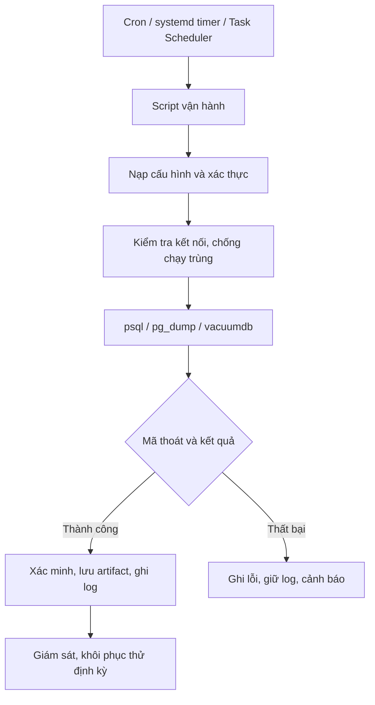

# Tự động hóa tác vụ quản trị PostgreSQL bằng công cụ dòng lệnh

Quản trị PostgreSQL thường gồm nhiều công việc lặp lại: kiểm tra kết nối, chạy truy vấn giám sát, sao lưu dữ liệu, kiểm tra bản sao lưu, cập nhật thống kê và lưu nhật ký vận hành. Làm thủ công từng lệnh dễ bỏ sót thời điểm thực hiện hoặc khó truy vết khi xảy ra lỗi. **Tự động hóa bằng công cụ dòng lệnh (CLI)** giúp biến các thao tác đó thành quy trình có thể chạy theo lịch, có mã thoát rõ ràng và có thể kiểm chứng kết quả.

Bài học sử dụng cơ sở dữ liệu ví dụ `shopdb`, người dùng PostgreSQL `pg_automation` và môi trường Linux để xây dựng một quy trình thực tế. Những tên này chỉ là ví dụ; khi áp dụng cần thay bằng tên và đường dẫn của môi trường đang quản trị.

## 1. Những công cụ PostgreSQL phù hợp để tự động hóa

PostgreSQL cung cấp sẵn các chương trình dòng lệnh; không nhất thiết phải viết ứng dụng Java hoặc dùng thư viện kết nối để làm các tác vụ vận hành cơ bản.

| Công cụ | Tác vụ thường tự động hóa | Điều cần lưu ý |
| --- | --- | --- |
| `psql` | Chạy SQL từ file, thu thập thông tin, xuất báo cáo | Dùng `ON_ERROR_STOP` để lỗi SQL làm tiến trình thất bại |
| `pg_isready` | Kiểm tra máy chủ có đang chấp nhận kết nối | Không chứng minh tài khoản có quyền truy vấn hay dữ liệu đúng |
| `pg_dump` | Sao lưu logic một cơ sở dữ liệu | Không sao lưu toàn bộ cấu hình cụm, các role toàn cục hay WAL để khôi phục theo thời điểm |
| `pg_restore` | Xem nội dung và khôi phục bản sao lưu dạng archive | Nên khôi phục thử vào cơ sở dữ liệu tách biệt |
| `pg_dumpall` | Sao lưu nhiều database hoặc đối tượng toàn cục | Cần quyền thích hợp; dữ liệu đầu ra cũng phải được bảo vệ |
| `vacuumdb` | Chạy VACUUM/ANALYZE theo phạm vi xác định | Autovacuum đã xử lý phần lớn nhu cầu thường ngày |
| `reindexdb` | Tạo lại index khi có lý do vận hành cụ thể | Có thể tốn tài nguyên, phát sinh khóa hoặc ảnh hưởng tải hệ thống |
| `createdb` / `dropdb` | Tạo hoặc xóa cơ sở dữ liệu thử nghiệm | Đặc biệt thận trọng với `dropdb` và tên database đích |
| `pg_basebackup` | Sao lưu vật lý toàn cụm | Phục vụ chiến lược backup vật lý/WAL, khác với `pg_dump` |
| `pg_ctl` | Quản lý vòng đời một PostgreSQL instance | Thường chạy với tài khoản hệ điều hành quản lý dịch vụ |

**Phân biệt phạm vi:** `pg_dump shopdb` tạo bản sao lưu logic cho `shopdb`; nó không thay thế chiến lược backup vật lý, lưu trữ WAL và kiểm tra khả năng phục hồi điểm thời gian (PITR) khi hệ thống yêu cầu RPO/RTO nghiêm ngặt.

Luồng xử lý điển hình:



Một script vận hành tốt cần biết **đang kết nối tới đâu**, **ai có quyền thực hiện**, **điều gì được xem là thành công**, **xử lý file dở dang thế nào** và **ai sẽ nhận thông tin khi lịch chạy thất bại**.

## 2. Chuẩn bị môi trường và kết nối không tương tác

### 2.1. Cài client và kiểm tra phiên bản

Trên máy chạy tác vụ, cần cài các PostgreSQL client utilities tương ứng và bảo đảm chúng có trong `PATH`:

```bash
psql --version
pg_dump --version
pg_restore --version
pg_isready --version
command -v psql pg_dump pg_restore pg_isready
```

Nên dùng bộ công cụ cùng major version với PostgreSQL server. Đặc biệt, `pg_dump` phiên bản cũ hơn major version của server mới có thể từ chối sao lưu. Máy thực hiện backup có thể là máy chuyên dụng, không bắt buộc chạy PostgreSQL server.

### 2.2. Cấu hình qua biến môi trường

Các client của PostgreSQL sử dụng biến môi trường `PG*` của thư viện `libpq`:

```bash
export PGHOST=127.0.0.1
export PGPORT=5432
export PGDATABASE=shopdb
export PGUSER=pg_automation
export PGCONNECT_TIMEOUT=10
export PGPASSFILE=/home/pgops/.pgpass
```

Lựa chọn địa chỉ và cơ chế TLS theo triển khai thật. Với kết nối qua mạng không đáng tin cậy, cần cấu hình TLS và xác thực chứng chỉ máy chủ phù hợp (ví dụ `PGSSLMODE=verify-full` cùng CA hợp lệ), không dựa vào việc mạng nội bộ mặc nhiên an toàn.

Không đặt mật khẩu trong URL, dòng lệnh `-W <mật-khẩu>` hoặc file script được commit. Thực tế `-W` của `psql` là tùy chọn **yêu cầu nhập mật khẩu**, không nhận mật khẩu trực tiếp. Trên Linux, file `.pgpass` có thể chứa một dòng có định dạng:

```text
127.0.0.1:5432:shopdb:pg_automation:MAT_KHAU_LAY_TU_SECRET_MANAGER
```

Thay giá trị minh họa bằng thông tin xác thực được cấp an toàn, không dùng chính chuỗi minh họa. Quyền truy cập file phải hạn chế:

```bash
chmod 600 /home/pgops/.pgpass
chmod 700 /home/pgops
```

Khi tạo mật khẩu, cần tránh để nó xuất hiện trong lịch sử shell hoặc log. Nếu mật khẩu chứa `:` hoặc dấu gạch chéo ngược, phải escape theo quy tắc định dạng `.pgpass`. Trên Windows, có thể dùng `PGPASSFILE` trỏ tới file được bảo vệ bằng NTFS ACL; không áp dụng `chmod` của Linux.

Tài khoản tự động hóa nên có **quyền tối thiểu** cho từng tác vụ. Ví dụ, tài khoản sao lưu cần quyền đọc các đối tượng được dump, trong khi tài khoản bảo trì cần quyền phù hợp cho thao tác bảo trì. Không dùng superuser chỉ để chạy `SELECT 1` hoặc backup thông thường.

### 2.3. Tách kiểm tra mạng và kiểm tra quyền SQL

```bash
# Kiểm tra server có chấp nhận kết nối hay không.
pg_isready -h "$PGHOST" -p "$PGPORT" -d "$PGDATABASE"

# Thực sự đăng nhập và chạy SQL; thất bại nếu SQL có lỗi.
psql -X -w -v ON_ERROR_STOP=1 -Atqc "SELECT 1;"
```

Các tùy chọn hay dùng trong tự động hóa:

- `-X`: không nạp `.psqlrc` cá nhân, giúp hành vi ổn định giữa các máy.
- `-w`: không hỏi mật khẩu tương tác; thiếu thông tin xác thực thì báo lỗi ngay.
- `-v ON_ERROR_STOP=1`: dừng khi SQL hoặc lệnh xử lý trong `psql` gặp lỗi.
- `-A`, `-t`, `-q`: xuất kết quả gọn để script dễ đọc; `-c` chạy chuỗi SQL được truyền vào.

`pg_isready` chỉ là một bước kiểm tra ban đầu. Nó có thể báo server đang nhận kết nối ngay cả khi tài khoản hiện tại không đủ quyền hoặc không đăng nhập được. Để quyết định công việc có thể chạy, luôn kiểm tra cả lệnh thực tế cần thiết.

## 3. Tự động hóa câu lệnh SQL bằng `psql`

Khi cần kiểm tra số phiên đang kết nối, hãy lưu SQL vào file `sql/daily_health.sql`:

```sql
SELECT
    now() AS checked_at,
    current_database() AS database_name,
    count(*) AS session_count
FROM pg_stat_activity
WHERE datname = current_database();
```

Chạy file từ shell:

```bash
psql -X -w -v ON_ERROR_STOP=1 \
  --dbname="$PGDATABASE" \
  --file="./sql/daily_health.sql"
```

Khác với nhập lệnh tương tác, cách này lưu được lịch sử thay đổi và dễ dùng lại trong cron hoặc CI. Khi cần xuất dữ liệu CSV về **máy chạy client**, dùng `\copy` của `psql` (ví dụ giả định hệ thống có bảng `public.orders`):

```bash
psql -X -w -v ON_ERROR_STOP=1 \
  -c "\copy (SELECT id, created_at FROM public.orders WHERE created_at >= current_date - interval '1 day') TO '/srv/reports/recent_orders.csv' WITH (FORMAT csv, HEADER true)"
```

`\copy` ghi file ở phía client; `COPY ... TO '/path'` chạy phía server và có yêu cầu quyền/đường dẫn khác. Đảm bảo thư mục đích tồn tại và dữ liệu xuất được phân quyền phù hợp.

Với **nhóm thay đổi SQL có thể chạy trong transaction**, `psql` có tùy chọn `--single-transaction` khi sử dụng `-f`:

```bash
psql -X -w -v ON_ERROR_STOP=1 \
  --single-transaction \
  --file="./sql/maintenance_transactional.sql"
```

Không sử dụng cách này cho lệnh cấm chạy trong transaction block, chẳng hạn `VACUUM` hoặc `CREATE INDEX CONCURRENTLY`. Tác vụ thay đổi schema nên có quy trình migration, kiểm soát phiên bản và thử nghiệm trên môi trường riêng.

## 4. Xây dựng script backup PostgreSQL chạy hằng ngày

Bản backup hữu ích phải tạo được file đầy đủ, không để file thành công giả do lệnh lỗi giữa chừng, tránh hai lịch chạy ghi trùng và có dấu hiệu thất bại rõ ràng cho bộ lập lịch.

Giả sử tài khoản hệ điều hành `pgops` đã được cấp quyền ghi vào `/srv/pg-backups`, và đã khai báo các biến `PGHOST`, `PGPORT`, `PGDATABASE`, `PGUSER`, `PGPASSFILE`. Lưu script sau tại `/opt/dbops/backup_pg.sh`:

```bash
#!/usr/bin/env bash
set -Eeuo pipefail
umask 077

: "${PGHOST:?Thieu PGHOST}"
: "${PGPORT:?Thieu PGPORT}"
: "${PGDATABASE:?Thieu PGDATABASE}"
: "${PGUSER:?Thieu PGUSER}"
: "${PGPASSFILE:?Thieu PGPASSFILE}"

BACKUP_DIR="${BACKUP_DIR:-/srv/pg-backups}"
RETENTION_DAYS="${RETENTION_DAYS:-14}"

if [[ ! "$RETENTION_DAYS" =~ ^[1-9][0-9]*$ ]]; then
    echo "RETENTION_DAYS phai la so nguyen duong" >&2
    exit 2
fi

mkdir -p -- "$BACKUP_DIR"

# Linux: flock giữ một khóa trong suốt thời gian script chạy.
exec 9>"$BACKUP_DIR/.backup.lock"
if ! flock -n 9; then
    echo "Da co mot job backup dang chay" >&2
    exit 75
fi

timestamp="$(date -u +%Y%m%dT%H%M%SZ)"
temp_file="$BACKUP_DIR/${PGDATABASE}_$timestamp.dump.partial"
final_file="$BACKUP_DIR/${PGDATABASE}_$timestamp.dump"

# Không để lại file .partial nếu pg_dump hoặc bước kiểm tra lỗi.
trap 'rm -f -- "$temp_file"' EXIT

echo "[$(date -u +%FT%TZ)] Kiem tra PostgreSQL"
pg_isready -h "$PGHOST" -p "$PGPORT" -d "$PGDATABASE" >/dev/null

echo "[$(date -u +%FT%TZ)] Bat dau pg_dump"
pg_dump --no-password \
    --format=custom \
    --dbname="$PGDATABASE" \
    --file="$temp_file"

# Kiểm tra archive đọc được TOC; đây chưa phải kiểm thử restore đầy đủ.
pg_restore --list "$temp_file" >/dev/null

# Chỉ file đã hoàn tất mới có đuôi .dump.
mv -- "$temp_file" "$final_file"
trap - EXIT

# Giữ bản backup theo số ngày quy định, chỉ xóa file đúng mẫu.
find "$BACKUP_DIR" -maxdepth 1 -type f \
    -name "${PGDATABASE}_*.dump" \
    -mtime "+$((RETENTION_DAYS - 1))" -print -delete

echo "[$(date -u +%FT%TZ)] Thanh cong: $final_file"
```

`set -e` cùng `pipefail` giúp thoát khi lệnh cần thiết thất bại; `set -u` phát hiện biến chưa khai báo. `umask 077` hạn chế quyền file mới. Mã thoát khác 0 cho phép bộ lập lịch đánh dấu công việc thất bại. Khóa `flock` chỉ có sẵn khi đã cài utility tương ứng trên Linux; nếu chạy trên hệ điều hành khác, cần dùng cơ chế khóa phù hợp.

Dạng archive `--format=custom` (`-Fc`) hỗ trợ `pg_restore`, cho phép lựa chọn đối tượng khi khôi phục và nén dữ liệu theo khả năng của phiên bản client. File `.partial` được đổi tên thành `.dump` sau khi hoàn tất để job giám sát không nhầm file chưa xong với một bản backup dùng được.

**Điều script chưa bảo đảm:** `pg_restore --list` chỉ kiểm tra PostgreSQL có đọc được cấu trúc archive (table of contents); không xác minh mọi khối dữ liệu có thể phục hồi. Cần khôi phục thử định kỳ và kiểm tra dữ liệu thực tế. Ngoài ra, bản backup nằm cùng máy chủ vẫn có thể mất khi máy hoặc ổ đĩa hỏng; tổ chức nên lưu thêm một bản ngoài máy chủ, có mã hóa, kiểm soát quyền và chính sách giữ bản sao độc lập.

### Chạy thủ công trước khi đưa vào lịch

```bash
chmod 700 /opt/dbops/backup_pg.sh
/opt/dbops/backup_pg.sh
ls -lh /srv/pg-backups/*.dump
```

Chạy bằng **đúng tài khoản hệ điều hành sẽ chạy lịch**. Cần bảo đảm tài khoản đó đọc được `PGPASSFILE`, ghi được thư mục backup và file log. Chỉ sau khi backup thủ công thành công mới đặt lịch.

## 5. Khôi phục thử: bước xác nhận quan trọng nhất

Đừng thử khôi phục trực tiếp lên database đang phục vụ người dùng. Một cách an toàn là dùng máy thử nghiệm hoặc database riêng `shopdb_restorecheck`, không tồn tại trong ứng dụng production:

```bash
# Chạy trong môi trường kiểm thử với quyền tạo database.
createdb --template=template0 shopdb_restorecheck

# Đọc lại archive vừa sao lưu; thay đường dẫn bằng file thực tế.
pg_restore --exit-on-error \
  --no-owner \
  --no-acl \
  --dbname=shopdb_restorecheck \
  /srv/pg-backups/shopdb_20261114T020000Z.dump

# Kiểm tra truy vấn cơ bản trong database kiểm thử.
psql -X -w -v ON_ERROR_STOP=1 \
  -d shopdb_restorecheck \
  -c "SELECT count(*) AS public_tables
      FROM information_schema.tables
      WHERE table_schema = 'public'
        AND table_type = 'BASE TABLE';"
```

`--exit-on-error` dừng khi phục hồi gặp lỗi; `--no-owner` và `--no-acl` giúp bỏ qua thiết lập owner/quyền từ hệ thống nguồn khi môi trường kiểm thử có role khác. Hai tùy chọn này không đảm bảo mọi extension hoặc dependency đều khôi phục được nếu thiếu quyền cần thiết.

Kiểm tra số bảng chỉ là bước đầu. Cần bổ sung các phép thử gắn với ứng dụng, ví dụ đếm hàng ở bảng quan trọng, kiểm tra quan hệ, đối chiếu số liệu nghiệp vụ và chạy truy vấn đọc đặc trưng. Sau khi xác minh, có thể xóa **đúng database kiểm thử** theo quy trình nội bộ; tuyệt đối không sao chép lệnh `dropdb` rồi thay nhầm tên thành database production.

Một bản backup được coi là có giá trị khi có thể **khôi phục thành công trong thời gian phục hồi mục tiêu**. Nếu yêu cầu phục hồi đến từng thời điểm giữa hai bản backup, cần thiết kế lưu trữ WAL/PITR phù hợp, không chỉ tăng tần suất `pg_dump`.

## 6. Tự động hóa bảo trì và giám sát

### 6.1. Thu thập chỉ số bằng SQL

Ví dụ truy vấn các bảng có nhiều dead tuple ước tính và thời điểm autovacuum gần nhất:

```bash
psql -X -w -v ON_ERROR_STOP=1 -d shopdb -c "
SELECT
    schemaname,
    relname,
    n_live_tup,
    n_dead_tup,
    last_autovacuum,
    last_autoanalyze
FROM pg_stat_user_tables
ORDER BY n_dead_tup DESC
LIMIT 10;"
```

`n_live_tup`, `n_dead_tup` là số liệu ước tính; chúng cần được đọc cùng quy mô bảng, tải ghi, thời điểm thống kê và thiết lập autovacuum. Không nên tự động chạy lệnh nặng chỉ vì một lần đọc chỉ số vượt ngưỡng tùy ý.

### 6.2. Các utility bảo trì

```bash
# Cập nhật thống kê phục vụ planner, khi có nhu cầu cụ thể.
vacuumdb --analyze-only --verbose --dbname=shopdb

# Chỉ dùng khi đã xác định cần tạo lại index.
# --concurrently hỗ trợ giảm mức chặn ghi nhưng vẫn tiêu tốn tài nguyên.
reindexdb --concurrently \
  --dbname=shopdb \
  --table=public.orders
```

Autovacuum thường đã đảm nhận dọn dead tuple và phân tích thống kê. `REINDEX` chỉ cần khi có căn cứ như vấn đề index cụ thể, bloat đáng kể được đánh giá đúng hoặc yêu cầu bảo trì đã được kiểm chứng. Chạy trong khung giờ phù hợp, quan sát thời gian, dung lượng đĩa, lock và mức tải. Các phiên bản PostgreSQL khác nhau có thể hỗ trợ tùy chọn concurrent khác nhau, nên kiểm tra `reindexdb --help` theo client/server thực tế.

Với tác vụ dọn dữ liệu nghiệp vụ, nên có điều kiện lọc rõ ràng, chạy thử `SELECT` với cùng điều kiện và kiểm soát số hàng thay đổi. Không đưa `DELETE`/`TRUNCATE` vào lịch chỉ dựa trên ví dụ minh họa.

## 7. Đặt lịch thực thi

### 7.1. Cron trên Linux

Chỉnh crontab của tài khoản `pgops` bằng `crontab -e` và khai báo cấu hình cần thiết (có thể dùng cách nạp cấu hình an toàn riêng nếu hạ tầng đã hỗ trợ):

```cron
SHELL=/bin/bash
PATH=/usr/local/bin:/usr/bin:/bin
PGHOST=127.0.0.1
PGPORT=5432
PGDATABASE=shopdb
PGUSER=pg_automation
PGPASSFILE=/home/pgops/.pgpass
PGCONNECT_TIMEOUT=10
BACKUP_DIR=/srv/pg-backups
RETENTION_DAYS=14

# 02:00 mỗi ngày theo múi giờ của cron host.
0 2 * * * /opt/dbops/backup_pg.sh >> /var/log/pgops/backup.log 2>&1
```

Thư mục `/var/log/pgops` phải tồn tại và do tài khoản lịch chạy có quyền ghi. Quản lý kích thước log bằng logrotate hoặc hệ thống log tập trung. Bản thân cron không bảo đảm có cảnh báo nếu job hỏng; cần cấu hình giám sát mã thoát, thời điểm backup cuối cùng và tuổi bản sao lưu.

Nếu hai lịch chạy trùng do job trước kéo dài, khóa `flock` trong script giúp phiên sau thoát thay vì tạo hai file đồng thời. Kiểm tra thời gian và múi giờ thực tế của host; khi chuyển lịch qua các máy có múi giờ khác nhau, không giả định `02:00` luôn là cùng một mốc UTC.

### 7.2. Systemd timer khi cần theo dõi trạng thái tốt hơn

Trên hệ điều hành có systemd, có thể thay cron bằng service và timer. Ví dụ file `/etc/systemd/system/pg-backup.service`:

```ini
[Unit]
Description=PostgreSQL logical backup

[Service]
Type=oneshot
User=pgops
EnvironmentFile=/etc/pgops/backup.env
ExecStart=/opt/dbops/backup_pg.sh
```

File `/etc/pgops/backup.env` chứa các biến `PGHOST`, `PGPORT`, `PGDATABASE`, `PGUSER`, `PGPASSFILE`, `BACKUP_DIR` (không cần chứa mật khẩu). Phân quyền file theo hạ tầng hệ điều hành. File `/etc/systemd/system/pg-backup.timer`:

```ini
[Unit]
Description=Daily PostgreSQL backup timer

[Timer]
OnCalendar=*-*-* 02:00:00
Persistent=true
Unit=pg-backup.service

[Install]
WantedBy=timers.target
```

Sau khi cài và kiểm tra cấu hình bằng quyền quản trị hệ điều hành:

```bash
sudo systemctl daemon-reload
sudo systemctl enable --now pg-backup.timer
systemctl list-timers pg-backup.timer
journalctl -u pg-backup.service -n 50 --no-pager
```

`Persistent=true` cho phép timer chạy bù khi máy đã tắt trong một lần lịch dự kiến. Cần bảo đảm việc chạy bù phù hợp tải hệ thống và chính sách backup.

### 7.3. Trên Windows: PowerShell và Task Scheduler

Các utility PostgreSQL cũng chạy được trên Windows. PowerShell cần kiểm tra `$LASTEXITCODE` ngay sau khi gọi chương trình native:

```powershell
$ErrorActionPreference = "Stop"
$env:PGHOST = "127.0.0.1"
$env:PGPORT = "5432"
$env:PGDATABASE = "shopdb"
$env:PGUSER = "pg_automation"
$env:PGPASSFILE = "C:\dbops\pgpass.conf"

New-Item -ItemType Directory -Force -Path "C:\pgbackups" | Out-Null
$backup = "C:\pgbackups\shopdb_$(Get-Date -Format 'yyyyMMdd_HHmmss').dump"

& pg_dump.exe --no-password --format=custom --dbname=shopdb --file=$backup
if ($LASTEXITCODE -ne 0) { throw "pg_dump failed: $LASTEXITCODE" }

& pg_restore.exe --list $backup | Out-Null
if ($LASTEXITCODE -ne 0) { throw "pg_restore list failed: $LASTEXITCODE" }

Write-Output "Backup created: $backup"
```

Đây là phiên bản ngắn để minh họa kiểm tra mã thoát; khi dùng thật cần bổ sung khóa chống chạy trùng, xử lý file dở dang, retention và giám sát tương tự script Linux. Cấu hình Task Scheduler chạy file `.ps1` bằng một tài khoản dịch vụ có quyền thích hợp và cho phép thực thi script theo chính sách máy. Hạn chế quyền trên `pgpass.conf` bằng ACL.

## 8. Khi nào job thất bại và xử lý ra sao?

Bản chất automation là **thất bại phải nhìn thấy được**. Không nên chỉ lưu dòng `echo "success"` mà bỏ qua exit code của lệnh PostgreSQL.

| Hiện tượng | Nguyên nhân thường gặp | Hướng kiểm tra |
| --- | --- | --- |
| `pg_isready` báo không chấp nhận kết nối | Server dừng, mạng chặn, host/port sai hoặc đang khởi động | Kiểm tra endpoint, dịch vụ, firewall và log server |
| `psql` báo authentication failed | Mật khẩu, rule `pg_hba.conf` hoặc file `.pgpass` không khớp | Kiểm tra host/port/db/user và cơ chế xác thực |
| `pg_dump` báo permission denied | Role không có quyền đọc một số object | Cấp quyền đúng phạm vi hoặc dùng tài khoản backup được quản lý |
| `pg_dump` bị từ chối vì version | Client quá cũ so với server | Cài utility tương thích với major version của server |
| `pg_dump` báo no space left on device | Dung lượng máy backup không đủ | Theo dõi disk, dung lượng file, retention và offsite upload |
| `pg_restore` lỗi owner/extension | Môi trường đích khác role hoặc thiếu extension/quyền | Dùng database thử phù hợp; kiểm tra dependency, quyền và restore options |
| Không xuất hiện file backup mới | Timer không chạy, biến môi trường thiếu, khóa đang giữ, script đã lỗi | Xem lịch, journal/log, exit code, thời điểm backup cuối |
| File `.dump` có nhưng restore không thành công | Archive lỗi, thiếu dependency hoặc chưa thử restore đầy đủ | Duy trì lịch khôi phục thử với kiểm tra nghiệp vụ |

Tối thiểu nên theo dõi: **thời điểm backup thành công gần nhất**, **kích thước file**, **mã thoát**, **thời gian chạy**, **dung lượng đĩa còn lại** và **kết quả khôi phục thử gần nhất**. Gửi cảnh báo qua hệ thống giám sát của tổ chức khi các điều kiện quan trọng không đạt.

Tính lặp lại cũng cần được thiết kế: kiểm tra trước khi tạo đối tượng; tránh thực hiện thay đổi SQL hai lần khi lịch chạy lại; không tự động retry mù quáng một thao tác thay đổi dữ liệu khi chưa biết lần trước đã commit hay chưa. Các lệnh chỉ đọc hoặc backup có thể retry theo chính sách, nhưng phải đặt giới hạn số lần, khoảng cách và lưu log của từng lần thử.

## 9. Bài thực hành: hoàn thiện một quy trình backup có thể phục hồi

Giả sử ứng dụng Java/Spring Boot sử dụng PostgreSQL `shopdb`. Hãy thực hiện lần lượt trong môi trường phát triển hoặc kiểm thử:

1. Tạo role vận hành với quyền đủ dùng, thiết lập `PGHOST`, `PGPORT`, `PGDATABASE`, `PGUSER`, xác thực qua `PGPASSFILE`. Chạy `pg_isready` và `psql -X -w -v ON_ERROR_STOP=1 -Atqc "SELECT 1"`.
2. Chạy `backup_pg.sh` thủ công; quan sát mã thoát và file `.dump` được tạo. Kiểm tra cấu trúc archive bằng `pg_restore --list`.
3. Tạo database kiểm thử riêng, chạy `pg_restore --exit-on-error` và kiểm tra một số bảng/dữ liệu mà ứng dụng thực sự cần.
4. Sau khi xác nhận có thể restore, thêm cron hoặc systemd timer; kiểm tra log của ít nhất một lần chạy theo lịch và xác định nơi nhận cảnh báo khi job thất bại.
5. Thử một tình huống lỗi có kiểm soát, chẳng hạn đặt `PGPORT` sai trên môi trường kiểm thử; xác nhận script trả mã khác 0, không tạo file `.dump` được coi là thành công, và công cụ giám sát phát hiện thất bại.

Khi hoàn thành, bạn sẽ có quy trình quản trị có thể chạy lại, kiểm tra được và có dấu vết vận hành. Những thao tác tốn tài nguyên hoặc có khả năng làm mất dữ liệu chỉ nên được đưa vào lịch sau khi đã xác định quyền, điều kiện chạy, cơ chế phục hồi và cách quan sát kết quả.

## 10. Ghi nhớ khi đưa vào hệ thống thực tế

- **Automation không đồng nghĩa với độ tin cậy.** Một file được tạo ra chưa chứng minh nó có thể khôi phục; lịch restore thử là thành phần bắt buộc của chiến lược backup.
- **Dùng đúng công cụ cho đúng phạm vi.** `pg_dump` phục vụ backup logic từng database; `pg_basebackup`/WAL phục vụ phương án vật lý và PITR; `psql` chạy SQL có thể kiểm soát mã thoát.
- **Không đưa bí mật vào script/log.** Quản lý quyền của tài khoản PostgreSQL, user hệ điều hành, `.pgpass`, thư mục backup và nơi lưu bản sao.
- **Giữ kết quả đo được.** Tác vụ cần lịch chạy rõ ràng, log, exit code, quy tắc chống chạy trùng, kiểm soát retention và cảnh báo khi không có bản backup mới.
- **Bảo trì dựa trên nhu cầu đo được.** Tận dụng autovacuum; chỉ chạy VACUUM/ANALYZE/REINDEX thủ công theo bằng chứng và trong thời điểm phù hợp.

Từ nền tảng này, có thể mở rộng script thành hệ thống vận hành chuẩn hóa: đưa backup lên kho lưu trữ ngoài máy chủ, bổ sung checksum, mã hóa, giám sát tập trung, theo dõi chỉ tiêu RPO/RTO và diễn tập khôi phục định kỳ.
