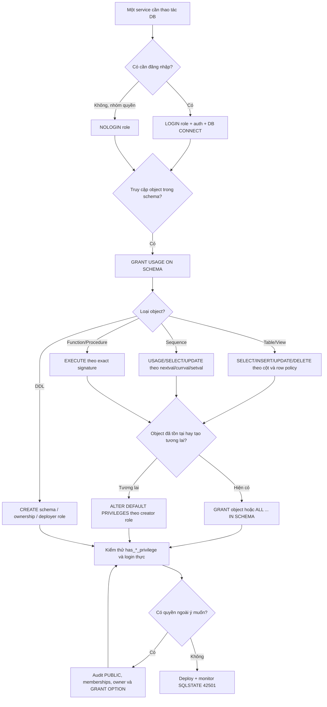

# GRANT, REVOKE và quyền trên database, schema, bảng, sequence, hàm trong PostgreSQL

Một ứng dụng cần đọc báo cáo không nhất thiết phải được quyền sửa dữ liệu; một worker cần tạo đơn hàng không nhất thiết được xem ghi chú nội bộ; còn một tài khoản triển khai schema không nên là tài khoản mà API sử dụng mỗi ngày. PostgreSQL giải quyết những nhu cầu này bằng hệ thống **role, ownership, object privileges và membership**, trong đó hai lệnh trung tâm là **`GRANT`** và **`REVOKE`**.

Ví dụ, ba câu sau tác động lên ba tầng bảo mật **khác nhau**:

```sql
GRANT CONNECT ON DATABASE app_db TO app_reader;

GRANT USAGE ON SCHEMA sales TO app_reader;

GRANT SELECT ON TABLE sales.orders TO app_reader;
```

- `CONNECT` cho phép sử dụng database ở bước kết nối, nhưng không cấp quyền đọc mọi bảng.
- `USAGE` trên schema cho phép tra cứu những object nằm trong namespace đó; nó không tự cấp `SELECT`.
- `SELECT` trên bảng cho phép đọc theo phạm vi được cấp, nhưng có thể vẫn cần quyền database, schema và các quyền khác.

Một lệnh `GRANT ALL` trên database **không** có nghĩa người nhận được mọi quyền trên bảng trong database. Tương tự, `REVOKE` một đường quyền không bảo đảm quyền truy cập đã biến mất nếu role còn được hưởng quyền từ `PUBLIC` hoặc role membership khác.

Bài học thuộc chương **Bảo mật** trong module *Database Engine Relational PostgreSQL*. Chúng ta sẽ xây dựng mô hình quyền theo từng tầng: **database → schema → bảng/view/cột → sequence → function/procedure**; sau đó kiểm tra quyền hiệu lực, thu hồi, quản lý quyền mặc định của đối tượng được tạo trong tương lai và tích hợp với ứng dụng.

> **Phạm vi phiên bản:** Cú pháp chính đối chiếu với PostgreSQL 18. Các quyền như `MAINTAIN`, tùy chọn membership và behavior mặc định của schema `public` cần kiểm tra theo major version thực tế. Lab tạo roles/database mới, nên chỉ chạy trên **cluster thử nghiệm** bởi tài khoản quản trị được phép. Không chạy các lệnh `REVOKE ... FROM PUBLIC` hoặc `DROP` trên database sản xuất mà chưa xác định tác động.

---

## 1. Mục tiêu học tập

Sau bài này, bạn có thể:

1. Phân biệt object owner, role login, group role `NOLOGIN`, membership và pseudo-role `PUBLIC`.
2. Dùng `GRANT`/`REVOKE` đúng theo loại object thay vì cấp quyền ở sai tầng.
3. Giải thích ba quyền trên database: `CONNECT`, `CREATE` và `TEMPORARY`.
4. Phân biệt `USAGE` và `CREATE` trên schema, kể cả nguy cơ `search_path`.
5. Cấp `SELECT`, `INSERT`, `UPDATE`, `DELETE`, `TRUNCATE`, `REFERENCES`, `TRIGGER` và `MAINTAIN` trên table/view khi phù hợp.
6. Cấp quyền theo **cột** và hiểu trường hợp table-level grant ghi đè hạn chế theo cột.
7. Dùng `USAGE`, `SELECT` và `UPDATE` trên sequence cho `nextval`, `currval`, `setval`.
8. Cấp `EXECUTE` riêng cho function, procedure, routine và xử lý overloaded signatures.
9. Phân biệt object privilege với `WITH GRANT OPTION` và role membership `WITH ADMIN OPTION`.
10. Hiểu `REVOKE ... CASCADE/RESTRICT` và nguyên nhân một role vẫn có quyền sau `REVOKE`.
11. Dùng `ALTER DEFAULT PRIVILEGES` đúng với role **tạo đối tượng**, global defaults và per-schema additions.
12. Không nhầm `GRANT ON ALL TABLES IN SCHEMA` với quyền trên các bảng tương lai.
13. Đọc quyền qua `psql`, `has_*_privilege` và system catalogs.
14. Áp dụng nguyên tắc **least privilege** trong migration, connection pool, `SECURITY DEFINER` và Row-Level Security.
15. Tự dựng một lab với tài khoản đọc, tài khoản ghi, sequence, view và function rồi kiểm chứng các thao tác được phép/bị từ chối.

## 2. Tư duy đúng: một request đi qua nhiều cổng

Một câu SQL:

```sql
SELECT order_id FROM sales.orders;
```

có thể cần các điều kiện:

```text
Khả năng kết nối (role LOGIN, pg_hba.conf, DB CONNECT, ...)
                        │
                        ▼
             Quyền USAGE trên schema
                        │
                        ▼
             Quyền SELECT trên table/cột
                        │
                        ▼
         RLS policies / view / function rules
                        │
                        ▼
                Dữ liệu được trả về
```

Quyền ở tầng trên **không thay thế** tầng dưới. Nếu thiếu `USAGE` trên schema, `SELECT` trên bảng có thể vẫn không đủ để sử dụng tên bảng. Nếu có `SELECT`, Row-Level Security vẫn có thể giới hạn các hàng mà role nhìn thấy.

### 2.1. Bốn loại cơ chế cần tách biệt

| Cơ chế | Trả lời câu hỏi gì? |
|---|---|
| **Role attributes** | Role có thể LOGIN, CREATEROLE, CREATEDB, BYPASSRLS, SUPERUSER...? |
| **Object privileges / ACL** | Role được SELECT bảng, USAGE sequence, EXECUTE function...? |
| **Object ownership** | Ai có quyền thay đổi định nghĩa hoặc DROP object? |
| **RLS và chính sách ứng dụng** | Trong bảng được phép truy cập, role được thao tác trên **những hàng nào**? |

Không viết “`GRANT SELECT` là đủ để bảo vệ dữ liệu đa tenant”. Nó chỉ là một phần của mô hình quyền.

## 3. Role: người dùng và nhóm quyền

PostgreSQL dùng **role** cho cả account đăng nhập và nhóm cấp quyền.

```sql
-- Login role có thể xác thực vào DB nếu đủ điều kiện khác.
CREATE ROLE app_user LOGIN;

-- NOLOGIN role thường là nhóm quyền.
CREATE ROLE app_read NOLOGIN;

-- Gán nhóm quyền cho login role.
GRANT app_read TO app_user;
```

`GRANT app_read TO app_user` là **GRANT membership**, không phải GRANT SELECT trên một object.

### 3.1. Tại sao nên dùng group role?

Nếu 20 services đều cần đọc một số bảng, cấp SELECT cho từng service làm chính sách khó kiểm tra. Thay vào đó:

```text
app_read (NOLOGIN)
    ├── service_api (LOGIN)
    ├── service_report (LOGIN)
    └── service_export (LOGIN)
```

Khi schema thay đổi, DBA cấp object privileges cho `app_read`. Các login roles thừa hưởng theo các **membership options** phù hợp.

### 3.2. LOGIN không đồng nghĩa được đọc bảng

`CREATE ROLE app_user LOGIN` không mặc nhiên cấp quyền với bảng ứng dụng. Và `GRANT CONNECT` cho một `NOLOGIN` role không tự khiến nó đăng nhập được: cần một login role có membership và đáp ứng authentication.

### 3.3. Role attributes không phải object privileges

`SUPERUSER`, `BYPASSRLS`, `CREATEDB`, `CREATEROLE`, `REPLICATION` không phải các quyền `GRANT SELECT ON TABLE`. Chúng có phạm vi và rủi ro khác; tuyệt đối không cấp `SUPERUSER` để khắc phục một lỗi `permission denied for table` thông thường.

## 4. PUBLIC là ai?

`PUBLIC` là một nhóm **ngầm định gồm mọi roles hiện tại và trong tương lai**. Nó không phải schema `public` và không phải role thông thường để `CREATE ROLE PUBLIC`.

```sql
GRANT EXECUTE ON FUNCTION sales.calc_tax(numeric)
TO PUBLIC;
```

Nghĩa là mọi role có đường truy cập phù hợp có thể hưởng quyền EXECUTE đó.

```sql
REVOKE EXECUTE ON FUNCTION sales.calc_tax(numeric)
FROM PUBLIC;
```

chỉ thu hồi **đường quyền đến từ PUBLIC** cho function này. Một role đã được GRANT trực tiếp hoặc qua một role khác vẫn có thể EXECUTE.

### 4.1. PUBLIC khác schema public

| Chuỗi | Bản chất |
|---|---|
| `PUBLIC` | Tập mọi roles trong privilege system |
| `public` | Schema thông thường trong một database |
| `pg_catalog` | Schema hệ thống |
| `pg_database_owner` | Predefined role gắn với owner của database hiện tại |

Sai lầm rất thường gặp là tưởng `REVOKE CREATE ON SCHEMA public FROM PUBLIC` có nghĩa “cấm tất cả truy cập database”. Nó chỉ thu hồi **quyền CREATE ở schema public** vốn được cấp qua PUBLIC.

## 5. Owner khác grantee

Khi object được tạo, nó có **owner**. Owner thường là role thực thi `CREATE`, hoặc role được chỉ định bằng cơ chế owner phù hợp.

```sql
SELECT
    tableowner,
    schemaname,
    tablename
FROM pg_tables
WHERE schemaname = 'sales';
```

Owner có những quyền đặc biệt với object:

- Có thể `ALTER`/`DROP` object theo quy tắc ownership.
- Có thể GRANT/REVOKE privileges trên object.
- Được xem là có **grant options** đối với object mà mình sở hữu.
- Thông thường có đầy đủ object privileges lúc khởi tạo, trừ khi policy đã thay đổi chúng.

### 5.1. Không có quyền GRANT DROP TABLE thông thường

```sql
-- Không phải cú pháp PostgreSQL để chuyển quyền sở hữu:
GRANT DROP ON TABLE sales.orders TO app_user;
```

Quyền thay đổi định nghĩa hoặc DROP object **gắn với owner** chứ không là object privilege `DROP` được GRANT.

Nếu cần chuyển owner:

```sql
ALTER TABLE sales.orders OWNER TO ddl_owner;
```

Lệnh trên chỉ chạy bởi role có đủ điều kiện ownership và membership/SET ROLE, hoặc bởi superuser; không phải role có SELECT thông thường.

### 5.2. Owner có thể tự REVOKE quyền thường của mình

Một owner có thể thu hồi SELECT/UPDATE khỏi chính mình trong một số trường hợp nhằm tránh thao tác nhầm, nhưng owner **vẫn có khả năng cấp lại** vì grant option thuộc về ownership. Đó không phải cách tạo rào chắn tuyệt đối đối với owner hoặc superuser.

## 6. Bảng quyền theo loại object

| Object | Quyền chính | Không tự cấp kèm |
|---|---|---|
| Database | `CONNECT`, `CREATE`, `TEMPORARY` | SELECT mọi bảng |
| Schema | `USAGE`, `CREATE` | CONNECT DB hoặc SELECT bảng |
| Table/view | `SELECT`, `INSERT`, `UPDATE`, `DELETE`, `TRUNCATE`, `REFERENCES`, `TRIGGER`, `MAINTAIN` | USAGE sequence |
| Column | `SELECT`, `INSERT`, `UPDATE`, `REFERENCES` | Quyền trên mọi cột |
| Sequence | `USAGE`, `SELECT`, `UPDATE` | INSERT vào bảng dùng sequence |
| Function | `EXECUTE` | Quyền đọc bảng bên trong SECURITY INVOKER |
| Procedure | `EXECUTE` | Quyền COMMIT tùy ngữ cảnh hoặc DML |
| Type/domain | `USAGE` | Quyền trên bảng chứa type |
| Configuration parameter | `SET`, `ALTER SYSTEM` khi áp dụng | SUPERUSER |
| Tablespace | `CREATE` | Quyền DDL trong mọi database |

`ALL PRIVILEGES` chỉ là **tất cả những quyền phù hợp với đúng object type**, không có nghĩa superuser.

**Lưu ý:** `MAINTAIN` được tài liệu PostgreSQL 18 liệt kê ở quyền trên relations; trên cluster cũ phải kiểm tra cú pháp và chức năng theo phiên bản.

## 7. Cấu trúc lệnh GRANT

Mẫu phổ biến:

```sql
GRANT privilege [, privilege ...]
ON object_type object_name [, ...]
TO role_name [, ...]
[WITH GRANT OPTION];
```

Ví dụ:

```sql
GRANT SELECT, INSERT ON TABLE sales.orders
TO order_service;

GRANT USAGE ON SCHEMA sales
TO order_service;

GRANT EXECUTE ON FUNCTION sales.calc_tax(numeric)
TO order_service;
```

### 7.1. GRANT cộng dồn, không thay toàn bộ ACL

Nếu role đã có SELECT rồi bạn GRANT INSERT, nó có cả SELECT và INSERT. GRANT không tự thu hồi những quyền cũ.

### 7.2. FROM và TO có ý nghĩa rõ

- `GRANT ... TO role`: cấp thêm quyền.
- `REVOKE ... FROM role`: thu hồi quyền trên đường grant liên quan.
- `GRANT role_a TO role_b`: cấp **membership**.
- `REVOKE role_a FROM role_b`: thu hồi **membership**.

Không đảo hai kiểu GRANT dù đều có cú pháp `GRANT ... TO ...`.

## 8. Cấu trúc lệnh REVOKE

```sql
REVOKE privilege [, privilege ...]
ON object_type object_name [, ...]
FROM role_name [, ...]
[CASCADE | RESTRICT];
```

Ví dụ:

```sql
REVOKE INSERT ON TABLE sales.orders
FROM order_service;

REVOKE USAGE ON SCHEMA sales
FROM order_service;
```

`REVOKE` không có khái niệm “deny” theo nghĩa chặn tuyệt đối: nếu `order_service` còn được SELECT từ `PUBLIC` hoặc group role khác, quyền vẫn hiệu lực.

### 8.1. REVOKE không xóa object

`REVOKE SELECT ON TABLE ...` không xóa dữ liệu hay DROP bảng. Nó thay đổi khả năng truy cập của các role.

### 8.2. REVOKE không thay role ownership

`REVOKE ALL ON TABLE ... FROM owner` có thể giảm quyền thường của owner nhưng **không** làm người đó mất quyền sở hữu/khả năng thay đổi định nghĩa object.

### 8.3. RESTRICT và CASCADE

Nếu không có dependent grants, hai lựa chọn có thể cho kết quả giống nhau. Khi có grant chains, `RESTRICT` từ chối thao tác thu hồi làm đứt grant phụ thuộc, còn `CASCADE` thu hồi cả grants phụ thuộc theo chuỗi.

Phần sau sẽ mô phỏng chính xác bằng vai trò trung gian.

---

## 9. Lab bảo mật: chuẩn bị cluster và tài khoản

Lab tiếp theo dùng database mới tên `acl_lab` và schema `demo_acl` để tránh sửa quyền trên database đang có ứng dụng. Bạn cần tài khoản quản trị **được phép CREATE ROLE, CREATE DATABASE và SET ROLE**. Với managed PostgreSQL, quyền thực tế có thể bị hạn chế.

**Chạy một lần trong `psql` với tài khoản quản trị trên cluster thử nghiệm:**

```sql
CREATE ROLE acl_owner NOLOGIN;
CREATE ROLE acl_reader NOLOGIN;
CREATE ROLE acl_writer NOLOGIN;

CREATE ROLE acl_report_login LOGIN;
CREATE ROLE acl_worker_login LOGIN;

GRANT acl_reader TO acl_report_login;
GRANT acl_writer TO acl_worker_login;

CREATE DATABASE acl_lab OWNER acl_owner;
```

> Đây là các tên role/database ví dụ. Không đặt mật khẩu cứng trong bài, log hoặc migration. Nếu cần login bằng mật khẩu, cấu hình authentication/secrets qua công cụ quản trị được chấp thuận thay vì sao chép secrets vào SQL nguồn.

### 9.1. Kết nối vào database lab

Trong `psql`, dùng meta-command:

```text
\connect acl_lab
```

`\connect` là lệnh của `psql`, không phải câu SQL truyền qua JDBC.

Nếu không dùng `psql`, cấu hình database `acl_lab` trong connection string của ứng dụng SQL client. Phần còn lại giả định kết nối đã vào database này dưới role quản trị.

### 9.2. Phân vai

| Role | LOGIN? | Mục đích |
|---|---|---|
| `acl_owner` | Không | Sở hữu schema/tables/functions |
| `acl_reader` | Không | Nhóm quyền đọc |
| `acl_writer` | Không | Nhóm quyền nhập/cập nhật |
| `acl_report_login` | Có | Account dùng quyền `acl_reader` |
| `acl_worker_login` | Có | Account dùng quyền `acl_writer` |

Tách owner khỏi runtime accounts là nguyên tắc quan trọng. Không để API thường trực đăng nhập bằng owner để “đỡ phải GRANT”.

## 10. Database privileges: CONNECT, CREATE, TEMPORARY

Trên database thử nghiệm, owner hoặc admin chạy:

```sql
REVOKE CONNECT, TEMPORARY ON DATABASE acl_lab
FROM PUBLIC;

GRANT CONNECT ON DATABASE acl_lab
TO acl_reader, acl_writer;
```

Như vậy những roles có quyền trực tiếp hoặc thừa hưởng `acl_reader`/`acl_writer` có một đường `CONNECT`, còn kết nối không được phép từ PUBLIC bị thu hồi.

### 10.1. CONNECT không thay authentication

Để kết nối thành công còn cần:

- Role có `LOGIN`.
- Cấu hình xác thực `pg_hba.conf` hoặc chính sách provider.
- Host/network/TLS phù hợp.
- Giới hạn connection/role/database không bị vi phạm.

`GRANT CONNECT` **không mở firewall** và không bỏ qua authentication.

### 10.2. CONNECT được kiểm tra khi bắt đầu kết nối

Thu hồi `CONNECT` không nên được xem như lệnh “ngắt lập tức mọi connection đang hoạt động”. Với session hiện hữu, cần có chính sách session management riêng nếu phải ngắt quyền truy cập khẩn cấp.

### 10.3. CREATE trên database cho phép gì?

```sql
-- Chỉ minh họa; đừng cấp cho runtime reader:
GRANT CREATE ON DATABASE acl_lab TO ddl_deployer;
```

`CREATE` ở **database** có liên quan đến việc tạo **schema**, publication và một số trusted extension khi đủ điều kiện. Nó **không** tương đương `CREATE` trên schema `demo_acl` và không trực tiếp là quyền tạo mọi table trong mọi schema.

### 10.4. TEMP/TEMPORARY

```sql
GRANT TEMPORARY ON DATABASE acl_lab TO acl_writer;
```

Cho phép tạo temporary tables trong database, nhưng không nên cấp mặc định nếu worker không cần chúng. Đây là quyền độc lập với `CREATE` schema.

### 10.5. Mặc định PUBLIC trên database

Trên PostgreSQL thông thường, database có thể cấp `CONNECT` và `TEMPORARY` cho `PUBLIC` theo default privileges. Vì thế, tạo một database mới **không tự có nghĩa đã giới hạn những role nào kết nối được**.

Không chạy `REVOKE CONNECT ... FROM PUBLIC` trên một database đang hoạt động trước khi đánh giá đường kết nối của mọi ứng dụng.

## 11. Tạo schema thuộc owner

Admin tạo schema:

```sql
CREATE SCHEMA demo_acl AUTHORIZATION acl_owner;
```

Sau đó chuyển current role sang owner để tạo objects thuộc đúng role:

```sql
SET ROLE acl_owner;
```

Bây giờ những objects tạo ra sẽ có owner `acl_owner`. Trong lab, quản trị viên có quyền SET ROLE cần thiết; một login role bình thường không được tự chọn bất kỳ role tùy ý.

### 11.1. USAGE và CREATE trên schema

```sql
REVOKE ALL ON SCHEMA demo_acl FROM PUBLIC;

GRANT USAGE ON SCHEMA demo_acl
TO acl_reader, acl_writer;
```

`USAGE` giúp role truy cập object names trong schema khi đồng thời có quyền trên object.

**Không** cấp:

```sql
-- Không cấp bừa cho runtime accounts:
GRANT CREATE ON SCHEMA demo_acl TO acl_reader;
```

`CREATE` trên schema cho phép tạo objects trong namespace, bao gồm khả năng ảnh hưởng đến cách tra cứu những tên không được qualify.

### 11.2. Schema USAGE không bằng table SELECT

```sql
GRANT USAGE ON SCHEMA demo_acl TO acl_reader;
```

chưa đủ cho:

```sql
SELECT * FROM demo_acl.orders;
```

Cần SELECT trên bảng, trên cột, hoặc qua view/function với quyền hợp lệ.

### 11.3. Schema CREATE không thay database CREATE

Một role có thể có `CREATE` trên schema hiện hữu nhưng không được tạo schema mới nếu thiếu database `CREATE`. Hai tầng không gộp thành một quyền.

## 12. Tạo bảng và sequence như owner

Vẫn trong session đã `SET ROLE acl_owner`:

```sql
CREATE SEQUENCE demo_acl.order_no_seq
    AS BIGINT
    START WITH 1000
    INCREMENT BY 1;

CREATE TABLE demo_acl.orders (
    order_id BIGINT PRIMARY KEY
        DEFAULT nextval('demo_acl.order_no_seq'::regclass),
    customer_name TEXT NOT NULL,
    total_cents BIGINT NOT NULL
        CHECK (total_cents >= 0),
    internal_note TEXT,
    created_at TIMESTAMPTZ NOT NULL DEFAULT now()
);

ALTER SEQUENCE demo_acl.order_no_seq
    OWNED BY demo_acl.orders.order_id;

INSERT INTO demo_acl.orders
    (customer_name, total_cents, internal_note)
VALUES
    ('An',   12000, 'Ghi chú nội bộ: VIP'),
    ('Bình', 45000, 'Chỉ dùng trong kế toán'),
    ('Chi',   5000, NULL);
```

### 12.1. Vì sao tạo sequence riêng?

Cột `order_id` dùng `DEFAULT nextval(...)` theo mô hình giống `serial`. Khi role INSERT mà không truyền `order_id`, PostgreSQL gọi `nextval`. **Quyền INSERT trên table không tự cấp USAGE trên sequence.**

Đây là lỗi triển khai rất phổ biến: INSERT table đã được GRANT nhưng vẫn báo `permission denied for sequence`.

### 12.2. OWNED BY không GRANT quyền

`ALTER SEQUENCE ... OWNED BY ...` gắn vòng đời/ownership dependency của sequence với cột. Nó không tự chuyển quyền `USAGE`/`SELECT`/`UPDATE` cho runtime roles.

### 12.3. Không phải mọi identity column cần cùng GRANT như serial

`GENERATED ... AS IDENTITY` dùng implicit sequence có semantics khác `DEFAULT nextval` thuần. Với identity column, việc INSERT không cần quyền sequence theo đúng con đường giống serial default. Khi xử lý một lỗi sequence, xác định cột dùng **serial/default nextval** hay **identity** trước khi cấp thêm quyền.

## 13. Tạo view công khai không lộ ghi chú nội bộ

`internal_note` chỉ dành cho owner hoặc service có quyền riêng. Để report role đọc dữ liệu cần thiết mà không mở cả table:

```sql
CREATE VIEW demo_acl.orders_public AS
SELECT
    order_id,
    customer_name,
    total_cents,
    created_at
FROM demo_acl.orders;
```

View cố định bốn trường hiển thị, không có `internal_note`.

### 13.1. View không tự bảo đảm mọi chính sách an ninh

Một view thông thường thực thi quyền truy cập base tables theo semantics view owner; với PostgreSQL 15+, view có thể dùng tùy chọn `security_invoker` để kiểm tra bằng quyền caller theo mô hình khác. RLS và search_path của functions trong view cũng cần đánh giá.

Ở lab, owner tạo view đơn giản và báo cáo chỉ được `SELECT` từ view. Đừng kết luận việc “ẩn cột ở một view” là hệ thống authorization hoàn chỉnh cho đa tenant.

## 14. Tạo function và procedure có quyền EXECUTE riêng

Trước khi tạo routines, đặt chính sách default cho các routines **do `acl_owner` tạo trong database này**:

```sql
ALTER DEFAULT PRIVILEGES FOR ROLE acl_owner
REVOKE EXECUTE ON FUNCTIONS FROM PUBLIC;
```

Sau đó tạo function thuần tính toán:

```sql
CREATE FUNCTION demo_acl.add_tax(
    p_total_cents BIGINT,
    p_rate NUMERIC
)
RETURNS NUMERIC
LANGUAGE sql
IMMUTABLE
STRICT
AS $$
    SELECT round(
        p_total_cents::numeric * (1 + p_rate),
        2
    );
$$;
```

Tạo procedure:

```sql
CREATE PROCEDURE demo_acl.echo_action(
    IN p_action TEXT
)
LANGUAGE plpgsql
AS $$
BEGIN
    RAISE NOTICE 'Action: %', p_action;
END;
$$;
```

### 14.1. Vì sao phải REVOKE function EXECUTE mặc định?

PostgreSQL thường **cấp EXECUTE cho PUBLIC trên functions/procedures mới** theo default. Nếu function có hành vi nhạy cảm, một cửa sổ ngắn giữa `CREATE FUNCTION` và `REVOKE` có thể khiến caller khác gọi nó.

Đặt `ALTER DEFAULT PRIVILEGES` trước khi tạo, hoặc tạo routine và REVOKE trong **cùng transaction** để tránh phơi quyền giữa các statement đã commit.

### 14.2. Function SECURITY INVOKER đọc bảng

Function `add_tax` không đọc table nên caller chỉ cần schema USAGE và function EXECUTE. Nhưng function `SECURITY INVOKER` đọc `demo_acl.orders` sẽ chịu quyền dữ liệu của caller. Cấp EXECUTE **không tự cấp SELECT base table**.

## 15. Cấp quyền tối thiểu trên schema, view, bảng, sequence và routines

Sau khi tạo objects, vẫn với current role `acl_owner`:

```sql
-- Reader thấy bảng view đã định, không thấy internal_note.
GRANT SELECT ON TABLE demo_acl.orders_public
TO acl_reader;

-- Writer đọc đúng những cột phục vụ UPDATE/RETURNING.
GRANT SELECT (order_id, customer_name, total_cents)
ON TABLE demo_acl.orders
TO acl_writer;

-- Writer chỉ được INSERT vào hai business columns.
GRANT INSERT (customer_name, total_cents)
ON TABLE demo_acl.orders
TO acl_writer;

-- Writer chỉ được sửa số tiền.
GRANT UPDATE (total_cents)
ON TABLE demo_acl.orders
TO acl_writer;

-- DEFAULT nextval(...) cần quyền trên sequence.
GRANT USAGE ON SEQUENCE demo_acl.order_no_seq
TO acl_writer;

-- Cho phép dùng function đã xác định chữ ký.
GRANT EXECUTE ON FUNCTION
    demo_acl.add_tax(BIGINT, NUMERIC)
TO acl_reader, acl_writer;

-- Procedure chỉ phục vụ worker.
GRANT EXECUTE ON PROCEDURE
    demo_acl.echo_action(TEXT)
TO acl_writer;
```

Kết thúc phiên SET ROLE:

```sql
RESET ROLE;
```

### 15.1. Không cấp ALL cho thuận tiện

```sql
-- Phản ví dụ: mở quyền quá rộng cho application:
GRANT ALL PRIVILEGES ON ALL TABLES IN SCHEMA demo_acl
TO acl_writer;
```

Lệnh này có thể mở thêm quyền xóa dữ liệu, TRUNCATE, TRIGGER, REFERENCES, MAINTAIN... vượt nhu cầu; đồng thời các quyền trên sequence **vẫn** là vấn đề khác.

### 15.2. Tại sao GRANT SELECT theo cột cho writer?

Worker cần:

```sql
UPDATE demo_acl.orders
SET total_cents = 13000
WHERE order_id = 1000
RETURNING order_id, total_cents;
```

Ngoài quyền UPDATE cột `total_cents`, query đọc `order_id` trong WHERE và RETURNING; vì thế cần SELECT trên các cột được tham chiếu.

Nếu chỉ GRANT UPDATE mà không có SELECT phù hợp, UPDATE có điều kiện/RETURNING có thể báo thiếu quyền.

## 16. Kiểm tra quyền với SET ROLE trong lab

Từ session quản trị có quyền `SET ROLE`, thử:

```sql
SET ROLE acl_report_login;

SELECT
    order_id,
    customer_name,
    total_cents
FROM demo_acl.orders_public
ORDER BY order_id;

SELECT demo_acl.add_tax(10000, 0.08);

RESET ROLE;
```

Reader nhìn thấy view và gọi function. Nhưng **không** được đọc trực tiếp bảng nguồn nếu chưa được GRANT:

```sql
SET ROLE acl_report_login;

-- CỐ TÌNH GÂY LỖI:
-- SELECT * FROM demo_acl.orders;

RESET ROLE;
```

### 16.1. Tách các lệnh cố ý lỗi ra khỏi transaction dài

Nếu chạy một câu cố ý lỗi trong explicit transaction, transaction có thể chuyển sang trạng thái aborted. Hãy chạy từng thử nghiệm độc lập hoặc `ROLLBACK` trước khi tiếp tục.

### 16.2. SET ROLE không giả lập mọi thứ của login thực

`SET ROLE` chuyển current role cho privilege checking, nhưng **không thay thế hoàn toàn** kiểm thử connection/authentication, `pg_hba.conf`, role-specific session defaults, connection limits và pooling.

Để kiểm tra đường kết nối thực, nên có thêm các tests đăng nhập bằng account runtime theo credential của môi trường lab.

## 17. Thử writer INSERT, UPDATE và sequence

```sql
SET ROLE acl_worker_login;

INSERT INTO demo_acl.orders
    (customer_name, total_cents)
VALUES
    ('Dũng', 25000)
RETURNING order_id, customer_name, total_cents;

UPDATE demo_acl.orders
SET total_cents = 26000
WHERE customer_name = 'Dũng'
RETURNING order_id, total_cents;

RESET ROLE;
```

Writer được quyền `INSERT` hai cột, `SELECT` các cột cần tham chiếu/RETURNING, `UPDATE(total_cents)` và `USAGE` sequence.

### 17.1. Thử thao tác bị cấm

```sql
SET ROLE acl_worker_login;

-- CỐ TÌNH GÂY LỖI:
-- DELETE FROM demo_acl.orders WHERE order_id = 1000;

-- CỐ TÌNH GÂY LỖI:
-- UPDATE demo_acl.orders
-- SET internal_note = 'Không được phép'
-- WHERE order_id = 1000;

-- CỐ TÌNH GÂY LỖI:
-- SELECT internal_note FROM demo_acl.orders;

RESET ROLE;
```

Các lệnh này minh họa **least privilege**: role thực thi đúng các thao tác cần thiết, nhưng không được xóa hoặc xem/sửa dữ liệu nhạy cảm.

### 17.2. GRANT theo cột không phải row-level permission

Writer vẫn có thể UPDATE mọi row nếu không có RLS hay điều kiện nghiệp vụ khác. Một ACL trên cột không biểu đạt “chỉ được sửa đơn hàng của khách thuộc tenant hiện tại”.

## 18. Quyền table đầy đủ: hiểu từng loại

| Quyền | Thao tác điển hình | Điểm cần lưu ý |
|---|---|---|
| `SELECT` | Đọc table/view/cột, COPY TO | Cần cả khi tham chiếu giá trị cũ trong nhiều DML |
| `INSERT` | Thêm rows, COPY FROM | Có thể GRANT theo cột |
| `UPDATE` | Sửa rows/cột, SELECT FOR UPDATE | Nhiều UPDATE còn cần SELECT |
| `DELETE` | Xóa rows | Điều kiện WHERE/RETURNING có thể cần SELECT |
| `TRUNCATE` | Xóa toàn bộ rows rất nhanh | Không phải DELETE thông thường, rủi ro lớn |
| `REFERENCES` | Tạo FK tham chiếu bảng/cột | Quyền DDL/constraint nhạy cảm |
| `TRIGGER` | Tạo trigger trên relation | Có thể ảnh hưởng đường ghi dữ liệu |
| `MAINTAIN` | VACUUM, ANALYZE, CLUSTER, REINDEX, REFRESH MV, LOCK TABLE, một số thống kê | Tác động hiệu năng/locking; kiểm tra version |

`MAINTAIN` không có nghĩa quyền thay đổi nội dung bằng UPDATE/DELETE; ngược lại, `UPDATE` không cấp quyền bảo trì cho mọi tác vụ.

### 18.1. REFERENCES/ TRIGGER không nên cấp cho API runtime

Hai quyền này cho phép tạo các object tác động tới ràng buộc và đường thực thi, có rủi ro an ninh/availability. Thường dành cho role migration/DDL có kiểm soát.

### 18.2. MAINTAIN không phải quyền “đọc số liệu bảo mật”

Chạy VACUUM/REINDEX/LOCK TABLE có thể gây tài nguyên và lock. Dành cho nhóm vận hành cần thiết, không cấp cho mọi reader chỉ vì muốn tự gọi ANALYZE.

### 18.3. ALL PRIVILEGES không bao gồm ownership

Ngay cả khi role có `ALL PRIVILEGES` trên table, quyền DROP/ALTER ownership vẫn không được chuyển sang role đó chỉ bằng GRANT ALL.

## 19. Quyền theo cột

PostgreSQL cho phép:

```sql
GRANT SELECT (order_id, customer_name)
ON demo_acl.orders TO acl_reader;

GRANT UPDATE (total_cents)
ON demo_acl.orders TO acl_writer;

GRANT INSERT (customer_name, total_cents)
ON demo_acl.orders TO acl_writer;
```

Đây là ví dụ cú pháp. **Không chạy GRANT SELECT đầu tiên trên lab nếu muốn giữ reader chỉ được truy cập qua view**, vì nó thay đổi policy ban đầu.

### 19.1. Quyền theo cột được hỗ trợ với loại nào?

Các column-level grants trên table bao gồm `SELECT`, `INSERT`, `UPDATE` và `REFERENCES`. Không có dạng `GRANT DELETE(column)` vì DELETE tác động row, không phải một cột.

### 19.2. Table-level SELECT bao trùm column-level

Giả sử role đã có:

```sql
GRANT SELECT ON demo_acl.orders TO acl_reader;
```

thì:

```sql
REVOKE SELECT (internal_note)
ON demo_acl.orders FROM acl_reader;
```

**không** tước quyền đọc `internal_note` nếu SELECT toàn bảng vẫn còn. ACL là quyền cộng dồn; không có cơ chế column-level DENY ghi đè table SELECT.

Muốn bảo vệ trường nhạy cảm, đừng cấp SELECT toàn bảng; dùng grants theo cột hoặc view có thiết kế security thích hợp.

### 19.3. SQL INSERT và RETURNING

`INSERT ... RETURNING order_id` có thể đòi SELECT trên `order_id` ngoài INSERT trên các cột được gán. Đọc chính xác thông báo lỗi và chính sách quyền của các cột được tham chiếu.

### 19.4. MERGE và quyền

`MERGE` có nhiều nhánh `INSERT`/`UPDATE`/`DELETE`. Quyền cần thiết phụ thuộc các thao tác có thể được áp dụng và việc đọc cột ở điều kiện. Không coi `GRANT UPDATE` đơn lẻ là đủ cho một câu MERGE nhiều hành động.

## 20. Quyền sequence: ba quyền khác tên table privileges

PostgreSQL sequence có những quyền riêng:

| Quyền sequence | Thao tác liên quan |
|---|---|
| `USAGE` | `nextval` và `currval` |
| `SELECT` | `currval` và đọc sequence theo quyền phù hợp |
| `UPDATE` | `nextval` và `setval` |

Một role chỉ cần tự sinh ID qua `nextval` thường được cấp:

```sql
GRANT USAGE ON SEQUENCE demo_acl.order_no_seq
TO acl_writer;
```

Không nhất thiết cấp `UPDATE`, vì `UPDATE` trên sequence có quyền `setval` làm thay đổi trạng thái sequence trực tiếp.

### 20.1. Vì sao INSERT vẫn fail dù có INSERT TABLE?

Cột:

```sql
order_id BIGINT DEFAULT
    nextval('demo_acl.order_no_seq'::regclass)
```

yêu cầu dùng sequence. Nếu role thiếu `USAGE` hoặc `UPDATE` phù hợp, `nextval` có thể báo:

```text
ERROR: permission denied for sequence order_no_seq
SQLSTATE: 42501
```

Cách giải không phải cấp `ALL` trên toàn database, mà xác định đúng sequence và cấp **tối thiểu** quyền cần.

### 20.2. SERIAL và IDENTITY

- `serial/bigserial` là tiện ích khai báo tạo sequence + default `nextval`.
- `GENERATED ... AS IDENTITY` là cơ chế identity column, có quy tắc quyền khi insert khác.
- Cả hai có thể có sequence phía dưới, nhưng **không nên suy rằng cùng một permission fix áp dụng mọi trường hợp**.

### 20.3. Sequence là một object độc lập

`GRANT ALL ON ALL TABLES IN SCHEMA demo_acl` không tự cấp mọi quyền sequence. Có cú pháp riêng:

```sql
GRANT USAGE ON ALL SEQUENCES IN SCHEMA demo_acl
TO acl_writer;
```

Cú pháp này cấp cho **các sequences hiện có** trong schema tại thời điểm thực thi. Nếu migration tạo sequence mới sau đó, cần default privileges hoặc GRANT mới.

### 20.4. currval và session state

`currval('...')` đọc giá trị đã được `nextval` thiết lập trong session phù hợp; có quyền SELECT/USAGE không tự khiến currval có giá trị nếu chưa có lần nextval ở session. Đây là vấn đề trạng thái sequence, khác privilege checking.

## 21. Function và procedure chỉ có EXECUTE privilege

Function:

```sql
GRANT EXECUTE
ON FUNCTION demo_acl.add_tax(BIGINT, NUMERIC)
TO acl_reader;
```

Procedure:

```sql
GRANT EXECUTE
ON PROCEDURE demo_acl.echo_action(TEXT)
TO acl_writer;
```

Không dùng:

```sql
-- Không hợp lệ:
GRANT SELECT ON FUNCTION demo_acl.add_tax(bigint, numeric)
TO acl_reader;
```

Một function có thể được gọi trong `SELECT`, nhưng tên quyền của routine là **`EXECUTE`**, không phải `SELECT`.

### 21.1. Chữ ký tham số rất quan trọng

Hai overloads:

```sql
CREATE FUNCTION demo_acl.echo_value(p_value INTEGER)
RETURNS TEXT
LANGUAGE sql
IMMUTABLE
AS $$ SELECT 'int:' || p_value::text $$;

CREATE FUNCTION demo_acl.echo_value(p_value TEXT)
RETURNS TEXT
LANGUAGE sql
IMMUTABLE
AS $$ SELECT 'text:' || p_value $$;
```

Bạn có thể cấp quyền khác nhau:

```sql
GRANT EXECUTE ON FUNCTION
    demo_acl.echo_value(INTEGER)
TO acl_reader;

REVOKE EXECUTE ON FUNCTION
    demo_acl.echo_value(TEXT)
FROM PUBLIC;
```

**Nhưng** nếu đang có default EXECUTE cho PUBLIC trên overload INTEGER, GRANT riêng không xóa đường PUBLIC; cần audit quyền thực trước khi công bố.

### 21.2. OUT parameters có thuộc chữ ký privilege không?

Function identity dựa trên input argument types; không tự thêm OUT-only types vào danh sách khi viết `GRANT EXECUTE ON FUNCTION f(input_type)`. Dùng thông tin từ `pg_get_function_identity_arguments(oid)` khi cần xác định signature chuẩn.

### 21.3. GRANT ON ALL FUNCTIONS / PROCEDURES / ROUTINES

```sql
GRANT EXECUTE ON ALL FUNCTIONS IN SCHEMA demo_acl
TO acl_reader;

GRANT EXECUTE ON ALL PROCEDURES IN SCHEMA demo_acl
TO acl_writer;

GRANT EXECUTE ON ALL ROUTINES IN SCHEMA demo_acl
TO acl_writer;
```

Đây là **các ví dụ độc lập**, không nên chạy cả ba nếu muốn giữ lab least-privilege. Trong PostgreSQL hiện đại:

- `ALL FUNCTIONS` gồm ordinary/aggregate/window functions, không tự gồm procedures.
- `ALL PROCEDURES` dành cho procedures.
- `ALL ROUTINES` bao gồm cả hai nhóm.

### 21.4. EXECUTE trên routine không vượt qua mọi quyền bên trong

Hàm `SECURITY INVOKER` đọc bảng vẫn cần người gọi đủ quyền đối với bảng. Hàm `SECURITY DEFINER` chạy theo owner và mang bề mặt rủi ro riêng; xem phần bảo mật function bên dưới.

## 22. GRANT OPTION: cho phép cấp quyền tiếp

Một GRANT thường:

```sql
GRANT SELECT ON TABLE demo_acl.orders_public
TO acl_reader;
```

cho role SELECT nhưng **không cho tự GRANT SELECT tiếp** tới role khác.

Muốn ủy quyền cấp tiếp:

```sql
GRANT SELECT ON TABLE demo_acl.orders_public
TO acl_reader WITH GRANT OPTION;
```

`acl_reader` có thể cấp SELECT cho một role khác theo điều kiện grantor/membership phù hợp.

### 22.1. Không cấp WITH GRANT OPTION cho PUBLIC

PostgreSQL không cho cấp grant option đối với object privileges cho `PUBLIC`. Nếu muốn phân quyền thông qua group, tạo một role `NOLOGIN` có membership được kiểm soát.

### 22.2. Grant option không tự có nghĩa quyền ALTER/DROP

Ngay cả khi role có `SELECT WITH GRANT OPTION`, nó vẫn không có quyền `ALTER TABLE` hoặc `DROP TABLE` của owner.

### 22.3. REVOKE GRANT OPTION FOR

```sql
REVOKE GRANT OPTION FOR SELECT
ON TABLE demo_acl.orders_public
FROM acl_reader;
```

Chỉ thu hồi **khả năng cấp tiếp** SELECT, không mặc nhiên lấy đi quyền SELECT đã cấp trực tiếp cho `acl_reader`.

## 23. CASCADE và RESTRICT với grant chains

Giả sử có quyền theo chuỗi:

```text
acl_owner
   └── SELECT WITH GRANT OPTION ──► role_a
                                    └── SELECT ──► role_b
```

Khi owner thu hồi grant option khỏi role A:

```sql
REVOKE GRANT OPTION FOR SELECT
ON TABLE demo_acl.orders_public
FROM role_a RESTRICT;
```

lệnh có thể bị **từ chối** nếu quyền của role B phụ thuộc vào grant option này.

Dùng:

```sql
REVOKE GRANT OPTION FOR SELECT
ON TABLE demo_acl.orders_public
FROM role_a CASCADE;
```

sẽ thu hồi grant option của A và những **dependent grants** qua chuỗi đó.

### 23.1. Đây là sơ đồ, chưa phải lệnh chạy trên lab

Bạn cần tạo `role_a`/`role_b` và thực hiện GRANT theo đúng grantor trước khi thử. Đừng chạy các lệnh thu hồi trên production bằng suy đoán; xem ACL thực tế trước.

### 23.2. CASCADE không có nghĩa xóa mọi đường quyền

Nếu role B **đồng thời** nhận SELECT trực tiếp từ owner hoặc từ role C, việc thu hồi chuỗi A→B không nhất thiết làm B hết quyền. PostgreSQL tính quyền hiệu lực theo **hợp của các grant paths**.

### 23.3. Mặc định RESTRICT

Khi có quyền phụ thuộc, bỏ `CASCADE` thường dẫn tới hành vi hạn chế tương đương `RESTRICT` và có thể báo lỗi. Không chọn CASCADE chỉ để lệnh REVOKE “chạy cho xong” khi chưa biết ai sẽ bị ảnh hưởng.

## 24. Role membership không giống WITH GRANT OPTION

Role membership:

```sql
GRANT acl_reader TO acl_report_login;
```

khác object GRANT:

```sql
GRANT SELECT ON demo_acl.orders_public
TO acl_reader WITH GRANT OPTION;
```

Đối với membership, PostgreSQL có các options:

- `ADMIN`: khả năng quản lý/ủy quyền membership theo điều kiện.
- `INHERIT`: việc member thừa hưởng quyền của role được cấp.
- `SET`: khả năng chuyển sang role được cấp bằng `SET ROLE`.

Ở PostgreSQL 16+, các option này có cú pháp và semantics rõ hơn trên từng membership edge.

### 24.1. Ví dụ membership có option

```sql
GRANT acl_reader TO acl_report_login
WITH INHERIT TRUE, SET TRUE, ADMIN FALSE;
```

Ví dụ này thể hiện mong muốn login có thể nhận quyền reader và chuyển role nhưng không tự quản lý membership của reader. Trên phiên bản cũ, kiểm tra cú pháp được hỗ trợ và thuộc tính INHERIT của role.

### 24.2. ADMIN OPTION không phải GRANT OPTION

`WITH ADMIN OPTION` thuộc **role membership**. `WITH GRANT OPTION` thuộc **object privilege**. Chúng quản lý các quyền khác nhau và có thể tạo các đường ủy quyền gián tiếp; không hoán đổi tên.

### 24.3. REVOKE membership

```sql
REVOKE acl_reader FROM acl_report_login;
```

Có thể khiến login mất đường quyền từ `acl_reader`, nhưng nếu có grants trực tiếp hoặc membership khác thì vẫn phải xét quyền hiệu lực.

## 25. SET ROLE, CURRENT_USER, SESSION_USER

Trong session quản trị đã đăng nhập:

```sql
SELECT
    SESSION_USER AS login_identity,
    CURRENT_USER AS active_identity,
    CURRENT_ROLE AS active_role;
```

Sau:

```sql
SET ROLE acl_reader;
```

`CURRENT_USER`/`CURRENT_ROLE` phản ánh role hiện tại; `SESSION_USER` thường giữ danh tính session ban đầu. Điều này giúp kiểm tra GRANT bằng đúng active role trong lab.

### 25.1. SET ROLE cần quyền chuyển role

Một user bình thường không thể:

```sql
SET ROLE acl_owner;
```

chỉ vì biết tên role. Quyền chuyển role chịu membership/SET options và quyền quản trị.

### 25.2. RESET ROLE phải được thực hiện

Khi test:

```sql
SET ROLE acl_reader;
-- Thử query.
RESET ROLE;
```

Nếu quên reset trong connection pool hoặc session quản trị, những câu SQL sau có thể chạy với role khác dự định. Trong ứng dụng, dùng connection lifecycle và transaction-scoped settings có kiểm soát.

## 26. GRANT ALL PRIVILEGES theo object type

Các ví dụ sau **không tương đương**:

```sql
GRANT ALL PRIVILEGES ON DATABASE acl_lab TO acl_writer;

GRANT ALL PRIVILEGES ON SCHEMA demo_acl TO acl_writer;

GRANT ALL PRIVILEGES ON TABLE demo_acl.orders TO acl_writer;

GRANT ALL PRIVILEGES ON SEQUENCE demo_acl.order_no_seq
TO acl_writer;

GRANT ALL PRIVILEGES ON FUNCTION
    demo_acl.add_tax(BIGINT, NUMERIC)
TO acl_writer;
```

Tùy object:

- Database ALL là những quyền như CONNECT, CREATE, TEMP.
- Schema ALL là USAGE và CREATE.
- Table ALL là tất cả quyền dành cho relation tương ứng.
- Sequence ALL là USAGE, SELECT và UPDATE.
- Function ALL hiện thực tế liên quan EXECUTE.

### 26.1. Không có ALL là “mọi quyền trong database”

`GRANT ALL ON DATABASE acl_lab` **không** tự đi xuống mọi schema/table/sequence/function. Đây là một nguyên nhân phổ biến khi người mới “đã GRANT ALL rồi” nhưng vẫn gặp permission denied ở table.

### 26.2. Dùng quyền tên cụ thể khi có thể

`GRANT USAGE ON SEQUENCE` diễn đạt đúng nhu cầu sinh ID hơn `GRANT ALL ON SEQUENCE`. `GRANT EXECUTE ON FUNCTION` cụ thể ít gây rủi ro hơn `GRANT EXECUTE ON ALL FUNCTIONS IN SCHEMA` cho schema chứa các routines nhạy cảm.

## 27. ALL TABLES, ALL SEQUENCES, ALL ROUTINES IN SCHEMA

PostgreSQL có cú pháp bulk GRANT/REVOKE:

```sql
GRANT SELECT ON ALL TABLES IN SCHEMA demo_acl
TO acl_reader;

GRANT USAGE ON ALL SEQUENCES IN SCHEMA demo_acl
TO acl_writer;

GRANT EXECUTE ON ALL ROUTINES IN SCHEMA demo_acl
TO acl_writer;
```

**Những lệnh này chỉ là ví dụ cú pháp; không chạy GRANT đầu trên lab nếu cần giữ cột `internal_note` kín.**

### 27.1. ALL TABLES không phải mọi object type

`ALL TABLES IN SCHEMA` áp dụng cho tables và các table-like objects phù hợp như views/foreign tables; nó **không** thay một lệnh `GRANT ... ON ALL SEQUENCES`.

### 27.2. ALL chỉ ảnh hưởng objects đang tồn tại

Nếu ngày mai migration tạo bảng mới, lệnh `GRANT SELECT ON ALL TABLES IN SCHEMA` đã chạy hôm nay **không tự cấp** trên bảng mới. Cần `ALTER DEFAULT PRIVILEGES` hoặc lặp GRANT trong migration.

### 27.3. Bulk REVOKE phải có kế hoạch

`REVOKE ALL ON ALL TABLES IN SCHEMA demo_acl FROM acl_writer` có thể làm hỏng tất cả ứng dụng đang dùng group role đó. Trước khi chạy trên production, lập inventory các object, jobs và quyền phụ thuộc.

## 28. ALTER DEFAULT PRIVILEGES: chỉ áp dụng tương lai

`ALTER DEFAULT PRIVILEGES` quy định ACL cho objects **được tạo trong tương lai**. Nó **không** backfill quyền cho bảng/hàm/sequence đã tồn tại.

Ví dụ:

```sql
ALTER DEFAULT PRIVILEGES FOR ROLE acl_owner
IN SCHEMA demo_acl
GRANT SELECT ON TABLES TO acl_reader;
```

Sau lệnh này, các tables mới **do current creating role `acl_owner` tạo trong schema `demo_acl`** sẽ nhận thêm SELECT cho `acl_reader`.

### 28.1. Không cấp toàn bộ new tables cho reader nếu chứa dữ liệu nhạy cảm

Ở lab có trường `internal_note`, nên **không chạy** ví dụ trên trừ khi bạn chấp nhận reader nhìn thấy bảng mới và mọi columns. Default privileges là chính sách rộng; hãy cân nhắc schema riêng cho tables báo cáo hoặc GRANT cụ thể theo migration.

### 28.2. FOR ROLE là role tạo object

`FOR ROLE acl_owner` **không** có nghĩa mọi objects trong schema này đều tự mang ACL mới. Nếu migration tạo table bằng `migration_user` thay vì `SET ROLE acl_owner`, các default privileges của `acl_owner` không tự áp cho object mới.

### 28.3. Membership không tự kế thừa default privileges khi CREATE

Ở thời điểm tạo object, PostgreSQL xét default privileges của **current role thực hiện CREATE**, không gộp default privileges của mọi roles mà creator là member.

Cơ chế này khác cách kiểm tra quyền sử dụng object thông thường, vốn có thể đi qua membership.

## 29. Global defaults và per-schema defaults

Nếu không ghi `IN SCHEMA`:

```sql
ALTER DEFAULT PRIVILEGES FOR ROLE acl_owner
REVOKE EXECUTE ON FUNCTIONS FROM PUBLIC;
```

đây là **global default trong database hiện tại** cho routines mới của role đó.

Nếu ghi `IN SCHEMA demo_acl`:

```sql
ALTER DEFAULT PRIVILEGES FOR ROLE acl_owner
IN SCHEMA demo_acl
GRANT EXECUTE ON FUNCTIONS TO acl_reader;
```

đây là **quyền bổ sung theo schema** cho routines mới.

### 29.1. Quy tắc rất dễ sai: per-schema REVOKE không xóa global default

Ví dụ:

```sql
-- KHÔNG đủ để xóa PUBLIC EXECUTE mặc định toàn DB:
ALTER DEFAULT PRIVILEGES FOR ROLE acl_owner
IN SCHEMA demo_acl
REVOKE EXECUTE ON FUNCTIONS FROM PUBLIC;
```

Per-schema defaults **cộng thêm** vào global defaults. Per-schema `REVOKE` hữu ích để gỡ một per-schema `GRANT` trước đó, **không** xóa quyền vốn có từ global defaults.

Muốn chặn mặc định PUBLIC EXECUTE cho routines mới của `acl_owner`, dùng global `ALTER DEFAULT PRIVILEGES FOR ROLE acl_owner REVOKE EXECUTE ON FUNCTIONS FROM PUBLIC` như ở lab.

### 29.2. Không có ALTER DEFAULT PRIVILEGES cho database CONNECT

`ALTER DEFAULT PRIVILEGES` điều chỉnh các nhóm như tables, sequences, routines, types, schemas và large objects theo cú pháp hỗ trợ. Nó **không** là lệnh đặt default CONNECT của tất cả databases mới theo kiểu object cấp database.

### 29.3. Functions và procedures trong default privileges

Trong PostgreSQL hiện đại, `ON FUNCTIONS` / `ON ROUTINES` trong `ALTER DEFAULT PRIVILEGES` quản lý default EXECUTE của routines, bao gồm procedures; không thể đặt hai default policies tách biệt cho function và procedure chỉ bằng lệnh này.

## 30. Default privileges cho sequences

Một ví dụ thực tế:

```sql
ALTER DEFAULT PRIVILEGES FOR ROLE acl_owner
IN SCHEMA demo_acl
GRANT USAGE ON SEQUENCES TO acl_writer;
```

Khi `acl_owner` tạo sequence mới trong schema này sau đó, `acl_writer` có quyền USAGE mặc định phù hợp với `nextval`.

### 30.1. Tại sao vẫn cần GRANT trên sequence cũ?

`demo_acl.order_no_seq` đã được tạo trước lệnh này, nên không tự nhận grant mới. Để sửa objects hiện có:

```sql
GRANT USAGE ON ALL SEQUENCES IN SCHEMA demo_acl
TO acl_writer;
```

Hoặc GRANT riêng sequence cụ thể khi muốn least privilege.

### 30.2. Có thể cần chính sách riêng cho IDENTITY

Các sequences dùng identity không nhất thiết có cùng đường permission như `serial`. Tránh áp một “GRANT USAGE ALL SEQUENCES” lên toàn DB khi chưa xác định writer thực sự cần những sequence nào.

## 31. Default privileges trên schema và type

PostgreSQL cũng cho phép định nghĩa default privileges cho schemas/types theo phạm vi hỗ trợ.

Ví dụ:

```sql
ALTER DEFAULT PRIVILEGES FOR ROLE acl_owner
GRANT USAGE ON SCHEMAS TO acl_reader;
```

Đây là ví dụ **global default** cho những schema mới do `acl_owner` tạo trong database này. Không có `IN SCHEMA another_schema` cho schema objects, vì schema không thể nằm trong schema khác.

### 31.1. Vì sao không nên cấp USAGE mọi schema mới tùy tiện?

Một schema mới có thể chứa routines hoặc tables nội bộ. Dù USAGE chưa đủ để đọc dữ liệu, nó vẫn mở namespace để gọi object có quyền phù hợp, đặc biệt nếu PUBLIC EXECUTE trên functions còn tồn tại.

### 31.2. Default privileges trên types

Với custom composite/enums/domains, `USAGE` có thể là dependency khi role tạo những objects khác dùng type. Tuy nhiên quyền này **không thay** SELECT table hoặc EXECUTE function.

## 32. Cách xem default privileges

Trong `psql`:

```text
\ddp
```

Có thể đọc catalog:

```sql
SELECT
    pg_get_userbyid(d.defaclrole) AS creator_role,
    n.nspname AS schema_name,
    d.defaclobjtype AS object_kind,
    d.defaclacl
FROM pg_default_acl AS d
LEFT JOIN pg_namespace AS n
    ON n.oid = d.defaclnamespace
ORDER BY creator_role, schema_name, object_kind;
```

Các hàng catalog cho biết những default ACL entries đã **được định nghĩa**, không phải một bảng tổng hợp quyền hiệu lực của mọi object hiện có.

### 32.1. Muốn xem quyền hiện có, không chỉ default

Dùng `\dp`, `\dn+`, `\df+` và các catalog/`has_*_privilege` phù hợp. Một object đã tồn tại không tự đổi ACL theo `pg_default_acl` khi chính sách tương lai thay đổi.

## 33. PostgreSQL tạo object mới với mặc định gì?

Theo mặc định PostgreSQL 18:

- Owner giữ các quyền phù hợp.
- Tables, sequences, schemas và nhiều object types **không** được cấp quyền sử dụng cho `PUBLIC` ngay khi tạo.
- Databases thường cấp `CONNECT` và `TEMPORARY` cho `PUBLIC`.
- Functions/procedures thường cấp `EXECUTE` cho `PUBLIC`.
- Languages và data types thường có `USAGE` cho `PUBLIC`.

Có thể thay đổi một số mặc định bằng `ALTER DEFAULT PRIVILEGES`, nhưng cách vận hành phải tính theo **object type, creator role, database và schema**.

### 33.1. Đừng suy mặc định của schema public bằng phiên bản

Từ PostgreSQL **15**, cụm database mới theo default đã bỏ quyền `CREATE` cho `PUBLIC` trên schema `public`; schema này thường do predefined role `pg_database_owner` sở hữu.

Nhưng database nâng cấp/restore có thể giữ ACL cũ. Vì vậy:

```sql
SELECT
    nspname,
    nspacl
FROM pg_namespace
WHERE nspname = 'public';
```

và `\dn+` mới cho bạn biết quyền thực tế.

### 33.2. Hardening schema public

Khi đánh giá cần thiết và đã kiểm kê dependencies:

```sql
REVOKE CREATE ON SCHEMA public FROM PUBLIC;
```

Đây là bước quan trọng với database cũ từng cho mọi roles tạo objects trong `public`, vì việc tạo function/operator trùng tên trong `search_path` có thể tạo rủi ro.

Không REVOKE `USAGE` khỏi `public` bừa nếu có extensions/routines ứng dụng đang dùng và chưa đánh giá quyền truy cập.

## 34. search_path là vấn đề bảo mật, không chỉ sự tiện dụng

```sql
SHOW search_path;
```

Một query không qualify:

```sql
SELECT * FROM orders;
```

sẽ tra cứu schema theo `search_path`. Nếu có schema mà untrusted role được `CREATE` trong search path, kẻ tấn công có thể tạo object trùng tên để làm câu SQL của một role khác hoạt động ngoài ý định.

### 34.1. Ưu tiên schema-qualified identifiers trong security-sensitive SQL

```sql
SELECT *
FROM demo_acl.orders;
```

giảm phụ thuộc vào path khi tìm table. Với functions/operators và `SECURITY DEFINER`, còn phải cân nhắc việc resolve tên các objects khác trong SQL body.

### 34.2. Không cấp CREATE trên schema được dùng ở đầu search_path cho untrusted users

`GRANT CREATE ON SCHEMA shared TO PUBLIC` là một quyết định có rủi ro lớn. Ngay cả khi dữ liệu tables được khóa bằng SELECT, quyền tạo object trong namespace tin cậy có thể mở đường hijack.

## 35. SECURITY INVOKER và SECURITY DEFINER

Mặc định, function thường chạy dưới `SECURITY INVOKER`: quyền dữ liệu bên trong function được kiểm tra theo context của caller.

`SECURITY DEFINER` khiến function chạy với quyền của owner khi thực thi thân function.

### 35.1. EXECUTE không tự cho SELECT dưới SECURITY INVOKER

```sql
CREATE FUNCTION demo_acl.get_order_amount(
    p_order_id BIGINT
)
RETURNS BIGINT
LANGUAGE sql
STABLE
SECURITY INVOKER
AS $$
    SELECT o.total_cents
    FROM demo_acl.orders AS o
    WHERE o.order_id = p_order_id;
$$;
```

Một caller có `EXECUTE` nhưng **không có SELECT phù hợp trên `demo_acl.orders`** vẫn có thể bị từ chối khi function đọc bảng.

### 35.2. SECURITY DEFINER là một boundary quyền nhạy cảm

```sql
CREATE FUNCTION demo_acl.count_orders_privileged()
RETURNS BIGINT
LANGUAGE sql
STABLE
SECURITY DEFINER
SET search_path = pg_catalog, demo_acl, pg_temp
AS $$
    SELECT count(*)
    FROM demo_acl.orders;
$$;
```

Chỉ GRANT EXECUTE cho role đáng tin nếu thật sự muốn cho phép biết count mà không đọc bảng.

### 35.3. Hardening SECURITY DEFINER

- Owner tối thiểu, không phải superuser nếu có thể.
- SET `search_path` không chứa untrusted writable schema trước trusted objects.
- Dùng schema-qualified object names ở những chỗ nhạy cảm.
- Không nối SQL động từ input trực tiếp.
- Xác nhận role EXECUTE, RLS và ownership.
- Tạo routine + REVOKE PUBLIC trong cùng transaction hoặc đặt default trước CREATE.
- Kiểm tra side effects, authorization theo tenant và các hàm phụ trợ được gọi bên trong.

`SECURITY DEFINER` không phải cách “đỡ phải GRANT SELECT” cho mọi stored function; nó có thể biến một function thành đường đọc dữ liệu vượt kiểm soát.

## 36. Role quyền đọc và Row-Level Security

`GRANT SELECT ON demo_acl.orders TO acl_reader` cho phép SELECT bảng, nhưng không nói những **hàng** nào hợp lệ với role.

Để giới hạn theo tenant, có thể dùng RLS:

```sql
-- Ví dụ khái niệm; lab chính không có tenant_id.
ALTER TABLE tenant_orders ENABLE ROW LEVEL SECURITY;

CREATE POLICY tenant_read
ON tenant_orders
FOR SELECT
USING (tenant_id = current_setting('app.tenant_id')::bigint);
```

Khối này chỉ là minh họa, không chạy vì chưa tạo `tenant_orders`.

### 36.1. RLS không thay object GRANT

Một role thường vẫn cần quyền table phù hợp; RLS là **bộ lọc/chính sách bổ sung** trên row operations.

### 36.2. Owner và BYPASSRLS

Table owner thường bypass RLS theo quy tắc mặc định, trừ khi bảng `FORCE ROW LEVEL SECURITY`; roles có `BYPASSRLS`/superusers có ngoại lệ riêng. Không đặt runtime API ở owner role nếu bạn dựa vào RLS để bảo vệ tenant.

### 36.3. SESSION SETTING phải là nguồn được xác thực

Nếu RLS đọc `current_setting('app.tenant_id')` nhưng client có thể tự đặt tenant ID bất kỳ, policy có thể không đủ để bảo vệ dữ liệu. Xác định cơ chế binding identity và connection pooling an toàn trước khi dùng custom settings cho authorization.

## 37. Views và quyền đọc base tables

View ở lab:

```sql
SELECT * FROM demo_acl.orders_public;
```

được tạo bởi owner và chỉ expose bốn cột. Với view mặc định, PostgreSQL có cơ chế kiểm tra quyền base tables theo view owner; người dùng có thể cần **SELECT trên view mà không cần SELECT trên base table**.

### 37.1. security_invoker view (PostgreSQL 15+)

Với tùy chọn `security_invoker = true`, quyền đọc base tables được kiểm tra theo caller thay vì theo owner theo mô hình mặc định.

```sql
CREATE VIEW report.v_orders
WITH (security_invoker = true)
AS
SELECT order_id, total_cents
FROM demo_acl.orders;
```

Ví dụ này không chạy trong lab vì chưa tạo schema `report`. Nó minh họa rằng **view security mode là một phần của quyền thực tế**.

### 37.2. Đừng cho CREATE trong schema chứa security-sensitive views

Nếu untrusted role có thể tạo object trong namespace được dùng bởi view/function definition, phải đánh giá nguy cơ tên trùng/search_path và các dependencies.

## 38. Partitioned tables: parent và child

Khi PostgreSQL partitioning được dùng, quyền truy cập qua **partitioned parent** và truy cập **trực tiếp từng child partition** là hai con đường cần phân biệt.

- Một query SELECT từ parent được kiểm tra quyền trên parent theo semantics của PostgreSQL.
- Query SELECT trực tiếp một partition bằng tên của nó cần quyền phù hợp trên partition.
- Các lệnh quản trị/maintenance trên parent/partitions có những yêu cầu ownership/MAINTAIN riêng.

Không tự hiểu:

```sql
GRANT SELECT ON parent_table TO reader;
```

là đã cấp trực tiếp `SELECT` trên mọi child khi caller nêu tên child trong query. Tương tự, `GRANT SELECT ON ALL TABLES IN SCHEMA` tại thời điểm này không phải quyền mặc định cho partition mới.

## 39. Kiểm tra quyền hiệu lực: has_database_privilege

Thay vì chỉ nhìn ACL strings, PostgreSQL có các hàm kiểm tra quyền hiệu lực theo role.

```sql
SELECT
    has_database_privilege(
        'acl_report_login',
        'acl_lab',
        'CONNECT'
    ) AS report_can_connect,

    has_database_privilege(
        'acl_worker_login',
        'acl_lab',
        'TEMP'
    ) AS worker_can_make_temp;
```

Khi diễn giải TRUE/FALSE, nhớ rằng superuser, owner và membership có semantics đặc biệt. Quyền connection thực tế vẫn có thể bị authentication/network/connection limits chặn.

## 40. has_schema_privilege

```sql
SELECT
    has_schema_privilege(
        'acl_report_login',
        'demo_acl',
        'USAGE'
    ) AS reader_schema_usage,

    has_schema_privilege(
        'acl_report_login',
        'demo_acl',
        'CREATE'
    ) AS reader_schema_create;
```

Theo lab:

- USAGE nên TRUE qua group `acl_reader`.
- CREATE nên FALSE đối với reader.

Không dùng hàm kiểm tra này thay thế thử nghiệm end-to-end khi RLS, function security hoặc driver đang tham gia.

## 41. has_table_privilege và has_column_privilege

```sql
SELECT
    has_table_privilege(
        'acl_report_login',
        'demo_acl.orders_public',
        'SELECT'
    ) AS report_can_select_view,

    has_table_privilege(
        'acl_report_login',
        'demo_acl.orders',
        'SELECT'
    ) AS report_has_table_select,

    has_column_privilege(
        'acl_worker_login',
        'demo_acl.orders',
        'total_cents',
        'UPDATE'
    ) AS worker_can_update_total,

    has_column_privilege(
        'acl_worker_login',
        'demo_acl.orders',
        'internal_note',
        'SELECT'
    ) AS worker_can_read_internal_note;
```

`has_column_privilege` tính cả quyền nhận gián tiếp từ table-level privilege. Vì vậy nó phù hợp để xác minh một cột có thật sự được đọc hay không.

### 41.1. Cần kiểm tra quyền của đúng role

Nếu chạy query dưới superuser mà chỉ hỏi `has_table_privilege('demo_acl.orders','SELECT')` không truyền role, kết quả là quyền của **current user**, có thể khác runtime role. Đặt đối số role rõ khi audit.

### 41.2. Function kiểm tra không thay toàn bộ SQL access path

Một query có thể cần nhiều quyền: USAGE schema, SELECT cột dùng WHERE, EXECUTE function gọi trong expression, sequence USAGE khi INSERT. Hãy kiểm tra toàn bộ đường thực thi.

## 42. has_sequence_privilege và has_function_privilege

```sql
SELECT
    has_sequence_privilege(
        'acl_worker_login',
        'demo_acl.order_no_seq',
        'USAGE'
    ) AS worker_nextval_ok,

    has_function_privilege(
        'acl_report_login',
        'demo_acl.add_tax(bigint,numeric)',
        'EXECUTE'
    ) AS reader_can_call_tax;
```

Tên function cần chính xác chữ ký. Với overloaded function, kiểm tra `pg_proc` và identity arguments.

### 42.1. Không so sánh grant strings theo chữ

Catalog ACL sử dụng các ký tự viết tắt/đối tượng grantor. Với kiểm tra hiệu lực, `has_*_privilege` thường dễ hiểu hơn việc tự parse raw `relacl`.

## 43. psql commands để audit quyền

Trong `psql`:

```text
\du
\l+
\dn+
\dp demo_acl.*
\z demo_acl.*
\df+ demo_acl.*
\ds+ demo_acl.*
\ddp
```

| Lệnh | Xem gì? |
|---|---|
| `\du` | Roles, attributes, memberships |
| `\l+` | Databases và access privileges |
| `\dn+` | Schema ownership/ACL |
| `\dp` / `\z` | Table/view/sequence ACL |
| `\df+` | Functions và metadata/quyền khi có |
| `\ds+` | Sequence objects |
| `\ddp` | Default privileges |

Đây là **psql meta-commands**, không phải SQL đưa trực tiếp vào `PreparedStatement`.

### 43.1. ACL rỗng trong catalog có nghĩa gì?

Một cột ACL bằng SQL NULL thường có thể biểu thị **default ACL** thay vì “không ai có quyền”. Vì vậy khi đọc `pg_class.relacl IS NULL` hoặc `pg_proc.proacl IS NULL`, đừng kết luận mọi role bị cấm; phải tính default privileges và ownership.

## 44. Catalogs chính để điều tra

Các bảng hệ thống hữu ích:

| Catalog | Dữ liệu |
|---|---|
| `pg_database` | Database owner và `datacl` |
| `pg_namespace` | Schema owner và `nspacl` |
| `pg_class` | Tables, views, sequences và `relacl` |
| `pg_attribute` | Column ACL trong `attacl` |
| `pg_proc` | Function/procedure metadata, owner và `proacl` |
| `pg_roles` | Roles/attributes công khai phù hợp |
| `pg_auth_members` | Role memberships |
| `pg_default_acl` | Default grants được khai báo |

Ví dụ:

```sql
SELECT
    n.nspname AS schema_name,
    c.relname AS object_name,
    c.relkind,
    pg_get_userbyid(c.relowner) AS owner_name,
    c.relacl
FROM pg_class AS c
JOIN pg_namespace AS n
    ON n.oid = c.relnamespace
WHERE n.nspname = 'demo_acl'
ORDER BY c.relname;
```

### 44.1. pg_class chứa nhiều relation kinds

`relkind` phân biệt table, view, materialized view, sequence, partitioned table... Không đọc mọi row trong `pg_class` như bảng dữ liệu bình thường.

### 44.2. Tránh tự sửa catalog

Không UPDATE `pg_class.relacl` hoặc `pg_proc.proacl` trực tiếp. Dùng `GRANT`, `REVOKE` và commands chính thức để database duy trì invariants đúng.

## 45. Đọc ACL entries bằng aclexplode

Một ACL có thể được mở thành grantor/grantee/privilege type:

```sql
SELECT
    c.relname AS object_name,
    x.grantor,
    x.grantee,
    x.privilege_type,
    x.is_grantable
FROM pg_class AS c
CROSS JOIN LATERAL aclexplode(
    COALESCE(c.relacl, acldefault('r', c.relowner))
) AS x
WHERE c.oid = 'demo_acl.orders'::regclass;
```

`acldefault('r', relowner)` cung cấp default ACL dạng relation cho mục đích inspect khi `relacl` NULL.

### 45.1. ACL storage khác effective privilege

Một role có thể được SELECT qua `PUBLIC`, nhiều grantors, inheritance hoặc ownership mà không có một row ACL trực tiếp ghi đúng tên role + SELECT.

Để quyết định “runtime login có được SELECT không?”, kết hợp:

- `has_table_privilege`/`has_column_privilege`.
- `has_schema_privilege`.
- Role memberships.
- RLS/view/function semantics.
- End-to-end tests dưới đúng login.

### 45.2. Không tách privilege letters bằng regular expression tùy tiện

ACL format có ký hiệu như `r`, `a`, `w`, `X`, dấu `*` cho grant option và grantor syntax. Ưu tiên hàm hệ thống/psql thay vì viết parser tự chế rồi áp quyết định bảo mật dựa vào đó.

## 46. SQLSTATE 42501: insufficient_privilege

Một lỗi thường gặp:

```text
ERROR: permission denied for schema demo_acl
SQLSTATE: 42501
```

hoặc:

```text
ERROR: permission denied for table orders
SQLSTATE: 42501
```

hoặc:

```text
ERROR: permission denied for sequence order_no_seq
SQLSTATE: 42501
```

Tất cả có thể cùng SQLSTATE `42501` nhưng nguyên nhân nằm ở **object khác**.

### 46.1. Quy trình chẩn đoán theo tầng

1. Xác định DB, username và `CURRENT_USER`/`SESSION_USER`.
2. Xác định object chính xác qua schema-qualified name.
3. Kiểm tra database CONNECT/TEMP/CREATE tùy thao tác.
4. Kiểm tra schema USAGE/CREATE.
5. Kiểm tra table/column privileges và cả cột trong WHERE/RETURNING.
6. Kiểm tra sequence cho default nextval.
7. Kiểm tra function/procedure EXECUTE và SECURITY INVOKER/DEFINER.
8. Kiểm tra membership, PUBLIC và RLS.
9. Kiểm tra app có lấy lại connection với role khác hay không.

### 46.2. Không chữa 42501 bằng SUPERUSER

Cấp SUPERUSER làm hàng loạt privilege checks bị bỏ qua, che giấu nguyên nhân và tạo rủi ro cực lớn. Hãy cấp quyền tối thiểu ở object đúng.

## 47. Lỗi schema và lỗi tên object

Nếu thấy:

```text
ERROR: relation "orders" does not exist
```

chưa chắc là bảng bị xóa. Có thể do:

- Query dùng tên không qualify và `search_path` không chứa schema.
- Role không có USAGE schema, khiến tên object không được resolve theo dự đoán.
- Đang kết nối nhầm database.
- Tên bảng được tạo bằng double quotes và case khác.
- Migration chưa chạy.

Đừng tự cấp ALL chỉ vì lỗi báo “does not exist”. Xác minh namespace và object catalog trước.

## 48. GRANT không có “DENY” ghi đè các grant paths

PostgreSQL object privileges có tính **cộng dồn**:

```text
Direct GRANT
     +
Membership role GRANTs
     +
PUBLIC grants
     +
Owner/superuser semantics
     =
Effective access (sau khi xét các điều kiện khác)
```

Giả sử:

```sql
GRANT SELECT ON demo_acl.orders TO PUBLIC;

REVOKE SELECT ON demo_acl.orders FROM acl_reader;
```

Reader vẫn có thể SELECT nhờ PUBLIC. Nếu mục tiêu là bảo vệ dữ liệu nhạy cảm, trước hết phải **không có đường GRANT PUBLIC** hoặc group nào cấp quá rộng.

### 48.1. Thu hồi trực tiếp không chắc giải quyết được

Một role có thể là member của hai group đọc khác nhau. REVOKE quyền từ group A có thể vẫn để group B cung cấp SELECT.

### 48.2. Với owner, cần đổi ownership nếu muốn tách quyền DDL

Không thể dùng một REVOKE object privilege để làm owner trở thành role không thể DROP bảng. Chuyển object ownership hoặc thiết kế tách owner và runtime roles.

## 49. Thu hồi an toàn khi cần thay đổi permission model

Một quy trình migration có kiểm soát:

1. Liệt kê existing ACLs và memberships.
2. Xác định direct grants, PUBLIC grants và chains grant option.
3. Đặt desired privileges theo nhóm role/application.
4. Tạo GRANT cần thiết cho con đường mới trước khi thu hồi cũ.
5. Thử effective privileges dưới runtime roles trên staging.
6. Chạy REVOKE có `RESTRICT` khi phù hợp để tránh phá grant chains vô ý.
7. Nếu phải dùng `CASCADE`, liệt kê downstream grants bị ảnh hưởng.
8. Deploy có monitoring, SQLSTATE error metrics và rollback migration.
9. Kiểm tra lại `has_*_privilege` và end-to-end tests.

### 49.1. REVOKE mạnh không có nghĩa “an toàn hơn” nếu phá ứng dụng

`REVOKE CONNECT ON DATABASE ... FROM PUBLIC` trên database cũ có thể làm nhiều services không kết nối lại được. `REVOKE EXECUTE ON ALL FUNCTIONS ... FROM PUBLIC` có thể phá các function API được ứng dụng gọi dựa trên default privileges.

Bảo mật phải đi cùng inventory và phân quyền có chủ đích, không thu hồi hàng loạt theo cảm tính.

## 50. GRANT trên role owner và quyền gián tiếp

Nếu group `acl_owner` sở hữu bảng và một login role được phép `SET ROLE acl_owner`, login đó có thể có quyền như owner trong phiên role đã chuyển.

Đây là lý do không nên:

```sql
GRANT acl_owner TO acl_worker_login;
```

chỉ vì worker cần INSERT. Bạn đã mở một con đường ownership/DDL nhiều hơn nhu cầu.

### 50.1. Runtime không nên nhận DDL owner membership

Tách:

- **Migration/deployer**: có thể SET ROLE owner dưới kiểm soát.
- **Application reader**: nhận group SELECT/EXECUTE tối thiểu.
- **Application writer**: nhận INSERT/UPDATE/USAGE sequence tối thiểu.
- **Maintenance role**: nhận MAINTAIN đúng phạm vi nếu cần.

### 50.2. CREATEROLE và ADMIN OPTION đặc biệt nhạy cảm

Một role có thể GRANT membership cho người khác không đồng nghĩa quyền đơn giản trên table. Hãy coi thay đổi memberships là một thao tác quản trị bảo mật cần audit.

## 51. MAINTAIN và predefined maintenance roles

PostgreSQL 18 hỗ trợ `MAINTAIN` trên quan hệ:

```sql
GRANT MAINTAIN ON TABLE demo_acl.orders
TO db_maintenance;
```

Trong môi trường có role `db_maintenance` được tạo và policy rõ, nó có thể thực thi các thao tác bảo trì được phép trên relation theo quyền này.

### 51.1. Những thao tác liên quan

Tài liệu PostgreSQL 18 mô tả `MAINTAIN` cho `VACUUM`, `ANALYZE`, `CLUSTER`, `REFRESH MATERIALIZED VIEW`, `REINDEX`, `LOCK TABLE` và một số hàm thống kê database object theo phạm vi phù hợp.

### 51.2. pg_maintain là role rộng hơn

Predefined role `pg_maintain` cho phép bảo trì rộng ở mức cluster/database theo cơ chế role đặc biệt, không chỉ một bảng cụ thể. Đừng cấp `pg_maintain` cho ứng dụng chỉ cần gọi một `ANALYZE`.

### 51.3. Versioning

Nếu đang dùng PostgreSQL trước khi quyền `MAINTAIN` được hỗ trợ, cú pháp GRANT MAINTAIN có thể không tồn tại. Tham khảo tài liệu đúng version trước khi áp migrations.

## 52. Thực thi một function SECURITY DEFINER an toàn cần nhiều hơn EXECUTE

Ví dụ một service được cấp:

```sql
GRANT EXECUTE ON FUNCTION
    demo_acl.count_orders_privileged()
TO acl_reader;
```

Nếu function đã được owner tạo và harden:

```sql
SELECT demo_acl.count_orders_privileged();
```

có thể trả số hàng ngay cả khi reader không có quyền SELECT trực tiếp bảng.

### 52.1. Đó là ủy quyền có chủ đích, không “lỗi” GRANT

SECURITY DEFINER tạo một **năng lực đặc biệt** cho caller: chạy logic đã định bằng quyền owner. Vì vậy review function body, inputs và search_path quan trọng ngang GRANT EXECUTE.

### 52.2. Function khai quá rộng có thể lộ mọi dữ liệu

Nếu một SECURITY DEFINER function trả tất cả orders mà không kiểm tra tenant, GRANT EXECUTE cho role không đáng tin là một lỗi bảo mật dù schema/table grants nhìn có vẻ chặt.

## 53. Function EXECUTE và GRANT DEFAULT với migrations

Giả sử migration tạo routine mới:

```sql
CREATE FUNCTION demo_acl.calculate_discount(p_value numeric)
RETURNS numeric LANGUAGE sql IMMUTABLE
AS $$ SELECT p_value * 0.90 $$;
```

Nếu default PUBLIC EXECUTE chưa được thay đổi, nó có thể được gọi bởi những roles có schema lookup cần thiết.

### 53.1. Tạo và REVOKE trong cùng transaction

```sql
BEGIN;

CREATE FUNCTION demo_acl.calculate_private_value(
    p_value numeric
)
RETURNS numeric
LANGUAGE sql IMMUTABLE
AS $$ SELECT p_value * 0.9 $$;

REVOKE EXECUTE ON FUNCTION
    demo_acl.calculate_private_value(numeric)
FROM PUBLIC;

GRANT EXECUTE ON FUNCTION
    demo_acl.calculate_private_value(numeric)
TO acl_reader;

COMMIT;
```

Trong transaction này, chưa có cửa sổ commit công khai giữa CREATE và REVOKE. Tuy nhiên lab đã đặt global default EXECUTE restriction cho `acl_owner`, nên ví dụ chủ yếu minh họa phương pháp migration có kiểm soát.

### 53.2. Nếu migration chạy dưới role khác

Quy tắc `ALTER DEFAULT PRIVILEGES FOR ROLE acl_owner` không tự áp vào function do role `deployment_service` tạo khi chưa chuyển current role. Chuẩn hóa role creator và ownership là một phần của release process.

## 54. Đặt quyền trên objects mới và objects cũ cùng lúc

Một deployment có thể có hai nhóm việc:

**Existing objects:**

```sql
GRANT SELECT ON ALL TABLES IN SCHEMA report
TO report_reader;
```

**Future objects created by owner:**

```sql
ALTER DEFAULT PRIVILEGES FOR ROLE report_owner
IN SCHEMA report
GRANT SELECT ON TABLES TO report_reader;
```

Đây là ví dụ cho schema `report` và roles tương ứng nếu chúng đã tồn tại; không phải SQL chạy được trên lab hiện tại.

### 54.1. Hai lệnh bổ sung nhau

- GRANT ALL TABLES xử lý objects hiện có.
- ALTER DEFAULT PRIVILEGES xử lý objects tương lai của creator role cụ thể.

Thiếu một trong hai có thể tạo sự khác biệt quyền giữa các thế hệ tables.

### 54.2. Scope của ALTER DEFAULT PRIVILEGES là database hiện tại

Roles là đối tượng cấp cluster, nhưng default ACL settings được lưu theo **database**. Đặt defaults trong `acl_lab` không tự áp cho database khác trong cluster.

## 55. Thao tác REVOKE trên routine đã overload

Nếu có:

```text
demo_acl.echo_value(integer)
demo_acl.echo_value(text)
```

thì:

```sql
REVOKE EXECUTE ON FUNCTION
    demo_acl.echo_value(TEXT)
FROM acl_reader;
```

chỉ nhắm overload text. Overload integer có ACL riêng.

### 55.1. Không giả định revocation là tuyệt đối

Role vẫn có thể EXECUTE overload text từ `PUBLIC` nếu mặc định của routine lúc tạo chưa bị thu hồi. Audit `has_function_privilege` sau REVOKE.

### 55.2. Chữ ký chính xác có thể lấy từ catalog

```sql
SELECT
    p.oid::regprocedure AS signature,
    pg_get_function_identity_arguments(p.oid)
        AS input_arguments,
    p.prokind,
    p.proacl
FROM pg_proc AS p
JOIN pg_namespace AS n
    ON n.oid = p.pronamespace
WHERE n.nspname = 'demo_acl'
ORDER BY p.proname, signature::text;
```

Nếu SQL parser không nhận alias `signature` trong một biểu thức ở cùng query scope khi dùng ORDER BY expression, dùng `ORDER BY p.proname, p.oid` thay thế. Mục đích là xác định chính xác các overloads trước khi GRANT/REVOKE.

## 56. Quyền schema USAGE có thể gây thông báo gây nhầm

Giả sử admin cấp:

```sql
GRANT SELECT ON demo_acl.orders_public TO acl_reader;
```

nhưng quên:

```sql
GRANT USAGE ON SCHEMA demo_acl TO acl_reader;
```

Bảng/view ACL trông đã đúng, nhưng SQL caller vẫn có thể bị từ chối khi resolve `demo_acl.orders_public`.

### 56.1. Trình tự giải lỗi

Kiểm tra:

```sql
SELECT
    has_schema_privilege(
        'acl_report_login', 'demo_acl', 'USAGE'
    ) AS schema_ok,

    has_table_privilege(
        'acl_report_login',
        'demo_acl.orders_public',
        'SELECT'
    ) AS view_ok;
```

Nếu một trong hai FALSE, fix đúng object. Không cấp `CREATE ON SCHEMA` cho reader chỉ để sửa thiếu `USAGE`.

## 57. Database CREATE và schema CREATE khác nhau

Ví dụ:

```sql
GRANT CREATE ON DATABASE acl_lab
TO acl_deployer;

GRANT CREATE ON SCHEMA demo_acl
TO acl_deployer;
```

Hai quyền này có scope khác:

- Database CREATE cho phép tạo các schema mới và những thao tác cấp database được phép.
- Schema CREATE cho phép tạo objects mới trong schema đó.

Một role cần tạo **table trong schema hiện hữu** thường cần CREATE schema (và quyền các dependencies khác), không nhất thiết cần CREATE database nếu không tạo schema mới.

### 57.1. Không nhầm CREATEDB với CREATE ON DATABASE

Role attribute `CREATEDB` cho phép tạo databases theo điều kiện của role; `GRANT CREATE ON DATABASE acl_lab` là quyền **bên trong một database đã tồn tại**.

## 58. REVOKE và object dependencies không được giải quyết tự động

Thu hồi EXECUTE của function có thể làm ứng dụng fail. Thu hồi USAGE của sequence có thể làm INSERT fail. Thu hồi schema USAGE có thể làm bảng biến mất khỏi đường lookup của một số queries.

Tuy nhiên GRANT/REVOKE không có chức năng tự tái cấu trúc views, trigger functions, foreign keys, applications và connectors để thay mô hình quyền.

### 58.1. Privilege migration nên có contract tests

Ví dụ sau deployment:

```sql
SELECT
    has_table_privilege(
        'acl_report_login',
        'demo_acl.orders_public',
        'SELECT'
    ) AS reader_can_view,

    has_sequence_privilege(
        'acl_worker_login',
        'demo_acl.order_no_seq',
        'USAGE'
    ) AS writer_can_generate_id,

    has_column_privilege(
        'acl_worker_login',
        'demo_acl.orders',
        'internal_note',
        'SELECT'
    ) AS writer_cannot_read_note;
```

Kỳ vọng lần lượt TRUE, TRUE, **FALSE**. Đặt tên cột cuối “writer_cannot_read_note” chỉ là nhãn; giá trị trả về là `has_column_privilege` nên **FALSE** mới là không đọc được.

## 59. Quyền trong JDBC và connection pool

Một ứng dụng Java thường dùng một login role riêng:

```text
report-service → acl_report_login
worker-service → acl_worker_login
migration-job  → privileged deployer (chỉ thời điểm deploy)
```

Ví dụ query có bind values:

```java
String sql = """
    SELECT order_id, customer_name, total_cents
    FROM demo_acl.orders_public
    WHERE order_id = ?
    """;

try (PreparedStatement ps = conn.prepareStatement(sql)) {
    ps.setLong(1, orderId);

    try (ResultSet rs = ps.executeQuery()) {
        while (rs.next()) {
            System.out.println(
                rs.getLong("order_id") + " / " +
                rs.getString("customer_name")
            );
        }
    }
}
```

### 59.1. PreparedStatement không thay privilege checks

Bind parameters chống SQL injection về mặt giá trị, nhưng không cấp quyền bảng. Nếu JDBC login là reader mà query truy cập trực tiếp `internal_note` trên bảng gốc, database vẫn từ chối.

### 59.2. Không tái sử dụng owner account cho mọi services

Nếu API đăng nhập bằng `acl_owner`, những GRANT/REVOKE dành cho runtime roles không còn kiểm soát chính API đó. Owner có DDL/GRANT powers vượt nhu cầu.

### 59.3. SET ROLE trong pool phải dọn trạng thái

Nếu ứng dụng dùng `SET ROLE`/`SET search_path` cho connection được tái sử dụng, cần kiểm soát reset ở transaction/session boundaries. Đừng để request sau thừa hưởng role hoặc path từ request trước.

### 59.4. Auth không nằm trong connection string hard-code

Không nhúng password trong source code hoặc migration files. Dùng secret manager và TLS/authentication policy phù hợp.

## 60. An toàn với GRANT ON ALL và quyền của migration

Một migration script có thể tạo objects thuộc **current user**, dù tên migration job “thay mặt owner”. Nếu không `SET ROLE` hoặc quản lý ownership đúng, những default privileges cho owner mong đợi không áp.

### 60.1. Kiểm tra owner sau migration

```sql
SELECT
    c.relname,
    pg_get_userbyid(c.relowner) AS owner
FROM pg_class AS c
JOIN pg_namespace AS n
    ON n.oid = c.relnamespace
WHERE n.nspname = 'demo_acl'
  AND c.relkind IN ('r', 'p', 'v', 'S')
ORDER BY c.relname;
```

Nếu nhiều services tạo objects với owners khác nhau, quản trị GRANT/default privileges sẽ khó hơn.

### 60.2. DDL role có quyền khác app runtime

Migration role có thể cần CREATE/ALTER/DROP, nhưng chỉ dùng trong CI/CD có kiểm soát. Không cấp membership của owner cho runtime rồi dùng `GRANT ALL` ở mọi table.

## 61. SQLSTATE và lỗi theo lớp

| Dấu hiệu | Khả năng nguyên nhân | Bước kiểm tra |
|---|---|---|
| `permission denied for database` | CONNECT hoặc thao tác DB thiếu quyền | `has_database_privilege` |
| `permission denied for schema` | Thiếu USAGE/CREATE | `has_schema_privilege` |
| `permission denied for table` | SELECT/INSERT/UPDATE/... thiếu | `has_table_privilege`, column ACL |
| `permission denied for sequence` | Thiếu USAGE/SELECT/UPDATE | `has_sequence_privilege` |
| `permission denied for function` | Thiếu EXECUTE | `has_function_privilege` |
| `function ... does not exist` | Sai schema/signature/search_path | `pg_proc`, casts |
| `relation ... does not exist` | Sai DB/schema/search_path/DDL | Catalog và search_path |
| `new row violates row-level security policy` | RLS không cho row | Policies, current role/tenant |
| `permission denied to set role` | Membership SET option thiếu | `\du`, memberships |
| DML fail dù GRANT TABLE INSERT | Default nextval cần sequence permission | `pg_get_serial_sequence`, column default |

Những lỗi có thể trông gần giống nhau nhưng không nên sửa bằng cùng một giải pháp rộng.

## 62. pg_get_serial_sequence và identity/serial diagnostics

Khi gặp lỗi sequence:

```sql
SELECT
    pg_get_serial_sequence(
        'demo_acl.orders',
        'order_id'
    ) AS associated_sequence;
```

Với sequence đã `OWNED BY` đúng, hàm giúp xác định sequence liên kết cột.

Đọc default expression từ catalog/`psql \d demo_acl.orders` để biết dùng `nextval` thuần, `serial` hay identity.

### 62.1. Đừng GRANT toàn bộ sequences nếu chỉ lỗi một

Một sequence có thể phục vụ số chứng từ nội bộ nhạy cảm. Nếu worker cần đúng `order_no_seq`, chỉ GRANT USAGE sequence đó thay vì `ALL SEQUENCES IN SCHEMA`.

## 63. PostgreSQL privileges không thay encryption, backup hoặc auditing

Một quyền SELECT hạn chế giúp ngăn một role đọc bảng trực tiếp, nhưng:

- Superuser và một số predefined roles vẫn có quyền mạnh.
- Backup/replication systems có thể có đường truy cập khác.
- Dữ liệu ở logs, exports, caches không tự được bảo vệ bởi table ACL.
- Quyền trên functions/views có thể mở những đường dữ liệu gián tiếp.
- Application cần quản lý authn/authz và secrets bên ngoài database.

Bảo mật là nhiều lớp: object ACL là tầng nền tảng, không phải toàn bộ chương trình bảo vệ dữ liệu.

## 64. Phân biệt quyền thao tác và quyền ủy quyền

Một vai trò có `SELECT` được phép **dùng** quyền SELECT, nhưng không tự được **ủy quyền SELECT cho role khác**.

`WITH GRANT OPTION` mở thêm năng lực ủy quyền. Cần kiểm soát vì một administrator có thể vô tình tạo chuỗi quyền khó thu hồi.

Ví dụ:

```sql
GRANT SELECT ON demo_acl.orders_public
TO acl_reader WITH GRANT OPTION;

REVOKE GRANT OPTION FOR SELECT
ON demo_acl.orders_public
FROM acl_reader;
```

Nếu đã có dependent grants, có thể phải xử lý `CASCADE/RESTRICT`. Không lấy ví dụ này làm phần mặc định cho role reader trong production.

## 65. Quyền hiển thị thông tin metadata và USAGE

Thu hồi `USAGE` trên schema làm role khó tham chiếu objects trong schema bằng SQL names, nhưng **không nhất thiết che mọi tên object khỏi system catalogs**.

Một role vẫn có thể nhìn thấy một số metadata trong `pg_catalog` hoặc `information_schema` tùy view/quyền. Không coi `REVOKE USAGE ON SCHEMA` là phương pháp bảo mật hoàn toàn việc **tồn tại** của object.

### 65.1. Schema USAGE đã bị REVOKE nhưng prepared plan còn sống

Tài liệu PostgreSQL lưu ý một số session có thể tiếp tục sử dụng statements đã được resolve trước khi USAGE bị thu hồi. Khi thu hồi quyền khẩn cấp, cần nghĩ về session management/prepared statements và đường quyền còn lại, không chỉ ACL change.

## 66. Không dùng object ACL cho quyền trên hàng

Ví dụ nghiệp vụ: mỗi nhân viên chỉ được xem orders thuộc `customer_id` của mình.

```sql
GRANT SELECT ON demo_acl.orders TO app_user;
```

cấp SELECT ở mức object, không hề chỉ định những rows tương ứng user. Cần RLS hoặc security predicates trong views/functions/application được kiểm soát.

### 66.1. GRANT SELECT(column) bảo vệ columns, không bảo vệ rows

Ngay cả khi chỉ cấp `SELECT(customer_name)`, role có thể xem giá trị cột này trên mọi row được RLS cho phép. Không có cú pháp `GRANT SELECT WHERE customer_id = 1`.

## 67. CREATE VIEW và caller privileges theo PostgreSQL 15+

Một view mặc định thường dùng quyền owner của view với underlying base relations; một view `security_invoker` lại kiểm tra bằng quyền invoker. Vì thế:

```sql
GRANT SELECT ON demo_acl.orders_public TO acl_reader;
```

có thể đủ cho lab view owner-based, nhưng nếu DBA đổi view sang `security_invoker=true`, reader có thể cần SELECT trên underlying table và RLS sẽ được áp trong context khác.

Đổi security mode của view là **thay đổi authorization contract**, cần được test như migration.

## 68. Cẩn thận với TRUNCATE và DELETE

`DELETE` và `TRUNCATE` là hai privilege names riêng.

```sql
GRANT DELETE ON demo_acl.orders TO deletion_service;
```

không mặc nhiên cho phép:

```sql
TRUNCATE demo_acl.orders;
```

vì cần `TRUNCATE` privilege. Đây là một biện pháp giúp phân tách thao tác xóa có điều kiện với thao tác làm rỗng bảng rất nhanh.

### 68.1. Cũng không ngược lại

Một role có `TRUNCATE` nhưng không DELETE không có quyền thực thi mọi `DELETE WHERE...`. Hãy cấp theo thao tác thực tế.

## 69. REFERENCES, TRIGGER và quyền gián tiếp

`REFERENCES` cho phép một role tạo foreign key tham chiếu table/cột; `TRIGGER` cho phép tạo trigger trên table/view trong phạm vi hỗ trợ.

Hai quyền này dễ bị xem nhẹ vì không trực tiếp đọc nội dung, nhưng có thể ảnh hưởng:

- Locking và write workload.
- Code được thực thi khi dữ liệu thay đổi.
- Integrity constraints.
- Availability và paths tương tác với quyền của object owner.

Không cấp mặc định cho application read/write roles; dành cho migration/DBA hoặc những workflows có review.

## 70. Bài tập 1 — GRANT ALL ON DATABASE

**Đề:** Một role nhận:

```sql
GRANT ALL ON DATABASE acl_lab TO some_role;
```

Tại sao `SELECT * FROM demo_acl.orders` vẫn báo permission denied?

**Đáp án:** ALL ON DATABASE chỉ có quyền thuộc object database, không tự cấp schema USAGE/table SELECT. Cần xét những tầng tương ứng.

## 71. Bài tập 2 — Schema USAGE

**Đề:** `acl_reader` được GRANT SELECT trên view nhưng quên schema USAGE.

**Đáp án:** thêm `GRANT USAGE ON SCHEMA demo_acl TO acl_reader`; không cần schema CREATE cho nghiệp vụ đọc.

## 72. Bài tập 3 — SELECT trực tiếp bảng nguồn

**Đề:** `acl_report_login` được SELECT `demo_acl.orders_public` nhưng không SELECT trực tiếp `demo_acl.orders`.

**Đáp án:** đó là hành vi chủ đích của một view owner-based với grants phù hợp; view và base table là hai objects có ACL khác nhau.

## 73. Bài tập 4 — UPDATE cần thêm SELECT

**Đề:**

```sql
UPDATE demo_acl.orders
SET total_cents = 5000
WHERE order_id = 1000
RETURNING order_id, total_cents;
```

**Đáp án:** ngoài UPDATE trên `total_cents`, role cần SELECT trên các cột được tham chiếu như `order_id` và `total_cents` trong query. Lab đã grant tương ứng.

## 74. Bài tập 5 — Serial/sequence

**Đề:** Role có INSERT table nhưng insert không truyền ID báo permission denied for sequence.

**Đáp án:** kiểm tra cột default `nextval` và cấp `USAGE ON SEQUENCE` đúng sequence cho role nếu cần; đừng cấp SUPERUSER.

## 75. Bài tập 6 — SELECT sequence có cho nextval không?

**Đề:** Role chỉ có `GRANT SELECT ON SEQUENCE`, cần `nextval`.

**Đáp án:** `nextval` được cho bởi `USAGE` hoặc `UPDATE` trên sequence, không chỉ SELECT. `SELECT` có vai trò cho `currval`/đọc state phù hợp.

## 76. Bài tập 7 — Function SELECT permission

**Đề:**

```sql
SELECT demo_acl.add_tax(10000, 0.10);
```

Cần `GRANT SELECT ON FUNCTION`?

**Đáp án:** không. Function cần **EXECUTE** privilege (và schema USAGE/điều kiện khác), dù được gọi trong SELECT.

## 77. Bài tập 8 — Overloaded functions

**Đề:** Có function `f(text)` và `f(integer)`; cấp EXECUTE chỉ trên `f(text)`.

**Đáp án:** grant đó nhắm overload text. Kiểm tra quyền hiệu lực của overload integer riêng, nhất là nếu PUBLIC EXECUTE mặc định còn tồn tại.

## 78. Bài tập 9 — REVOKE từ role nhưng vẫn SELECT

**Đề:**

```sql
REVOKE SELECT ON demo_acl.orders_public
FROM acl_report_login;
```

Reader vẫn SELECT được.

**Đáp án:** có thể vì quyền được nhận qua group `acl_reader`. REVOKE trực tiếp khỏi login không thu hồi quyền từ membership hoặc PUBLIC.

## 79. Bài tập 10 — REVOKE column vẫn đọc được

**Đề:** Role có table SELECT, DBA REVOKE SELECT trên một cột và mong giấu cột đó.

**Đáp án:** table-level SELECT vẫn bao phủ cột. Phải loại đường full-table SELECT, sau đó chỉ grant cột cho phép hoặc cung cấp view.

## 80. Bài tập 11 — WITH GRANT OPTION

**Đề:** `acl_reader` cần cho phép role khác SELECT một view.

**Đáp án:** owner có thể cấp `SELECT ... WITH GRANT OPTION` cho reader; nhưng đó là năng lực ủy quyền nhạy cảm. Nếu không thực sự cần, quản trị quyền bằng owner/migration role tốt hơn.

## 81. Bài tập 12 — CASCADE

**Đề:** Owner cấp A WITH GRANT OPTION; A cấp B; owner muốn thu hồi grant option của A.

**Đáp án:** RESTRICT có thể từ chối vì dependent grant của B; CASCADE có thể thu hồi chain A→B. B vẫn có thể còn quyền qua đường GRANT khác.

## 82. Bài tập 13 — ADMIN khác GRANT OPTION

**Đề:** `GRANT group_role TO user WITH ADMIN OPTION` khác gì `GRANT SELECT ON table TO user WITH GRANT OPTION`?

**Đáp án:** ADMIN quản lý role membership, GRANT OPTION quản lý khả năng cấp tiếp object privilege cụ thể.

## 83. Bài tập 14 — ALL TABLES và bảng mới

**Đề:** Hôm nay chạy `GRANT SELECT ON ALL TABLES IN SCHEMA report TO analyst`. Ngày mai tạo table mới.

**Đáp án:** bulk GRANT ảnh hưởng hiện hữu; bảng mới không tự được cấp SELECT chỉ nhờ lệnh hôm qua. Cần default privileges theo creator role hoặc GRANT trong migration mới.

## 84. Bài tập 15 — ALTER DEFAULT PRIVILEGES

**Đề:** Đặt defaults cho `acl_owner`, nhưng deployer tạo table bằng current role `deploy_user`.

**Đáp án:** default ACL cho `acl_owner` không tự áp khi creator thực là `deploy_user`; phải thống nhất current creator role hoặc đặt defaults phù hợp cho deploy_user.

## 85. Bài tập 16 — Per-schema REVOKE EXECUTE

**Đề:** DBA chạy:

```sql
ALTER DEFAULT PRIVILEGES IN SCHEMA demo_acl
REVOKE EXECUTE ON FUNCTIONS FROM PUBLIC;
```

rồi kỳ vọng chặn default PUBLIC EXECUTE.

**Đáp án:** không đủ, vì per-schema revoke không xóa global default privileges. Cần global ALTER DEFAULT PRIVILEGES của đúng creator role (hoặc CREATE và REVOKE cùng transaction).

## 86. Bài tập 17 — PUBLIC vs public

**Đề:** `REVOKE CREATE ON SCHEMA public FROM PUBLIC` có hai chữ “public”.

**Đáp án:** `public` là schema; `PUBLIC` là tập tất cả roles. Lệnh thu hồi schema CREATE privilege khỏi pseudo-role PUBLIC.

## 87. Bài tập 18 — Quyền MAINTAIN

**Đề:** Monitoring service cần VACUUM mọi bảng; có nên GRANT pg_maintain không?

**Đáp án định hướng:** chỉ cấp một predefined role rộng nếu phạm vi vận hành thực sự yêu cầu. Với vài tables cụ thể và PostgreSQL version hỗ trợ, cân nhắc GRANT MAINTAIN trên đúng relations, đánh giá locking/availability.

## 88. Bài tập 19 — RLS

**Đề:** Reader có SELECT nhưng không xem được một số tenants.

**Đáp án:** ngoài ACL, xem RLS policies, role/tenant context, view security mode, BYPASSRLS/owner semantics. GRANT SELECT không hủy RLS.

## 89. Bài tập 20 — SECURITY DEFINER

**Đề:** Function SECURITY DEFINER owner quyền rộng, được EXECUTE bởi PUBLIC và dùng unqualified names trong writable schema.

**Đáp án:** nguy cơ privilege escalation/data exposure. Hạn chế EXECUTE, cố định search_path an toàn, schema-qualify objects, owner tối thiểu và kiểm tra input/authorization.

## 90. Bài tập 21 — SET ROLE

**Đề:** Một login có role membership nhưng không thể `SET ROLE some_role`.

**Đáp án:** kiểm tra membership `SET` option và privileges; không phải mọi membership đều cho chuyển role trong PostgreSQL mới.

## 91. Bài tập 22 — Migration đổi owner

**Đề:** Team dùng `GRANT ALL ON TABLE` để role có thể DROP bảng.

**Đáp án:** quyền DROP/ALTER liên quan ownership. Thiết kế DDL owner/deployer role phù hợp; object GRANT ALL không chuyển owner.

## 92. Bài tập 23 — CONNECT và pg_hba

**Đề:** `has_database_privilege(...,'CONNECT')` là TRUE nhưng application không kết nối được.

**Đáp án:** kiểm tra LOGIN, mật khẩu/TLS, `pg_hba.conf`, network, connection limits và đúng database/username. CONNECT ACL chỉ là một điều kiện.

## 93. Bài tập 24 — identity so với serial

**Đề:** Một table dùng `GENERATED BY DEFAULT AS IDENTITY` và một table khác dùng `DEFAULT nextval`, cùng nhận INSERT GRANT.

**Đáp án:** không kết luận hai table cần cùng sequence grants. Identity có cơ chế quyền khác; xác định DDL thực trước khi sửa lỗi.

## 94. Bài tập 25 — Đọc ACL catalog

**Đề:** `pg_class.relacl` là NULL. Mọi role đều không có quyền?

**Đáp án:** không. NULL trong catalog có thể biểu thị default ACL; xét owner và default grants. Sử dụng `has_table_privilege` cho quyền hiệu lực.

## 95. Bài tập 26 — DELETE và TRUNCATE

**Đề:** Role chỉ có DELETE; muốn TRUNCATE.

**Đáp án:** cần quyền `TRUNCATE` riêng. Không cấp chỉ vì “cả hai đều xóa dữ liệu” mà bỏ qua rủi ro thao tác toàn bảng.

## 96. Bài tập 27 — Thiếu CREATE trong schema

**Đề:** Role có CREATE ON DATABASE nhưng không CREATE ON SCHEMA hiện hữu.

**Đáp án:** hai quyền khác nhau. Database CREATE thường cho phép tạo schema; để tạo object trong một schema không sở hữu, cần schema CREATE phù hợp.

## 97. Bài tập 28 — Cột nhạy cảm và view

**Đề:** Muốn report service đọc `order_id, total_cents` mà không xem `internal_note`.

**Đáp án:** dùng view chọn cột, GRANT SELECT view, hoặc column-level SELECT cụ thể nếu phù hợp. Không GRANT SELECT toàn table rồi REVOKE một cột.

## 98. Bài tập 29 — Future functions

**Đề:** Sau khi harden một function, team tạo function mới và nó lại public executable.

**Đáp án:** kiểm tra creator role và global `ALTER DEFAULT PRIVILEGES ... REVOKE EXECUTE ... FROM PUBLIC`. Existing function REVOKE không quyết định defaults cho routines khác.

## 99. Bài tập 30 — Least privilege end-to-end

**Đề:** Worker cần thêm order, cập nhật `total_cents`, không được đọc `internal_note` hoặc DELETE.

**Đáp án:** cấp database CONNECT, schema USAGE, table INSERT/UPDATE/SELECT theo những cột cần thiết, USAGE sequence nếu default nextval yêu cầu, không grant DELETE/TRUNCATE, xác định RLS nếu có tenants. Kiểm tra hành vi trực tiếp dưới runtime login.

---

## 100. Bảng tra cứu cú pháp nhanh

| Nhu cầu | SQL |
|---|---|
| Cấp DB connection | `GRANT CONNECT ON DATABASE db TO role` |
| Cho tạo schema | `GRANT CREATE ON DATABASE db TO role` |
| Cho tạo temp tables | `GRANT TEMP ON DATABASE db TO role` |
| Cho lookup schema | `GRANT USAGE ON SCHEMA s TO role` |
| Cho tạo object trong schema | `GRANT CREATE ON SCHEMA s TO role` |
| Cấp SELECT table | `GRANT SELECT ON TABLE s.t TO role` |
| Cấp INSERT table | `GRANT INSERT ON TABLE s.t TO role` |
| Cấp UPDATE một cột | `GRANT UPDATE (c) ON s.t TO role` |
| Cấp SELECT hai cột | `GRANT SELECT (a,b) ON s.t TO role` |
| Cấp DELETE | `GRANT DELETE ON s.t TO role` |
| Cấp TRUNCATE | `GRANT TRUNCATE ON s.t TO role` |
| Cấp quyền tạo FK | `GRANT REFERENCES ON s.t TO role` |
| Cấp quyền trigger | `GRANT TRIGGER ON s.t TO role` |
| Cấp maintenance | `GRANT MAINTAIN ON s.t TO role` |
| Cấp nextval sequence | `GRANT USAGE ON SEQUENCE s.seq TO role` |
| Cấp SELECT trên sequence | `GRANT SELECT ON SEQUENCE s.seq TO role` |
| Cấp setval | `GRANT UPDATE ON SEQUENCE s.seq TO role` |
| Cấp gọi function | `GRANT EXECUTE ON FUNCTION s.f(int) TO role` |
| Cấp gọi procedure | `GRANT EXECUTE ON PROCEDURE s.p(text) TO role` |
| Cấp tất cả routines hiện có | `GRANT EXECUTE ON ALL ROUTINES IN SCHEMA s TO role` |
| Cấp role membership | `GRANT group_role TO login_role` |
| Cho cấp object privilege tiếp | `GRANT SELECT ON s.t TO role WITH GRANT OPTION` |
| Thu hồi một quyền | `REVOKE SELECT ON s.t FROM role` |
| Thu hồi quyền cấp tiếp | `REVOKE GRANT OPTION FOR SELECT ON s.t FROM role` |
| Thu hồi grant chains | `REVOKE SELECT ON s.t FROM role CASCADE` |
| Quyền objects tương lai | `ALTER DEFAULT PRIVILEGES FOR ROLE owner IN SCHEMA s GRANT SELECT ON TABLES TO role` |
| Không PUBLIC EXECUTE trong future | `ALTER DEFAULT PRIVILEGES FOR ROLE owner REVOKE EXECUTE ON FUNCTIONS FROM PUBLIC` |
| Kiểm tra table rights | `has_table_privilege('role','s.t','SELECT')` |
| Kiểm tra column rights | `has_column_privilege('role','s.t','c','UPDATE')` |
| Kiểm tra sequence rights | `has_sequence_privilege('role','s.seq','USAGE')` |
| Kiểm tra function rights | `has_function_privilege('role','s.f(int)','EXECUTE')` |
| Kiểm tra DB rights | `has_database_privilege('role','db','CONNECT')` |
| Kiểm tra schema rights | `has_schema_privilege('role','s','USAGE')` |
| Xem ACL trong psql | `\dp`, `\dn+`, `\l+`, `\ddp` |

## 101. Sơ đồ quyết định cấp quyền



## 102. Checklist triển khai an toàn

1. Runtime accounts có tách khỏi owner/deployer không?
2. Mỗi service có đúng role và LOGIN policy không?
3. Có group roles `NOLOGIN` để gom privileges không?
4. Có biết quyền nào đang đến từ `PUBLIC` không?
5. Có phân biệt pseudo-role PUBLIC và schema public không?
6. Database CONNECT có bị cấp rộng theo mặc định không?
7. Có kiểm tra authentication/network ngoài ACL không?
8. Có phân biệt CREATE database-level và CREATE schema-level không?
9. Runtime có thật sự cần TEMPORARY không?
10. Có cấp schema USAGE nhưng tránh schema CREATE cho untrusted roles không?
11. Có schema-qualified names trong SQL bảo mật không?
12. Có đánh giá search_path/pg_temp với SECURITY DEFINER không?
13. Có GRANT SELECT đúng tables/views/cột cần thiết không?
14. Có tránh GRANT SELECT toàn table rồi cố REVOKE một cột không?
15. INSERT/UPDATE/DELETE có đủ SELECT cho WHERE/RETURNING không?
16. Có xác định table dùng serial/default nextval hay identity không?
17. Có GRANT USAGE sequence đúng scope cho writer không?
18. Có tránh sequence UPDATE/setval nếu không cần không?
19. Có chỉ GRANT EXECUTE những routines được phép không?
20. Có tính default PUBLIC EXECUTE trên functions/procedures không?
21. Có xác định đúng overload signatures không?
22. Có phân biệt SECURITY INVOKER/DEFINER không?
23. Có bảo vệ RLS/tenant authorization riêng không?
24. Có biết table owner thường bypass RLS không?
25. Có kiểm tra view security mode/underlying privileges không?
26. Có phân biệt table-level GRANT và column-level grants không?
27. Có tránh GRANT DELETE/TRUNCATE/MAINTAIN/TRIGGER/REFERENCES nếu không cần không?
28. Có chỉ định quyền tối thiểu trên partitioned parent/children không?
29. Có đọc quyền hiệu lực qua has_*_privilege không?
30. Có kiểm tra các đường từ memberships và PUBLIC không?
31. Có phân biệt object GRANT OPTION với membership ADMIN/INHERIT/SET không?
32. Có dự tính dependent privileges trước REVOKE CASCADE không?
33. Có rõ ALL TABLES IN SCHEMA là current objects không?
34. Có ALTER DEFAULT PRIVILEGES cho đúng current creating role không?
35. Có nhớ per-schema defaults không thể thu hồi global grant không?
36. Có đặt default routine EXECUTE policy trước khi CREATE function nhạy cảm không?
37. Có migrate existing objects riêng khỏi future objects không?
38. Có ghi rõ database scope của default privileges không?
39. Có tạo object theo owner role thống nhất trong migrations không?
40. Có kiểm tra SET ROLE state trong connection pool không?
41. Có test cả thao tác thành công và permission denied dưới runtime login không?
42. Có ghi log/audit lỗi `42501` mà không để lộ secrets không?
43. Có rollback/roll-forward plan khi thay quyền hàng loạt không?
44. Có tránh cấp SUPERUSER để chữa một ACL lỗi không?
45. Có giám sát grant chains, owner changes và security-sensitive DDL không?

## 103. Tài liệu chính thức tham khảo

- [PostgreSQL 18 — GRANT](https://www.postgresql.org/docs/18/sql-grant.html): cú pháp và từng loại object privileges.
- [PostgreSQL 18 — REVOKE](https://www.postgresql.org/docs/18/sql-revoke.html): grant option, RESTRICT/CASCADE và các đường quyền song song.
- [PostgreSQL 18 — Privileges](https://www.postgresql.org/docs/18/ddl-priv.html): ý nghĩa SELECT/INSERT/UPDATE/DELETE/TRUNCATE/REFERENCES/TRIGGER/MAINTAIN và mặc định PUBLIC.
- [PostgreSQL 18 — ALTER DEFAULT PRIVILEGES](https://www.postgresql.org/docs/18/sql-alterdefaultprivileges.html): creator role, future objects, global vs per-schema.
- [PostgreSQL 18 — Database Roles](https://www.postgresql.org/docs/18/user-manag.html) và [Role Membership](https://www.postgresql.org/docs/18/role-membership.html): LOGIN/NOLOGIN, inheritance và SET ROLE.
- [PostgreSQL 18 — Schemas](https://www.postgresql.org/docs/18/ddl-schemas.html): USAGE/CREATE, schema public và search_path security.
- [PostgreSQL 18 — Row Security Policies](https://www.postgresql.org/docs/18/ddl-rowsecurity.html): phân quyền theo hàng bên cạnh object ACL.
- [PostgreSQL 18 — Function Security](https://www.postgresql.org/docs/18/perm-functions.html): SECURITY DEFINER và nguy cơ search_path.
- [PostgreSQL 18 — Predefined Roles](https://www.postgresql.org/docs/18/predefined-roles.html): pg_database_owner, pg_maintain, pg_monitor và các role đặc quyền.
- [PostgreSQL 18 — Information Functions](https://www.postgresql.org/docs/18/functions-info.html): `has_*_privilege` và các hàm kiểm tra.
- [PostgreSQL 18 — Identity Columns](https://www.postgresql.org/docs/18/ddl-identity-columns.html): khác biệt cơ chế IDENTITY với default nextval.
- [PostgreSQL 18 — CREATE VIEW](https://www.postgresql.org/docs/18/sql-createview.html): quyền view owner/security_invoker.

Hãy dùng tài liệu **đúng major version** của hệ thống thực tế: một cluster PostgreSQL 14 được nâng cấp có thể giữ ACL schema public cũ; syntax membership và MAINTAIN cũng có khác biệt giữa phiên bản. Không copy migrations bảo mật từ tài liệu mới sang server cũ mà chưa kiểm tra.

## 104. Tổng kết

Trong PostgreSQL, bảo mật theo object là một chuỗi **quyền cộng dồn và ranh giới rõ ràng**, không phải một công tắc duy nhất.

1. **`GRANT`** cấp quyền trên object cho role; **`REVOKE`** thu hồi một đường quyền. `PUBLIC` và role memberships có thể tiếp tục cung cấp quyền, nên cần kiểm tra **effective privileges** thay vì chỉ một GRANT line.
2. **Database:** `CONNECT`, `CREATE`, `TEMPORARY`. Các quyền này không tự cấp SELECT trên mọi tables.
3. **Schema:** `USAGE` cho tra cứu objects, `CREATE` cho tạo objects. Schema CREATE của untrusted users trong `search_path` là rủi ro; cẩn thận với ACL thực tế của schema `public`.
4. **Bảng và cột:** cấp đúng `SELECT`, `INSERT`, `UPDATE`, `DELETE` và các quyền mạnh như `TRUNCATE`/`REFERENCES`/`TRIGGER`/`MAINTAIN` theo use case. Table-level SELECT không bị một REVOKE column riêng ghi đè.
5. **Sequence:** có ACL riêng `USAGE`, `SELECT`, `UPDATE`. Quyền INSERT table dùng `DEFAULT nextval` có thể thiếu quyền sequence; identity column cần xét riêng.
6. **Function/procedure:** dùng `EXECUTE` theo đúng signature. Mặc định PUBLIC EXECUTE phải được kiểm soát cho routines nhạy cảm. Với `SECURITY DEFINER`, review owner, search_path, RLS và input authorization.
7. **Ủy quyền:** `WITH GRANT OPTION` cho cấp quyền object tiếp; `WITH ADMIN OPTION` cho role membership. `REVOKE CASCADE` có thể tác động chuỗi downstream grants.
8. **Quyền tương lai:** `ALTER DEFAULT PRIVILEGES` không sửa ACL cũ, chỉ ảnh hưởng objects mới của đúng creator role trong database hiện tại. Per-schema defaults cộng vào global defaults, không dùng để xóa global PUBLIC EXECUTE.
9. **Least privilege:** tách owner, deployer, reader, writer và maintenance; dùng schema-qualified names, views/column grants/RLS có kiểm soát; kiểm tra bằng `psql` và `has_*_privilege` từ chính runtime roles.

**Quy tắc thực hành:** trước mỗi `GRANT` hãy hỏi *“role nào cần thao tác gì trên object nào, và có đường quyền nào rộng hơn đang tồn tại không?”*; trước mỗi `REVOKE` hãy hỏi *“ai còn được hưởng quyền qua PUBLIC/membership, và ai sẽ mất quyền qua grant chains?”*. Trả lời đúng hai câu hỏi này là nền tảng của một mô hình phân quyền PostgreSQL có thể vận hành và kiểm toán.
