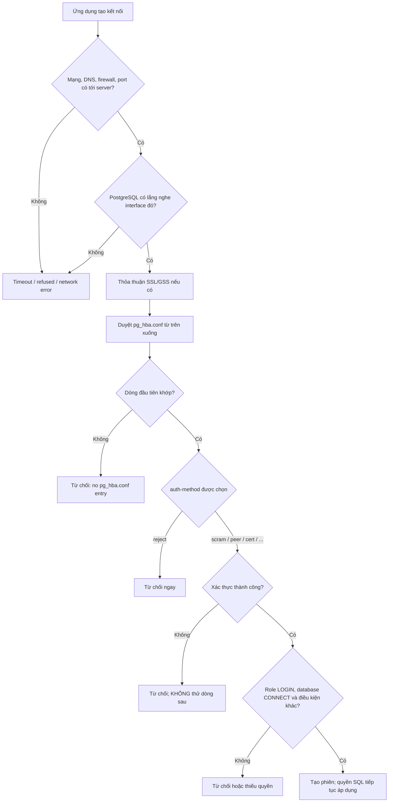

# pg_hba.conf, thứ tự luật và giới hạn nguồn kết nối trong PostgreSQL

Một ứng dụng có tài khoản PostgreSQL hợp lệ và mật khẩu chính xác nhưng vẫn không kết nối được từ máy mới. Trong khi đó, một máy khác truy cập thành công cùng database. Nguyên nhân có thể không nằm ở câu SQL hay quyền `SELECT`, mà ở **`pg_hba.conf`**: PostgreSQL chưa cho phép tổ hợp **kiểu kết nối – database – role – địa chỉ máy khách – phương thức xác thực** đó.

Trong ngữ cảnh bảo mật PostgreSQL, hiểu đúng `pg_hba.conf` là nền tảng để xây chính sách **chỉ cho các nguồn kết nối cần thiết được xác thực**, tránh mở database cho mọi máy và chẩn đoán những thông báo như:

```text
FATAL: no pg_hba.conf entry for host "...",
       user "...", database "...", ...
```

Bài học thuộc chương **Bảo mật** và tập trung vào ba trục chính:

1. **Cú pháp và khả năng kiểm soát của `pg_hba.conf`:** kiểu kết nối, database, role, địa chỉ IP/CIDR, các phương thức xác thực và tùy chọn.
2. **Thứ tự luật:** PostgreSQL dùng **luật đầu tiên khớp**, không có cơ chế thử các luật phía sau khi xác thực theo luật đã chọn thất bại.
3. **Giới hạn nguồn kết nối:** thiết kế allowlist cho từng ứng dụng và mạng; phân biệt `pg_hba.conf` với `listen_addresses`, firewall, TLS, role privileges và số lượng kết nối tối đa.

Sau bài học, bạn có thể thiết kế chính sách HBA cho môi trường nhiều dịch vụ, tự tính luật nào được áp dụng, kiểm tra file bằng `pg_hba_file_rules`, reload an toàn, thực hiện thử nghiệm kết nối từ các nguồn khác nhau và xây runbook xử lý lỗi production.

> **An toàn:** `pg_hba.conf` là file bảo mật của **PostgreSQL server**, không phải file cấu hình đặt trong repository Java để tự động áp dụng. Các IP và tên database dưới đây là ví dụ mô phỏng. Không thay cấu hình production khi chưa có quyền, backup, đường truy cập quản trị dự phòng và kế hoạch rollback.

## 1. pg_hba.conf nằm ở đâu trong quá trình kết nối?

HBA là viết tắt của **Host-Based Authentication**. File này kiểm soát PostgreSQL sẽ **chọn phương thức xác thực hoặc từ chối** một yêu cầu kết nối dựa vào những thông tin kết nối.

Sơ đồ đơn giản:



**`pg_hba.conf` không thay thế tất cả các lớp bảo mật**:

- Nó không mở cổng mạng nếu firewall chặn.
- Nó không làm server lắng nghe interface chưa cấu hình.
- Nó không tạo role, database, mật khẩu hay quyền `CONNECT`.
- Nó không thay thế `GRANT`/`REVOKE` trên schema, bảng, hàm hoặc Row-Level Security.
- Nó không đặt quota số request mỗi giây.
- Nó không bảo đảm người dùng không nhìn thấy dữ liệu nhạy cảm nếu SQL privileges đã cấp quá rộng.

Một kết nối thành công cần vượt qua **nhiều lớp**, và mỗi lớp cần được chẩn đoán riêng.

## 2. Xác định đúng file HBA đang được server sử dụng

Theo cách cài đặt, `pg_hba.conf` thường nằm trong data directory của PostgreSQL, nhưng tham số `hba_file` có thể trỏ tới nơi khác.

Trên một phiên có quyền đọc cấu hình:

```sql
SHOW hba_file;
SHOW config_file;
SHOW data_directory;
SHOW server_version;
```

Hoặc:

```sql
SELECT
    current_setting('hba_file') AS hba_file,
    current_setting('config_file') AS postgres_conf,
    current_setting('server_version') AS version;
```

Không được giả định đường dẫn kiểu `/var/lib/postgresql/data/pg_hba.conf` là đúng trên mọi hệ thống:

- Linux package, Docker và Kubernetes có thể mount file ở vị trí khác nhau.
- Managed database services có thể không cho phép chỉnh file trực tiếp.
- Windows có cách quản lý service/configuration riêng.
- Một PostgreSQL host có thể chạy **nhiều cluster** và port khác nhau.

**Đọc đúng `SHOW hba_file` của chính instance đang xử lý** trước khi chỉnh bất kỳ dòng nào.

### 2.1. File text, không phải câu lệnh SQL

Một dòng HBA thường có dạng:

```text
TYPE  DATABASE  USER  ADDRESS  METHOD  [OPTIONS]
```

Nó là **cấu hình file**, không chạy bằng `psql` như một câu SQL.

Ví dụ:

```text
hostssl  ordersdb  orders_api  10.42.10.0/24  scram-sha-256
```

Dòng trên nói:

> Một kết nối TCP/IP có SSL, yêu cầu database `ordersdb` với role `orders_api`, xuất phát từ mạng IPv4 `10.42.10.0/24`, sẽ được xác thực bằng SCRAM-SHA-256.

Nó **không** tự đặt mật khẩu và **không** cấp quyền truy cập bảng.

## 3. Cấu trúc các bản ghi trong pg_hba.conf

Các dạng phổ biến:

```text
local       DATABASE  USER            METHOD  [OPTIONS]
host        DATABASE  USER  ADDRESS   METHOD  [OPTIONS]
hostssl     DATABASE  USER  ADDRESS   METHOD  [OPTIONS]
hostnossl   DATABASE  USER  ADDRESS   METHOD  [OPTIONS]
hostgssenc  DATABASE  USER  ADDRESS   METHOD  [OPTIONS]
hostnogssenc DATABASE USER  ADDRESS   METHOD  [OPTIONS]
```

Có thể dùng địa chỉ mạng dạng `IP/mask-length` hoặc dạng hai cột `IP-address IP-mask`.

Các dòng trắng và phần bình luận sau `#` được bỏ qua theo quy tắc file. Trường chứa khoảng trắng có thể được quote bằng dấu ngoặc kép. Cú pháp nối dòng và include cần tuân thủ chính xác tài liệu phiên bản PostgreSQL đang chạy.

| Trường | Ý nghĩa | Ví dụ |
| --- | --- | --- |
| `TYPE` | Unix socket, TCP, SSL hoặc biến thể GSS | `local`, `hostssl` |
| `DATABASE` | Database yêu cầu hoặc từ khóa phù hợp | `ordersdb`, `all` |
| `USER` | PostgreSQL role yêu cầu hoặc danh sách/nhóm | `orders_api`, `+app_users` |
| `ADDRESS` | **IP nguồn của client** hoặc dải/host name | `10.42.10.0/24` |
| `METHOD` | Xác thực hoặc từ chối | `scram-sha-256`, `peer`, `reject` |
| `OPTIONS` | Tùy chọn của phương thức | Ví dụ `clientcert=verify-full` khi phù hợp |

### 3.1. Các trường không phải “tên bất kỳ”

Ví dụ `all` không đặt trong quote có ý nghĩa **từ khóa** ở những vị trí cho phép. Nếu được quote ở các trường database/user/address phù hợp, từ khóa có thể mất ý nghĩa đặc biệt và được hiểu như tên literal.

Tương tự, `replication` trong trường database có nghĩa chuyên biệt khi không được quote; đừng xem mọi tên trong file chỉ là chuỗi so sánh đơn giản.

## 4. local và host là hai đường kết nối khác nhau

### 4.1. local — Unix-domain socket

```text
local  all  postgres  peer
```

Dòng `local` chỉ phù hợp kết nối qua **Unix-domain socket** (trên những hệ thống hỗ trợ socket đó).

Một client trên cùng máy chạy:

```bash
psql -U postgres -d postgres
```

có thể dùng Unix socket nếu không chỉ định host và môi trường/libpq đang dùng phương thức mặc định ấy.

**Không phải mọi kết nối “cùng một máy” đều là `local`**.

### 4.2. host — TCP/IP, kể cả localhost

```bash
psql -h 127.0.0.1 -U orders_api -d ordersdb
```

là kết nối **TCP/IP**. Nó được so với các dòng `host`, `hostssl`, `hostnossl`... phù hợp, **không** so với `local`.

Một client dùng:

```bash
psql -h localhost -U orders_api -d ordersdb
```

có thể kết nối qua IPv4 `127.0.0.1` hoặc IPv6 `::1` tùy DNS/resolver và môi trường.

Cần luật đúng cho địa chỉ thực sự được dùng. Không suy rằng một rule `127.0.0.1/32` sẽ bao phủ luôn `::1/128`.

### 4.3. Câu hỏi chẩn đoán

Một lệnh `psql` thành công khi không có `-h` nhưng lỗi khi thêm `-h 127.0.0.1` có thể chỉ ra:

- Unix socket và TCP chọn **hai rule HBA khác nhau**.
- TCP không được server lắng nghe hoặc bị firewall.
- Phương thức `peer` trên socket khác với `scram-sha-256` trên TCP.
- Role hoặc password chưa phù hợp với luật TCP.

Đừng chỉ kiểm tra mật khẩu mà bỏ qua **loại kết nối**.

## 5. host, hostssl, hostnossl và GSS

| TYPE | Khớp khi nào? | Lưu ý |
| --- | --- | --- |
| `host` | Kết nối TCP/IP | Khớp cả SSL và non-SSL, và các biến thể GSS theo khả năng |
| `hostssl` | TCP có SSL/TLS | Server phải bật hỗ trợ SSL |
| `hostnossl` | TCP **không** dùng SSL | Không tự động là “chỉ TCP plaintext” trong mọi tổ hợp GSS |
| `hostgssenc` | TCP có GSSAPI encryption | Cần server hỗ trợ GSS |
| `hostnogssenc` | TCP không dùng GSSAPI encryption | Có thể là kết nối dùng SSL |
| `local` | Unix-domain socket | Không xét IP/CIDR |

### 5.1. hostssl không khớp nếu client không dùng TLS

```text
hostssl  ordersdb  orders_api  10.42.10.0/24  scram-sha-256
```

Một client từ `10.42.10.25` có thể khớp rule này nếu kết nối TLS được thiết lập. Cùng client với kết nối **không mã hóa SSL** sẽ **không khớp dòng hostssl**, rồi PostgreSQL tiếp tục tìm các rule khác.

**Điều kiện:** server phải bật `ssl=on` và được cấu hình certificate/key phù hợp. Nếu SSL bị tắt, `hostssl` không trở thành luật TCP thông thường.

### 5.2. host rộng hơn hostssl

```text
host     all       all         0.0.0.0/0       trust
hostssl  ordersdb  orders_api  10.42.10.0/24  scram-sha-256
```

Đây là **cấu hình cực kỳ nguy hiểm**: dòng `host ... trust` ở trên đã khớp mọi kết nối TCP IPv4, kể cả SSL. Dòng `hostssl` phía sau **không bao giờ được chọn** cho những yêu cầu đó.

Không dùng `trust` cho nguồn mạng không tin cậy. Phần trên chỉ minh họa bẫy thứ tự.

### 5.3. Cấu hình client cũng quan trọng

Trong libpq/`psql`:

- `sslmode=disable`: không dùng SSL.
- `sslmode=require`: yêu cầu kết nối có SSL, nhưng không thay thế đầy đủ kiểm tra tên server/certificate.
- `sslmode=verify-ca`: xác minh chuỗi chứng chỉ CA.
- `sslmode=verify-full`: xác minh CA **và danh tính host**.

Đối với kết nối qua mạng cần chống giả mạo server, chọn `verify-full` cùng CA/certificate được quản lý phù hợp. `hostssl` của server chỉ yêu cầu **kênh SSL đã được thiết lập**, không bảo đảm client đã xác minh đúng danh tính server.

## 6. DATABASE: khớp database nào?

Trường `DATABASE` có thể là tên database cụ thể, danh sách hoặc các từ khóa được PostgreSQL hỗ trợ.

Ví dụ:

```text
hostssl  ordersdb     orders_api  10.42.10.0/24  scram-sha-256
hostssl  reportingdb  report_ro   10.42.20.0/24  scram-sha-256
```

Role `orders_api` muốn kết nối `reportingdb` không khớp dòng đầu vì **database khác**, dù client IP và role khớp các trường còn lại.

Các giá trị thường gặp:

| Giá trị | Ý nghĩa |
| --- | --- |
| `all` | Mọi database phù hợp theo ngữ nghĩa trường |
| `ordersdb` | Chỉ database có tên đó |
| `ordersdb,reportingdb` | Một trong các tên liệt kê |
| `sameuser` | Database có tên trùng với role yêu cầu |
| `samerole` | Role được yêu cầu là thành viên role có tên trùng database |
| `samegroup` | Cách viết cũ của `samerole`, nên tránh ở config mới |
| `replication` | Kết nối **physical replication** phù hợp, không phải logical replication thông thường |

### 6.1. Physical replication khác logical replication

Ví dụ rule dành cho physical streaming replication:

```text
hostssl  replication  repl_user  10.42.30.0/24  scram-sha-256
```

Đây không phải rule cho mọi client đang đọc dữ liệu thông thường từ database tên `replication`.

Đối với **logical replication**, connection có database cụ thể nên thường phải có rule matching **tên database thực**, không dùng máy móc từ khóa `replication`.

Cả hai còn yêu cầu role/privileges replication và cấu hình server tương ứng. HBA chỉ là một phần điều kiện.

### 6.2. Không để all thay thế phân quyền có chủ đích

```text
hostssl  all  orders_api  10.42.10.0/24  scram-sha-256
```

mở phạm vi **HBA database** cho role orders_api trên mọi database (nếu xác thực và các quyền khác cho phép). Nếu ứng dụng chỉ cần `ordersdb`, viết đúng `ordersdb` làm giảm diện tích sai cấu hình.

## 7. USER: role nào được xét?

`USER` trong HBA là **PostgreSQL role name client yêu cầu dùng**, không phải tên tài khoản của hệ điều hành hoặc tên app tự khai trong HTTP header.

```text
hostssl  ordersdb  orders_api  10.42.10.0/24  scram-sha-256
```

Dòng này không cho role `orders_admin` khớp chỉ vì cả hai cùng bắt đầu bằng `orders_`.

### 7.1. Danh sách role

```text
hostssl  ordersdb  orders_api,orders_worker  10.42.10.0/24  scram-sha-256
```

Có thể dùng khi hai role thật sự cần cùng chính sách kết nối. Nhưng một role chỉ đọc và một role ghi thường có nhu cầu mạng khác nhau; nên tách nếu cần least privilege.

### 7.2. Thành viên role với dấu +

```text
hostssl  ordersdb  +orders_app_group  10.42.10.0/24  scram-sha-256
```

`+orders_app_group` khớp các role là thành viên phù hợp của role `orders_app_group` theo quy tắc membership. Không có dấu `+` thì tên được so theo role cụ thể.

Dùng group role để quản lý nhiều role có thể tiện, nhưng thêm một member mới có thể làm **mở rộng phạm vi HBA** không mong muốn. Hãy kiểm tra membership trong quy trình cấp quyền.

### 7.3. LOGIN và quyền CONNECT vẫn cần thiết

HBA cho phép một attempt tới bước xác thực **không tự biến role thành login role**:

```sql
-- Ví dụ dành cho DBA trên môi trường học tập.
CREATE ROLE orders_api LOGIN;
CREATE ROLE orders_report LOGIN;
```

Role cũng cần có phương thức xác thực hợp lệ và quyền `CONNECT` vào database mong muốn.

```sql
-- Chỉ áp dụng sau khi có database ordersdb và
-- đã xác định quyền truy cập mặc định phù hợp.
REVOKE CONNECT ON DATABASE ordersdb FROM PUBLIC;
GRANT CONNECT ON DATABASE ordersdb TO orders_api, orders_report;
```

`REVOKE CONNECT ... FROM PUBLIC` phải được thực hiện có kế hoạch vì có thể ảnh hưởng những role khác. Quyền schema, table, sequence và function là lớp riêng sau khi vào database.

## 8. ADDRESS: giới hạn IP nguồn bằng CIDR

Đây là phần quan trọng nhất để hạn chế **nguồn kết nối**.

```text
hostssl  ordersdb  orders_api  10.42.10.25/32  scram-sha-256
```

Địa chỉ `10.42.10.25/32` là **một IP IPv4 duy nhất**.

```text
hostssl  ordersdb  orders_api  10.42.10.0/24  scram-sha-256
```

Dải `10.42.10.0/24` bao gồm các địa chỉ IPv4 có 24 bit đầu khớp mạng `10.42.10.x`.

### 8.1. Các độ dài mask quen thuộc

| CIDR | Phạm vi khớp theo mô hình IP |
| --- | --- |
| `10.42.10.25/32` | Một địa chỉ IPv4 |
| `10.42.10.0/24` | Một mạng IPv4 256 địa chỉ |
| `10.42.0.0/16` | Dải IPv4 rộng hơn nhiều |
| `0.0.0.0/0` | **Mọi IPv4** |
| `::1/128` | IPv6 loopback duy nhất |
| `2001:db8:abcd::/48` | Ví dụ mạng IPv6 dùng tiền tố tài liệu |
| `::/0` | **Mọi IPv6** |

`2001:db8::/32` là vùng dành cho ví dụ/tài liệu, không phải mạng production cần đưa nguyên xi vào HBA.

### 8.2. Chỉ cho phép đúng một máy

```text
hostssl  ordersdb  orders_api  10.42.10.25/32  scram-sha-256
```

Phù hợp cho một bastion hoặc một máy có IP nguồn ổn định, nhưng nếu máy ở sau NAT, IP PostgreSQL thấy có thể là **IP egress/NAT** chứ không phải IP private của chính container.

### 8.3. Cho phép cả subnet

```text
hostssl  ordersdb  orders_api  10.42.10.0/24  scram-sha-256
```

Tất cả máy có địa chỉ nguồn trong subnet ấy đều có khả năng khớp **điều kiện địa chỉ**. Tuy nhiên, còn phải khớp database, role, SSL và vượt xác thực.

**CIDR không phải cơ chế nhận dạng máy bằng mật khẩu hoặc certificate.** Nếu một máy trong subnet bị xâm nhập, allowlist theo IP không chặn nó tự thử đăng nhập bằng những tài khoản đã bị lộ.

### 8.4. IPv4 không tự bao phủ IPv6

```text
host  all  all  0.0.0.0/0  reject
```

chặn những kết nối IPv4 khớp, **không tự chặn mọi IPv6**.

Muốn có một rule phủ mọi IPv6:

```text
host  all  all  ::/0  reject
```

Trong thiết kế deny-by-default, nếu không có rule IPv6 nào khớp, PostgreSQL cũng từ chối. Nhưng khi dùng deny-all tường minh, nên hiểu phạm vi của từng họ địa chỉ.

### 8.5. Cú pháp IP và netmask tách cột

Có thể dùng:

```text
hostssl  ordersdb  orders_api  10.42.10.0  255.255.255.0  scram-sha-256
```

Tương đương về dải với `10.42.10.0/24`. Cú pháp CIDR thường dễ đọc và ít gây sai khi quản trị.

### 8.6. all, samehost, samenet

Trường ADDRESS cũng hỗ trợ một số từ khóa:

- `all`: mọi địa chỉ client.
- `samehost`: những địa chỉ IP thuộc chính máy PostgreSQL server.
- `samenet`: những địa chỉ nằm trên các mạng mà server kết nối trực tiếp.

Chúng có thể hữu ích trong môi trường kiểm soát tốt, nhưng `samenet` có thể trở nên **rộng hơn ý định** khi máy được gắn thêm network interface/VPN. Với hệ thống production cần allowlist rõ ràng, CIDR cụ thể thường dễ audit hơn.

## 9. Thứ tự luật: dòng đầu tiên khớp thắng

Đây là quy tắc **cốt lõi**:

> PostgreSQL duyệt các bản ghi HBA **theo thứ tự hiệu lực**, tìm dòng đầu tiên khớp **TYPE + DATABASE + USER + ADDRESS**. Phương thức AUTH ở dòng đó được sử dụng. Nếu xác thực thất bại, PostgreSQL **không thử dòng tiếp theo**.

Không có “fallback”, “backup” hay “dòng sau có độ ưu tiên cao hơn”.

### 9.1. Ví dụ lỗi: rule rộng che rule chặt

```text
# SAI: rule quá rộng nằm ở trên.
host     all       all         0.0.0.0/0       trust
hostssl  ordersdb  orders_api  10.42.10.0/24   scram-sha-256
```

Yêu cầu:

```text
TCP IPv4 + SSL
database=ordersdb
user=orders_api
client=10.42.10.25
```

khớp dòng **1** (`host all all 0.0.0.0/0`). Nếu sử dụng cấu hình sai này, PostgreSQL chọn `trust`; dòng 2 dù chặt hơn cũng **không được xét**.

Đó là lý do không thể lập HBA theo tư duy firewall có “luật cụ thể đương nhiên ưu tiên luật tổng quát”.

### 9.2. Ví dụ đúng: ngoại lệ cụ thể trước phạm vi rộng

```text
hostssl  ordersdb  orders_api  10.42.10.0/24  scram-sha-256
host     all       all         0.0.0.0/0      reject
host     all       all         ::/0           reject
```

Một yêu cầu IPv4, TLS, đúng database/role, IP trong subnet khớp dòng đầu và cần SCRAM.

Những yêu cầu TCP khác rơi vào các dòng `reject` tương ứng.

### 9.3. Không thử dòng sau khi mật khẩu sai

```text
hostssl  ordersdb  orders_api  10.42.10.0/24  scram-sha-256
host     ordersdb  orders_api  10.42.10.0/24  trust
```

Nếu client TLS từ `10.42.10.25` khớp dòng đầu nhưng nhập mật khẩu sai, PostgreSQL **không thử dòng `trust` sau**.

Tuy nhiên, **client không dùng TLS** sẽ không khớp `hostssl` và có thể rơi xuống `host ... trust`! Cấu hình trên vẫn **không an toàn**, dù cơ chế no-fallback bảo vệ trường hợp mật khẩu sai ở dòng đầu.

Bài học: phải kiểm thử **từng kiểu kết nối**, không chỉ một trường hợp TLS.

### 9.4. Reject sớm để tạo ngoại lệ deny

```text
host    all       all         10.42.10.99/32  reject
hostssl ordersdb  orders_api  10.42.10.0/24   scram-sha-256
```

Máy `10.42.10.99` bị từ chối trước, dù thuộc subnet phía sau. Đây là trường hợp có chủ đích **chặn một host trong một subnet được cho phép**.

Đảo hai dòng làm chính sách khác:

```text
hostssl ordersdb  orders_api  10.42.10.0/24   scram-sha-256
host    all       all         10.42.10.99/32  reject
```

Một yêu cầu TLS đúng database/role từ `10.42.10.99` đã khớp dòng đầu; dòng reject phía sau không tác động.

### 9.5. Không có dòng khớp thì mặc định bị từ chối

Nếu file chỉ có:

```text
hostssl  ordersdb  orders_api  10.42.10.0/24  scram-sha-256
```

và request từ `10.42.20.17` không khớp bất kỳ rule nào khác, PostgreSQL từ chối. **Không bắt buộc phải có dòng reject cuối**, nhưng thêm một dòng reject rõ ràng có thể hữu ích cho audit và chẩn đoán.

## 10. Tính luật khớp như một bảng quyết định

Giả sử HBA hiệu lực gồm:

```text
# 1
local    all       postgres     peer
# 2
hostssl  ordersdb  orders_api   10.42.10.0/24  scram-sha-256
# 3
hostssl  ordersdb  orders_ro    10.42.20.0/24  scram-sha-256
# 4
hostssl  ordersdb  db_admin     10.42.99.10/32 scram-sha-256
# 5
host     all       all          0.0.0.0/0     reject
# 6
host     all       all          ::/0          reject
```

Ở đây:

- `orders_api` là role ứng dụng ghi.
- `orders_ro` là role báo cáo chỉ đọc.
- `db_admin` là role quản trị được phép kết nối từ bastion.
- `postgres` được quản trị qua Unix socket theo `peer` ở host phù hợp.
- SSL phải bật và các role phải có khả năng xác thực tương ứng.

Xét các yêu cầu:

| Client IP/kiểu | Database | Role | TLS | Luật đầu tiên | Kết quả HBA |
| --- | --- | --- | --- | --- | --- |
| `10.42.10.25` TCP | `ordersdb` | `orders_api` | Có | 2 | SCRAM |
| `10.42.10.25` TCP | `ordersdb` | `orders_api` | Không | 5 | Reject |
| `10.42.10.25` TCP | `ordersdb` | `orders_ro` | Có | 5 | Reject |
| `10.42.20.17` TCP | `ordersdb` | `orders_ro` | Có | 3 | SCRAM |
| `10.42.20.17` TCP | `ordersdb` | `orders_api` | Có | 5 | Reject |
| `10.42.10.25` TCP | `postgres` | `orders_api` | Có | 5 | Reject |
| `10.42.99.10` TCP | `ordersdb` | `db_admin` | Có | 4 | SCRAM |
| `::1` TCP | `ordersdb` | `orders_api` | Có | 6 | Reject |
| Unix socket, OS user postgres | `postgres` | `postgres` | Không xét | 1 | Peer |

**Kết quả HBA** nghĩa là phương thức được chọn hoặc bị reject ngay, **không bảo đảm kết nối thành công**. Ở các dòng SCRAM, mật khẩu, LOGIN và CONNECT vẫn phải hợp lệ.

### 10.1. Quy trình tính tay

Với mỗi connection attempt:

1. Đây là Unix socket hay TCP? TCP có SSL/GSS encryption gì?
2. Database client yêu cầu là gì?
3. Role client yêu cầu là gì?
4. **IP nguồn mà PostgreSQL nhận được** là IP nào?
5. Đọc từng dòng theo thứ tự.
6. Dòng nào không khớp **bất kỳ một trường nào** thì bỏ qua.
7. Dòng đầu khớp tất cả điều kiện chọn AUTH method.
8. Nếu AUTH thất bại, kết thúc; không xem tiếp.
9. Nếu không có dòng nào khớp, từ chối.

Đừng bỏ bước 4: IP của server, domain mà client kết nối tới hoặc IP trong container không nhất thiết là **IP nguồn nhìn từ PostgreSQL**.

## 11. Allowlist theo từng dịch vụ

Một chính sách HBA có thể được thiết kế như **ma trận nhu cầu kết nối** trước khi viết file.

| Thành phần | Role | Database | Nguồn cho phép | Kiểu kết nối |
| --- | --- | --- | --- | --- |
| API backend | `orders_api` | `ordersdb` | `10.42.10.0/24` | TLS |
| Worker đọc báo cáo | `orders_ro` | `ordersdb` | `10.42.20.0/24` | TLS |
| Bastion DBA | `db_admin` | `ordersdb` | `10.42.99.10/32` | TLS |
| Admin trên chính DB host | `postgres` | `postgres` hoặc DB quản trị | Unix socket | Peer (nếu OS hỗ trợ) |

Từ ma trận đó mới đưa ra file cấu hình tương ứng.

### 11.1. Ví dụ HBA tối giản theo allowlist

```text
# Unix socket local administration, Linux/Unix with suitable OS account.
local    all       postgres    peer

# App/backend.
hostssl  ordersdb  orders_api  10.42.10.0/24    scram-sha-256

# Read-only reporting.
hostssl  ordersdb  orders_ro   10.42.20.0/24    scram-sha-256

# DBA bastion.
hostssl  ordersdb  db_admin    10.42.99.10/32   scram-sha-256

# Explicitly reject all other TCP attempts.
host     all       all         0.0.0.0/0        reject
host     all       all         ::/0             reject
```

Đây là **mẫu cấu hình**, không phải một file sẵn dùng ở mọi hệ thống. Trước khi áp dụng phải:

- Có thật các database và roles tương ứng.
- Bật TLS và cài certificate phù hợp.
- Xác minh IP nguồn thực sau NAT/proxy.
- Có đường quản trị dự phòng và quy trình rollback.
- Xem ứng dụng quản lý có cần replication/health checks/monitoring connections khác không.
- Kiểm tra nguy cơ khóa chính mình ra khỏi database.

### 11.2. Vì sao tách role theo dịch vụ?

Nếu API và reporting cùng dùng role `postgres` hoặc một role superuser, HBA khó tạo ranh giới đặc quyền rõ ràng.

Tách role và grant:

- Giới hạn source network.
- Giới hạn database.
- Giới hạn quyền SQL (read/write/schema).
- Dễ quay vòng credential và phân tích kết nối.
- Giảm ảnh hưởng nếu một secret bị lộ.

## 12. Không dùng trust trên mạng không tin cậy

Phương thức `trust` cho phép client khớp rule đăng nhập **không cần mật khẩu**. Nó không phải là “tin địa chỉ nhưng vẫn kiểm tra password”.

Ví dụ cực kỳ rủi ro:

```text
host  all  all  0.0.0.0/0  trust
```

Đây là kiểu cấu hình **không dùng cho production** vì bất kỳ nguồn IPv4 nào có thể đi tới port đều có thể cố đăng nhập như các database roles phù hợp mà không qua password authentication.

Ngay cả:

```text
host  all  all  10.42.0.0/16  trust
```

cũng có rủi ro nếu subnet rộng chứa máy không tin cậy hoặc bị xâm nhập.

### 12.1. Reject khác trust

- `reject`: từ chối kết nối vô điều kiện khi rule khớp.
- `trust`: chấp nhận bước xác thực danh tính mà không kiểm tra secret.
- `scram-sha-256`: dùng cơ chế password authentication SCRAM.

Tên phương thức là một thành phần quyết định bảo mật, không phải nhãn ưu tiên.

### 12.2. Không dùng password method nếu không hiểu truyền password

Phương thức HBA `password` nhận mật khẩu theo cách không được mã hóa bởi chính phương thức đó. Dù có thể truyền bên trong kênh TLS, nên ưu tiên `scram-sha-256` cho xác thực bằng mật khẩu và bảo vệ TLS của kết nối.

## 13. Các phương thức xác thực thường gặp

| METHOD | Bối cảnh | Lưu ý |
| --- | --- | --- |
| `reject` | Chặn nguồn/role/database phù hợp | Không xác thực |
| `scram-sha-256` | Password authentication hiện đại | Ưu tiên cho trường hợp phù hợp |
| `md5` | Cấu hình tương thích cũ | MD5 password storage đã deprecated; tránh thiết kế mới |
| `trust` | Môi trường thử nghiệm thực sự cô lập nếu có lý do | Rất nguy hiểm trên mạng có truy cập |
| `peer` | Unix socket local | So danh tính OS; không dùng cho TCP |
| `ident` | TCP/IP, xác minh từ ident server client | Ít dùng, phụ thuộc cấu hình hệ thống |
| `cert` | Client certificate qua SSL | Cần PKI và mapping danh tính đúng |
| `gss` | GSSAPI/Kerberos | Phù hợp môi trường có hệ thống identity này |
| `sspi` | Windows SSPI | Nền tảng/điều kiện riêng |
| `ldap` | LDAP directory | Có tham số server và chính sách TLS/credential |
| `pam` | PAM hệ điều hành | Yêu cầu cấu hình module phù hợp |
| `radius` | RADIUS | Cần máy chủ và thông tin xác thực hỗ trợ |
| `oauth` | Một số phiên bản PostgreSQL mới | Kiểm tra hỗ trợ theo major version và yêu cầu triển khai |

Không phải method nào cũng áp dụng được cho mọi `TYPE` hoặc mọi build/major version. Bài này tập trung vào **cách chọn luật và giới hạn nguồn kết nối**, không thay hướng dẫn triển khai đầy đủ từng hệ thống LDAP/Kerberos/certificate.

### 13.1. SCRAM và lưu trữ mật khẩu

Kiểm tra:

```sql
SHOW password_encryption;
```

Với cấu hình hiện đại, giá trị mong muốn cho password mới thường là `scram-sha-256`.

Nếu DBA cần tạo role và đặt password, có thể:

```sql
-- Chạy bởi role có quyền quản trị, trong môi trường phù hợp.
CREATE ROLE orders_api LOGIN;
```

Rồi từ `psql`, dùng một cách nhập secret không đưa plaintext vào script hoặc shell history:

```text
\password orders_api
```

Không ghi mật khẩu thật vào tài liệu đào tạo, source repository, ảnh chụp terminal hay log. Nếu thay cấu hình password encryption, những password đã lưu trước đó **không tự được chuyển đổi** chỉ vì thay một GUC; cần quy trình đổi mật khẩu phù hợp.

### 13.2. MD5 và sự chuyển tiếp

Trên các phiên bản PostgreSQL còn hỗ trợ, một HBA rule viết `md5` có thể thực hiện SCRAM nếu mật khẩu role đã được lưu theo SCRAM; nhưng cơ chế password MD5 cũ đã bị **deprecated**.

Đừng dùng điều đó làm lý do thêm `md5` cho hệ thống mới. Hãy lập kế hoạch đồng bộ client driver và server để dùng `scram-sha-256`, lưu ý những client cũ có thể thiếu hỗ trợ SCRAM.

## 14. TLS: HBA và xác minh danh tính không phải cùng một việc

Một thiết kế truyền thông bảo mật thường cần cả:

1. PostgreSQL server bật SSL, có certificate/key đúng.
2. HBA có dòng `hostssl` phù hợp.
3. Client yêu cầu SSL và xác minh certificate/hostname theo chính sách.
4. Role có phương thức xác thực phù hợp.
5. Network/firewall hạn chế nguồn/port.

Ví dụ lệnh client (địa chỉ/certificate chỉ minh họa):

```bash
psql "host=db.internal.example port=5432 dbname=ordersdb user=orders_api sslmode=verify-full sslrootcert=/path/to/ca.crt"
```

`sslmode=verify-full` yêu cầu chuỗi certificate/host khớp với tên server. Đây là **kiểm tra phía client**, khác với việc server lựa chọn dòng `hostssl`.

### 14.1. hostssl không phải client certificate auth

```text
hostssl  ordersdb  orders_api  10.42.10.0/24  scram-sha-256
```

yêu cầu kênh SSL và SCRAM password, **không bắt buộc client trình certificate** chỉ vì TYPE là `hostssl`.

Nếu muốn bắt buộc client certificate, có các lựa chọn riêng như `cert` hoặc tùy chọn `clientcert=verify-full` cho những cấu hình `hostssl` thích hợp. Đây là một lớp kiểm tra PKI bổ sung; phải cấu hình CA/mapping đúng.

### 14.2. Vì sao không nên cho non-SSL fallback?

```text
hostssl ordersdb orders_api 10.42.10.0/24 scram-sha-256
host    ordersdb orders_api 10.42.10.0/24 scram-sha-256
```

Hai dòng này cho phép cùng role/IP sử dụng đường non-SSL (dòng `host`), trái ý định “bắt buộc TLS”.

Nếu chính sách yêu cầu TLS, không viết rule non-SSL cho phép fallback. Có thể thêm:

```text
hostnossl  all  all  0.0.0.0/0  reject
hostnossl  all  all  ::/0       reject
```

Nhưng **thứ tự** vẫn quan trọng: nếu một dòng `host ... trust` ở trên đã khớp, những dòng reject này không còn tác dụng.

## 15. HBA giới hạn IP nhìn từ PostgreSQL, không phải IP do app khai báo

Một hệ thống có thể dùng:

```text
Java service (Pod 10.244.2.18)
     |
     +-- Kubernetes NAT / egress node (10.42.10.25)
              |
              +-- PostgreSQL server (10.42.0.5:5432)
```

Trong nhiều cấu hình mạng, PostgreSQL nhìn thấy **source IP sau NAT** (ví dụ `10.42.10.25`), không phải pod IP `10.244.2.18`.

HBA so với địa chỉ nguồn của **TCP connection thật sự đến PostgreSQL**. Nó không đọc:

- HTTP `X-Forwarded-For` của một request.
- Client IP của người dùng trình duyệt ở phía sau API.
- Hostname mà ứng dụng tự gửi trong payload.
- Địa chỉ DNS dùng để tra ra database server.

### 15.1. Kiểm tra client IP từ một kết nối thành công

Trong phiên đang kết nối:

```sql
SELECT
    inet_client_addr() AS client_ip,
    inet_client_port() AS client_port,
    inet_server_addr() AS server_ip,
    inet_server_port() AS server_port,
    current_user AS role_name,
    current_database() AS db_name;
```

Với Unix socket, `inet_client_addr()` thường trả SQL `NULL` vì **không có IP TCP client**.

Nếu một kết nối đang bị HBA chặn, bạn không thể dùng chính kết nối thất bại đó để chạy query. Có thể dùng phiên quản trị đã được phép, log server, network diagnostics hoặc một kết nối thử từ đường hợp lệ để xác minh.

### 15.2. Xem các sessions hiện có

Khi có quyền quan sát phù hợp:

```sql
SELECT
    pid,
    usename,
    datname,
    client_addr,
    client_port,
    application_name,
    backend_start,
    state
FROM pg_stat_activity
WHERE backend_type = 'client backend'
ORDER BY backend_start DESC;
```

`client_addr` là địa chỉ client thấy ở PostgreSQL cho những backend TCP phù hợp. Các session qua Unix socket có thể không có client_addr.

Không coi `application_name` là bằng chứng danh tính bảo mật: client có thể tự đặt nó. Role/secret/certificate và network policy mới là các lớp xác thực.

### 15.3. Proxy hoặc connection pooler thay đổi IP nguồn

Nếu app kết nối qua PgBouncer hoặc proxy:

```text
App 10.42.10.25  ->  PgBouncer 10.42.50.8  ->  PostgreSQL
```

HBA của PostgreSQL thường thấy IP **PgBouncer** ở bước TCP connection thứ hai, không phải IP từng app.

Phải triển khai chính sách ở **cả phía app→pooler** và **pooler→database**, tương ứng topology. Không ghi HBA trỏ trực tiếp vào app subnet nếu trên thực tế không có direct connection.

## 16. So sánh pg_hba.conf, listen_addresses và firewall

Đây là ba lớp rất dễ bị nhầm.

| Lớp | Câu hỏi | Phạm vi |
| --- | --- | --- |
| `listen_addresses` | PostgreSQL có **lắng nghe** TCP trên interface này không? | Địa chỉ interface phía **server** |
| Firewall/security group/network policy | Packet từ nguồn X có đi tới server:port được không? | Lớp mạng, cổng, giao thức |
| `pg_hba.conf` | Nếu attempt tới được server, database/role/client IP/type này phải xác thực thế nào? | Host-based authentication |
| Role `LOGIN` và `CONNECT` | Danh tính được xác thực có quyền mở session trong DB không? | Role/database privileges |
| `GRANT`/RLS | Sau khi kết nối, được đọc/ghi dữ liệu nào? | Đối tượng và hàng dữ liệu |

### 16.1. listen_addresses thường mặc định localhost

Kiểm tra:

```sql
SHOW listen_addresses;
SHOW port;
SHOW ssl;
```

Nếu `listen_addresses='localhost'`, PostgreSQL chỉ lắng nghe loopback TCP theo cấu hình đang hiệu lực. Viết:

```text
hostssl  ordersdb  orders_api  10.42.10.0/24  scram-sha-256
```

không làm server tự mở socket trên `10.42.0.5`.

Để chấp nhận remote TCP, cần cấu hình `listen_addresses` phù hợp với interface mạng server, **cùng firewall hạn chế**.

### 16.2. Vì sao không vội dùng listen_addresses='*'?

`*` yêu cầu lắng nghe trên các interface có thể, làm tăng diện tích bề mặt mạng. Trong môi trường đa NIC, có thể lắng nghe cả mạng quản trị, public hoặc interface không mong muốn nếu firewall không đúng.

Ưu tiên bind vào interface cần thiết, kết hợp security group/firewall và HBA allowlist. Nếu triển khai đòi `*` do kiến trúc container, phải xác nhận layer network restriction đầy đủ.

### 16.3. Thay listen_addresses có thể cần restart

`listen_addresses` là tham số chỉ thay đổi khi **server start**. Một `SELECT pg_reload_conf()` không đủ để áp dụng giá trị mới của tham số cần restart.

Ngược lại, thay đổi HBA thường được nạp bằng **reload** trên Unix-like systems, không cần restart toàn server.

## 17. HBA không phải rate limiter hay connection pooler

“Giới hạn nguồn kết nối” không đồng nghĩa “giới hạn **số lượng** kết nối”.

HBA giới hạn **nguồn/role/database và cách xác thực**. Những giới hạn số lượng thuộc cơ chế khác.

Các tham số liên quan:

```sql
SHOW max_connections;
SHOW superuser_reserved_connections;
```

Trên những phiên bản hỗ trợ:

```sql
SHOW reserved_connections;
```

Các cơ chế khác:

- `ALTER ROLE role_name CONNECTION LIMIT n`.
- `ALTER DATABASE database_name CONNECTION LIMIT n`.
- Pooling bằng PgBouncer hoặc connection pool của Java.
- `authentication_timeout` để giới hạn thời gian hoàn thành bước xác thực.
- Firewall/load balancer để kiểm soát lưu lượng.
- Giới hạn tài nguyên và kiểm soát tần suất ở các tầng thích hợp.

### 17.1. Ví dụ connection limit theo role

```sql
-- DBA thực hiện nếu đây là policy được phê duyệt.
ALTER ROLE orders_api CONNECTION LIMIT 30;
```

Lệnh này không làm HBA chỉ cho 30 IP nguồn; nó liên quan tới **số phiên đăng nhập đồng thời** của role theo quy tắc PostgreSQL.

Các connection limits có ngoại lệ và không phải cơ chế rate limiting hoàn hảo. Đừng coi nó là hàng rào DoS duy nhất.

### 17.2. max_connections có chi phí

Tăng `max_connections` có thể làm tăng nhu cầu tài nguyên, không phải cách giải quyết mọi lỗi “too many connections”. Với hàng trăm pod, mỗi pod mở một pool quá lớn, cần tính **tổng số connections** tới instance và dùng pooling hợp lý.

### 17.3. HBA không ngăn TCP handshake hay làm biến mất mọi traffic

Dù HBA có reject rule cuối, kết nối vẫn đi tới server đủ xa để PostgreSQL đánh giá authentication. Đối với nguồn không tin cậy trên Internet, **firewall/security group** nên chặn trước khi traffic tới database.

## 18. Đọc thứ tự luật khi có include files

PostgreSQL hỗ trợ tách HBA thành nhiều file bằng:

```text
include          'hba/common.conf'
include_if_exists 'hba/optional.conf'
include_dir      'hba.d'
```

Các directive này hoạt động như việc chèn nội dung file được include **vào vị trí directive** trong chuỗi các luật.

### 18.1. Include không tạo độ ưu tiên riêng

Giả sử file chính:

```text
include 'hba.d/00-admin.conf'
include 'hba.d/20-app.conf'
host all all 0.0.0.0/0 reject
```

PostgreSQL xét lần lượt những luật trong file admin, rồi file app, rồi rule reject cuối.

Nhưng nếu file admin chứa:

```text
host  all  all  0.0.0.0/0  trust
```

thì nó vẫn có thể che các luật chặt hơn trong file app. **Chia file không thay đổi first-match semantics.**

### 18.2. include_dir có thứ tự tên file

`include_dir` lấy các file kết thúc bằng `.conf` và không bắt đầu bằng dấu chấm, rồi xử lý theo **thứ tự tên file dựa trên C locale** (số trước chữ, chữ hoa trước chữ thường).

Ví dụ:

```text
hba.d/
  00-admin.conf
  10-app.conf
  20-reporting.conf
  90-deny.conf
```

Đặt tên có prefix số giúp người quản trị hình dung thứ tự, nhưng phải kiểm tra **effective rule order** chứ không chỉ đọc tên file.

### 18.3. include_if_exists không phải thông báo lỗi nghiêm trọng nếu file thiếu

`include_if_exists` được thiết kế để bỏ qua file không tồn tại theo quy tắc và ghi log. Nếu file đó chứa **allowlist cần thiết** mà bị thiếu, ứng dụng có thể bị chặn bởi rule khác hoặc mặc định deny.

Không xem mọi file optional là vô hại; quan trọng là vai trò của từng file trong chính sách.

### 18.4. Đường dẫn include

Đường dẫn có thể là tuyệt đối hoặc tương đối theo quy tắc file include. Trong quá trình triển khai nên ghi đường dẫn rõ, tránh phụ thuộc working directory của process shell. Không tự tạo include file ở nơi PostgreSQL service user không đọc được.

## 19. Kiểm tra cú pháp và thứ tự bằng pg_hba_file_rules

PostgreSQL cung cấp system view:

```sql
SELECT *
FROM pg_hba_file_rules;
```

Nó cung cấp bản tóm tắt các dòng không rỗng/không comment, kèm thông tin cho biết dòng có hợp lệ về cú pháp/khả năng áp dụng hay không.

Trên các phiên bản mới có các cột như:

- `rule_number`: thứ tự rule được xét nếu hợp lệ.
- `file_name` và `line_number`.
- `type`, `database`, `user_name`, `address`, `netmask`.
- `auth_method`, `options`.
- `error`.

**Độ sẵn có của một số cột có thể khác theo major version**. Dùng `SELECT *` để xem schema view thật trước khi viết dashboard quản trị.

### 19.1. Tìm dòng lỗi

```sql
SELECT *
FROM pg_hba_file_rules
WHERE error IS NOT NULL;
```

Nếu có dòng chứa `error` khác NULL, cần đọc nội dung lỗi, file và số dòng phù hợp, sửa cấu hình rồi kiểm tra lại.

`pg_hba_file_rules` thường chỉ đọc được bởi superuser (hoặc quyền được cấp theo cơ chế PostgreSQL phù hợp). Không mở quyền xem cấu hình xác thực cho mọi role ứng dụng.

### 19.2. Đọc thứ tự hiệu lực trên PostgreSQL mới

Với server có `rule_number` và `file_name`:

```sql
SELECT
    rule_number,
    file_name,
    line_number,
    type,
    database,
    user_name,
    address,
    auth_method,
    error
FROM pg_hba_file_rules
ORDER BY rule_number NULLS LAST, file_name, line_number;
```

`rule_number` đặc biệt hữu ích khi file có include; **`line_number` chỉ có ý nghĩa trong chính file tương ứng**, không phải thứ tự toàn bộ khi nhiều file tham gia.

### 19.3. Rất quan trọng: view không chứng minh file đã được reload

`pg_hba_file_rules` phản ánh **nội dung file hiện tại trên disk**, **không phải bản đã được server nạp lần cuối**.

Ví dụ:

1. DBA sửa file trên disk.
2. `SELECT * FROM pg_hba_file_rules` cho thấy rule mới hợp lệ.
3. Chưa reload trên Linux.
4. New connections có thể vẫn dùng rule cũ đang được server áp dụng.

Đây không phải mâu thuẫn. Cần cả **kiểm tra file**, **reload** và **thử kết nối thực**.

## 20. Nạp thay đổi: reload, không cần restart cho HBA thông thường

Trên hệ thống Unix-like, `pg_hba.conf` được đọc khi server start và khi postmaster nhận SIGHUP.

Có thể yêu cầu reload bằng SQL (với quyền phù hợp):

```sql
SELECT pg_reload_conf();
```

Hoặc từ công cụ quản trị:

```bash
pg_ctl reload
```

### 20.1. pg_reload_conf() trả true có nghĩa gì?

Giá trị true thường cho biết đã **gửi yêu cầu reload** thành công, không phải bằng chứng mọi rule mới hợp lệ, đã nạp như mong muốn hoặc mọi ứng dụng chắc chắn kết nối được.

Sau reload:

1. Kiểm tra `pg_hba_file_rules` còn lỗi không.
2. Đọc PostgreSQL server logs để biết có cảnh báo/lỗi nạp cấu hình không.
3. Thử **kết nối mới** từ nguồn được phép và nguồn phải bị chặn.
4. Xác nhận phiên quản trị dự phòng vẫn hoạt động.

Không dừng ở việc thấy chữ `t` từ `SELECT pg_reload_conf()`.

### 20.2. Existing sessions không bị xác thực HBA lại

Các kết nối **đã được xác thực trước khi đổi HBA** không tự bị ngắt ngay chỉ vì luật mới reject IP của chúng. Chính sách mới tác động tới **những lần kết nối mới** theo cơ chế nạp file.

Nếu cần xử lý các session cũ đang hoạt động trái chính sách, phải có một quyết định vận hành riêng và cân nhắc transaction đang chạy; đừng mặc định HBA reload có tác dụng revoke tức thì.

### 20.3. Ngoại lệ Windows

Theo tài liệu PostgreSQL, trên **Microsoft Windows**, thay đổi HBA được áp dụng ngay cho **những kết nối mới tiếp theo** theo cơ chế khác Unix, không cần bước reload riêng để các thay đổi HBA có hiệu lực.

Tuy nhiên vẫn nên kiểm tra file, logs và kết nối thử. Không áp dụng quy tắc Windows này cho mọi GUC như `listen_addresses` vốn cần restart.

## 21. Thay đổi HBA an toàn để không khóa chính mình

Giả sử database ở máy từ xa và chỉ có một kết nối DBA đang hoạt động. Việc đặt deny rule đầu file có thể khiến lần đăng nhập tiếp theo bị từ chối.

Quy trình thực tế nên:

1. **Xác định** file bằng `SHOW hba_file`.
2. **Giữ** một đường quản trị dự phòng có kiểm soát: console/bastion/Unix socket/managed service admin.
3. **Sao lưu** file và ghi rõ phiên bản cấu hình trước thay đổi.
4. **Viết ma trận allowlist**, bao gồm health checks, monitoring, replication nếu có.
5. **Kiểm tra thứ tự** trong file chính và mọi include.
6. **Rà cú pháp** bằng `pg_hba_file_rules` với quyền phù hợp.
7. **Reload** nếu hệ thống yêu cầu.
8. **Đọc logs** sau reload.
9. **Mở một kết nối mới** từ từng nguồn được phép để xác nhận thành công.
10. **Mở một kết nối mới** từ nguồn không được phép để xác nhận bị từ chối.
11. **Xác minh không có rule rộng** vô tình cho phép đường non-TLS.
12. **Ghi kết quả và rollback plan**; chỉ đóng phiên quản trị cũ khi đường mới đã được kiểm chứng.

### 21.1. Không thử bằng chính kết nối hiện có

Nếu đang mở `psql` từ trước, câu:

```sql
SELECT 1;
```

thành công sau reload **không chứng minh** địa chỉ của phiên đó còn được HBA cho phép khi kết nối lại. Phải mở **một phiên mới**.

### 21.2. Đừng xóa đường cứu hộ trước khi thử luật mới

Một kế hoạch rollout an toàn luôn có cách phục hồi file/cấu hình ngay cả khi mọi kết nối từ mạng ứng dụng bị reject.

Với managed PostgreSQL, cơ chế rollback thường đi qua parameter group/access rules của nhà cung cấp thay vì chỉnh file trực tiếp.

## 22. Kiểm thử kết nối từ các nguồn khác nhau

Cần kiểm thử ở đúng network segment, không chỉ trên DB server.

### 22.1. Từ pod/máy ứng dụng được phép

Ví dụ với tên DNS của DB server:

```bash
psql "host=db.internal.example port=5432 dbname=ordersdb user=orders_api sslmode=verify-full sslrootcert=/path/to/ca.crt"
```

Sau khi kết nối:

```sql
SELECT
    current_user,
    current_database(),
    inet_client_addr(),
    inet_server_addr();
```

Đối chiếu `inet_client_addr()` với CIDR trong HBA.

### 22.2. Thử đường không dùng SSL

Trong **môi trường kiểm thử được phép**, một kết nối:

```bash
psql "host=db.internal.example port=5432 dbname=ordersdb user=orders_api sslmode=disable"
```

nên bị từ chối nếu chính sách HBA chỉ cho TLS và không có rule non-SSL nào khác mở cửa.

Không cần cung cấp mật khẩu thật hoặc thử vô hạn. Kiểm tra loại lỗi để chắc rằng kết nối tới đúng server/port; không gộp lỗi DNS/firewall thành bằng chứng HBA đã chặn.

### 22.3. Thử sai role hoặc sai database

Từ cùng máy ứng dụng, thử với role/database khác theo ma trận. Nếu policy chỉ cho `orders_api` vào `ordersdb`, một role khác không được dựa vào rule `all all` ở cuối để đăng nhập.

**Kết quả từ chối** phải được phân loại đúng:

- Bị reject bởi HBA.
- Không có matching HBA.
- Mật khẩu/identity sai.
- Không có quyền LOGIN/CONNECT.
- TLS/certificate handshake lỗi.
- Network refused/timeout.

Những lỗi này không tương đương.

## 23. Chẩn đoán lỗi: timeout, refused, HBA hay password?

| Thông báo/triệu chứng | Lớp cần kiểm tra trước |
| --- | --- |
| DNS name không resolve | DNS/client resolver |
| Timeout tới server:5432 | Routing, firewall, security group, listener |
| Connection refused | Port/listen_addresses/service/firewall |
| `no pg_hba.conf entry ...` | Loại kết nối, DB, user, source IP, effective rule order |
| `pg_hba.conf rejects connection ...` | Rule `reject` đầu tiên khớp |
| `password authentication failed` | Rule đã chọn, password/SCRAM/role secret và client |
| `peer authentication failed` | Unix socket, OS username, database role, pg_ident map |
| TLS certificate verification failed | Client trust store, CA, hostname, certificate chain |
| Permission denied for database | `CONNECT` và database ACL |
| Permission denied for relation | `GRANT`/schema/table privileges, RLS khi liên quan |
| Too many connections | Server/role/database connection limits, pool sizes |

Đừng xử lý một lỗi firewall bằng cách mở `0.0.0.0/0` trong HBA. Cũng đừng xử lý một lỗi password bằng cách đổi `scram-sha-256` thành `trust`.

### 23.1. “no pg_hba.conf entry” không luôn có nghĩa thiếu một IP

Một HBA line chỉ khớp khi **đủ các điều kiện**:

- TYPE phù hợp.
- DATABASE phù hợp.
- USER phù hợp.
- ADDRESS phù hợp.

Ngay cả khi IP nằm trong dải được phép, sai `dbname` hoặc `user` cũng làm dòng bị bỏ qua.

### 23.2. Lỗi có thể chỉ rõ encryption status

Một số thông báo HBA nêu trạng thái SSL/GSS encryption, chẳng hạn kết nối không được mã hóa. Cần kiểm tra `hostssl` có đang bị bỏ qua do client dùng `sslmode=disable` hoặc server `ssl=off` không.

### 23.3. Lỗi password không kích hoạt fallback

Nếu HBA chọn SCRAM rồi password sai, PostgreSQL **không chọn rule MD5/trust nằm dưới**. Hướng xử lý là xác minh role/password và cơ chế xác thực ở rule đầu, không chèn rule yếu hơn phía sau.

## 24. HBA với hostname thay vì IP

ADDRESS có thể là hostname hoặc hậu tố hostname:

```text
hostssl ordersdb orders_api app1.internal.example scram-sha-256
hostssl ordersdb orders_api .apps.internal.example scram-sha-256
```

PostgreSQL kiểm tra tên client theo quy tắc **reverse DNS lookup** của IP nguồn, rồi **forward DNS lookup** tên đó để xác minh nó phân giải trở lại địa chỉ IP nguồn.

Cụ thể:

1. PostgreSQL nhận địa chỉ client IP.
2. Reverse-resolve IP để lấy hostname.
3. So hostname với tên/hậu tố trong rule.
4. Nếu khớp, forward-resolve hostname để xác nhận IP nguồn nằm trong những kết quả.

### 24.1. Vì sao hostname rule thường gây bất ngờ?

- Client có thể không có PTR/reverse DNS record.
- PTR trả tên khác tên mà DBA đã khai.
- Forward DNS và reverse DNS không nhất quán.
- DNS lookup chậm hoặc không ổn định.
- Thay đổi DNS làm chính sách thay đổi ngoài ý định.

Nếu dùng hostname trong HBA, phải quản trị DNS cẩn thận và giám sát độ trễ xác thực. Với môi trường có IP egress ổn định, một **CIDR allowlist** thường dễ dự đoán và kiểm thử hơn.

### 24.2. Hậu tố bắt đầu bằng dấu chấm

Một address entry `.internal.example` có thể khớp hostname như `app1.internal.example`, nhưng không nhất thiết khớp chính chuỗi `internal.example`.

Không dùng ký hiệu suffix như wildcard SQL `LIKE '%...%'`. Đây là quy tắc hostname riêng của PostgreSQL.

### 24.3. DNS không thay thế xác thực người dùng

Ngay cả khi hostname khớp, vẫn cần SCRAM/certificate hoặc phương thức xác thực tương ứng. DNS là tín hiệu về **nguồn mạng**, không phải secret nhận dạng ứng dụng.

## 25. Trường hợp kết nối từ Docker/Kubernetes

### 25.1. Docker host network và bridge network

Với Docker bridge, source IP mà database nhìn thấy phụ thuộc nơi DB chạy và NAT. Một container có IP nội bộ `172.x` không bảo đảm PostgreSQL thấy đúng IP đó khi kết nối ra ngoài host.

Thiết kế HBA theo **đường đi thực tế của packet** và chính sách egress. Đừng mở một dải container rộng chỉ vì chưa xác định source IP.

### 25.2. Kubernetes pod IP có thể thay đổi

Pod có thể được tạo lại với IP mới. Nếu HBA cố gắn `/32` vào một pod IP tạm thời, kết nối sẽ bị chặn sau reschedule.

Các lựa chọn tùy kiến trúc:

- Egress gateway/NAT có IP ổn định.
- Database proxy có IP/identity ổn định.
- Chọn subnet nhỏ thực sự chỉ dành cho workload cần DB.
- NetworkPolicy/security group để giới hạn những pod được tới DB.
- TLS với xác minh danh tính cùng role quyền tối thiểu.

Một CIDR quá rộng như `10.0.0.0/8` có thể vô tình bao hàng nghìn workload khác. **Không dùng CIDR rộng để sửa nhanh lỗi pod đổi IP** nếu có lựa chọn giới hạn nguồn rõ ràng hơn.

### 25.3. Cloud managed database

Một số dịch vụ quản lý PostgreSQL không cho người dùng trực tiếp sửa `pg_hba.conf` mà cung cấp:

- Trusted sources/IP allowlist.
- VPC security groups.
- Private endpoints.
- Parameter groups hoặc authentication policies.
- Proxy/pooling và IAM/certificate auth tùy nhà cung cấp.

Vẫn cần hiểu **thứ tự luật, nguồn TCP, role và TLS**, nhưng thao tác cấu hình được thực hiện qua cơ chế nhà cung cấp. Không giả định shell có thể sửa file HBA trên managed service.

## 26. Sử dụng nhóm role thay vì danh sách quá dài

Khi có nhiều application roles, có thể tạo group role:

```sql
-- DBA chạy trong môi trường phù hợp.
CREATE ROLE orders_app_group NOLOGIN;
GRANT orders_app_group TO orders_api;
```

Sau đó HBA:

```text
hostssl  ordersdb  +orders_app_group  10.42.10.0/24  scram-sha-256
```

Nó có thể giảm số dòng HBA, nhưng thêm role vào group là **thay đổi chính sách ai được xác thực từ subnet đó**.

Cần review:

1. Group có chứa cả role quản trị không?
2. Những thành viên nào là LOGIN roles?
3. Có người quản trị nào thêm membership tự động từ provisioning system?
4. Những quyền SQL của group được cấp như thế nào?
5. Có nguy cơ cấp quá nhiều quyền qua inheritance/SET ROLE riêng với HBA matching không?

HBA membership check và effective SQL privileges không phải một khái niệm duy nhất. Đừng suy mọi thuộc tính quản lý role đều được kiểm tra ở cùng một bước.

## 27. Chính sách dành cho replication và giám sát

Một hệ thống PostgreSQL thực tế có thể cần:

- Physical replication connections.
- Logical replication subscriptions.
- Backup agents.
- Monitoring/exporters.
- Read replicas.
- Admin bastion.
- Pooler/proxy.

Nếu chỉ viết hai dòng cho API và reject all, các hệ thống phụ này có thể ngừng hoạt động khi chúng tạo connection mới.

### 27.1. Đường physical replication

```text
hostssl  replication  repl_user  10.42.30.0/24  scram-sha-256
```

Ngoài HBA, cần cấu hình replication privileges, `wal_level`, network và các thông số slot/sender tương ứng.

### 27.2. Monitoring role và database

Một monitoring agent thường kết nối bằng role riêng, ít quyền. Nên giới hạn:

```text
hostssl  postgres  metrics_reader  10.42.40.15/32  scram-sha-256
```

Đây là ví dụ giả định monitoring dùng database `postgres`. Nếu agent kết nối database khác hoặc đi qua proxy, cần sửa ma trận. Không cấp superuser cho metrics chỉ để tránh viết grants phù hợp.

### 27.3. Luật replication phải có thứ tự với reject cuối

Những dòng replication và monitoring nằm **trước** reject-all, nếu muốn cho phép. Nhưng không nên đặt một `host all all 0.0.0.0/0 trust` để “cứu” replication; đó là mở quyền ngoài chủ đích.

## 28. Một lỗi khó: rule cụ thể nhưng client IPv6

Cấu hình:

```text
hostssl  ordersdb  orders_api  127.0.0.1/32  scram-sha-256
host     all       all         0.0.0.0/0     reject
```

Client dùng:

```bash
psql -h localhost -U orders_api -d ordersdb
```

Nếu resolver chọn `::1`, không rule IPv4 nào khớp. Kết quả có thể bị từ chối, dù cả hai process chạy trên cùng host.

Muốn cho loopback IPv6 khi được phép:

```text
hostssl  ordersdb  orders_api  ::1/128  scram-sha-256
```

Ngoài ra phải có server SSL/listener IPv6 phù hợp.

**Không tự mở `::/0` để sửa một lỗi của `::1`.** Hãy giới hạn đúng IP hoặc subnet cần thiết.

## 29. Một lỗi khó khác: dòng reject nằm trước allowlist

```text
host  all       all         0.0.0.0/0      reject
hostssl ordersdb orders_api  10.42.10.0/24 scram-sha-256
```

Ở đây, client IPv4 đã bị reject ở dòng đầu, bất kể dòng allowlist chi tiết hơn phía sau.

Cách sửa là **đặt allowlist phù hợp trước reject rộng**:

```text
hostssl ordersdb orders_api  10.42.10.0/24 scram-sha-256
host  all       all         0.0.0.0/0      reject
```

Không phải nâng quyền role hoặc thay password. Đây hoàn toàn là vấn đề **thứ tự HBA**.

## 30. Một lỗi khác: HBA đúng nhưng SSL tắt

File:

```text
hostssl ordersdb orders_api 10.42.10.0/24 scram-sha-256
```

Server:

```sql
SHOW ssl;
```

Nếu giá trị là `off`, rule `hostssl` không thể khớp một kết nối TLS hợp lệ theo thiết kế; server sẽ có cảnh báo về dòng không thể áp dụng trong bối cảnh không hỗ trợ SSL.

Hướng xử lý:

1. Xem cấu hình chứng chỉ và `ssl` của server.
2. Kiểm tra TLS handshake từ client.
3. Kiểm tra file HBA và thứ tự.
4. Không lặng lẽ thay `hostssl` bằng `host` nếu security policy yêu cầu TLS.

Bước bảo mật bị thiếu không được chữa bằng cách bỏ yêu cầu mã hóa.

## 31. Tách lỗi HBA khỏi quyền SQL

Giả sử client từ allowlist thành công login như `orders_ro` vào `ordersdb` nhưng chạy:

```sql
DELETE FROM accounting.invoices;
```

và nhận lỗi permission denied. Đây là **dấu hiệu tốt** nếu role chỉ đọc: HBA đã cho phép kết nối, nhưng privileges chặn DML không được cấp.

Các lớp kiểm soát nên:

- HBA: ai có thể **thử xác thực** từ nguồn nào.
- Role: ai có thể **LOGIN**.
- Database `CONNECT`: role có vào DB được không.
- Schema `USAGE` và table `SELECT/INSERT/UPDATE/DELETE`: được thao tác gì.
- RLS: được nhìn/sửa hàng nào.
- TLS/cert: kết nối có được bảo vệ và định danh phù hợp không.

Không “sửa” lỗi permission denied trên bảng bằng cách thay HBA. Hai lớp không cùng chức năng.

## 32. Đọc hoạt động SSL từ phía server

Khi đã kết nối thành công, có thể kiểm tra phiên hiện tại:

```sql
SELECT
    s.ssl,
    s.version,
    s.cipher
FROM pg_stat_ssl AS s
WHERE s.pid = pg_backend_pid();
```

Ví dụ kết quả `ssl=true` và một TLS version/cipher thích hợp chứng minh **phiên hiện tại** đang dùng SSL.

Để xem các backend client nếu có quyền:

```sql
SELECT
    a.pid,
    a.usename,
    a.datname,
    a.client_addr,
    s.ssl,
    s.version AS tls_version,
    a.application_name
FROM pg_stat_activity AS a
LEFT JOIN pg_stat_ssl AS s
    ON s.pid = a.pid
WHERE a.backend_type = 'client backend'
ORDER BY a.pid;
```

Không dùng mỗi `pg_stat_ssl.ssl=true` để chứng minh client đã verify server hostname. Việc `verify-full` ở client phải được kiểm tra ở cấu hình client/certificate riêng.

## 33. Phân tích một sự cố thực tế theo lớp

Tình huống:

> API từ subnet `10.42.10.0/24` kết nối `ordersdb` bằng role `orders_api` được; worker báo cáo từ subnet `10.42.20.0/24` dùng `orders_ro` nhận `no pg_hba.conf entry`.

HBA ban đầu:

```text
hostssl  ordersdb  orders_api  10.42.10.0/24  scram-sha-256
host     all       all         0.0.0.0/0      reject
```

Phân tích:

1. Server mở TCP và SSL, vì API đang kết nối được.
2. Worker dùng role `orders_ro` nên không khớp rule đầu, dù TLS đúng.
3. Worker là IPv4 nên khớp reject-all ở rule sau.
4. Phương thức reject được chọn; không phải do password sai.

Giải pháp theo ma trận đã được phê duyệt:

```text
hostssl  ordersdb  orders_api  10.42.10.0/24  scram-sha-256
hostssl  ordersdb  orders_ro   10.42.20.0/24  scram-sha-256
host     all       all         0.0.0.0/0      reject
```

Sau đó:

- Kiểm tra role tồn tại/LOGIN/password.
- Kiểm tra quyền CONNECT/SELECT cần thiết.
- Kiểm tra `pg_hba_file_rules` và reload.
- Thử **new connection** từ worker.
- Đảm bảo nguồn không được phép vẫn bị chặn.

Không mở `hostssl all all 0.0.0.0/0` chỉ để worker kết nối được.

## 34. Thiết kế với pg_ident.conf và peer

Với local connection:

```text
local all postgres peer
```

`peer` dựa trên danh tính user hệ điều hành mà PostgreSQL nhận được từ Unix socket. Theo mặc định, tên OS user có thể cần tương ứng database role, trừ khi có username mapping thích hợp.

Nếu OS service account tên `deploy` nhưng cần login PostgreSQL role `migration_admin`, có thể có cấu hình `pg_ident.conf` kết hợp tùy chọn `map=...` theo tài liệu.

Ví dụ nguyên tắc:

```text
local  ordersdb  migration_admin  peer  map=migration_map
```

Để cấu hình mapping phải chỉnh `pg_ident.conf` tương ứng và quản lý quyền OS. Đây không phải lời khuyên dùng `trust` để tránh quản lý danh tính.

**`peer` chỉ dùng cho local Unix-domain sockets**. Với `psql -h 127.0.0.1` qua TCP, chọn một phương thức khác phù hợp; không trông chờ peer tự hoạt động như với socket.

## 35. Các anti-pattern cấu hình thường gặp

| Anti-pattern | Tại sao nguy hiểm hoặc sai | Thay thế |
| --- | --- | --- |
| `host all all 0.0.0.0/0 trust` | Bỏ xác thực mật khẩu trên mọi IPv4 tới được server | Allowlist hẹp + SCRAM/TLS |
| `hostssl` đặt sau `host all all ... trust` | Dòng rộng che dòng chặt | Chuyển allowlist cụ thể lên trước, bỏ trust |
| Chỉ cấu hình `127.0.0.1/32` cho `localhost` | Client có thể dùng IPv6 `::1` | Kiểm tra địa chỉ thực, thêm rule IPv6 chính xác |
| Chỉ thêm IPv4 reject để “chặn tất cả” | Không bao phủ IPv6 | Rà cả hai họ địa chỉ |
| `host all all 10.0.0.0/8 md5` | Phạm vi quá rộng, method legacy | Scope theo role/DB/CIDR nhỏ và SCRAM |
| HBA đúng nhưng `listen_addresses=localhost` | Remote TCP không tới listener | Bind interface cần thiết + firewall |
| HBA mở nhưng firewall chặn | Packet không tới PG | Sửa đúng network layer |
| Dùng pod IP làm allowlist sau NAT | PG thấy IP egress khác | Kiểm tra `inet_client_addr()`/topology |
| Mở allowlist chung cho reporting/admin/API | Trộn đặc quyền và mạng | Tách roles, database và subnet |
| Mật khẩu sai nhưng thêm rule trust phía dưới | Không fallback; đồng thời mở non-TLS | Sửa credentials và cấu hình an toàn |
| `pg_reload_conf()=true` nghĩa đã xác minh hoàn toàn | Chỉ là yêu cầu reload thành công | Kiểm tra view, logs và new connections |
| `pg_hba_file_rules` có rule mới nên chắc đã nạp | View đọc file hiện tại, không phải loaded config | Reload/đo thực tế |
| Thử trên kết nối cũ rồi tuyên bố HBA mới ổn | Existing session không auth lại | Mở kết nối mới |
| Chỉnh HBA mà không có rollback | Có thể khóa đường DBA | Backup, console/bastion và triển khai có kiểm soát |
| Ghi mật khẩu vào repo hoặc lệnh shell | Rò rỉ credentials | Secret manager/psql prompt |
| Dùng HBA làm quota request | HBA không giới hạn QPS | Pooling, resource limits, network controls |
| Tưởng HBA grant quyền SELECT | Chỉ điều khiển kết nối/xác thực | Dùng GRANT/RLS riêng |
| Dùng hostname nhưng DNS reverse sai | Rule không khớp/latency | CIDR ổn định hoặc DNS kiểm soát |
| Dựa vào `application_name` để xác thực | Client tự gửi tên | Dùng role/TLS/cert/network identity |

## 36. Runbook triển khai chính sách HBA

Một thay đổi production có thể được triển khai theo các pha.

### Pha A — Thu thập hiện trạng

1. Ghi PostgreSQL major version, cluster, port và `SHOW hba_file`.
2. Lấy effective HBA hiện tại và các file include.
3. Thống kê nguồn hiện có bằng `pg_stat_activity.client_addr` và logs được phép.
4. Xác định proxy/NAT, replication, monitoring, backup và DBA paths.
5. Xác định các roles và databases được phép.
6. Xác định yêu cầu TLS, certificate, SCRAM và network firewall.

### Pha B — Thiết kế ma trận nguồn

Với mỗi service ghi một hàng:

```text
service | client egress CIDR | database | role | TLS | auth method | owner
```

Không thiết kế từ một danh sách IP “có thể cần” không gắn với chủ sở hữu cụ thể.

### Pha C — Soạn và rà thứ tự

1. Các luật ngoại lệ bị chặn cụ thể nếu cần.
2. Allowlist theo đúng role/database/IP.
3. Replication/monitoring/admin theo nhu cầu.
4. Reject rộng hoặc mặc định deny.
5. Kiểm tra các file include theo thứ tự C-locale.
6. Loại các rule trust/public/legacy không được phê duyệt.

### Pha D — Triển khai an toàn

1. Backup config.
2. Duy trì một phiên quản trị đang hoạt động và kênh cứu hộ riêng.
3. Ghi file bằng quyền phù hợp, kiểm tra không mất dòng hiện hữu.
4. Chạy `pg_hba_file_rules` để xem parse errors.
5. Reload trên Unix-like; hiểu ngoại lệ Windows.
6. Đọc server logs và kiểm tra lỗi cấu hình.
7. Thử kết nối **mới** cho trường hợp allow và deny, TLS và non-TLS, IPv4 và IPv6 nếu được hỗ trợ.
8. Nếu fail, rollback file và kiểm tra phục hồi.

### Pha E — Quan sát sau rollout

- Số authentication failures theo nguồn/role và loại lỗi.
- Số kết nối đang hoạt động và saturation của pool.
- Client TLS status, các lỗi certificate.
- Tình trạng IP egress thay đổi sau deploy.
- Các application error rates và latency của connection establishment.
- Rule bất thường đã cho kết nối từ mạng không dự kiến.

**Không khẳng định production an toàn chỉ vì có một dòng reject-all ở cuối.** Phải kiểm tra những dòng **đứng trước** và những lớp mạng/quyền liên quan.

## 37. Bài thực hành

Các bài dưới đây có thể làm trên một PostgreSQL lab/VM/container bạn được phép quản trị. Những bài đòi sửa `pg_hba.conf` cần có backup và đường vào quản trị; tránh làm trên instance dùng chung.

### Bài 1 — Tìm file cấu hình

Chạy:

```sql
SHOW hba_file;
SHOW listen_addresses;
SHOW port;
SHOW ssl;
```

Mỗi thông số quyết định gì? Tại sao thay `hba_file` và thay `listen_addresses` không có cùng quy trình áp dụng?

### Bài 2 — Phân biệt socket và TCP

So:

```bash
psql -U postgres -d postgres
psql -h 127.0.0.1 -U postgres -d postgres
```

Trên máy hỗ trợ Unix socket, hai câu có thể chọn HBA record khác nhau ra sao?

### Bài 3 — CIDR /32 và /24

Giải thích địa chỉ nào khớp:

```text
10.42.10.25/32
10.42.10.0/24
```

Thử các IP `10.42.10.25`, `10.42.10.99`, `10.42.11.1`. Vì sao một dải `/24` mở rộng hơn rất nhiều so với `/32`?

### Bài 4 — Luật đầu tiên khớp

```text
host all all 0.0.0.0/0 reject
hostssl ordersdb orders_api 10.42.10.0/24 scram-sha-256
```

Client TLS đúng role/database từ `10.42.10.25` bị áp luật nào? Hãy sửa thứ tự.

### Bài 5 — Không fallback khi password sai

```text
hostssl ordersdb orders_api 10.42.10.0/24 scram-sha-256
host ordersdb orders_api 10.42.10.0/24 trust
```

Nếu mật khẩu SCRAM sai trong TLS, PostgreSQL có thử trust không? Nếu client tắt SSL thì nguy cơ gì?

### Bài 6 — Hostssl không khớp non-TLS

Đặt một rule `hostssl` duy nhất cho role `orders_api`. Dự đoán kết quả khi client dùng `sslmode=disable` và khi dùng `verify-full` với certificate hợp lệ.

### Bài 7 — Database và role đều phải khớp

Rule chỉ cho `ordersdb` và `orders_api`. Đổi từng tham số thành `reportingdb` rồi `orders_ro`.

Hãy chỉ ra trường nào không khớp và giải thích tại sao IP đúng không đủ.

### Bài 8 — IPv4 vs IPv6

Rule IPv4 chỉ có `127.0.0.1/32`. Client dùng `localhost` và resolve `::1`. Điều gì xảy ra?

Viết rule cho IPv6 loopback mà không mở toàn bộ IPv6 Internet.

### Bài 9 — Chặn ngoại lệ trong subnet

Subnet `10.42.10.0/24` được phép, nhưng `10.42.10.99` bị cấm. Viết HBA sao cho dòng reject của `/32` có hiệu lực.

### Bài 10 — include_dir

Thiết kế các file:

```text
00-admin.conf
10-api.conf
20-reporting.conf
90-deny.conf
```

Giải thích thứ tự theo C locale và vì sao luật `host all all 0.0.0.0/0 trust` trong `00-admin.conf` là một lỗi nghiêm trọng.

### Bài 11 — pg_hba_file_rules

```sql
SELECT *
FROM pg_hba_file_rules
WHERE error IS NOT NULL;
```

Nếu có lỗi, chỉ ra file/dòng cần sửa. Vì sao view này không tự chứng minh server đang sử dụng toàn bộ luật mới trên disk?

### Bài 12 — Kiểm tra reload

Sau một thay đổi được phép trên môi trường lab:

```sql
SELECT pg_reload_conf();
```

Thiết kế các bước kiểm tra tiếp theo. Vì sao kết quả true chưa kết thúc quá trình xác minh?

### Bài 13 — Existing session và new session

Giả sử phiên DBA đang mở từ trước khi subnet của nó bị deny. Sau reload, phiên cũ còn chạy `SELECT 1`.

Vì sao phải thử một **kết nối mới** trước khi kết luận luật đang áp dụng?

### Bài 14 — Source IP sau NAT

App pod `10.244.2.18` đi qua egress gateway `10.42.10.25`. HBA nên nhắm tới IP nào nếu PostgreSQL thấy `10.42.10.25`?

Bạn sẽ dùng `inet_client_addr()` để kiểm chứng trong điều kiện nào?

### Bài 15 — Proxy/pooler

App kết nối PgBouncer tại `10.42.50.8`, PgBouncer mở connection đến PostgreSQL. HBA trên server thấy nguồn nào?

Những chính sách bảo mật nào phải được áp dụng thêm ở lớp app→pooler?

### Bài 16 — HBA vs firewall

Client nhận connection timeout trước khi có thông báo PostgreSQL. Tại sao không nên sửa HBA trước khi kiểm tra routing, listener, port và firewall?

### Bài 17 — HBA vs GRANT CONNECT

Rule HBA cho phép `orders_ro` kết nối `ordersdb` qua SCRAM nhưng role không có `CONNECT`. Kết nối có thành công không?

Viết SQL cấp quyền phù hợp với nguyên tắc least privilege.

### Bài 18 — Kiểm tra TLS

```sql
SELECT ssl, version, cipher
FROM pg_stat_ssl
WHERE pid = pg_backend_pid();
```

Đầu ra cho biết điều gì? Vì sao nó không chứng minh client đã dùng `sslmode=verify-full`?

### Bài 19 — Peer và TCP

Rule `local all postgres peer` cho phép OS user postgres qua Unix socket. Vì sao không có nghĩa một TCP connection `-h 127.0.0.1` sẽ được peer xác thực?

### Bài 20 — Dữ liệu đăng nhập không an toàn

So sánh việc đặt mật khẩu trong script SQL version control với dùng `psql \password` và secret manager. Nêu rủi ro shell history, logs, CI artifacts và quyền đọc secret.

### Bài 21 — Giới hạn số lượng kết nối

Phân biệt:

```sql
SHOW max_connections;
ALTER ROLE orders_api CONNECTION LIMIT 30;
```

với một HBA allowlist `10.42.10.0/24`. Cái nào giới hạn **nguồn IP**? Cái nào giới hạn **số phiên**?

### Bài 22 — Physical vs logical replication

Rule:

```text
hostssl replication repl_user 10.42.30.0/24 scram-sha-256
```

phù hợp loại replication connection nào? Tại sao logical replication có database name cần rule khác theo từng cấu hình?

### Bài 23 — Chẩn đoán bốn lỗi

Phân loại:

1. `Connection refused`.
2. `No pg_hba.conf entry`.
3. `Password authentication failed`.
4. `Permission denied for table`.

Với mỗi lỗi, nêu layer cần kiểm tra trước và **một thay đổi sai lầm** cần tránh.

### Bài 24 — Runbook production

Một hệ thống có:

- API backend ở `10.42.10.0/24` dùng role `orders_api`/database `ordersdb`.
- Reporting worker ở `10.42.20.0/24` dùng `orders_ro`/`ordersdb`.
- Bastion DBA tại `10.42.99.10` dùng `db_admin`.
- Physical replica ở `10.42.30.0/24`.
- PostgreSQL server `10.42.0.5:5432`, yêu cầu TLS cho remote.
- Container app đi qua NAT ở một số môi trường.

Hãy xây:

1. Ma trận sources/roles/databases.
2. File HBA theo **first-match** có reject-all cuối.
3. Cấu hình network/listener và TLS cần kiểm tra riêng.
4. Quy trình thiết lập mật khẩu SCRAM và quyền CONNECT.
5. Cách xác định IP egress thật.
6. Kiểm tra `pg_hba_file_rules`, logs và reload.
7. Ma trận test từ nguồn được phép, nguồn bị chặn và non-TLS.
8. Kế hoạch tránh lockout DBA.
9. Giám sát sau rollout và phương án rollback.
10. Biện pháp connection pooling/limits độc lập với HBA.

Bài làm chỉ đạt yêu cầu khi giải thích **vì sao một dòng HBA cụ thể được chọn trước những dòng khác**, chứ không chỉ chép mẫu cấu hình.

## 38. Tổng kết

**`pg_hba.conf` quyết định kết nối nào được phép đi tới bước xác thực nào**, dựa trên kiểu kết nối, database, PostgreSQL role và nguồn client. Cần ghi nhớ:

1. **Luật đầu tiên khớp được chọn; không có fallback** sang dòng sau khi xác thực thất bại.
2. `local` là Unix socket; `host` là TCP (có hoặc không SSL); `hostssl` chỉ khớp TCP có SSL.
3. **Cụ thể trước, rộng sau**: allowlist và ngoại lệ reject cần được đặt đúng thứ tự.
4. `ADDRESS` là **IP nguồn PostgreSQL thực sự thấy**, có thể là IP NAT/pooler thay vì IP ứng dụng.
5. Dùng **CIDR hẹp** và xem cả IPv4 lẫn IPv6. `0.0.0.0/0` không bao phủ IPv6.
6. `hostssl` không tự buộc client xác minh tên server; dùng TLS và certificate validation đúng ở cả hai phía.
7. Ưu tiên **SCRAM-SHA-256** cho password authentication, tránh `trust` trên mạng không tin cậy và không xây mới dựa vào MD5 password storage đã deprecated.
8. `pg_hba_file_rules` giúp kiểm tra file và thứ tự, nhưng **không báo chắc bản cấu hình server đã load**.
9. HBA trên Unix-like được nạp qua reload; **existing sessions không tự xác thực lại**. Windows có hành vi nạp HBA cho kết nối mới khác.
10. `listen_addresses`, firewall, `LOGIN`, `CONNECT`, `GRANT` và RLS là **những lớp bổ sung**; HBA không thay thế chúng.
11. HBA kiểm soát **nguồn và phương thức xác thực**, không phải rate limit; dùng pooling/connection limits/resource control khi cần.
12. Mọi thay đổi production phải có **backup, đường DBA dự phòng, thử kết nối mới, logs và rollback plan**.

Khi gặp một lỗi kết nối, hãy tách bốn câu hỏi: **packet có tới server không, server có lắng nghe không, dòng HBA nào khớp đầu tiên, và xác thực/quyền có hợp lệ không?** Đó là cách nhanh nhất để chẩn đoán đúng vấn đề mà không vô tình mở rộng diện tích tấn công.

## 39. Tài liệu PostgreSQL chính thức

- [The pg_hba.conf File — định dạng, thứ tự luật, loại kết nối, địa chỉ và includes](https://www.postgresql.org/docs/current/auth-pg-hba-conf.html)
- [Client Authentication — các phương thức xác thực](https://www.postgresql.org/docs/current/client-authentication.html)
- [Password Authentication — SCRAM và MD5](https://www.postgresql.org/docs/current/auth-password.html)
- [pg_hba_file_rules — kiểm tra cấu hình trên disk, lỗi và thứ tự rule](https://www.postgresql.org/docs/current/view-pg-hba-file-rules.html)
- [Connections and Authentication Settings — listen_addresses, port, max_connections](https://www.postgresql.org/docs/current/runtime-config-connection.html)
- [SSL Support — cấu hình và xác minh certificate](https://www.postgresql.org/docs/current/ssl-tcp.html)
- [libpq Connection Strings / SSL Mode](https://www.postgresql.org/docs/current/libpq-connect.html)
- [Database Roles — LOGIN, CONNECTION LIMIT, membership](https://www.postgresql.org/docs/current/user-manag.html)
- [Database Privileges — CONNECT và GRANT](https://www.postgresql.org/docs/current/ddl-priv.html)
- [Monitoring Database Activity — pg_stat_activity và pg_stat_ssl](https://www.postgresql.org/docs/current/monitoring-stats.html)

Các đường dẫn `current` trỏ tới tài liệu PostgreSQL hiện hành. Trước khi áp dụng cấu hình, chạy `SHOW server_version;` và đối chiếu **tài liệu đúng major version**; ví dụ `oauth`, hệ thống include, cột `rule_number` của `pg_hba_file_rules` và các tham số connection reservation có thể khác giữa phiên bản.
