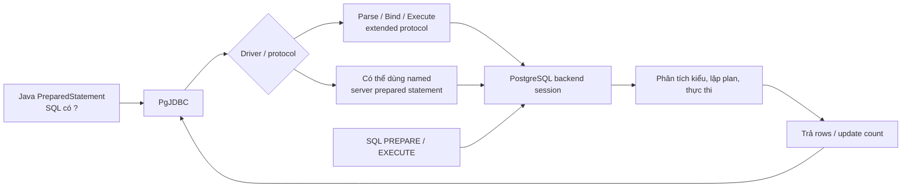
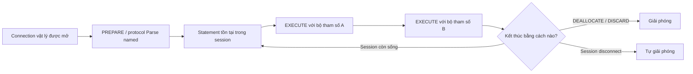

# Prepared statement, tham số truy vấn và vòng đời trên máy chủ trong PostgreSQL

Một ứng dụng Java liên tục gửi câu truy vấn lấy đơn hàng theo khách hàng:

```sql
SELECT order_id, status, total_amount
FROM orders
WHERE tenant_id = 7 AND status = 'paid';
```

Nếu mỗi request tạo một SQL string bằng cách nối giá trị từ người dùng, ứng dụng vừa dễ mắc lỗi **SQL injection**, vừa khó tái sử dụng một mẫu truy vấn nhất quán. PostgreSQL hỗ trợ **prepared statements** để phân biệt **cấu trúc câu lệnh** với **giá trị tham số**. Tuy nhiên, khái niệm “prepare” xuất hiện ở nhiều tầng: lệnh SQL `PREPARE` của PostgreSQL, giao thức kết nối mở rộng (`Parse/Bind/Execute`), `java.sql.PreparedStatement` của JDBC và cơ chế cache của driver hoặc connection pool.

Đặc biệt, một prepared statement đặt tên trên server có **vòng đời gắn với một phiên PostgreSQL (session/backend)**. Nó không tồn tại như một đối tượng toàn database được mọi connection dùng chung, không tự biến kết quả thành cache, và không bảo đảm mọi lần thực thi luôn dùng cùng một execution plan.

Bài học thuộc chương **Kết nối ứng dụng**, xoay quanh ba câu hỏi:

1. **Prepared statement là gì?** Cách khai báo, truyền tham số, thực thi và giải phóng.
2. **Tham số được xử lý thế nào?** Kiểu dữ liệu, `NULL`, bảo mật, giới hạn chỗ được dùng placeholder và khả năng tái sử dụng plan.
3. **Vòng đời trên server ra sao?** Session, transaction, driver JDBC, pooler, invalidation, generic/custom plans và vận hành.

Sau bài này, bạn có thể viết ví dụ `PREPARE`/`EXECUTE` chạy được, gọi từ Java bằng `PreparedStatement`, chẩn đoán lỗi parameter mismatch, kiểm tra `pg_prepared_statements` và thiết kế ứng dụng không dựa vào những giả định sai về phiên kết nối.

## 1. Bức tranh tổng quan

Một prepared statement là **một câu lệnh SQL được chuẩn bị để có thể thực thi với những bộ tham số khác nhau**. Nói đơn giản, ứng dụng gửi **mẫu truy vấn** một lần theo một cơ chế chuẩn bị, sau đó cung cấp các giá trị cho những lần chạy tương ứng.

Ví dụ mẫu SQL:

```sql
SELECT order_id, total_amount
FROM ps_lab.orders
WHERE tenant_id = $1
  AND status = $2
ORDER BY placed_at DESC
LIMIT $3;
```

Ba tham số giữ vị trí các **giá trị**:

- `$1`: tenant ID, kiểu số nguyên.
- `$2`: trạng thái, kiểu text.
- `$3`: số hàng tối đa, kiểu số nguyên.

Ứng dụng có thể chạy cùng cấu trúc với:

```text
(tenant_id=2, status='paid', limit=10)
(tenant_id=5, status='pending', limit=20)
(tenant_id=2, status='cancelled', limit=5)
```

Không cần dùng phép nối chuỗi để đưa những giá trị ấy vào cú pháp SQL.

### 1.1. Sơ đồ các tầng



**Điều cần phân biệt:** object `PreparedStatement` trong Java không phải lúc nào cũng đồng nghĩa đã tồn tại một **named prepared statement** trong `pg_prepared_statements`. Driver có thể dùng extended protocol với unnamed statement trước, sau đó chuyển sang server-side named statement theo chính sách cache và ngưỡng chuẩn bị.

### 1.2. Những gì prepared statement không làm

Prepared statement **không**:

- Tự lưu kết quả `SELECT` như một materialized view hoặc result cache.
- Tự miễn phí bước thực thi, quét bảng, JOIN hoặc sort.
- Bảo đảm query nào cũng dùng B-tree index.
- Cho phép truyền tùy ý tên bảng/cột thay cho SQL identifier.
- Tự cấp quyền trên database hoặc bảng.
- Tự bảo vệ khỏi lỗi logic phân quyền multi-tenant.
- Tồn tại xuyên server restart hoặc kết nối vật lý mới.
- Tự giải quyết vấn đề pool mở quá nhiều connections.

Nó là công cụ quản lý **cấu trúc SQL, binding tham số và tái sử dụng các phần xử lý truy vấn** trong bối cảnh thích hợp.

## 2. SQL PREPARE, EXECUTE và DEALLOCATE

Ba lệnh PostgreSQL cốt lõi:

```sql
PREPARE statement_name (parameter_type, ...)
AS sql_statement;

EXECUTE statement_name(parameter_value, ...);

DEALLOCATE statement_name;
```

Tên statement tồn tại trong **session** đã tạo nó, trừ khi được giải phóng hoặc session kết thúc.

Ví dụ có thể thử trực tiếp không cần bảng:

```sql
PREPARE ps_sum(integer, integer)
AS SELECT $1 + $2 AS total;

EXECUTE ps_sum(10, 20);
EXECUTE ps_sum(7, 8);

DEALLOCATE ps_sum;
```

Kết quả lần lượt là 30 và 15.

Sau `DEALLOCATE`, gọi:

```sql
EXECUTE ps_sum(1, 2);
```

sẽ lỗi vì statement tên `ps_sum` không còn tồn tại trong session hiện tại.

### 2.1. Tên statement và phạm vi

```sql
PREPARE ps_hello(text)
AS SELECT 'Hello, ' || $1 AS greeting;

EXECUTE ps_hello('PostgreSQL');
```

Tên `ps_hello` là **tên của prepared statement**, không phải tên table, index hoặc stored procedure. Nó cần duy nhất trong **cùng session**. Một session khác có thể tạo một statement cùng tên độc lập.

### 2.2. PREPARE không chạy query ngay như EXECUTE

`PREPARE` tạo một prepared statement dựa trên cú pháp/query được cung cấp. Bước thực sự đọc dữ liệu hoặc thực hiện DML xảy ra khi `EXECUTE`.

Ví dụ:

```sql
PREPARE ps_current_time AS
SELECT clock_timestamp() AS observed_at;

EXECUTE ps_current_time;
EXECUTE ps_current_time;

DEALLOCATE ps_current_time;
```

Mỗi lần thực thi gọi `clock_timestamp()` và có thể trả thời điểm khác. Prepared statement không “đóng băng” kết quả lần đầu.

### 2.3. PREPARE có thể dùng cho những loại câu lệnh nào?

SQL `PREPARE` thường được dùng cho:

- `SELECT`.
- `INSERT`.
- `UPDATE`.
- `DELETE`.
- `MERGE` khi major version hỗ trợ.
- `VALUES`.

Không dùng `PREPARE` như một cơ chế chung để chuẩn bị mọi DDL/utility command như `CREATE TABLE`. Khi cần triển khai schema, dùng migration với SQL được kiểm soát, không dùng parameter binding để thay tên đối tượng.

## 3. Bộ dữ liệu thực hành

Các ví dụ từ đây dùng schema `ps_lab` trong **database học tập**. Chỉ tạo/nạp trên schema mới, không chạy nguyên xi trên production.

### 3.1. Tạo bảng

```sql
CREATE SCHEMA IF NOT EXISTS ps_lab;

CREATE TABLE ps_lab.orders (
    order_id bigint GENERATED BY DEFAULT AS IDENTITY PRIMARY KEY,
    tenant_id integer NOT NULL,
    customer_id bigint NOT NULL,
    status text NOT NULL
        CHECK (status IN ('paid', 'pending', 'cancelled')),
    total_amount numeric(12, 2) NOT NULL
        CHECK (total_amount >= 0),
    placed_at timestamptz NOT NULL,
    note text
);
```

Ý nghĩa:

- `order_id`: khóa định danh của mỗi đơn.
- `tenant_id`: ranh giới dữ liệu theo tenant.
- `status`: một trong ba trạng thái.
- `total_amount`: số tiền chính xác kiểu `numeric`.
- `placed_at`: thời gian có timezone.
- `note`: cột có thể NULL, dùng để thử binding giá trị thiếu.

### 3.2. Nạp 60.000 hàng có phân bố không đều

```sql
INSERT INTO ps_lab.orders
    (tenant_id, customer_id, status, total_amount, placed_at, note)
SELECT
    CASE
        WHEN g <= 54000 THEN 1
        ELSE 2 + (g % 60)
    END AS tenant_id,
    1000 + (g % 2000) AS customer_id,
    CASE
        WHEN g % 11 = 0 THEN 'cancelled'
        WHEN g % 4 = 0 THEN 'pending'
        ELSE 'paid'
    END AS status,
    ((g % 25000)::numeric / 100)::numeric(12, 2)
        AS total_amount,
    TIMESTAMPTZ '2026-01-01 00:00:00+00'
        + (g % 180) * INTERVAL '1 day'
        + (g % 86400) * INTERVAL '1 second'
        AS placed_at,
    CASE WHEN g % 5 = 0 THEN NULL ELSE 'sample' END AS note
FROM generate_series(1, 60000) AS s(g);
```

Dữ liệu có **tenant 1 rất lớn**, các tenant còn lại nhỏ hơn nhiều. Sự phân bố lệch là cơ hội học cách **generic plan** và **custom plan** có thể khác hiệu năng.

### 3.3. Tạo index mẫu

```sql
CREATE INDEX idx_ps_orders_tenant_status_time
ON ps_lab.orders (
    tenant_id,
    status,
    placed_at DESC,
    order_id DESC
)
INCLUDE (total_amount);

CREATE INDEX idx_ps_orders_customer
ON ps_lab.orders (customer_id);

ANALYZE ps_lab.orders;
```

Index đầu hỗ trợ các query lọc bằng `tenant_id`/`status` rồi cần những hàng mới nhất theo thời gian. Điều kiện `ORDER BY` phải tương thích nếu muốn tận dụng thứ tự index. `INCLUDE` lưu thêm dữ liệu payload, nhưng không bảo đảm `Index Only Scan` luôn không cần heap fetch.

Đây là **data demo**; planner có thể chọn Seq Scan khi nó thấy rẻ hơn. Không tạo index chỉ vì ví dụ có index mà bỏ qua workload thật.

### 3.4. Kiểm tra số lượng theo tenant

```sql
SELECT
    tenant_id,
    COUNT(*) AS order_count
FROM ps_lab.orders
GROUP BY tenant_id
ORDER BY order_count DESC, tenant_id
LIMIT 10;
```

Bạn sẽ thấy tenant 1 chứa phần lớn hàng. Các tenant còn lại phân bố trên số lượng nhỏ hơn.

## 4. PREPARE một SELECT với tham số có kiểu

```sql
PREPARE ps_recent_orders(integer, text, integer) AS
SELECT
    order_id,
    tenant_id,
    customer_id,
    status,
    total_amount,
    placed_at
FROM ps_lab.orders
WHERE tenant_id = $1
  AND status = $2
ORDER BY placed_at DESC, order_id DESC
LIMIT $3;
```

Câu này khai rõ ba kiểu tham số:

| Vị trí | Kiểu trong `PREPARE` | Ý nghĩa |
| --- | --- | --- |
| `$1` | `integer` | Tenant ID |
| `$2` | `text` | Trạng thái |
| `$3` | `integer` | Giới hạn hàng |

Thực thi:

```sql
EXECUTE ps_recent_orders(2, 'paid', 10);
EXECUTE ps_recent_orders(1, 'pending', 5);
EXECUTE ps_recent_orders(5, 'cancelled', 20);
```

Bạn có thể đổi **giá trị**, nhưng không thay cấu trúc SELECT hay số lượng tham số của statement đã prepare.

### 4.1. EXECUTE nhận biểu thức giá trị

```sql
EXECUTE ps_recent_orders(2 + 1, upper('paid'), 10);
```

Đây là một ví dụ cú pháp. Vì `upper('paid')` tạo `'PAID'`, trong bảng mẫu trạng thái được lưu chữ thường, query có thể không trả hàng. Parameter binding không tự chuyển trạng thái theo nghiệp vụ.

### 4.2. EXECUTE không dùng dấu $ trong danh sách giá trị

Đúng:

```sql
EXECUTE ps_recent_orders(2, 'paid', 10);
```

Sai về ý tưởng:

```text
EXECUTE ps_recent_orders($1, $2, $3);
```

Trong SQL `EXECUTE` gọi một prepared statement đã có, bạn truyền **giá trị hoặc biểu thức**. `$1`, `$2`, `$3` thuộc **câu SQL định nghĩa** ở `PREPARE`; chúng không tự có giá trị trong một câu EXECUTE ngoài bối cảnh parameter tương ứng.

### 4.3. Tham số không phải string interpolation

`$2` đại diện một **giá trị text** có kiểu, không phải đoạn SQL được thay bằng nội dung tùy ý. Nếu ứng dụng truyền chuỗi:

```text
paid' OR '1'='1
```

nó được xử lý như **một giá trị text**, không biến query thành phép `OR`. Câu query chỉ tìm status bằng chính chuỗi đó (và thường không khớp).

## 5. Nhìn prepared statements đang có trong phiên

PostgreSQL cung cấp view `pg_prepared_statements`:

```sql
SELECT
    name,
    statement,
    prepare_time,
    parameter_types,
    from_sql,
    generic_plans,
    custom_plans
FROM pg_prepared_statements
ORDER BY prepare_time;
```

Các cột quan trọng:

- `name`: tên prepared statement.
- `statement`: câu lệnh đã được chuẩn bị.
- `prepare_time`: thời điểm prepare.
- `parameter_types`: mảng kiểu tham số.
- `from_sql`: `true` nếu tạo bằng lệnh SQL `PREPARE`; `false` nếu tạo qua protocol.
- `generic_plans` / `custom_plans`: số lần đã chọn từng loại plan.

Một số cột phụ thuộc major version PostgreSQL. Trên server cũ, kiểm tra schema view bằng `SELECT *` trước khi phụ thuộc một cột nhất định.

### 5.1. View này chỉ nói về session hiện tại

Quan trọng: `pg_prepared_statements` hiển thị **prepared statements của current session**, không phải inventory tất cả statements từ mọi ứng dụng.

Bạn có thể thực hiện:

```sql
SELECT name, parameter_types, from_sql
FROM pg_prepared_statements
WHERE name = 'ps_recent_orders';
```

trong chính connection vừa `PREPARE`. Nếu bạn mở `psql` ở terminal khác, session mới sẽ không thấy statement tên đó.

### 5.2. Một tên statement không mang ý nghĩa global

Giả sử có 100 connection vật lý từ 100 pod. Mỗi connection có thể có một prepared statement tên `ps_recent_orders`, nhưng đó là **100 thực thể session-local**, không phải một object server chia sẻ.

Điều này quan trọng khi tính memory footprint và khi restart pooler/server.

### 5.3. Xóa statement thực hành

```sql
DEALLOCATE ps_recent_orders;
```

Sau đó:

```sql
SELECT name
FROM pg_prepared_statements
WHERE name = 'ps_recent_orders';
```

trong cùng session sẽ không còn dòng tương ứng.

## 6. Kiểu tham số: khai rõ hay suy luận?

Bạn có thể cung cấp danh sách kiểu:

```sql
PREPARE ps_find_id(bigint) AS
SELECT order_id, status
FROM ps_lab.orders
WHERE order_id = $1;
```

Hoặc để PostgreSQL suy luận kiểu từ ngữ cảnh khi có đủ thông tin:

```sql
PREPARE ps_find_id_inferred AS
SELECT order_id, status
FROM ps_lab.orders
WHERE order_id = $1;
```

Cột `order_id` có kiểu `bigint`, nên parser có ngữ cảnh để suy loại tham số.

Kiểm tra:

```sql
SELECT name, parameter_types
FROM pg_prepared_statements
WHERE name IN ('ps_find_id', 'ps_find_id_inferred');

EXECUTE ps_find_id(1);
EXECUTE ps_find_id_inferred(1);
```

### 6.1. Khi ngữ cảnh không đủ, hãy ghi kiểu

Ví dụ:

```sql
PREPARE ps_untyped AS SELECT $1;
```

có thể bị từ chối vì PostgreSQL không xác định được kiểu của tham số `$1`.

Cách tường minh:

```sql
PREPARE ps_typed(text) AS
SELECT $1 AS supplied_text;

EXECUTE ps_typed('hello');
```

Hoặc ép kiểu trong SQL:

```sql
PREPARE ps_cast AS
SELECT $1::integer + 10 AS result;

EXECUTE ps_cast(5);
```

### 6.2. Vì sao kiểu quan trọng?

PostgreSQL chọn toán tử và function theo **kiểu dữ liệu**, ví dụ:

- `bigint = bigint`.
- `uuid = uuid`.
- `numeric + numeric`.
- `jsonb @> jsonb`.
- `timestamptz >= timestamptz`.

Nếu driver gửi `varchar` trong khi biểu thức đòi `uuid` hoặc `jsonb`, bạn có thể gặp lỗi operator/cast. Không chuyển mọi input thành text chỉ vì người dùng nhập từ HTTP.

## 7. Tham số NULL và suy luận kiểu

SQL NULL không phải chuỗi `'NULL'`.

Ví dụ:

```sql
PREPARE ps_nullable_note(bigint, text) AS
SELECT order_id, note
FROM ps_lab.orders
WHERE order_id = $1
  AND note IS NOT DISTINCT FROM $2;

EXECUTE ps_nullable_note(1, NULL);
EXECUTE ps_nullable_note(1, 'sample');
```

Điều kiện `IS NOT DISTINCT FROM` xử lý NULL như một giá trị so sánh theo semantics rõ ràng:

- Hai phía cùng NULL → true.
- Một phía NULL, một phía không NULL → false.
- Hai phía non-NULL → so bằng thông thường.

### 7.1. `= NULL` không hoạt động như so sánh thông thường

Sai về logic khi muốn tìm note NULL:

```sql
WHERE note = $2
```

với `$2 = NULL` không trả true cho các hàng `note IS NULL`. Hãy dùng `IS NULL` hoặc toán tử NULL-safe theo yêu cầu.

### 7.2. Nullable filter có nghĩa khác với NULL equality

Một mẫu thường thấy:

```sql
PREPARE ps_optional_status(integer, text) AS
SELECT order_id, status
FROM ps_lab.orders
WHERE tenant_id = $1
  AND ($2 IS NULL OR status = $2)
ORDER BY order_id
LIMIT 30;
```

Ở đây `$2 = NULL` nghĩa là **không lọc status**, không phải “tìm status NULL”. Hai hợp đồng khác nhau cần được đặt tên rõ.

**Hiệu năng:** điều kiện OR với parameter optional có thể ảnh hưởng selectivity và generic plan. Với workload nhạy hiệu năng, hai query shapes cố định — có lọc và không lọc — đôi khi tốt hơn một query OR tổng quát.

## 8. Nên truyền giá trị kiểu đúng từ Java

Các cặp PostgreSQL ↔ JDBC thường gặp:

| PostgreSQL | Java/PgJDBC | Gợi ý bind |
| --- | --- | --- |
| `bigint` | `long`/`Long` | `setLong` |
| `integer` | `int`/`Integer` | `setInt` |
| `numeric` | `BigDecimal` | `setBigDecimal` |
| `text`/`varchar` | `String` | `setString` |
| `boolean` | `boolean`/`Boolean` | `setBoolean` hoặc `setNull` |
| `date` | `LocalDate` | `setObject` theo JDBC 4.2 |
| `timestamptz` | `OffsetDateTime` | `setObject` theo hỗ trợ PgJDBC |
| `uuid` | `UUID` | `setObject` |
| `jsonb` | `PGobject` hoặc cast phù hợp | Xem ví dụ typed JSON |

Lựa chọn thực tế phụ thuộc phiên bản driver và giao diện được dùng. Không suy mọi JDBC driver đều hỗ trợ giống PgJDBC đối với `jsonb`, UUID hoặc array.

### 8.1. Java setNull cần kiểu SQL

Ví dụ binding một nullable text:

```java
if (note == null) {
    statement.setNull(2, java.sql.Types.VARCHAR);
} else {
    statement.setString(2, note);
}
```

Tham số NULL cũng cần được hiểu trong ngữ cảnh SQL type. Khi cấu trúc phức tạp, cast tường minh trong SQL có thể giúp tránh lỗi suy luận kiểu.

## 9. Không thể bind tên bảng, cột hoặc từ khóa SQL

Một parameter placeholder đại diện **giá trị dữ liệu**, không phải SQL syntax node.

Sai về ý định:

```sql
PREPARE ps_wrong(text) AS
SELECT * FROM $1;
```

Không có nghĩa `$1` sẽ trở thành tên bảng tùy ý.

Tương tự:

```sql
SELECT *
FROM ps_lab.orders
ORDER BY $1;
```

không tự coi chuỗi `'placed_at'` được truyền vào là **tên cột cần ORDER BY**. Nếu câu SQL hợp lệ, nó có thể bị hiểu như sắp theo một giá trị/biểu thức hằng và **không tạo thứ tự mong muốn**.

### 9.1. Sắp xếp động an toàn bằng whitelist

Trong Java, có thể ánh xạ một lựa chọn API thành **một trong các SQL fragments cố định do ứng dụng kiểm soát**:

```java
String orderExpression = switch (sortKey) {
    case "date" -> "placed_at DESC, order_id DESC";
    case "amount" -> "total_amount DESC, order_id DESC";
    default -> throw new IllegalArgumentException("Unsupported sort");
};

String sql = """
    SELECT order_id, total_amount, placed_at
    FROM ps_lab.orders
    WHERE tenant_id = ?
    ORDER BY
    """ + orderExpression + """
    LIMIT ?
    """;
```

Ví dụ trên dùng **whitelist**, không nối giá trị sortKey do client nhập thẳng vào SQL. Các **giá trị** `tenant_id`, `LIMIT` vẫn phải bind bằng placeholders.

### 9.2. Dynamic identifier ở PL/pgSQL

Khi thực sự cần truy cập tên bảng/cột động ở server-side code, có thể dùng `EXECUTE format('%I', identifier)` với validation/whitelist và `USING` cho các giá trị.

Đó là **SQL động** với những rủi ro quyền và injection khác, không phải trường hợp tham số hóa SQL PREPARE thuần.

### 9.3. Không parameterize toàn bộ predicate tùy ý

Không nhận chuỗi `"tenant_id = 1 OR true"` từ client rồi ghép vào `WHERE`. Hãy biểu diễn filter thành các trường dữ liệu typed trong API và tạo một trong những query shapes có kiểm soát.

## 10. SQL injection: điều prepared statement thực sự bảo vệ

Mẫu nguy hiểm:

```java
String sql =
    "SELECT order_id FROM ps_lab.orders WHERE status = '"
    + rawStatus
    + "'";
```

Nếu `rawStatus` đến từ request, nó có thể thay đổi cú pháp SQL khi được nối thành text.

Mẫu đúng:

```java
String sql =
    "SELECT order_id FROM ps_lab.orders WHERE status = ?";

try (PreparedStatement ps = connection.prepareStatement(sql)) {
    ps.setString(1, rawStatus);
    try (ResultSet rs = ps.executeQuery()) {
        // Đọc rows.
    }
}
```

Giá trị người dùng được đưa vào qua **bind parameter**. Các dấu quote, semicolon, comment markers và từ khóa trong giá trị **không trở thành cấu trúc SQL**.

### 10.1. Prepared statement không thay validation nghiệp vụ

Một chuỗi `rawStatus="unexpected"` không thể inject SQL qua binding, nhưng vẫn có thể là giá trị **không hợp lệ theo domain**.

Cần:

- Whitelist giá trị status.
- Kiểm soát độ dài input.
- Giới hạn `LIMIT`/pagination.
- Kiểm tra user/tenant authorization.
- Xử lý SQL errors.
- Có query timeout, log an toàn khi cần.

### 10.2. Không lộ secret qua log tham số

Một framework có thể log:

```text
SQL: SELECT ... WHERE email = ?
params: secret@example.test
```

Parameterization ngăn injection, **không tự ẩn dữ liệu nhạy cảm trong logs**. Với mật khẩu, token, dữ liệu cá nhân hoặc giá trị nhạy cảm, cần cấu hình logging/redaction thích hợp ở app, driver và database.

## 11. Java JDBC PreparedStatement: ví dụ repository hoàn chỉnh

Đây là ví dụ dùng DataSource và prepared query trả các đơn gần đây.

```java
import java.math.BigDecimal;
import java.sql.Connection;
import java.sql.PreparedStatement;
import java.sql.ResultSet;
import java.sql.SQLException;
import java.time.Instant;
import java.util.ArrayList;
import java.util.List;
import javax.sql.DataSource;

public final class OrderRepository {
    private final DataSource dataSource;

    public OrderRepository(DataSource dataSource) {
        this.dataSource = dataSource;
    }

    public record OrderSummary(
            long orderId,
            int tenantId,
            String status,
            BigDecimal amount,
            Instant placedAt
    ) {}

    public List<OrderSummary> findRecent(
            int authorizedTenantId,
            String status,
            int requestedLimit
    ) throws SQLException {
        if (!List.of("paid", "pending", "cancelled").contains(status)) {
            throw new IllegalArgumentException("Unsupported status");
        }

        int limit = Math.max(1, Math.min(requestedLimit, 50));

        String sql = """
            SELECT
                order_id, tenant_id, status,
                total_amount, placed_at
            FROM ps_lab.orders
            WHERE tenant_id = ?
              AND status = ?
            ORDER BY placed_at DESC, order_id DESC
            LIMIT ?
            """;

        List<OrderSummary> result = new ArrayList<>();

        try (Connection connection = dataSource.getConnection();
             PreparedStatement statement =
                 connection.prepareStatement(sql)) {

            statement.setInt(1, authorizedTenantId);
            statement.setString(2, status);
            statement.setInt(3, limit);

            try (ResultSet rs = statement.executeQuery()) {
                while (rs.next()) {
                    result.add(new OrderSummary(
                        rs.getLong("order_id"),
                        rs.getInt("tenant_id"),
                        rs.getString("status"),
                        rs.getBigDecimal("total_amount"),
                        rs.getTimestamp("placed_at").toInstant()
                    ));
                }
            }
        }

        return result;
    }
}
```

Điểm nổi bật:

- `?` là placeholder theo **JDBC**, đánh số vị trí bắt đầu từ **1**.
- `setInt(1, ...)` bind tenant; `setString(2, ...)` bind status.
- `setInt(3, ...)` bind LIMIT sau khi giới hạn mức tối đa của sản phẩm.
- `try-with-resources` đóng ResultSet, PreparedStatement và Connection theo contract của JDBC.
- `BigDecimal` dành cho `numeric` thay vì `double` để tránh mất chính xác tiền.
- `authorizedTenantId` phải lấy từ **ngữ cảnh xác thực/ủy quyền phía server ứng dụng**, không tin một tenant ID tùy ý trong request.

### 11.1. JDBC ? khác SQL PREPARE $1

JDBC:

```sql
SELECT * FROM ps_lab.orders WHERE order_id = ?
```

SQL `PREPARE` trong PostgreSQL:

```sql
PREPARE ps_one(bigint) AS
SELECT * FROM ps_lab.orders WHERE order_id = $1;
```

Không viết `$1` trực tiếp vào `PreparedStatement` Java theo thói quen SQL PREPARE, trừ khi dùng giao diện driver được định nghĩa đặc biệt. `?` là placeholder chuẩn của `PreparedStatement`.

### 11.2. JDBC PreparedStatement không cam kết server PREPARE ngay

`Connection.prepareStatement(sql)` tạo **JDBC PreparedStatement object**. PgJDBC có thể dùng extended query protocol, parse/bind/execute và caching; nó không nhất thiết gửi SQL `PREPARE name(...) AS ...` ngay khi method này được gọi.

Khi ứng dụng chạy query lặp, PgJDBC có thể chuyển sang **named server-side prepared statements** tùy `prepareThreshold`, query mode, cache và driver version.

### 11.3. Connection.close trong pool không luôn đóng TCP session

Khi `dataSource` là connection pool, `connection.close()` thường **trả connection logic về pool** thay vì đóng socket vật lý ngay.

Đó là điều tốt cho tái sử dụng connection, nhưng có hệ quả: server session vẫn tồn tại và có thể còn giữ prepared statements, session settings hoặc cached state theo cách pool/driver quản lý.

## 12. Extended query protocol: Parse, Bind, Execute

Bên cạnh việc gửi SQL `PREPARE`/`EXECUTE` bằng simple query protocol, PostgreSQL có **extended query protocol**.

Các thông điệp cốt lõi:

1. **Parse**: gửi SQL text và có thể gắn tên statement.
2. **Bind**: cung cấp bộ giá trị tham số, tạo portal.
3. **Describe**: lấy mô tả parameters/results khi cần.
4. **Execute**: chạy portal.
5. **Sync**: hoàn thành chu kỳ protocol, đồng bộ trạng thái.

Một sequence khái niệm:

```text
Client                         PostgreSQL backend
  | -- Parse SQL với $1,$2 --> |
  | <-- ParseComplete -------- |
  | -- Bind values --------->  |
  | <-- BindComplete --------- |
  | -- Execute --------------> |
  | <-- RowDescription/DataRow |
  | <-- CommandComplete ------ |
  | -- Sync -----------------> |
  | <-- ReadyForQuery -------- |
```

Đây là mô hình giản lược; thứ tự cụ thể và tối ưu pipelining phụ thuộc driver/client.

### 12.1. Unnamed và named prepared statements

Extended protocol có thể tạo:

- **Unnamed statement**: thường dùng cho truy vấn không cần giữ tên lâu dài; có quy tắc thay thế/hủy theo protocol.
- **Named statement**: có tên và có thể tái sử dụng trong session cho nhiều Bind/Execute.

Điều này giải thích vì sao bạn có thể dùng `PreparedStatement` trong Java mà không thấy một named statement tương ứng tồn tại lâu trong `pg_prepared_statements`.

### 12.2. Portal khác prepared statement

`Parse` chuẩn bị statement; `Bind` tạo một **portal** với bộ tham số và định dạng kết quả; `Execute` chạy portal.

Không đánh đồng portal (một execution context) với named prepared statement (mẫu truy vấn được chuẩn bị). Chúng có quy tắc vòng đời khác nhau trong protocol/transaction.

### 12.3. Statement caching của driver không phải cache kết quả

PgJDBC có thể giữ parsed query/cached statements để giảm parse/prepare work. Nhưng mỗi lần `executeQuery()` vẫn phải thực thi SQL và đọc các hàng tương ứng ở snapshot hiện hành.

Nếu một đơn đã đổi `status` và transaction mới đọc dữ liệu, prepared statement **không tự trả lại kết quả cũ** chỉ vì tên statement được cache.

## 13. Vòng đời trên server: session, transaction và giải phóng

Một **named prepared statement** thuộc **một PostgreSQL session**.

Vòng đời cơ bản:



### 13.1. Prepared statement tồn tại qua transaction boundaries

Trong cùng connection:

```sql
PREPARE ps_session_demo(integer)
AS SELECT $1 * 10 AS result;

BEGIN;
EXECUTE ps_session_demo(2);
COMMIT;

BEGIN;
EXECUTE ps_session_demo(3);
ROLLBACK;

EXECUTE ps_session_demo(4);

DEALLOCATE ps_session_demo;
```

Câu cuối vẫn có thể chạy sau COMMIT và ROLLBACK vì statement **đã được tạo trong session trước khi hai transaction bắt đầu**.

Điều này **không có nghĩa** một prepared statement đang chạy có thể thoát khỏi quy tắc transaction: nếu transaction đang ở trạng thái aborted do lỗi, bạn cần rollback/khôi phục transaction state trước khi chạy tiếp các câu lệnh hợp lệ.

### 13.2. Session disconnect làm mất statement

Nếu connection vật lý bị đóng và client kết nối lại:

```sql
EXECUTE ps_session_demo(5);
```

không thể dùng statement từ session cũ, dù session cũ từng tạo cùng tên.

Một connection pool cần xử lý trường hợp reconnect/failover theo lifecycle driver, không được giả định server giữ mọi prepared statements vô thời hạn.

### 13.3. PREPARE có thể bị ảnh hưởng bởi rollback lúc tạo

Các thao tác chuẩn bị diễn ra trong context của session/transaction; hành vi của lệnh `PREPARE` được tạo trong transaction thất bại cần đối chiếu server/protocol và cách client xử lý. **Không thiết kế hệ thống dựa vào việc cố dùng một statement vừa được tạo bên trong transaction đã lỗi**.

Mẫu thực hành đơn giản là chuẩn bị trên connection ở trạng thái hợp lệ, theo driver lifecycle và thử lại/reprepare sau reconnect.

## 14. DEALLOCATE, DEALLOCATE ALL và DISCARD ALL

Giải phóng một statement:

```sql
DEALLOCATE ps_find_id;
```

Giải phóng các statements được SQL command quản lý theo phạm vi session:

```sql
DEALLOCATE ALL;
```

`DISCARD ALL` còn rộng hơn: nó reset/giải phóng nhiều tài nguyên và trạng thái session theo quy tắc PostgreSQL, trong đó có prepared statements.

### 14.1. Không gọi DEALLOCATE ALL tùy tiện trong connection pool

Một JDBC driver có thể đang cache tên prepared statements và kỳ vọng chúng còn tồn tại. Nếu application tự chạy:

```sql
DEALLOCATE ALL;
```

trên connection ấy, cache ở client/driver có thể **không còn đồng bộ** với trạng thái server; những lần Execute sau có thể lỗi “prepared statement does not exist” hoặc driver phải tự recover.

Chỉ dùng lệnh reset session khi connection pool/driver hỗ trợ và được cấu hình đúng.

### 14.2. DISCARD ALL không phải một câu lệnh business query

`DISCARD ALL` có nhiều tác động reset session và không được dùng bên trong transaction block theo quy tắc PostgreSQL. Nó cần được điều phối như thao tác quản trị/reset connection, không ghép vào từng request.

### 14.3. Một tên có thể được dùng lại sau DEALLOCATE

```sql
PREPARE ps_x(integer) AS SELECT $1 + 1;
EXECUTE ps_x(1);
DEALLOCATE ps_x;

PREPARE ps_x(text) AS SELECT upper($1);
EXECUTE ps_x('abc');
DEALLOCATE ps_x;
```

Lần prepare thứ hai cùng tên được phép vì statement cũ đã được giải phóng. Nhưng **hai câu có contract tham số khác nhau**; driver/application phải quản lý tên và expected types đúng.

## 15. Một lần chạy không đồng nghĩa một plan bất biến

PostgreSQL chuẩn bị statement và có thể tạo một **execution plan** khi thực thi. Với prepared statement có tham số, planner có thể chọn:

- **Custom plan:** tối ưu dựa trên bộ giá trị tham số cụ thể của lần thực thi.
- **Generic plan:** một plan có thể tái sử dụng cho những bộ tham số khác nhau của cùng prepared statement.

Điều này có tác động lớn khi phân bố dữ liệu lệch.

### 15.1. Custom plan

Giả sử tenant 1 có 54.000 hàng, tenant 2 chỉ có khoảng 100 hàng. Một câu query:

```sql
WHERE tenant_id = $1
```

có thể nên:

- Dùng Seq Scan hoặc index access tùy tỷ lệ trả về khi `$1=1`.
- Dùng Index Scan khi `$1=2` trả rất ít hàng.

Custom plan có khả năng dùng **giá trị tham số thực** và statistics để chọn đường đi.

### 15.2. Generic plan

Generic plan không được tối ưu riêng cho `$1=1` hay `$1=2` mỗi lần. Nó tiết kiệm một phần chi phí planning khi câu truy vấn chạy lặp nhưng có thể **kém phù hợp** với một số giá trị rất lệch.

Generic plan **không có nghĩa query bỏ qua parameter**. Parameter vẫn được bind và query vẫn lọc đúng. Khác biệt nằm ở **quyết định kế hoạch**, không phải semantics SQL.

### 15.3. Khi nào PostgreSQL chọn generic hay custom?

Với `plan_cache_mode=auto`, PostgreSQL dùng cơ chế ước lượng chi phí giữa kế hoạch generic và custom. Với prepared statements có tham số, thông thường hệ thống ban đầu thực hiện **năm custom plans**, sau đó cân nhắc generic plan theo so sánh chi phí ước lượng.

Chi tiết quy tắc có thể phát triển theo major version và query type. **Không xem số “5” là một SLA cứng** cho mọi driver, mọi kế hoạch hoặc mọi statement.

Một statement không có tham số thường có lý do tự nhiên để dùng generic plan, vì không có parameter values thay đổi.

## 16. Điều khiển plan_cache_mode để học

Kiểm tra:

```sql
SHOW plan_cache_mode;
```

Các giá trị phổ biến:

- `auto`: PostgreSQL tự quyết định.
- `force_custom_plan`: yêu cầu custom plan cho những prepared queries có thể dùng custom.
- `force_generic_plan`: yêu cầu generic plan cho những prepared queries có thể dùng generic.

Ví dụ trên session học tập:

```sql
PREPARE ps_tenant_count(integer) AS
SELECT COUNT(*)
FROM ps_lab.orders
WHERE tenant_id = $1;

SET plan_cache_mode = force_custom_plan;

EXPLAIN EXECUTE ps_tenant_count(1);
EXPLAIN EXECUTE ps_tenant_count(2);

SET plan_cache_mode = force_generic_plan;

EXPLAIN EXECUTE ps_tenant_count(1);
EXPLAIN EXECUTE ps_tenant_count(2);

SET plan_cache_mode = auto;
DEALLOCATE ps_tenant_count;
```

Trong plan, generic plan có thể hiển thị placeholder `$1` ở điều kiện; custom plan có thể hiển thị giá trị cụ thể. Nhưng **quan sát plan thực** vẫn quan trọng hơn suy luận chỉ từ cách văn bản được in.

### 16.1. Sử dụng SET LOCAL để giới hạn tác động

```sql
BEGIN;

SET LOCAL plan_cache_mode = force_custom_plan;

PREPARE ps_local_plan(integer) AS
SELECT COUNT(*)
FROM ps_lab.orders
WHERE tenant_id = $1;

EXPLAIN EXECUTE ps_local_plan(2);

DEALLOCATE ps_local_plan;

COMMIT;
```

`SET LOCAL` đặt lựa chọn chỉ trong transaction hiện tại theo semantics PostgreSQL. Nó tránh thay đổi GUC của cả session đang được connection pool tái sử dụng.

### 16.2. Không ép generic/custom bằng thói quen

`force_custom_plan` có thể làm tăng planning overhead nếu query được gọi rất nhiều lần. `force_generic_plan` có thể làm query với những tham số hiếm/chọn lọc rất chậm.

Chỉ override sau khi đã đo những query đại diện; ưu tiên `auto` nếu không có vấn đề được chứng minh.

## 17. EXPLAIN EXECUTE: xem plan của prepared statement

Bạn không cần sao chép query text và thay tham số bằng tay để xem plan.

```sql
PREPARE ps_explain(integer, text) AS
SELECT order_id, total_amount, placed_at
FROM ps_lab.orders
WHERE tenant_id = $1
  AND status = $2
ORDER BY placed_at DESC, order_id DESC
LIMIT 20;

EXPLAIN EXECUTE ps_explain(2, 'paid');

EXPLAIN (ANALYZE, BUFFERS)
EXECUTE ps_explain(2, 'paid');

DEALLOCATE ps_explain;
```

- `EXPLAIN EXECUTE` xem kế hoạch dự kiến.
- `EXPLAIN (ANALYZE, BUFFERS) EXECUTE` **thực thi thật** và đo actual time/rows/buffers.

Vì ví dụ trên là SELECT, nó không thay dữ liệu. **Nếu prepared statement là UPDATE/DELETE/INSERT, EXPLAIN ANALYZE sẽ thực thi DML thật**; phải dùng transaction/rollback phù hợp trên môi trường học tập.

### 17.1. Vì sao một plan có Seq Scan?

Dù có index trên tenant, PostgreSQL có thể chọn Seq Scan khi:

- Tenant 1 chứa phần lớn bảng.
- Query trả nhiều hàng.
- Statistics cho thấy index access đắt hơn scan.
- Bảng nhỏ hoặc cache/tải thay đổi.
- Generic plan phải cân bằng nhiều giá trị khác nhau.

**Index tồn tại không ép planner phải dùng nó.** Prepared statement không thay quy luật cost-based optimization.

### 17.2. Đọc những chỉ số cần thiết

| Trường | Ý nghĩa |
| --- | --- |
| `cost` | Ước lượng planner, không phải mili-giây |
| `rows` / `actual rows` | Ước lượng/thực tế số hàng |
| `Index Cond` | Điều kiện thực sự được đẩy vào index |
| `Filter` | Điều kiện lọc còn lại |
| `Sort` | Chi phí sắp xếp nếu index không cung cấp ordering |
| `Buffers: shared hit/read` | Hoạt động PostgreSQL buffer cache |
| `Planning Time` | Thời gian lập kế hoạch được đo |
| `Execution Time` | Thời gian executor theo instrumentation |

Một phép đo sau khi cache ấm không đủ kết luận. Hãy thử query phổ biến, hiếm và các tham số góc cạnh nhiều lần.

## 18. Quan sát generic_plans và custom_plans

Sau khi tạo prepared statement:

```sql
PREPARE ps_plan_counter(integer) AS
SELECT COUNT(*)
FROM ps_lab.orders
WHERE tenant_id = $1;

EXECUTE ps_plan_counter(1);
EXECUTE ps_plan_counter(2);
EXECUTE ps_plan_counter(3);

SELECT
    name,
    generic_plans,
    custom_plans
FROM pg_prepared_statements
WHERE name = 'ps_plan_counter';

DEALLOCATE ps_plan_counter;
```

Các counter giúp hiểu **server đã dùng loại plan nào bao nhiêu lần** trong session.

### 18.1. Không suy từ counters về toàn bộ cluster

`pg_prepared_statements` là session-local. Một lần xem counters trong psql **không cho biết** tình trạng chuẩn bị query trên 200 connections khác.

Nếu cần toàn hệ thống, phải dùng observability phù hợp (driver logs, metrics, `pg_stat_statements` nếu có và quy định riêng), không gom dữ liệu session-local một cách giả định.

### 18.2. from_sql cho biết con đường tạo

Nếu `from_sql=true`, statement được chuẩn bị bằng SQL `PREPARE`. Những named statements qua protocol có thể có `from_sql=false`.

Đây là tín hiệu hữu ích để phân biệt câu lệnh bạn chạy bằng `psql` với statement do driver quản lý, nhưng driver còn có cache client-side không nhất thiết xuất hiện trong view.

## 19. pgJDBC prepareThreshold và ngưỡng dùng server-side named statements

PgJDBC có cơ chế `prepareThreshold` để quyết định khi nào một query được chạy lặp đủ để tạo/đổi sang named server-side prepared statement, tùy protocol mode và cache.

Trong nhiều phiên bản PgJDBC, mặc định `prepareThreshold=5`. Nhưng trước khi áp dụng một con số cứng:

- Kiểm tra phiên bản PgJDBC thực tế.
- Kiểm tra `preferQueryMode` và các driver properties liên quan.
- Kiểm tra statement caching.
- Xem query có lặp trên **cùng physical connection** hay không.
- Xem driver có đủ điều kiện để giữ server-side prepared statement không.

### 19.1. Năm request không nhất thiết bằng năm lần chạy trên một session

Giả sử Java app có pool 20 connections và nhận 100 requests. Chúng có thể được phân bố qua nhiều physical sessions.

Vì vậy, việc query được chạy 100 lần **toàn ứng dụng** không bảo đảm mỗi connection đã chạy đủ ngưỡng để chuyển sang server-side prepare.

### 19.2. Ngưỡng 0 và các query modes

Driver có thể cho phép tắt server-side prepared statements bằng cấu hình phù hợp như `prepareThreshold=0`, hoặc dùng simple-query mode theo cấu hình `preferQueryMode`. Các lựa chọn ảnh hưởng protocol/caching và cần kiểm tra theo đúng driver version.

Đừng tự thay cấu hình production chỉ để “chắc chắn prepared hơn”. Hãy benchmark latency, CPU, parse/plan overhead và tác động pooler.

### 19.3. Driver có thể cache SQL sau khi Java object đóng

Việc `PreparedStatement.close()` đóng object ở JDBC không đồng nghĩa chắc chắn driver/server vừa `DEALLOCATE` ngay lập tức. Tùy driver cache và physical connection lifecycle, trạng thái chuẩn bị có thể được giữ để dùng lại.

Ngược lại, khi physical session bị hủy, named server statements của session đó biến mất.

## 20. Connection pool: prepared statement thuộc physical connection

Giả sử HikariCP hoặc một pool khác có tối đa 10 physical connections. Mỗi physical connection tương ứng một backend session PostgreSQL khi kết nối trực tiếp.

```text
HTTP Request 1  -> Pool -> Connection A -> PostgreSQL Session A
HTTP Request 2  -> Pool -> Connection B -> PostgreSQL Session B
HTTP Request 3  -> Pool -> Connection A -> PostgreSQL Session A
```

Nếu Session A đã có `PREPARE ps_report` nhưng Session B chưa có:

```sql
EXECUTE ps_report(...);
```

sẽ hoạt động trên A nhưng **không tự hoạt động trên B**.

### 20.1. Đừng prepare bằng SQL một lần khi ứng dụng start rồi dùng toàn pool

Một anti-pattern:

1. App startup mượn một connection.
2. Chạy SQL `PREPARE ps_report(...)`.
3. Trả connection về pool.
4. Những request sau mượn connection khác và chạy `EXECUTE ps_report(...)`.

Kết quả có thể lúc được lúc lỗi, phụ thuộc connection được mượn. Đó là **vấn đề session affinity**, không phải database bất ổn.

Giải pháp thường tốt hơn cho ứng dụng Java: dùng `PreparedStatement` và để driver quản lý preparation/caching **trên từng physical connection**.

### 20.2. Vòng đời của connection pool

Một pool có thể thay physical connections vì:

- Idle timeout.
- Max lifetime.
- Network reset.
- Database restart.
- Failover.
- Credentials rotation.
- Health check thất bại.

Khi connection mới được tạo, server-side named statements trong connection cũ **không tồn tại**. Driver phải thực hiện preparation theo yêu cầu, không phụ thuộc một statement đã tạo ở session khác.

### 20.3. Reset session state phải phối hợp với driver

Một pooler có thể chạy reset query khi trả connection về pool. Nếu nó thực hiện `DISCARD ALL` hoặc `DEALLOCATE ALL` trong lúc driver vẫn nghĩ named statements còn tồn tại, ứng dụng có thể gặp lỗi lặp/chạy lại.

Cần kiểm tra tài liệu pooler/driver và các thiết lập reset thay vì dùng một đoạn SQL “dọn sạch mọi thứ” tùy tiện.

## 21. PgBouncer: session pooling và transaction pooling

PgBouncer thêm một tầng giữa client và PostgreSQL:

```text
Java app ----> PgBouncer ----> PostgreSQL backend
```

Các pool modes có ảnh hưởng khác nhau tới session state.

### 21.1. Session pooling

Trong **session pooling**, một client connection thường gắn với một PostgreSQL backend connection cho cả thời gian client session được giữ.

Những prepared statements gắn với backend dễ có semantics tương tự kết nối PostgreSQL trực tiếp hơn, dù reset/disconnect vẫn cần chú ý.

### 21.2. Transaction pooling

Trong **transaction pooling**, backend server connection có thể được cấp cho client chỉ trong transaction rồi trả về pool. Request/transaction tiếp theo có thể đi sang backend khác.

Vì SQL `PREPARE` đặt tên tồn tại theo session backend, ứng dụng **không thể mặc định** SQL `PREPARE` ở transaction này sẽ có mặt khi chạy `EXECUTE` trong transaction sau.

### 21.3. Hỗ trợ protocol-level prepared statements thay đổi theo phiên bản

Các phiên bản PgBouncer hiện đại có hỗ trợ **protocol-level named prepared statements** trong transaction pooling khi bật/cấu hình tính năng như `max_prepared_statements` phù hợp.

Nhưng:

- **SQL text `PREPARE`/`EXECUTE`** không đồng nghĩa cùng đường protocol-level mà pooler có thể quản lý.
- Khả năng hỗ trợ phụ thuộc phiên bản PgBouncer, cấu hình, driver behavior và query mode.
- Không mặc định mọi PgBouncer phiên bản hoặc mode đều hỗ trợ mọi hình thức chuẩn bị.
- Cần kiểm thử failover, reset, DDL invalidation và transaction boundaries.

**Không kết luận “transaction pooling luôn không dùng được PreparedStatement”**, cũng không kết luận “hễ PgBouncer mới là mọi SQL PREPARE đều dùng được”. Phải xác định **loại chuẩn bị** và **phiên bản/cấu hình thực tế**.

### 21.4. Khi bị lỗi ngẫu nhiên ở transaction pool

Các thông báo có thể liên quan:

```text
prepared statement "..." does not exist
prepared statement "..." already exists
cached plan must not change result type
```

Không vội tắt toàn bộ connection pooling. Hãy kiểm tra:

1. Pool mode.
2. PgBouncer version và `max_prepared_statements`.
3. PgJDBC query mode/`prepareThreshold`.
4. Driver có dùng unnamed/named extended protocol không.
5. Reset query/session state.
6. Schema migrations vừa diễn ra không.
7. Kết nối có failover/reconnect không.

Mỗi lỗi có thể có nhiều nguyên nhân, không phải tất cả xuất phát cùng một bug.

## 22. Generic plan có thể là regression khi dữ liệu lệch

Dùng phân bố tenant trong `ps_lab.orders`:

- Tenant 1: khoảng 90% dữ liệu.
- Tenant 2–61: mỗi tenant có một phần rất nhỏ.

Prepared query:

```sql
PREPARE ps_skew(integer) AS
SELECT order_id, status, total_amount
FROM ps_lab.orders
WHERE tenant_id = $1;
```

Kiểm tra:

```sql
SET plan_cache_mode = force_custom_plan;

EXPLAIN EXECUTE ps_skew(1);
EXPLAIN EXECUTE ps_skew(2);

SET plan_cache_mode = force_generic_plan;

EXPLAIN EXECUTE ps_skew(1);
EXPLAIN EXECUTE ps_skew(2);

SET plan_cache_mode = auto;
DEALLOCATE ps_skew;
```

Hãy quan sát:

- Planner ước lượng `rows` bao nhiêu?
- Có index nào phục vụ `tenant_id` không?
- Custom plan cho tenant nhỏ có khác tenant lớn không?
- Generic plan có dùng cùng access path cho hai tham số không?

### 22.1. Số hàng trả nhiều có thể cần Seq Scan

Đối với tenant 1, lấy 54.000 hàng từ một bảng 60.000 hàng qua một index có thể đắt hơn Seq Scan. Không phải mọi query có `WHERE tenant_id = 1` đều được lợi từ index.

### 22.2. Hãy đo planning time cùng execution time

Custom plan có thể chọn đúng index cho tenant nhỏ nhưng tốn planning mỗi lần. Generic plan giảm planning nhưng có thể tăng execution time.

Tối ưu tổng thời gian:

```text
request latency ≈ connection wait + parse/plan + execute + fetch + network
```

Không chỉ đo `Execution Time` của một SELECT sau khi toàn bộ caches đã ấm.

## 23. Invalidation khi schema hoặc statistics thay đổi

Prepared statement có thể sống lâu hơn một migration thay đổi bảng. PostgreSQL có cơ chế **re-analysis/re-planning/invalidation** khi định nghĩa đối tượng phụ thuộc hoặc planner statistics thay đổi phù hợp.

Nhưng **không phải mọi migration đều trong suốt với prepared statements**.

### 23.1. Đổi index

Nếu bạn tạo hoặc xóa index liên quan, PostgreSQL có thể cần xây lại plan để tận dụng đường truy cập mới. Prepared statement không bị khóa vĩnh viễn vào access path cũ chỉ vì đã được prepare trước.

### 23.2. Đổi kiểu hoặc cấu trúc output

Một trường hợp khó:

1. Client đã chuẩn bị `SELECT * FROM some_table WHERE id = $1`.
2. Migration thêm/đổi cột làm **kiểu kết quả** khác.
3. Client dùng lại một named prepared statement cũ.

Có thể gặp lỗi:

```text
cached plan must not change result type
```

Vì prepared query/driver đang phụ thuộc result descriptor đã định hình, việc thay output shape không phải lúc nào cũng tự chuyển đổi an toàn.

### 23.3. Tránh SELECT * trong giao diện ổn định

Thay:

```sql
SELECT *
FROM ps_lab.orders
WHERE order_id = $1;
```

bằng:

```sql
SELECT order_id, tenant_id, status, total_amount
FROM ps_lab.orders
WHERE order_id = $1;
```

khi API chỉ cần bốn field. Điều này giúp giảm tác động của migration thêm cột không liên quan.

### 23.4. search_path thay đổi cũng có thể ảnh hưởng

PostgreSQL có cơ chế phân tích lại prepared statements khi `search_path` thay đổi trong những điều kiện nhất định. Một query không schema-qualify có thể phụ thuộc vào object resolution.

Trong code quan trọng, ưu tiên:

```sql
FROM ps_lab.orders
```

thay vì `FROM orders` nếu phiên có thể thay `search_path` qua nhiều tenants/roles/pools.

### 23.5. Không dùng reconnect như cách chữa mọi lỗi

Reconnect/reprepare có thể giúp sau một migration thay result descriptor, nhưng nếu SQL bản thân không còn hợp lệ (cột đã bị xóa, kiểu tham số không tương thích), lỗi vẫn còn.

Cần **quy trình migration tương thích ngược**, cập nhật query/client contracts và kiểm thử rollout nhiều phiên app.

## 24. Prepared DML: INSERT, UPDATE và RETURNING

Prepared statements không chỉ dùng cho SELECT.

### 24.1. INSERT với tham số

```sql
PREPARE ps_insert_order(integer, bigint, text, numeric, timestamptz)
AS
INSERT INTO ps_lab.orders (
    tenant_id, customer_id, status, total_amount, placed_at
)
VALUES ($1, $2, $3, $4, $5)
RETURNING order_id, tenant_id, status, total_amount;
```

Trong transaction học tập:

```sql
BEGIN;

EXECUTE ps_insert_order(
    2, 1200, 'paid', 42.50,
    TIMESTAMPTZ '2026-07-01 10:00:00+00'
);

ROLLBACK;

DEALLOCATE ps_insert_order;
```

`RETURNING` trả giá trị sau DML như SQL thông thường. `ROLLBACK` hoàn tác row change, nhưng identity sequence có thể tạo khoảng trống vì sequence allocation không bị rollback như row.

### 24.2. UPDATE nhiều điều kiện

```sql
PREPARE ps_update_status(text, integer, bigint) AS
UPDATE ps_lab.orders
SET status = $1
WHERE tenant_id = $2
  AND order_id = $3
RETURNING order_id, tenant_id, status;
```

Chạy an toàn trong transaction:

```sql
BEGIN;

EXECUTE ps_update_status('paid', 2, 1);

ROLLBACK;

DEALLOCATE ps_update_status;
```

Ví dụ có thể trả 0 hàng vì order ID 1 ở tenant 1; đây là điều mong muốn: **điều kiện tenant nằm trong WHERE** thay vì chỉ lọc theo `order_id`.

### 24.3. Prepared statement không thay transaction

Nếu cập nhật số dư và ghi ledger cần nguyên tử, vẫn phải dùng một transaction đúng cách. Prepared statement là cơ chế **chuẩn bị câu lệnh**, không phải cơ chế `COMMIT` hay tự rollback khi nghiệp vụ thất bại.

## 25. Ví dụ JDBC UPDATE RETURNING có kiểm tra tenant

```java
import java.sql.Connection;
import java.sql.PreparedStatement;
import java.sql.ResultSet;
import java.sql.SQLException;
import javax.sql.DataSource;

public class OrderStatusService {
    private final DataSource dataSource;

    public OrderStatusService(DataSource dataSource) {
        this.dataSource = dataSource;
    }

    public boolean setStatus(
            int authorizedTenantId,
            long orderId,
            String newStatus
    ) throws SQLException {
        if (!java.util.Set.of(
                "paid", "pending", "cancelled").contains(newStatus)) {
            throw new IllegalArgumentException("Invalid status");
        }

        String sql = """
            UPDATE ps_lab.orders
            SET status = ?
            WHERE tenant_id = ?
              AND order_id = ?
            RETURNING order_id
            """;

        try (Connection c = dataSource.getConnection();
             PreparedStatement ps = c.prepareStatement(sql)) {
            ps.setString(1, newStatus);
            ps.setInt(2, authorizedTenantId);
            ps.setLong(3, orderId);

            try (ResultSet rs = ps.executeQuery()) {
                return rs.next();
            }
        }
    }
}
```

**Bảo mật multi-tenant:** `authorizedTenantId` phải đến từ identity được phía server xác thực. Nếu ứng dụng bind một tenant ID tùy ý client gửi mà không kiểm tra authorization, prepared statement **không ngăn lộ/chỉnh dữ liệu tenant khác**.

### 25.1. Không gộp đồng thời “không tìm thấy” với “không được phép”

Hàm trả false khi không có hàng khớp `tenant_id` và `order_id`. Tùy sản phẩm, đây có thể là chủ đích tránh tiết lộ sự tồn tại của ID ở tenant khác.

Nếu cần phân biệt 404/403 cho nghiệp vụ, thiết kế tầng authorization có kiểm soát; không bỏ tenant predicate chỉ để có thông báo dễ đọc hơn.

## 26. Cẩn thận với IN lists và số lượng tham số

Một query tìm theo nhiều IDs đôi khi được viết:

```sql
WHERE order_id IN (?, ?, ?, ...)
```

Số dấu `?` thay đổi theo số IDs, tức ứng dụng tạo **nhiều query shapes** khác nhau. Điều đó ảnh hưởng cache và độ phức tạp.

PostgreSQL hỗ trợ array parameters:

```sql
PREPARE ps_ids(bigint[]) AS
SELECT order_id, status
FROM ps_lab.orders
WHERE order_id = ANY($1);

EXECUTE ps_ids(ARRAY[1, 2, 3]::bigint[]);
DEALLOCATE ps_ids;
```

### 26.1. JDBC bind SQL array

```java
Long[] ids = {1L, 2L, 3L};

String sql = """
    SELECT order_id, status
    FROM ps_lab.orders
    WHERE order_id = ANY (?::bigint[])
    """;

try (PreparedStatement ps = connection.prepareStatement(sql)) {
    java.sql.Array array = connection.createArrayOf("int8", ids);
    try {
        ps.setArray(1, array);
        try (ResultSet rs = ps.executeQuery()) {
            while (rs.next()) {
                // Đọc hàng.
            }
        }
    } finally {
        array.free();
    }
}
```

Đây là ví dụ PgJDBC/JDBC; đường quản lý SQL Array và cú pháp type name cần kiểm tra theo driver. Array lớn vẫn có chi phí truyền/so sánh, không có nghĩa một ANY array vô hạn luôn tốt hơn JOIN/temp table.

### 26.2. Empty array và NULL array khác nhau

`order_id = ANY('{}'::bigint[])` không khớp hàng nào theo semantics. `ANY(NULL::bigint[])` có thể trả NULL. Thiết kế API phải phân biệt “không chọn ID” với “tìm mọi ID”.

Không tự biến một danh sách rỗng thành việc bỏ luôn điều kiện `WHERE` nếu đó không phải hợp đồng nghiệp vụ.

## 27. LIKE, pattern và tham số

Bạn có thể bind một pattern:

```sql
PREPARE ps_note_search(text) AS
SELECT order_id, note
FROM ps_lab.orders
WHERE note ILIKE $1
ORDER BY order_id
LIMIT 20;

EXECUTE ps_note_search('%sample%');
DEALLOCATE ps_note_search;
```

Từ góc độ SQL injection, pattern vẫn là **một giá trị**. Tuy nhiên, ký tự `%` và `_` là wildcard trong `LIKE/ILIKE`.

Nếu UI muốn tìm **chuỗi literal**, cần escape wildcards theo semantics `LIKE` hoặc sử dụng cơ chế tìm kiếm khác. Parameterization ngăn thay cấu trúc SQL, **không tự vô hiệu hóa wildcard semantics**.

### 27.1. Hiệu năng và leading wildcard

`ILIKE '%term%'` có thể không tận dụng B-tree thông thường như equality/prefix query. Nếu workload cần tìm substring lớn, cân nhắc `pg_trgm` và index phù hợp theo chính sách môi trường.

Đừng đổ lỗi cho prepared statement khi root cause là predicate khó chọn lọc hoặc thiếu index phù hợp.

## 28. Giới hạn việc reuse statement và memory footprint

Một session có thể có nhiều named prepared statements. Mỗi statement cần quản lý metadata/cached state, dù PostgreSQL có cơ chế invalidation và giải phóng bộ nhớ.

Nếu ứng dụng tạo tên mới cho mỗi request:

```text
ps_search_0001
ps_search_0002
ps_search_0003
...
```

rồi không DEALLOCATE trên session sống lâu, nó có thể tích lũy prepared statements và tăng overhead.

### 28.1. Tái sử dụng query shape

Hãy dùng một mẫu truy vấn với tham số thay vì tạo tên mới theo giá trị dữ liệu.

Sai về thiết kế cache:

```text
PREPARE order_42 AS SELECT ... WHERE order_id = 42;
PREPARE order_43 AS SELECT ... WHERE order_id = 43;
```

Tốt hơn:

```sql
PREPARE ps_order(bigint) AS
SELECT order_id, status
FROM ps_lab.orders
WHERE order_id = $1;

EXECUTE ps_order(42);
EXECUTE ps_order(43);

DEALLOCATE ps_order;
```

### 28.2. SQL text khác nhau có thể thành cache entries khác

Các khác biệt về SQL text, result types hoặc driver query identity có thể làm driver coi là những statements khác nhau.

Ví dụ app sinh SQL tự do với hàng chục tổ hợp filter, alias và comment, cache có thể khó đạt tỷ lệ hit cao như mong muốn.

Thiết kế query builder để tạo **tập hữu hạn query shapes** và dùng bind parameters cho values. Không hy sinh tính đúng semantics chỉ để ép một query shape cho mọi tình huống.

### 28.3. Quan sát đúng tầng

- PgJDBC metrics/logs: prepared-cache hits và server-side prepare behavior nếu driver cung cấp.
- PostgreSQL `pg_prepared_statements`: trạng thái hiện tại **trên một backend session**.
- `pg_stat_statements`: thống kê truy vấn chuẩn hóa toàn hệ thống khi extension được bật, không phải catalog tất cả named statements của mọi sessions.
- Connection pool metrics: active/idle/waiting/total connections.
- PostgreSQL `pg_stat_activity`: hoạt động và session states.

Mỗi công cụ trả lời một câu hỏi khác nhau.

## 29. Prepared statement và pg_stat_statements

`pg_stat_statements` là extension để thống kê execution của những query patterns theo cách PostgreSQL hỗ trợ; cần được cài/kích hoạt và cấp quyền phù hợp.

Nó có thể cho biết query nào tốn tổng execution time, calls và mean time, nhưng:

- Không phải view hiển thị mọi named prepared statements theo session.
- Không phải trace chi tiết mọi bound parameter value.
- Không luôn cho biết một statement cụ thể đã dùng custom/generic plan bao nhiêu lần trên từng backend.
- Có chi phí thu thập và hạn chế quyền/phiên bản cần xem xét.

Để kiểm tra **prepared statement nào còn sống trong một session**, dùng `pg_prepared_statements`. Để tối ưu truy vấn **lặp trên toàn hệ thống**, kết hợp `pg_stat_statements`, EXPLAIN và application metrics.

### 29.1. Tránh log literal nhạy cảm

Việc capture queries, EXPLAIN và client tracing có thể làm xuất hiện query text, parameters hoặc thông tin nghiệp vụ. Chỉ bật debug logging theo chính sách an toàn, giữ thời gian ngắn và bảo vệ logs.

## 30. Phân biệt SQL PREPARE với PREPARE TRANSACTION

PostgreSQL còn có:

```sql
PREPARE TRANSACTION 'some_gtrid';
```

Đây là cơ chế **two-phase commit (2PC)**, **không phải** chuẩn bị statement để tái sử dụng tham số.

So sánh:

| Khía cạnh | `PREPARE name(...) AS SELECT ...` | `PREPARE TRANSACTION 'gid'` |
| --- | --- | --- |
| Mục đích | Chuẩn bị câu SQL để thực thi với tham số | Chuẩn bị transaction cho 2PC |
| Phạm vi | Backend session | Prepared transaction trong cơ chế 2PC |
| Thực thi | `EXECUTE name(values)` | `COMMIT PREPARED` / `ROLLBACK PREPARED` |
| Giải phóng | `DEALLOCATE` hoặc session end | Kết thúc prepared transaction |
| Cấu hình liên quan | Plan cache/driver/pool behavior | `max_prepared_transactions` |
| Có liên quan SQL injection binding? | Có, ở tầng parameter binding | Không phải công dụng chính |

**`max_prepared_transactions` không phải số lượng tối đa các SQL prepared statements thông thường**. Không tăng tham số này để “chứa nhiều PreparedStatement Java”.

### 30.1. Hai cơ chế có cùng chữ “prepared” nhưng semantics khác

Một `PreparedStatement` JDBC không tự tạo một distributed transaction. Một `PREPARE TRANSACTION` 2PC không giúp query SELECT tái sử dụng generic plan.

## 31. Khi nào PREPARE có lợi, khi nào ít lợi?

### Có lợi trong nhiều tình huống

- Câu SQL được gọi nhiều lần với các giá trị khác nhau.
- Ứng dụng cần binding typed values an toàn.
- Query có parsing/planning không nhỏ so với execution.
- Driver/pool tái sử dụng physical sessions đủ lâu.
- Query shape ổn định và ít thay đổi.
- Schema ít có migration làm đổi result descriptors trong lúc rollout.

### Ít hoặc không có lợi rõ

- Chạy một câu SQL một lần rồi đóng connection ngay.
- Query execution nặng hàng giây, planning chỉ vài micro/milliseconds.
- Dữ liệu skew khiến generic plan gây regression.
- Mỗi request tạo SQL text khác nhau hoàn toàn.
- Transaction pooler không hỗ trợ hình thức server prepare được sử dụng.
- Đang cố dùng placeholders cho identifiers/DDL.
- Query vẫn trả hàng triệu rows qua network hoặc bị lock wait.

**Dù lợi ích performance nhỏ, parameter binding vẫn rất quan trọng cho an toàn SQL**. Không bỏ `PreparedStatement` chỉ vì một query không thể tái sử dụng plan.

## 32. Vấn đề kiểu JSONB, UUID và mảng trong PreparedStatement

Những kiểu PostgreSQL đặc thù cần xử lý đúng.

### 32.1. UUID

```sql
PREPARE ps_uuid(uuid) AS
SELECT $1::uuid AS id;

EXECUTE ps_uuid('123e4567-e89b-12d3-a456-426614174000');
DEALLOCATE ps_uuid;
```

Ở Java có thể dùng `java.util.UUID` và `setObject` theo PgJDBC.

### 32.2. JSONB

```sql
PREPARE ps_json(jsonb) AS
SELECT $1 @> '{"active": true}'::jsonb
       AS contains_active;

EXECUTE ps_json('{"active": true, "name": "A"}'::jsonb);
DEALLOCATE ps_json;
```

Với JDBC, có thể ép kiểu SQL tường minh `?::jsonb` và bind JSON serialized text theo cách driver hỗ trợ, hoặc dùng `org.postgresql.util.PGobject` với type `jsonb`.

Nếu tự nối JSON payload vào SQL text, bạn mất lợi ích SQL binding và dễ gặp lỗi quoting.

### 32.3. Cẩn thận dấu hỏi trong toán tử PostgreSQL

PostgreSQL có những toán tử JSONB chứa ký tự `?` (ví dụ kiểm tra key existence). Trong PgJDBC, dấu `?` cũng là placeholder; driver có quy tắc escape literal dấu hỏi trong JDBC SQL, thường dùng `??` để biểu diễn một `?` operator literal.

Ví dụ:

```java
// PgJDBC-specific: ?? được gửi dưới dạng toán tử ? thật.
String sql = "SELECT ?::jsonb ?? 'active'";
```

Bind parameter đầu bằng JSONB phù hợp. Nếu dùng ngôn ngữ/driver khác, cú pháp escape có thể khác. Không áp dụng một cách máy móc cho mọi JDBC implementation.

## 33. Plan cache và transaction isolation

Việc prepared statement được giữ qua nhiều transactions **không có nghĩa nó giữ snapshot dữ liệu cũ**.

Ví dụ:

1. Session A prepare SELECT.
2. Session B cập nhật một hàng và COMMIT.
3. Session A bắt đầu một transaction mới ở `READ COMMITTED`.
4. Session A execute SELECT đã prepare.

Query vẫn tuân theo quy tắc snapshot/isolation của lần thực thi, chứ không trả “dữ liệu vào lúc PREPARE”.

### 33.1. Prepared statement không làm mất MVCC

Nếu session A đang trong `REPEATABLE READ` transaction, nhiều lần EXECUTE trong cùng transaction có thể nhìn cùng một snapshot theo semantics isolation level. Đó là hành vi **transaction isolation**, không phải cache kết quả của prepared statement.

### 33.2. Prepared DML vẫn có locks

`EXECUTE ps_update_status(...)` vẫn có thể chờ row lock, gây deadlock trong các điều kiện phù hợp hoặc bị statement timeout. Việc query đã prepare không cho phép bỏ qua concurrency control của PostgreSQL.

### 33.3. Transaction aborted và statement lifecycle

Khi một SQL statement trong transaction phát lỗi khiến transaction ở trạng thái aborted, những câu lệnh tiếp theo có thể nhận:

```text
current transaction is aborted,
commands ignored until end of transaction block
```

Giải pháp là xử lý `ROLLBACK` hoặc savepoint đúng cách. Không sửa lỗi này bằng cách `DEALLOCATE` hay `PREPARE` lại một query khác trong transaction đang lỗi.

## 34. Server restart, failover và driver reconnect

Prepared statements sống trong backend session, nên:

- Restart PostgreSQL kết thúc các sessions và trạng thái prepared statements.
- Failover sang primary khác tạo các sessions mới; named statements từ backend cũ không đi theo.
- Khi network connection bị hủy, session cũ không còn sử dụng được.
- Driver có thể tự reconnect hoặc pool tạo connection mới, nhưng phải chuẩn bị lại những statements cần thiết.

### 34.1. Không truyền tên server statement qua request hoặc service khác

Một API gửi `statementName="ps_recent_orders"` từ server A tới server B không đủ để chạy EXECUTE. Tên chỉ có nghĩa trong session cụ thể đã prepare.

### 34.2. Retry sau reconnect cần kiểm soát DML idempotency

Nếu kết nối đứt giữa lúc `EXECUTE INSERT` và lúc ứng dụng nhận kết quả, bạn có thể không biết transaction đã commit hay chưa.

Việc reconnect và execute lại không chỉ là vấn đề mất prepared statement; đó là bài toán **unknown commit outcome** và idempotency.

Với lệnh ghi tiền hoặc tạo đơn, thiết kế business idempotency key, unique constraint và quy trình reconcile. Không tự retry vô điều kiện chỉ vì lỗi “connection reset”.

## 35. Schema migrations: chuẩn bị để không phá client đang chạy

Một migration production có thể đang diễn ra khi các phiên Java vẫn giữ prepared statements.

Kế hoạch triển khai an toàn nên:

1. Tránh đổi đồng loạt output shape của những SELECT mà client cũ đang dùng.
2. Ưu tiên **expand-and-contract**: thêm cấu trúc mới trước, giữ tương thích, chuyển client, rồi bỏ cũ.
3. Dùng danh sách cột tường minh thay `SELECT *` khi có thể.
4. Thử với connection pool và prepared statement đã được “warm”.
5. Kiểm tra lỗi type mismatch, `cached plan must not change result type`.
6. Có cách làm mới physical connections theo thứ tự kiểm soát nếu cần.
7. Không reset đồng loạt mọi pool nếu điều đó gây thác lũ kết nối/reconnect.
8. Giám sát query latency, error rates và rollback plan.

### 35.1. Đổi kiểu tham số ở DB không tự đổi Java mapping

Nếu `order_id` từ bigint đổi sang UUID:

- `PREPARE ps_order(bigint)` cũ không còn tương đương.
- JDBC `setLong` không phù hợp với UUID.
- Các indexes, constraints, foreign keys và DTOs có thể cần migration.
- Server replan không tự tạo phép chuyển đổi bigint→UUID có nghĩa nghiệp vụ.

Prepared statement có thể phát hiện một số vấn đề sớm, nhưng nó không phải compatibility layer thần kỳ.

## 36. Bảo mật role, database và prepared statement

Một prepared statement được chuẩn bị và thực thi trong ngữ cảnh quyền của PostgreSQL. Nó **không cấp thêm quyền**.

Ví dụ role chỉ đọc không thể dùng:

```sql
PREPARE ps_delete(bigint) AS
DELETE FROM ps_lab.orders
WHERE order_id = $1;
```

để vượt `DELETE` privileges nếu role không có quyền thực thi thao tác đó.

### 36.1. Vấn đề tenant

Một statement:

```sql
SELECT *
FROM ps_lab.orders
WHERE tenant_id = $1;
```

không tự bảo đảm `$1` là tenant được phép xem. Client độc hại có thể thử ID khác nếu app tin input.

Giải pháp ở tầng phù hợp:

- Lấy tenant từ authenticated identity.
- Bind tenant ID đó vào SQL.
- Có database role separation và RLS khi kiến trúc yêu cầu.
- Không dùng một role superuser cho mọi request.
- Audit accesses/mutations theo chính sách.

### 36.2. SET ROLE và search_path không phải giải pháp chung cho cache

Nếu pool dùng lại một backend session cho nhiều tenants và đổi `SET ROLE`/`search_path`, hãy đánh giá prepared statement dependencies, permission checking và session reset. Không để một query text không schema-qualify vô tình trỏ vào bảng tenant khác.

Cách đơn giản và an toàn hơn trong nhiều hệ thống là **SQL schema-qualify và tenant predicate có kiểm soát**, kết hợp database policy thích hợp.

### 36.3. Các bản SQL do app log có thể chứa tham số nhạy cảm

PreparedStatement không loại bỏ rủi ro statement logging. Tránh dùng dynamic logging toàn bộ parameter values trong production nếu có dữ liệu cần bảo vệ.

## 37. Chẩn đoán các lỗi thường gặp

| Triệu chứng | Nguyên nhân có thể | Hướng xử lý |
| --- | --- | --- |
| `prepared statement "x" does not exist` | Đã DEALLOCATE, session khác, reconnect, pooler reset | Kiểm tra session/pooler/driver lifecycle |
| `prepared statement "x" already exists` | Trùng tên trong cùng session | Quản lý tên, deallocate hoặc driver cache |
| `there is no parameter $2` | Mismatch số lượng placeholders/SQL | Kiểm tra `PREPARE` và parameter positions |
| `could not determine data type of parameter $1` | Không đủ ngữ cảnh suy kiểu | Khai parameter_types/cast |
| `operator does not exist: uuid = character varying` | Binding sai kiểu | Dùng `UUID`/explicit cast |
| `invalid input syntax for type ...` | Giá trị không chuyển được sang type | Validate và bind đúng |
| `cached plan must not change result type` | Migration đổi result descriptor | Update query contract/reprepare/rollout |
| Query qua pool lúc được lúc lỗi | Statement chỉ tồn tại ở một backend session | Dùng JDBC driver-managed preparation |
| Transaction pooling có lỗi prepared | SQL PREPARE không session-affine; protocol support/config | Kiểm tra PgBouncer mode/version |
| Query chậm sau nhiều lần gọi | Generic plan kém với tham số lệch, hoặc nguyên nhân khác | `EXPLAIN EXECUTE`, plan counters, stats |
| Query chậm dù đã prepare | Thực thi/IO/locks/network mới là bottleneck | EXPLAIN, pg_stat_activity, tracing |
| `COUNT(*)` thay đổi giữa executions | Dữ liệu/transaction snapshot thay đổi | Không nhầm prepare với result cache |
| `DEALLOCATE ALL` gây lỗi driver | Cache client/server lệch | Để driver/pooler quản lý reset |
| SQL injection vẫn xảy ra | Vẫn nối fragments/identifiers ngoài bind | Whitelist query shape, bind values |
| LIMIT bị truyền quá lớn | Bind an toàn nhưng logic thiếu giới hạn | Clamp/validate pagination |
| Duplicate INSERT sau retry | Không rõ commit outcome | Idempotency key và transaction design |
| Server dùng nhiều memory vì statements | Tạo statement tên mới không giải phóng | Hạn chế query shapes, cache sizing |
| No rows dù filter đúng | NULL semantics, type/collation hoặc tenant mismatch | Kiểm tra values/WHERE và data |
| Java `setString` cho JSONB gây lỗi | Typed binding chưa phù hợp | Cast `?::jsonb` hoặc PGobject |

## 38. Runbook điều tra prepared statement và query latency

Khi ứng dụng báo chậm/lỗi liên quan prepared statements, làm theo thứ tự:

**Bước 1 — Xác định đường kết nối.** Java → PostgreSQL trực tiếp hay Java → PgBouncer → PostgreSQL? Pool mode và driver version là gì?

**Bước 2 — Phân biệt hình thức chuẩn bị.** SQL `PREPARE` trong ứng dụng, JDBC `PreparedStatement`, hay extended protocol named/unnamed?

**Bước 3 — Xác định physical session.** Query có thực thi trên connection đã prepare không? Có reconnect, failover, maxLifetime hoặc reset session không?

**Bước 4 — Đọc SQL shape và parameter types.** Có sai kiểu UUID/JSONB/array/NULL không? Có identifiers bị nối thẳng từ input không?

**Bước 5 — Kiểm tra `pg_prepared_statements` trong đúng session.** Xem `name`, `parameter_types`, `from_sql`, `generic_plans` và `custom_plans`.

**Bước 6 — Lấy `EXPLAIN EXECUTE`.** So custom/generic với representative parameters, tránh dùng một giá trị dễ dàng mà bỏ qua data skew.

**Bước 7 — Đối chiếu statistics và indexes.** `ANALYZE`, phân bố tenant/status, index cond và actual rows.

**Bước 8 — Tách planning khỏi execution/network.** Prepared có thể giảm planning nhưng không rút ngắn result transfer hoặc lock wait.

**Bước 9 — Xem migration timeline.** Có thêm/xóa cột, đổi kiểu, thay search_path hoặc role/session settings không?

**Bước 10 — Xem server/pooler logs.** Phân biệt “does not exist”, “already exists”, “cached plan result type”, “aborted transaction”.

**Bước 11 — Thử fix có kiểm soát.** Ví dụ chỉnh query shape hoặc driver threshold trên staging; không bật `force_custom_plan` toàn cluster chỉ từ một case.

**Bước 12 — Giữ an toàn nghiệp vụ.** Retry DML phải idempotent, tenant phải lấy từ identity, parameters không được log nhạy cảm.

**Bước 13 — Rollout/rollback.** Theo dõi p95/p99, error rates, pool active/idle, DB CPU, planning time và prepared cache behavior.

### 38.1. Các chỉ số đáng theo dõi

- Tần suất SQL theo query shape.
- p50/p95/p99 của query latency.
- Planning time vs execution time khi instrument được.
- Custom/generic plan usage trong những session mẫu.
- Database CPU, I/O, buffer hits/reads.
- Pool active/idle/waiting/timeout.
- Số physical reconnects/failovers.
- Lỗi prepared statement not found/duplicate.
- Cache hits/misses của PgJDBC nếu có metrics.
- Số query shapes duy nhất.
- Thời gian phân phối dữ liệu/DDL migrations.

Không dùng một chỉ số duy nhất như “number of prepared statements” để quyết định hệ thống đang tối ưu tốt hay không.

## 39. Bài thực hành

Dùng schema `ps_lab` ở phần 3, trừ khi bài chỉ dùng một câu SELECT không cần bảng. Hãy dự đoán output/hành vi rồi mới chạy và giải thích lý do.

### Bài 1 — PREPARE cơ bản

```sql
PREPARE ps_add(integer, integer) AS
SELECT $1 + $2 AS sum;

EXECUTE ps_add(5, 8);
EXECUTE ps_add(100, 20);
DEALLOCATE ps_add;
```

Vì sao query structure không đổi khi tham số khác?

### Bài 2 — EXECUTE sau DEALLOCATE

Sau `DEALLOCATE ps_add`, thử chạy `EXECUTE ps_add(1, 2)`.

Giải thích lỗi và phạm vi statement name.

### Bài 3 — Đọc pg_prepared_statements

Tạo `ps_recent_orders` với 3 tham số. Chạy:

```sql
SELECT name, parameter_types, from_sql
FROM pg_prepared_statements
WHERE name = 'ps_recent_orders';
```

Vì sao `from_sql` thường là true ở trường hợp này?

### Bài 4 — Hai sessions, cùng tên

Mở hai cửa sổ psql/SQL connections riêng:

- Session A prepare `ps_a`.
- Session B thử `EXECUTE ps_a` khi chưa prepare.

Giải thích tại sao statement từ A không tự xuất hiện trong B.

### Bài 5 — Session và transaction

Tạo `ps_tx` trước `BEGIN`, chạy trong transaction, `COMMIT` rồi chạy tiếp.

Vì sao COMMIT không tự DEALLOCATE statement đã tồn tại trong session?

### Bài 6 — Kiểu tham số

```sql
PREPARE ps_typed(bigint) AS
SELECT order_id
FROM ps_lab.orders
WHERE order_id = $1;
```

Thử giá trị số và một chuỗi không chuyển được sang bigint. Vì sao lỗi kiểu không liên quan SQL injection?

### Bài 7 — Inferred type

Thử tạo PREPARE với `WHERE order_id = $1` mà không khai kiểu. Kiểm tra `parameter_types`. Sau đó thử `SELECT $1` không có ngữ cảnh.

Khi nào nên khai kiểu rõ?

### Bài 8 — NULL semantics

So hai query:

```sql
WHERE note = $1
```

và:

```sql
WHERE note IS NOT DISTINCT FROM $1
```

khi `$1=NULL`. Vì sao chúng không tương đương?

### Bài 9 — Optional filter

Dùng `($2 IS NULL OR status = $2)`. Khi nào NULL nghĩa “bỏ lọc”, và vì sao generic plan có thể kém cho dạng OR này?

### Bài 10 — Tham số không phải tên cột

Thử hiểu tại sao `ORDER BY $1` với `$1='placed_at'` không phải một cách sort theo cột `placed_at`. Thiết kế whitelist 2 lựa chọn sort.

### Bài 11 — SQL injection

Tạo cùng một chức năng tìm status theo hai cách: nối string và JDBC parameter binding. Giải thích vì sao chỉ cách thứ hai an toàn với input chứa quote hoặc SQL keywords.

### Bài 12 — JDBC indexes bắt đầu từ 1

Viết `PreparedStatement` cho:

```sql
SELECT order_id
FROM ps_lab.orders
WHERE tenant_id = ?
  AND status = ?
LIMIT ?;
```

Bind lần lượt `2`, `'paid'` và `20`. Điều gì xảy ra nếu quên bind tham số thứ 3?

### Bài 13 — Java numeric

Viết hàm đọc `total_amount numeric(12,2)` bằng `BigDecimal`. Vì sao không nên chuyển tiền về `double` nếu cần bảo toàn số thập phân?

### Bài 14 — PrepareThreshold và pool

App có pool 10 physical connections, nhận 20 HTTP requests gọi cùng SQL. Tại sao không thể kết luận mỗi session đã đạt ngưỡng server-side prepare?

### Bài 15 — Generic/custom plans

Tạo `ps_skew` rồi dùng:

```sql
SET plan_cache_mode = force_custom_plan;
EXPLAIN EXECUTE ps_skew(1);
EXPLAIN EXECUTE ps_skew(2);

SET plan_cache_mode = force_generic_plan;
EXPLAIN EXECUTE ps_skew(1);
EXPLAIN EXECUTE ps_skew(2);
```

Đối chiếu estimates và access path. Khôi phục `auto` sau bài.

### Bài 16 — Counters

Thực thi một prepared statement vài lần, kiểm tra `generic_plans`/`custom_plans`. Vì sao counters này chỉ thuộc session hiện tại?

### Bài 17 — EXPLAIN ANALYZE DML

Chuẩn bị một câu UPDATE, rồi chạy `EXPLAIN (ANALYZE, BUFFERS) EXECUTE ...` bên trong transaction và rollback.

Vì sao cần ROLLBACK ngay cả khi câu lệnh bắt đầu bằng EXPLAIN?

### Bài 18 — Invalidations sau migration

Giả sử Java client đã prepare `SELECT * FROM orders` rồi migration thêm cột. Nêu nguy cơ result type và cách giảm ảnh hưởng bằng danh sách cột tường minh/rollout có kiểm soát.

### Bài 19 — PgBouncer transaction pooling

Session A SQL PREPARE trên backend X rồi transaction sau EXECUTE trên backend Y. Điều gì có thể xảy ra? Khác nhau thế nào với protocol-level prepared statements mà PgBouncer mới hỗ trợ tùy cấu hình?

### Bài 20 — DISCARD ALL và driver cache

Tại sao ứng dụng không nên chạy `DISCARD ALL`/`DEALLOCATE ALL` tùy tiện trên connection mà PgJDBC vẫn cache server-side names?

### Bài 21 — ARRAY và ANY

```sql
PREPARE ps_ids(bigint[]) AS
SELECT order_id
FROM ps_lab.orders
WHERE order_id = ANY($1);
```

Thử array `{1,2,3}` và array rỗng. Dùng JDBC `createArrayOf` để bind.

### Bài 22 — Parameterized DML và tenant

Viết UPDATE có cả `WHERE tenant_id = ? AND order_id = ?`. Vì sao prepared statement chống injection nhưng không tự xác minh tenant ID người dùng được phép sử dụng?

### Bài 23 — Restart và reconnect

Mô phỏng việc đóng connection A và mở connection B rồi tìm prepared statement A. Giải thích vì sao không thể chia sẻ statement xuyên sessions.

### Bài 24 — Tránh nhầm PREPARE TRANSACTION

Phân biệt hai lệnh:

```sql
PREPARE ps_x(integer) AS SELECT $1;
PREPARE TRANSACTION 'transaction-id';
```

Chúng giải quyết hai bài toán gì? `max_prepared_transactions` thuộc cơ chế nào?

### Bài 25 — Thực hành hỗn hợp về hiệu năng

Với 60.000 orders và tenant 1 rất lớn:

1. Thử `WHERE tenant_id=1` và `WHERE tenant_id=2`.
2. Đo `EXPLAIN (ANALYZE, BUFFERS) EXECUTE`.
3. So `force_custom_plan` với `force_generic_plan`.
4. Đọc index usage và estimates.
5. Kết luận điều kiện nào **có khả năng** hưởng lợi từ từng plan.
6. Ghi lại planning/execution trade-off, không suy từ một lần chạy.

### Bài 26 — Thiết kế dịch vụ production

Một Java service có 40 pods, HikariCP tối đa 15 connections/pod, phía trước PostgreSQL có PgBouncer transaction pooling. Dữ liệu multi-tenant lệch mạnh, ứng dụng deploy migration hàng tuần.

Thiết kế phương án gồm:

1. JDBC parameter binding và validation.
2. Cách không lộ tenant khác.
3. Kế hoạch dùng/không dùng server-side prepared statements theo phiên bản PgJDBC/PgBouncer.
4. Tính tổng connections tới pooler/database.
5. Chiến lược prepared statement cache/threshold.
6. Cách thử generic/custom regression.
7. Cách xử lý reconnect/failover và unknown commit outcome.
8. Kế hoạch migration an toàn với result descriptors.
9. Monitoring `pg_stat_statements`, pool metrics và `EXPLAIN`.
10. Rollback khi deployment tăng tỷ lệ lỗi `cached plan` hoặc `statement does not exist`.

Câu trả lời tốt phải phân biệt **JDBC object, protocol-level prepared statement, session-local server statement và transaction pooling**, thay vì gom tất cả thành một khái niệm.

## 40. Checklist áp dụng trong dự án Java/PostgreSQL

Trước khi tạo một query dùng thường xuyên:

1. **SQL shape có cố định không?** Nếu có, dùng `PreparedStatement` với `?`.
2. **Tham số đã có kiểu đúng chưa?** Tránh chuyển UUID/JSONB/timestamp thành chuỗi không cần thiết.
3. **Có dùng input làm identifier hoặc SQL fragment không?** Nếu có, thiết kế whitelist.
4. **Có phân quyền tenant đúng không?** Bind tenant lấy từ authenticated context.
5. **`NULL` có ý nghĩa gì?** Tìm NULL, bỏ lọc hay invalid input?
6. **Query có index phù hợp không?** Đọc `EXPLAIN`, không đoán.
7. **Dữ liệu có skew không?** Thử generic vs custom trên giá trị phổ biến/hiếm.
8. **Driver chuẩn bị theo cách nào?** Xem PgJDBC version, threshold, query mode.
9. **Connection pool có giữ physical sessions không?** Có reset/reconnect/failover không?
10. **Có PgBouncer transaction pooling không?** Xác định supported protocol-level prepare.
11. **Migrations có đổi result types không?** Hạn chế `SELECT *` trên API stable.
12. **Có DML retry không?** Cần idempotency nếu unknown commit outcome.
13. **Logging có lộ secrets không?** Redact parameters khi cần.
14. **Server load thực tế ra sao?** Measure parse/plan/execute/fetch/network.
15. **Có kế hoạch chẩn đoán không?** `pg_prepared_statements` trong đúng session và metrics toàn hệ thống.

## 41. Tổng kết

Những điểm cốt lõi về **prepared statement, tham số truy vấn và vòng đời trên máy chủ** trong PostgreSQL:

- **SQL `PREPARE name(types) AS statement`** tạo một statement có thể chạy nhiều lần bằng **`EXECUTE name(values)`**.
- **`$1`, `$2`...** là placeholders trong SQL statement được chuẩn bị; **`?`** là placeholders của JDBC `PreparedStatement`.
- Bind parameters là cách đúng để đưa **giá trị dữ liệu** vào SQL và tránh SQL injection do nối string. Nó **không** biến giá trị thành tên bảng/cột hay giải quyết mọi lỗi authorization.
- **Named server prepared statements gắn với session**, không tồn tại toàn database; `DEALLOCATE` hoặc kết thúc physical connection sẽ giải phóng chúng theo vòng đời phù hợp.
- **Java `PreparedStatement` không đồng nghĩa luôn có SQL `PREPARE` ngay trên server**. PgJDBC có extended protocol, cache và cơ chế threshold cho server-side named prepare.
- **Connection pooling** khiến nhiều requests dùng nhiều backend sessions; không prepare một lần trên một connection rồi EXECUTE từ mọi connection.
- **PgBouncer transaction pooling** có đặc điểm session state riêng; protocol-level prepared statement support tùy version/config và khác SQL PREPARE text.
- **Generic/custom plans** là cân bằng giữa planning overhead và plan phụ thuộc tham số. Với dữ liệu lệch, phải đo và dùng `EXPLAIN EXECUTE`.
- Prepared statement **không cache kết quả**, không giữ snapshot dữ liệu cũ qua các executions và không bỏ qua MVCC/locks.
- **Schema migrations/reconnect/failover** có thể khiến statements bị invalid, thiếu tên hoặc result descriptors không tương thích; cần query contracts và rollout an toàn.
- **`PREPARE TRANSACTION`** là cơ chế 2PC hoàn toàn khác SQL statement preparation.

Khi một ứng dụng gặp lỗi “prepared statement does not exist” hoặc query chậm sau nhiều lần gọi, câu hỏi đầu tiên không phải “làm sao thêm PREPARE?”, mà là: **statement được chuẩn bị ở tầng nào, trên physical session nào, với kiểu tham số nào, đang dùng loại plan nào và kết nối có đi qua pooler hay không?**

## 42. Tài liệu PostgreSQL và PgJDBC tham khảo

- [PostgreSQL PREPARE — cú pháp, generic/custom plans và vòng đời session](https://www.postgresql.org/docs/current/sql-prepare.html)
- [PostgreSQL EXECUTE — chạy prepared statement và EXPLAIN](https://www.postgresql.org/docs/current/sql-execute.html)
- [PostgreSQL DEALLOCATE — giải phóng prepared statements](https://www.postgresql.org/docs/current/sql-deallocate.html)
- [PostgreSQL pg_prepared_statements — metadata và plan counters](https://www.postgresql.org/docs/current/view-pg-prepared-statements.html)
- [PostgreSQL Protocol Message Flow — extended query Parse/Bind/Execute](https://www.postgresql.org/docs/current/protocol-flow.html)
- [PostgreSQL plan_cache_mode — auto, force_generic_plan, force_custom_plan](https://www.postgresql.org/docs/current/runtime-config-query.html)
- [PostgreSQL EXPLAIN — kế hoạch và thực thi](https://www.postgresql.org/docs/current/sql-explain.html)
- [PostgreSQL DISCARD — reset session state](https://www.postgresql.org/docs/current/sql-discard.html)
- [PostgreSQL pg_stat_statements](https://www.postgresql.org/docs/current/pgstatstatements.html)
- [PgJDBC Documentation](https://jdbc.postgresql.org/documentation/)
- [PgJDBC Statement Caching / Server Prepare](https://jdbc.postgresql.org/documentation/server-prepare/)
- [PgBouncer Features](https://www.pgbouncer.org/features.html)
- [PgBouncer Configuration](https://www.pgbouncer.org/config.html)

Các liên kết `current` có thể dẫn tới major version PostgreSQL mới hơn server của bạn. Trước khi áp dụng chi tiết `plan_cache_mode`, `pg_prepared_statements`, PgJDBC `prepareThreshold` hoặc hỗ trợ prepared statements của PgBouncer transaction pooling, hãy kiểm tra **PostgreSQL, PgJDBC và PgBouncer versions đang thực sự chạy**.
