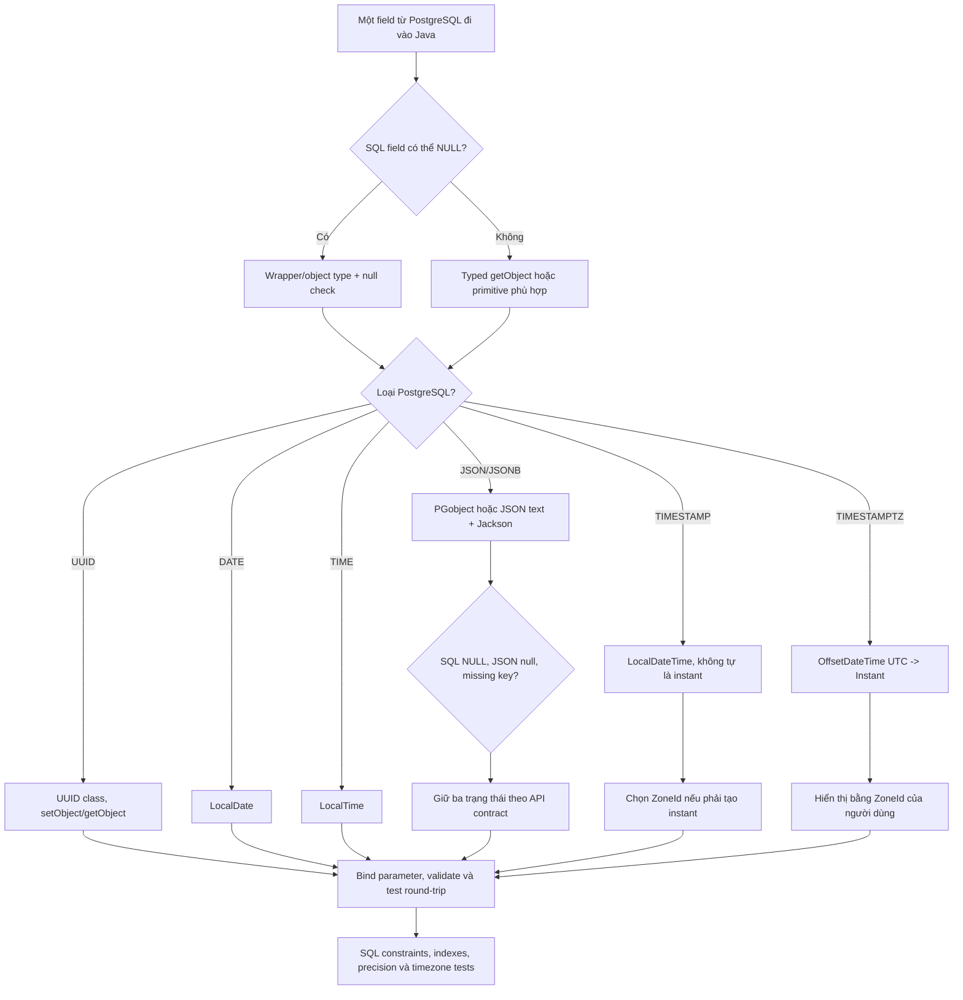

# Ánh xạ NULL, UUID, JSON và kiểu thời gian giữa PostgreSQL và ứng dụng Java

Một bảng PostgreSQL có thể lưu một giá trị `NULL`, một khóa `UUID`, một tài liệu `JSONB`, ngày lịch `DATE` và thời điểm `TIMESTAMPTZ` rất tự nhiên. Tuy nhiên, khi ứng dụng Java đọc/ghi những dữ liệu đó qua JDBC, **kiểu dữ liệu SQL và kiểu dữ liệu Java không phải lúc nào cũng tương đương một–một**.

Những lỗi rất phổ biến:

- SQL `NULL` bị biến thành `0` vì gọi `ResultSet.getInt()` mà không xem `wasNull()`.
- `payload IS NULL` bị đánh đồng với tài liệu JSON chứa giá trị `null`.
- Chuỗi UUID được truyền như `VARCHAR` và driver không biết tự ép sang `uuid`.
- `LocalDateTime` được dùng cho một sự kiện cần lưu **thời điểm toàn cầu**, dẫn tới lệch múi giờ.
- `TIMESTAMPTZ` bị hiểu là PostgreSQL lưu cả tên múi giờ `Asia/Ho_Chi_Minh`, trong khi bản thân giá trị không giữ tên vùng đó.
- Giờ hiển thị trên máy chủ, trên JVM và trong JSON API khác nhau dù các bên đang nói về **cùng một instant**.
- Timestamp Java có nanosecond precision nhưng PostgreSQL lưu với độ phân giải thường là microsecond, làm phép so sánh round-trip quá nghiêm ngặt thất bại.

Bài học thuộc chương **Kết nối ứng dụng** của module *Database Engine Relational PostgreSQL*. Trọng tâm là chọn kiểu dữ liệu đúng, đọc/ghi qua **pgJDBC**, giữ ranh giới giữa **SQL NULL, JSON null và giá trị thiếu**, xử lý UUID dưới dạng `java.util.UUID` và thiết kế thời gian bằng `java.time`.

> **Nguyên tắc:** Ánh xạ dữ liệu không chỉ là ép kiểu để câu lệnh chạy. Phải giữ **ý nghĩa nghiệp vụ** của thiếu dữ liệu, định danh, cấu trúc JSON và thời điểm. Phần SQL và Java cùng tuân theo một hợp đồng về kiểu, NULL và timezone.

Các ví dụ sử dụng PostgreSQL hiện đại, JDBC 4.2 và pgJDBC hỗ trợ Java 8+ time API. Những chức năng như `gen_random_uuid()` trong PostgreSQL core hoặc `uuidv7()` phụ thuộc major version; cần đối chiếu với server thật. Bài dùng schema `demo_mapping` trong database thử nghiệm.

---

## 1. Mục tiêu học tập

Sau bài này, bạn có thể:

1. Chọn kiểu Java cho `uuid`, `jsonb`, `date`, `time`, `timestamp` và `timestamptz`.
2. Phân biệt SQL NULL, JSON null, trường JSON không tồn tại và giá trị mặc định.
3. Hiểu `getInt`/`getBoolean` trả primitive mặc định khi SQL NULL và phải kiểm tra `wasNull()`.
4. Dùng `getObject(..., Integer.class)` và wrapper types để giữ nullability khi phù hợp.
5. Truyền SQL NULL bằng `PreparedStatement.setNull`/`setObject` với kiểu rõ ràng.
6. Đọc/ghi PostgreSQL `uuid` bằng `java.util.UUID` thay vì xử lý tùy tiện như text.
7. Đọc/ghi `jsonb` qua `PGobject`, JSON text có cast hoặc thư viện JSON như Jackson.
8. Truy vấn các khóa JSON bằng `->`, `->>`, `?` và `@>` mà không đánh đồng missing với null.
9. Phân biệt thời gian **không gắn múi giờ** và **thời điểm tuyệt đối**.
10. Ánh xạ `DATE → LocalDate`, `TIME → LocalTime`, `TIMESTAMP → LocalDateTime`, `TIMESTAMPTZ → OffsetDateTime`.
11. Chuyển `OffsetDateTime` sang `Instant` và hiển thị theo `ZoneId` một cách tường minh.
12. Nhận ra ảnh hưởng của PostgreSQL `TimeZone`, JVM timezone, DST và độ phân giải microsecond.
13. Thiết kế model/DTO, update PATCH và JSON serialization không phá dữ liệu thiếu/null.
14. Gỡ lỗi với `SQLSTATE`, `pg_typeof`, JDBC metadata và các round-trip tests.

## 2. Bảng ánh xạ nhanh

| PostgreSQL | Java phổ biến | Giữ NULL thế nào? | Ghi chú |
|---|---|---|---|
| `integer` | `Integer` | `null` | Tránh primitive `int` nếu nullable |
| `bigint` | `Long` | `null` | `getLong` + `wasNull` khi dùng primitive |
| `boolean` | `Boolean` | `null` | Không biến trạng thái unknown thành false |
| `numeric` | `BigDecimal` | `null` | Không dùng `double` cho tiền |
| `text`/`varchar` | `String` | `null` | Chuỗi rỗng khác SQL NULL |
| `uuid` | `java.util.UUID` | `null` | `setObject`/`getObject(...,UUID.class)` |
| `jsonb`/`json` | JSON text, `PGobject`, `JsonNode` | Phải phân biệt SQL NULL và JSON null | Driver không tự hiểu mọi DTO |
| `date` | `LocalDate` | `null` | Ngày lịch, không chứa timezone |
| `time` | `LocalTime` | `null` | Giờ trong ngày, không có ngày/zone |
| `timestamp without time zone` | `LocalDateTime` | `null` | Không đại diện instant nếu thiếu zone |
| `timestamp with time zone` / `timestamptz` | `OffsetDateTime` | `null` | pgJDBC trả offset UTC; chuyển sang `Instant` được |
| `interval` | Driver-specific `PGInterval` hoặc mapping riêng | `null` | Months/days/time không đồng nghĩa luôn với `Duration` |

Đây là **mapping khuyến nghị cho JDBC**. ORM, JSON serializer và service-layer model có thể dùng kiểu domain khác, nhưng phải chuyển đổi có chủ đích tại boundary.

### 2.1. Ba lớp kiểu dữ liệu

```text
Database                JDBC boundary               Application
──────────────────────  ──────────────────────────  ───────────────────────
uuid                    java.util.UUID               EventId / UUID
jsonb                   PGobject / String            JsonNode / DTO
date                    LocalDate                    BusinessDate
timestamp               LocalDateTime                Local appointment
timestamptz             OffsetDateTime (UTC)         Instant / event timestamp
nullable integer        Integer hoặc wasNull         Integer / Optional policy
```

Không chọn kiểu Java chỉ vì tên cột “date/time” giống nhau. Phải biết giá trị lưu **ngày**, **giờ địa phương**, hay **mốc thời gian toàn cầu**.

## 3. Các khái niệm NULL phải phân biệt ngay từ đầu

Có ít nhất bốn trạng thái thường bị nhầm:

1. **SQL NULL:** một ô trong bảng không có giá trị SQL.
2. **JSON null:** một giá trị hợp lệ **bên trong JSON**.
3. **JSON key missing:** object JSON không có trường được hỏi.
4. **Java null:** một tham chiếu Java không trỏ tới object nào.

Ngoài ra, còn có:

- Chuỗi rỗng `''`.
- JSON object rỗng `{}`.
- JSON array rỗng `[]`.
- Giá trị mặc định do PostgreSQL tính khi INSERT.
- Giá trị không được gửi trong một HTTP PATCH.

Một hệ thống đúng không được gộp những trạng thái này vô điều kiện.

### 3.1. SQL NULL không phải chuỗi "null"

```sql
SELECT
    NULL::text IS NULL AS sql_null,
    'null'::text IS NULL AS string_is_null,
    ''::text IS NULL AS empty_string_is_null;
```

Kết quả logic:

| Biểu thức | Kết quả |
|---|---|
| `NULL::text IS NULL` | TRUE |
| `'null'::text IS NULL` | FALSE |
| `''::text IS NULL` | FALSE |

`'null'` chỉ là bốn ký tự n-u-l-l, không phải SQL NULL.

## 4. SQL NULL và logic ba giá trị

SQL predicate có thể trả `TRUE`, `FALSE` hoặc `UNKNOWN` khi liên quan NULL.

```sql
SELECT
    NULL::integer = NULL::integer AS equality,
    NULL::integer IS NULL AS is_null,
    NULL::integer IS NOT DISTINCT FROM NULL::integer
        AS null_safe_equality;
```

`equality` nhận SQL NULL (unknown). Hai biểu thức còn lại trả TRUE.

### 4.1. Không dùng = NULL

Sai:

```sql
WHERE retry_count = NULL
```

Đúng:

```sql
WHERE retry_count IS NULL
```

### 4.2. So sánh nullable parameter

Nếu muốn tìm rows mà cột và tham số đều có thể NULL:

```sql
WHERE retry_count IS NOT DISTINCT FROM ?
```

`IS NOT DISTINCT FROM` coi hai NULL là bằng nhau theo nghĩa *null-safe equality*. Không tự biến mọi phép `=` thành cú pháp này nếu nghiệp vụ muốn bỏ qua filter khi parameter null.

### 4.3. NULL trong NOT IN

`NOT IN` với danh sách chứa NULL có thể tạo kết quả UNKNOWN, khiến rows không được trả như kỳ vọng.

```sql
SELECT 5 NOT IN (1, 2, NULL);
```

Kết quả là SQL NULL. Nếu đang lọc từ một bảng phụ có thể chứa NULL, cân nhắc `NOT EXISTS` cùng điều kiện rõ ràng.

## 5. Primitive Java và NULL: bẫy getInt, getLong, getBoolean

Ví dụ:

```java
int retryCount = rs.getInt("retry_count");
```

Khi cột SQL chứa NULL, `getInt` trả giá trị primitive **0**, và chỉ `rs.wasNull()` mới cho biết đó là SQL NULL.

Tương tự:

```java
long count = rs.getLong("some_bigint");    // NULL -> 0L
boolean approved = rs.getBoolean("approved"); // NULL -> false
```

Nếu domain phân biệt “chưa biết” với “không”, phép mapping này **mất thông tin**.

### 5.1. Mẫu wasNull đúng

```java
int rawRetry = rs.getInt("retry_count");
Integer retryCount = rs.wasNull() ? null : rawRetry;

boolean rawApproved = rs.getBoolean("approved");
Boolean approved = rs.wasNull() ? null : rawApproved;
```

`wasNull()` luôn nói về **cột vừa được đọc qua getter gần nhất**. Không gọi một getter khác trước khi kiểm tra:

```java
int n = rs.getInt("retry_count");
String description = rs.getString("description");

// KHÔNG làm thế này:
// boolean wasRetryNull = rs.wasNull();
// wasNull() lúc này phản ánh description, không phải retry_count.
```

### 5.2. Typed getObject

Trong pgJDBC hỗ trợ kiểu tương ứng, có thể giữ nullability:

```java
Integer retry = rs.getObject("retry_count", Integer.class);
Boolean approved = rs.getObject("approved", Boolean.class);
Long total = rs.getObject("some_bigint", Long.class);
```

Các wrappers cho phép Java `null` biểu diễn SQL NULL. Với driver version cụ thể, xác nhận các typed overloads được hỗ trợ.

### 5.3. Optional là quyết định ở tầng API

`Optional<Integer>` có thể hữu ích cho giá trị trả về từ method, nhưng không phải lựa chọn mặc định cho mọi field DTO/JPA entity. Đừng đưa `Optional.empty()` vào mapper rồi vô tình làm mất sự khác biệt giữa **field không có mặt trong PATCH** và **field có mặt nhưng null**.

## 6. PreparedStatement.setNull và kiểu tham số

Một câu INSERT:

```sql
INSERT INTO demo_mapping.app_event
    (event_id, description, retry_count)
VALUES (?, ?, ?);
```

Các SQL placeholders phải có kiểu đúng.

```java
ps.setObject(1, eventId);              // UUID
ps.setNull(2, java.sql.Types.VARCHAR); // SQL NULL của text/varchar
ps.setNull(3, java.sql.Types.INTEGER); // SQL NULL của integer
```

### 6.1. setObject(index, null) đôi khi tạo kiểu không rõ

Trong nhiều tình huống PostgreSQL suy được kiểu từ target column. Nhưng query polymorphic, comparison, overloaded function hoặc `SELECT ? IS NULL` có thể không đủ thông tin để xác định type của parameter.

Ví dụ dễ có lỗi:

```sql
SELECT ? IS NULL;
```

Giải pháp là cung cấp cast trong SQL:

```sql
SELECT ?::integer IS NULL;
```

hoặc bind typed NULL phù hợp với driver/SQL context.

### 6.2. setNull(Types.OTHER)

PostgreSQL-specific types như `uuid` và `jsonb` có thể được pgJDBC xử lý qua `Types.OTHER`. Khi SQL cần loại chính xác, đặt cast tường minh:

```sql
SELECT ?::uuid;
SELECT ?::jsonb;
```

Điều này giúp server có target type rõ ràng và tránh việc driver bind chuỗi mặc định thành `varchar` trong những ngữ cảnh không có implicit cast.

### 6.3. Không dùng "null" thay SQL NULL

```java
ps.setString(1, "null"); // Bốn ký tự: KHÔNG phải SQL NULL.
```

Nếu cột `jsonb`, chuỗi `"null"` sau cast thành JSONB là **JSON null**, lại càng khác SQL NULL.

## 7. Missing field và explicit NULL khi INSERT

Giả sử bảng có:

```sql
created_at TIMESTAMPTZ NOT NULL DEFAULT now()
```

Ba cách INSERT khác nhau:

```sql
-- A: không đưa cột vào -> PostgreSQL tính DEFAULT.
INSERT INTO t(other_col) VALUES ('A');

-- B: ghi DEFAULT tường minh.
INSERT INTO t(other_col, created_at)
VALUES ('B', DEFAULT);

-- C: ghi SQL NULL -> NOT NULL constraint có thể lỗi.
INSERT INTO t(other_col, created_at)
VALUES ('C', NULL);
```

`DEFAULT` không tự thay thế mọi explicit NULL. Khi mapping HTTP request, cần phân biệt “client không gửi field” với “client gửi field null”.

### 7.1. PATCH ba trạng thái

Với một trường nullable trong PATCH API:

| JSON HTTP input | Ý định có thể có |
|---|---|
| Không có key `description` | Không đổi giá trị |
| `"description": null` | Xóa giá trị, ghi SQL NULL |
| `"description": ""` | Ghi chuỗi rỗng |

DTO dùng duy nhất `String description` có thể không phân biệt key missing với key explicit null nếu serializer/deserializer không theo dõi presence. Cần thiết kế PATCH model có trạng thái **present/absent**.

---

## 8. Lab: tạo bảng mô phỏng sự kiện ứng dụng

Tạo schema:

```sql
CREATE SCHEMA IF NOT EXISTS demo_mapping;
```

Tạo bảng lưu đủ các kiểu:

```sql
CREATE TABLE demo_mapping.app_event (
    event_id UUID PRIMARY KEY,

    description TEXT NULL,
    retry_count INTEGER NULL
        CHECK (retry_count IS NULL OR retry_count >= 0),
    approved BOOLEAN NULL,

    payload JSONB NULL,

    event_date DATE NULL,
    scheduled_local TIMESTAMP WITHOUT TIME ZONE NULL,
    occurred_at TIMESTAMP WITH TIME ZONE NULL,

    created_at TIMESTAMPTZ NOT NULL
        DEFAULT transaction_timestamp()
);
```

Những lựa chọn có chủ đích:

- `event_id`: UUID, không nullable.
- `description`: text nullable; rỗng khác NULL.
- `retry_count`: NULL có nghĩa chưa biết/chưa ghi nhận, không phải 0.
- `approved`: TRUE/FALSE/NULL là ba trạng thái khác nhau.
- `payload`: nullable `jsonb`, để lab thấy khác JSON null.
- `event_date`: ngày lịch không có timezone.
- `scheduled_local`: thời gian trên lịch địa phương, **chưa gắn zone**.
- `occurred_at`: mốc thời gian tuyệt đối.
- `created_at`: thời điểm server tạo row, không NULL.

### 8.1. Nạp dữ liệu với các tình huống NULL/JSON/time

```sql
INSERT INTO demo_mapping.app_event
(event_id, description, retry_count, approved,
 payload, event_date, scheduled_local, occurred_at)
VALUES
(
    '11111111-1111-4111-8111-111111111111',
    NULL, NULL, NULL,
    NULL, NULL, NULL, NULL
),
(
    '22222222-2222-4222-8222-222222222222',
    'Sự kiện có JSON object', 0, FALSE,
    '{"source":"web","status":null,"count":0}'::jsonb,
    DATE '2026-11-14',
    TIMESTAMP '2026-11-14 09:30:00',
    TIMESTAMPTZ '2026-11-14 09:30:00+07'
),
(
    '33333333-3333-4333-8333-333333333333',
    'JSON null, không phải SQL NULL', 2, TRUE,
    'null'::jsonb,
    DATE '2026-11-15',
    TIMESTAMP '2026-11-15 10:00:00',
    TIMESTAMPTZ '2026-11-15 10:00:00+07'
),
(
    '44444444-4444-4444-8444-444444444444',
    '', NULL, NULL,
    '{}'::jsonb,
    NULL, NULL, NULL
),
(
    '55555555-5555-4555-8555-555555555555',
    'Payload chứa mảng', 5, TRUE,
    '{"roles":["ops","qa"],"active":true}'::jsonb,
    DATE '2026-11-16',
    TIMESTAMP '2026-11-16 18:45:00',
    TIMESTAMPTZ '2026-11-16 18:45:00+07'
);
```

### 8.2. Xem toàn bộ dữ liệu

```sql
SELECT
    event_id,
    description,
    retry_count,
    approved,
    payload,
    event_date,
    scheduled_local,
    occurred_at
FROM demo_mapping.app_event
ORDER BY event_id;
```

Sau khi nạp:

- Row 1 có `payload IS NULL`.
- Row 2 có object với key `"status"` mang **JSON null**.
- Row 3 có payload là **JSON null ở root**.
- Row 4 có object rỗng `{}`.
- Row 5 có array `roles` và boolean JSON.

Với `occurred_at`, chuỗi hiển thị phụ thuộc session `TimeZone`; **không so chuỗi hiển thị để kết luận có lệch instant**.

## 9. UUID trong PostgreSQL

`uuid` biểu diễn định danh 128-bit; dạng text quen thuộc:

```text
550e8400-e29b-41d4-a716-446655440000
```

PostgreSQL xác thực đầu vào theo quy tắc kiểu `uuid`, có thể chấp nhận nhiều biểu diễn textual hợp lệ, và thường hiển thị dạng canonical với dấu gạch nối.

### 9.1. UUID không phải VARCHAR(36)

Hai cột:

```sql
event_id UUID
event_id VARCHAR(36)
```

khác nhau về type checking, storage, operators, indexes và cách driver map. Nếu trường thực sự là UUID, ưu tiên native `uuid` thay vì lưu text rồi parse ở mọi query.

### 9.2. UUID không chứa timezone

Một UUID không phải timestamp và không tự cho biết creation time. Với UUID v4 ngẫu nhiên, không thể suy thời điểm tạo từ nội dung ID.

Một số UUID versions như v7 có thành phần thời gian, nhưng điều đó phụ thuộc version generator/chuẩn và không biến UUID thành thay thế cho `created_at`.

### 9.3. So sánh và index UUID

`uuid` có equality, ordering và hỗ trợ B-tree index:

```sql
SELECT *
FROM demo_mapping.app_event
WHERE event_id =
    '22222222-2222-4222-8222-222222222222'::uuid;
```

Với primary key `event_id UUID`, PostgreSQL đã tạo index thích hợp để kiểm tra uniqueness/lookup.

## 10. Java UUID: setObject và getObject

Trong Java:

```java
import java.util.UUID;

UUID id = UUID.fromString(
    "22222222-2222-4222-8222-222222222222"
);
```

Ghi bằng pgJDBC:

```java
String sql = """
    SELECT event_id, description
    FROM demo_mapping.app_event
    WHERE event_id = ?
    """;

try (PreparedStatement ps = conn.prepareStatement(sql)) {
    ps.setObject(1, id);

    try (ResultSet rs = ps.executeQuery()) {
        while (rs.next()) {
            UUID dbId = rs.getObject("event_id", UUID.class);
            String description = rs.getString("description");
            System.out.println(dbId + " / " + description);
        }
    }
}
```

`UUID` được driver hỗ trợ như PostgreSQL UUID type, không cần chuyển qua string để so sánh.

### 10.1. Lấy UUID nullable

```java
UUID maybeId = rs.getObject("optional_uuid", UUID.class);
```

Nếu cột SQL NULL, kết quả là Java null. Với primary key `event_id` của lab, giá trị không thể NULL theo constraint.

### 10.2. Tạo UUID ở Java

```java
UUID newId = UUID.randomUUID();
```

Lời gọi này thường sinh UUID v4 random. Đừng giả định thứ tự tăng theo thời gian; muốn phân trang theo thời điểm, dùng `created_at` cùng tie-breaker ID.

### 10.3. UUID malformed

```java
UUID.fromString(userInput);
```

có thể ném `IllegalArgumentException` cho chuỗi sai định dạng. Nếu cần format contract chặt, validate trước theo chính sách API và vẫn để database kiểm tra native uuid.

Không tự tạo UUID bằng cách xóa hết dấu gạch nối rồi ép bất kỳ chuỗi hex nào nếu business validation yêu cầu đúng chuẩn.

## 11. Bind UUID dưới dạng String: khi nào phải cast?

Giả sử:

```java
ps.setString(1,
    "22222222-2222-4222-8222-222222222222");
```

Nếu query:

```sql
SELECT *
FROM demo_mapping.app_event
WHERE event_id = ?;
```

driver có thể khai báo parameter kiểu `varchar`. PostgreSQL không có nghĩa vụ chọn ngầm phép so sánh `uuid = varchar` theo cách bạn mong; có thể lỗi “operator does not exist”.

Cách chuẩn: dùng `setObject(index, UUID)`.

Nếu input bị buộc là string ở boundary và muốn cast tường minh:

```sql
SELECT *
FROM demo_mapping.app_event
WHERE event_id = ?::uuid;
```

với `setString` tương ứng. PostgreSQL sẽ parse UUID; input không hợp lệ gây lỗi kiểu dữ liệu.

### 11.1. Đừng dựa hoàn toàn vào stringtype=unspecified

pgJDBC có setting ảnh hưởng cách gửi kiểu chuỗi, nhưng đổi toàn ứng dụng chỉ để chữa UUID/JSON cast có thể tạo side effects cho overloaded functions và query planning. Ưu tiên JDBC native types hoặc explicit SQL casts.

### 11.2. UUID trong JSON API

Một field JSON:

```json
{"eventId":"22222222-2222-4222-8222-222222222222"}
```

là **JSON string** ở HTTP boundary. Khi vào Java model, nên parse thành `UUID` để giữ validation/type safety trước khi ghi vào PostgreSQL `uuid`.

## 12. Sinh UUID ở PostgreSQL

PostgreSQL hiện đại có:

```sql
SELECT gen_random_uuid();
```

`gen_random_uuid()` sinh UUID v4 ngẫu nhiên. Các bản PostgreSQL cũ từng dùng extension `pgcrypto` cho function này; core PostgreSQL mới có thể cung cấp sẵn.

Ví dụ thêm default:

```sql
ALTER TABLE demo_mapping.app_event
ALTER COLUMN event_id
SET DEFAULT gen_random_uuid();
```

Khi application không gửi event_id, database có thể tự sinh một UUID.

### 12.1. Ứng dụng sinh hay DB sinh?

| Tiêu chí | Sinh ở Java | Sinh ở PostgreSQL |
|---|---|---|
| Có ID trước INSERT | Có | Không, trừ khi RETURNING |
| Dễ liên kết event/outbox trước ghi | Có | Cần nhận ID từ INSERT |
| Logic thống nhất đa client | Cần chia sẻ generator | DB là nguồn sinh |
| Hỗ trợ offline IDs | Có | Không trực tiếp |
| Quyền/phiên bản extension | Ít phụ thuộc DB | Phụ thuộc function PG/version |

Nếu DB sinh:

```sql
INSERT INTO demo_mapping.app_event(description)
VALUES ('Sinh UUID tại database')
RETURNING event_id;
```

Ứng dụng lấy UUID mới từ `RETURNING`. Đừng giả định `getGeneratedKeys()` trả đúng tất cả cột nếu SQL/driver configuration khác; dùng `RETURNING` tường minh là một lựa chọn rõ.

### 12.2. UUID v7 và khả năng sắp xếp

PostgreSQL 18 có hỗ trợ sinh UUID v7 qua `uuidv7()`. Nó hữu ích khi muốn UUID có tính chất tăng gần theo thời gian, nhưng không có trên mọi server version. Một ID gần thứ tự thời gian **không thay** `created_at` khi cần thời điểm chính xác, và có thể lộ tín hiệu thời gian tạo.

## 13. UUID và NULL

`UUID.fromString(null)` không phải một cách chuyển SQL NULL an toàn thành UUID. Null ở Java phải xử lý **trước** khi parse:

```java
UUID parseNullableUuid(String input) {
    return input == null ? null : UUID.fromString(input);
}
```

Nếu schema cho nullable UUID:

```java
ps.setNull(1, java.sql.Types.OTHER);
```

và SQL type được chỉ rõ bằng target column hoặc cast `?::uuid` khi không thể suy kiểu.

### 13.1. UUID zero không phải NULL

`00000000-0000-0000-0000-000000000000` là một UUID value, không phải SQL NULL. Nếu ứng dụng dùng nó làm sentinel “chưa có ID”, đó là **contract tự đặt**, có thể gây xung đột dữ liệu; nên dùng nullability/điều kiện nghiệp vụ rõ.

---

## 14. JSON và JSONB: cả hai là kiểu PostgreSQL riêng

PostgreSQL có `json` và `jsonb`:

- `json` lưu representation textual với các chi tiết formatting/key order/duplicate keys ở input (theo quy tắc hiện tại).
- `jsonb` lưu representation được phân tích/chuẩn hóa, thuận tiện truy vấn/index và thường dùng cho dữ liệu ứng dụng.
- Cả hai kiểm tra input là JSON hợp lệ.
- Không có nghĩa `jsonb` là `text` chỉ vì query có thể hiển thị text.

Ví dụ:

```sql
SELECT
    '{"b":2,"a":1}'::json AS as_json,
    '{"b":2,"a":1}'::jsonb AS as_jsonb;
```

Với `jsonb`, không nên kỳ vọng giữ nguyên thứ tự keys hoặc whitespace của input.

### 14.1. Duplicate keys

```sql
SELECT
    '{"status":"old","status":"new"}'::jsonb;
```

`jsonb` không giữ hai keys cùng tên; thông thường giá trị cuối được giữ. Nếu ứng dụng phụ thuộc từng ký tự/key order/duplicate trong tài liệu gốc, cần đánh giá dùng `json` hoặc lưu raw source riêng.

### 14.2. JSON number không phải Java double mặc định

Một JSON number như `0.1` có thể cần giữ chính xác khi là số tiền. Nếu deserialize bằng Java `double` và rồi serialize lại, có thể mất fidelity. Dùng `BigDecimal` hoặc JSON tree numeric handling phù hợp domain.

### 14.3. JSON object không phải relational row

`{"status":"OK"}` trong một cột `jsonb` là một giá trị SQL. Không tự có constraint NOT NULL cho mỗi key, không tự có foreign keys tới bảng khác, và không tự có index cho mọi đường JSON field.

## 15. Ba loại NULL với JSONB

Thử:

```sql
SELECT
    NULL::jsonb IS NULL AS sql_null_is_null,
    'null'::jsonb IS NULL AS json_null_is_sql_null,
    jsonb_typeof('null'::jsonb) AS json_null_type,
    jsonb_typeof(NULL::jsonb) AS sql_null_type;
```

Kỳ vọng:

| Trường | Kết quả |
|---|---|
| `sql_null_is_null` | TRUE |
| `json_null_is_sql_null` | FALSE |
| `json_null_type` | Text `null` |
| `sql_null_type` | SQL NULL |

### 15.1. JSON null là một giá trị JSON hợp lệ

Trong JSON:

```json
null
```

là một JSON scalar. Cột `jsonb` vẫn có giá trị SQL không-null khi lưu `'null'::jsonb`.

### 15.2. SQL NULL nghĩa là không có JSON document

Cột chứa SQL NULL thì không có một JSON value để truy cập keys hoặc duyệt arrays.

### 15.3. JSON key missing là trường hợp thứ ba

Trong:

```json
{"source":"web"}
```

key `status` không tồn tại. Trong:

```json
{"source":"web","status":null}
```

key `status` tồn tại nhưng giá trị là JSON null.

## 16. JSONB field extraction: -> và ->>

`->` trả `jsonb`; `->>` trả `text`.

```sql
SELECT
    payload -> 'status' AS status_json,
    payload ->> 'status' AS status_text
FROM demo_mapping.app_event
WHERE event_id =
    '22222222-2222-4222-8222-222222222222'::uuid;
```

Với key `status:null`:

- `payload -> 'status'` là **JSONB null** (một giá trị JSON).
- `payload ->> 'status'` là **SQL NULL**, vì ép JSON null thành SQL text không có giá trị.

### 16.1. Nếu key không có?

`->` và `->>` thông thường trả SQL NULL khi không tìm thấy key/path phù hợp. Vì vậy:

```sql
payload ->> 'status' IS NULL
```

**không phân biệt** missing key với JSON null.

### 16.2. Toán tử ? kiểm tra key hiện diện

```sql
SELECT
    payload ? 'status' AS has_status_key,
    jsonb_typeof(payload -> 'status') AS status_json_type
FROM demo_mapping.app_event
WHERE event_id =
    '22222222-2222-4222-8222-222222222222'::uuid;
```

`has_status_key` là TRUE, `status_json_type` trả text `null`.

### 16.3. Điều kiện JSON key hiện diện nhưng giá trị null

```sql
SELECT event_id
FROM demo_mapping.app_event
WHERE payload ? 'status'
  AND jsonb_typeof(payload -> 'status') = 'null';
```

Trả row 2. Không match row 1 (SQL NULL) hoặc row 4 (object rỗng).

## 17. JSONB containment và kiểm tra JSON null

`@>` kiểm tra containment:

```sql
SELECT event_id
FROM demo_mapping.app_event
WHERE payload @> '{"status":null}'::jsonb;
```

Điều kiện này yêu cầu JSON object có key `status` với JSON null.

```sql
SELECT event_id
FROM demo_mapping.app_event
WHERE payload @> '{"source":"web"}'::jsonb;
```

tìm object chứa key/value đó ở mức cấu trúc tương ứng.

### 17.1. @> khác LIKE trên chuỗi JSON

`payload::text LIKE '%web%'` tìm chữ theo representation, có thể match ở key hoặc value ngẫu nhiên và kém semantics/index phù hợp. `@>` hiểu JSON structure.

### 17.2. ? chỉ kiểm tra top-level key/element

`payload ? 'status'` không tự tìm một key `status` nằm sâu trong mọi nested object. Với nested data, dùng path operators hoặc JSONPath theo cấu trúc thực.

### 17.3. SQL NULL qua containment

Khi `payload` là SQL NULL, `payload @> ...` trả SQL NULL/UNKNOWN trong predicate và row không được chọn bởi WHERE thông thường.

## 18. Query phân loại tất cả trạng thái JSON

Một query thực hành:

```sql
SELECT
    event_id,
    CASE
        WHEN payload IS NULL
            THEN 'SQL_NULL'
        WHEN jsonb_typeof(payload) = 'null'
            THEN 'JSON_NULL_ROOT'
        WHEN jsonb_typeof(payload) = 'object'
             AND NOT (payload ? 'status')
            THEN 'OBJECT_MISSING_STATUS'
        WHEN jsonb_typeof(payload) = 'object'
             AND jsonb_typeof(payload -> 'status') = 'null'
            THEN 'OBJECT_STATUS_JSON_NULL'
        ELSE 'OTHER_JSON'
    END AS payload_state
FROM demo_mapping.app_event
ORDER BY event_id;
```

Đây là một cách hiển thị **domain state** rõ hơn việc gộp mọi trường hợp thành Java null.

### 18.1. Một root JSON array cũng là JSON value

`jsonb_typeof(payload)` có thể trả `array`, `object`, `string`, `number`, `boolean` hoặc `null`. Đừng tự giả định mọi JSONB column là object.

### 18.2. JSON object rỗng không là NULL

`'{}'::jsonb IS NULL` là FALSE. Chọn data contract: object rỗng khác “không có payload” hay không? Nếu có, API phải giữ sự khác biệt đó.

## 19. Ghi JSONB từ Java: PGobject

pgJDBC không tự serial hóa mọi Java `Map` hoặc DTO thành PostgreSQL `jsonb`. Một cách tường minh là sử dụng `org.postgresql.util.PGobject`:

```java
import org.postgresql.util.PGobject;
import java.sql.PreparedStatement;

PGobject jsonb = new PGobject();
jsonb.setType("jsonb");
jsonb.setValue(
    "{\"source\":\"mobile\",\"status\":null}"
);

String sql = """
    UPDATE demo_mapping.app_event
    SET payload = ?
    WHERE event_id = ?
    """;

try (PreparedStatement ps = conn.prepareStatement(sql)) {
    ps.setObject(1, jsonb);
    ps.setObject(2, eventId);

    ps.executeUpdate();
}
```

`PGobject` cung cấp PostgreSQL-specific type metadata cho driver. Chỉ nên dùng với JSON đã được serialize bởi thư viện đáng tin (hoặc một constant hợp lệ trong lab); không tự nối fields thành JSON bằng string concatenation.

### 19.1. Một đường khác: SQL cast với setString

```java
String sql = """
    UPDATE demo_mapping.app_event
    SET payload = ?::jsonb
    WHERE event_id = ?
    """;

try (PreparedStatement ps = conn.prepareStatement(sql)) {
    ps.setString(1, jsonText);
    ps.setObject(2, eventId);
    ps.executeUpdate();
}
```

Cast `?::jsonb` làm server parse input dưới dạng JSONB. Nếu `jsonText` không hợp lệ, PostgreSQL báo lỗi, không ghi JSON “gần đúng”.

### 19.2. Không dùng setString trên JSONB không cast rồi đoán behavior

Tùy pgJDBC typing/settings, server có thể nhận `varchar` và từ chối gán trực tiếp vào `jsonb`. Đặt cast hoặc `PGobject` để hợp đồng rõ ràng.

### 19.3. SQL NULL vs JSON null trong JDBC

```java
// A: SQL NULL, không có JSON document.
ps.setNull(1, java.sql.Types.OTHER);

// B: JSON null: một JSON document có giá trị root là null.
PGobject jsonNull = new PGobject();
jsonNull.setType("jsonb");
jsonNull.setValue("null");
ps.setObject(1, jsonNull);
```

**A và B không tương đương**; câu WHERE `payload IS NULL` chỉ match A.

## 20. Dùng Jackson để chuyển DTO thành JSON

Một JSON mapper nên chịu trách nhiệm escaping Unicode, quotes, numeric policy và nested structure.

```java
import com.fasterxml.jackson.databind.ObjectMapper;
import org.postgresql.util.PGobject;

ObjectMapper mapper = new ObjectMapper();

record EventPayload(
    String source,
    String status,
    Integer count
) {}

EventPayload payload =
    new EventPayload("mobile", null, 3);

String jsonText = mapper.writeValueAsString(payload);

PGobject dbJson = new PGobject();
dbJson.setType("jsonb");
dbJson.setValue(jsonText);

ps.setObject(1, dbJson);
```

### 20.1. Serializer settings làm đổi hợp đồng null

Jackson có thể được cấu hình bỏ các fields null (`NON_NULL`), biến:

```json
{"source":"mobile","status":null,"count":3}
```

thành:

```json
{"source":"mobile","count":3}
```

Hai documents này **khác** về key existence. Chọn serialize null hay omit null dựa trên API/domain contract, không coi đó là chi tiết vô hại.

### 20.2. Không map tùy tiện JSON vào raw Object

Nếu business cần validation theo schema, dùng DTO/JsonNode, kiểm tra field types/ranges và những keys cho phép. JSONB không tự kiểm tra rằng `count` là integer >= 0 chỉ vì Java record khai `Integer`.

### 20.3. Version hóa schema JSON

Nếu ứng dụng đổi `status` từ string sang object hoặc đổi tên `source`, rows cũ vẫn có schema trước. Cân nhắc `schemaVersion` trong payload hoặc migration/enrichment policy rõ.

## 21. Đọc JSONB từ JDBC

Cách đơn giản:

```java
String rawJson = rs.getString("payload");
if (rawJson == null) {
    // SQL NULL.
} else {
    // JSON văn bản: có thể là "null", "{}", "[]", ...
}
```

Với pgJDBC, `rs.getObject("payload")` thường cho `PGobject` của type JSONB; điều đó **không tự biến thành** Java `Map`/`JsonNode`/domain DTO.

```java
Object raw = rs.getObject("payload");

if (raw == null) {
    // SQL NULL
} else if (raw instanceof PGobject pg) {
    System.out.println(pg.getType());  // jsonb
    System.out.println(pg.getValue()); // JSON text
}
```

### 21.1. Vì sao getString đủ cho nhiều trường hợp?

Bạn có thể dùng một JSON library để parse text: driver chỉ giữ trách nhiệm vận chuyển bytes/text đúng, Jackson chịu trách nhiệm schema/deserialization.

### 21.2. JSON null ở root khi getString

`rs.getString("payload")` trả Java String `"null"` (bốn ký tự) đối với JSONB root `null`, **không** phải Java null. Với SQL NULL, trả Java null.

### 21.3. Đừng parse JSON bằng regex

JSON có escaped quotes, unicode, nesting và arrays. Dùng parser chuẩn. Không `split(",")` để biến `{"a":"x,y"}` thành fields.

## 22. Jackson JsonNode: missing, null node và Java null

Giả sử:

```java
import com.fasterxml.jackson.databind.JsonNode;
import com.fasterxml.jackson.databind.ObjectMapper;

ObjectMapper mapper = new ObjectMapper();
String json = rs.getString("payload");

if (json == null) {
    // SQL NULL: không có payload.
} else {
    JsonNode root = mapper.readTree(json);

    if (root.isNull()) {
        // JSON root null.
    } else if (root.isObject()) {
        JsonNode status = root.get("status");

        if (status == null) {
            // JSON object không có key status.
        } else if (status.isNull()) {
            // Có key status, value là JSON null.
        } else {
            // Có key, value không phải JSON null.
        }
    }
}
```

### 22.1. get() và path() khác nhau

Với Jackson:

- `root.get("status")` thường trả Java null khi missing field.
- `root.path("status")` trả `MissingNode` khi missing, tránh null dereference.
- `NullNode` biểu thị **JSON null**, không phải Java null.

### 22.2. Không đánh đồng missing và null khi PATCH

Nếu API dùng JSON Merge Patch, explicit null có thể mang nghĩa *xóa key*, còn key missing có nghĩa *không đụng vào key*. Những ý nghĩa này cần được bảo toàn qua Jackson → service → SQL update.

### 22.3. Mọi root JSON không phải object

`mapper.readTree("null")` cho NullNode; `mapper.readTree("[]")` cho ArrayNode. Không gọi `root.get("status")` và mặc nhiên kết quả có ý nghĩa cho mọi root types.

## 23. JSONB array và kiểu phần tử

Dữ liệu:

```json
{"roles":["ops","qa"],"active":true}
```

Truy vấn:

```sql
SELECT
    payload -> 'roles' AS roles_json,
    payload ->> 'active' AS active_as_text,
    jsonb_typeof(payload -> 'roles') AS roles_type
FROM demo_mapping.app_event
WHERE event_id =
    '55555555-5555-4555-8555-555555555555'::uuid;
```

`roles_json` là JSONB array, `active_as_text` là SQL text `true`, `roles_type` là `array`.

### 23.1. Không dùng getBoolean trực tiếp trên kết quả ->>

Một query `payload ->> 'active'` trả SQL `text`, dù nội dung là `true`/`false`. Nếu muốn boolean SQL:

```sql
SELECT (payload ->> 'active')::boolean AS active
FROM demo_mapping.app_event
WHERE event_id =
    '55555555-5555-4555-8555-555555555555'::uuid;
```

Cast có thể lỗi nếu value chứa chuỗi không phải boolean hợp lệ. Validation JSON schema/contract là cần thiết.

### 23.2. JSON array index bắt đầu từ 0

```sql
SELECT
    payload -> 'roles' -> 0 AS first_role
FROM demo_mapping.app_event
WHERE event_id =
    '55555555-5555-4555-8555-555555555555'::uuid;
```

JSONB array subscripts bắt đầu từ **0**, khác mặc định SQL arrays PostgreSQL thường bắt đầu từ **1**.

## 24. Lọc JSONB: index và operator classes

Với workload phù hợp, có thể tạo:

```sql
CREATE INDEX idx_app_event_payload_gin
ON demo_mapping.app_event
USING GIN (payload);
```

Default `jsonb_ops` hỗ trợ các operators như:

- `@>` containment.
- `?` key existence.
- `?|`, `?&` cho nhiều keys.
- JSONPath matching theo khả năng hỗ trợ.

### 24.1. jsonb_path_ops khác jsonb_ops

`jsonb_path_ops` thường tối ưu một số truy vấn containment/JSONPath nhưng **không hỗ trợ key-existence `?`** như default `jsonb_ops`.

Chọn operator class theo query thật, không vì benchmark một trường hợp rồi thay toàn bộ.

### 24.2. Index expression cho field cụ thể

Nếu thường tìm `source`:

```sql
CREATE INDEX idx_app_event_payload_source
ON demo_mapping.app_event
((payload ->> 'source'));
```

Query:

```sql
SELECT event_id
FROM demo_mapping.app_event
WHERE payload ->> 'source' = 'web';
```

Có thể tận dụng expression index. Với 5 rows lab, planner vẫn có thể chọn Seq Scan vì quá nhỏ.

### 24.3. Tránh index mọi key vô hạn

GIN index tăng storage/write cost và không tự bảo đảm mọi JSON query nhanh. Nếu một field dùng để JOIN/filter cực thường xuyên, cân nhắc đưa nó thành cột quan hệ typed có constraint.

## 25. JSONB và SQL injection

Truy vấn có dữ liệu client:

```java
String sql = """
    SELECT event_id
    FROM demo_mapping.app_event
    WHERE payload @> ?::jsonb
    """;

try (PreparedStatement ps = conn.prepareStatement(sql)) {
    ps.setString(1, "{\"source\":\"web\"}");
    ...
}
```

Bind value an toàn hơn việc nối SQL string. Tuy nhiên, client vẫn có thể gửi JSON quá lớn/nested gây resource pressure; cần giới hạn kích thước, depth và validate.

### 25.1. ? toán tử key existence và JDBC placeholder

PostgreSQL có JSONB operator `?`, trùng ký tự placeholder JDBC. Với pgJDBC SQL PreparedStatement, có thể escape dấu hỏi operator thành `??` trong SQL text nếu cần.

Ví dụ:

```java
String sql = """
    SELECT event_id
    FROM demo_mapping.app_event
    WHERE payload ?? 'status'
    """;
```

pgJDBC xử lý `??` như literal operator `?` thay vì bind parameter. Với `Statement` thông thường có thể dùng operator `?` trực tiếp. Kiểm tra driver version/query parsing khi dùng các operators `?|`/`?&`.

### 25.2. Không để JSON key name không tin cậy thành SQL identifier

Nếu muốn query theo key động, dùng JSON operators/functions với key là **giá trị bind** theo đúng API, không nối tên key vào SQL/field expression tùy tiện.

## 26. JSONB là lựa chọn linh hoạt, không miễn phí cho validation

PostgreSQL bảo đảm JSONB là một JSON value hợp lệ. Nó **không tự** bảo đảm:

- Root phải là object.
- Key `status` tồn tại.
- Key `count` là integer dương.
- Key `eventId` là UUID string hợp lệ.
- Field timestamp trong JSON ở đúng ISO 8601.
- Không có khóa nhạy cảm ngoài schema.

Cần JSON Schema, CHECK constraints thích hợp, validation trong Java hoặc mô hình cột quan hệ cho các fields quan trọng.

### 26.1. CHECK ví dụ kiểu root object

```sql
ALTER TABLE demo_mapping.app_event
ADD CONSTRAINT payload_object_or_null
CHECK (
    payload IS NULL
    OR jsonb_typeof(payload) IN ('object', 'null')
);
```

**Chú ý:** constraint trên **cho phép root JSON null**, nhưng không cho JSON array hoặc scalar khác. Vì row 5 là object và row 3 là JSON null, dữ liệu lab hiện tại phù hợp.

Nếu nghiệp vụ thực sự chỉ chấp nhận object, loại `'null'` khỏi danh sách và phải migrate/xử lý row 3 trước khi áp constraint.

## 27. JSONB với UPDATE và key missing

Giả sử client muốn set status:

```sql
UPDATE demo_mapping.app_event
SET payload = jsonb_set(
    COALESCE(payload, '{}'::jsonb),
    '{status}',
    '"DONE"'::jsonb,
    true
)
WHERE event_id =
    '44444444-4444-4444-8444-444444444444'::uuid;
```

`jsonb_set` cập nhật path và có thể tạo key cuối nếu đủ điều kiện.

### 27.1. SQL NULL cần policy trước khi update

`COALESCE(payload,'{}'::jsonb)` biến SQL NULL thành object rỗng trước khi set key. Đây là quyết định nghiệp vụ, không phải hành vi tự nhiên của mọi JSON operation.

### 27.2. JSON root null không phải object

Với `payload='null'::jsonb`, `COALESCE` không thay nó bằng `{}`. Nếu muốn treat root JSON null như object rỗng, phải có branch riêng theo `jsonb_typeof(payload)`.

### 27.3. Xóa key khác set JSON null

```sql
-- Xóa key status khỏi JSON object:
payload - 'status'

-- Để key status hiện diện với value JSON null:
jsonb_set(payload, '{status}', 'null'::jsonb, true)
```

Không dùng hai thao tác thay nhau khi API cần phân biệt missing và explicit null.

## 28. JSON serialization và timezone fields

Nếu JSON chứa:

```json
{
  "eventId": "22222222-2222-4222-8222-222222222222",
  "occurredAt": "2026-11-14T09:30:00+07:00"
}
```

thì `occurredAt` **chỉ là một JSON string** với format mà ứng dụng quy ước. PostgreSQL không tự coi nested JSON string là `timestamptz` hoặc enforce timezone semantics.

Nếu cần sort/filter theo thời điểm, cân nhắc cột `occurred_at TIMESTAMPTZ` riêng và đồng bộ với JSON theo policy rõ.

### 28.1. Không bỏ offset khi parse

`2026-11-14T09:30:00+07:00` là một instant rõ. Nếu bạn chỉ lấy phần `2026-11-14T09:30:00` thành LocalDateTime, đã bỏ thông tin offset và không thể xác định instant một cách độc lập.

### 28.2. UUID trong JSON cũng chỉ là string

Một field `"eventId"` trong JSON không có native UUID type; Java cần parse/validate khi domain yêu cầu. Không cho rằng JSONB tự ràng buộc tham chiếu đến `app_event.event_id`.

---

## 29. Phân biệt bốn nhóm kiểu thời gian

| PostgreSQL | Mang ngày? | Mang giờ? | Có biểu diễn instant? | Java |
|---|---:|---:|---|---|
| `date` | Có | Không | Không | `LocalDate` |
| `time without time zone` | Không | Có | Không | `LocalTime` |
| `timestamp without time zone` | Có | Có | Không, nếu thiếu zone/offset | `LocalDateTime` |
| `timestamp with time zone` | Có | Có | **Có**, một mốc thời gian tuyệt đối | `OffsetDateTime` khi qua pgJDBC |

Cần phân biệt “giờ lịch” và “đã xảy ra khi nào”.

### 29.1. Ngày lịch

Sinh nhật, ngày lập hợp đồng, ngày nghỉ lễ theo một hệ lịch là `DATE`/`LocalDate`, không nhất thiết là một instant.

### 29.2. Giờ trong ngày

Cửa hàng mở lúc `08:00`: `TIME`/`LocalTime` là lựa chọn thường gặp, nhưng để biết mốc mở cửa vào ngày cụ thể cần thêm date, time zone và DST policy.

### 29.3. Lịch hẹn địa phương

`2026-11-14 09:30` tại một địa điểm là `LocalDateTime`. Để xác định instant, phải biết vùng như `Asia/Ho_Chi_Minh`.

### 29.4. Sự kiện đã xảy ra

API nhận payment lúc `2026-11-14T02:30:00Z` là instant rõ ràng: `TIMESTAMPTZ`.

## 30. TIMESTAMP WITHOUT TIME ZONE

PostgreSQL:

```sql
SELECT TIMESTAMP '2026-11-14 09:30:00'
    AS local_clock_value;
```

Đây là một giá trị ngày–giờ **không chứa offset hoặc zone identifier**.

Java:

```java
LocalDateTime local =
    LocalDateTime.of(2026, 11, 14, 9, 30);
```

### 30.1. Cùng LocalDateTime có thể chỉ hai instants khác nhau

`2026-11-14 09:30` ở Hà Nội và ở London không là cùng một instant. Nếu ứng dụng tự gắn timezone mặc định của JVM vào giá trị này mà không dựa vào domain, dữ liệu có thể lệch giờ.

### 30.2. Timezone suffix có thể bị bỏ qua khi ép kiểu timestamp

```sql
SELECT TIMESTAMP '2026-11-14 09:30:00+07'
    AS timestamp_without_zone;
```

Với literal được xác định rõ kiểu `TIMESTAMP WITHOUT TIME ZONE`, offset trong text **không biến cột thành `timestamptz`**. Đây là nguồn bug khi người viết nghĩ server đã lưu `+07`.

### 30.3. Chuyển sang instant cần zone

```java
ZoneId zone = ZoneId.of("Asia/Ho_Chi_Minh");
Instant instant = local.atZone(zone).toInstant();
```

Việc gắn zone là một **quyết định nghiệp vụ**. Nếu ngày giờ thuộc một vùng có DST, giá trị local có thể mơ hồ hoặc không tồn tại; xem phần DST.

## 31. TIMESTAMP WITH TIME ZONE / TIMESTAMPTZ

`TIMESTAMPTZ` lưu một thời điểm tuyệt đối theo mô hình thời gian của PostgreSQL, thực tế chuẩn hóa thời điểm và hiển thị theo `TimeZone` hiện hành của session. Nó **không lưu nguyên tên múi giờ gốc của từng giá trị**.

```sql
SELECT TIMESTAMPTZ '2026-11-14 09:30:00+07'
    AS event_instant;
```

Instant này tương đương `2026-11-14T02:30:00Z`.

### 31.1. Vì sao giờ hiển thị có thể khác?

```sql
SHOW TimeZone;

SELECT TIMESTAMPTZ '2026-11-14 09:30:00+07';
```

Nếu session timezone là UTC, output có thể hiển thị `2026-11-14 02:30:00+00`. Nếu session timezone là `Asia/Ho_Chi_Minh`, output có thể hiển thị `09:30:00+07`.

**Đây là cùng một instant**, không phải dữ liệu bị cộng/trừ giờ sai trong storage.

### 31.2. PostgreSQL không giữ ZoneId gốc

Nếu input dùng vùng `America/New_York` hay offset `-05:00`, cột timestamptz không tự cho biết source originally dùng timezone name nào.

Muốn phục dựng lịch làm việc theo địa phương, có thể cần thêm cột:

```sql
timezone_id TEXT NOT NULL
```

chứa tên IANA zone được validate. Dùng tên vùng thay vì offset cố định nếu cần quy tắc DST nhiều năm.

## 32. SET TIME ZONE và thay đổi cách trình bày

Trong một transaction thử nghiệm:

```sql
BEGIN;

SET LOCAL TIME ZONE 'UTC';

SELECT
    occurred_at,
    occurred_at AT TIME ZONE 'Asia/Ho_Chi_Minh'
        AS local_time_vn
FROM demo_mapping.app_event
WHERE event_id =
    '22222222-2222-4222-8222-222222222222'::uuid;

ROLLBACK;
```

`SET LOCAL` chỉ có hiệu lực trong transaction hiện tại. `occurred_at` được hiển thị ở UTC; biểu thức `AT TIME ZONE 'Asia/Ho_Chi_Minh'` trả timestamp **không có timezone** biểu diễn local wall-clock time ở Việt Nam.

### 32.1. SET TIME ZONE không di chuyển stored instant

Thay đổi session `TimeZone` chủ yếu tác động diễn giải input thiếu offset, chuyển đổi và formatting theo kiểu/biểu thức. Nó không viết lại mọi `timestamptz` trong bảng.

### 32.2. Connection pool cần consistency

Một connection được tái sử dụng sau `SET TIME ZONE` session-level có thể mang timezone config của request trước. Dùng connection initialization/transaction-scoped settings và reset rõ. Không dựa vào JVM default timezone để đoán Postgres session timezone.

## 33. AT TIME ZONE có hai chiều khác nhau

PostgreSQL quá tải toán tử `AT TIME ZONE` tùy kiểu input.

**Từ local timestamp sang instant:**

```sql
SELECT
    TIMESTAMP '2026-11-14 09:30:00'
        AT TIME ZONE 'Asia/Ho_Chi_Minh'
        AS absolute_instant;
```

Kết quả kiểu `timestamptz`. PostgreSQL hiểu local wall-clock time là giờ của Việt Nam và chuyển thành mốc tuyệt đối.

**Từ instant sang local timestamp:**

```sql
SELECT
    TIMESTAMPTZ '2026-11-14 02:30:00+00'
        AT TIME ZONE 'Asia/Ho_Chi_Minh'
        AS vietnam_local_time;
```

Kết quả kiểu `timestamp without time zone`, hiển thị `2026-11-14 09:30:00`.

### 33.1. Đừng áp AT TIME ZONE hai lần tùy tiện

Nếu dữ liệu đã là `timestamptz`, gắn thêm timezone như thể nó là local timestamp rồi cast qua lại có thể tạo **double conversion**.

### 33.2. Kiểm tra type bằng pg_typeof

```sql
SELECT
    pg_typeof(
        TIMESTAMP '2026-11-14 09:30:00'
            AT TIME ZONE 'Asia/Ho_Chi_Minh'
    ) AS from_local_type,

    pg_typeof(
        TIMESTAMPTZ '2026-11-14 02:30:00+00'
            AT TIME ZONE 'Asia/Ho_Chi_Minh'
    ) AS from_instant_type;
```

Đây là cách tốt để xác minh mình đang chuyển đổi sang kiểu nào.

## 34. JDBC mapping java.time do pgJDBC hỗ trợ

Theo tài liệu pgJDBC về JDBC 4.2:

| PostgreSQL | `ResultSet.getObject(column, Class)` | `PreparedStatement.setObject` |
|---|---|---|
| `date` | `LocalDate.class` | `LocalDate` |
| `time without time zone` | `LocalTime.class` | `LocalTime` |
| `timestamp without time zone` | `LocalDateTime.class` | `LocalDateTime` |
| `timestamp with time zone` | `OffsetDateTime.class` | `OffsetDateTime` |

`Instant`, `ZonedDateTime` và `OffsetTime` **không được pgJDBC công bố là mapping trực tiếp được hỗ trợ giống bốn kiểu trên**. Chuyển đổi qua các types được driver hỗ trợ.

### 34.1. Ví dụ typed reading

```java
LocalDate eventDate =
    rs.getObject("event_date", LocalDate.class);

LocalDateTime scheduledLocal =
    rs.getObject(
        "scheduled_local",
        LocalDateTime.class
    );

OffsetDateTime occurred =
    rs.getObject(
        "occurred_at",
        OffsetDateTime.class
    );
```

Nếu SQL NULL, các object references này là Java null.

### 34.2. OffsetDateTime được trả về với UTC offset

pgJDBC trả giá trị `TIMESTAMPTZ` dưới dạng `OffsetDateTime` mang offset UTC (offset 0) theo tài liệu driver, dù input lúc ghi có `+07:00`.

Vì vậy không test:

```java
assertEquals("+07:00", occurred.getOffset().toString());
```

để chứng minh round-trip. Hãy so **instant**:

```java
Instant instant = occurred.toInstant();
```

### 34.3. Không tự getObject(..., Instant.class)

`Instant` là type rất thích hợp cho domain “đã xảy ra lúc nào”, nhưng pgJDBC không liệt kê nó trong mapping trực tiếp cho `TIMESTAMPTZ`. Dùng `OffsetDateTime.class` rồi `toInstant()`.

## 35. Ghi LocalDate, LocalDateTime và OffsetDateTime

```java
import java.time.LocalDate;
import java.time.LocalDateTime;
import java.time.OffsetDateTime;

String sql = """
    UPDATE demo_mapping.app_event
    SET event_date = ?,
        scheduled_local = ?,
        occurred_at = ?
    WHERE event_id = ?
    """;

try (PreparedStatement ps = conn.prepareStatement(sql)) {
    ps.setObject(1, LocalDate.of(2026, 11, 14));

    ps.setObject(
        2,
        LocalDateTime.of(2026, 11, 14, 9, 30)
    );

    ps.setObject(
        3,
        OffsetDateTime.parse(
            "2026-11-14T09:30:00+07:00"
        )
    );

    ps.setObject(4, eventId);

    ps.executeUpdate();
}
```

Những object Java có kiểu đúng với ba cột SQL, tránh phải xây string timestamp có format mơ hồ.

### 35.1. Dùng Instant tại service layer

Nếu model của ứng dụng dùng `Instant`:

```java
Instant instant = Instant.parse(
    "2026-11-14T02:30:00Z"
);

OffsetDateTime jdbcValue =
    instant.atOffset(ZoneOffset.UTC);

ps.setObject(1, jdbcValue);
```

Khi đọc:

```java
OffsetDateTime jdbcValue =
    rs.getObject("occurred_at", OffsetDateTime.class);

Instant instant =
    jdbcValue == null ? null : jdbcValue.toInstant();
```

Đây là conversion rõ ràng, tránh phụ thuộc implicit driver handling của `Instant`.

### 35.2. Không tạo LocalDateTime từ Instant mà thiếu zone

`LocalDateTime.ofInstant(instant, ZoneId.systemDefault())` phụ thuộc timezone JVM host. Nếu chạy service ở container UTC rồi deployment khác ở +07, local value khác nhau dù instant giống nhau.

Chọn `ZoneId` theo domain hoặc dùng UTC nếu là convention đã định.

## 36. Hiển thị instant theo timezone người dùng

Một event timestamp lưu `TIMESTAMPTZ`:

```java
Instant eventInstant = occurred.toInstant();

ZonedDateTime vietnamTime =
    eventInstant.atZone(
        ZoneId.of("Asia/Ho_Chi_Minh")
    );

ZonedDateTime newYorkTime =
    eventInstant.atZone(
        ZoneId.of("America/New_York")
    );
```

Hai đối tượng biểu diễn **cùng instant** nhưng có local clock time/offset khác nhau.

### 36.1. Offset không phải timezone region

`+07:00` là offset cố định; `Asia/Ho_Chi_Minh` là tên vùng IANA với lịch sử quy tắc thời gian. Với những vùng có DST, offset có thể thay đổi theo ngày.

### 36.2. Không lưu chỉ offset khi nghiệp vụ cần zone rules

Hẹn họp lặp vào 09:00 thứ Hai ở New York cần **ZoneId** để tự áp DST, không phải lúc nào cũng `-05:00`.

Nếu chỉ lưu instant và offset lúc tạo, bạn có thể không tái tính đúng một lịch lặp tại địa phương trong tương lai.

## 37. DST: LocalDateTime có thể mơ hồ

Trong timezone có DST như `America/New_York`, một số local times:

- Không tồn tại khi đồng hồ chuyển sang mùa hè.
- Xuất hiện **hai lần** khi đồng hồ quay lại.

Ví dụ trong một ngày chuyển giờ:

```java
LocalDateTime appointment =
    LocalDateTime.of(2026, 11, 1, 1, 30);

ZoneId zone = ZoneId.of("America/New_York");
```

Giá trị `01:30` trong ngày chuyển từ daylight time sang standard time có thể tương ứng với hai instants.

### 37.1. atZone có default resolution policy

`appointment.atZone(zone)` không nhất thiết báo lỗi ambiguity; Java có quy tắc chọn offset trong các trường hợp overlap/gap. Nếu booking không được mơ hồ, hãy kiểm tra valid offsets của zone rules và yêu cầu người dùng xác nhận khi cần.

### 37.2. Dùng ZonedDateTime không có nghĩa driver lưu ZoneId

Để ghi PostgreSQL `timestamptz`, bạn có thể chuyển `ZonedDateTime` thành `OffsetDateTime` hoặc `Instant` rồi qua mapping JDBC được hỗ trợ. Nhưng tên vùng ban đầu vẫn cần lưu riêng nếu nghiệp vụ cần.

### 37.3. Asia/Ho_Chi_Minh không có DST hiện nay

Dù ví dụ Việt Nam đơn giản hơn về chuyển mùa, ứng dụng toàn cầu không nên thiết kế timeline chỉ theo offset +07. Khi thêm khách ở những vùng khác, các lỗi DST sẽ xuất hiện.

## 38. Timestamp precision: microseconds vs nanoseconds

`java.time` hỗ trợ nanoseconds (9 chữ số thập phân). PostgreSQL timestamps thường lưu tới **microsecond precision** (6 chữ số thập phân).

Ví dụ:

```java
OffsetDateTime input = OffsetDateTime.parse(
    "2026-11-14T09:30:00.123456789+07:00"
);
```

Sau khi ghi và đọc lại, phần 789 nanoseconds cuối **không được bảo toàn nguyên vẹn**. Cách driver/PostgreSQL chuyển giữa precision có thể làm tròn theo quy tắc tương ứng; đừng cam kết cùng nguyên văn chuỗi nanos.

### 38.1. Không test full nanosecond equality vô điều kiện

Sai tư duy:

```java
assertEquals(input, roundTripped);
```

nếu input có precision cao hơn database và returned offset bị chuẩn hóa UTC.

Thử:

- Chuyển về instant trước khi so.
- Chuẩn hóa precision về microseconds theo policy/test strategy được xác định.
- Kiểm tra rounding boundary.

### 38.2. Column typmod cũng ảnh hưởng precision

PostgreSQL cho phép:

```sql
TIMESTAMPTZ(3)
TIMESTAMP(0)
```

để giới hạn số chữ số giây phần lẻ. Nếu schema chọn `TIMESTAMPTZ(3)`, chỉ có millisecond precision ở cột đó, khác mặc định 6.

### 38.3. Không dùng equality tuyệt đối cho dữ liệu đã chuyển độ phân giải

Nếu server nhận timestamp từ hệ thống khác có độ phân giải khác, so sánh exact nanoseconds có thể tạo false mismatch. Chọn precision trong domain schema và thực hiện rounding/normalization nhất quán.

## 39. DATE và timezone: nguy cơ lệch ngày

`DATE '2026-11-14'` là **ngày lịch**, không tự có instant.

Khi trích ngày từ `timestamptz`:

```sql
SELECT
    TIMESTAMPTZ '2026-11-14 00:30:00+07'
        AT TIME ZONE 'UTC' AS utc_local,
    (
        TIMESTAMPTZ '2026-11-14 00:30:00+07'
        AT TIME ZONE 'UTC'
    )::date AS utc_date;
```

Instant này tương ứng `2026-11-13 17:30Z`. Ở UTC, ngày là **13/11**, còn ở Việt Nam là **14/11**.

### 39.1. Cast timestamptz::date phụ thuộc session TimeZone

```sql
SELECT occurred_at::date
FROM demo_mapping.app_event;
```

nếu session timezone thay đổi, ngày trích xuất có thể thay đổi. Nếu nghiệp vụ cần ngày theo Việt Nam, định nghĩa rõ:

```sql
SELECT
    (occurred_at AT TIME ZONE 'Asia/Ho_Chi_Minh')::date
        AS vietnam_business_date
FROM demo_mapping.app_event;
```

### 39.2. Không lưu business date bằng cách lấy UTC date tùy tiện

Nếu hóa đơn thuộc “ngày kinh doanh” của cửa hàng tại Việt Nam, ngày có thể khác ngày UTC quanh nửa đêm. Lưu `event_date DATE` theo business rule riêng nếu cần.

## 40. TIME WITHOUT TIME ZONE và LocalTime

`TIME` không có ngày hoặc zone:

```sql
SELECT TIME '09:15:30' AS local_time;
```

Trong Java:

```java
LocalTime t = LocalTime.of(9, 15, 30);
```

Dùng cho “mở cửa lúc 09:15” hoặc “giờ chạy tác vụ theo local calendar”. Để chuyển thành instant, cần:

1. Date cụ thể.
2. ZoneId.
3. DST resolution policy.

### 40.1. TIME WITH TIME ZONE

PostgreSQL có `time with time zone` (`timetz`), nhưng thường không phải lựa chọn phù hợp cho lịch hẹn có DST vì không có ngày để xác định offset theo quy tắc mùa. pgJDBC cũng không liệt kê `OffsetTime` là mapping java.time hỗ trợ trực tiếp.

Nếu nghiệp vụ cần lịch giờ địa phương và tên vùng, dùng `LocalTime` + `ZoneId`/dữ liệu lịch, sau đó xác định instant theo ngày thực.

## 41. Chú ý timestamp infinity

PostgreSQL hỗ trợ những giá trị thời gian đặc biệt như `infinity`/`-infinity` cho một số date/time types.

```sql
SELECT
    'infinity'::timestamptz AS future_unbounded,
    '-infinity'::date AS past_unbounded;
```

Chúng **không phải** SQL NULL và không là một instant hữu hạn thông thường.

### 41.1. Đừng tự map infinity thành null

pgJDBC có những conventions đặc thù cho sentinel values trong Java time classes, thay đổi theo API/driver version. Nếu hệ thống dùng infinity để chỉ “không có ngày kết thúc”, cần viết mapping/test riêng và không giả định mọi thư viện/serializer hỗ trợ.

### 41.2. Nullable timestamp thường dễ hiểu hơn sentinel magic

Nếu `expires_at=NULL` mang nghĩa “không có ngày hết hạn”, đó có thể là contract rõ hơn `'infinity'::timestamptz` với các client đa ngôn ngữ. Nhưng nếu domain cần khoảng thời gian mở có phép so sánh hiệu quả, infinity có use case. Quyết định phải nhất quán.

## 42. now(), transaction_timestamp(), statement_timestamp(), clock_timestamp()

PostgreSQL có nhiều nguồn thời gian:

| Hàm | Ý nghĩa |
|---|---|
| `now()` | Mốc bắt đầu transaction hiện tại |
| `transaction_timestamp()` | Tương đương `now()` |
| `statement_timestamp()` | Thời điểm bắt đầu statement |
| `clock_timestamp()` | Đồng hồ thực, có thể đổi trong cùng statement |

Ví dụ:

```sql
SELECT
    now(),
    transaction_timestamp(),
    statement_timestamp(),
    clock_timestamp();
```

### 42.1. DEFAULT now() trong transaction nhiều lệnh

Nếu transaction kéo dài 10 phút và insert ở cuối, `now()` vẫn phản ánh **transaction start**, không phải chính xác thời điểm insert lệnh cuối.

Nếu cần “wall-clock time ở lúc gọi hàm”, cân nhắc `clock_timestamp()`; nếu cần snapshot nhất quán transaction, `now()` có ý nghĩa riêng.

### 42.2. created_at và updated_at cần policy

Không tự nhận `DEFAULT now()` giải quyết cập nhật `updated_at`. DEFAULT thường áp khi INSERT (hoặc khi ghi DEFAULT chủ động), không tự chạy lại trên mọi UPDATE. Cần application/trigger/SQL update policy.

### 42.3. DB clock và JVM clock có thể lệch

Nếu service dùng `Instant.now()` còn DB dùng `clock_timestamp()`, hai host có clock skew. Không so chúng như một đồng hồ vật lý duy nhất nếu chưa có NTP/precision/ordering guarantees.

## 43. JDBC driver timezone và java.sql.Timestamp cũ

Java legacy JDBC cung cấp `java.sql.Date`, `java.sql.Time` và `java.sql.Timestamp`. Chúng có các behavior/overloads lịch sử liên quan default timezone và `Calendar`.

Ví dụ:

```java
java.sql.Timestamp ts =
    rs.getTimestamp("occurred_at");
```

có thể hữu ích với hệ thống legacy, nhưng rất dễ bị hiểu nhầm khi in `ts.toString()` hoặc dùng JVM default timezone.

### 43.1. Ưu tiên java.time

Đường dễ kiểm chứng:

```java
OffsetDateTime odt =
    rs.getObject("occurred_at", OffsetDateTime.class);

Instant instant =
    odt == null ? null : odt.toInstant();
```

Cho một instant business, đây là cách rõ ràng hơn việc parse `Timestamp.toString()`.

### 43.2. Chuyển từ Timestamp cũ

Nếu hệ thống đã dùng `Timestamp`:

```java
Instant instant = timestamp.toInstant();
```

Sau đó dùng `instant.atOffset(ZoneOffset.UTC)` khi bind `TIMESTAMPTZ` theo pgJDBC mapping. Không tự chuyển qua `LocalDateTime` mà quên zone semantics.

## 44. LocalDateTime không phải Instant

Hai câu Java:

```java
LocalDateTime a = LocalDateTime.of(2026, 11, 14, 9, 30);
Instant b = Instant.parse("2026-11-14T02:30:00Z");
```

chỉ tương đương instant nếu áp quy tắc rằng `a` được hiểu tại `Asia/Ho_Chi_Minh`.

### 44.1. Khi nào dùng LocalDateTime?

- Lịch hẹn 09:30 theo địa phương nhưng chưa quyết định zone.
- Thời gian mở cửa được định nghĩa theo lịch/địa điểm.
- Dữ liệu nguồn cũ thực sự lưu local wall time.
- Một cột PostgreSQL `timestamp without time zone` được model đúng theo domain.

### 44.2. Khi nào dùng Instant?

- Thời điểm thanh toán hoàn tất.
- Log event occurred.
- Created/updated timestamps.
- Thời gian hết hạn token.
- Deadline đã được định nghĩa bằng một mốc tuyệt đối.

Với JDBC, chuyển Instant sang OffsetDateTime UTC trước khi bind.

## 45. Mapping thời gian trong JSON API

Một API có thể dùng ISO 8601:

```json
{
  "eventDate": "2026-11-14",
  "scheduledLocal": "2026-11-14T09:30:00",
  "occurredAt": "2026-11-14T02:30:00Z",
  "timeZoneId": "Asia/Ho_Chi_Minh"
}
```

Đây là bốn khái niệm khác nhau:

- `eventDate`: ngày.
- `scheduledLocal`: local date-time.
- `occurredAt`: instant.
- `timeZoneId`: tên vùng để dùng quy tắc timezone.

### 45.1. Đừng serialize LocalDateTime kèm Z giả

`2026-11-14T09:30:00Z` biểu diễn instant UTC, **không tương đương** với LocalDateTime `09:30` được hiểu theo giờ Việt Nam.

Nếu code gắn chữ `Z` vào LocalDateTime bằng nối chuỗi, đó là đổi semantics, không chỉ đổi format.

### 45.2. Date-only không tự có midnight UTC

`2026-11-14` là ngày lịch. Chuyển nó thành `2026-11-14T00:00:00Z` là một giả định về múi giờ, có thể sai với deadline local.

### 45.3. Ghi rõ contract cho client

Nên mô tả trong OpenAPI/schema:

- Field nào là date-only.
- Field nào có offset/UTC.
- Field nào là local date-time.
- Field nào cho phép NULL.
- Field nào optional/missing.
- Precision mong đợi.

## 46. Domain model: record có nullable fields

Một Java record minh họa:

```java
import java.math.BigDecimal;
import java.time.Instant;
import java.time.LocalDate;
import java.time.LocalDateTime;
import java.util.UUID;
import com.fasterxml.jackson.databind.JsonNode;

record EventDto(
    UUID eventId,
    String description,
    Integer retryCount,
    Boolean approved,
    JsonNode payload,
    LocalDate eventDate,
    LocalDateTime scheduledLocal,
    Instant occurredAt
) {}
```

### 46.1. JsonNode payload không tự phân biệt SQL NULL

Nếu mapper dùng `payload=null` cho SQL NULL, còn JSON root null là `NullNode`, hai trạng thái vẫn phân biệt. Nếu mapper biến cả SQL NULL và NullNode thành Java null, dữ liệu sẽ mất nghĩa.

### 46.2. RetryCount phải là Integer

Nếu nullable integer đi vào primitive `int`, application có thể vô tình tạo giá trị 0 giả. Dùng wrapper và validation khi cần.

### 46.3. Instant và LocalDateTime có vai trò khác

`occurredAt` là instant; `scheduledLocal` là wall-clock. Không đặt tất cả fields là Instant chỉ để đơn giản hóa JSON serializer.

## 47. Mapper JDBC từ ResultSet sang DTO

Ví dụ đầy đủ, giả định có `ObjectMapper mapper`:

```java
EventDto mapEvent(
    ResultSet rs,
    ObjectMapper mapper
) throws SQLException, java.io.IOException {

    UUID id = rs.getObject("event_id", UUID.class);

    String description = rs.getString("description");
    Integer retry = rs.getObject("retry_count", Integer.class);
    Boolean approved = rs.getObject("approved", Boolean.class);

    String jsonText = rs.getString("payload");
    JsonNode payload =
        jsonText == null ? null : mapper.readTree(jsonText);

    LocalDate eventDate =
        rs.getObject("event_date", LocalDate.class);

    LocalDateTime scheduledLocal =
        rs.getObject(
            "scheduled_local",
            LocalDateTime.class
        );

    OffsetDateTime odt =
        rs.getObject(
            "occurred_at",
            OffsetDateTime.class
        );

    Instant occurredAt =
        odt == null ? null : odt.toInstant();

    return new EventDto(
        id,
        description,
        retry,
        approved,
        payload,
        eventDate,
        scheduledLocal,
        occurredAt
    );
}
```

### 47.1. Mọi field nullable đều có đường xử lý

Không gọi `odt.toInstant()` trước khi kiểm tra null. Không biến SQL NULL payload thành `mapper.readTree("null")` vì như vậy thành JSON NullNode.

### 47.2. DTO mapping còn cần validation

Mapper chỉ đọc kiểu. Một `retryCount=-10` có thể không xảy ra nhờ CHECK constraint, nhưng DTO từ nguồn khác vẫn cần validate. Một JSON `{"count":"3"}` có thể không khớp kiểu miền nghiệp vụ.

### 47.3. Exceptions khác nhau

`SQLException` cho JDBC/SQL errors; Jackson parse có thể ném `IOException` hoặc các loại con. Trong service production, wrap/translate sang error domain có log an toàn và không lộ database details cho client.

## 48. INSERT từ Java với UUID, JSONB và java.time

Ví dụ ghi một event đầy đủ:

```java
import java.sql.*;
import java.time.*;
import java.util.UUID;
import com.fasterxml.jackson.databind.ObjectMapper;
import com.fasterxml.jackson.databind.JsonNode;
import org.postgresql.util.PGobject;

void insertEvent(
    Connection conn,
    EventDto event,
    ObjectMapper mapper
) throws Exception {

    String sql = """
        INSERT INTO demo_mapping.app_event (
            event_id, description, retry_count, approved,
            payload, event_date, scheduled_local, occurred_at
        )
        VALUES (?, ?, ?, ?, ?, ?, ?, ?)
        """;

    try (PreparedStatement ps = conn.prepareStatement(sql)) {
        ps.setObject(1, event.eventId());

        if (event.description() == null) {
            ps.setNull(2, Types.VARCHAR);
        } else {
            ps.setString(2, event.description());
        }

        if (event.retryCount() == null) {
            ps.setNull(3, Types.INTEGER);
        } else {
            ps.setInt(3, event.retryCount());
        }

        if (event.approved() == null) {
            ps.setNull(4, Types.BOOLEAN);
        } else {
            ps.setBoolean(4, event.approved());
        }

        if (event.payload() == null) {
            ps.setNull(5, Types.OTHER); // SQL NULL
        } else {
            PGobject jsonb = new PGobject();
            jsonb.setType("jsonb");
            jsonb.setValue(mapper.writeValueAsString(
                event.payload()
            ));
            ps.setObject(5, jsonb);
        }

        if (event.eventDate() == null) {
            ps.setNull(6, Types.DATE);
        } else {
            ps.setObject(6, event.eventDate());
        }

        if (event.scheduledLocal() == null) {
            ps.setNull(7, Types.TIMESTAMP);
        } else {
            ps.setObject(7, event.scheduledLocal());
        }

        if (event.occurredAt() == null) {
            ps.setNull(8, Types.TIMESTAMP_WITH_TIMEZONE);
        } else {
            ps.setObject(
                8,
                event.occurredAt().atOffset(ZoneOffset.UTC)
            );
        }

        ps.executeUpdate();
    }
}
```

### 48.1. UUID eventId không nullable

Vì bảng khai primary key, `event.eventId()` phải khác null nếu không có default. Nếu muốn server sinh UUID, bỏ `event_id` khỏi INSERT và dùng `RETURNING`; không bind SQL NULL rồi kỳ vọng default chạy.

### 48.2. Không đặt String "null" vào description nếu null

Mẫu xử lý type-appropriate `setNull` giúp không biến missing text thành chuỗi n-u-l-l.

### 48.3. JSON NullNode vẫn được serialize thành JSON null

Nếu `event.payload()` là Jackson `NullNode` (không phải Java null), `mapper.writeValueAsString` ra `"null"` và `PGobject(jsonb)` sẽ lưu JSON null root.

## 49. UPDATE PATCH: missing, explicit NULL và giá trị mới

Một HTTP PATCH:

```json
{"description":null}
```

khác:

```json
{}
```

và:

```json
{"description":""}
```

Nếu Java DTO chỉ có `String description`, bạn khó biết request nào đã gửi key.

### 49.1. Mô hình ba trạng thái

Có thể biểu diễn bằng:

```java
sealed interface PatchValue<T>
    permits PatchAbsent, PatchPresent {}

record PatchAbsent<T>()
    implements PatchValue<T> {}

record PatchPresent<T>(T value)
    implements PatchValue<T> {}
```

`PatchAbsent` nghĩa là “không cập nhật”. `PatchPresent<>(null)` nghĩa “cập nhật thành SQL NULL”. `PatchPresent<>("abc")` nghĩa cập nhật thành text.

### 49.2. SQL update cần quyết định riêng

Nếu field không có mặt, không thêm nó vào `SET` (hoặc dùng flag presence). Nếu có mặt với null, bind SQL NULL.

Không dùng:

```sql
SET description = COALESCE(?, description)
```

nếu hợp đồng PATCH cần **explicit NULL để xóa field**, vì COALESCE sẽ giữ giá trị cũ khi parameter NULL.

### 49.3. Một câu SQL dùng presence flag

```sql
UPDATE demo_mapping.app_event
SET description =
    CASE WHEN ?::boolean THEN ?::text ELSE description END
WHERE event_id = ?::uuid;
```

Parameter 1: true nếu key có mặt. Parameter 2: giá trị text hoặc SQL NULL. Parameter 3: UUID. Điều này phân biệt missing với explicit null.

## 50. RETURNING và mapping ID/time sau INSERT

Khi DB sinh giá trị:

```sql
INSERT INTO demo_mapping.app_event(description)
VALUES ('Created by DB')
RETURNING event_id, created_at;
```

Java:

```java
String sql = """
    INSERT INTO demo_mapping.app_event(description)
    VALUES (?)
    RETURNING event_id, created_at
    """;

try (PreparedStatement ps = conn.prepareStatement(sql)) {
    ps.setString(1, "Created by DB");

    try (ResultSet rs = ps.executeQuery()) {
        if (rs.next()) {
            UUID id = rs.getObject("event_id", UUID.class);
            OffsetDateTime created =
                rs.getObject(
                    "created_at",
                    OffsetDateTime.class
                );
            Instant createdInstant = created.toInstant();
        }
    }
}
```

Ví dụ này giả định đã thêm `DEFAULT gen_random_uuid()` cho `event_id` ở phần trước.

### 50.1. RETURNING giúp lấy đúng thời gian DB đã ghi

Nếu client gửi `Instant.now()` làm timestamp dự đoán, nó không nhất thiết bằng `created_at DEFAULT now()` của DB. Dùng `RETURNING created_at` khi cần giá trị đã được lưu.

### 50.2. Không có row không phải NULL row

`INSERT ... RETURNING` chỉ trả rows thực sự INSERT/UPDATE theo câu lệnh và semantics. Với `ON CONFLICT DO NOTHING RETURNING`, có thể không có row. Đừng gọi `rs.next()` rồi truy cập cột mà không kiểm tra kết quả.

## 51. Round-trip tests: những thứ cần so

Khi test ứng dụng, kiểm tra:

1. SQL NULL → Java null.
2. Java null → SQL NULL.
3. Integer 0 khác SQL NULL.
4. Boolean false khác SQL NULL.
5. Empty string khác SQL NULL.
6. UUID Java → PostgreSQL UUID → Java UUID.
7. JSON null khác SQL NULL.
8. JSON key missing khác key present-with-null.
9. JSON object/array preserve semantics mong muốn.
10. DATE giữ nguyên calendar date.
11. LocalDateTime giữ nguyên local fields.
12. OffsetDateTime giữ nguyên **instant**, không đòi offset string giống nhau.
13. Timestamp precision được chuẩn hóa theo database.
14. Các giá trị gần ranh giới ngày ở những timezones khác nhau.
15. Trường hợp DST gap/overlap.
16. Không có dữ liệu/row và một row có NULL fields.
17. SQL type mismatch, malformed UUID/JSON.
18. Nullability constraints và defaults đúng.

### 51.1. Không test bằng println là đủ

Đặc biệt với timestamps, một giá trị in ra theo UTC và một giá trị in ra `+07` trông khác nhau nhưng có thể cùng instant. Tests cần so giá trị typed.

## 52. SQL kiểm tra UUID và JSON bằng pg_typeof

```sql
SELECT
    pg_typeof(event_id) AS uuid_type,
    pg_typeof(payload) AS payload_type,
    pg_typeof(event_date) AS date_type,
    pg_typeof(scheduled_local) AS local_ts_type,
    pg_typeof(occurred_at) AS instant_type
FROM demo_mapping.app_event
LIMIT 1;
```

Kết quả sẽ xác nhận SQL types của các cột; hữu ích khi migration vô tình tạo `varchar` thay `uuid` hoặc `timestamp` thay `timestamptz`.

### 52.1. pg_typeof(NULL) có khác typed NULL

`NULL` literal tự nó có type resolution phụ thuộc context. Với `NULL::uuid` hoặc `NULL::jsonb`, PostgreSQL biết type đích dù value NULL.

```sql
SELECT
    pg_typeof(NULL::uuid),
    pg_typeof(NULL::jsonb),
    pg_typeof(NULL::timestamptz);
```

Không suy cột là text chỉ vì `ResultSet.getString` đọc được giá trị từ nó.

## 53. JDBC ResultSetMetaData

Nếu ứng dụng gặp mapping bất ngờ:

```java
ResultSetMetaData md = rs.getMetaData();

for (int i = 1; i <= md.getColumnCount(); i++) {
    System.out.println(
        md.getColumnName(i)
        + " / SQL type=" + md.getColumnType(i)
        + " / DB type=" + md.getColumnTypeName(i)
        + " / Java class=" + md.getColumnClassName(i)
    );
}
```

### 53.1. SQL type name khác JDBC Types enum

PostgreSQL `uuid`/`jsonb` có thể được driver báo dưới JDBC `Types.OTHER` nhưng `getColumnTypeName` cho tên thực `uuid`/`jsonb`.

Không coi `Types.OTHER` là “driver không biết dữ liệu”; nó có thể là PostgreSQL-specific type được xử lý qua custom mapping.

### 53.2. Metadata không thay value semantics

Metadata cho biết cột `jsonb`, nhưng không cho biết row cụ thể đang là SQL NULL, JSON null root hay JSON object thiếu key. Vẫn phải kiểm tra giá trị.

## 54. SQLSTATE khi mapping lỗi

| SQLSTATE | Loại lỗi điển hình | Trường hợp liên quan |
|---|---|---|
| `22P02` | invalid_text_representation | UUID string sai hoặc JSON textual input sai |
| `22007` | invalid_datetime_format | Time/date input sai format |
| `22008` | datetime_field_overflow | Date/time fields nằm ngoài phạm vi hợp lệ |
| `23502` | not_null_violation | Bind SQL NULL vào cột NOT NULL |
| `23505` | unique_violation | UUID PK trùng |
| `23514` | check_violation | retry_count âm |
| `42804` | datatype_mismatch | Gán parameter kiểu không phù hợp |
| `42P18` | indeterminate_datatype | Không suy được type parameter trong ngữ cảnh |
| `42501` | insufficient_privilege | JDBC role không được INSERT/SELECT |

Đây là các mã thường gặp; **cùng một dữ liệu sai** có thể dẫn tới mã khác tùy câu SQL/cast context/driver.

### 54.1. Đọc SQLSTATE trong Java

```java
try {
    ps.executeUpdate();
} catch (SQLException ex) {
    String sqlState = ex.getSQLState();

    if ("23505".equals(sqlState)) {
        // Duplicate identifier.
    } else if ("23502".equals(sqlState)) {
        // Required field absent/NULL.
    } else {
        throw ex;
    }
}
```

### 54.2. Không chỉ parse error message text

Thông báo tiếng Anh/locale/server version có thể khác. Dùng SQLSTATE để phân loại; thông tin constraint/table/column ở driver error detail chỉ dùng khi an toàn.

### 54.3. Không log raw JSON secrets

Payload có thể chứa thông tin riêng tư. Khi ghi lỗi mapping, log request ID, SQLSTATE, field name và sanitized diagnostics; tránh in nguyên toàn bộ JSON chứa secrets/PII.

## 55. Lỗi 22P02 với UUID

Thử trên lab:

```sql
-- CỐ TÌNH GÂY LỖI:
-- SELECT 'not-a-uuid'::uuid;
```

PostgreSQL từ chối chuỗi không hợp lệ.

### 55.1. Validate tại API boundary

Nếu HTTP nhận UUID dạng string, parse `UUID.fromString` trong controller/service, trả HTTP 400 cho giá trị sai và vẫn dùng native SQL uuid. Đừng để mỗi truy vấn phải parse string với cast và ném lỗi DB cho những input người dùng hiển nhiên sai.

### 55.2. Không cho fallback "000...0" tùy tiện

Nếu UUID thiếu, dùng absent/null tùy contract hoặc từ chối request, không thay bằng một sentinel UUID có thể bị lưu thành row thật.

## 56. Lỗi JSON input không hợp lệ

```sql
-- CỐ TÌNH GÂY LỖI:
-- SELECT '{missing-quote:1}'::jsonb;
```

JSON object keys phải dùng double quote đúng cú pháp JSON.

### 56.1. Dùng JSON parser trước khi bind nếu phù hợp

Jackson `readTree` sẽ giúp phát hiện format sai ở application boundary. PostgreSQL vẫn bảo vệ với JSONB type, nên double validation không thay thế constraint DB.

### 56.2. Đừng tự sửa JSON lỗi bằng replace

Không lấy raw user input rồi replace single quote thành double quote; có thể phá string nội dung và mở lỗi bảo mật. Yêu cầu client gửi JSON hợp lệ.

## 57. NULL trong aggregate và JSON

`COUNT(*)` đếm mọi rows; `COUNT(payload)` bỏ qua SQL NULL payload, nhưng **vẫn đếm JSON null root** vì đó là non-NULL SQL value.

```sql
SELECT
    COUNT(*) AS all_events,
    COUNT(payload) AS sql_nonnull_payloads,
    COUNT(*) FILTER (
        WHERE jsonb_typeof(payload) = 'null'
    ) AS json_null_root_count
FROM demo_mapping.app_event;
```

Với 5 rows đầu:

- `all_events = 5`.
- `sql_nonnull_payloads = 4`.
- `json_null_root_count = 1`.

Nếu sau đó đã chèn thêm row ở ví dụ DB-generated ID, số liệu sẽ khác; muốn kết quả chính xác như trên, chạy trước những INSERT bổ sung.

### 57.1. NULL trong SUM

`SUM(retry_count)` bỏ qua NULL nhưng không bỏ qua số 0. Trên toàn tập rỗng, SUM trả SQL NULL thay vì 0.

### 57.2. COUNT(payload->>'status')

`->>` trả SQL NULL cho JSON null và missing. Do đó `COUNT(payload->>'status')` không đếm JSON null, dù payload JSON object có key `status`. Muốn đếm key presence, dùng `FILTER (WHERE payload ? 'status')`.

## 58. NULL trong INSERT vs UPDATE và ON CONFLICT

`ON CONFLICT` không tự quyết định null semantics cho payload.

```sql
INSERT INTO demo_mapping.app_event(event_id, payload)
VALUES (
    '22222222-2222-4222-8222-222222222222',
    '{"source":"api"}'::jsonb
)
ON CONFLICT (event_id)
DO UPDATE SET payload = EXCLUDED.payload;
```

Khi conflict, payload cũ bị thay hoàn toàn bằng JSONB mới.

### 58.1. SQL NULL nghĩa là overwrite khi gán

Nếu `EXCLUDED.payload` là SQL NULL, `DO UPDATE SET payload = EXCLUDED.payload` xóa payload cũ thành SQL NULL. Nó **không có** ý nghĩa “bỏ qua field nếu client không gửi”.

### 58.2. PATCH cần presence flag hoặc tách SQL

Dùng `CASE` theo trường hiện diện, không dùng `COALESCE` nếu cần explicit null clear.

### 58.3. JSON object merge cũng là quyết định khác

`old.payload || new.payload` ở JSONB có semantics kết hợp top-level values. Nó không phải deep merge tùy ý. Khi API có nested data, định nghĩa rõ patch strategy và test null/missing.

## 59. Query có parameter NULL trong WHERE

Giả sử UI có filter tùy chọn `retry_count`:

```sql
SELECT event_id
FROM demo_mapping.app_event
WHERE (?::integer IS NULL OR retry_count = ?::integer);
```

Phương án này diễn đạt: parameter NULL nghĩa “không lọc”, và cần bind cùng giá trị vào hai placeholders.

### 59.1. NULL là filter "chỉ rows NULL" thì khác

Nếu muốn tìm rows có retry_count NULL:

```sql
WHERE retry_count IS NULL
```

Nếu muốn so nullable value null-safe:

```sql
WHERE retry_count IS NOT DISTINCT FROM ?::integer
```

### 59.2. Một nullable value không thể mang mọi ý nghĩa cùng lúc

Một API filter có thể cần ba trạng thái:

- Không lọc.
- Lọc bằng số N.
- Chỉ lọc rows NULL.

Thiết kế request model/SQL với **mode riêng**, thay vì dùng duy nhất parameter nullable không biết người dùng muốn điều nào.

## 60. Query thời gian với range và index

Nếu muốn mọi events trong một ngày **theo giờ Việt Nam**:

```sql
SELECT event_id, occurred_at
FROM demo_mapping.app_event
WHERE occurred_at >=
    (TIMESTAMP '2026-11-14 00:00:00'
     AT TIME ZONE 'Asia/Ho_Chi_Minh')
  AND occurred_at <
    (TIMESTAMP '2026-11-15 00:00:00'
     AT TIME ZONE 'Asia/Ho_Chi_Minh')
ORDER BY occurred_at, event_id;
```

Dùng khoảng nửa mở **[start, next_day)**.

### 60.1. Tránh ::date trên cột trong predicate hot path

```sql
-- Có thể khó dùng index thường trên occurred_at:
WHERE occurred_at::date = DATE '2026-11-14'
```

Ngoài phụ thuộc session timezone, biểu thức trên cột có thể không tận dụng trực tiếp B-tree index `occurred_at` như range predicate.

### 60.2. Index cho range queries

```sql
CREATE INDEX idx_app_event_occurred_id
ON demo_mapping.app_event(occurred_at, event_id);
```

Với dữ liệu lớn, range theo timestamptz có thể dùng index này. Bảng lab ít rows nên Seq Scan vẫn có thể được chọn.

### 60.3. Không cộng đúng 24 giờ cho mọi local day có DST

Một ngày theo timezone có DST có thể dài **23 hoặc 25 giờ**. Tính start/end từ **hai local midnights ở zone** (ngày hiện tại và ngày kế tiếp) rồi chuyển từng instant; không lấy start UTC rồi cộng 24 giờ cho mọi vùng.

## 61. Java dựng day range theo ZoneId

```java
LocalDate day = LocalDate.of(2026, 11, 14);
ZoneId zone = ZoneId.of("Asia/Ho_Chi_Minh");

Instant start = day
    .atStartOfDay(zone)
    .toInstant();

Instant end = day.plusDays(1)
    .atStartOfDay(zone)
    .toInstant();

String sql = """
    SELECT event_id, occurred_at
    FROM demo_mapping.app_event
    WHERE occurred_at >= ?
      AND occurred_at < ?
    ORDER BY occurred_at, event_id
    """;

try (PreparedStatement ps = conn.prepareStatement(sql)) {
    ps.setObject(1, start.atOffset(ZoneOffset.UTC));
    ps.setObject(2, end.atOffset(ZoneOffset.UTC));
    ...
}
```

### 61.1. Vì sao atStartOfDay(zone)?

Nó chuyển business date thành instant theo timezone rules của vùng, xử lý những ngày chuyển offset theo policy Java. Đối với một số vùng/lịch sử, midnight có thể có transition đặc biệt, nên không luôn là “00:00 rồi cộng offset cố định”.

### 61.2. So sánh ở DB trên cùng trục instant

Khi binds là OffsetDateTime UTC và cột là timestamptz, PostgreSQL so sánh các instants; UI có thể chọn timezone khác mà không cần thay dữ liệu đã lưu.

## 62. Java date/time parsing: chọn đúng parser

Các ví dụ:

```java
LocalDate d =
    LocalDate.parse("2026-11-14");

LocalDateTime local =
    LocalDateTime.parse("2026-11-14T09:30:00");

OffsetDateTime offsetTime =
    OffsetDateTime.parse("2026-11-14T09:30:00+07:00");

Instant instant =
    Instant.parse("2026-11-14T02:30:00Z");
```

### 62.1. Đừng dùng LocalDateTime.parse cho ISO có offset rồi bỏ offset

`LocalDateTime.parse("...+07:00")` theo formatter mặc định không có cùng contract với `OffsetDateTime.parse`; không nên “cắt chuỗi 6 ký tự cuối” để làm nó chạy.

### 62.2. JSON schema nên xác định dạng

API field `occurredAt` yêu cầu offset/UTC nên dùng RFC3339/ISO offset date-time rõ; không chấp nhận input thiếu zone rồi tự chọn JVM timezone.

### 62.3. Tính nhất quán giữa services

Java, JavaScript, Go, Python có cách parse ngày giờ khác nhau. Giao diện JSON có offset và date-only/local-date-time phân biệt rõ giúp giảm lỗi liên dịch vụ.

## 63. Tích hợp ORM/JPA cần chú ý gì?

Một số ORM mapping:

```java
@Column(name = "event_id")
UUID eventId;

@Column(name = "event_date")
LocalDate eventDate;

@Column(name = "scheduled_local")
LocalDateTime scheduledLocal;

@Column(name = "occurred_at")
OffsetDateTime occurredAt;
```

có thể được hỗ trợ trực tiếp tùy Hibernate/JPA version. Nhưng khi dùng `Instant`, `JsonNode` hoặc `Map` cho `jsonb`, behavior phụ thuộc ORM dialect/type mapping/version.

### 63.1. JDBC đúng không bảo đảm ORM tự đúng

Hibernate có thể dùng JSON mapping riêng (`@JdbcTypeCode(SqlTypes.JSON)` trong các phiên bản phù hợp), custom type hoặc converter. Kiểm tra generated DDL và SQL bind types; không suy từ Java annotation tên là `JsonNode` rằng DB column chắc chắn là `jsonb`.

### 63.2. Optional columns và dirty checking

Nếu ORM nạp `payload` là Java null nhưng root JSON null lẽ ra phải là NullNode, dirty checking có thể không nhận ra sự thay đổi cần thiết. Xác định JSON mapping rõ và viết integration tests.

### 63.3. Lazy loading và transaction

Mapping rowset không nên phụ thuộc một ResultSet đã đóng. Nếu serializer truy cập lazy association ngoài transaction, có thể phát sinh lỗi độc lập với NULL/UUID/time mapping.

## 64. Thiết kế index và constraints cho mapping

Các cột có domain constraints giúp ứng dụng và DB thống nhất:

```sql
ALTER TABLE demo_mapping.app_event
ADD CONSTRAINT retry_count_nonnegative
CHECK (retry_count IS NULL OR retry_count >= 0);
```

**Lưu ý:** Lab đã có constraint tương tự ngay lúc CREATE TABLE; khối trên là ví dụ schema migration, **không cần chạy thêm** nếu đã tạo lab nguyên bản.

### 64.1. CHECK không tự chặn SQL NULL

`CHECK (retry_count >= 0)` không reject NULL vì SQL CHECK cho phép TRUE hoặc UNKNOWN. Nếu phải có giá trị, kết hợp `NOT NULL`.

### 64.2. UUID PRIMARY KEY vừa UNIQUE vừa NOT NULL

`event_id UUID PRIMARY KEY` bảo vệ identity. Java UUID type chỉ giúp tránh format lỗi tại client, không thay DB uniqueness.

### 64.3. JSONB CHECK root type

Nếu payload phải là object, thêm CHECK với `jsonb_typeof(payload)='object'` và xét NULL policy. Không dựa vào JSON parser ở application làm ràng buộc duy nhất.

## 65. Phân biệt NULL và giá trị mặc định trong schema migration

Nếu bạn chuyển một cột từ nullable sang NOT NULL:

1. Xác định ý nghĩa của NULL cũ.
2. Backfill bằng giá trị **đúng nghiệp vụ**, không tự dùng 0/false.
3. Kiểm tra application writers và PATCH semantics.
4. Thêm NOT NULL constraint khi dữ liệu đã hợp lệ.
5. Kiểm thử rollback/compatibility.

### 65.1. Không đổi NULL retry_count thành 0 nếu khác nghĩa

`NULL` có thể nghĩa “chưa chạy lần nào hoặc chưa ghi nhận” trong một hệ thống, khác `0` nghĩa “đã xác nhận không retry”. Nếu gộp, analytics/alerting có thể sai.

### 65.2. NOT NULL trên jsonb không cấm JSON null

`payload JSONB NOT NULL` cấm SQL NULL, nhưng vẫn cho `'null'::jsonb`. Nếu domain cấm JSON null root, cần thêm CHECK theo `jsonb_typeof`.

## 66. JSONB và application-level enums

Nếu payload có:

```json
{"status":"PENDING"}
```

application có thể map sang enum:

```java
enum Status {
    PENDING, DONE, FAILED
}
```

Nhưng cần xác định:

- Missing status xử lý thế nào?
- Status JSON null xử lý thế nào?
- Giá trị không nằm trong enum bị reject hay giữ “unknown”?
- Khi thêm enum value mới, service cũ có đọc được không?
- JSON field type sai (object/array thay string) xử lý ra sao?

### 66.1. Không trực tiếp gọi valueOf trên null

`Status.valueOf(null)` không phải null-safe mapping. Phải kiểm tra presence/null trước.

### 66.2. Không xem JSONB là schema-free

JSONB linh hoạt hơn schema cột, nhưng ứng dụng cần schema contract rõ để tránh dữ liệu “đúng JSON” nhưng sai nghiệp vụ.

## 67. Thứ tự JSON keys và equality tests

`jsonb` có thể thay đổi thứ tự key khi hiển thị:

```sql
SELECT '{"b":2,"a":1}'::jsonb;
```

Không so raw JSON text từ DB với chuỗi input nguyên gốc:

```java
assertEquals("{\"b\":2,\"a\":1}", dbJsonString);
```

Thay vào đó, parse cả hai thành JSON tree rồi so **cấu trúc** nếu domain không cần giữ key order.

### 67.1. Khi cần chữ ký số trên payload gốc

Nếu có chữ ký số/HMAC dựa trên byte exact của JSON input, `jsonb` không giữ whitespace/key order ban đầu. Lưu canonical representation đã định hoặc raw signed bytes riêng theo thiết kế bảo mật.

### 67.2. UUID text formatting cũng nên canonical

Java `UUID.toString()` trả format canonical phổ biến. Nhưng không dùng string concatenation làm khóa thay native UUID equality trong DB.

## 68. Date/time lưu dưới JSONB và tìm kiếm

Nếu cần filter nhanh theo `occurredAt` nhưng chỉ lưu JSON string trong payload:

```sql
WHERE (payload ->> 'occurredAt')::timestamptz
      >= TIMESTAMPTZ '2026-11-14 00:00:00+07'
```

Query này có rủi ro:

- Key missing/null.
- String sai format gây lỗi cast.
- Parse trên mỗi row tốn chi phí.
- Index phức tạp hơn.
- Session timezone ảnh hưởng khi string thiếu offset.

### 68.1. Ưu tiên cột typed cho dữ liệu cốt lõi

Với timestamp dùng để filter/index/partition, lưu `occurred_at TIMESTAMPTZ` riêng. JSON có thể chứa bản sao cho transport nhưng cần quy tắc đồng bộ.

### 68.2. Tránh timestamp string không offset

`"2026-11-14 09:30:00"` không tự chỉ một instant. Khi cast sang timestamptz, PostgreSQL có thể dùng session TimeZone, tạo kết quả khác giữa môi trường.

## 69. EXPLAIN cho JSON và timestamp predicates

```sql
EXPLAIN (ANALYZE, BUFFERS)
SELECT event_id
FROM demo_mapping.app_event
WHERE payload @> '{"source":"web"}'::jsonb;
```

```sql
EXPLAIN (ANALYZE, BUFFERS)
SELECT event_id
FROM demo_mapping.app_event
WHERE occurred_at >=
    TIMESTAMPTZ '2026-11-14 00:00:00+07'
  AND occurred_at <
    TIMESTAMPTZ '2026-11-15 00:00:00+07';
```

### 69.1. Planner có thể dùng Seq Scan trên lab

Bảng 5 rows rất nhỏ; dù đã tạo GIN/B-tree indexes, Seq Scan có thể rẻ hơn. Không kết luận “JSONB index sai” khi planner không dùng nó trên dataset demo.

### 69.2. Dữ liệu lớn cần đo read/write costs

GIN JSONB tăng storage/WAL và chi phí cập nhật payload. Một B-tree trên timestamptz thường hiệu quả cho range queries nhưng vẫn phụ thuộc selectivity và sort.

### 69.3. EXPLAIN ANALYZE thực thi query

Ở đây là SELECT nên phù hợp lab. Với INSERT/UPDATE/DELETE, `EXPLAIN ANALYZE` thực thi DML; không chạy trên production mà không có transaction/rollback safeguards.

## 70. Timezones của database, session và application

Có ít nhất ba cấu hình:

1. PostgreSQL cluster/database default `TimeZone`.
2. Session-specific `SET TIME ZONE` (có thể do driver/pool thay).
3. JVM/application `ZoneId.systemDefault()`.

Chúng **không bắt buộc giống nhau**. Mục tiêu là cho các giá trị typed có semantics rõ và chuyển đổi tường minh, không ép mọi thành UTC string ở mọi tầng bằng quy tắc mơ hồ.

### 70.1. UTC convention giúp giảm ambiguity

Thường hợp lý khi lưu instants bằng `timestamptz` và xử lý domain timestamps qua `Instant`/`OffsetDateTime` UTC. Hiển thị theo user zone ở UI.

### 70.2. UTC không thay local business date

Ngày đóng sổ theo Việt Nam vẫn là business date tại Việt Nam. Nếu chỉ dùng UTC DATE, sẽ có trường hợp event 00:30 giờ Việt Nam bị gán về ngày trước.

### 70.3. Không ép mọi user time thành Instant nếu không có zone

Một lịch hẹn local chưa xác định zone là incomplete để chuyển thành instant. Domain model cần lưu thêm ZoneId/địa điểm hoặc yêu cầu người dùng chọn.

## 71. Connection pool và timezone leak

Giả sử một request chạy:

```sql
SET TIME ZONE 'Asia/Ho_Chi_Minh';
```

rồi trả connection về pool mà không reset. Request tiếp theo có thể nhận session vẫn ở +07.

### 71.1. Tránh session state không được quản lý

Nếu phải dùng timezone/session settings, chọn một trong các chiến lược:

- Pool khởi tạo mọi connection với timezone cố định.
- `SET LOCAL` trong explicit transaction và kết thúc transaction đúng.
- Reset session state trước khi trả connection về pool.
- Gửi typed OffsetDateTime thay vì timestamp text thiếu offset.

### 71.2. SET LOCAL không có cùng vòng đời với SET session-level

`SET LOCAL` hết hiệu lực khi transaction kết thúc, phù hợp transaction-scoped overrides. Không dựa vào nó ngoài explicit transaction rồi mong session setting kéo dài.

## 72. Batch INSERT và nullability

Với JDBC batch:

```java
String sql = """
    INSERT INTO demo_mapping.app_event(
        event_id, description, retry_count,
        approved, payload, occurred_at
    )
    VALUES (?, ?, ?, ?, ?::jsonb, ?)
    """;

try (PreparedStatement ps = conn.prepareStatement(sql)) {
    for (EventDto e : events) {
        ps.setObject(1, e.eventId());
        ps.setString(2, e.description());

        if (e.retryCount() == null) {
            ps.setNull(3, Types.INTEGER);
        } else {
            ps.setInt(3, e.retryCount());
        }

        if (e.approved() == null) {
            ps.setNull(4, Types.BOOLEAN);
        } else {
            ps.setBoolean(4, e.approved());
        }

        String jsonText = e.payload() == null
            ? null
            : mapper.writeValueAsString(e.payload());

        if (jsonText == null) {
            ps.setNull(5, Types.VARCHAR);
        } else {
            ps.setString(5, jsonText);
        }

        if (e.occurredAt() == null) {
            ps.setNull(6, Types.TIMESTAMP_WITH_TIMEZONE);
        } else {
            ps.setObject(
                6,
                e.occurredAt().atOffset(ZoneOffset.UTC)
            );
        }

        ps.addBatch();
    }

    ps.executeBatch();
}
```

### 72.1. Bind toàn bộ placeholder mỗi vòng

Không dựa vào việc PreparedStatement giữ parameters từ row trước trong batch. Nếu bỏ qua setNull/setObject cho một field vì row mới missing, có thể bị lỗi hoặc dùng lại value cũ không mong muốn.

### 72.2. Dùng transaction cho tính nguyên tử cần thiết

Một batch có thể fail giữa chừng. Quản lý commit/rollback và retry/idempotency theo nghiệp vụ; không suy mọi rows đã commit chỉ vì `executeBatch` ném exception sau một số updates.

### 72.3. UUID unique khi retry

Nếu event ID được sinh một lần rồi reuse khi retry, primary key giúp tránh nhân bản. Nếu mỗi retry sinh UUID mới, đó không còn là cùng idempotency identity.

## 73. ORM và SQL NULL có thể khác default

Khi ORM tạo INSERT:

```sql
INSERT INTO event(created_at) VALUES (NULL);
```

DB `DEFAULT now()` **không chạy**, và NOT NULL có thể lỗi. Nếu ORM bỏ cột khỏi INSERT:

```sql
INSERT INTO event DEFAULT VALUES;
```

DB defaults mới được áp.

### 73.1. @GeneratedValue và UUID

ORM có thể sinh UUID ở client hoặc dùng DB function. Kiểm tra generated DDL và RETURNING path để biết nguồn identity, không chỉ nhìn annotation.

### 73.2. @Column(nullable=false) không luôn là DB constraint đã migrate

Code annotation và schema thực có thể khác nếu migrations không cập nhật. Dùng catalog/DDL kiểm chứng, không dựa vào annotation duy nhất.

## 74. Dọn dữ liệu lab có kiểm soát

Nếu bạn muốn xóa dữ liệu thử nghiệm:

```sql
-- Chỉ chạy trong database thử nghiệm:
DROP SCHEMA IF EXISTS demo_mapping CASCADE;
```

Lệnh này xóa cả tables, indexes và objects phụ thuộc trong schema. Không dùng `CASCADE` trên schema production vì có thể xóa dependencies ngoài phạm vi dự kiến.

### 74.1. Không dọn khi còn chạy bài tập

Các phần thực hành phía sau dùng `demo_mapping.app_event`. Chỉ thực hiện cleanup sau khi kết thúc toàn bộ lab.

---

## 75. Bài tập 1 — Nullable integer

**Đề:** Cột `retry_count` SQL NULL, Java đọc:

```java
int retries = rs.getInt("retry_count");
```

**Đáp án:** `retries` là 0, mất thông tin nếu không gọi `rs.wasNull()`. Dùng `Integer` hoặc `getObject(...,Integer.class)` để phân biệt NULL với 0.

## 76. Bài tập 2 — NULL Boolean

**Đề:** Cột `approved` có ba trạng thái: TRUE/FALSE/NULL. Dùng primitive `boolean` có đủ?

**Đáp án:** không. Dùng `Boolean`/`getObject(Boolean.class)` hoặc `getBoolean` + `wasNull`.

## 77. Bài tập 3 — getString("payload")

**Đề:** Payload là SQL NULL trong row 1 và JSON root null trong row 3.

**Đáp án:** `getString` cho Java null ở row 1, nhưng chuỗi `"null"` ở row 3. Không gộp hai giá trị.

## 78. Bài tập 4 — JSON missing key

**Đề:** `{"source":"web"}` và `{"source":"web","status":null}` có giống nhau không?

**Đáp án:** không. `payload ? 'status'` phân biệt key hiện diện, còn `payload ->> 'status' IS NULL` không phân biệt được hai trường hợp.

## 79. Bài tập 5 — UUID value

**Đề:** Nên lưu event ID bằng `varchar(36)` hay `uuid` khi đó thực sự là UUID?

**Đáp án:** ưu tiên `uuid` và Java `UUID`; native type validation/indexing và typed bind rõ nghĩa hơn string.

## 80. Bài tập 6 — UUID from String

**Đề:** `ps.setString(1,uuidString)` với predicate `event_id = ?` có thể lỗi?

**Đáp án:** có thể vì driver gửi `varchar`, trong khi PostgreSQL cần UUID comparison. Dùng `setObject(UUID)` hoặc `?::uuid` với explicit validation.

## 81. Bài tập 7 — JSONB từ Java

**Đề:** Một DTO cần lưu vào `jsonb`. Dùng `ps.setObject(1, someMap)` có phải mapping chuẩn?

**Đáp án:** không thể mặc định pgJDBC tự serialize Map thành JSONB. Dùng Jackson serialize và `PGobject(type="jsonb")` hoặc bind JSON text với `?::jsonb`.

## 82. Bài tập 8 — SQL NULL vs JSON null khi ghi

**Đề:** Hai lời gọi:

```java
ps.setNull(1, Types.OTHER);
ps.setString(1, "null");
```

**Đáp án:** lời gọi đầu mang ý nghĩa SQL NULL; lời gọi sau là chuỗi “null”, và khi cast sang jsonb nó là JSON null. Không coi tương đương.

## 83. Bài tập 9 — DATE trong Java

**Đề:** Cột `event_date DATE` biểu diễn ngày kinh doanh.

**Đáp án:** dùng `LocalDate`, không tự chuyển thành `Instant` tại midnight UTC trừ khi domain có quy ước rõ.

## 84. Bài tập 10 — LocalDateTime

**Đề:** `2026-11-14 09:30` không có offset/zone.

**Đáp án:** `LocalDateTime`/`TIMESTAMP WITHOUT TIME ZONE`; chưa thể xác định instant duy nhất nếu không biết timezone.

## 85. Bài tập 11 — TIMESTAMPTZ

**Đề:** DB lưu `2026-11-14 09:30+07`; pgJDBC trả `2026-11-14T02:30Z`.

**Đáp án:** không lệch dữ liệu. Hai biểu diễn cùng một instant. So `toInstant()` thay vì offset string.

## 86. Bài tập 12 — OffsetDateTime vs Instant

**Đề:** Service layer muốn dùng `Instant`, nhưng pgJDBC không liệt kê `Instant.class` làm direct mapping cho timestamptz.

**Đáp án:** đọc `OffsetDateTime.class` rồi `toInstant()`; ghi bằng `instant.atOffset(UTC)`.

## 87. Bài tập 13 — Session TimeZone

**Đề:** Cùng row timestamptz hiện `02:30+00` ở một session và `09:30+07` ở session khác.

**Đáp án:** session TimeZone khác; stored instant không đổi.

## 88. Bài tập 14 — Hai chiều AT TIME ZONE

**Đề:** `timestamp AT TIME ZONE zone` trả kiểu gì và `timestamptz AT TIME ZONE zone` trả kiểu gì?

**Đáp án:** từ local timestamp sang `timestamptz` instant; từ timestamptz sang `timestamp without time zone` local wall-clock.

## 89. Bài tập 15 — Date boundary

**Đề:** Event ở `2026-11-14 00:30+07` thuộc ngày nào tại UTC?

**Đáp án:** `2026-11-13`, vì instant là `2026-11-13 17:30Z`. Ngày kinh doanh Việt Nam vẫn là `2026-11-14`.

## 90. Bài tập 16 — DST

**Đề:** Local appointment lúc `01:30` ở New York trong ngày DST rollback.

**Đáp án:** có thể là hai instants. Dùng ZoneId và valid offsets/explicit offset selection theo booking policy.

## 91. Bài tập 17 — Precision

**Đề:** Java input có `.123456789` giây, PostgreSQL lưu microseconds.

**Đáp án:** không đảm bảo đủ 9 chữ số fractional seconds round-trip. Chuẩn hóa precision và so instants phù hợp.

## 92. Bài tập 18 — Query một ngày local

**Đề:** Muốn tìm events trong ngày 14/11 theo giờ Việt Nam.

**Đáp án:** tính start/end của hai local midnights trong `Asia/Ho_Chi_Minh`, convert thành timestamptz và query `occurred_at >= start AND occurred_at < end`.

## 93. Bài tập 19 — PATCH explicit null

**Đề:** API PATCH `{"description":null}` phải xóa mô tả, còn `{}` phải giữ nguyên.

**Đáp án:** cần presence flag/tri-state model. `COALESCE(?, description)` không đủ nếu explicit null phải xóa.

## 94. Bài tập 20 — JSONB GIN operator class

**Đề:** Query thường dùng `payload ? 'status'`. Nên dùng `jsonb_ops` hay `jsonb_path_ops`?

**Đáp án:** default `jsonb_ops` hỗ trợ key-existence `?`. `jsonb_path_ops` không hỗ trợ `?` theo bảng operators; chọn theo workload.

## 95. Bài tập 21 — PGobject và malformed JSON

**Đề:** Dữ liệu text `{x:1}` được gửi qua PGobject jsonb.

**Đáp án:** PostgreSQL sẽ từ chối JSON syntax không hợp lệ; dùng JSON serializer chuẩn và validate trước khi bind.

## 96. Bài tập 22 — sqlstate

**Đề:** Cột UUID nhận chuỗi không hợp lệ.

**Đáp án:** có thể gặp `22P02`; JDBC lấy `SQLException.getSQLState()` để xử lý lỗi, không parse nguyên error message text.

## 97. Bài tập 23 — NOT NULL JSONB

**Đề:** `payload JSONB NOT NULL` có cho `'null'::jsonb` không?

**Đáp án:** có, vì JSON null là SQL non-null value. Nếu nghiệp vụ cấm JSON null, thêm CHECK theo `jsonb_typeof`.

## 98. Bài tập 24 — COUNT(payload)

**Đề:** Có 5 rows; một SQL NULL payload, một JSON null root.

**Đáp án:** `COUNT(payload) = 4`, vì JSON null root là non-null SQL value. `COUNT(*) = 5`.

## 99. Bài tập 25 — UUID v4 và phân trang

**Đề:** `ORDER BY event_id` với UUID v4 có phải thứ tự tạo dữ liệu?

**Đáp án:** không. V4 là random, không có thời gian tạo đáng tin; dùng `created_at,event_id` hay business ordering rõ.

## 100. Bài tập 26 — JsonNode null

**Đề:** Jackson `root.get("status")` khi key missing và present JSON null khác nhau?

**Đáp án:** missing thường trả Java null; present JSON null trả NullNode. Nếu `root` bản thân là NullNode, phải xử lý root type trước khi tra field.

## 101. Bài tập 27 — timestamp text trong JSON

**Đề:** Payload lưu `"2026-11-14 09:30:00"`, backend ép sang timestamptz.

**Đáp án:** thiếu offset; PostgreSQL có thể dùng session TimeZone để diễn giải. Hợp đồng API nên yêu cầu ISO string có offset cho instants.

## 102. Bài tập 28 — DEFAULT now()

**Đề:** ORM gửi explicit NULL vào cột `created_at NOT NULL DEFAULT now()`.

**Đáp án:** DEFAULT không được kích hoạt bởi explicit NULL; sẽ lỗi NOT NULL. Bỏ column khỏi INSERT hoặc dùng `DEFAULT` rõ ràng.

## 103. Bài tập 29 — UUID server-generated

**Đề:** Muốn DB sinh UUID và trả cho ứng dụng.

**Đáp án:** đặt `DEFAULT gen_random_uuid()` khi version hỗ trợ; `INSERT ... RETURNING event_id` rồi map bằng `rs.getObject("event_id",UUID.class)`.

## 104. Bài tập 30 — JDBC result metadata

**Đề:** `getColumnType` báo `Types.OTHER` cho `jsonb`. Có phải dữ liệu không có type?

**Đáp án:** không. Đây là PostgreSQL-specific type dưới JDBC abstraction; `getColumnTypeName` có thể trả `jsonb`, và driver dùng PGobject/text path.

---

## 105. Bảng lỗi thường gặp và cách sửa

| Triệu chứng | Gốc vấn đề | Hướng xử lý |
|---|---|---|
| NULL integer thành 0 | Dùng `getInt` không `wasNull` | `Integer` / typed getObject |
| NULL boolean thành false | Dùng `getBoolean` | `Boolean` / wasNull |
| INSERT default không chạy | Client gửi explicit NULL | Bỏ column hoặc dùng DEFAULT |
| UUID query báo operator mismatch | String bind VARCHAR | `setObject(UUID)` hoặc `?::uuid` |
| UUID invalid syntax | Input string sai | Validate/parse UUID |
| JSONB INSERT báo type mismatch | Text bind không cast | `PGobject(jsonb)` hoặc `?::jsonb` |
| SQL NULL bị hiểu JSON null | Mapper serialize null sai | Phân biệt Java null vs NullNode |
| JSON key null bị hiểu missing | Dùng `->>` đơn lẻ | `?` + `->` + jsonb_typeof |
| JSON keys thay thứ tự | `jsonb` chuẩn hóa representation | So JSON structure, không raw text |
| Event time lệch 7 giờ khi hiển thị | TimeZone session/JVM | So instant, explicit ZoneId |
| Mất zone ID sau lưu TIMESTAMPTZ | DB chỉ giữ instant | Lưu zone ID riêng khi cần |
| LocalDateTime bị biến thành UTC | Gắn default timezone không đúng | Chọn zone theo domain |
| Ngày kinh doanh bị lùi ngày | Trích UTC date thay local date | Range theo business zone |
| Timestamp round-trip lệch microseconds | Precision khác | Chuẩn hóa precision |
| JSON text timestamp filter chậm | Parse/cast runtime, thiếu index | Typed timestamptz column |
| PATCH null không xóa được | `COALESCE` coi NULL là bỏ qua | Presence flag/tri-state |
| 22P02 từ JDBC | Text representation sai | Validate và SQLSTATE handling |
| getObject(Instant.class) không hỗ trợ | Driver mapping | OffsetDateTime → Instant |

## 106. Sơ đồ quyết định mapping



## 107. Checklist trước khi triển khai

1. Schema thật dùng `uuid` hay lưu ID dưới text?
2. UUID được sinh ở client hay DB?
3. UUID version/generator có được kiểm tra theo PostgreSQL version không?
4. Bảng có primary key/unique constraints phù hợp không?
5. JDBC dùng `UUID` typed bind thay vì text tự do không?
6. Nullable integers có dùng `Integer` hoặc `wasNull()` không?
7. Nullable booleans có giữ được NULL khác FALSE không?
8. Có dùng SQL NULL thay vì chuỗi `"null"` không?
9. Input missing có khác explicit null theo contract không?
10. PATCH có representation ba trạng thái không?
11. Có hiểu DEFAULT chỉ chạy khi bỏ column hoặc ghi DEFAULT không?
12. JSON payload là `json` hay `jsonb` có chủ đích?
13. Có giữ SQL NULL khác JSON root null không?
14. Có phân biệt JSON object missing key và key value null không?
15. JSON serializer có bỏ null fields theo setting không?
16. Có dùng thư viện JSON thay string concatenation không?
17. Có dùng `PGobject` hoặc `?::jsonb` khi bind JSON không?
18. Có validate JSON schema/domain fields không?
19. Có biết `jsonb` không giữ key order/whitespace/duplicate keys không?
20. Index JSONB dùng operator class phù hợp `?`/`@>` không?
21. Cột thời gian là `DATE` hay `TIMESTAMP` hay `TIMESTAMPTZ` đúng semantics?
22. Có dùng `LocalDate` cho calendar date không?
23. Có dùng `LocalDateTime` cho local wall clock không?
24. Instant events có lưu `TIMESTAMPTZ` không?
25. Java pgJDBC có dùng `OffsetDateTime` cho timestamptz không?
26. Có tránh assumed getObject(Instant.class)/ZonedDateTime.class support không?
27. Khi so timestamp, có so instants không?
28. Có nhớ pgJDBC trả OffsetDateTime UTC không?
29. Có giữ ZoneId riêng nếu nghiệp vụ cần timezone vùng không?
30. Có xử lý DST overlaps/gaps cho booking toàn cầu không?
31. Có xác định session `TimeZone` và JVM timezone policy không?
32. Connection pool có reset session timezone state không?
33. Có xử lý microsecond precision và typmod đúng không?
34. Có test vùng +07 và UTC quanh nửa đêm không?
35. Có dùng half-open date ranges cho local business days không?
36. Có tránh cast `occurred_at::date` tùy session trong query hot path không?
37. Có index typed time columns phù hợp không?
38. Có dùng typed null/explicit cast cho SQL parameters ambiguous không?
39. Có kiểm thử `SQLSTATE` 22P02, 23502, 23505 và time errors không?
40. Có tránh log raw JSON secrets/PII khi lỗi không?
41. Có kiểm thử JDBC/ORM driver version và generated SQL không?
42. Có đo query plans trên dataset đủ lớn không?
43. Có xử lý server generated UUID/time bằng RETURNING không?
44. Có tích hợp serialization contract giữa Java và frontend không?
45. Có integration tests cho SQL NULL/JSON null/missing/empty/zero/false không?

## 108. Tài liệu tham khảo

- [PostgreSQL 18 — UUID Type](https://www.postgresql.org/docs/18/datatype-uuid.html).
- [PostgreSQL 18 — UUID Functions](https://www.postgresql.org/docs/18/functions-uuid.html).
- [PostgreSQL 18 — JSON Types](https://www.postgresql.org/docs/18/datatype-json.html).
- [PostgreSQL 18 — JSON Functions and Operators](https://www.postgresql.org/docs/18/functions-json.html).
- [PostgreSQL 18 — Date/Time Types](https://www.postgresql.org/docs/18/datatype-datetime.html).
- [PostgreSQL 18 — Date/Time Functions and Operators](https://www.postgresql.org/docs/18/functions-datetime.html).
- [PostgreSQL 18 — Conditional Expressions: COALESCE, NULLIF](https://www.postgresql.org/docs/18/functions-conditional.html).
- [PostgreSQL 18 — Comparison Functions and Operators](https://www.postgresql.org/docs/18/functions-comparison.html).
- [pgJDBC — Issuing a Query and Processing the Result](https://jdbc.postgresql.org/documentation/query/) — gồm bảng mapping Java 8 date/time.
- [pgJDBC — PostgreSQL Extensions to the JDBC API](https://jdbc.postgresql.org/documentation/ext/).
- [pgJDBC — Data Type Support](https://jdbc.postgresql.org/documentation/server-prepare/#data-type-support).
- [Oracle Java — java.time API](https://docs.oracle.com/en/java/javase/21/docs/api/java.base/java/time/package-summary.html).
- [Jackson Databind — JsonNode API](https://javadoc.io/doc/com.fasterxml.jackson.core/jackson-databind/latest/com/fasterxml/jackson/databind/JsonNode.html).

Tính năng và kiểu mapping phụ thuộc **phiên bản pgJDBC, PostgreSQL server, Java, ORM**. Hãy kiểm tra trên stack đang chạy, đặc biệt Java time types, PostgreSQL-specific JSON mapping và UUID generator có sẵn.

## 109. Tổng kết

Ánh xạ giữa PostgreSQL và Java cần giữ nguyên những phân biệt quan trọng của dữ liệu, không chỉ chuyển text thành object:

1. **NULL:** SQL NULL khác 0, false, chuỗi rỗng và JSON null. Với nullable primitive columns, dùng wrappers/typed `getObject` hoặc kiểm tra `wasNull()` ngay sau getter. `setNull` cần đúng type khi bind.
2. **UUID:** dùng native PostgreSQL `uuid` và Java `UUID`. Ghi bằng `PreparedStatement.setObject(uuid)`, đọc bằng `getObject(..., UUID.class)`. Nếu bind string, cast `?::uuid` và validate; không dùng `VARCHAR(36)` theo thói quen khi thực chất là UUID.
3. **JSONB:** `jsonb` là một giá trị SQL có cấu trúc. Phân biệt SQL NULL, root JSON null, key missing và key tồn tại với JSON null. Dùng `PGobject(jsonb)` hoặc `?::jsonb` và parser JSON như Jackson; `->`, `->>`, `?`, `@>` có ý nghĩa khác nhau.
4. **DATE/TIME/TIMESTAMP:** `DATE→LocalDate`, `TIME→LocalTime`, `TIMESTAMP WITHOUT TIME ZONE→LocalDateTime`. Những kiểu này không tự đại diện một instant.
5. **TIMESTAMPTZ:** là một instant. pgJDBC đọc thành `OffsetDateTime` ở UTC; nếu domain dùng `Instant`, chuyển qua `toInstant()`. Không mong PostgreSQL giữ tên vùng gốc hoặc offset input.
6. **Timezone và precision:** hiển thị theo `ZoneId` do nghiệp vụ chọn; kiểm thử DST và ngày quanh midnight. PostgreSQL thường có microsecond timestamp precision, Java có nanoseconds; round-trip tests phải tính đến khác biệt.
7. **API boundary:** phân biệt missing và explicit null khi PATCH, dùng ISO 8601 có offset cho instants, không serialize LocalDateTime như UTC bằng cách thêm chữ Z.
8. **Vận hành:** dùng constraints, index typed fields, parameterized SQL, SQLSTATE và integration tests. JSONB linh hoạt, nhưng không thay schema/validation; connection pool timezone và ORM type mapping cũng cần quản lý.

Một câu kiểm tra ngắn cho mọi field là: **“Giá trị này có thể thiếu không, loại dữ liệu thực là gì, và khi qua Java rồi ghi ngược PostgreSQL thì còn giữ nguyên ý nghĩa không?”** Trả lời được cả ba, bạn sẽ tránh phần lớn lỗi âm thầm ở NULL, UUID, JSON và các kiểu thời gian trong ứng dụng.
