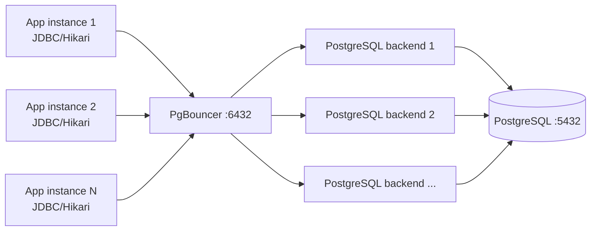

# PgBouncer với session pooling và transaction pooling trong PostgreSQL

Một ứng dụng Java dùng PostgreSQL có thể mở hàng trăm hoặc hàng nghìn kết nối khi lưu lượng tăng: mỗi instance có một connection pool, nhiều instance cùng triển khai, nhiều worker đồng thời truy vấn. PostgreSQL xử lý mỗi kết nối client bằng một backend process; số kết nối quá nhiều có thể tiêu tốn RAM, thời gian khởi tạo và tài nguyên quản lý, dù nhiều kết nối đang rảnh.

**PgBouncer** là một *connection pooler* nhẹ đặt giữa ứng dụng và PostgreSQL. Thay vì để mỗi kết nối phía ứng dụng giữ riêng một backend PostgreSQL trong toàn bộ thời gian tồn tại, PgBouncer quản lý tập kết nối server và phân phối chúng theo **pooling mode**.

Hai chế độ quan trọng nhất:

- **Session pooling:** một kết nối PostgreSQL được giữ cho một client trong **toàn bộ phiên**; giải phóng khi client ngắt kết nối hoặc phiên kết thúc.
- **Transaction pooling:** một kết nối PostgreSQL chỉ được giữ cho client trong **thời gian một transaction**; khi transaction kết thúc, kết nối server có thể phục vụ client khác.

Sự khác nhau nghe đơn giản nhưng ảnh hưởng trực tiếp đến **session variables, temporary tables, prepared statements, cursors, advisory locks, LISTEN/NOTIFY, giao dịch JDBC, RLS theo tenant, migration và độ an toàn của dữ liệu**.

Ví dụ cấu hình:

```ini
[databases]
appdb_tx = host=127.0.0.1 port=5432 dbname=appdb pool_mode=transaction
appdb_session = host=127.0.0.1 port=5432 dbname=appdb pool_mode=session

[pgbouncer]
listen_addr = 127.0.0.1
listen_port = 6432
auth_type = scram-sha-256
auth_file = /etc/pgbouncer/userlist.txt
default_pool_size = 20
max_client_conn = 500
```

Hai tên `appdb_tx` và `appdb_session` là **alias phía PgBouncer** cùng trỏ tới database PostgreSQL `appdb`. Ví dụ minh họa sự lựa chọn theo workload; chưa phải cấu hình production hoàn chỉnh vì còn cần quản lý TLS, authentication, credentials, quyền, logging, file permissions, timeout, dự phòng và giới hạn kết nối.

## 1. Mục tiêu học tập

Sau bài này, bạn có thể:

1. Giải thích vị trí của PgBouncer trong kiến trúc PostgreSQL và vì sao giảm chi phí kết nối.
2. Phân biệt **client connections** và **server/backend connections**.
3. Hiểu sự khác nhau giữa `session`, `transaction` và `statement` pooling.
4. Dự đoán thời điểm PgBouncer gán và trả một kết nối PostgreSQL cho pool.
5. Chọn chế độ theo tính chất ứng dụng, tính năng SQL và transaction boundaries.
6. Hiểu những thay đổi quan trọng với `SET`, `SET LOCAL`, session state và transaction state.
7. Nhận diện các tình huống không phù hợp transaction pooling: session-level advisory locks, LISTEN lâu dài, temp tables sống qua nhiều transaction, cursors giữ qua commit.
8. Giải thích khác biệt giữa SQL `PREPARE` và prepared statements của PostgreSQL extended query protocol, cùng vai trò của `max_prepared_statements` ở phiên bản PgBouncer hỗ trợ.
9. Cấu hình PgBouncer cơ bản, lựa chọn per-database alias và bảo vệ đường kết nối.
10. Tính quy mô pool theo database/user, giới hạn PostgreSQL và workload đồng thời.
11. Tích hợp đúng với JDBC/pgJDBC, HikariCP hoặc transaction manager.
12. Sử dụng `SHOW POOLS`, `SHOW STATS`, `SHOW CLIENTS`, `SHOW SERVERS` để quan sát.
13. Chẩn đoán `cl_waiting`, transaction kéo dài, backend churn, lỗi chuẩn bị statement và lỗi trạng thái phiên.
14. Tổ chức migration, RLS, failover, load test và rollout an toàn.
15. Thiết kế runbook và checklist khi chuyển ứng dụng từ kết nối trực tiếp/session pooling sang transaction pooling.

## 2. Tại sao cần connection pooling bên ngoài ứng dụng?

Một hệ thống điển hình:

```text
         20 instance ứng dụng
            mỗi instance
          HikariCP tối đa 30
                  |
                  v
        Tối đa 600 kết nối
                  |
                  v
             PostgreSQL
```

Nếu không có tầng trung gian, tổng số backend có thể tiến gần tổng số kết nối mà các ứng dụng duy trì, ngay cả khi nhiều client đang idle. Điều này làm tăng:

- Chi phí bộ nhớ và tài nguyên cho backend PostgreSQL.
- Áp lực `max_connections` và reserved connection slots.
- Khả năng xảy ra connection storms khi deploy/scale-out.
- Công việc quản lý những phiên không thực sự đang chạy query.

PgBouncer thêm tầng phân phối:



**Chú ý:** PostgreSQL vẫn có một backend cho mỗi kết nối **server** của PgBouncer. Điều PgBouncer tiết kiệm là số backend cần thiết để phục vụ nhiều kết nối **client**, nhất là khi không phải tất cả client cùng cần chạy transaction.

### 2.1. Pool ở JDBC và pool ở PgBouncer không giống hệt nhau

HikariCP tái sử dụng **đối tượng kết nối JDBC** trong một application instance. PgBouncer tái sử dụng **kết nối mạng tới backend PostgreSQL** giữa nhiều client kết nối qua nó.

Hai tầng có thể cùng tồn tại, nhưng phải tính **tổng giới hạn**. Nếu HikariCP giữ 100 client connections mà PgBouncer chỉ có 20 server connections, transaction pooling có thể phục vụ hiệu quả nếu đa số thời gian client không mở transaction.

### 2.2. PgBouncer không làm một SQL query chạy nhanh hơn một cách tự động

Nếu một truy vấn thiếu index và chạy 20 giây, đặt PgBouncer trước database không sửa execution plan của SQL. PgBouncer giúp giảm áp lực kết nối; thời gian chờ pool có thể **tăng** nếu server pool quá nhỏ hoặc transaction quá dài.

### 2.3. PgBouncer không phải bộ định tuyến SQL theo bảng

PgBouncer không tự đọc câu SELECT để chuyển sang read replica và UPDATE sang primary như một query router. Muốn tách đọc/ghi, ứng dụng hoặc tầng routing khác phải chọn đúng endpoint/pool.

## 3. Các khái niệm: client, server, pool và transaction

| Khái niệm | Nghĩa |
| --- | --- |
| **Client connection** | Kết nối từ Java/psql/ứng dụng tới PgBouncer |
| **Server connection** | Kết nối từ PgBouncer tới một PostgreSQL backend |
| **Pool** | Nhóm server connections có thể được dùng cho một database/user tương ứng theo cấu hình |
| **Session** | Phiên logic của client từ lúc kết nối đến lúc ngắt |
| **Transaction** | Đơn vị giao dịch từ `BEGIN` tới `COMMIT`/`ROLLBACK`, hoặc transaction ngầm định của statement khi autocommit |
| **Idle client** | Client vẫn kết nối nhưng không đang thực thi công việc |
| **Idle in transaction** | Transaction đã mở nhưng chưa kết thúc, có thể giữ server connection/locks |
| **Pool waiting** | Client chờ PgBouncer cấp một server connection thích hợp |

Một client connection tới PgBouncer **không tương đương** với một PostgreSQL backend cố định khi dùng transaction pooling.

## 4. So sánh nhanh ba pooling modes

| Thuộc tính | Session pooling | Transaction pooling | Statement pooling |
| --- | --- | --- | --- |
| Thời gian giữ backend cho client | Toàn phiên | Trong một transaction | Trong một statement |
| Tái sử dụng backend giữa client còn đang kết nối | Thường không | Có, sau khi transaction kết thúc | Có, sau statement |
| Giữ session state qua nhiều transactions | Có thể, theo chính sách reset khi trả pool | **Không thể dựa vào** | Không thể dựa vào |
| Multi-statement transaction `BEGIN ... COMMIT` | Hỗ trợ | Hỗ trợ | Không phù hợp; thường bị từ chối |
| Temporary table tồn tại qua commit | Có thể dùng trong phiên | Không an toàn để dựa vào | Không phù hợp |
| Session-level advisory lock | Có thể dùng khi quản lý giải phóng | Không an toàn | Không phù hợp |
| LISTEN giữ lâu dài | Có thể dùng | Không an toàn | Không phù hợp |
| Mức chia sẻ backend | Ít hơn | Cao khi giao dịch ngắn | Cao nhất về ranh giới chia sẻ |
| Độ tương thích với ứng dụng cũ | Cao hơn | Cần rà soát session assumptions | Hạn chế nhất |

Bài này tập trung vào session và transaction; statement mode được nêu để tránh nhầm lẫn.

## 5. Session pooling hoạt động như thế nào?

Trong session pooling, khi client được gán một kết nối server, PgBouncer giữ liên kết đó **cho tới khi phiên client kết thúc**.

```text
Client A: CONNECT ─────────────────────────── DISCONNECT
                 |                              |
Server 1:        [gắn với A suốt phiên]──────────+

Client B: CONNECT ─────────────────────────── DISCONNECT
                 |                              |
Server 2:        [gắn với B suốt phiên]──────────+
```

### 5.1. Đặc điểm chính

Nếu client A mở connection và để idle vài phút, server connection đã gắn với client A vẫn có thể bị chiếm dụng dù A không chạy SQL. Điều này làm khả năng chia sẻ backend kém hơn transaction pooling.

### 5.2. Ưu điểm

- Tương thích hơn với hành vi của một phiên PostgreSQL thông thường.
- Có thể duy trì `SET` cấp session, temp tables, SQL prepared statements, cursors và trạng thái phiên theo thời gian sống của client, trong phạm vi các tính năng/protocol được hỗ trợ.
- Phù hợp ứng dụng cũ khó sửa hoặc kết nối chuyên dụng có trạng thái lâu dài.

### 5.3. Hạn chế

- Số server connections có xu hướng gần số client connections thực sự được gắn backend.
- Các client idle có thể giữ backend; hệ thống có thể nhanh chóng chạm giới hạn pool.
- Ít hiệu quả nếu mục tiêu chính là phục vụ hàng trăm client thường xuyên idle bằng vài chục PostgreSQL backends.

### 5.4. Reset state khi client ngắt

PgBouncer có cơ chế reset server connection cho session pooling, thường liên quan cấu hình `server_reset_query` như `DISCARD ALL`. Điều này nhằm tránh để session state của client cũ ảnh hưởng client mới.

**Không suy luận rằng state của client A được giữ mãi sau khi A disconnect.** Session state chỉ có thể dựa vào trong vòng đời liên kết phiên, không phải sau khi backend được trả cho người khác.

## 6. Transaction pooling hoạt động như thế nào?

Trong transaction pooling, PgBouncer cấp backend cho client khi client cần thực thi một transaction và trả backend về pool khi transaction **thật sự kết thúc**.

```text
Thời gian ------>

Client A:  BEGIN ── SELECT ── UPDATE ── COMMIT       BEGIN ── SELECT ── COMMIT
Server 1: [         gắn với A           ]          [có thể là server khác]

Client B:                                    BEGIN ── INSERT ── COMMIT
Server 1:                                   [    gắn với B     ]
```

### 6.1. Khả năng tái sử dụng

Client A và B có thể **cùng duy trì** kết nối TCP tới PgBouncer, nhưng backend PostgreSQL được chia sẻ **lần lượt theo transaction**.

### 6.2. Ưu điểm

- Tận dụng tốt backend cho ứng dụng có nhiều client connections nhưng transaction ngắn.
- Giảm số kết nối backend PostgreSQL cần thiết khi tỉ lệ concurrency giao dịch thực tế thấp hơn số kết nối client.
- Hữu ích cho nhiều web/API services, đặc biệt khi triển khai nhiều instance.

### 6.3. Đổi lại

Giữa hai transactions của **cùng một client**, PgBouncer có thể cấp **hai PostgreSQL backends khác nhau**. Vì vậy bất kỳ trạng thái nào gắn riêng với backend trước đó đều không được giả định còn tồn tại/đúng ở backend tiếp theo.

### 6.4. Không phải transaction “không có trạng thái”

**Trong một transaction**, client vẫn dùng cùng backend để thực thi đúng semantics của PostgreSQL. Bạn vẫn có thể:

- `BEGIN`, `UPDATE`, `SELECT` và `COMMIT`.
- Dùng row locks và `SELECT ... FOR UPDATE`.
- Đặt `SET LOCAL` cho transaction hiện tại.
- Dùng transaction-level advisory locks.

Vấn đề xảy ra khi ứng dụng **dựa vào state sống qua ranh giới COMMIT/ROLLBACK**.

## 7. Một client dùng nhiều PostgreSQL backend PID

PostgreSQL có hàm:

```sql
SELECT pg_backend_pid();
```

Với session pooling, PID thường ổn định khi một client đã được gắn backend và phiên chưa kết thúc, trừ trường hợp mất/reconnect/failover.

Với transaction pooling, chạy:

```sql
SELECT pg_backend_pid();
SELECT pg_backend_pid();
```

ở hai statements autocommit riêng **có thể** trả các PID khác nhau; chúng cũng **có thể trùng nhau** nếu PgBouncer tình cờ chọn lại cùng backend.

### 7.1. Không dùng PID trùng nhau để kết luận đang session pooling

Một lần thấy PID giống nhau chỉ chứng minh hai statements tình cờ được chạy bởi cùng một backend; không chứng minh PgBouncer đã khóa backend cho session.

### 7.2. Cách kiểm tra đáng tin hơn

Kiểm tra cấu hình Pool mode bằng console quản trị PgBouncer, quan sát `SHOW POOLS`/`SHOW SERVERS` trong workload và mô phỏng nhiều clients đang cạnh tranh cùng pool.

### 7.3. Không dùng pg_backend_pid làm user/session ID của ứng dụng

Trong transaction pooling, một PID có thể phục vụ các client khác nhau theo thời gian. Cần application session ID/request ID riêng, không lấy backend PID làm định danh nghiệp vụ.

## 8. Giao dịch ngầm định và JDBC autocommit

Khi PostgreSQL xử lý một statement thông thường không nằm trong `BEGIN ... COMMIT`, statement chạy trong một **transaction ngầm định**.

Ví dụ:

```sql
SELECT COUNT(*) FROM orders;
```

Với JDBC `autoCommit=true`, mỗi thao tác SQL thường là đơn vị commit riêng theo semantics JDBC/driver. Trong transaction pooling, backend có thể được trả về pool **sau mỗi transaction như vậy**.

### 8.1. autocommit không đồng nghĩa giữ backend

Client vẫn giữ connection JDBC/PgBouncer, nhưng server PostgreSQL connection không buộc phải gắn với client qua các statements riêng biệt.

### 8.2. explicit transaction giữ backend

```sql
BEGIN;

SELECT balance
FROM accounts
WHERE account_id = 101
FOR UPDATE;

UPDATE accounts
SET balance = balance - 100
WHERE account_id = 101;

COMMIT;
```

Tất cả statements trong transaction được thực thi trên cùng PostgreSQL backend để bảo toàn locks, snapshots và thay đổi chưa commit.

### 8.3. Giữ transaction ngắn

Đừng mở transaction rồi:

- Gọi REST API ngoài.
- Chờ người dùng xác nhận.
- Ngủ vài giây chỉ để debug.
- Làm CPU work dài ở Java trước khi COMMIT.

Khi transaction chưa kết thúc, PgBouncer không thể trả backend đó cho một client khác một cách an toàn.

## 9. Lab cấu hình PgBouncer có hai alias

Giả sử PostgreSQL chạy trên `127.0.0.1:5432`, database `appdb`. Đây là ví dụ triển khai lab trên máy/container do bạn kiểm soát.

```ini
; /etc/pgbouncer/pgbouncer.ini

[databases]
appdb_tx = host=127.0.0.1 port=5432 dbname=appdb pool_mode=transaction
appdb_session = host=127.0.0.1 port=5432 dbname=appdb pool_mode=session

[pgbouncer]
listen_addr = 127.0.0.1
listen_port = 6432
unix_socket_dir = /var/run/postgresql
auth_type = scram-sha-256
auth_file = /etc/pgbouncer/userlist.txt

admin_users = pool_admin
stats_users = pool_metrics

max_client_conn = 500
default_pool_size = 20
min_pool_size = 0
reserve_pool_size = 5
reserve_pool_timeout = 5

query_wait_timeout = 30
server_idle_timeout = 600
```

**Không sao chép nguyên cấu hình sang production.** Các con số, đường dẫn socket, authentication, TLS, DNS, log và đặc tính server phụ thuộc môi trường.

### 9.1. Vì sao alias quan trọng?

Ứng dụng có thể chọn endpoint theo tính năng:

```text
jdbc:postgresql://pool.example.internal:6432/appdb_tx
jdbc:postgresql://pool.example.internal:6432/appdb_session
```

Hai alias trỏ cùng database thật nhưng có pooling mode riêng. Cần xem mỗi alias tạo pool resource riêng và ảnh hưởng tổng server connections.

### 9.2. Chọn tên rõ ràng

Các tên như `appdb_tx`, `appdb_session` dễ giúp người vận hành phân biệt. Không đặt alias mơ hồ khiến migrations vô tình đi qua transaction pooling trong khi script phụ thuộc session state.

### 9.3. TCP hay Unix socket?

PgBouncer có thể lắng nghe qua TCP và/hoặc Unix socket tùy cấu hình. Trong container/cluster, cần xét bind address, quyền filesystem, network policies và service discovery.

### 9.4. Không mở PgBouncer ra Internet không cần thiết

Nếu chỉ ứng dụng nội bộ cần truy cập, nên dùng private network và giới hạn nguồn kết nối. PgBouncer là một entrypoint database, cần được bảo vệ như database.

## 10. Authentication và hai đường kết nối

Có **hai chặng**:

1. Ứng dụng/JDBC → PgBouncer.
2. PgBouncer → PostgreSQL.

Chúng có thể có yêu cầu xác thực/TLS/credentials khác nhau.

### 10.1. auth_type và auth_file

Ví dụ `auth_type = scram-sha-256` cho client authentication với cơ chế hỗ trợ, và `auth_file` trỏ file chứa các thông tin xác thực theo định dạng PgBouncer.

Không đặt password thực vào tài liệu hoặc commit `userlist.txt` chứa secrets vào repository.

### 10.2. auth_query và auth_user

Trong những hệ thống cần tra thông tin user động, PgBouncer có tùy chọn xác thực qua truy vấn `auth_query` bằng role phù hợp. Cần xem tài liệu phiên bản, nguyên tắc ít quyền nhất và bảo mật truy vấn.

### 10.3. TLS hai phía

Các cấu hình liên quan `client_tls_*` và `server_tls_*` giúp bảo vệ các chặng kết nối khi triển khai phù hợp. Xác minh certificate, hostname, trust root và cách rotate certificates.

### 10.4. Không đồng nhất SSL mode của JDBC với chặng server

JDBC dùng TLS tới PgBouncer chưa tự chứng minh PgBouncer dùng TLS tới PostgreSQL. Phải kiểm tra cấu hình **cả hai chặng**.

### 10.5. TLS và SCRAM có chi tiết phiên bản

Khả năng dùng SCRAM credentials, chuyển tiếp xác thực và yêu cầu password format phụ thuộc phiên bản/cấu hình PgBouncer/PostgreSQL. Khi deploy phải kiểm tra kết nối thực tế bằng một role test, không đoán một dòng `auth_type` đã hoàn thiện hệ thống an ninh.

## 11. Tính pool size: không phải tổng client = tổng backend

Ví dụ:

- 10 app instances.
- Mỗi instance tối đa 40 JDBC connections.
- Tổng tối đa 400 client connections đến PgBouncer.
- PostgreSQL chịu được một số backend theo budget RAM/workload.

Nếu dùng transaction pooling và concurrency đồng thời chỉ cần khoảng 25 giao dịch, có thể bắt đầu benchmark với pool gần mức đó thay vì mặc định 400 server connections.

### 11.1. Công thức tư duy

```text
Tổng client slots mong muốn
    ≈ số instances × maximumPoolSize
      + psql/CLI/background jobs/đột biến

Server connections thực tế
    ≈ tổng các pool đang hoạt động theo
      database × user, giới hạn pool / reserve
      và các giới hạn server/database/user khác
```

**Không coi `default_pool_size` là giới hạn tổng cho toàn bộ PgBouncer.**

### 11.2. Pool thường tách theo database và user

Giả sử:

- 3 database aliases.
- Mỗi alias có 4 distinct PostgreSQL users.
- `default_pool_size=20`.

Trong mô hình mỗi database/user có pool riêng, số server slots lý thuyết có thể gần:

```text
3 × 4 × 20 = 240
```

chưa kể reserve pools, sự khác biệt giữa alias/pool configuration và các giới hạn khác.

### 11.3. Nhưng tổng không phải lúc nào cũng bằng tích số ấy

Nếu database definition ép dùng một server user cố định, hoặc có các giới hạn `max_db_connections`/`max_user_connections`, cách chia pool và tổng server connections có thể khác.

Phải nhìn `SHOW POOLS`, `SHOW DATABASES` và server statistics thực tế.

### 11.4. Chừa headroom cho PostgreSQL

Không đặt tổng PgBouncer pool slots chạm `max_connections` của PostgreSQL mà quên:

- Reserved/superuser connections.
- Monitoring/admin access.
- Migrations và maintenance.
- Replication/bảo trì hoặc các clients đi trực tiếp.
- Memory per backend và workload.

### 11.5. Mục tiêu là throughput bền vững

Pool quá nhỏ gây queue. Pool quá lớn làm PostgreSQL quá tải CPU, memory và I/O. Cần benchmark để tìm điểm cân bằng, không có một con số pool size đúng cho mọi hệ thống.

## 12. Các thông số PgBouncer quan trọng

| Thông số | Vai trò |
| --- | --- |
| `pool_mode` | session, transaction hoặc statement |
| `max_client_conn` | Giới hạn số kết nối client PgBouncer cho phép |
| `default_pool_size` | Số server connections mặc định mỗi pool |
| `min_pool_size` | Số server connections tối thiểu theo điều kiện hoạt động |
| `reserve_pool_size` | Kết nối dự phòng có thể cấp thêm khi queue chờ đạt điều kiện |
| `reserve_pool_timeout` | Thời gian chờ trước khi dùng reserve slots |
| `max_db_connections` | Giới hạn server connections trên một database theo cấu hình |
| `max_user_connections` | Giới hạn server connections theo user khi cấu hình |
| `query_wait_timeout` | Giới hạn thời gian client chờ để được phục vụ |
| `server_idle_timeout` | Thu hồi server connection rảnh sau khoảng thời gian phù hợp |
| `server_lifetime` | Giới hạn vòng đời server connection theo chính sách |
| `server_connect_timeout` | Giới hạn khi tạo kết nối server |
| `idle_transaction_timeout` | Timeout client đang idle trong transaction theo cấu hình |
| `server_reset_query` | Reset trạng thái server khi phù hợp với session pooling |
| `max_prepared_statements` | Hỗ trợ theo dõi protocol-level named prepared statements ở phiên bản PgBouncer phù hợp |

Tên/khả năng của từng setting có thể khác theo phiên bản. Dùng `SHOW CONFIG` trong console PgBouncer đang chạy để xác nhận.

### 12.1. max_client_conn khác PostgreSQL max_connections

`max_client_conn` thuộc PgBouncer: số client sockets kết nối vào pooler. `max_connections` thuộc PostgreSQL: số kết nối server backend mà PostgreSQL chấp nhận.

### 12.2. File descriptors và giới hạn hệ điều hành

PgBouncer cần file descriptors cho cả client sockets lẫn server sockets. Nếu nâng `max_client_conn` quá cao mà không tính `ulimit`/service unit/container limits, tiến trình vẫn có thể gặp lỗi tài nguyên.

### 12.3. reserve_pool không là dung lượng miễn phí

Reserve connections cũng là PostgreSQL backends thật khi được dùng. Phải đưa chúng vào budget `max_connections` và memory.

## 13. Session state là gì?

Session state là những thông tin được lưu trong **backend PostgreSQL session**, thay vì trong một row hoặc transaction duy nhất.

Ví dụ:

```sql
SET search_path = tenant_10, public;
SET TIME ZONE 'Asia/Ho_Chi_Minh';
SET ROLE reporting_role;
CREATE TEMP TABLE selected_ids (id bigint);
PREPARE q(bigint) AS SELECT * FROM orders WHERE id = $1;
LISTEN order_events;
SELECT pg_advisory_lock(12345);
```

Đây là các ví dụ độc lập; không chạy nguyên block nếu schema/role/tables chưa tồn tại. Mức ảnh hưởng chính xác tùy chức năng và phiên bản.

### 13.1. Vì sao transaction pooling gặp vấn đề?

Sau COMMIT, PgBouncer có thể chuyển client sang backend khác. Backend mới:

- Có thể không có temp table vừa tạo.
- Có thể không chứa SQL prepared statement cùng tên.
- Có thể không có LISTEN subscription.
- Có thể có session-level advisory lock từ một ngữ cảnh khác nếu cleanup không đúng.
- Có thể có session settings khác nếu ứng dụng tự tạo và không quản lý đúng.

### 13.2. Một số startup parameters được PgBouncer theo dõi

PgBouncer có cơ chế theo dõi/chuyển tiếp một số parameters thường gặp, ví dụ `client_encoding`, `DateStyle`, `TimeZone`, `standard_conforming_strings` và `application_name` tùy phiên bản và cấu hình. Có các settings như `track_extra_parameters`/`ignore_startup_parameters` ở phiên bản hỗ trợ.

Vì thế câu nói “**mọi** SET đều bị hỏng trong transaction pooling” là quá đơn giản. Quy tắc an toàn là **không dựa vào tùy tiện session state qua transaction boundaries** trừ những trường hợp PgBouncer thực sự hỗ trợ/tracking, được xác minh và kiểm thử.

## 14. SET LOCAL: cách đặt cấu hình theo transaction

Khi cần một tùy chọn chỉ có hiệu lực **trong transaction hiện tại**, dùng `SET LOCAL`:

```sql
BEGIN;

SET LOCAL statement_timeout = '3s';
SET LOCAL search_path = reporting, public;

SELECT COUNT(*) FROM sales;

COMMIT;
```

### 14.1. Vì sao phù hợp transaction pooling?

PgBouncer giữ cùng backend trong transaction. `SET LOCAL` có hiệu lực cho các câu SQL kế tiếp **trong transaction ấy** và được khôi phục khi transaction kết thúc theo semantics PostgreSQL.

### 14.2. SET session-level khác SET LOCAL

```sql
SET statement_timeout = '3s';
```

là thay đổi session-level. Nếu được chạy trong transaction pooling rồi backend được trả về pool, client không được bảo đảm lần SQL sau chạy với cùng state. Điều này khác mục đích của `SET LOCAL`.

### 14.3. Đặt SET LOCAL trước query cần áp dụng

```sql
BEGIN;
SET LOCAL statement_timeout = '3s';
SELECT expensive_operation();
COMMIT;
```

Nếu code đặt SET LOCAL **sau** query chậm, nó không có tác dụng hồi tố.

### 14.4. Không tin SET LOCAL ngoài transaction tường minh

Một câu SET LOCAL riêng lẻ trong autocommit không cung cấp cùng ngữ cảnh transaction cho câu SELECT kế tiếp. Cần mở transaction rõ ràng hoặc dùng cơ chế cấu hình đã được thiết kế cho pool.

## 15. RLS và biến tenant qua transaction pooling

Một kiến trúc multi-tenant có thể dùng PostgreSQL Row-Level Security, kết hợp session setting để truyền tenant context.

Ví dụ minh họa predicate:

```sql
-- Giả định bảng có tenant_id và RLS được bật.
-- CREATE POLICY tenant_isolation ON app.orders
-- USING (
--     tenant_id = current_setting('app.tenant_id', true)::integer
-- )
-- WITH CHECK (
--     tenant_id = current_setting('app.tenant_id', true)::integer
-- );
```

### 15.1. Cách truyền context đúng theo transaction

```sql
BEGIN;

SELECT set_config('app.tenant_id', '10', true);

SELECT *
FROM app.orders
WHERE order_id = 101;

COMMIT;
```

Tham số thứ ba của `set_config(name, value, is_local)` là `true` nghĩa đặt ở phạm vi **transaction-local**, tương đương ý tưởng `SET LOCAL`.

### 15.2. Không dùng SET session cấp tenant một lần ở startup

Với transaction pooling, đặt:

```sql
SET app.tenant_id = '10';
```

rồi giả định mọi query của cùng JDBC connection sau này mang tenant 10 là **không an toàn**. Query tiếp theo có thể đi tới backend khác, và trạng thái backend trước có thể gây rủi ro nếu cleanup/scope sai.

### 15.3. Phải kiểm tra tenant context trước mỗi transaction cần thiết

Mẫu service:

```text
BEGIN
  set_config('app.tenant_id', verifiedTenant, true)
  SELECT/INSERT/UPDATE/DELETE trong tenant
COMMIT / ROLLBACK
```

### 15.4. Cảnh báo bảo mật về custom GUC

Nếu client không đáng tin có thể tự `SET app.tenant_id` tùy ý dưới cùng database role, một RLS policy chỉ tin biến đó **không tự chứng minh người dùng được phép thuộc tenant 10**. Application phải xác thực tenant, kiểm soát quyền và bảo vệ đường ghi; các mô hình bảo mật cao hơn có thể cần database roles riêng hoặc cơ chế signed/trusted context.

### 15.5. RLS policy còn phụ thuộc owner/bypass roles

Test bằng superuser/table owner có thể không phản ánh RLS của role ứng dụng. Không dùng PgBouncer như một biện pháp thay thế RLS hoặc authorization.

## 16. Temporary tables: xét vòng đời ON COMMIT

Một bảng tạm trong PostgreSQL thuộc session, ví dụ:

```sql
CREATE TEMP TABLE session_cart (
    sku text,
    quantity integer
);
```

Nếu transaction kết thúc mà bảng vẫn tồn tại trên backend, client trong transaction pooling không được bảo đảm gặp lại bảng ấy ở transaction sau.

### 16.1. Pattern không phù hợp transaction pooling

```sql
-- Transaction 1
BEGIN;
CREATE TEMP TABLE session_cart (sku text);
INSERT INTO session_cart VALUES ('A-001');
COMMIT;

-- Transaction 2, có thể chạy trên backend khác:
SELECT * FROM session_cart;
```

Câu SELECT có thể báo relation không tồn tại hoặc gặp trạng thái backend không mong muốn. Đây là anti-pattern.

### 16.2. Mẫu chỉ dùng trong một transaction

```sql
BEGIN;

CREATE TEMP TABLE work_ids (
    id bigint
) ON COMMIT DROP;

INSERT INTO work_ids VALUES (10), (20), (30);

SELECT COUNT(*) FROM work_ids;

COMMIT;
```

`ON COMMIT DROP` giúp định nghĩa và dữ liệu temp table bị xóa tại COMMIT, không đòi giữ temp table cho transaction tiếp theo.

### 16.3. ON COMMIT DELETE ROWS khác ON COMMIT DROP

`ON COMMIT DELETE ROWS` xóa rows nhưng **cấu trúc temporary table vẫn có thể tồn tại trong backend session**. Nếu PgBouncer tái sử dụng backend cho client khác, bạn không được tự kết luận session-level object state đã sạch.

### 16.4. Giải pháp tốt hơn khi có thể

- Dùng CTE/VALUES/temp relation thuần theo một query.
- Dùng bảng staging thông thường có request/job ID và cleanup phù hợp.
- Dùng session pooling/dedicated connection cho thao tác thực sự cần temp state xuyên transactions.

## 17. Prepared statements: điểm tương thích theo phiên bản

PostgreSQL có **hai cách** dễ bị gọi chung là “prepared statement”:

1. **SQL-level** `PREPARE name(...) AS ...` và `EXECUTE name(...)`.
2. **Protocol-level** named prepared statements được client driver tạo qua PostgreSQL extended query protocol.

Chúng không được PgBouncer xử lý giống hệt nhau.

### 17.1. SQL PREPARE lưu state trên backend

```sql
PREPARE get_order(bigint) AS
SELECT order_id, amount
FROM orders
WHERE order_id = $1;

EXECUTE get_order(101);
```

Nếu PREPARE chạy trong transaction thứ nhất và EXECUTE chạy ở transaction thứ hai qua transaction pooling, EXECUTE có thể tới backend **không có** named prepared statement đó.

### 17.2. Protocol-level prepared statements

Các phiên bản PgBouncer hiện đại có hỗ trợ quản lý **protocol-level named prepared statements** trong transaction pooling khi cấu hình `max_prepared_statements` lớn hơn 0. Tính năng này được giới thiệu từ dòng PgBouncer 1.21; phải kiểm tra phiên bản và cấu hình đang chạy.

### 17.3. max_prepared_statements không tự sửa SQL PREPARE

Không được suy luận rằng chỉ cần bật:

```ini
max_prepared_statements = 100
```

thì mọi chuỗi `PREPARE ...; COMMIT; EXECUTE ...` do ứng dụng gửi dưới dạng SQL text đều trở thành session-independent. Hỗ trợ nói trên tập trung vào named prepared statements **của wire protocol**, không phải biến SQL-level session PREPARE thành đối tượng độc lập.

### 17.4. Nguy cơ ở driver

Một số JDBC drivers chỉ chuyển sang server-side named prepare sau một ngưỡng số lần execute. Vì vậy chạy vài query đầu có thể ổn, đến query thứ N mới xuất hiện lỗi như:

```text
prepared statement "S_1" does not exist
prepared statement "S_1" already exists
```

Thông điệp cụ thể tùy driver, PgBouncer và PostgreSQL. Không nên chỉ test một lần chạy SQL rồi kết luận đã tương thích.

## 18. pgJDBC: prepareThreshold và cách chọn giải pháp

Với Java/pgJDBC, các phần cấu hình liên quan thường là:

- `PreparedStatement` trong JDBC.
- Ngưỡng driver dùng server-side prepare, ví dụ `prepareThreshold`.
- Phiên bản PgBouncer và `max_prepared_statements`.
- Khả năng app có dùng SQL-level PREPARE trực tiếp không.

### 18.1. Phương án A: PgBouncer hỗ trợ protocol prepared statements

Nếu dùng PgBouncer phiên bản phù hợp, cấu hình:

```ini
[pgbouncer]
max_prepared_statements = 100
```

rồi chạy integration test dài hơn ngưỡng chuẩn bị của driver. Kích thước cache cần tính chi phí memory, số lượng query shapes và workload thực tế.

### 18.2. Phương án B: tắt server-side named prepare của driver

Trong một số trường hợp có thể đặt thuộc tính JDBC phù hợp:

```text
jdbc:postgresql://pool.example.internal:6432/appdb_tx?prepareThreshold=0
```

Với pgJDBC, `prepareThreshold=0` được dùng để tắt cơ chế server-side preparation theo ngưỡng của driver. Điều đó không có nghĩa bỏ việc dùng `PreparedStatement` với bind parameters trong Java; parameter binding vẫn cần để tránh SQL injection.

### 18.3. Không tắt prepare nếu không cần

Vô hiệu hóa server-side preparation có thể gây mất lợi ích về parse/plan caching. Trước khi đổi, hãy kiểm tra PgBouncer version/support và benchmark.

### 18.4. Test lifecycle dài

Một ca test nên:

1. Lặp lại một PreparedStatement nhiều lần trên cùng JDBC connection.
2. Chạy nhiều transactions riêng biệt.
3. Tạo concurrency để backend có thể được phân phối lại.
4. Kiểm tra kết quả bind parameters, latency và errors.
5. Chạy dưới cùng phiên bản driver/PgBouncer như production.

## 19. Cursors và streaming result sets

Cursors PostgreSQL thường gắn với transaction/backend.

### 19.1. Cursor trong cùng transaction

```sql
BEGIN;

DECLARE c_orders CURSOR FOR
SELECT order_id
FROM orders
ORDER BY order_id;

FETCH 100 FROM c_orders;
FETCH 100 FROM c_orders;

CLOSE c_orders;
COMMIT;
```

Trong transaction pooling, các lệnh nằm **trong cùng transaction** và dùng cùng backend, nên cursor transaction-scoped có thể hoạt động theo đúng semantics.

### 19.2. Cursor giữ qua COMMIT không an toàn

`DECLARE ... CURSOR WITH HOLD` có thể tạo cursor tồn tại sau COMMIT trên backend. Trong transaction pooling, client không được bảo đảm ở lại backend đó, nên không được xây giao thức fetch qua nhiều transactions dựa vào held cursor.

### 19.3. Streaming JDBC

Một số chế độ fetch-by-cursor của pgJDBC cần `autoCommit=false` và fetch size thích hợp. Nếu transaction giữ mở trong suốt thời gian streaming lớn, nó cũng **giữ backend PgBouncer** trong toàn bộ thời gian ấy.

### 19.4. Chiến lược dữ liệu lớn

- Page theo keyset để transaction ngắn.
- Stream trong một transaction có giới hạn và timeout.
- Chạy báo cáo dài qua session/dedicated pool nếu cần.

Không coi PgBouncer là cách làm cursor dài trở nên miễn phí.

## 20. Advisory locks: session-level và transaction-level

PostgreSQL có advisory locks, nhưng hai phạm vi quan trọng:

| Hàm | Vòng đời lock | Trong transaction pooling |
| --- | --- | --- |
| `pg_advisory_lock(key)` | Session-level, cần unlock/đóng session | **Không an toàn để dựa vào** |
| `pg_advisory_unlock(key)` | Giải phóng session lock của backend hiện tại | Có thể chạy trên backend khác ở transaction sau |
| `pg_advisory_xact_lock(key)` | Tự giải phóng khi transaction kết thúc | Phù hợp nếu toàn bộ work trong cùng transaction |

### 20.1. Ví dụ nguy hiểm

```sql
SELECT pg_advisory_lock(12345);
-- COMMIT ngầm định, PgBouncer trả backend.

SELECT pg_advisory_unlock(12345);
-- Có thể chạy ở backend khác.
```

Bạn không được bảo đảm câu unlock tới đúng backend giữ lock.

### 20.2. Mẫu transaction-level

```sql
BEGIN;

SELECT pg_advisory_xact_lock(12345);

UPDATE jobs
SET processed = true
WHERE job_id = 12345;

COMMIT;
```

Lock có hiệu lực trong transaction và tự giải phóng khi transaction kết thúc.

### 20.3. Không thay row locks bừa bãi

Nếu bài toán chỉ cần bảo vệ row cụ thể, `SELECT ... FOR UPDATE` hoặc UPDATE có điều kiện có thể dễ hiểu và đảm bảo hơn advisory lock tự quản lý key.

## 21. LISTEN/NOTIFY và long-lived subscribers

`LISTEN` đăng ký một backend session nhận thông báo:

```sql
LISTEN order_changed;
```

Subscription gắn với backend session. Nếu client dùng transaction pooling rồi server connection được trả về pool, **không thể tin rằng client đó sẽ tiếp tục nhận notifications từ backend cũ**.

### 21.1. Dùng session/dedicated connection cho listener

Một listener chạy lâu nên dùng:

- Kết nối PostgreSQL trực tiếp, hoặc
- Session-pooling alias được quản lý phù hợp.

### 21.2. Phân biệt publisher và listener

Một transaction có thể thực hiện:

```sql
NOTIFY order_changed, '101';
```

và thông báo được phát theo semantics PostgreSQL khi transaction commit. Việc **gửi NOTIFY** khác với việc **giữ LISTEN subscription** trên một backend lâu dài.

### 21.3. LISTEN/NOTIFY không phải durable message queue

Không dùng nó làm cơ chế duy nhất bảo đảm xử lý từng sự kiện đúng một lần hay replay sau downtime; ứng dụng có thể cần outbox/job queue/event store.

## 22. Sequence state: currval và lastval

Những hàm:

```sql
SELECT currval('order_id_seq');
SELECT lastval();
```

dựa vào **session state** của backend PostgreSQL. Trong transaction pooling, nếu lệnh `INSERT` và câu `currval` nằm trong hai transactions riêng, không được giả định chúng chạy trên cùng backend.

### 22.1. Mẫu dễ lỗi

```sql
INSERT INTO orders(customer_id) VALUES (10);
SELECT currval('orders_order_id_seq');
```

Nếu mỗi statement autocommit riêng, backend của SELECT có thể chưa từng gọi nextval tương ứng, hoặc state không thuộc request hiện tại.

### 22.2. Dùng INSERT ... RETURNING

```sql
INSERT INTO orders(customer_id)
VALUES (10)
RETURNING order_id;
```

Đây là cách thuận tiện và an toàn hơn để nhận ID của row mới trong cùng statement.

### 22.3. nextval vẫn có thể dùng với quyền thích hợp

`nextval` là phép cấp số sequence thực sự; rủi ro chính ở đây là **các giá trị/session state được tra lại ở statement khác**, chứ không phải PgBouncer cấm mọi thao tác sequence.

## 23. Reset query và trạng thái backend

PgBouncer có settings như:

```ini
server_reset_query = DISCARD ALL
```

nhằm làm sạch server session khi connection được trả về pool trong **session pooling** theo cơ chế áp dụng.

### 23.1. Transaction pooling có quy tắc khác

Trong transaction pooling, backend được trả về sau từng transaction. PgBouncer mặc định không dùng `server_reset_query` ở mỗi lần trả backend theo cùng cách với session pooling.

### 23.2. Vì sao không chỉ bật reset mạnh mọi transaction?

Chạy các thao tác reset thường xuyên có chi phí và không biến mọi session feature thành transaction-safe. Hơn nữa những hành vi như LISTEN hoặc session advisory lock vẫn không có vòng đời tương ứng với client nếu backend liên tục đổi.

### 23.3. Không xây hệ thống dựa vào session SET “tình cờ chưa bị reset”

Nếu code đặt `SET search_path = tenant_10` rồi một số tests vẫn đúng, đó không phải bảo đảm an toàn của transaction pooling. Hãy chuyển sang các thiết kế transaction-scoped hoặc endpoint session cho workload cần state.

## 24. Thao tác DDL và migration qua PgBouncer

Nhiều DDL như:

```sql
BEGIN;
CREATE TABLE migration_sample (id bigint PRIMARY KEY);
CREATE INDEX idx_migration_sample_id ON migration_sample(id);
COMMIT;
```

có thể chạy trong một transaction PostgreSQL, và PgBouncer transaction pooling có thể giữ cùng backend cho giao dịch đó.

### 24.1. Nhưng migration tools có thể cần session state

Các tools có thể dựa vào:

- Advisory **session** lock để tránh hai migrations chạy đồng thời.
- `SET search_path` tồn tại qua nhiều transactions.
- Temp tables xuyên transactions.
- SQL-level PREPARE/transaction behavior.
- Một số DDL không được phép chạy trong transaction block.

### 24.2. Khuyến nghị thực tế

Với migrations, `pg_dump`/`pg_restore`, maintenance và long-lived admin sessions, ưu tiên **kết nối trực tiếp PostgreSQL** hoặc **session-pooling endpoint** theo yêu cầu của tool.

### 24.3. Migration phải có connection budget riêng

Nếu chỉ dùng pool transaction dành cho traffic web, migration nặng có thể tranh server slots với request runtime. Nên có tài nguyên/endpoint/quy trình được kiểm soát.

### 24.4. Không có chuyện transaction pooling tự phân phối một transaction sang nhiều backend

Nếu migration chạy một transaction dài, nó **chiếm một backend đến cuối giao dịch**. Điểm cần xét là session state *giữa* các transaction và mức độ ảnh hưởng tới pool.

## 25. Java/JDBC: mẫu transaction-safe với PgBouncer

Giả sử JDBC URL trỏ tới alias `appdb_tx`. Ví dụ không phụ thuộc framework:

```java
String url =
    "jdbc:postgresql://pool.example.internal:6432/appdb_tx";

try (Connection c = DriverManager.getConnection(
        url, dbUser, dbPassword)) {
    boolean priorAutoCommit = c.getAutoCommit();
    c.setAutoCommit(false);

    try {
        // Context chỉ sống trong transaction hiện tại.
        try (PreparedStatement ctx = c.prepareStatement(
                "SELECT set_config('app.tenant_id', ?, true)")) {
            ctx.setString(1, verifiedTenantId);
            ctx.executeQuery().close();
        }

        try (PreparedStatement ps = c.prepareStatement("""
                INSERT INTO app.orders(tenant_id, customer_id, amount)
                VALUES (?, ?, ?)
                RETURNING order_id
                """)) {
            ps.setInt(1, Integer.parseInt(verifiedTenantId));
            ps.setLong(2, customerId);
            ps.setBigDecimal(3, amount);

            try (ResultSet rs = ps.executeQuery()) {
                if (!rs.next()) {
                    throw new SQLException("No order_id returned");
                }
                long orderId = rs.getLong(1);
                // Dùng orderId trong cùng transaction nếu cần.
            }
        }

        c.commit();
    } catch (SQLException | RuntimeException e) {
        c.rollback();
        throw e;
    } finally {
        c.setAutoCommit(priorAutoCommit);
    }
}
```

Đây là **mẫu minh họa**: giả định `app.orders`, credentials và biến Java đã tồn tại, method xử lý checked exceptions phù hợp. Trong ứng dụng dùng Spring/JTA transaction manager, hãy dùng cơ chế transaction của framework thay vì tự đổi autoCommit không đúng contract pool.

### 25.1. Vì sao context đặt trong transaction?

`set_config(..., true)` chỉ áp dụng tại transaction đang mở. Các câu query cùng transaction chạy trên backend đã được PgBouncer gán.

### 25.2. Vì sao INSERT RETURNING?

Nó lấy `order_id` mà không cần dựa vào `currval` của một backend có thể thay đổi giữa statements.

### 25.3. PreparedStatement vẫn quan trọng

Không tắt bind parameters để “né PgBouncer”. Phải giữ truy vấn tham số hóa để tránh SQL injection; vấn đề server-side named prepare có thể xử lý qua driver/PgBouncer settings.

### 25.4. Không đưa user input vào tên schema tùy ý

Nếu cần schema-per-tenant, đừng ghép `search_path` từ input không xác thực. Đặt cơ chế routing/whitelist và quyền riêng; transaction pooling không tự bảo vệ multi-tenancy.

## 26. HikariCP + PgBouncer: hai tầng pool

HikariCP vẫn có giá trị để:

- Tái sử dụng JDBC connections trong ứng dụng.
- Giới hạn số concurrent requests lấy connection.
- Kiểm tra connection còn sống.
- Cung cấp timeout khi ứng dụng chờ client connection.

PgBouncer phục vụ mục đích khác: giảm backend connections và quản lý transaction-level reuse.

### 26.1. Ví dụ cấu hình khái niệm

```properties
spring.datasource.url=jdbc:postgresql://pool.example.internal:6432/appdb_tx
spring.datasource.hikari.maximum-pool-size=20
spring.datasource.hikari.minimum-idle=2
spring.datasource.hikari.connection-timeout=3000
```

Các giá trị chỉ là mẫu để thảo luận; phải benchmark theo instance count và tải.

### 26.2. Đừng nhân pool size không kiểm soát

Nếu 50 pods × 20 Hikari connections, PgBouncer có thể nhận tới 1.000 clients. `max_client_conn`, file descriptor budget, connection churn và server pool sizes phải được tính theo số này.

### 26.3. Connection init SQL và session state

Một số Hikari/JDBC cấu hình `connectionInitSql` chỉ chạy khi JDBC client connection được tạo. Trong transaction pooling, SQL đặt session state lúc khởi tạo **không đảm bảo** tác dụng lên mọi PostgreSQL backend được gán về sau.

Nếu cần tenant/request context, đặt lại **trong mỗi transaction** theo quy trình ứng dụng.

### 26.4. Transaction manager phải rõ

Spring `@Transactional` có thể giúp nhóm các statements vào cùng transaction/connection; nhưng việc gọi qua async threads, propagation khác hoặc self-invocation có thể khiến thực tế khác mong đợi. Test transaction boundary bằng SQL/đối tượng thật.

### 26.5. HikariCP pool nhỏ không đồng nghĩa transaction ngắn

Một service giữ connection trong transaction suốt thời gian gọi HTTP ngoài có thể giữ backend PgBouncer lâu. Cần đo **transaction duration**, không chỉ kích thước Hikari pool.

## 27. Cơ sở dữ liệu đọc/ghi và PgBouncer

Nếu hệ thống có primary và replicas:

```text
API write ──> PgBouncer write ──> PostgreSQL primary
API read  ──> PgBouncer read  ──> PostgreSQL replica
```

### 27.1. Ứng dụng phải chọn endpoint phù hợp

PgBouncer không phải engine tự hiểu “SELECT phải tới replica” từ query text. Routing đọc/ghi thường cần DSNs khác nhau hoặc tầng proxy có khả năng routing riêng.

### 27.2. Read-after-write consistency

Một request vừa UPDATE primary rồi đọc replica có thể thấy dữ liệu cũ do replication lag. Session pooling hay transaction pooling **không tự loại bỏ replication lag**.

### 27.3. Failover thay đổi server connections

Khi PostgreSQL failover, các server connections cũ có thể bị ngắt. PgBouncer cần kết nối lại tới endpoint mới theo network/DNS/service discovery; ứng dụng phải có retry/transaction error handling phù hợp.

### 27.4. Đừng retry transaction ghi mà không có idempotency

Nếu network đứt đúng lúc COMMIT, client có thể không chắc database đã commit hay chưa. Retry mù một INSERT/payment có thể tạo trùng. Cần request ID và unique constraints theo nghiệp vụ.

## 28. Kết nối console quản trị PgBouncer

PgBouncer có một database quản trị đặc biệt tên `pgbouncer`.

Mẫu lệnh:

```bash
psql "host=pool.example.internal port=6432 dbname=pgbouncer user=pool_admin sslmode=verify-full"
```

Bạn cần cấu hình TLS certificate/trust root và account đúng, không đưa password lên command line hoặc tài liệu.

### 28.1. Một số lệnh SHOW

```sql
SHOW VERSION;
SHOW CONFIG;
SHOW DATABASES;
SHOW USERS;
SHOW POOLS;
SHOW CLIENTS;
SHOW SERVERS;
SHOW STATS;
SHOW LISTS;
```

Các `SHOW` này chạy trên **PgBouncer admin console**, không phải câu `SHOW POOLS` của PostgreSQL backend thông thường.

### 28.2. admin_users và stats_users

Admin role thường có thể xem và thay đổi vận hành PgBouncer; stats role thường có khả năng truy cập thông tin thống kê với phạm vi hạn chế hơn. Không cấp admin console cho application runtime chỉ để chạy SQL.

### 28.3. Quyền và nội dung nhạy cảm

`SHOW CLIENTS` hoặc `SHOW SERVERS` có thể chứa thông tin kết nối, user, địa chỉ IP, timestamps hoặc query metadata. Giới hạn quyền và xử lý logs/exports cẩn thận.

## 29. Đọc SHOW POOLS

Một số cột quen thuộc:

| Cột | Diễn giải |
| --- | --- |
| `database` | Database alias/pool |
| `user` | User/server pool liên quan |
| `cl_active` | Client connections đang active theo trạng thái pool |
| `cl_waiting` | Client đang chờ server connection |
| `sv_active` | Server connections đang phục vụ client |
| `sv_idle` | Server connections nhàn rỗi, có thể dùng |
| `sv_used` | Server connections đã dùng, đang ở trạng thái riêng theo PgBouncer |
| `sv_tested` | Server connections đang được kiểm tra |
| `sv_login` | Server connections đang trong quá trình login |
| `maxwait` | Thời gian chờ lớn nhất liên quan queue, định dạng/cột phụ thuộc phiên bản |

Tên và số liệu chi tiết có thể khác giữa phiên bản PgBouncer. Khi debug, dùng chính output của server thực tế.

### 29.1. cl_waiting lớn nói lên điều gì?

Nhiều client chưa được cấp backend. Có thể do:

- Pool đủ server connections nhưng tất cả đang bận transaction.
- Pool size quá thấp so với concurrency.
- Transaction bị giữ mở lâu.
- PostgreSQL chậm/locks/I/O.
- Server connections bị lỗi hoặc đang reconnect.
- Giới hạn per-db/per-user khác đang chặn.

### 29.2. Không chỉ tăng pool size

Nếu backend PostgreSQL đã CPU 100%, thêm 100 connections có thể khiến DB chậm hơn. Cần xem transaction duration và wait events.

### 29.3. sv_idle nhiều nhưng client vẫn chờ?

Có thể clients ở **pool khác** theo database/user, bị limit cụ thể hoặc servers không ở trạng thái phù hợp. Không cộng tất cả `sv_idle` của mọi pool rồi kết luận mọi client đều có server để dùng.

## 30. SHOW STATS và các chỉ số hiệu năng

`SHOW STATS` cung cấp các số liệu tổng hợp theo database/pool, ví dụ transactions, queries, bytes và timings tùy phiên bản.

### 30.1. Các chỉ số cần theo dõi

- Số transaction và query được xử lý.
- Thời gian client chờ có server connection.
- Thời gian transaction.
- Thời gian thực thi query.
- Ingress/egress traffic và throughput.
- Số clients đang active/waiting.
- Số server connections active/idle.

### 30.2. Kết hợp với PostgreSQL statistics

PgBouncer biết **client đang chờ server pool**, còn PostgreSQL biết **backend đang chạy/chờ gì**.

Để phân tích:

```sql
SELECT
    pid,
    usename,
    application_name,
    state,
    wait_event_type,
    wait_event,
    now() - xact_start AS transaction_age,
    query
FROM pg_stat_activity
WHERE datname = current_database()
ORDER BY xact_start NULLS LAST;
```

Lệnh này chạy trên PostgreSQL, không phải PgBouncer admin database.

### 30.3. Metrics cần gắn với thời gian

Tổng tích lũy kể từ reset không trực tiếp là queries/s. Để tính throughput, cần delta theo thời gian với thời điểm lấy mẫu rõ. Khi stats reset/restart, phải xử lý counter reset.

### 30.4. Client waiting không luôn là lỗi

Một queue ngắn có thể là trade-off bình thường để giới hạn áp lực DB. Quan trọng là **P95/P99 wait time, request timeout và throughput đạt SLA**.

## 31. Chẩn đoán idle in transaction

Trong transaction pooling, một transaction mở nhưng ứng dụng không làm gì vẫn **giữ backend**.

Ví dụ Java:

```text
connection.setAutoCommit(false)
SELECT ...;
call external API for 30 seconds
connection.commit()
```

30 giây chờ API có thể giữ một PostgreSQL backend, dù chẳng có SQL nào đang thực thi.

### 31.1. Xem trên PostgreSQL

```sql
SELECT
    pid,
    application_name,
    state,
    now() - xact_start AS xact_age,
    wait_event_type,
    wait_event
FROM pg_stat_activity
WHERE state = 'idle in transaction'
ORDER BY xact_start;
```

### 31.2. Cách khắc phục

- Chỉ mở transaction ngay trước các câu SQL cần atomicity.
- Không gọi dịch vụ mạng khi đang giữ transaction nếu không bắt buộc.
- Bảo đảm commit/rollback trong mọi nhánh, kể cả exception.
- Cân nhắc `idle_in_transaction_session_timeout` của PostgreSQL và `idle_transaction_timeout` của PgBouncer theo chính sách.

### 31.3. Timeout không tự sửa logic

Ngắt idle transaction có thể giải phóng backend nhưng cũng khiến request thất bại. Cần sửa ứng dụng giữ transaction quá lâu.

## 32. Query wait timeout và chuỗi timeouts

Một request có thể chịu nhiều giới hạn:

```text
HTTP request timeout
        |
Hikari connectionTimeout (chờ client JDBC connection)
        |
PgBouncer query_wait_timeout (chờ server backend)
        |
PostgreSQL statement_timeout / lock_timeout
        |
pgJDBC socketTimeout / network timeout
```

### 32.1. Không đánh đồng các thời gian chờ

Nếu Hikari timeout khi lấy connection, query có thể **chưa hề tới PgBouncer**.

Nếu PgBouncer query_wait_timeout, client đã kết nối tới pooler nhưng chưa lấy được server connection đúng hạn.

Nếu PostgreSQL `statement_timeout`, statement đã được thực thi/đang thực thi trong backend rồi bị giới hạn.

### 32.2. Thiết kế timeout theo ngân sách request

Ví dụ API SLA 2 giây cần phân bổ hợp lý cho pool wait, DB query, network và xử lý ứng dụng. Không đặt PostgreSQL statement_timeout 60 giây trong khi HTTP timeout 2 giây rồi kỳ vọng không có backend bị giữ sau client hủy.

### 32.3. Cancel/retry semantics

Một timeout có thể để transaction abort và cần rollback. Retry chỉ khi lỗi có thể retry, và hoạt động ghi phải idempotent hoặc được kiểm soát.

## 33. Làm lab minh họa backend reuse

Chuẩn bị một database `appdb` và kết nối:

```bash
psql "host=127.0.0.1 port=6432 dbname=appdb_tx user=lab_user"
```

Trong một session psql:

```sql
SELECT pg_backend_pid() AS first_pid;
SELECT pg_backend_pid() AS second_pid;
```

Hai PID có thể bằng nhau hoặc khác nhau.

### 33.1. Chạy hai client cạnh tranh

Mở thêm một psql client tới cùng alias với cùng user. Nếu cấu hình `default_pool_size=1` cho lab:

- Client A mở transaction và chạy `SELECT pg_sleep(3)`.
- Client B chạy query trong khi A giữ backend.
- B có thể thấy chờ pool đến khi A commit.

### 33.2. Không mở transaction rồi ngủ trên production

Thí nghiệm giữ backend cố ý, chỉ dùng local/staging. Nếu cần đo tại production, dùng metrics đang có thay vì tạo lock/queue giả.

### 33.3. So với session pooling

Với một server slot và session pooling:

- Client A đã được gắn backend.
- Client B có thể phải chờ **đến khi A disconnect**, không chỉ đến COMMIT.

Sự khác biệt này cho thấy tại sao session pooling kém hiệu quả với nhiều client kết nối nhưng idle.

## 34. Test trạng thái phiên có kiểm soát

Một thí nghiệm:

```sql
-- Kết nối qua appdb_tx
BEGIN;
SET LOCAL application_name = 'tx-lab';
SELECT current_setting('application_name');
COMMIT;

BEGIN;
SELECT current_setting('application_name');
COMMIT;
```

### 34.1. Vì sao dùng application_name?

Nó minh họa local vs session setting. Tuy nhiên application_name thuộc nhóm tham số có thể được PgBouncer track/chuyển tiếp ở một số cấu hình; **không dùng thí nghiệm này làm bằng chứng mọi custom GUC có hành vi giống nhau**.

### 34.2. Với custom setting

```sql
BEGIN;
SELECT set_config('app.demo_context', 'A', true);
SELECT current_setting('app.demo_context', true);
COMMIT;
```

Không dựa vào kết quả `current_setting` trong transaction tiếp theo, vì backend có thể khác và local context đã hết hiệu lực.

### 34.3. Kết quả giống nhau không chứng minh session stickiness

PgBouncer có thể dùng lại cùng backend, hoặc driver/PgBouncer tracking đã đồng bộ một tham số. Kết luận cần dựa trên cơ chế và cấu hình, không phải một lần test đơn giản.

## 35. Phiên bản PgBouncer và feature compatibility

PgBouncer phát triển theo phiên bản. Một tính năng hỗ trợ trong bản mới có thể không có ở bản cũ.

### 35.1. Luôn lấy phiên bản đang chạy

Trong console:

```sql
SHOW VERSION;
SHOW CONFIG;
```

Trên PostgreSQL backend:

```sql
SHOW server_version;
```

Đây là hai phần mềm khác nhau, có vòng đời nâng cấp riêng.

### 35.2. Những điểm cần xác minh trước migration

- `max_prepared_statements` có tồn tại và được cấu hình không?
- Driver có dùng protocol named prepared statements không?
- Có thay đổi về parameter tracking/server reset không?
- Authentication/TLS và cấu hình SCRAM có tương thích không?
- Console columns/metrics hiện có khác tài liệu cũ không?

### 35.3. Không ghi một quy tắc bất biến cho mọi phiên bản

Ví dụ “transaction pooling tuyệt đối không hỗ trợ prepared statements” là nhận định quá rộng ở những phiên bản PgBouncer hiện đại có hỗ trợ protocol-level prepared statements. Ngược lại “bật một setting là mọi SQL PREPARE chạy được” cũng sai.

## 36. Session pooling thích hợp khi nào?

Ưu tiên session pooling hoặc kết nối trực tiếp nếu workflow cần:

- Tính tương thích cao với PostgreSQL session state.
- `LISTEN` subscriptions lâu dài.
- Session-level advisory locks.
- Temporary tables tồn tại qua nhiều transactions.
- SQL PREPARE rồi EXECUTE qua nhiều transactions.
- Cursors/session resources sống sau COMMIT.
- Migration/admin tool phụ thuộc backend session.
- Ứng dụng legacy khó kiểm soát mã tạo session state.

### 36.1. Không phải session pooling luôn là “tốt hơn”

Nếu có 2.000 client connections idle và chỉ 50 transactions đang chạy, session pooling có thể tiêu tốn/chiếm nhiều server connections hơn transaction pooling đáng kể.

### 36.2. Cô lập session workloads

Có thể dùng alias session riêng với pool limits phù hợp thay vì buộc tất cả API dùng session mode chỉ vì một listener hoặc migration tool đặc biệt.

## 37. Transaction pooling thích hợp khi nào?

Phù hợp với workload:

- Web/API requests có transactions ngắn.
- Mỗi request không dựa vào state server sau COMMIT.
- Dùng SQL parameterization chuẩn với driver/PgBouncer tương thích.
- Có thể dùng `SET LOCAL` cho context transaction.
- Không phụ thuộc session advisory locks/LISTEN/temp tables sống lâu.
- Có concurrency client cao hơn concurrency transaction thực tế.

### 37.1. Đặt giả định bằng test

Không chuyển mode chỉ bằng đổi dòng:

```ini
pool_mode = transaction
```

Nếu code đang lưu state trong session, thay đổi này ảnh hưởng tính đúng, không chỉ performance.

### 37.2. Long transactions làm giảm hiệu quả

Nếu mọi request mở transaction kéo dài 30 giây, transaction pooling không tạo được khả năng chia sẻ backend như kỳ vọng.

### 37.3. Không ép các báo cáo kéo dài vào cùng pool web

Query phân tích chạy 10 phút có thể chiếm một slot suốt thời gian đó. Cân nhắc workload-specific endpoint/pool, replica hoặc scheduling.

## 38. Một bảng quyết định cho tính năng PostgreSQL

| Tính năng | Session pooling | Transaction pooling | Gợi ý |
| --- | --- | --- | --- |
| SELECT/INSERT/UPDATE bình thường | Có | Có | Transaction ngắn, bind parameters |
| Multi-statement BEGIN/COMMIT | Có | Có | Một backend trong transaction |
| SET session và dùng sau nhiều COMMIT | Có thể | Không nên | SET LOCAL trong mỗi transaction |
| Temp table ON COMMIT DROP trong cùng tx | Có | Có thể phù hợp | Tạo/dùng/drop trong một transaction |
| Temp table qua hai transactions | Có thể | Không an toàn | Session/dedicated |
| SQL PREPARE qua transactions | Có | Không nên | Đổi cách prepare hoặc mode |
| Protocol named prepared statements | Có | Tùy version/max_prepared_statements | Test pgJDBC/PgBouncer thực tế |
| LISTEN lâu dài | Có | Không an toàn | Listener riêng |
| NOTIFY đơn lẻ | Có | Có | Không đồng nghĩa subscription |
| Session advisory lock | Có thể | Không an toàn | Xact lock hoặc session mode |
| Transaction advisory lock | Có | Có | Giữ trong BEGIN/COMMIT |
| Cursor transaction-scoped | Có | Có | Fetch trước COMMIT |
| Holdable cursor qua COMMIT | Có thể | Không an toàn | Session/dedicated |
| currval/lastval qua hai transactions | Có thể | Không an toàn | INSERT RETURNING |
| SET LOCAL RLS tenant context | Có | Có | Kiểm tra auth và transaction |
| pg_dump/maintenance/migrations | Thường phù hợp | Cần xem tool | Direct/session thường rõ ràng hơn |

## 39. Benchmark: đo throughput, wait và database load

Mục tiêu benchmark là trả lời:

1. Bao nhiêu clients đồng thời?
2. Bao nhiêu transactions thực sự đồng thời?
3. Bao nhiêu backend PostgreSQL được mở?
4. P95/P99 latency và pool waiting tăng khi nào?
5. CPU/I/O/locks của PostgreSQL bị giới hạn ở đâu?

### 39.1. Dữ liệu đại diện

Không dùng bảng 5 rows để quyết định pool size production. Dùng staging dataset phù hợp và query/transaction mix phản ánh read/write ratio, transaction duration và skew.

### 39.2. pgbench

`pgbench` là công cụ benchmark PostgreSQL. Nếu môi trường có dataset pgbench và được phép chạy benchmark:

```bash
pgbench -h pool.example.internal -p 6432 -U bench_user -d appdb_tx -c 50 -j 4 -T 60 -P 5
```

Lệnh chạy **workload thật**; nếu script mặc định tạo UPDATE/INSERT vào các bảng pgbench, chỉ chạy trên database benchmark, không chạy trên production. Không gọi `pgbench -i` vào database nghiệp vụ.

### 39.3. Thử nhiều cấu hình

So:

- Trực tiếp PostgreSQL.
- PgBouncer session pooling.
- PgBouncer transaction pooling.
- Những pool sizes và instance counts phù hợp.

Đo throughput **cùng với latency và saturation**. TPS tăng nhưng P99 tăng gấp 10 không nhất thiết là cải thiện.

### 39.4. Không loại bỏ hệ số môi trường

TLS, network latency, máy PgBouncer, transaction length, prepared statements, caching và khác biệt app instance có thể tác động benchmark.

## 40. Vận hành: RELOAD, PAUSE, RESUME

Console PgBouncer có các lệnh quản trị như:

```sql
RELOAD;
PAUSE;
RESUME;
```

Chúng có ý nghĩa vận hành lớn.

### 40.1. RELOAD

Dùng để nạp lại các cấu hình được hỗ trợ từ file/settings khi phù hợp. Không phải mọi thay đổi cấu hình đều có thể được áp dụng ngay không gián đoạn theo cùng cách.

### 40.2. PAUSE/RESUME

Có thể dùng trong quy trình bảo trì/switchover. PAUSE có thể khiến clients chờ, nên phải hiểu phạm vi, timeout và phiên bản trước khi dùng.

### 40.3. Không chạy thử lệnh quản trị trên production

Đặc biệt không PAUSE/KILL/RECONNECT tất cả pools chỉ để khám phá output. Hãy đọc và thử trên staging trước, có runbook và quyền phù hợp.

### 40.4. Config deployment phải có rollback

Khi thay pool_mode, auth hoặc server endpoint, cần kiểm thử trước, rollout theo nhóm nhỏ, giám sát errors/queues và giữ phương án trở về cấu hình trước.

## 41. High availability của chính PgBouncer

PgBouncer là một tầng dịch vụ mới; nếu chỉ có một PgBouncer instance duy nhất, nó có thể thành **single point of failure**.

### 41.1. Một số mô hình triển khai

- PgBouncer sidecar/local service gần ứng dụng.
- Pooler shared theo một cụm với nhiều instances và load balancing.
- PgBouncer gần database theo kiến trúc vận hành.

Không có mô hình nào đúng tuyệt đối; cần xét độ trễ, quản trị credentials, failover, connection balancing và observability.

### 41.2. Pool budget khi có nhiều PgBouncer

Nếu có ba PgBouncer instances, **mỗi instance có pool size riêng**. Tổng PostgreSQL server connections có thể bằng tổng các pools của cả ba.

Ví dụ ba instances × default_pool_size=30 cho cùng user/database có thể mở tới khoảng 90 server connections, chưa kể reserve và pools khác.

### 41.3. Load balancer cần hiểu connection affinity

Một client TCP connection đã gắn với một PgBouncer instance trong vòng đời của nó. Failover pooler thường làm client connection bị ngắt; ứng dụng phải xử lý reconnect/transaction uncertainty.

### 41.4. DNS và PostgreSQL failover

Khi primary đổi, không giả định mọi server connection tự chuyển đích tức thì. Cần xem DNS caching, connection lifetime, service discovery và quy trình reconnect của pooler.

## 42. Bảo mật và least privilege

PgBouncer không thay PostgreSQL authorization. Hãy bảo vệ:

- **Network:** chỉ cho service cần thiết truy cập port 6432.
- **TLS:** xác thực và mã hóa cả hai chặng khi phù hợp.
- **Credentials:** secrets manager, file permissions và rotation.
- **Admin console:** tách admin và stats roles.
- **Database roles:** reader/writer/maintenance với quyền tối thiểu.
- **RLS:** bảo vệ tenant/row data tại database.
- **Logs:** không ghi passwords hoặc SQL parameters nhạy cảm tùy tiện.

### 42.1. Không gộp mọi ứng dụng vào superuser

Một thiết lập “cho dễ” dùng cùng PostgreSQL superuser cho mọi app làm tăng blast radius, đồng thời có thể bypass RLS và các ràng buộc quyền.

### 42.2. Forced user ảnh hưởng pooling và quyền

Một database entry của PgBouncer có thể cấu hình server user cố định. Khi đó nhiều client identities có thể dùng chung một server role theo quy tắc xác thực/ủy quyền, làm thay đổi security boundary và grouping của pool.

Không dùng forced user chỉ để giảm số pools mà quên xem **người thật sự chạy SQL trên PostgreSQL là role nào**.

### 42.3. Custom GUC không phải chứng cứ quyền tenant

Kết hợp PgBouncer transaction pooling với `SET LOCAL app.tenant_id` phải đi cùng kiểm soát nguồn tenant ID đáng tin cậy; một người dùng có khả năng chạy SQL trực tiếp có thể tìm cách tự đổi GUC.

## 43. Troubleshooting: bảng lỗi thường gặp

| Triệu chứng | Nguyên nhân khả dĩ | Kiểm tra / hướng xử lý |
| --- | --- | --- |
| `prepared statement ... does not exist` | Protocol/SQL PREPARE không tương thích giữa backend transactions | Version, `max_prepared_statements`, pgJDBC `prepareThreshold`, SQL PREPARE |
| Temp table biến mất | Backend khác sau COMMIT | Dùng ON COMMIT DROP trong cùng transaction hoặc session mode |
| SET search_path “không giữ” | Session state không được đảm bảo trong tx pool | SET LOCAL mỗi transaction, thiết kế scope |
| `currval ... not yet defined` | Query ở backend khác chưa gọi nextval | INSERT RETURNING |
| LISTEN không nhận event | Subscription ở backend session khác | Listener dedicated/session |
| Advisory unlock không tìm thấy lock | Session lock ở backend khác | pg_advisory_xact_lock hoặc session pool |
| Pool có nhiều `cl_waiting` | Concurrency cao, tx dài, pool nhỏ, DB chậm | SHOW POOLS + pg_stat_activity, đo waits |
| `too many clients already` ở PgBouncer | `max_client_conn`/FD budget | Tính tổng Hikari clients, giới hạn kết nối |
| PostgreSQL `too many connections` | Tổng server pools vượt budget | Pool cardinality, reserve, instances, direct clients |
| API timeout nhưng DB query ngắn | Chờ Hikari hoặc PgBouncer | Tách connection wait, query wait, execution |
| Query read-after-write thấy dữ liệu cũ | Replica lag/endpoint routing | Primary read khi cần consistency |
| JDBC test vài lần pass, chạy lâu lỗi | Named prepare ngưỡng driver, backend reassignment | Integration test qua nhiều tx |
| Migration mất advisory lock | Tool dùng session lock trong tx pool | Session/dedicated endpoint |
| Một số role lỗi quyền | User mapping/forced user/RLS | Xác định server role và grants |
| Backend PID thay đổi | Bình thường ở transaction pooling | Đừng dùng PID làm session identity |
| Pooler failover làm mất connection | Client socket bị ngắt | Reconnect và retry có idempotency |
| pg_stat_activity có idle in transaction | App giữ tx mở | Sửa transaction scope, timeout kiểm soát |

## 44. Runbook: PgBouncer queue tăng đột ngột

1. **Xác định phạm vi:** database/user pool nào đang chờ, bao nhiêu `cl_waiting`, thời gian chờ bao lâu.
2. **Xem server state:** `sv_active`, `sv_idle` và pool limits.
3. **Đối chiếu PostgreSQL:** backend đang chạy hay chờ lock/I/O/CPU; tìm idle in transaction.
4. **Kiểm tra deployment:** vừa tăng số pods, Hikari maximumPoolSize hay workload không?
5. **Kiểm tra timeout/retry storm:** clients có đang retry dồn dập làm queue lớn hơn không?
6. **Tối ưu transaction:** loại remote calls trong transaction, đảm bảo commit/rollback.
7. **Tối ưu query:** EXPLAIN những SQL chậm, xem index/locks.
8. **Cân nhắc pool resize** nếu PostgreSQL còn headroom và benchmark hỗ trợ.
9. **Giảm tải hoặc rate limit** nếu DB đã bão hòa.
10. **Theo dõi sau xử lý:** P95 wait, error rate, CPU, transactions/s và client queue.

Không nâng pool size theo phản xạ khi database đã quá tải.

## 45. Runbook: lỗi session state khi chuyển sang transaction pooling

1. Thu thập SQLSTATE, message, query sequence và transaction boundaries.
2. Kiểm tra `SHOW VERSION`, `pool_mode`, alias và `SHOW CONFIG`.
3. Xác định state cần giữa các statements: temp table, PREPARE, SET, LISTEN, cursor, advisory lock, currval.
4. Xác định các statements có thuộc cùng một transaction không.
5. Nếu state chỉ cần trong transaction, chuyển sang `SET LOCAL`/xact lock/ON COMMIT DROP hoặc giao thức phù hợp.
6. Với protocol prepared statements, xác minh version/`max_prepared_statements` và pgJDBC settings.
7. Với long-lived session features, chuyển workload tới session/dedicated connection.
8. Tạo regression test có nhiều clients và nhiều transactions; không chỉ test 1 backend.
9. Canary deploy, quan sát lỗi và giữ đường rollback.

## 46. Runbook: lỗi khi PostgreSQL/PgBouncer failover

1. Xác định server endpoint nào đã đổi, thời điểm và phạm vi mất kết nối.
2. Kiểm tra PgBouncer reachability và connection/authentication/TLS.
3. Đối chiếu `SHOW SERVERS`, `SHOW POOLS` và PostgreSQL role/primary status.
4. Xác định in-flight transactions có kết quả commit **không chắc chắn** không.
5. Đảm bảo application reconnect, rollback failed connections và retry đúng nhóm lỗi.
6. Với writes, dùng idempotency key/unique constraints để tránh lặp.
7. Kiểm tra replica routing và read-after-write.
8. Test lại connectivity với reader/writer roles và transaction pool.
9. Theo dõi queue recovery, error rate, server slots và latency.
10. Ghi lại root cause và cải tiến runbook/automation deployment.

## 47. Checklist trước khi chọn transaction pooling

Đánh dấu những câu đã được xác nhận:

- [ ] Ứng dụng không cần session affinity sau COMMIT.
- [ ] Không dùng SQL PREPARE/EXECUTE qua nhiều transactions, hoặc đã thay cơ chế phù hợp.
- [ ] pgJDBC server-side prepare tương thích với PgBouncer version/config.
- [ ] Không giữ temporary tables qua nhiều transactions.
- [ ] Không dùng session-level advisory locks cho workflow bình thường.
- [ ] Không dùng LISTEN subscriptions trên connection transaction-pooled.
- [ ] Cursor/streaming được giữ trong transaction phù hợp.
- [ ] Không dùng currval/lastval qua nhiều transactions; đã chuyển sang RETURNING.
- [ ] Tenant/request context dùng SET LOCAL trong mỗi transaction.
- [ ] Không tin session-level SET/search_path/role được giữ qua transactions.
- [ ] Transaction boundaries của Java/Spring/JDBC đã được xác minh.
- [ ] Không có remote calls dài trong transaction.
- [ ] HikariCP maximumPoolSize và app replica counts được tính vào max_client_conn.
- [ ] PgBouncer pool counts theo database/user được đưa vào PostgreSQL connection budget.
- [ ] Có metrics cl_waiting, wait time, sv_active/sv_idle, PostgreSQL wait events.
- [ ] TLS/authentication/secrets/admin access được review.
- [ ] Có session/direct endpoint cho migration và listener.
- [ ] Có integration tests qua nhiều transactions/connections.
- [ ] Có canary/rollback plan và chính sách retry/idempotency.

## 48. Bài tập thực hành PostgreSQL và PgBouncer

Các bài tập dùng database/test pool do bạn quản lý. Không thay cấu hình hoặc chạy test giữ khóa/giữ transaction trên production.

1. **Kiến trúc:** vẽ ba lớp ứng dụng, PgBouncer và PostgreSQL.
2. **Khái niệm:** phân biệt client connection và server connection.
3. **Chi phí:** giải thích vì sao 500 client JDBC connections có thể gây áp lực với PostgreSQL nếu kết nối trực tiếp.
4. **Session mode:** mô tả vòng đời backend từ CONNECT tới DISCONNECT.
5. **Transaction mode:** mô tả vòng đời backend từ BEGIN tới COMMIT.
6. **Statement mode:** vì sao multi-statement transaction không phù hợp statement pooling?
7. **So sánh:** lập bảng ba workload cần session hay transaction mode.
8. **Alias:** cấu hình `appdb_tx` và `appdb_session` cùng trỏ một database.
9. **Ports:** phân biệt 6432 (pooler) với 5432 (server) trong ví dụ.
10. **Authentication:** giải thích hai chặng authentication và TLS.
11. **Secrets:** đề xuất cách bảo vệ `auth_file` và mật khẩu.
12. **Sizing:** với 12 pods × 25 connections, cần bao nhiêu client slots tối thiểu trước headroom?
13. **Pool cardinality:** với 3 aliases × 4 users × size 20, giải thích server connection budget.
14. **max_client_conn:** vì sao không đặt nó bằng PostgreSQL max_connections?
15. **default_pool_size:** giải thích vì sao đây không phải giới hạn global cho mọi pools.
16. **Reserve:** tính thêm reserve slots trong budget kết nối.
17. **show config:** kết nối PgBouncer admin database và chạy SHOW VERSION/SHOW CONFIG.
18. **show pools:** tìm cl_waiting, sv_active và sv_idle của một pool.
19. **show stats:** phân biệt tổng query count với query throughput theo giây.
20. **PID:** chạy pg_backend_pid ở hai statements và giải thích vì sao PID trùng không chứng minh session mode.
21. **Two clients:** tạo hai psql clients cạnh tranh một server slot ở transaction pool lab.
22. **Session comparison:** lặp lại bài 21 dưới session mode.
23. **Autocommit:** giải thích vì sao hai JDBC statements autoCommit=true có thể dùng hai backends.
24. **Explicit tx:** viết BEGIN/SELECT FOR UPDATE/UPDATE/COMMIT qua transaction pool.
25. **Idle in tx:** viết ví dụ Java giữ transaction mở khi gọi API ngoài và chỉ ra tác hại.
26. **SET LOCAL:** đặt statement_timeout chỉ trong một transaction rồi kết thúc.
27. **SET session:** vì sao SET search_path trước rồi query sau COMMIT không đáng tin ở tx mode?
28. **Tracked parameters:** tìm các settings PgBouncer đang hỗ trợ track và giải thích khác biệt với custom GUC.
29. **Tenant RLS:** dùng set_config(..., true) và giải thích vì sao phải xác minh tenant ID.
30. **Tenant security:** nếu người dùng có thể tùy ý SET app.tenant_id, RLS còn an toàn không?
31. **Temp table:** tạo temp table trong tx 1 rồi thử SELECT ở tx 2; dự đoán lỗi/behavior.
32. **ON COMMIT DROP:** tạo/dùng/drop temp table trong đúng một transaction.
33. **ON COMMIT DELETE ROWS:** vì sao xóa rows không đồng nghĩa xóa object session?
34. **SQL PREPARE:** giải thích vì sao PREPARE ở tx 1 rồi EXECUTE ở tx 2 không đáng tin.
35. **Protocol prepare:** nêu khác biệt với SQL PREPARE và điều kiện hỗ trợ ở PgBouncer mới.
36. **max_prepared_statements:** nghiên cứu config hiện tại rồi thử integration test named prepare với nhiều backends.
37. **pgJDBC:** kiểm tra ngưỡng `prepareThreshold` và phân tích ảnh hưởng.
38. **PreparedStatement:** tại sao không bỏ bind parameters để giải quyết lỗi prepare?
39. **Cursor:** dùng DECLARE/FETCH/CLOSE trong một transaction.
40. **Hold cursor:** vì sao cursor WITH HOLD không phù hợp tx pool?
41. **Streaming:** đo ảnh hưởng của JDBC fetch size và transaction duration.
42. **Advisory lock:** so pg_advisory_lock và pg_advisory_xact_lock.
43. **Unlock:** tại sao unlock session-level có thể đi sai backend?
44. **LISTEN:** giải thích vì sao notification subscriber cần session connection.
45. **NOTIFY:** phân biệt phát thông báo với giữ subscription.
46. **Sequence:** vì sao currval sau một INSERT ở transaction khác có thể lỗi?
47. **RETURNING:** chuyển ID lookup sang INSERT ... RETURNING.
48. **Reset:** tìm server_reset_query và giải thích liên hệ với session mode.
49. **Migrations:** mô tả một migration tool dùng session advisory locks sẽ gặp gì ở tx pool.
50. **Read replica:** tại sao PgBouncer không tự chọn replica theo SELECT?
51. **Consistency:** đề xuất cách xử lý read-after-write khi replica lag.
52. **HikariCP:** tính 20 pods × maximumPoolSize=30 và tác động tới client slots.
53. **Connection init:** vì sao SET tenant ở connectionInitSql không đủ cho tx pool?
54. **JDBC transaction:** viết PreparedStatement gọi set_config local và INSERT RETURNING.
55. **Timeout chain:** phân biệt Hikari wait, PgBouncer wait và PostgreSQL statement_timeout.
56. **cl_waiting:** nêu ba nguyên nhân khi cl_waiting tăng.
57. **Postgres stats:** query pg_stat_activity để tìm idle in transaction và locks.
58. **Pool exhausted:** vì sao tăng pool size có thể làm DB chậm hơn?
59. **Pool many users:** role-per-tenant làm pool cardinality tăng như thế nào?
60. **Forced user:** vì sao giảm pools bằng server user cố định có thể ảnh hưởng security boundary?
61. **Failover:** mô tả retry với transaction chưa biết COMMIT hay chưa.
62. **Idempotency:** thiết kế request key cho nghiệp vụ tạo đơn hàng.
63. **TLS:** kiểm tra cấu hình mã hóa của hai chặng.
64. **Admin:** phân biệt admin_users với stats_users.
65. **Canary:** lập plan chuyển một phần traffic từ session mode sang tx mode.
66. **Rollback:** nêu tín hiệu nào buộc quay lại session mode.
67. **Benchmark:** lập ma trận tải với 10/30/100 clients, đo throughput và P95.
68. **pgbench:** giải thích vì sao không chạy workload ghi mặc định trên production.
69. **Metrics:** thiết kế dashboard cl_waiting, avg wait, sv_active/idle, PostgreSQL CPU/I/O.
70. **SLO:** chọn ngưỡng wait/timeouts hợp lý với request SLA giả định.
71. **Long query:** một báo cáo 10 phút làm ảnh hưởng pool web ra sao?
72. **Shared PgBouncer:** hai pooler instances có default_pool_size=30 mỗi cái tạo bao nhiêu backend slots cho cùng pool?
73. **Session listener:** thiết kế kết nối riêng cho LISTEN/NOTIFY mà không ảnh hưởng API transaction pool.
74. **RLS integration test:** chạy nhiều tenant trong nhiều transactions và xác minh không rò dữ liệu.
75. **Prepared threshold test:** lặp PreparedStatement vượt threshold dưới nhiều concurrent clients.
76. **Error catalog:** lập bảng lỗi temp table, PREPARE, currval, permissions, timeouts.
77. **Connection storm:** trình bày cách PgBouncer bảo vệ PostgreSQL và giới hạn của nó.
78. **Operations:** xây runbook cho sự cố cl_waiting tăng sau deploy.
79. **Modes:** thiết kế hai aliases tx/session trong một hệ thống có API, migration, listener và batch.
80. **Thiết kế tổng hợp:** chọn pool sizes, xác định transaction boundaries, security, observability, canary, rollback và test suite cho ứng dụng Java chạy PostgreSQL qua PgBouncer.

## 49. Các hiểu nhầm cần tránh

| Hiểu nhầm | Thực tế |
| --- | --- |
| PgBouncer là cache kết quả SQL | Nó là connection pooler, không phải query-result cache |
| Transaction pooling chia sẻ backend ngay giữa BEGIN và COMMIT | Backend gắn với client suốt transaction |
| Client JDBC connection = PostgreSQL backend cố định | Không đúng khi dùng tx pooling |
| default_pool_size=20 nghĩa tối đa 20 server connections toàn cluster | Pool chia theo database/user và từng PgBouncer instance |
| Tăng pool size luôn làm nhanh | Có thể làm quá tải PostgreSQL |
| Mọi SET đều hỏng trong tx mode | Một số parameters được track; không dựa vào tùy tiện session state |
| SET LOCAL giống SET session | SET LOCAL chỉ sống trong transaction |
| Hikari connectionInitSql bảo đảm mọi server backend có tenant context | Sai với transaction backend reassignment |
| Temp table ON COMMIT DELETE ROWS là đã xóa object | Object session vẫn có thể còn |
| PreparedStatement Java luôn lỗi trong tx pooling | Tùy wire protocol, PgBouncer version và settings |
| max_prepared_statements sửa mọi SQL PREPARE/EXECUTE | Không, protocol-level và SQL-level khác nhau |
| Cùng backend PID qua hai query nghĩa session pooling | Có thể chỉ tình cờ reuse cùng backend |
| LISTEN và NOTIFY là một vấn đề | Long-lived listener khác với publisher |
| Session advisory lock giống transaction advisory lock | Thời gian sống và tính tương thích khác |
| currval an toàn qua mọi transaction | Nó phụ thuộc backend session state |
| PgBouncer tự route SELECT sang replica | Không phải chức năng tự động của connection pooler |
| PgBouncer giữ transaction mở ít tốn backend | Idle in transaction vẫn chiếm backend |
| PgBouncer thay thế RLS | Không, authorization thuộc PostgreSQL/app |
| Một PgBouncer instance đủ HA | Có thể thành single point of failure |
| Timeout nào cũng do database query chậm | Có thể chờ Hikari hoặc PgBouncer queue |
| Failover retry write luôn an toàn | Commit outcome có thể không chắc chắn; cần idempotency |
| READ replica luôn thấy write mới | Có replication lag |

## 50. Tổng kết

Điểm khác biệt cốt lõi:

```text
SESSION POOLING
    Client CONNECT
       -> giữ PostgreSQL backend
       -> nhiều transactions
       -> client DISCONNECT
       -> backend được trả về pool/reset theo cấu hình

TRANSACTION POOLING
    Client CONNECT (giữ PgBouncer client connection)
       -> BEGIN -> backend được cấp
       -> SQL ...
       -> COMMIT/ROLLBACK -> backend được trả về pool
       -> transaction sau có thể dùng backend khác
       -> client DISCONNECT
```

Những nguyên tắc vận hành quan trọng:

- **Session pooling ưu tiên tính tương thích với session state; transaction pooling ưu tiên tái sử dụng backend ở ranh giới giao dịch.**
- **Không có “phiên PostgreSQL cố định” phía sau một client PgBouncer transaction-pooled.** Đừng giữ session assumptions qua COMMIT.
- **Trong một transaction, PostgreSQL semantics vẫn được duy trì.** Có thể dùng locks, statements liên tiếp và SET LOCAL phù hợp.
- **Prepared statements phải phân biệt SQL-level và protocol-level.** Các bản PgBouncer mới có hỗ trợ protocol named prepared statements khi cấu hình đúng; integration test với driver thực tế là bắt buộc.
- **Temporary tables, LISTEN, session advisory locks, holdable cursors và currval qua transactions** cần được xem xét hoặc chuyển sang session/dedicated endpoint.
- **Java/JDBC phải quản lý transaction scope rõ**; Hikari pool size và số app instances phải được tính cùng PgBouncer/PostgreSQL budget.
- **Quan sát SHOW POOLS/SHOW STATS cùng PostgreSQL pg_stat_activity** để phân biệt client queue, transaction kéo dài, query chậm và lock contention.
- **PgBouncer không thay database security, routing replica, retry/idempotency hoặc HA.** Mỗi phần vẫn cần thiết kế riêng.
- **Chọn mode theo workload**, không chỉ theo hiệu năng kỳ vọng. API transaction ngắn có thể dùng transaction pooling, còn listener/migration/session-state-heavy workload nên dùng session hoặc kết nối trực tiếp.

Hiểu đúng hai pooling modes sẽ giúp bạn giảm số backend PostgreSQL mà vẫn giữ được **tính đúng của giao dịch, ranh giới tenant, quyền truy cập và hành vi của JDBC**. Mục tiêu không phải đặt pool size thật lớn, mà là phân phối số kết nối server hợp lý theo **thời gian sử dụng thực tế của transaction** và kiểm chứng mọi giả định về session state trước khi đưa vào production.
