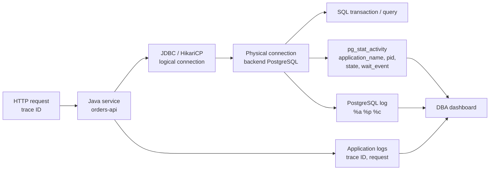

# Quan sát ứng dụng qua application_name và thông tin phiên trong PostgreSQL

Một cụm PostgreSQL phục vụ API đặt hàng, worker xử lý thanh toán, dịch vụ báo cáo và các tác vụ quản trị. Vào giờ cao điểm, số kết nối tăng, một số request chậm bất thường. Khi DBA truy vấn `pg_stat_activity`, tất cả các phiên đều đăng nhập bằng những tên role khá giống nhau, nhiều phiên đang ở trạng thái `idle`, vài phiên chờ khóa, và các câu SQL được cắt ngắn. Làm thế nào biết **ứng dụng nào** đang tạo kết nối, **phiên nào** đang chạy truy vấn, và **phiên nào** đang chặn một thao tác khác?

PostgreSQL có một cơ chế đơn giản nhưng rất hữu ích: tham số **`application_name`**. Ứng dụng có thể khai tên khi mở kết nối hoặc thay đổi trong phiên. PostgreSQL đưa nhãn này vào `pg_stat_activity` và có thể ghi vào log qua `log_line_prefix` với ký hiệu `%a`.

Ví dụ:

```text
application_name = orders-api/prod/writer
application_name = payment-worker/prod
application_name = reporting/prod/reader
application_name = dba-psql/maintenance
```

Nhờ tên ổn định và thống nhất, nhóm vận hành có thể trả lời những câu hỏi thực tế:

- Dịch vụ nào đang giữ nhiều kết nối nhất?
- Các phiên của `orders-api` đang chạy SQL hay chỉ đợi trong pool?
- Có transaction bị bỏ quên ở trạng thái `idle in transaction` không?
- Một truy vấn chậm là do I/O, CPU hay đang **chờ lock**?
- Có thể nối một dòng log PostgreSQL với đúng backend session không?
- Khi có PgBouncer, application_name mà PostgreSQL nhìn thấy là tên ứng dụng gốc hay tên pooler?
- Vì sao `application_name` **không thể** thay thế authentication, metrics có lịch sử hoặc distributed tracing?

Bài thuộc chương **Kết nối ứng dụng** trong PostgreSQL, đi từ cấu hình nhãn, cách đọc thông tin phiên, phân tích sự cố, đến ví dụ Java/PgJDBC và vận hành production. Tài liệu có SQL thực hành độc lập; những bước cần hai hoặc ba session được đánh dấu cụ thể.

> **Lưu ý bảo mật:** `application_name` là **metadata do client có thể khai báo/thay đổi**, không phải danh tính đã được xác thực. Không dùng nó làm căn cứ cấp quyền, nhận diện tenant hoặc quyết định một client có được vào database hay không.

## 1. Bức tranh: từ request đến backend session

Một request HTTP thường đi qua nhiều tầng:



**Ba định danh khác nhau:**

1. **Ứng dụng:** nhãn `application_name` mô tả nguồn hoặc nhóm workload, ví dụ `orders-api/prod`.
2. **Phiên database:** backend `pid` và những thông tin như `backend_start`, session ID trong log.
3. **Request/trace:** mã của một nghiệp vụ hoặc HTTP request, do hệ thống tracing/logging của ứng dụng quản lý.

Một ứng dụng có thể có **nhiều backend sessions**. Một backend session trong pool có thể phục vụ **nhiều requests nối tiếp nhau**. Vì thế, `application_name` rất hữu ích để phân nhóm **ứng dụng**, nhưng tự nó **không chứng minh** một dòng SQL thuộc HTTP request nào.

### 1.1. Từ ngữ cần phân biệt

| Thuật ngữ | Ý nghĩa trong bài |
| --- | --- |
| `application_name` | Tham số cấu hình dạng chuỗi gắn nhãn phiên, có thể thấy trong activity/log |
| `session/backend` | Kết nối phía server phục vụ client, có backend process tương ứng trong kiến trúc PostgreSQL thông thường |
| `pid` | Process ID của backend hiện tại; có thể được dùng lại sau khi process kết thúc |
| `pg_stat_activity` | View thông tin hoạt động phiên/process tại thời điểm quan sát |
| `connection pool` | Tập các physical connections được ứng dụng tái sử dụng |
| `transaction` | Phạm vi công việc với BEGIN/COMMIT/ROLLBACK, có thể ngắn hơn session |
| `query` | Một câu SQL đang hoặc vừa được backend xử lý |
| `wait_event` | Điều kiện mà backend đang đợi, nếu có |
| `log_line_prefix` | Mẫu bổ sung metadata vào dòng log PostgreSQL |

Không được xem các đối tượng này là một-một.

## 2. application_name là gì?

`application_name` là một tham số runtime của PostgreSQL mà client có thể cung cấp khi kết nối hoặc thay đổi sau đó.

Kiểm tra trong phiên đang mở:

```sql
SHOW application_name;
```

Hoặc:

```sql
SELECT current_setting('application_name') AS application_name;
```

Ví dụ kết quả:

```text
application_name
-------------------------
orders-api/prod/writer
```

PostgreSQL có thể hiển thị tên này tại:

- Cột `pg_stat_activity.application_name`.
- Dòng log khi `log_line_prefix` chứa `%a`.
- Những công cụ giám sát dựa trên thông tin session/backend.

### 2.1. Nhãn không phải tên role

So sánh:

```sql
SELECT
    current_user AS sql_role,
    session_user AS login_role,
    current_setting('application_name') AS app_label;
```

`current_user` và `session_user` liên quan danh tính/role SQL, có thể khác khi dùng `SET ROLE` hoặc security context. `application_name` là **nhãn riêng**.

Ví dụ nhiều ứng dụng sử dụng cùng role kỹ thuật `app_runtime`:

```text
role=app_runtime, application_name=orders-api/prod
role=app_runtime, application_name=payment-worker/prod
role=app_runtime, application_name=reporting/prod
```

Nhãn giúp quan sát, nhưng nếu chính sách quyền thực sự khác nhau, tốt hơn là **tách roles và privileges** thay vì chỉ tách nhãn.

### 2.2. Nhãn không phải hostname hay IP

`application_name='orders-api/prod'` không cho biết app chạy ở máy nào. Thông tin địa chỉ mạng nằm ở những trường khác, ví dụ `client_addr`.

Nếu app qua NAT hoặc proxy, PostgreSQL có thể thấy **IP của NAT/proxy**. Nhãn ứng dụng cũng có thể bị proxy thay đổi hoặc không được truyền tới backend như kỳ vọng.

### 2.3. Nhãn không phải tham số phân quyền

Không được làm:

```text
Nếu application_name = "trusted-admin" thì cho phép DELETE.
```

Client có thể thử tự đặt `application_name` như vậy. PostgreSQL dùng role, authentication, grants, policies và transaction rules cho việc kiểm soát truy cập; ứng dụng cũng phải kiểm tra authorization.

## 3. Đặt tên thế nào cho hữu ích?

Một quy ước dễ vận hành là:

```text
<service>/<environment>/<pool-or-role>
```

Ví dụ:

```text
orders-api/prod/writer
orders-api/prod/reader
payment-worker/prod
reporting/staging/reader
migration/prod
ops-psql/prod
```

Bạn có thể chọn dấu phân cách khác; quan trọng là **thống nhất, ngắn, có ý nghĩa và không chứa dữ liệu nhạy cảm**.

### 3.1. Nên chứa những gì?

- **Service:** API, worker, batch, scheduler hay CLI.
- **Environment:** prod/staging/dev, tránh gộp nhiều môi trường nếu cùng cụm database.
- **Pool/role của workload:** reader/writer, hoặc batch/realtime khi hữu ích.
- **Một mã phiên bản ngắn** chỉ khi có nhu cầu phân tích rollout và không khiến số lượng nhãn tăng vô hạn.

### 3.2. Không nên chứa những gì?

- Mật khẩu, JWT, API key, session cookie.
- Email, số điện thoại, họ tên hoặc nội dung truy vấn nhạy cảm.
- Mã khách hàng/tenant không được phép công bố trong giám sát.
- HTTP URL đầy đủ, query string hay request body.
- Request ID ngẫu nhiên cho **mỗi** SQL nếu làm phát sinh số lượng tên không giới hạn.
- Dữ liệu do người dùng nhập trực tiếp, chưa kiểm soát.

Nhãn có thể xuất hiện trong logs và màn hình DBA. Nó cần phù hợp với **chính sách bảo vệ dữ liệu**.

### 3.3. Giới hạn độ dài

Trong PostgreSQL build thông thường, `application_name` bị giới hạn bởi `NAMEDATALEN - 1` bytes (thường tối đa **63 bytes**). Chuỗi dài có thể bị cắt; ký tự UTF-8 có thể chiếm nhiều bytes.

Vì thế, hai chuỗi có tiền tố rất giống nhau nhưng khác ở cuối **có thể trở thành cùng một nhãn sau khi bị cắt**.

Ưu tiên tên ngắn, phần quan trọng đặt ở đầu:

```text
orders-api/prod/writer
```

thay vì một chuỗi dài chứa cả hostname, pod UID, release SHA, tenant và request ID.

## 4. Đặt application_name ngay khi kết nối

Cách tốt nhất cho nhãn **mặc định ổn định của một pool** thường là đặt ngay khi tạo physical connection, để PostgreSQL nhìn thấy tên từ đầu vòng đời phiên.

### 4.1. Qua libpq/psql bằng PGAPPNAME

Trong bash hoặc shell tương thích:

```bash
PGAPPNAME='ops-psql/staging' \
psql "host=db.internal.example port=5432 dbname=ordersdb user=report_ro"
```

`PGAPPNAME` là biến môi trường libpq cho giá trị `application_name` khi client tạo kết nối.

Kiểm tra sau khi đăng nhập:

```sql
SHOW application_name;
```

Tên host, database và role phía trên chỉ là ví dụ; cần có PostgreSQL server, quyền truy cập và authentication phù hợp.

### 4.2. Qua connection string libpq

Với cú pháp keyword/value của libpq, truyền trực tiếp giá trị chuỗi thông thường, không áp dụng URL encoding cho dấu `/`:

```bash
psql "host=db.internal.example port=5432 dbname=ordersdb user=report_ro application_name=ops-psql/staging"
```

Khi dùng **URI** thay vì keyword/value, các ký tự đặc biệt cần được encode theo quy tắc URI:

```text
postgresql://db.internal.example:5432/ordersdb?application_name=ops-psql%2Fstaging
```

Không đưa password thật lên command line vì có thể xuất hiện trong process listings hoặc shell history.

### 4.3. Qua JDBC connection properties

PgJDBC hỗ trợ property `ApplicationName`.

```java
import java.sql.Connection;
import java.sql.DriverManager;
import java.sql.PreparedStatement;
import java.sql.ResultSet;
import java.sql.SQLException;
import java.util.Properties;

public class JdbcApplicationNameDemo {
    public static void main(String[] args) throws SQLException {
        Properties properties = new Properties();
        properties.setProperty("user", System.getenv("DB_USER"));
        properties.setProperty("password", System.getenv("DB_PASSWORD"));
        properties.setProperty(
            "ApplicationName",
            "orders-api/staging/writer"
        );

        String url =
            "jdbc:postgresql://db.internal.example:5432/ordersdb";

        try (Connection connection =
                 DriverManager.getConnection(url, properties);
             PreparedStatement statement = connection.prepareStatement(
                 "SELECT current_setting('application_name'), pg_backend_pid()"
             );
             ResultSet rs = statement.executeQuery()) {

            if (rs.next()) {
                System.out.println("Application: " + rs.getString(1));
                System.out.println("Backend PID: " + rs.getInt(2));
            }
        }
    }
}
```

Đây là ví dụ kết nối; không chạy được nếu chưa có database/role/secret thật. Với môi trường production, credentials nên đến từ cơ chế quản lý secret phù hợp, không hardcode vào source.

### 4.4. Qua JDBC URL

Có thể dùng property ở query string của JDBC URL theo quy tắc PgJDBC:

```text
jdbc:postgresql://db.internal.example:5432/ordersdb?ApplicationName=orders-api%2Fstaging%2Fwriter
```

Các ký tự cần URL-encode trong query parameter phải được encode đúng. Khi cấu hình service thực, chọn **một nguồn cấu hình nhất quán**: URL, Properties hoặc DataSource properties; tránh đặt chồng nhiều nơi rồi không biết giá trị nào hiệu lực.

## 5. HikariCP: nhãn theo physical connection

Một ứng dụng Java thường dùng HikariCP hoặc pool tương tự. Hãy gắn nhãn khi pool tạo connection vật lý:

```java
import com.zaxxer.hikari.HikariConfig;
import com.zaxxer.hikari.HikariDataSource;

public final class DataSources {
    public static HikariDataSource createWriterPool() {
        HikariConfig config = new HikariConfig();

        config.setJdbcUrl(
            "jdbc:postgresql://db.internal.example:5432/ordersdb"
        );
        config.setUsername(System.getenv("DB_USER"));
        config.setPassword(System.getenv("DB_PASSWORD"));

        config.setMaximumPoolSize(12);
        config.setPoolName("orders-writer-pool");

        config.addDataSourceProperty(
            "ApplicationName",
            "orders-api/prod/writer"
        );

        return new HikariDataSource(config);
    }
}
```

Hai thuộc tính này **khác nhau**:

| Thuộc tính | Nơi thường quan sát | Ý nghĩa |
| --- | --- | --- |
| `config.setPoolName(...)` | HikariCP metrics/logs | Tên pool ở ứng dụng |
| PgJDBC `ApplicationName` | `pg_stat_activity.application_name`, PostgreSQL logs | Nhãn session ở server |

`PoolName` của HikariCP **không tự biến thành `application_name` của PostgreSQL**. Muốn đặt nhãn server phải cấu hình PgJDBC connection property tương ứng.

### 5.1. Tách pool reader và writer

Nếu kiến trúc có hai DataSources:

```text
orders-api/prod/reader
orders-api/prod/writer
```

giúp DBA xem số kết nối và truy vấn của hai loại workload riêng. Trong ứng dụng, pool reader và writer có thể có JDBC URLs, credentials và cơ chế routing khác nhau.

Chỉ **đặt nhãn khác nhau** không tạo quyền read-only. Role, grants, topology/replica routing và transaction semantics phải được thiết kế riêng.

### 5.2. Connection.close() không luôn đóng backend

Với pool:

```java
try (Connection connection = dataSource.getConnection()) {
    // Query...
}
```

`connection.close()` thường **trả connection logic về pool**. Physical connection tới PostgreSQL vẫn sống, và bạn thường thấy session tương ứng ở trạng thái `idle` trong `pg_stat_activity`.

Đây không nhất thiết là connection leak. Phải kết hợp với metrics **active/idle/waiting** phía pool.

### 5.3. Số kết nối có thể nhân theo số instance

Giả sử 20 pods, mỗi pod có tối đa 12 physical connections:

```text
20 pods × 12 connections/pod = tối đa 240 connections tới DB
```

Đây là **giới hạn lý thuyết từ phía các pool**, không phải lời khẳng định luôn có 240 sessions. Giới hạn thực tế còn phụ thuộc minimumIdle, nhu cầu, network, PgBouncer và connection limits của PostgreSQL.

Nhãn giúp nhóm sessions theo dịch vụ, nhưng không giảm số lượng connections. Nếu vượt khả năng server, cần xem pool sizing và connection architecture.

## 6. Thay application_name trong một phiên SQL

Một session đang mở có thể đặt nhãn:

```sql
SET application_name = 'ops-psql/staging';

SHOW application_name;
```

Giá trị mới được dùng cho thông tin phiên và logs liên quan sau khi setting có hiệu lực.

### 6.1. Giá trị session-level có thể sống lâu trong pool

Nếu một request thực hiện:

```sql
SET application_name = 'checkout-request';
```

rồi trả physical connection về pool **mà không reset**, request sau có thể mượn lại backend đang mang nhãn `checkout-request`.

Đó là lỗi **rò rỉ session state** trong connection pooling, khiến dashboard/log quy trách nhiệm sai workload.

Đặt một **nhãn ổn định từ lúc mở connection**. Chỉ thay đổi theo request khi hiểu rõ transaction scope và cách reset.

### 6.2. RESET application_name

```sql
RESET application_name;
```

đặt tham số về giá trị mặc định phù hợp với ngữ cảnh cấu hình session; không nên mặc định nó luôn khôi phục đúng **nhãn pool ban đầu** nếu có nhiều tầng startup/session settings.

Nếu cần biết giá trị ban đầu, nên giữ trong cấu hình pool và dùng cơ chế reset của pool/driver có kiểm soát. Khi chọn thiết kế, hạn chế thay session-level application_name ở các request bình thường.

### 6.3. Đặt bằng set_config

PostgreSQL có hàm:

```sql
SELECT set_config(
    'application_name',
    'ops-psql/staging',
    false
);
```

Tham số cuối:

- `false`: setting theo phạm vi **session** tương đương ý tưởng `SET`.
- `true`: setting **local cho transaction** phù hợp, tương tự `SET LOCAL`.

Cách gọi `set_config` có thể bind giá trị text từ JDBC thay vì ghép một câu `SET ... 'user_value'` bằng chuỗi.

## 7. SET LOCAL: nhãn cho một transaction

Khi cần gắn nhãn tạm cho một thao tác batch hoặc một đoạn nghiệp vụ, dùng:

```sql
BEGIN;

SET LOCAL application_name = 'orders-api/prod/reconcile';

-- Những câu SQL bên dưới chạy trong cùng transaction.
SELECT COUNT(*)
FROM pg_catalog.pg_class;

COMMIT;
```

Giá trị `SET LOCAL` chỉ hiệu lực trong transaction hiện tại và được hoàn nguyên khi transaction kết thúc theo semantics PostgreSQL.

### 7.1. SET LOCAL không phải nhãn cho toàn HTTP request

Một HTTP request có thể chạy **nhiều transaction** hoặc lấy connection khác nhau. `SET LOCAL` áp dụng cho **transaction cụ thể**, không tự theo request qua nhiều sessions.

Ví dụ:

```text
HTTP request
   |
   +-- Transaction A -> backend 101 -> SET LOCAL -> query A
   |
   +-- Transaction B -> backend 205 -> không tự kế thừa label A
```

Nếu muốn correlation theo request end-to-end, dùng **trace ID trong application tracing/logs**. `application_name` bổ sung thông tin database session, không thay hệ thống tracing.

### 7.2. Không dùng SET LOCAL ngoài transaction có chủ đích

Khi connection đang ở autocommit mode, gửi một `SET LOCAL` độc lập không bảo đảm setting tồn tại trong câu SQL kế tiếp; nó có thể hết hiệu lực ngay khi transaction ngầm của statement kết thúc.

Với JDBC, nếu muốn nhãn local dùng cho cả nghiệp vụ, phải chủ động kiểm soát transaction boundaries.

### 7.3. Đặt nhãn qua JDBC có bind

```java
import java.sql.Connection;
import java.sql.PreparedStatement;
import java.sql.ResultSet;
import java.sql.SQLException;
import javax.sql.DataSource;

public class ReconcileRepository {
    private final DataSource dataSource;

    public ReconcileRepository(DataSource dataSource) {
        this.dataSource = dataSource;
    }

    public long countOrders() throws SQLException {
        try (Connection connection = dataSource.getConnection()) {
            boolean previousAutoCommit = connection.getAutoCommit();
            connection.setAutoCommit(false);

            try {
                try (PreparedStatement tag = connection.prepareStatement(
                         "SELECT set_config('application_name', ?, true)"
                     )) {
                    tag.setString(1, "orders-api/prod/reconcile");
                    try (ResultSet ignored = tag.executeQuery()) {
                        ignored.next();
                    }
                }

                long count;
                try (PreparedStatement query = connection.prepareStatement(
                         "SELECT COUNT(*) FROM pg_catalog.pg_class"
                     );
                     ResultSet rs = query.executeQuery()) {
                    rs.next();
                    count = rs.getLong(1);
                }

                connection.commit();
                return count;
            } catch (SQLException | RuntimeException error) {
                connection.rollback();
                throw error;
            } finally {
                connection.setAutoCommit(previousAutoCommit);
            }
        }
    }
}
```

Ví dụ cho thấy **`set_config(..., true)` và truy vấn cần cùng một transaction trên cùng connection**. Câu `SELECT COUNT(*) FROM pg_catalog.pg_class` chỉ dùng để minh họa, không phải báo cáo đơn hàng thật.

Khi dùng trong dự án, còn cần xử lý timeout, business transaction và chính sách retry đúng. Đừng dùng logic riêng này như thay thế transaction manager của framework nếu project đã có Spring/JTA hoặc cơ chế tương ứng.

## 8. PostgreSQL biết phiên nào đang kết nối bằng cách nào?

Trong **chính session đang mở**, có thể chạy:

```sql
SELECT
    pg_backend_pid() AS backend_pid,
    current_database() AS database_name,
    current_user AS current_role,
    session_user AS login_role,
    current_setting('application_name') AS application_name,
    inet_client_addr() AS client_ip,
    inet_client_port() AS client_port,
    inet_server_addr() AS server_ip,
    inet_server_port() AS server_port,
    pg_postmaster_start_time() AS server_started_at;
```

Các trường:

- `pg_backend_pid()`: PID của backend xử lý session hiện tại.
- `current_database()`: database của connection.
- `current_user`: role đang hiệu lực cho kiểm tra quyền SQL.
- `session_user`: session authorization identity.
- `inet_client_addr()` / `inet_client_port()`: địa chỉ/port kết nối TCP từ client, nếu có.
- `inet_server_addr()` / `inet_server_port()`: endpoint server của kết nối TCP nếu có.
- `pg_postmaster_start_time()`: thời điểm server instance bắt đầu, **không phải** thời điểm connection bắt đầu.

### 8.1. Unix socket không có IP client

Khi client kết nối qua Unix-domain socket, `inet_client_addr()` thường là SQL `NULL`. Đó không tự có nghĩa “không biết client” hay “client bị ẩn bởi TLS”; socket local không có địa chỉ TCP client.

`client_port` trong `pg_stat_activity` có semantics riêng cho Unix sockets và các backend nội bộ; không dùng nó như HTTP port hoặc port public của app.

### 8.2. Source IP sau NAT/proxy

Nếu topology là:

```text
orders-api pod -> PgBouncer / NAT -> PostgreSQL
```

`inet_client_addr()` và `pg_stat_activity.client_addr` có thể hiển thị **PgBouncer hoặc egress IP**, không phải pod IP hay IP người dùng trình duyệt.

Muốn quy nguồn request, phải đối chiếu topology và các lớp logs khác nhau; đừng dùng IP DB client làm danh tính HTTP end user.

## 9. pg_stat_activity: view trung tâm của việc quan sát phiên

Câu truy vấn tổng quát:

```sql
SELECT
    a.pid,
    a.application_name,
    a.usename,
    a.datname,
    a.client_addr,
    a.backend_start,
    a.xact_start,
    a.query_start,
    a.state_change,
    a.state,
    a.wait_event_type,
    a.wait_event,
    left(a.query, 160) AS query_preview
FROM pg_stat_activity AS a
WHERE a.backend_type = 'client backend'
ORDER BY a.backend_start DESC, a.pid;
```

Đây là **ảnh chụp tại thời điểm truy vấn**. Nó không tự lưu lịch sử mọi SQL đã chạy từ lúc server bắt đầu.

### 9.1. Các cột định danh

| Cột | Ý nghĩa |
| --- | --- |
| `pid` | PID của process backend |
| `datname` | Database mà backend đang dùng |
| `usename` | Database role được trình bày cho session |
| `application_name` | Nhãn do client/session khai báo |
| `client_addr` | IP kết nối client nhìn từ PostgreSQL, có thể NULL |
| `client_hostname` | Hostname client nếu việc reverse DNS có dữ liệu/được cấu hình phù hợp |
| `client_port` | Port phía client cho kết nối TCP hoặc giá trị đặc biệt |
| `backend_type` | Loại backend, ví dụ `client backend`, background process |
| `backend_start` | Thời điểm backend process bắt đầu |

### 9.2. Các cột về công việc

| Cột | Ý nghĩa |
| --- | --- |
| `state` | Trạng thái hoạt động ở mức session/backend |
| `query` | Query đang chạy hoặc query gần nhất khi idle, trong giới hạn được phép xem |
| `query_start` | Thời điểm query hiện tại bắt đầu; khi không active thường là query trước gần nhất |
| `xact_start` | Thời điểm transaction hiện tại bắt đầu, có thể NULL |
| `state_change` | Thời điểm backend chuyển sang state hiện tại |
| `wait_event_type` | Loại chờ hiện tại nếu có |
| `wait_event` | Sự kiện cụ thể mà backend đang chờ nếu có |
| `backend_xid` | Transaction ID đang có của backend khi được gán |
| `backend_xmin` | Xmin horizon của backend khi có, liên quan quan sát vacuum |
| `query_id` | Query identifier khi PostgreSQL được cấu hình/hỗ trợ tính toán |

Một số cột và cách cung cấp có thể khác theo **major version** PostgreSQL. Trên hệ thống thật, xem schema view và đúng tài liệu phiên bản đang dùng.

### 9.3. Query text bị hạn chế

`a.query` có thể:

- Bị cắt theo `track_activity_query_size`.
- Không hiển thị đầy đủ vì quyền của role đang quan sát.
- Chứa SQL đang thực thi khi `state='active'`.
- Là **câu SQL cuối** khi session ở trạng thái idle.

Không coi đoạn `query_preview` là toàn bộ SQL đã thực thi; nó được cắt thêm thành 160 ký tự cho mục đích hiển thị.

## 10. Tạo dữ liệu thực hành

Để có các câu truy vấn mô phỏng workload ứng dụng, tạo schema riêng `obs_lab` trên database thực hành.

```sql
CREATE SCHEMA IF NOT EXISTS obs_lab;

CREATE TABLE obs_lab.orders (
    order_id bigint GENERATED ALWAYS AS IDENTITY PRIMARY KEY,
    tenant_id integer NOT NULL,
    status text NOT NULL CHECK (status IN ('paid', 'pending')),
    amount numeric(12, 2) NOT NULL CHECK (amount >= 0),
    created_at timestamptz NOT NULL
);

INSERT INTO obs_lab.orders (
    tenant_id, status, amount, created_at
)
SELECT
    (g % 4) + 1,
    CASE WHEN g % 3 = 0 THEN 'pending' ELSE 'paid' END,
    (g % 5000)::numeric / 100,
    TIMESTAMPTZ '2026-01-01 00:00:00+00'
        + (g % 60) * INTERVAL '1 day'
FROM generate_series(1, 1200) AS s(g);

CREATE INDEX idx_obs_orders_tenant_status
ON obs_lab.orders (tenant_id, status, created_at DESC);

ANALYZE obs_lab.orders;
```

Bảng có 1.200 hàng giả lập thuộc 4 tenants; nó dùng để học quan sát sessions và locks, **không phải benchmark độ lớn production**.

### 10.1. Query của một API

```sql
SELECT
    order_id, amount, created_at
FROM obs_lab.orders
WHERE tenant_id = 2
  AND status = 'paid'
ORDER BY created_at DESC, order_id DESC
LIMIT 20;
```

### 10.2. Query của một reporting worker

```sql
SELECT
    tenant_id,
    status,
    COUNT(*) AS order_count,
    SUM(amount) AS total_amount
FROM obs_lab.orders
GROUP BY tenant_id, status
ORDER BY tenant_id, status;
```

Khi quan sát live activity, cùng một SQL có thể xuất hiện dưới nhiều `application_name` tùy kết nối gửi nó.

## 11. Tạo hai sessions để thấy tên ứng dụng

Mở **hai terminal hoặc SQL connections** tới cùng PostgreSQL database học tập.

### Session A — API

```sql
SET application_name = 'orders-api/lab';

SELECT
    pg_backend_pid() AS pid,
    current_setting('application_name') AS app;

SELECT pg_sleep(15);
```

### Session B — Observer

```sql
SET application_name = 'ops-observer/lab';

SELECT
    pid,
    application_name,
    state,
    wait_event_type,
    wait_event,
    query_start,
    query
FROM pg_stat_activity
WHERE application_name = 'orders-api/lab';
```

Nếu Session B chạy **khi Session A vẫn đang ngủ**, bạn có thể thấy:

- `application_name='orders-api/lab'`.
- `state='active'`.
- `query` là `SELECT pg_sleep(15)`.
- `wait_event_type='Timeout'` và sự kiện chờ liên quan `PgSleep`.

Khi `pg_sleep` kết thúc, Session A có thể trở lại `idle`. `query` của một session idle có thể **vẫn hiển thị câu `SELECT pg_sleep(15)` là câu cuối**, chứ không có nghĩa nó còn đang chạy.

### 11.1. Tại sao dùng pg_sleep?

`pg_sleep` giữ câu SQL đang chạy đủ lâu để dễ quan sát từ session khác. Nó không phải đại diện tốt cho CPU-heavy hay I/O-heavy workload, vì bản chất của nó chủ yếu là chờ timeout.

Chỉ dùng khoảng chờ ngắn trên môi trường học tập; không tạo hàng trăm phiên `pg_sleep` để kiểm thử production.

### 11.2. Đừng quan sát session A bằng query của chính A rồi kỳ vọng thấy idle

Khi một session tự chạy `SELECT ... FROM pg_stat_activity WHERE pid=pg_backend_pid()`, tại thời điểm query ấy chạy, backend của chính nó đang **active**.

Dùng một observer connection khác nếu muốn biết trạng thái của session A **khi A không gửi query**.

## 12. Các trạng thái session quan trọng

`state` trong `pg_stat_activity` thường có các giá trị:

| State | Cách hiểu thực tế |
| --- | --- |
| `active` | Backend đang thực thi một query |
| `idle` | Backend đã hoàn tất command, đang đợi client gửi command mới |
| `idle in transaction` | Transaction đang mở, backend không thực thi query |
| `idle in transaction (aborted)` | Transaction đang mở nhưng đã lỗi, chờ client rollback/kết thúc |
| `fastpath function call` | Backend đang thực thi fast-path function call |
| `disabled` | Activity tracking cho backend không hoạt động/được tắt |

### 12.1. idle không mặc nhiên là lỗi

Một pool của Java giữ 8 physical connections, mới dùng 2, thì 6 backend `idle` có thể là **hành vi bình thường**. Pool giữ chúng để request tiếp theo không phải trả chi phí mở TCP/TLS/authentication.

Muốn tìm connection leak, cần kết hợp:

- Metrics của pool: active/idle/pending/acquire timeouts.
- Tổng số backend theo application_name.
- `backend_start`/`state_change`.
- Transaction age và tài nguyên đang giữ.
- Log lifecycle và retry patterns.

Không được tự đóng mọi session `idle` chỉ vì thấy chúng “không làm gì”.

### 12.2. idle in transaction nguy hiểm hơn

`idle in transaction` nghĩa transaction vẫn mở dù phiên không thực thi query. Nó có thể:

- Giữ locks lâu hơn cần thiết.
- Giữ snapshot/xmin trong những điều kiện phù hợp, cản trở vacuum cleanup.
- Làm tăng bloat hoặc gây chờ khóa ở sessions khác.
- Cho thấy ứng dụng quên commit/rollback hoặc đang chờ một thao tác mạng giữa transaction.

Cần ưu tiên điều tra những transaction **có tuổi lớn và ảnh hưởng thực**, không chỉ đếm trạng thái.

### 12.3. aborted transaction cần rollback

Một session `idle in transaction (aborted)` đã gặp lỗi trong transaction, rồi client chưa xử lý rollback.

Nó không phải chỉ một query chậm. Ứng dụng phải xử lý transaction error đúng cách; việc đổi `application_name` không sửa được trạng thái giao dịch.

## 13. query_start, xact_start và state_change khác nhau

Ba timestamp thường bị nhầm:

- `query_start`: query hiện tại bắt đầu khi `active`; khi không active thường ghi lần query gần nhất.
- `xact_start`: transaction hiện tại bắt đầu, hoặc NULL nếu không có transaction đang mở.
- `state_change`: thời điểm state hiện tại bắt đầu.

Ví dụ theo thời gian:

```text
10:00:00 BEGIN
10:00:01 UPDATE orders ...
10:00:02 UPDATE kết thúc; session idle in transaction
10:07:00 DBA xem pg_stat_activity

xact_start    ~ 10:00:00
query_start   ~ 10:00:01 (query trước gần nhất)
state_change  ~ 10:00:02
state         = idle in transaction
```

Một transaction như vậy đã tồn tại khoảng 7 phút, dù query UPDATE chỉ chạy 1 giây.

### 13.1. Query chạy lâu

```sql
SELECT
    pid,
    application_name,
    usename,
    datname,
    clock_timestamp() - query_start AS query_age,
    wait_event_type,
    wait_event,
    left(query, 240) AS query_preview
FROM pg_stat_activity
WHERE state = 'active'
  AND pid <> pg_backend_pid()
  AND query_start IS NOT NULL
ORDER BY query_age DESC;
```

**Điều kiện `state='active'` rất quan trọng.** Nếu bỏ nó, bạn có thể nhầm một session `idle` với “query chạy 2 giờ” chỉ vì `query_start` là thời điểm câu query cuối của session đó.

### 13.2. Transaction mở lâu

```sql
SELECT
    pid,
    application_name,
    usename,
    datname,
    state,
    clock_timestamp() - xact_start AS transaction_age,
    clock_timestamp() - state_change AS state_age,
    left(query, 160) AS last_or_current_query
FROM pg_stat_activity
WHERE xact_start IS NOT NULL
  AND pid <> pg_backend_pid()
ORDER BY xact_start;
```

Đây là danh sách để **điều tra**, không phải danh sách mọi session cần terminate. Một báo cáo read-only có transaction dài cũng cần xem isolation, snapshot/locks trước khi quyết định can thiệp.

### 13.3. Thời gian idle

```sql
SELECT
    pid,
    application_name,
    state,
    clock_timestamp() - state_change AS idle_duration,
    backend_start
FROM pg_stat_activity
WHERE state = 'idle'
  AND backend_type = 'client backend'
ORDER BY state_change;
```

`idle_duration` khác `connection_age`. Một connection sống nhiều giờ nhưng mới idle 2 giây là bình thường với pool.

### 13.4. clock_timestamp() và now()

Trong PostgreSQL:

- `now()`/`transaction_timestamp()` cố định theo thời điểm bắt đầu transaction hiện tại.
- `clock_timestamp()` đọc thời gian thực tại lúc gọi.

Đối với monitoring được chạy trong một transaction dài, `clock_timestamp()` có thể cho duration sát thời điểm quan sát hơn. Trên dashboard thời gian thực, không nên giữ một transaction của observer mở quá lâu.

## 14. Nhóm số kết nối theo application_name

Một truy vấn vận hành hữu ích:

```sql
SELECT
    COALESCE(
        NULLIF(application_name, ''),
        '<unset>'
    ) AS app,
    datname,
    usename,
    COUNT(*) AS total_connections,
    COUNT(*) FILTER (
        WHERE state = 'active'
    ) AS active_connections,
    COUNT(*) FILTER (
        WHERE state = 'idle'
    ) AS idle_connections,
    COUNT(*) FILTER (
        WHERE state LIKE 'idle in transaction%'
    ) AS idle_in_transaction_connections
FROM pg_stat_activity
WHERE backend_type = 'client backend'
GROUP BY
    COALESCE(NULLIF(application_name, ''), '<unset>'),
    datname,
    usename
ORDER BY total_connections DESC, app;
```

Ví dụ output *minh họa*, không phải kết quả cố định của lab:

| app | database | role | total | active | idle | idle in transaction |
| --- | --- | --- | ---: | ---: | ---: | ---: |
| orders-api/prod/writer | ordersdb | orders_api | 40 | 5 | 34 | 1 |
| reporting/prod | ordersdb | report_ro | 12 | 3 | 9 | 0 |
| payment-worker/prod | ordersdb | payment_worker | 8 | 1 | 6 | 1 |

### 14.1. Tại sao group theo cả database và role?

Một `application_name` có thể được đặt cùng chuỗi ở nhiều database hoặc roles. Nhóm chỉ theo app có thể che mất khác biệt:

- Pool reader trên replica vs pool writer trên primary.
- Role quyền ghi vs role chỉ đọc.
- Staging và production dùng chung cluster.
- Một batch job chạy nhiều database.

Cần chọn dimensions phù hợp với câu hỏi vận hành.

### 14.2. Nhãn rỗng hoặc thiếu quy ước

Không phải mọi client đều đặt tên. `application_name` có thể rỗng hoặc mang default của tool/driver.

`COALESCE(NULLIF(application_name,''),'<unset>')` chỉ chuẩn hóa cách hiển thị. Nó **không sửa nhãn ở session**.

Nếu nhiều sessions thuộc nhóm `<unset>`, cần sửa configuration của client/pool và kiểm tra các session mới, thay vì tự gán một tên “đoán” cho chúng trong dashboard.

## 15. Theo dõi pool saturation bằng dữ liệu PostgreSQL

Giả sử HikariCP metrics báo:

```text
active=12
idle=0
pending=27
max=12
```

Và PostgreSQL có 12 sessions mang `orders-api/prod/writer`.

Cách diễn giải:

- Pool đã dùng hết capacity physical connections của nó.
- Có 27 logical requests đang đợi **mượn connection**.
- DB có thể đang chạy query chậm, chờ lock hoặc đơn giản là những transactions quá lâu.
- `pg_stat_activity` giúp xem 12 backends làm gì, nhưng **không hiển thị trực tiếp 27 requests chưa lấy được connection**.

Đây là điểm then chốt: **pool waiting queue nằm ở ứng dụng**, không nhất thiết có backend row tương ứng trong PostgreSQL.

### 15.1. Kết hợp hai lớp metrics

| Câu hỏi | Nguồn quan sát |
| --- | --- |
| Bao nhiêu Java threads/requests đang đợi connection? | HikariCP/pool metrics |
| Có bao nhiêu backend đang kết nối? | `pg_stat_activity` |
| Những backend đó đang làm gì? | `state`/`wait_event`/`query` |
| Query nào tốn thời gian tổng cộng? | `pg_stat_statements` khi được bật |
| Request nào đang chậm? | Application tracing/logs |
| Query có bị khóa không? | `pg_blocking_pids()`, `pg_locks` |
| Kết nối tới từ đâu? | `client_addr`, topology network, pooler logs |

Không có một view duy nhất giải quyết mọi câu hỏi.

### 15.2. Pool lớn hơn không luôn tốt hơn

Khi nhiều requests chờ connection, tăng pool từ 12 lên 80 có thể gây quá tải PostgreSQL nếu bottleneck là CPU/I/O/lock contention. Trước khi tăng, cần đo:

- Số concurrent transactions hữu ích.
- Query latency và lock wait.
- DB CPU/memory/I/O.
- Số pods × pool size.
- `max_connections` và reserved connections.
- Pool acquisition timeouts.

`application_name` giúp **gắn trách nhiệm cho nguồn kết nối**, không thay bài toán capacity planning.

## 16. wait_event_type và wait_event cho biết điều gì?

`state='active'` không có nghĩa backend luôn đang dùng CPU. Một active backend có thể đang **chờ**.

Các trường:

- `wait_event_type`: nhóm sự kiện, như `Lock`, `IO`, `Client`, `Timeout`, `LWLock`... tùy phiên bản/trường hợp.
- `wait_event`: tên sự kiện cụ thể trong nhóm đó.

Ví dụ khi đang `pg_sleep`, có thể thấy `Timeout/PgSleep`.

### 16.1. Active nhưng chờ lock

```text
state=active
wait_event_type=Lock
wait_event=transactionid
```

là một khả năng thường gặp khi UPDATE phải chờ transaction khác. Nhưng đây chỉ là **ví dụ**; loại lock và wait event cụ thể có thể khác theo SQL/đối tượng.

### 16.2. Active nhưng không có wait_event

`wait_event_type IS NULL` không tự chứng minh query đang dùng 100% CPU. Nó chỉ cho biết backend không báo một wait event ở **thời điểm quan sát**.

Muốn phân tích CPU, I/O hoặc mạng, cần thêm metrics hệ điều hành, PostgreSQL statistics và kế hoạch SQL.

### 16.3. Client wait là gì?

Một backend có thể chờ client gửi command tiếp theo hoặc đọc/ghi dữ liệu qua socket. Không phải mọi `Client` wait đều là lỗi database; có thể là request đang gửi/đọc kết quả, network chậm hoặc session idle.

Luôn đọc **`state` cùng `wait_event`**, thay vì chỉ nhìn một trường.

## 17. Thử nghiệm chờ khóa với ba sessions

Để học cách nối `application_name` với blocker/waiter, dùng hai sessions ghi và một session observer.

### Session A — giữ transaction và row lock

```sql
SET application_name = 'orders-api/lab/blocker';

BEGIN;

UPDATE obs_lab.orders
SET amount = amount + 1
WHERE order_id = 1;

-- Giữ transaction mở để tái hiện lock wait.
-- KHÔNG COMMIT cho tới khi Session B bắt đầu UPDATE.
```

Khi `UPDATE` xử lý hàng `order_id=1`, transaction giữ khóa phù hợp cho đến khi COMMIT/ROLLBACK.

### Session B — cố UPDATE cùng hàng

```sql
SET application_name = 'payment-worker/lab/waiter';

SET lock_timeout = '20s';

UPDATE obs_lab.orders
SET amount = amount + 2
WHERE order_id = 1;
```

Nếu A chưa kết thúc transaction, B có thể chờ. Sau 20 giây, `lock_timeout` có thể làm statement B lỗi nếu vẫn chưa lấy được khóa. Đây là cách tránh treo lab vô hạn.

### Session C — quan sát

```sql
SET application_name = 'ops-observer/lab';

SELECT
    pid,
    application_name,
    state,
    wait_event_type,
    wait_event,
    pg_blocking_pids(pid) AS blocking_pids,
    left(query, 180) AS query_preview
FROM pg_stat_activity
WHERE application_name LIKE '%/lab/%'
ORDER BY application_name, pid;
```

Bạn có thể thấy `payment-worker/lab/waiter` đang chờ, và `pg_blocking_pids(pid)` chứa PID của Session A.

### 17.1. Kết thúc thử nghiệm đúng cách

Tại Session A:

```sql
ROLLBACK;
```

Sau đó Session B có thể hoàn thành UPDATE nếu chưa timeout. Nếu muốn không giữ thay đổi dữ liệu lab, hãy chạy B trong transaction riêng và ROLLBACK (bài này dùng autocommit mặc định nên một UPDATE thành công có thể được commit). Có thể khôi phục dữ liệu lab hoặc tạo lại trên schema thử nghiệm.

Tại Session B:

```sql
RESET lock_timeout;
```

Đừng để một session học tập giữ transaction mở lâu sau khi bài thực hành kết thúc.

## 18. Liệt kê blocking sessions kèm application_name

Một query thực tế:

```sql
SELECT
    waiting.pid AS waiting_pid,
    waiting.application_name AS waiting_app,
    waiting.usename AS waiting_role,
    waiting.state AS waiting_state,
    waiting.wait_event_type,
    waiting.wait_event,
    blocker.pid AS blocking_pid,
    blocker.application_name AS blocking_app,
    blocker.usename AS blocking_role,
    blocker.state AS blocking_state,
    blocker.xact_start AS blocking_xact_start,
    left(waiting.query, 180) AS waiting_sql,
    left(blocker.query, 180) AS blocking_last_or_current_sql
FROM pg_stat_activity AS waiting
CROSS JOIN LATERAL
    unnest(pg_blocking_pids(waiting.pid)) AS b(blocking_pid)
JOIN pg_stat_activity AS blocker
    ON blocker.pid = b.blocking_pid
ORDER BY waiting.pid, blocker.pid;
```

Kết quả cho bạn biết **ai đang đợi ai**, gắn nhãn app cho mỗi phía.

### 18.1. Blocker có thể đang idle in transaction

Một tình huống:

```text
waiting_app=payment-worker/lab/waiter, waiting_state=active
blocking_app=orders-api/lab/blocker, blocking_state=idle in transaction
```

Ở thời điểm observer xem, blocker đã hoàn thành UPDATE và đang chờ client gửi COMMIT/ROLLBACK. **Câu UPDATE không còn active**, nhưng transaction vẫn giữ lock.

Đừng chỉ tìm active queries rồi kết luận “không có ai chặn”.

### 18.2. pg_blocking_pids() tốt hơn tự đoán từ pg_locks

Có thể kiểm tra `pg_locks`, nhưng tự viết join blocker/waiter dễ bỏ sót hàng đợi lock hoặc xử lý sai “soft blockers”.

`pg_blocking_pids()` phản ánh các backend đang chặn tại thời điểm quan sát theo cơ chế PostgreSQL; dùng nó làm điểm khởi đầu cho phân tích blocking chains.

Có những trường hợp đặc biệt như prepared transactions khiến PID trong kết quả cần diễn giải riêng (ví dụ PID 0), nên một join đơn giản với `pg_stat_activity` không thể hiển thị mọi loại blocker. Khi gặp kết quả thiếu, mở rộng điều tra `pg_locks` và prepared transactions.

## 19. pg_locks bổ sung điều gì?

`pg_stat_activity` mô tả backend. `pg_locks` cho biết các lock được giữ hoặc đang chờ.

```sql
SELECT
    a.pid,
    a.application_name,
    a.state,
    l.locktype,
    l.mode,
    l.granted,
    l.relation::regclass AS relation_name,
    l.transactionid
FROM pg_locks AS l
JOIN pg_stat_activity AS a
    ON a.pid = l.pid
WHERE a.application_name LIKE '%/lab/%'
ORDER BY a.pid, l.granted, l.locktype, l.mode;
```

Những cột:

- `locktype`: loại đối tượng/định danh lock.
- `mode`: chế độ lock.
- `granted`: đã được cấp hay đang chờ.
- `relation`: OID của relation khi lock liên quan relation, có thể NULL.
- `transactionid`: transaction ID khi lock liên quan.

Một lệnh UPDATE có thể giữ nhiều loại lock; không phải mỗi hàng được cập nhật đều hiện lên như một row-lock riêng trong `pg_locks`.

### 19.1. Không tự kill blocker đầu tiên thấy được

Một blocker có thể đang bảo vệ transaction hợp lệ, ví dụ ghi sổ kế toán. Kết thúc nó gây rollback và có thể làm hệ thống ứng dụng retry/double-submit nếu không có idempotency.

Runbook đúng là xác định:

1. Query và transaction age.
2. `application_name`, role và source.
3. Business operation/owner.
4. Lock chain và mức ảnh hưởng.
5. Có phương án tự kết thúc từ ứng dụng không.
6. Chỉ khi cần mới cân nhắc cancel/terminate theo quyền và quy trình vận hành.

## 20. Đọc các phiên idle in transaction theo ứng dụng

Một query điều tra nhanh:

```sql
SELECT
    pid,
    application_name,
    usename,
    datname,
    client_addr,
    clock_timestamp() - xact_start AS xact_age,
    clock_timestamp() - state_change AS idle_state_age,
    backend_xmin,
    left(query, 220) AS last_query
FROM pg_stat_activity
WHERE state LIKE 'idle in transaction%'
  AND xact_start IS NOT NULL
ORDER BY xact_start;
```

Các câu hỏi nên trả lời:

- Phiên nào có transaction lâu nhất?
- Nó thuộc service/pool nào?
- Nó giữ `backend_xmin` có thể ảnh hưởng vacuum không?
- Nó có đang chặn backend khác không?
- `query` cuối là gì, và application logs có nói transaction đang chờ mạng/HTTP không?

### 20.1. Backend xmin và vacuum

Một transaction/snapshot tồn tại lâu có thể giữ lại khả năng nhìn những phiên bản hàng cũ, cản trở cleanup theo MVCC. `backend_xmin` là một tín hiệu cần xem cùng các hệ thống như replication slots/prepared transactions.

**Không phải mọi `idle in transaction` đều có `backend_xmin` như nhau**, và không phải mọi vấn đề vacuum đến từ user sessions. Dùng thêm thống kê vacuum/bloat và snapshot retention khi điều tra sâu.

### 20.2. Cấu hình timeout phù hợp

Các tham số PostgreSQL có thể giúp chặn transaction bị bỏ quên:

- `idle_in_transaction_session_timeout`: kết thúc session sau thời gian idle trong transaction theo cấu hình.
- `statement_timeout`: giới hạn thời gian chạy câu lệnh.
- `lock_timeout`: giới hạn thời gian chờ lock.
- `idle_session_timeout`: kết thúc session idle ngoài transaction, cần cân nhắc với poolers.

Ví dụ **chỉ trong session lab**:

```sql
SET idle_in_transaction_session_timeout = '30s';
SET statement_timeout = '20s';
SET lock_timeout = '5s';
```

Thay đổi timeout ở production cần xem SLO, độ dài giao dịch hợp lệ, driver retry/pool behavior. `idle_session_timeout` có thể gây gián đoạn pool giữ các idle connections bình thường.

## 21. pg_stat_activity không phải lịch sử truy vấn

Một observer chạy:

```sql
SELECT * FROM pg_stat_activity;
```

chỉ lấy **trạng thái hiện tại**. Một SQL hoàn thành trong 3 ms có thể không bao giờ được nhìn thấy bởi dashboard lấy mẫu mỗi 5 giây.

### 21.1. Những điều pg_stat_activity có thể làm tốt

- Biết ai đang kết nối.
- Biết query nào đang active tại thời điểm quan sát.
- Phân nhóm workload theo application_name.
- Tìm transaction age bất thường.
- Xem wait events và blockers.
- Xác định connection source/role/database.

### 21.2. Những điều nó không tự cung cấp

- Lịch sử đầy đủ mọi SQL đã chạy.
- p95/p99 latency của từng API.
- Các bound parameter values của mọi PreparedStatement.
- Số request HTTP mà một backend đã phục vụ.
- Lỗi SQL trong quá khứ nếu session đã ngắt.
- Tập kết quả query trước đó.
- Phân quyền business của người dùng ứng dụng.

Để có dữ liệu dài hạn, cần logs, metrics, traces hoặc extension phù hợp.

### 21.3. Observer có thể nhìn chính nó

`pg_stat_activity` thường chứa session observer hiện tại. Khi đang chạy câu SELECT monitoring, phiên ấy có thể hiện `active`.

Nếu cần loại bỏ:

```sql
WHERE pid <> pg_backend_pid()
```

Với query nhóm toàn hệ thống, có thể tách riêng các observer sessions bằng application_name và role phù hợp.

## 22. query_id và pg_stat_statements: không phải nhãn ứng dụng

Trong các phiên bản hỗ trợ, `pg_stat_activity.query_id` có thể chứa một query identifier nếu tính năng query ID được bật/phù hợp.

```sql
SELECT
    pid,
    application_name,
    query_id,
    state,
    left(query, 120) AS query_preview
FROM pg_stat_activity
WHERE backend_type = 'client backend';
```

Nhưng `query_id` có thể NULL hoặc không sẵn theo cấu hình/phiên bản.

### 22.1. pg_stat_statements dùng để làm gì?

Extension `pg_stat_statements` cung cấp thống kê tổng hợp query patterns theo database/user/query identifier và các metrics liên quan tùy phiên bản:

- Số lần gọi.
- Tổng/trung bình execution time.
- Số rows.
- Buffer/I/O statistics khi được hỗ trợ.
- Planning statistics tùy cấu hình.

Nó hữu ích để tìm SQL tốn nhiều tài nguyên và regressions.

### 22.2. Không mặc định group pg_stat_statements theo application_name

**`pg_stat_statements` không có dimension application_name chuẩn để nhóm mọi calls theo tên app một cách trực tiếp.**

Một query fingerprint có thể được chạy từ nhiều services. Nếu muốn đo riêng theo service, có thể cần:

- Metrics/tracing ở application layer.
- PostgreSQL logs chứa `%a` cùng query/duration.
- Kết nối và role/database được thiết kế phân biệt.
- Công cụ observability có correlation metadata riêng.

Đừng join `pg_stat_statements` với `pg_stat_activity` qua query ID rồi giả định thu được **toàn bộ lịch sử calls đúng theo app**. `pg_stat_activity` chỉ là phiên hiện tại, trong khi `pg_stat_statements` tổng hợp qua thời gian.

### 22.3. query_id không phải business trace ID

Query ID có thể đại diện cho **mẫu truy vấn**, không phải một request duy nhất. Hai requests khác nhau có thể chạy cùng query ID. Hãy giữ request/trace ID ở hệ thống tracing.

## 23. Log PostgreSQL: hiển thị application_name bằng %a

Một cấu hình `log_line_prefix` ví dụ:

```text
log_line_prefix = '%m [%p] %c %u@%d app=%a client=%h '
```

Ý nghĩa các placeholder:

| Token | Nội dung |
| --- | --- |
| `%m` | Timestamp log kèm milliseconds |
| `%p` | Process ID |
| `%c` | Session ID trong log, hữu ích khi PID được dùng lại |
| `%u` | User/role name |
| `%d` | Database name |
| `%a` | `application_name` |
| `%h` | Client host/IP khi có |
| `%r` | Remote host/IP và remote port |

Ví dụ log *minh họa*:

```text
2026-11-14 10:30:00.123 +07 [24567] 6736abc0.5ff7 orders_api@ordersdb app=orders-api/prod/writer client=10.42.10.5 LOG: duration: 613.442 ms statement: SELECT ...
```

Đừng suy PID `24567` là định danh duy nhất vĩnh viễn. PostgreSQL có thể tái sử dụng process IDs sau khi backend kết thúc. `%c`/`backend_start` và timestamp giúp correlation đáng tin hơn.

### 23.1. Những log settings liên quan

Tùy yêu cầu quan sát:

```text
log_connections = on
log_disconnections = on
log_min_duration_statement = 500ms
log_lock_waits = on
```

Đây là **mẫu cấu hình dành cho DBA**, không phải SQL đặt trực tiếp trong một query ứng dụng; tùy tham số có thể cấu hình qua file, ALTER SYSTEM hoặc các cơ chế nhà cung cấp và cần reload/restart tương ứng.

- `log_connections`/`log_disconnections` giúp xem lifecycle kết nối, nhưng tăng log volume.
- `log_min_duration_statement` ghi những câu SQL vượt ngưỡng, cần cân nhắc dữ liệu nhạy cảm.
- `log_lock_waits` kết hợp với cấu hình `deadlock_timeout` để ghi nhận một số lock waits kéo dài.
- Mẫu `log_line_prefix` cho phép tìm theo `app=...` và backend/session.

Không tự bật `log_statement=all` ở production chỉ để “xem mọi query” mà chưa đánh giá chi phí, quyền truy cập log và nguy cơ lộ dữ liệu.

### 23.2. application_name có thể bị client sửa

Nếu ứng dụng đặt tên sai, log cũng gắn sai nhãn. Vì vậy `%a` là **metadata quan sát**, không phải bằng chứng pháp lý chắc chắn về nguồn gốc hay là đầu vào cho authorization.

Role, client addr, TLS/certificate và application logs cần được dùng cùng nhau khi sự cố đòi bằng chứng tốt hơn.

### 23.3. Log line và SQL text có thể chứa dữ liệu nhạy cảm

Tùy cấu hình, một số logs có thể chứa query text, parameters hoặc error details. Đừng copy toàn bộ production logs vào issue công khai. Áp dụng retention, redaction, access control và chỉ thu thập những thông tin thực sự cần điều tra.

## 24. Kết hợp log PostgreSQL và Java tracing

Ví dụ một request trong application log:

```text
trace_id=4ac8... service=orders-api action=checkout
db_pool=writer db_backend_pid=24567 db_duration_ms=612
```

Và dòng PostgreSQL log:

```text
[24567] ... app=orders-api/prod/writer duration: 610 ms ...
```

Sự kết hợp có thể giúp điều tra, nhưng cần lưu ý:

- Backend PID có thể được dùng lại sau khi session đóng.
- Một connection có thể được dùng bởi nhiều HTTP requests **nối tiếp**.
- Một request có thể dùng nhiều connections.
- Timestamp ở hai host có thể lệch nếu đồng hồ không được đồng bộ.
- Log sampling và SQL truncation có thể làm thiếu dữ liệu.
- `application_name` không chứa trace ID mặc định.

### 24.1. Cách cải thiện correlation

- Dùng distributed tracing ở Java service và trong database client instrumentation.
- Ghi pool name, query operation name, duration và trace ID ở application layer.
- Khi cần, lấy `pg_backend_pid()` **trong cùng physical connection** với công việc cần correlate.
- Trong PostgreSQL logs, dùng `%a`, `%p` và `%c` để có thông tin session.
- Đặt application_name ổn định theo service/pool, không cố nhét tất cả metadata request vào một trường 63 bytes.

### 24.2. Vì sao không đặt request ID liên tục vào application_name?

Nếu mỗi request đổi nhãn:

```text
orders-api/prod/trace=...random...
```

thì:

- Nhãn bị giới hạn độ dài, có thể bị cắt.
- Dashboards nhóm theo app có high-cardinality rất lớn.
- Session-level SET có thể rò nhãn sang request sau trong pool.
- Log rất khó tổng hợp.
- Với transaction pooling, nhãn có thể không gắn với backend như bạn tưởng.

Khi một workflow thật sự cần nhãn theo operation, dùng **SET LOCAL trong transaction** và giá trị ổn định như `orders-api/prod/checkout` thay vì một UUID ngẫu nhiên cho mỗi request.

## 25. pg_stat_ssl: session hiện tại có mã hóa TLS không?

Nếu hệ thống có yêu cầu mã hóa kết nối, có thể xem:

```sql
SELECT
    a.pid,
    a.application_name,
    a.usename,
    a.datname,
    a.client_addr,
    s.ssl,
    s.version AS tls_version,
    s.cipher
FROM pg_stat_activity AS a
LEFT JOIN pg_stat_ssl AS s
    ON s.pid = a.pid
WHERE a.backend_type = 'client backend'
ORDER BY a.application_name, a.pid;
```

Trong một session:

```sql
SELECT
    ssl,
    version AS tls_version,
    cipher
FROM pg_stat_ssl
WHERE pid = pg_backend_pid();
```

`ssl=true` cho biết backend connection đang dùng SSL/TLS theo thống kê server.

### 25.1. TLS không đồng nghĩa application_name đáng tin

Một client qua TLS vẫn có thể đặt:

```text
application_name = trusted-admin
```

Nhãn này không chứng minh danh tính. Việc xác thực role, client certificate hay password thuộc cơ chế authentication/`pg_hba.conf` riêng.

### 25.2. Server-side TLS không nói client đã verify hostname

`pg_stat_ssl.ssl=true` không chứng minh client đặt `sslmode=verify-full` hoặc đã kiểm tra đúng server identity. Để xác nhận điều đó, cần kiểm tra cấu hình client/trust store/certificate chain theo policy.

### 25.3. GSSAPI encryption là nhánh khác

Với những hệ thống dùng GSSAPI, PostgreSQL có thống kê như `pg_stat_gssapi` tùy version/config. Không đồng nhất “không dùng SSL” với “không có một cơ chế mã hóa nào” khi GSS encryption được triển khai.

## 26. Quyền nhìn thấy thông tin của các sessions khác

Không phải mọi database role được quyền xem đầy đủ `query` và chi tiết của mọi session khác.

Với role thông thường, PostgreSQL có thể giới hạn các cột thông tin nhạy cảm của những backends thuộc role khác. Một số thuộc tính chung vẫn hiển thị, nhưng query text/state có thể bị hạn chế.

### 26.1. Role giám sát chuyên dụng

Những role dựng sẵn liên quan:

- `pg_read_all_stats`: cho khả năng đọc thêm thông tin thống kê, bao gồm các phần activity bị hạn chế.
- `pg_monitor`: role tổng hợp nhiều quyền quan sát, rộng hơn một số nhu cầu cụ thể.

Trong môi trường phù hợp, DBA có thể:

```sql
-- Chỉ DBA có quyền thực hiện và sau khi review nhu cầu.
GRANT pg_read_all_stats TO observability_reader;
```

Đây là ví dụ **cấp quyền nhạy cảm**: query text và state có thể làm lộ nội dung SQL, tên đối tượng hoặc thông tin nghiệp vụ. Không cấp `pg_monitor` cho mọi application role chỉ để làm dashboard.

### 26.2. Không chạy monitor bằng superuser nếu không cần

Một dashboard chỉ xem số connection và lock waits thường không cần dùng login superuser. Hãy thiết kế dedicated monitoring role và grants nhỏ nhất theo nhu cầu.

### 26.3. Khi một session không thấy query text

Đừng kết luận database không chạy query chỉ vì `query` rỗng/ẩn. Có thể là:

- Khác role và thiếu stats privilege.
- Activity tracking bị tắt.
- Query text bị cắt hoặc không sẵn.
- Backend đã kết thúc.
- Bạn đang quan sát sai server/replica.
- Query quá ngắn nên snapshot không bắt được.

Phân biệt quyền với tình trạng hệ thống trước khi chẩn đoán.

## 27. track_activities và query text size

`pg_stat_activity` dựa vào cơ chế thống kê hoạt động của PostgreSQL. Hai thiết lập quan trọng:

```sql
SHOW track_activities;
SHOW track_activity_query_size;
```

- `track_activities` điều khiển việc theo dõi query/activity trong mỗi session.
- `track_activity_query_size` giới hạn số bytes dành cho **query text** trong activity reporting; thay đổi thường đòi server restart vì thuộc loại thiết lập ở server start.

### 27.1. Query text dài có thể bị cắt

Một SQL statement dài hàng chục KB có thể chỉ hiển thị phần đầu trong `pg_stat_activity.query`. Khi đó, `left(query,160)` còn cắt ngắn thêm lần nữa.

Không dùng query text trong activity view làm kho lưu trữ câu SQL đầy đủ. Với truy vấn thường xuyên, giữ SQL trong source/migration repository của ứng dụng và dùng query IDs/instrumentation để tra cứu.

### 27.2. Stats snapshot có thể làm quan sát bị cũ

Trong một transaction giám sát lâu, một số thống kê có cơ chế snapshot/cache theo cấu hình và version. Khi thấy số liệu không thay đổi theo mong đợi, hãy kiểm tra `stats_fetch_consistency` và cơ chế statistics snapshot.

PostgreSQL có `pg_stat_clear_snapshot()` cho những tình huống muốn loại snapshot thống kê cache trong transaction. Tuy nhiên, dashboard realtime thường nên dùng **queries/transactions ngắn** thay vì giữ một transaction monitor mở nhiều phút.

## 28. PgBouncer ảnh hưởng application_name thế nào?

Topology:

```text
orders-api A  --\
orders-api B  --- PgBouncer ---> PostgreSQL backend 12345
reporting C   --/
```

Trong transaction pooling, một backend PostgreSQL có thể lần lượt phục vụ transactions của nhiều client connections.

### 28.1. Session pooling

Ở session pooling, một client-side connection thường gắn với một server-side connection trong vòng đời client session. `application_name` có thể được truyền/quản lý tương ứng, nhưng phải xác minh cấu hình thực tế của pooler.

### 28.2. Transaction pooling

Với transaction pooling, client và server sessions không có ánh xạ cố định qua nhiều transactions. PgBouncer có cơ chế theo dõi/đồng bộ một số startup parameters, trong đó có `application_name` theo khả năng phiên bản và cấu hình.

Vì vậy:

- Không mặc định PostgreSQL luôn nhìn thấy app gốc ở mọi tình huống.
- Không mặc định mọi `SET application_name` của ứng dụng sẽ tồn tại đúng như kết nối trực tiếp.
- Không phụ thuộc một server backend PID bất biến xuyên transactions của app.
- Kiểm thử thực tế `application_name`, role, client_addr và application logs trong **pool mode đúng đang dùng**.

### 28.3. Server thường thấy IP của pooler

`pg_stat_activity.client_addr` ở PostgreSQL có thể là địa chỉ PgBouncer, không phải địa chỉ app.

Nếu muốn biết mỗi app client thực sự đang chờ/kết nối thế nào, dùng **PgBouncer admin metrics/views** và application pool metrics, kết hợp PostgreSQL observations.

### 28.4. Transaction-scoped tagging và pooling

`SET LOCAL application_name` là một cơ chế transaction-scoped. Nhưng để đạt đúng nhãn, lệnh SET LOCAL và query cần chạy **trong cùng transaction** trên backend được pooler cấp, đồng thời phải phù hợp với cách pooler quản lý startup/session parameters.

Không gửi `SET LOCAL` độc lập trong autocommit rồi giả định query tiếp theo ở một backend khác sẽ mang nhãn cũ.

## 29. Nhiều instances cùng ứng dụng

Giả sử `orders-api` chạy 50 replicas. Mỗi instance đặt:

```text
application_name=orders-api/prod/writer
```

Khi group `pg_stat_activity`, bạn thấy tổng số connections của cả dịch vụ. Đây thường là mục tiêu tốt.

Nếu cần phân biệt replica nào:

- Xem `client_addr` khi topology giữ IP riêng ổn định.
- Dùng metrics/app logs với pod/instance ID.
- Nếu thực sự cần trong DB, có thể thêm **một mã instance ngắn** và vẫn giữ service ở đầu.
- Tránh phát sinh hàng nghìn nhãn tạm theo từng request.

### 29.1. Ví dụ giới hạn số lượng phiên theo app

Một system có thể có:

```text
orders-api/prod/writer: 150 sessions
payment-worker/prod: 20 sessions
reporting/prod: 8 sessions
```

Từ đó, điều tra:

1. Số replicas và max pool size của từng service.
2. Tỷ lệ active/idle.
3. Có bao nhiêu transaction đang mở.
4. Tần suất connection churn.
5. Có nhiều sessions gắn nhãn cũ sau rollout không.

Không kết luận `orders-api` “rò rỉ 150 connections” nếu 50 replicas mỗi replica cần 3 idle connections hợp lệ. Cần xem kỳ vọng cấu hình.

### 29.2. Phát hiện tên application cũ sau deployment

```sql
SELECT
    application_name,
    MIN(backend_start) AS oldest_connection,
    MAX(backend_start) AS newest_connection,
    COUNT(*) AS connections
FROM pg_stat_activity
WHERE backend_type = 'client backend'
  AND application_name LIKE 'orders-api/%'
GROUP BY application_name
ORDER BY oldest_connection;
```

Nếu nhãn chứa release version, có thể phát hiện sessions từ release cũ còn sống. Nhưng một nhãn phiên bản tự đặt cũng không thay thế deployment inventory hoặc readiness checks.

## 30. Quan sát lỗi connection storm

Một sự cố có thể xảy ra:

1. Database restart hoặc failover.
2. Hàng trăm app pods cùng reconnect.
3. Mỗi pool cố mở tối đa physical connections.
4. PostgreSQL tăng số backends rất nhanh.
5. CPU/TLS/authentication và connection limit trở thành bottleneck.

`application_name` giúp nhóm ai đang mở connections:

```sql
SELECT
    COALESCE(NULLIF(application_name,''), '<unset>') AS app,
    COUNT(*) AS sessions,
    MIN(backend_start) AS oldest,
    MAX(backend_start) AS newest
FROM pg_stat_activity
WHERE backend_type = 'client backend'
GROUP BY COALESCE(NULLIF(application_name,''), '<unset>')
ORDER BY sessions DESC;
```

### 30.1. Không chỉ nhìn số backend

Cần xem cả:

- Hikari acquisition wait/connection creation metrics.
- App retry backoff, jitter và reconnect storm.
- PostgreSQL `max_connections` và resource limits.
- PgBouncer pool settings nếu có.
- Network/TLS/SSL handshake overhead.
- Connection lifetime và maxLifetime distribution.
- Health checks có mở connection quá thường xuyên không.

Tăng `max_connections` mà không kiểm soát số backend có thể làm quá tải CPU/memory hơn nữa.

### 30.2. ApplicationName giúp nhận diện workload, không chặn kết nối

Nếu muốn giới hạn ai được kết nối, dùng `pg_hba.conf`, network policy, database role/CONNECT privileges và các lớp authentication thích hợp.

Nếu muốn giới hạn **số lượng connections**, xem role/database connection limits, pooling và `max_connections`. PostgreSQL không dùng `application_name` như một connection quota chính thức.

## 31. Quan sát sessions qua Java khi debug

Một ứng dụng có thể lấy backend PID của physical connection:

```java
import java.sql.Connection;
import java.sql.PreparedStatement;
import java.sql.ResultSet;

public class DbSessionMetadata {
    public static void print(Connection connection) throws Exception {
        String sql = """
            SELECT
                pg_backend_pid() AS pid,
                current_setting('application_name') AS app,
                inet_client_addr() AS client_ip,
                current_database() AS db_name
            """;

        try (PreparedStatement ps = connection.prepareStatement(sql);
             ResultSet rs = ps.executeQuery()) {
            rs.next();

            System.out.println("DB PID: " + rs.getInt("pid"));
            System.out.println("DB app: " + rs.getString("app"));
            System.out.println("DB name: " + rs.getString("db_name"));
            System.out.println("Client IP: " + rs.getString("client_ip"));
        }
    }
}
```

Ví dụ chỉ có ích nếu gọi **trong đúng Connection** đang xử lý query muốn debug.

### 31.1. Đừng mở connection phụ chỉ để hỏi PID của connection chính

Nếu request dùng connection A để UPDATE và app mở connection B để `SELECT pg_backend_pid()`, PID trả về thuộc **B**, không phải session đã chạy UPDATE.

Đó là lỗi correlation thường gặp ở code nhiều DataSources/pools.

### 31.2. Cân nhắc overhead khi gọi metadata cho mọi request

Mỗi câu SELECT metadata cũng là một round trip/SQL statement. Không nhất thiết cần gọi trên mọi request production.

Có thể chỉ ghi backend PID khi debug/sampling, hoặc dùng instrumentation từ driver/observability system. Nếu log hàng triệu requests, phải cân nhắc I/O, log volume và quyền truy cập.

### 31.3. Request ID cần nằm ở tracing system

Ngay cả khi log được PID đúng, request ID vẫn phải được gắn ở application span/log. Backend PID có thể phục vụ nhiều requests theo thời gian.

## 32. Cancel và terminate backend: can thiệp phải có kiểm soát

PostgreSQL cung cấp:

```sql
SELECT pg_cancel_backend(<pid>);
SELECT pg_terminate_backend(<pid>);
```

**Đây là template**, thay `<pid>` bằng số PID hợp lệ sau khi điều tra và được phê duyệt. Không chạy trên production theo thói quen.

Khác biệt:

- `pg_cancel_backend` yêu cầu hủy **query đang chạy** của backend; session có thể tiếp tục tồn tại.
- `pg_terminate_backend` yêu cầu kết thúc **backend session**; transaction chưa commit sẽ bị rollback theo quy tắc PostgreSQL.
- Quyền cần thiết phụ thuộc role và phiên bản; không phải role nào cũng được hủy session người khác hay superuser.

### 32.1. Một bước xác định candidate trước khi hành động

```sql
SELECT
    pid,
    application_name,
    usename,
    datname,
    state,
    xact_start,
    query_start,
    pg_blocking_pids(pid) AS blocked_by
FROM pg_stat_activity
WHERE application_name = 'orders-api/prod/writer'
ORDER BY xact_start NULLS LAST, pid;
```

Đây là **read-only inspection**. Đừng ghép trực tiếp toàn bộ kết quả vào `pg_terminate_backend`.

### 32.2. Tại sao PID một mình chưa đủ?

Sau khi một backend cũ kết thúc, OS có thể dùng lại PID đó. Giữa lúc DBA nhìn dashboard và lúc chạy can thiệp, session có thể đã biến mất.

Cần xác minh lại gần thời điểm hành động:

- PID.
- Application/role/database.
- `backend_start` và state.
- Mục tiêu nghiệp vụ và impact.
- Logs/owner khi cần.

### 32.3. Terminate không thay fix ứng dụng

Nếu root cause là request quên COMMIT, terminate giúp giải tỏa tạm thời nhưng lỗi có thể tái diễn ngay khi app reconnect.

Fix cần nằm ở transaction management, timeout, connection release và code path liên quan.

## 33. Một tình huống điều tra end-to-end

**Sự cố giả lập:** sau deploy, endpoint checkout p95 tăng từ 100 ms lên 8 giây. HikariCP báo pending threads tăng; PostgreSQL CPU không cao.

### Bước 1 — Kiểm tra pool

```text
orders-writer-pool:
  active=12
  idle=0
  pending=43
```

Điều này cho thấy nhiều request đang đợi lấy connection. Chưa xác định nguyên nhân backend giữ connection lâu.

### Bước 2 — Group pg_stat_activity

```sql
SELECT
    application_name,
    state,
    COUNT(*) AS sessions
FROM pg_stat_activity
WHERE backend_type = 'client backend'
GROUP BY application_name, state
ORDER BY application_name, state;
```

Giả sử thấy 12 sessions `orders-api/prod/writer`, trong đó:

- 2 `active`.
- 10 `idle in transaction`.

Đây là dấu hiệu cần điều tra ngay, nhưng vẫn phải xác minh chính xác số liệu/hành vi ở thời điểm đó.

### Bước 3 — Xem transaction age

```sql
SELECT
    pid,
    application_name,
    state,
    clock_timestamp() - xact_start AS xact_age,
    clock_timestamp() - state_change AS state_age,
    left(query, 160) AS query_preview
FROM pg_stat_activity
WHERE application_name = 'orders-api/prod/writer'
ORDER BY xact_start NULLS LAST;
```

Nếu các transaction tồn tại lâu, ứng dụng có thể giữ connection trong lúc đợi external API hoặc không đóng transaction khi exception.

### Bước 4 — Xem blockers

```sql
SELECT
    a.pid,
    a.application_name,
    a.wait_event_type,
    a.wait_event,
    pg_blocking_pids(a.pid) AS blocked_by
FROM pg_stat_activity AS a
WHERE a.application_name LIKE 'orders-api/%';
```

Nếu nhiều waiting queries bị cùng một blocker, cần tìm transaction owner của blocker trước.

### Bước 5 — Nối log với phiên

Dùng `application_name`, PID/session ID trong PostgreSQL logs và trace IDs ở Java service. Xác định code path vừa thay trong deploy có giữ transaction xuyên một network call không.

### Bước 6 — Khắc phục nguyên nhân

Có thể cần:

- Đảm bảo commit/rollback trong `finally`/transaction manager.
- Thu hẹp transaction boundary.
- Không giữ DB connection khi gọi dịch vụ bên ngoài nếu kiến trúc cho phép.
- Thiết lập timeout phù hợp.
- Thêm tracing/logging cho transaction duration.
- Đánh giá pool size và retry riêng.

Chỉ tăng pool size hoặc terminate 10 sessions mà không sửa lỗi code là **xử lý triệu chứng**.

## 34. Thông tin phiên của connection pool và session affinity

Sự khác biệt giữa **logical connection** và **physical connection** ảnh hưởng quan sát:

```text
t0: Request A -> logical connection LA -> physical backend PID 1001
t1: LA.close() -> trả physical backend 1001 về pool
t2: Request B -> logical connection LB -> cùng physical backend PID 1001
```

Tại t2:

- `backend_start` không đổi chỉ vì request B bắt đầu.
- `application_name` mặc định có thể vẫn là nhãn của pool.
- `query_start` phản ánh query đang/gần nhất của B.
- Session-level settings cũ nếu không reset có thể ảnh hưởng B.
- Transaction chưa được rollback đúng có thể khiến B gặp lỗi.

### 34.1. Backend start không phải thời điểm request

`backend_start` cho biết lúc physical backend process bắt đầu. Nó có thể là vài giờ trước dù request hiện tại chỉ mới 20 ms.

Đừng dùng `clock_timestamp() - backend_start` để tính latency API.

### 34.2. Query start không phải thời gian giữ connection

Một application request có thể giữ connection để làm nhiều việc:

```text
BEGIN
SELECT ...
gọi external API trong Java
UPDATE ...
COMMIT
```

Trong lúc chờ API, backend có thể `idle in transaction` dù connection vẫn bị borrow từ pool. `query_start` lúc đó là query trước, không đo toàn bộ thời gian app giữ connection. Cần đo pool checkout duration ở Java.

### 34.3. SET LOCAL giảm nguy cơ state leak

Khi cần tag operation, `SET LOCAL` trong transaction tốt hơn `SET` session-level ở nhiều tình huống vì giá trị tự hết hiệu lực khi transaction kết thúc.

Nhưng nó **không chữa** việc application để transaction mở mãi. Transaction manager vẫn phải đảm bảo kết thúc đúng.

## 35. Đo độ hữu dụng của quy ước nhãn

Một quy ước nhãn tốt nên trả lời được:

- Tên nào là production, staging, development?
- Service nào là API, worker, báo cáo, migration?
- Pool nào là reader/writer?
- Tỷ lệ sessions `<unset>` có thấp không?
- Có services nào dùng cùng role nhưng cần phân biệt không?
- Label dài có bị cắt không?
- Label có chứa PII/secrets không?
- App name qua PgBouncer có nhất quán không?
- Khi deploy mới, sessions cũ có biến mất theo lifetime policy không?

Nếu dashboard có hàng nghìn labels chỉ vì mỗi request một tên, quy ước đó thường **quá chi tiết và khó dùng**.

### 35.1. Mục tiêu quản trị

Một nhóm workload đủ rõ để quyết định:

```text
orders-api/prod/writer đang giữ 180/240 app sessions
payment-worker/prod đang chờ locks
reporting/prod/reader đang chạy aggregate lâu
```

sẽ hữu dụng hơn một màn hình gồm 180 tên pod/request khác nhau không thể nhóm.

### 35.2. Không giả định số liệu đáng tin tuyệt đối

Labels do client gửi có thể sai, cũ hoặc bị spoof. Dùng role/IP/TLS + metrics ứng dụng để kiểm chứng các trường hợp bất thường.

## 36. Tổng hợp truy vấn cho dashboard DBA

Dưới đây là bộ query đọc nhanh theo từng câu hỏi. Chạy bằng role quan sát có quyền phù hợp.

### 36.1. Tất cả các ứng dụng đang có connections

```sql
SELECT
    COALESCE(NULLIF(application_name,''), '<unset>') AS app,
    COUNT(*) AS sessions
FROM pg_stat_activity
WHERE backend_type = 'client backend'
GROUP BY COALESCE(NULLIF(application_name,''), '<unset>')
ORDER BY sessions DESC, app;
```

### 36.2. Query đang active lâu

```sql
SELECT
    pid,
    application_name,
    usename,
    clock_timestamp() - query_start AS running_for,
    wait_event_type,
    wait_event,
    left(query, 300) AS sql_preview
FROM pg_stat_activity
WHERE state = 'active'
  AND pid <> pg_backend_pid()
ORDER BY query_start;
```

### 36.3. Idle in transaction lâu

```sql
SELECT
    pid,
    application_name,
    client_addr,
    clock_timestamp() - xact_start AS transaction_age,
    clock_timestamp() - state_change AS idle_state_age
FROM pg_stat_activity
WHERE state LIKE 'idle in transaction%'
ORDER BY xact_start;
```

### 36.4. Waiters và blockers

```sql
SELECT
    w.pid AS waiting_pid,
    w.application_name AS waiting_app,
    b.pid AS blocking_pid,
    b.application_name AS blocking_app,
    w.wait_event_type,
    w.wait_event
FROM pg_stat_activity AS w
CROSS JOIN LATERAL unnest(pg_blocking_pids(w.pid))
    AS x(blocking_pid)
JOIN pg_stat_activity AS b
    ON b.pid = x.blocking_pid
ORDER BY w.pid;
```

### 36.5. Các phiên không dùng TLS

```sql
SELECT
    a.pid,
    a.application_name,
    a.usename,
    a.client_addr,
    s.ssl
FROM pg_stat_activity AS a
JOIN pg_stat_ssl AS s ON s.pid = a.pid
WHERE a.backend_type = 'client backend'
  AND s.ssl = false
ORDER BY a.application_name, a.pid;
```

Kết quả **không tự chứng minh** các phiên này đi qua mạng Internet không mã hóa; Unix socket hoặc phương thức GSS encryption có thể có semantics khác. Cần xem topology và security policy.

### 36.6. Thống kê tuổi connection

```sql
SELECT
    application_name,
    COUNT(*) AS sessions,
    MIN(backend_start) AS oldest_backend_start,
    MAX(backend_start) AS newest_backend_start
FROM pg_stat_activity
WHERE backend_type = 'client backend'
GROUP BY application_name
ORDER BY sessions DESC;
```

Đây không phải metric request age.

## 37. Sai lầm thường gặp

| Nhận định sai | Vì sao sai | Cách hiểu đúng |
| --- | --- | --- |
| `application_name` chứng minh client là admin | Client có thể khai nhãn | Dùng authentication/roles/privileges |
| Đặt tên trong Hikari `PoolName` là đủ | PoolName là metadata Hikari | Đặt PgJDBC `ApplicationName` riêng |
| `client_addr` luôn là IP pod app | NAT/PgBouncer có thể thay IP | Xác định đường đi TCP thật |
| Một PID = một HTTP request | Pool dùng lại sessions | Cần tracing/logs application |
| `backend_start` là thời điểm request bắt đầu | Là tuổi backend connection | Dùng request timing từ app |
| `query_start` lâu nghĩa query còn chạy | Với idle nó có thể là query cuối | Lọc `state='active'` |
| `state='active'` nghĩa đang dùng CPU | Có thể đang wait | Xem wait events và OS/DB metrics |
| `state='idle'` luôn là connection leak | Pool giữ connections hợp lệ | Kết hợp pool metrics và lifecycle |
| `idle in transaction` giống idle | Transaction vẫn mở, có thể giữ locks/snapshot | Điều tra xact age/locks |
| `application_name` lưu được toàn trace ID | Giới hạn độ dài và cardinality | Giữ trace IDs ở tracing system |
| `SET application_name` cho request sẽ tự reset | Là setting session-level | Dùng SET LOCAL hoặc reset đúng |
| `SET LOCAL` ngoài transaction phục vụ request sau | Phạm vi transaction | Bao business query trong cùng transaction |
| `pg_stat_activity` là lịch sử query | Chỉ trạng thái tại thời điểm xem | Logs/pg_stat_statements/tracing |
| `pg_stat_statements` có app dimension chuẩn | Tổng hợp theo query/user/DB | App attribution cần thêm instrumentation |
| `query_id` là request ID | Là query identifier khi được tính | Dùng trace ID ở app |
| Có query text rỗng nghĩa backend không chạy | Quyền/stats/truncation có thể ảnh hưởng | Kiểm tra stats permission/cấu hình |
| `pg_stat_ssl.ssl=true` nghĩa client verify-full | Chỉ thấy server-side TLS | Kiểm tra cấu hình client/cert |
| PostgreSQL log PID duy nhất vĩnh viễn | PID tái sử dụng | Dùng session ID/timestamp/backend_start |
| Cancel và terminate giống nhau | Cancel query vs terminate session | Chọn theo tác động và quyền |
| Increase pool luôn chữa timeout | Có thể tạo DB overload | Tìm nguyên nhân hold/lock |
| ApplicationName giới hạn số connections | Chỉ là nhãn | Pool sizing, connection limits |
| SET application_name qua transaction pooler luôn ổn | Server session có thể đổi giữa transactions | Kiểm thử pool mode và tagging |
| Monitoring role cần superuser | Có roles stats chuyên biệt | Cấp quyền tối thiểu |
| Query trong pg_stat_activity là SQL đầy đủ | Có thể bị cắt | Xem track_activity_query_size/logs |
| Một bảng dashboard đủ để debug mọi sự cố | Nhiều tầng request/pool/DB | Kết hợp app tracing, pool và DB stats |

## 38. Runbook xử lý một sự cố qua application_name

Khi service báo database latency hoặc timeout tăng, làm theo thứ tự:

**Bước 1 — Xác định chính xác database instance.** Primary hay replica? Cluster/port nào? Kết nối đi qua PgBouncer không?

**Bước 2 — Xác nhận nhãn ứng dụng.** `SHOW application_name` từ một physical connection của service; so với `pg_stat_activity`, role và database.

**Bước 3 — Đọc tổng số sessions.** Group theo app/role/database/state; so với số pods × pool maximum, pool active/idle/pending.

**Bước 4 — Xem các câu active lâu.** Chỉ tính query age khi `state='active'`; đọc `wait_event` và query preview.

**Bước 5 — Xem transaction mở lâu.** `xact_start`, `state_change`, `idle in transaction`, `backend_xmin`.

**Bước 6 — Xem blockers.** Dùng `pg_blocking_pids()` trước khi tự join lock tables. Phân biệt blocker active và idle in transaction.

**Bước 7 — Đối chiếu application logs/traces.** Request IDs, JDBC borrow duration, business operation, DB backend PID nếu có.

**Bước 8 — Xem PostgreSQL logs.** `%a`/`%p`/`%c`, slow statement durations, lock waits và connection churn.

**Bước 9 — Phân biệt query-plan/I/O/CPU/network.** `pg_stat_activity` chỉ là một phần. Khi cần dùng `EXPLAIN (ANALYZE, BUFFERS)` với cảnh báo rằng nó chạy query thật.

**Bước 10 — Kiểm tra pooler.** PgBouncer session/transaction mode, app name forwarding, waiting clients, server connections và reset behavior.

**Bước 11 — Xác định cách khắc phục.** Fix code transaction, giảm query cost, thêm timeout hợp lý hoặc điều chỉnh pool size theo bằng chứng.

**Bước 12 — Nếu can thiệp session, xác minh identity.** Không terminate theo nhãn mơ hồ; xem pid/backend_start/role/ảnh hưởng và permission.

**Bước 13 — Theo dõi sau sửa.** p95/p99, pool pending, idle in transaction, lock waits, DB CPU/I/O, application errors.

**Bước 14 — Cải thiện observability.** Chuẩn hóa `ApplicationName` cho tất cả physical pools, log correlation và alerting về transaction age/connection counts.

Một runbook tốt không dùng `application_name` làm nguồn sự thật duy nhất; nó kết hợp các bằng chứng bổ sung.

## 39. Bài thực hành

Các bài dưới đây sử dụng PostgreSQL lab có nhiều kết nối và schema `obs_lab` ở phần 10. Những bài thay đổi cấu hình hoặc transaction nên chạy trên môi trường học tập được phép quản trị.

### Bài 1 — Tên phiên hiện tại

```sql
SHOW application_name;

SELECT
    current_setting('application_name') AS app,
    pg_backend_pid() AS pid;
```

Phân biệt app label với backend PID.

### Bài 2 — Đặt tên bằng SET

```sql
SET application_name = 'my-service/lab';

SELECT current_setting('application_name');
```

Đặt lại tên khác. Vì sao giá trị này có thể còn tồn tại khi physical connection được pool tái sử dụng?

### Bài 3 — PGAPPNAME trong psql

Mở `psql` mới với `PGAPPNAME='ops-psql/lab'`. Kiểm tra `SHOW application_name` và tìm dòng của mình trong `pg_stat_activity`.

Tại sao nhãn startup thường phù hợp cho tên pool/service?

### Bài 4 — Phân biệt role và app

```sql
SELECT
    current_user,
    session_user,
    current_setting('application_name');
```

Đặt application_name thành `'dba-superuser'`. Nó có biến role thành superuser không? Vì sao không?

### Bài 5 — Hai sessions quan sát nhau

Ở Session A đặt `orders-api/lab` rồi chạy `SELECT pg_sleep(15)`. Ở B tìm A bằng application_name.

Ghi lại `state`, `query_start`, `wait_event_type` và `wait_event` trong lúc A còn chạy.

### Bài 6 — Active và idle

Sau khi `pg_sleep` của A kết thúc, quan sát A lại từ B.

Vì sao `query` vẫn có thể hiển thị `pg_sleep` trong khi `state='idle'`?

### Bài 7 — Group theo app

Viết truy vấn đếm sessions cho mỗi `application_name` và từng `state`. Bổ sung `datname` và `usename` vào GROUP BY.

Tại sao group chỉ theo app có thể không đủ trong hệ thống nhiều database?

### Bài 8 — Backend age

```sql
SELECT
    pid,
    application_name,
    clock_timestamp() - backend_start AS backend_age
FROM pg_stat_activity
WHERE backend_type = 'client backend';
```

Tại sao thời gian này không đo request latency?

### Bài 9 — Transaction age

Mở transaction ở A, chạy một query ngắn rồi để đó. Ở B xem `xact_start` và `state_change`.

Giải thích khác nhau giữa transaction age, query age và idle state age.

### Bài 10 — Idle in transaction

Ở Session A:

```sql
BEGIN;
SELECT * FROM obs_lab.orders WHERE order_id = 1;
```

Chưa COMMIT, xem A từ B. Tại sao phải đóng transaction ở cuối bài? Kết thúc bằng `ROLLBACK`.

### Bài 11 — Đếm pool sessions

Giả sử pool có `max=12` và `idle=8`. PostgreSQL cho thấy 10 sessions của app; điều này có tự chứng minh pool leak không?

Nêu thêm metrics cần lấy từ HikariCP.

### Bài 12 — HikariCP PoolName vs ApplicationName

Trong Java HikariConfig, đặt:

```java
config.setPoolName("writer-pool");
config.addDataSourceProperty(
    "ApplicationName", "orders-api/lab/writer"
);
```

Cái nào xuất hiện ở Hikari metrics? Cái nào ở `pg_stat_activity`?

### Bài 13 — SET LOCAL

Trong một transaction:

```sql
BEGIN;
SET LOCAL application_name = 'orders-api/lab/batch';
SHOW application_name;
COMMIT;
SHOW application_name;
```

Vì sao nhãn quay về giá trị trước đó? Thử giải thích khác biệt nếu dùng `SET` thay vì `SET LOCAL`.

### Bài 14 — pg_backend_pid và connection pool

Mượn connection A rồi gọi `pg_backend_pid()`. Trả về pool, mượn connection B và gọi lại.

Nếu PID bằng nhau, kết luận chắc chắn đó là cùng HTTP request có đúng không?

### Bài 15 — Source IP sau PgBouncer

App kết nối qua PgBouncer. Trong DB chạy:

```sql
SELECT inet_client_addr();
```

Nếu IP là của PgBouncer, bạn sẽ tìm IP thật của app ở layer nào?

### Bài 16 — Chờ lock với ba sessions

Thực hiện phần 17: A giữ UPDATE chưa commit, B UPDATE cùng hàng, C đọc `pg_blocking_pids`.

Tại sao A có thể `idle in transaction` nhưng vẫn chặn B?

### Bài 17 — pg_locks

```sql
SELECT
    a.application_name,
    l.locktype,
    l.mode,
    l.granted
FROM pg_locks AS l
JOIN pg_stat_activity AS a ON a.pid = l.pid
WHERE a.application_name LIKE '%/lab/%';
```

Sự khác biệt giữa `granted=true` và `granted=false` là gì?

### Bài 18 — Kiểm tra TLS

```sql
SELECT ssl, version, cipher
FROM pg_stat_ssl
WHERE pid = pg_backend_pid();
```

Có thể kết luận client đã dùng `sslmode=verify-full` chỉ từ query này không?

### Bài 19 — Quyền đọc activity của session khác

Dùng role thường và role monitoring được cấp quyền phù hợp để đọc `pg_stat_activity`.

Những thông tin nào có thể bị ẩn? Vì sao cấp `pg_read_all_stats` cần review bảo mật?

### Bài 20 — Query text truncation

Tạo một query có comment dài trong lab rồi xem `pg_stat_activity.query` khi đang active.

So sánh kích thước hiển thị với `SHOW track_activity_query_size`. Vì sao không dùng view này làm nơi lưu trọn vẹn SQL history?

### Bài 21 — log_line_prefix

Đề xuất cấu hình log có `%m`, `%p`, `%c`, `%a` và role/database.

Giải thích vì sao session ID có ích hơn chỉ PID khi phân tích logs qua nhiều ngày.

### Bài 22 — Không tự đặt application_name bằng request ID

Một service muốn đặt `application_name=orders-api/prod/<trace UUID>` cho mỗi request.

Phân tích giới hạn 63 bytes, high-cardinality, pool state leak và vì sao distributed tracing phù hợp hơn.

### Bài 23 — Nguy cơ SET trong pool

Request A dùng `SET application_name='checkout'` và không RESET. Request B mượn đúng physical connection ấy.

Quan sát database sẽ có nhãn gì? Viết lại dùng stable pool startup name hoặc `SET LOCAL` trong transaction.

### Bài 24 — Query ID vs application_name

`pg_stat_activity.query_id` có thể xác định request duy nhất không? `pg_stat_statements` có thể tự tổng hợp tất cả query time theo application_name không?

Đề xuất thêm những dữ liệu nào ở Java logs/traces để trả lời.

### Bài 25 — Chẩn đoán connection storm

Một app có 30 pods, mỗi pod HikariCP max 20 connections, sau failover mọi pod reconnect. Nêu:

1. Tổng connection ceiling phía pool.
2. SQL nhóm sessions theo app.
3. Metrics pool waiting/connections creation.
4. Vì sao không vội tăng max_connections.
5. Giải pháp retry/backoff và pooling phù hợp.

### Bài 26 — Quan sát sau deployment

Ứng dụng đổi nhãn từ `orders-api/prod/v1` sang `orders-api/prod/v2`. Query `pg_stat_activity` thấy cả hai cùng tồn tại.

Nêu các khả năng: rolling rollout chưa xong, old pods còn sống, physical connection maxLifetime dài hoặc pooler giữ sessions. Làm sao phân biệt bằng `backend_start` và deployment inventory?

### Bài 27 — Sự cố transaction dài

Một backend thuộc `payment-worker/prod` giữ transaction 20 phút và chặn nhiều UPDATE. Hãy viết trình tự điều tra:

- `pg_stat_activity`.
- `pg_blocking_pids`.
- App logs/trace.
- Query/transaction age.
- Đánh giá có nên cancel/terminate không.
- Fix code và timeout.

### Bài 28 — Dashboard đa nguồn

Thiết kế một dashboard có bốn nhóm:

1. **Connection inventory** theo application_name/role/database.
2. **Long transactions** và `idle in transaction`.
3. **Lock waiters/blockers** và labels hai phía.
4. **Application metrics/traces** cho pool queue/HTTP p95.

Giải thích vì sao `pg_stat_activity` một mình không đủ.

### Bài 29 — Quan sát workload phân tán

Hệ thống gồm `orders-api`, `payment-worker`, `reporting` và `db-migration`, trong đó API đi qua PgBouncer transaction pooling, các worker kết nối trực tiếp.

Đề xuất naming convention và kiểm thử:

- App name của từng physical connection.
- Session vs transaction scoped tagging.
- PgBouncer mode/forwarding.
- Source IP, role, database.
- Log correlation `%a`/`%c`.
- Query ID/tracing.
- Role stats privileges.
- Kế hoạch xử lý khi app labels bị rỗng hoặc nhầm.

### Bài 30 — Runbook production

Một cluster có 1.000 client connections, ba services và nhiều transactions idle lâu. DBA chỉ có `pg_stat_activity`, `pg_locks`, Hikari metrics và PostgreSQL logs.

Hãy trình bày một runbook có:

1. Cách xác nhận đúng cluster.
2. SQL group theo app/state.
3. Phân biệt idle bình thường và idle in transaction.
4. Cách tìm waiters và blockers.
5. Cách đo transaction age và current query age.
6. Cách nối logs với backend PID/session ID.
7. Cách nhận biết giới hạn giám sát qua PgBouncer.
8. Cách bảo vệ thông tin nhạy cảm.
9. Tiêu chí cân nhắc terminate backend.
10. Chỉ số xác nhận sự cố đã được khắc phục.

Mục tiêu của bài không phải thuộc tên cột, mà là **diễn giải đúng quan hệ giữa app, pool, backend, transaction, query và log**.

## 40. Tóm tắt những điều cần nhớ

1. **`application_name` là nhãn quan sát do client/session cung cấp**, không phải danh tính đã xác thực.
2. Đặt nhãn ngay khi tạo physical connection, ví dụ `PGAPPNAME`, libpq connection string hoặc PgJDBC `ApplicationName`.
3. Trong Java/HikariCP, `PoolName` và PostgreSQL `ApplicationName` là **hai metadata khác nhau**.
4. Chọn nhãn **ngắn, ổn định, ít cardinality, không có PII/secrets**; cách đặt theo service/environment/pool thường dễ vận hành.
5. `SET application_name` thay session-level state; ở pool có nguy cơ rò sang request sau. `SET LOCAL` có phạm vi transaction.
6. `pg_stat_activity` là **ảnh chụp hiện tại** của backend sessions, không phải audit log lịch sử mọi SQL.
7. **`pid` là backend process ID**, không phải request ID; có thể được tái sử dụng. `backend_start` là connection age, không phải latency.
8. Đọc **`state` cùng `query_start`**: một session `idle` có thể vẫn hiển thị SQL cuối cùng.
9. `xact_start`, `state_change` và `query_start` trả lời **ba câu hỏi thời gian khác nhau**.
10. `idle` thường bình thường với pool; **`idle in transaction`** cần điều tra vì có thể giữ locks và snapshot.
11. `wait_event_type`/`wait_event` cho biết nơi backend đang chờ ở thời điểm quan sát; `active` không luôn nghĩa đang dùng CPU.
12. Dùng `pg_blocking_pids()` và `pg_locks` để tìm **ai đang chặn ai**, kết hợp nhãn ứng dụng ở cả waiter/blocker.
13. `client_addr` phản ánh kết nối tới PostgreSQL; với NAT/PgBouncer nó có thể là IP của trung gian.
14. Gắn `application_name` vào PostgreSQL logs với **`%a`**, kết hợp `%p` và `%c` để correlate session.
15. `pg_stat_ssl` cung cấp góc nhìn TLS server-side, không chứng minh client đã verify hostname.
16. Quyền đọc thống kê của những role khác bị kiểm soát; dùng dedicated monitoring role có quyền tối thiểu.
17. **`pg_stat_statements` không tự group calls theo application_name**, và `query_id` không phải trace/request ID.
18. Với PgBouncer transaction pooling, session/backend affinity không được giả định; kiểm thử application_name forwarding và transaction-scoped settings.
19. Các lệnh cancel/terminate có rủi ro vận hành, không nên chạy chỉ dựa trên một nhãn.
20. Muốn quan sát end-to-end, phải **kết hợp ứng dụng, connection pool, PostgreSQL activity, logs và distributed tracing**.

## 41. Tài liệu PostgreSQL và PgJDBC tham khảo

- [PostgreSQL: Reporting and Logging — application_name, log_line_prefix](https://www.postgresql.org/docs/current/runtime-config-logging.html)
- [PostgreSQL: pg_stat_activity — thông tin từng backend session](https://www.postgresql.org/docs/current/monitoring-stats.html#MONITORING-PG-STAT-ACTIVITY-VIEW)
- [PostgreSQL: System Information Functions — pg_backend_pid, pg_postmaster_start_time](https://www.postgresql.org/docs/current/functions-info.html)
- [PostgreSQL: Network Address Functions — inet_client_addr/port](https://www.postgresql.org/docs/current/functions-info.html)
- [PostgreSQL: Runtime Configuration — application_name](https://www.postgresql.org/docs/current/runtime-config-logging.html#RUNTIME-CONFIG-LOGGING-WHAT)
- [PostgreSQL: Lock Monitoring — pg_locks](https://www.postgresql.org/docs/current/view-pg-locks.html)
- [PostgreSQL: Explicit Locking — chờ khóa và deadlock](https://www.postgresql.org/docs/current/explicit-locking.html)
- [PostgreSQL: Server Signaling Functions — cancel/terminate backend](https://www.postgresql.org/docs/current/functions-admin.html)
- [PostgreSQL: Statistics and Permissions](https://www.postgresql.org/docs/current/monitoring-stats.html)
- [PostgreSQL: Client Connection Defaults — application_name](https://www.postgresql.org/docs/current/runtime-config-client.html)
- [PostgreSQL: libpq Connection Strings, PGAPPNAME](https://www.postgresql.org/docs/current/libpq-connect.html)
- [PostgreSQL: pg_stat_statements](https://www.postgresql.org/docs/current/pgstatstatements.html)
- [PgJDBC Connection Parameters — ApplicationName](https://jdbc.postgresql.org/documentation/use/)
- [HikariCP — Connection Pool Configuration](https://github.com/brettwooldridge/HikariCP)
- [PgBouncer — Features and Pool Modes](https://www.pgbouncer.org/features.html)

Các liên kết `current` trỏ đến tài liệu phiên bản PostgreSQL hiện hành. Trong dự án thật, hãy đối chiếu **đúng major version PostgreSQL**, **PgJDBC**, **HikariCP** và **PgBouncer** đang chạy, nhất là các cột statistics, query ID, quyền monitoring, protocol handling và cách pooler truyền/đồng bộ `application_name`.
