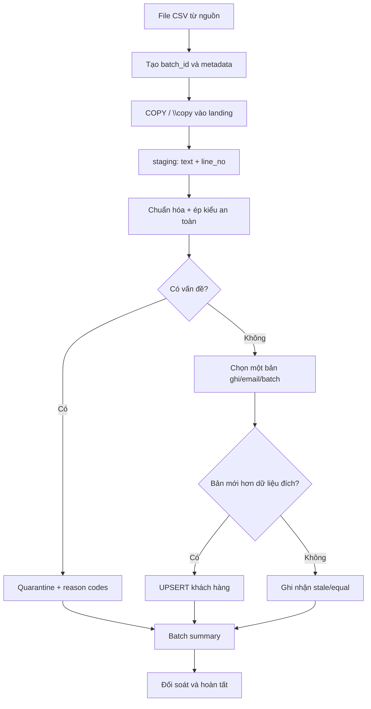

# Nhập vào bảng trung gian để kiểm tra và chuẩn hóa dữ liệu trong PostgreSQL

Một file CSV có thể trông rất đơn giản:

```csv
email,full_name,country,birth_date,active,credit_limit,updated_at
alice@example.com,Alice Nguyen,VN,1995-06-12,true,1000.00,2026-10-01T08:00:00Z
BOB@example.com,Bob Tran,vn,,yes,500,2026-10-02T09:00:00Z
not-an-email,Someone,VN,2026-02-30,true,"1,000",unknown
```

Nhưng nếu nhập trực tiếp vào bảng nghiệp vụ có các cột `date`, `boolean`, `numeric` và các ràng buộc `NOT NULL`, `UNIQUE`, một dòng sai có thể khiến toàn bộ lệnh nhập thất bại. Kể cả khi PostgreSQL chấp nhận mọi kiểu dữ liệu, dữ liệu còn có thể chứa **email trùng do chữ hoa/thường, khoảng trắng dư, mã quốc gia viết không chuẩn, giá trị boolean không thống nhất hoặc bản ghi cũ ghi đè bản ghi mới**.

Giải pháp thực tế là một **bảng trung gian (*staging table*)**, nơi dữ liệu được tiếp nhận với ít giả định nhất trước khi chuyển sang bảng chính.

```text
CSV / JSON / API / S3 / ứng dụng Java
               |
               v
      BẢNG TIẾP NHẬN THÔ
      (staging / landing)
      tất cả field dạng text
               |
               v
      CHUẨN HÓA + KIỂM TRA
      format, kiểu, business rules
               |
       +-------+--------+
       |                |
       v                v
   HỢP LỆ           KHÔNG HỢP LỆ
       |                |
   Khử trùng         Quarantine
   Chọn bản mới       + lý do lỗi
       |
       v
   INSERT / UPSERT
   vào bảng nghiệp vụ
       |
       v
   Tổng hợp batch, metrics,
   đối soát và lưu dấu nguồn
```

**Tư tưởng cốt lõi:** **nạp được dữ liệu thô** không có nghĩa **chấp nhận dữ liệu đó làm dữ liệu nghiệp vụ**. Bảng staging giữ ranh giới giữa hai hành động này để quy trình có thể kiểm tra, giải thích, sửa lỗi và chạy lại.

Trong bài này, chúng ta xây dựng một luồng ETL nhỏ nhưng đầy đủ bằng PostgreSQL: `COPY`/`\\copy` → staging dạng `text` → chuẩn hóa → xác thực kiểu/nghiệp vụ → lưu lỗi → xử lý trùng → `INSERT ... ON CONFLICT` → kiểm tra idempotency, concurrency, transaction và số liệu chất lượng.

## 1. Mục tiêu học tập

Sau bài học, bạn có thể:

1. Giải thích tại sao cần staging thay vì nhập trực tiếp dữ liệu bên ngoài vào bảng nghiệp vụ.
2. Phân biệt vùng **landing/raw**, vùng **validated/normalized**, vùng **rejected/quarantine** và bảng đích.
3. Thiết kế bảng staging giữ `batch_id`, vị trí dòng, nguồn nhập và giá trị ban đầu.
4. Sử dụng `COPY FROM STDIN`, `psql \\copy` và `INSERT` để tiếp nhận dữ liệu CSV.
5. Phân biệt lỗi parse CSV/cấu trúc với lỗi kiểu dữ liệu và lỗi nghiệp vụ.
6. Chuẩn hóa khoảng trắng, chữ hoa/thường, số điện thoại, boolean, ngày và timestamp theo quy tắc có thể kiểm thử.
7. Tránh phép ép kiểu khiến cả batch thất bại; nhận biết giá trị ngày không tồn tại, số vượt độ chính xác và giá trị rỗng.
8. Ghi nhiều lý do từ chối cho cùng một hàng và cô lập chúng để không làm bẩn bảng chính.
9. Phân biệt hàng sai, hàng trùng trong batch, hàng hợp lệ và hàng quá cũ so với dữ liệu đích.
10. Dùng `ROW_NUMBER()` hoặc kỹ thuật tương đương chọn bản ghi tốt nhất theo khóa nghiệp vụ.
11. Dùng `INSERT ... ON CONFLICT DO UPDATE` an toàn, không ghi đè bản ghi mới bằng dữ liệu cũ.
12. Tổ chức xử lý theo batch có thể chạy lại, theo dõi trạng thái và đối soát số lượng.
13. Dùng transaction, constraints và khóa phù hợp để giữ tính nhất quán.
14. Hiểu khác biệt giữa `COPY` server-side, `\\copy` client-side và pgJDBC `CopyManager`.
15. Biết các biện pháp bảo mật khi tiếp nhận file không đáng tin và cách bảo vệ PII trong staging.
16. Tối ưu nhập nhiều dòng bằng set-based SQL, indexes, `ANALYZE`, chunking và giữ transaction phù hợp.
17. Thiết kế quan sát lỗi, metrics, reprocessing, cleanup/retention và một checklist triển khai production.

## 2. Tại sao nhập trực tiếp vào bảng chính thường là sai lầm?

Giả sử bảng:

```sql
CREATE TABLE customers (
    customer_id bigint GENERATED ALWAYS AS IDENTITY PRIMARY KEY,
    email text NOT NULL UNIQUE,
    full_name text NOT NULL,
    birth_date date,
    credit_limit numeric(12,2) NOT NULL CHECK (credit_limit >= 0)
);
```

Với CSV không sạch, nhập trực tiếp có các vấn đề:

| Vấn đề | Ví dụ | Hệ quả |
| --- | --- | --- |
| Sai kiểu | `birth_date = 2026-02-30` | Phép chuyển sang `date` lỗi |
| Sai cú pháp số | `1,000.00` theo locale | Không ép được `numeric` bằng quy tắc mong muốn |
| Giá trị trống | `email = ''` | Có thể qua `NOT NULL` nếu không kiểm tra độ dài |
| Sai nghiệp vụ | `credit_limit = -5` | Vi phạm CHECK |
| Khóa trùng | `Alice@EXAMPLE.com` và `alice@example.com` | Trùng sau chuẩn hóa |
| File đã nhập lại | Cùng dữ liệu gửi lần 2 | Ghi/đếm hai lần nếu không có khóa idempotency |
| Dữ liệu lỗi thời | Snapshot hôm qua tới sau snapshot hôm nay | Ghi đè bản mới |
| Thiếu dấu nguồn | Không có batch, line hoặc filename | Khó giải thích row được nhập từ đâu |
| File cực lớn | Một transaction khổng lồ | WAL, lock, disk và khôi phục khó |
| Dữ liệu riêng tư | Email, điện thoại trong raw text | Rủi ro lưu trữ/log không kiểm soát |

### 2.1. Vì sao `COPY` trực tiếp không giải quyết hết?

`COPY` được tối ưu để nạp dữ liệu, **không tự định nghĩa quy tắc nghiệp vụ** như “email phải duy nhất sau lowercase” hay “mỗi khách hàng chỉ nhận bản cập nhật mới nhất”.

Khi `COPY` trực tiếp vào cột có kiểu/ràng buộc mạnh, một lỗi có thể khiến statement nhập không thành công. Staging cho phép lưu raw values trước, kiểm tra bằng các truy vấn được quan sát và có quy trình quarantine.

### 2.2. Nhưng staging không phải nơi bỏ hết mọi ràng buộc

Bảng trung gian vẫn cần:

- Khóa định danh mỗi raw record.
- Batch ID.
- Vòng đời/trạng thái nhập.
- Quyền và retention.
- Giới hạn tài nguyên.

Staging “dễ nạp” **không đồng nghĩa** vô hạn, không quản trị hoặc có thể chứa mọi dữ liệu mãi mãi.

## 3. Bốn vùng dữ liệu và nhiệm vụ riêng

| Vùng | Mục tiêu | Dạng dữ liệu | Có quyền sửa trực tiếp? |
| --- | --- | --- | --- |
| **Landing/raw** | Giữ những giá trị nhập nguyên gốc | Thường `text` và metadata nguồn | Chỉ ingestion job, hạn chế update |
| **Normalized/validated** | Chuyển đổi và lưu kết quả kiểm tra | Kiểu dữ liệu chuẩn, reason codes | Pipeline xử lý |
| **Rejected/quarantine** | Lưu các dòng cần xem lại | Dòng nguồn + lý do | Quy trình sửa dữ liệu được kiểm soát |
| **Target/business** | Phục vụ ứng dụng | Constraints, indexes, RLS, nghiệp vụ | Role ứng dụng tương ứng |

### 3.1. Raw và normalized nên tách

Nếu ngay khi nhập bạn viết đè email từ `" Alice@Example.COM "` thành `"alice@example.com"`, có thể mất dấu để giải thích vì sao bản ghi bị hợp nhất.

Giữ **raw** bất biến và lưu **normalized** riêng giúp audit, chạy lại theo rule version và điều tra lỗi.

### 3.2. Quarantine không chỉ dành cho dữ liệu lỗi kiểu

Một hàng có thể đúng cú pháp nhưng:

- Khóa nghiệp vụ trùng.
- Tham chiếu tới khách hàng không tồn tại.
- Dữ liệu xung đột với giá trị hiện có.
- Ngày nằm ngoài khoảng cho phép.
- Không vượt được chính sách chống ghi đè bản mới.

Quy trình cần phân biệt **invalid** (sai), **duplicate/superseded** (trùng có thể bỏ qua) và **stale** (quá cũ), bởi cách xử lý khác nhau.

## 4. Kiến trúc batch có khả năng đối soát

Trong ví dụ, một batch là một lần nhập dữ liệu khách hàng từ nguồn cụ thể.



Các bước có thể chạy trong **một transaction** hoặc trong các transactions theo phase/batch tùy yêu cầu atomicity và kích thước dữ liệu. Nếu chạy theo nhiều transactions, cần có trạng thái trung gian, idempotency và kế hoạch phục hồi.

### 4.1. Metadata nên có

- `batch_id` hoặc ingestion job ID.
- `source_system`/file name, checksum hoặc object storage key.
- Thời điểm nhận file.
- Số dòng thô.
- Số dòng lỗi, dòng trùng, dòng chấp nhận.
- Version của bộ quy tắc chuẩn hóa.
- Thời điểm hoàn thành và lỗi batch nếu có.

### 4.2. Không dùng timestamp làm ID duy nhất

Hai job có thể bắt đầu trong cùng mili giây. Dùng ID/UUID có ràng buộc unique hoặc nguồn cấp ID được quản lý, không suy luận uniqueness chỉ từ `now()`.

## 5. Tạo schema lab

Tất cả ví dụ DDL/DML từ đây chạy trong database thử nghiệm riêng; không chạy trực tiếp trên bảng khách hàng thật.

```sql
CREATE SCHEMA IF NOT EXISTS import_lab;
```

Ví dụ dùng `batch_id = 1001` để dễ theo dõi. Trong production nên tạo ID qua sequence/identity/UUID và dùng job registry.

## 6. Bảng theo dõi batch

```sql
CREATE TABLE import_lab.import_batches (
    batch_id bigint PRIMARY KEY,
    source_system text NOT NULL,
    source_file text NOT NULL,
    source_sha256 text,
    rule_version integer NOT NULL DEFAULT 1,
    status text NOT NULL DEFAULT 'LOADED'
        CHECK (status IN (
            'LOADED',
            'PROCESSING',
            'COMPLETED',
            'COMPLETED_WITH_REJECTIONS',
            'FAILED'
        )),
    raw_count bigint NOT NULL DEFAULT 0,
    rejected_count bigint NOT NULL DEFAULT 0,
    superseded_count bigint NOT NULL DEFAULT 0,
    applied_count bigint NOT NULL DEFAULT 0,
    skipped_count bigint NOT NULL DEFAULT 0,
    created_at timestamptz NOT NULL DEFAULT clock_timestamp(),
    finished_at timestamptz
);

INSERT INTO import_lab.import_batches (
    batch_id, source_system, source_file, rule_version
)
VALUES (
    1001, 'crm_export', 'customers_2026_11.csv', 1
);
```

### 6.1. Vì sao có rule_version?

Nếu tháng sau chuẩn hóa email/điện thoại khác đi, một hàng trước đây không hợp lệ có thể trở thành hợp lệ. Version giúp biết batch đã được xử lý bằng **bộ quy tắc nào**.

### 6.2. SHA-256 có tác dụng gì?

Fingerprint của file giúp phát hiện cùng nội dung được gửi lại. Nó chỉ là **một yếu tố** của idempotency; cần xác định chính sách với:

- Cùng file nhưng source khác.
- Cùng filename nhưng nội dung khác.
- Cùng dữ liệu business được sắp xếp khác.
- File có cùng nội dung nhưng được yêu cầu xử lý lại theo rule mới.

### 6.3. Trạng thái batch khác trạng thái từng row

Một batch có thể `COMPLETED_WITH_REJECTIONS`, nghĩa pipeline hoàn tất xử lý nhưng còn những dòng cần sửa. Không ghi `COMPLETED` nếu công việc mới chỉ dừng ở bước `COPY`.

## 7. Bảng staging lưu nguyên giá trị thô

Mọi cột từ nguồn trong ví dụ được lưu dạng `text`; metadata được quản lý riêng.

```sql
CREATE TABLE import_lab.stage_customers (
    batch_id bigint NOT NULL
        REFERENCES import_lab.import_batches(batch_id),
    line_no bigint NOT NULL,
    email_raw text,
    full_name_raw text,
    phone_raw text,
    country_raw text,
    birth_date_raw text,
    active_raw text,
    credit_limit_raw text,
    source_updated_at_raw text,
    loaded_at timestamptz NOT NULL DEFAULT clock_timestamp(),
    PRIMARY KEY (batch_id, line_no),
    CHECK (line_no > 0)
);
```

### 7.1. Tại sao các field ban đầu là text?

Nếu `birth_date_raw='2026-02-30'`, cột `text` nhận được chuỗi đó thay vì ném lỗi date cast ngay tại `COPY`. Phần xử lý sau có thể gắn reason `INVALID_BIRTH_DATE` cho đúng line và tiếp tục xử lý các line khác.

### 7.2. Vì sao vẫn để batch_id và line_no có kiểu mạnh?

Chúng là **metadata do hệ thống ingestion kiểm soát**, không phải các giá trị tùy ý của file. Chúng cần ổn định để đối soát và định danh nguồn. Nếu file cung cấp line number không đáng tin, nên tự cấp số dòng từ ingestion tool.

### 7.3. Primary key batch_id + line_no

Một batch không được chứa hai bản ghi có cùng số dòng nguồn. Điều này còn cho phép nạp lại cùng dòng bằng một chính sách xác định thay vì vô tình tạo bản sao.

Không được hiểu line_no là business key của khách hàng: hai dòng khác nhau vẫn có thể có cùng email.

## 8. Bảng chuẩn hóa và lưu kết quả validation

```sql
CREATE TABLE import_lab.normalized_customers (
    batch_id bigint NOT NULL,
    line_no bigint NOT NULL,
    email text,
    full_name text,
    phone_e164 text,
    country_code text,
    birth_date date,
    is_active boolean,
    credit_limit numeric(12,2),
    source_updated_at timestamptz,
    issues text[] NOT NULL DEFAULT '{}'::text[],
    state text NOT NULL CHECK (state IN (
        'READY',
        'REJECTED',
        'SUPERSEDED',
        'APPLIED',
        'SKIPPED_STALE_OR_EQUAL'
    )),
    checked_at timestamptz NOT NULL DEFAULT clock_timestamp(),
    PRIMARY KEY (batch_id, line_no),
    FOREIGN KEY (batch_id, line_no)
        REFERENCES import_lab.stage_customers(batch_id, line_no)
);

CREATE INDEX idx_normalized_customers_batch_state
ON import_lab.normalized_customers (batch_id, state);
```

**Thiết kế:** có thể lưu NULL trong các cột typed ở vùng normalized khi hàng bị từ chối. Chỉ rows có `state='READY'` mới được đưa vào bảng chính.

### 8.1. Vì sao issues là text[]?

Một dòng có thể sai cả email và ngày sinh. Lưu nhiều reason codes tốt hơn chỉ giữ thông báo đầu tiên.

### 8.2. Text reason code khác free-text error

Các mã như `INVALID_EMAIL`, `INVALID_DATE`, `INVALID_CREDIT_LIMIT` giúp tổng hợp số liệu và ánh xạ UI. Thông báo lỗi đầy đủ có thể được tạo ở tầng báo cáo, còn reason code giữ ổn định.

## 9. Bảng quarantine

```sql
CREATE TABLE import_lab.rejected_customers (
    batch_id bigint NOT NULL,
    line_no bigint NOT NULL,
    issues text[] NOT NULL,
    reviewed boolean NOT NULL DEFAULT false,
    rejected_at timestamptz NOT NULL DEFAULT clock_timestamp(),
    PRIMARY KEY (batch_id, line_no),
    FOREIGN KEY (batch_id, line_no)
        REFERENCES import_lab.stage_customers(batch_id, line_no)
);
```

Không sao chép toàn bộ PII raw vào quarantine lần nữa trong lab: bảng lỗi trỏ về staging bằng khóa. Trong production, lưu dữ liệu raw/PII thêm lần nữa có thể tăng chi phí bảo mật và retention.

### 9.1. Một hàng SUPERSEDED cũng có thể ghi vào quarantine

Đó không nhất thiết là dữ liệu sai. Ví dụ, hai dòng cùng email và dòng mới hơn thắng; dòng cũ được giữ để đối soát với reason `DUPLICATE_EMAIL_IN_BATCH`.

### 9.2. Không cho reviewer sửa trực tiếp bảng target để “vá” không kiểm soát

Nếu người vận hành sửa raw record, nên có cơ chế lập correction batch, lưu audit, cập nhật rule version hoặc tạo phiên bản có dấu nguồn mới. Tránh làm mất khả năng tái hiện dữ liệu gốc.

## 10. Bảng đích với constraints chặt chẽ

```sql
CREATE TABLE import_lab.customers (
    customer_id bigint GENERATED ALWAYS AS IDENTITY PRIMARY KEY,
    email text NOT NULL UNIQUE,
    full_name text NOT NULL
        CHECK (length(btrim(full_name)) BETWEEN 1 AND 120),
    phone_e164 text,
    country_code text NOT NULL
        CHECK (country_code ~ '^[A-Z]{2}$'),
    birth_date date,
    is_active boolean NOT NULL,
    credit_limit numeric(12,2) NOT NULL
        CHECK (credit_limit >= 0),
    source_updated_at timestamptz NOT NULL,
    updated_at timestamptz NOT NULL DEFAULT clock_timestamp(),
    CHECK (
        phone_e164 IS NULL
        OR phone_e164 ~ '^\+[1-9][0-9]{7,14}$'
    )
);
```

### 10.1. Constraints là lớp phòng thủ cuối

Staging validation giảm lỗi khi nhập, nhưng database vẫn nên có `NOT NULL`, `CHECK`, `UNIQUE` và foreign keys cho dữ liệu nghiệp vụ.

Một bug trong pipeline không được phép âm thầm đưa `credit_limit=-10` hoặc `email=NULL` vào target.

### 10.2. Email làm business key chỉ là giả định của bài lab

Trong nhiều hệ thống, email **có thể thay đổi, được dùng chung, có alias và quy tắc chữ hoa/thường khác nhau**. Không tự động lấy email làm định danh người dùng duy nhất nếu nghiệp vụ không chấp nhận. Ví dụ này dùng `email` làm conflict key chỉ để tập trung vào kỹ thuật import.

### 10.3. Quốc gia và số điện thoại còn cần validation sâu

Regex hai chữ cái **không chứng minh** mã ISO 3166-1 alpha-2 tồn tại. Regex E.164 minh họa định dạng cơ bản, không chứng minh số đã được cấp hoặc có thể liên lạc. Production có thể cần reference table, thư viện chuẩn hóa và xác thực ngoài.

## 11. Dữ liệu mẫu gồm hàng hợp lệ và hàng lỗi

Chúng ta nạp dữ liệu bằng `INSERT VALUES` để bài lab chạy được ngay cả khi không có file CSV:

```sql
INSERT INTO import_lab.stage_customers (
    batch_id, line_no,
    email_raw, full_name_raw, phone_raw,
    country_raw, birth_date_raw, active_raw,
    credit_limit_raw, source_updated_at_raw
)
VALUES
    (1001, 1,
     'alice@example.com', 'Alice', '+84901234567',
     'VN', '1995-05-11', 'true',
     '100.00', '2026-10-01T08:00:00Z'),

    (1001, 2,
     ' bob@example.com ', ' Bob Tran ', NULL,
     'vn', '', 'yes',
     '500', '2026-10-02T09:00:00Z'),

    (1001, 3,
     ' ALICE@EXAMPLE.COM ', 'Alice Nguyen', '+84 901 234 567',
     'vn', '1995-05-11', '1',
     '250.50', '2026-10-05T08:00:00Z'),

    (1001, 4,
     'not-an-email', 'Bad Email', NULL,
     'VN', '2001-01-01', 'true',
     '100', '2026-10-06T08:00:00Z'),

    (1001, 5,
     'empty-name@example.com', '  ', NULL,
     'VN', '2001-01-01', 'true',
     '100', '2026-10-06T08:00:00Z'),

    (1001, 6,
     'bad-date@example.com', 'Bad Date', NULL,
     'VN', '2026-02-30', 'true',
     '100', '2026-10-06T08:00:00Z'),

    (1001, 7,
     'bad-money@example.com', 'Bad Money', NULL,
     'VN', NULL, 'true',
     '1,000.00', '2026-10-06T08:00:00Z'),

    (1001, 8,
     'bad-phone@example.com', 'Bad Phone', 'abc',
     'VN', NULL, 'true',
     '100', '2026-10-06T08:00:00Z'),

    (1001, 9,
     'bad-bool@example.com', 'Bad Boolean', NULL,
     'VN', NULL, 'unknown',
     '100', '2026-10-06T08:00:00Z'),

    (1001, 10,
     'bad-time@example.com', 'Bad Timestamp', NULL,
     'VN', NULL, 'true',
     '100', '2026-99-06T08:00:00Z'),

    (1001, 11,
     'carol@example.com', 'Carol Le', '+84987654321',
     'SG', '1990-01-15', 'no',
     '750.00', '2026-10-07T08:00:00Z'),

    (1001, 12,
     'missing-country@example.com', 'Missing Country', NULL,
     '', NULL, 'true',
     '50', '2026-10-08T08:00:00Z');
```

Trong 12 hàng:

- Dòng **1** và **3** có cùng email sau chuẩn hóa; dòng 3 có timestamp mới hơn.
- Dòng **2** có khoảng trắng, mã quốc gia viết thường và boolean `yes`.
- Các dòng **4–10, 12** có lỗi cần quarantine.
- Dòng **11** hợp lệ.

Khi xử lý, kết quả mong đợi là **3 email hợp lệ ứng viên** (Alice, Bob, Carol), trong đó dòng Alice cũ bị đánh dấu SUPERSEDED, nên có **3 dòng áp dụng vào target** và **9 dòng không áp dụng** (8 lỗi đầu vào + 1 dòng superseded). Số liệu phải kiểm tra bằng SQL, không giả định chỉ từ lời mô tả.

## 12. Bắt đầu với raw text: NULL, chuỗi rỗng và khoảng trắng

Ba giá trị này khác nhau:

```text
NULL       -> Không có giá trị SQL.
''         -> Chuỗi rỗng, độ dài 0.
'   '      -> Chuỗi chứa khoảng trắng.
```

Trong PostgreSQL:

```sql
SELECT
    NULLIF(BTRIM('    '), '') AS empty_to_null,
    BTRIM('  Alice  ') AS trimmed_name,
    LOWER(BTRIM('  ALICE@EXAMPLE.COM ')) AS normalized_email;
```

### 12.1. Một mẫu làm sạch cơ bản

```sql
NULLIF(BTRIM(raw_value), '')
```

Quy trình:

1. Bỏ khoảng trắng đầu/cuối theo quy tắc `BTRIM`.
2. Nếu kết quả là chuỗi rỗng, đổi thành SQL NULL.

### 12.2. Không dùng TRIM cho mọi loại dữ liệu không suy xét

Ví dụ mật khẩu, signature, mã định danh có khoảng trắng ý nghĩa hoặc dữ liệu pháp lý có thể cần giữ nguyên. Quy tắc làm sạch phải theo **hợp đồng dữ liệu của từng trường**.

### 12.3. Unicode và khoảng trắng không phải chỉ có ASCII

`BTRIM` mặc định không xử lý tất cả các loại Unicode whitespace theo ý định người dùng. Với nguồn dữ liệu nhiều quốc gia, cần xác định chuẩn normalization Unicode và kiểm thử các ký tự như non-breaking space.

## 13. Chuẩn hóa email: ví dụ minh họa, không phải luật RFC đầy đủ

Trong lab:

```sql
SELECT
    LOWER(NULLIF(BTRIM(email_raw), '')) AS email_normalized
FROM import_lab.stage_customers
WHERE batch_id = 1001
ORDER BY line_no;
```

### 13.1. Điều được xử lý

- Loại khoảng trắng hai đầu.
- Lowercase để hai biến thể `Alice@Example.com` và `alice@example.com` hợp nhất theo quy tắc ứng dụng.

### 13.2. Điều chưa được xử lý

- Quy tắc local-part theo RFC và hệ thống email thực tế.
- Unicode normalization.
- Internationalized domains/IDNA.
- Thẻ alias `+tag`, dấu chấm của một số nhà cung cấp.
- Thực tế địa chỉ có thể nhận email hay không.

**Không tự xóa dấu chấm, dấu cộng hoặc phần sau dấu cộng của email** để “chống trùng”; các quy tắc đó không đúng cho mọi nhà cung cấp.

### 13.3. Kiểm tra format thô chỉ là một lớp

Lab dùng regex đơn giản:

```sql
email ~ '^[^[:space:]@]+@[^[:space:]@]+\.[^[:space:]@]+$'
```

Nó bắt những lỗi phổ biến nhưng không xác nhận địa chỉ tồn tại, mailbox hợp lệ hay đáp ứng toàn bộ chuẩn RFC.

## 14. Chuẩn hóa số điện thoại

Ta định nghĩa chính sách mẫu: nhận dấu `+` và các dấu phân tách quen thuộc, sau đó yêu cầu dạng gần E.164.

```sql
SELECT
    regexp_replace(
        '+84 901 234 567',
        '[[:space:]().-]',
        '',
        'g'
    ) AS phone_e164;
```

Kết quả: `+84901234567`.

### 14.1. Không xóa mọi ký tự không phải số một cách mù quáng

Nếu viết:

```sql
regexp_replace(raw_phone, '[^0-9]', '', 'g')
```

bạn có thể đánh mất dấu `+`, extension, ký tự cảnh báo hoặc ngữ nghĩa mã vùng. Dòng `abc` có thể biến thành chuỗi rỗng và gây lỗi khó truy vết.

### 14.2. Nếu số điện thoại có thể là local format

Chuẩn hóa thực tế cần **country context**, quy tắc số nội địa, độ dài, extension và thay đổi kế hoạch đánh số. Đối với sản phẩm quốc tế, thư viện xử lý phone chuyên dụng thường đáng tin hơn một regex tự viết.

### 14.3. NULL phone có thể là hợp lệ

Trong lab, `phone_e164` tùy chọn. Vì vậy raw phone NULL hoặc rỗng không tạo lỗi; raw phone có giá trị nhưng sai format sẽ bị từ chối.

## 15. Chuẩn hóa boolean

Dữ liệu nguồn có thể chứa:

```text
true, TRUE, t, yes, y, 1
false, FALSE, f, no, n, 0
```

Không dựa vào việc PostgreSQL tự nhận mọi biến thể ngoài hợp đồng nguồn. Ta quy định rõ:

```sql
CASE
    WHEN LOWER(BTRIM(active_raw))
         IN ('true','t','yes','y','1') THEN true
    WHEN LOWER(BTRIM(active_raw))
         IN ('false','f','no','n','0') THEN false
    ELSE NULL
END
```

### 15.1. Vì sao `unknown` không mặc định thành FALSE?

Nếu một khách hàng có trạng thái chưa rõ, đổi thành `false` có thể là biến đổi nghiệp vụ không được phép. Lab chọn cách **reject** khi trạng thái bắt buộc nhưng không nhận diện được.

### 15.2. Tách unknown và blank

Nếu dữ liệu từ nguồn có ba giá trị `true/false/unknown`, kiểu `boolean NOT NULL` của bảng đích không biểu diễn đủ. Có thể cần enum/status code riêng hoặc cho phép NULL; hãy chọn theo nghiệp vụ thay vì ép mọi thứ thành boolean.

## 16. Chuẩn hóa số tiền và credit limit

Trong lab, `credit_limit` phải:

- Không âm.
- Tối đa 10 chữ số trước dấu thập phân.
- Tối đa 2 chữ số sau dấu thập phân.
- Dùng dấu chấm làm dấu thập phân, không chấp nhận dấu phân nhóm.

Kiểm tra:

```sql
credit_limit_text ~ '^[0-9]{1,10}(\.[0-9]{1,2})?$'
```

Sau khi thỏa format:

```sql
credit_limit_text::numeric(12,2)
```

### 16.1. Tại sao không ép kiểu trước rồi kiểm tra?

```sql
SELECT '1,000.00'::numeric;
```

có thể gây exception, làm statement xử lý nhiều rows dừng thay vì riêng hàng lỗi. Quy trình theo lô nên **nhận diện format trước** hoặc dùng safe-cast helper có exception handling kiểm soát.

### 16.2. Regex cũng không phải parser tài chính tổng quát

Nó từ chối `+12.00`, `1e3`, dấu phẩy/thập phân locale khác, âm và leading formats ngoài hợp đồng. Đó là **chính sách lab**, không phải lỗi của PostgreSQL.

### 16.3. Nếu số quá lớn

`numeric(12,2)` có giới hạn precision/scale. Regex giới hạn phần nguyên giúp giảm lỗi range, còn constraints ở target vẫn phải bảo vệ. Nếu xử lý dữ liệu kế toán lớn, chọn kiểu và quy tắc làm tròn phù hợp nghiệp vụ.

## 17. Ngày: regex không chứng minh ngày tồn tại

Chuỗi:

```text
2026-02-30
```

khớp mẫu `YYYY-MM-DD` nhưng là ngày không tồn tại.

Đừng chỉ:

```sql
CASE
    WHEN raw_date ~ '^[0-9]{4}-[0-9]{2}-[0-9]{2}$'
    THEN raw_date::date
END
```

vì `::date` vẫn có thể ném lỗi.

### 17.1. Safe-cast helper cho ngày ISO

```sql
CREATE FUNCTION import_lab.try_iso_date(p_text text)
RETURNS date
LANGUAGE plpgsql
STABLE
STRICT
AS $$
BEGIN
    IF BTRIM(p_text) !~
       '^[0-9]{4}-[0-9]{2}-[0-9]{2}$'
    THEN
        RETURN NULL;
    END IF;

    RETURN BTRIM(p_text)::date;

EXCEPTION
    WHEN invalid_datetime_format
      OR datetime_field_overflow
      OR invalid_text_representation
    THEN
        RETURN NULL;
END;
$$;
```

Thử:

```sql
SELECT
    import_lab.try_iso_date('2026-02-28') AS valid_date,
    import_lab.try_iso_date('2026-02-30') AS invalid_date,
    import_lab.try_iso_date('not-a-date') AS invalid_text,
    import_lab.try_iso_date('') AS blank;
```

Hàm trả date khi hợp lệ và NULL khi sai format/ngày.

### 17.2. STRICT có ý nghĩa gì?

Khi input SQL NULL, PostgreSQL trả NULL trước khi gọi thân hàm. Bản thân một chuỗi rỗng `''` không phải NULL, nhưng hàm trả NULL vì không khớp format.

### 17.3. Không bắt `WHEN OTHERS` cho mọi sai sót

Chỉ bắt nhóm lỗi chuyển kiểu mong đợi. Nếu hàm có bug hoặc môi trường thiếu object/quyền, che mọi exception thành NULL sẽ khiến dữ liệu sai khó chẩn đoán.

### 17.4. Vì sao không dùng to_date tùy tiện?

Một số cách parse ngày có thể **chuẩn hóa/điều chỉnh giá trị ngoài phạm vi mong muốn** thay vì từ chối đúng ngày sai. Với dữ liệu nhập yêu cầu chính xác, hãy kiểm tra parse kết quả theo contract hoặc dùng phép cast an toàn có handler.

## 18. Timestamp: bắt buộc có offset khi nguồn phân tán

Nếu nguồn gửi:

```text
2026-10-01T08:00:00Z
2026-10-01T15:00:00+07:00
```

hai giá trị mô tả **cùng một thời điểm UTC**.

### 18.1. Lý do dùng timestamptz

`timestamptz` lưu thời điểm, không lưu nguyên chuỗi timezone đã nhập như một field riêng. Khi SELECT, giá trị có thể hiển thị theo `TimeZone` của session.

### 18.2. Safe-cast helper cho timestamp có timezone

```sql
CREATE FUNCTION import_lab.try_source_timestamp(p_text text)
RETURNS timestamptz
LANGUAGE plpgsql
STABLE
STRICT
AS $$
BEGIN
    IF BTRIM(p_text) !~
       '^[0-9]{4}-[0-9]{2}-[0-9]{2}[T ][0-9]{2}:[0-9]{2}:[0-9]{2}(Z|[+-][0-9]{2}:[0-9]{2})$'
    THEN
        RETURN NULL;
    END IF;

    RETURN BTRIM(p_text)::timestamptz;

EXCEPTION
    WHEN invalid_datetime_format
      OR datetime_field_overflow
      OR invalid_text_representation
    THEN
        RETURN NULL;
END;
$$;
```

Test:

```sql
SELECT
    import_lab.try_source_timestamp(
        '2026-10-01T08:00:00Z'
    ) AS valid_utc,
    import_lab.try_source_timestamp(
        '2026-10-01T15:00:00+07:00'
    ) AS same_instant,
    import_lab.try_source_timestamp(
        '2026-99-01T08:00:00Z'
    ) AS invalid_time;
```

### 18.3. Đây là hợp đồng format của lab

Hàm cố ý không nhận fractional seconds, timezone tên vùng hay timestamp không có offset. Nếu nguồn có format khác, phải cập nhật hợp đồng và kiểm thử.

### 18.4. Source update time không phải ingestion time

- `source_updated_at`: thời điểm bản ghi **được nguồn cập nhật**.
- `loaded_at`: thời điểm hệ thống **nhận vào staging**.

Không dùng `loaded_at` để xác định bản nào mới nhất ở nguồn: một file cũ gửi lại hôm nay vẫn có thể chứa dữ liệu từ tháng trước.

## 19. Chuẩn hóa toàn bộ batch bằng set-based SQL

Đây là bước quan trọng nhất: sử dụng `WITH`/`INSERT ... SELECT` thay vì vòng lặp gọi một INSERT cho từng field.

```sql
WITH cleaned AS (
    SELECT
        s.batch_id,
        s.line_no,
        LOWER(NULLIF(BTRIM(s.email_raw), '')) AS email,
        NULLIF(BTRIM(s.full_name_raw), '') AS full_name,
        CASE
            WHEN NULLIF(BTRIM(s.phone_raw), '') IS NULL
            THEN NULL
            ELSE regexp_replace(
                BTRIM(s.phone_raw),
                '[[:space:]().-]',
                '',
                'g'
            )
        END AS phone_e164,
        UPPER(NULLIF(BTRIM(s.country_raw), '')) AS country_code,
        NULLIF(BTRIM(s.birth_date_raw), '') AS birth_date_text,
        NULLIF(BTRIM(s.active_raw), '') AS active_text,
        NULLIF(BTRIM(s.credit_limit_raw), '') AS credit_limit_text,
        NULLIF(BTRIM(s.source_updated_at_raw), '')
            AS updated_text
    FROM import_lab.stage_customers AS s
    WHERE s.batch_id = 1001
),
typed AS (
    SELECT
        c.*,
        import_lab.try_iso_date(c.birth_date_text) AS birth_date,
        CASE
            WHEN LOWER(c.active_text)
                 IN ('true','t','yes','y','1') THEN true
            WHEN LOWER(c.active_text)
                 IN ('false','f','no','n','0') THEN false
            ELSE NULL
        END AS is_active,
        CASE
            WHEN c.credit_limit_text ~
                 '^[0-9]{1,10}(\.[0-9]{1,2})?$'
            THEN c.credit_limit_text::numeric(12,2)
            ELSE NULL
        END AS credit_limit,
        import_lab.try_source_timestamp(c.updated_text)
            AS source_updated_at
    FROM cleaned AS c
),
validated AS (
    SELECT
        t.*,
        ARRAY_REMOVE(
            ARRAY[
                CASE
                    WHEN t.email IS NULL
                         OR t.email !~
                           '^[^[:space:]@]+@[^[:space:]@]+\.[^[:space:]@]+$'
                    THEN 'INVALID_EMAIL'
                END,
                CASE
                    WHEN t.full_name IS NULL
                         OR LENGTH(t.full_name) > 120
                    THEN 'INVALID_FULL_NAME'
                END,
                CASE
                    WHEN t.country_code IS NULL
                         OR t.country_code !~ '^[A-Z]{2}$'
                    THEN 'INVALID_COUNTRY'
                END,
                CASE
                    WHEN t.phone_e164 IS NOT NULL
                         AND t.phone_e164 !~
                             '^\+[1-9][0-9]{7,14}$'
                    THEN 'INVALID_PHONE'
                END,
                CASE
                    WHEN t.birth_date_text IS NOT NULL
                         AND t.birth_date IS NULL
                    THEN 'INVALID_BIRTH_DATE'
                END,
                CASE
                    WHEN t.is_active IS NULL
                    THEN 'INVALID_ACTIVE'
                END,
                CASE
                    WHEN t.credit_limit IS NULL
                    THEN 'INVALID_CREDIT_LIMIT'
                END,
                CASE
                    WHEN t.source_updated_at IS NULL
                    THEN 'INVALID_SOURCE_TIMESTAMP'
                END
            ]::text[],
            NULL
        ) AS validation_issues
    FROM typed AS t
)
INSERT INTO import_lab.normalized_customers (
    batch_id, line_no, email, full_name, phone_e164,
    country_code, birth_date, is_active,
    credit_limit, source_updated_at, issues, state
)
SELECT
    batch_id, line_no, email, full_name, phone_e164,
    country_code, birth_date, is_active,
    credit_limit, source_updated_at,
    validation_issues,
    CASE
        WHEN CARDINALITY(validation_issues) = 0 THEN 'READY'
        ELSE 'REJECTED'
    END
FROM validated
ON CONFLICT (batch_id, line_no) DO NOTHING;
```

### 19.1. Vì sao tách cleaned, typed và validated?

- `cleaned`: chuẩn hóa hình thức.
- `typed`: chuyển từ chuỗi sang giá trị PostgreSQL.
- `validated`: áp quy tắc nghiệp vụ và tạo reason codes.

Các pha rõ ràng giúp dễ đọc, dễ test và thay đổi từng bước.

### 19.2. Vì sao dùng CASE bảo vệ cast?

`CASE WHEN text ~ format THEN text::numeric END` tránh cast các chuỗi rõ ràng không đúng định dạng. Với ngày/timestamp còn có ngày không tồn tại nên dùng helper có exception handling.

### 19.3. Vì sao thêm ON CONFLICT DO NOTHING?

Khóa chính `(batch_id,line_no)` giúp chạy lại **bước tạo normalized rows** không nhân đôi cùng dòng. Tuy nhiên, nếu raw data hoặc rule version đổi, `DO NOTHING` sẽ **không tự tái đánh giá** dòng cũ; quy trình reprocess cần kiểm soát phiên bản, xóa/rebuild có chủ đích hoặc tạo batch mới.

### 19.4. Vì sao không tự gán READY khi parse được?

Một hàng `typed` hợp lệ về mặt cú pháp nhưng thiếu `full_name` hoặc sai business rule vẫn phải `REJECTED`. Kiểu dữ liệu đúng không đồng nghĩa dữ liệu hợp lệ.

## 20. Xem kết quả validation

```sql
SELECT
    line_no,
    email,
    full_name,
    country_code,
    birth_date,
    is_active,
    credit_limit,
    source_updated_at,
    state,
    issues
FROM import_lab.normalized_customers
WHERE batch_id = 1001
ORDER BY line_no;
```

### 20.1. Phân loại bằng số lượng

```sql
SELECT
    state,
    COUNT(*) AS row_count
FROM import_lab.normalized_customers
WHERE batch_id = 1001
GROUP BY state
ORDER BY state;
```

### 20.2. Một hàng có thể có nhiều lỗi

Nếu email sai, country trống và ngày không hợp lệ trong cùng dòng, `issues` có thể chứa ba reason codes. Đây là lợi thế khi xử lý hàng lỗi theo đợt: người gửi file nhận được **một báo cáo đủ lỗi** thay vì gửi đi sửa một lỗi rồi lại gặp lỗi tiếp.

### 20.3. Đừng quá tin một reason duy nhất

Thứ tự lý do trong array là thứ tự logic kiểm tra, không nên được dùng như mức ưu tiên tự động nếu business không quy định.

## 21. Validation nghiệp vụ: thêm các quy tắc khác khi cần

Những quy tắc lab hiện có:

- Email và full name bắt buộc.
- Quốc gia gồm hai chữ cái A–Z.
- Số điện thoại nếu có phải ở dạng gần E.164.
- Ngày sinh tùy chọn, nhưng nếu có phải là ngày hợp lệ.
- Active bắt buộc.
- Credit limit không âm và đúng định dạng.
- Source timestamp bắt buộc.

Production thường còn cần:

### 21.1. Referential integrity

`country_code` có thể phải tồn tại trong `reference_countries`:

```sql
SELECT n.batch_id, n.line_no, n.country_code
FROM import_lab.normalized_customers AS n
LEFT JOIN import_lab.reference_countries AS c
  ON c.country_code = n.country_code
WHERE c.country_code IS NULL;
```

Đây là **ví dụ định hướng**, chỉ chạy sau khi tạo bảng `reference_countries`. Không tự giả định mọi mã hai chữ cái là quốc gia hợp lệ.

### 21.2. Age và ngày sinh

Nếu yêu cầu khách hàng tối thiểu 18 tuổi, cần tính theo ngày hiện tại/nguồn và quy tắc pháp lý cụ thể. Không đánh dấu bất biến một kết quả phụ thuộc thời gian như tuổi.

### 21.3. Cross-field consistency

Nếu `is_active=false` nhưng `credit_limit>0` không được phép theo nghiệp vụ, đây là một rule riêng. Không coi mọi sự kết hợp lạ là sai khi chưa được business quy định.

### 21.4. PII và consent

Nhập email/phone có thể cần consent, nguồn dữ liệu hợp pháp, quyền xử lý và retention. Validation định dạng không giải quyết nghĩa vụ bảo vệ dữ liệu.

## 22. Phát hiện trùng sau chuẩn hóa

Trước khi UPSERT, tìm email trùng trong các hàng đang `READY`:

```sql
SELECT
    email,
    COUNT(*) AS duplicates,
    ARRAY_AGG(line_no ORDER BY source_updated_at DESC, line_no DESC)
        AS source_lines
FROM import_lab.normalized_customers
WHERE batch_id = 1001
  AND state = 'READY'
GROUP BY email
HAVING COUNT(*) > 1;
```

Bạn sẽ thấy `alice@example.com` có hai nguồn là dòng 3 và dòng 1.

### 22.1. Vì sao phải khử trùng trước UPSERT?

PostgreSQL `INSERT ... ON CONFLICT DO UPDATE` không cho một câu lệnh tác động cùng một target row nhiều lần. Nếu nguồn của một INSERT có **hai rows cùng conflict key**, bạn có thể gặp:

```text
ON CONFLICT DO UPDATE command cannot affect row a second time
```

Đây là lý do không nên đưa trực tiếp cả hai dòng Alice vào cùng một INSERT ... ON CONFLICT mà chưa có chính sách dedupe.

### 22.2. Chọn “bản mới nhất” theo gì?

Chính sách lab:

1. Timestamp của nguồn lớn hơn thắng.
2. Nếu cùng timestamp, dòng có `line_no` lớn hơn thắng.

Thứ tự tie-break cần **được xác định và giải thích**, không dựa vào thứ tự heap hoặc kết quả SELECT ngẫu nhiên.

## 23. Dùng ROW_NUMBER để chọn một bản ghi/email

```sql
WITH ranked AS (
    SELECT
        batch_id,
        line_no,
        email,
        ROW_NUMBER() OVER (
            PARTITION BY email
            ORDER BY source_updated_at DESC NULLS LAST,
                     line_no DESC
        ) AS rn
    FROM import_lab.normalized_customers
    WHERE batch_id = 1001
      AND state = 'READY'
)
SELECT *
FROM ranked
ORDER BY email, rn;
```

### 23.1. Điều kiện PARTITION BY

`PARTITION BY email` nhóm các rows cùng khóa nghiệp vụ sau khi đã `LOWER/TRIM`. Không dùng raw email vì `' ALICE@...'` và `'alice@...'` sẽ bị coi là khác.

### 23.2. ORDER BY nhất quán

Nếu không có tie-break, hai bản ghi cùng timestamp có thể được chọn không ổn định qua những kế hoạch khác nhau.

### 23.3. Khi không có source timestamp tin cậy

Không tự dùng `line_no` làm “bản mới nhất” nếu file có thứ tự tùy ý. Cần thỏa thuận với nguồn: version, event sequence, modified timestamp đáng tin, hoặc chọn quy tắc giữ bản đầu và quarantine xung đột.

## 24. Đánh dấu bản trùng là SUPERSEDED

```sql
WITH ranked AS (
    SELECT
        batch_id,
        line_no,
        ROW_NUMBER() OVER (
            PARTITION BY email
            ORDER BY source_updated_at DESC NULLS LAST,
                     line_no DESC
        ) AS rn
    FROM import_lab.normalized_customers
    WHERE batch_id = 1001
      AND state = 'READY'
)
UPDATE import_lab.normalized_customers AS n
SET
    state = 'SUPERSEDED',
    issues = ARRAY_APPEND(
        n.issues,
        'DUPLICATE_EMAIL_IN_BATCH'
    )
FROM ranked AS r
WHERE n.batch_id = r.batch_id
  AND n.line_no = r.line_no
  AND r.rn > 1;
```

Sau bước này, dòng Alice cũ (line 1) trở thành `SUPERSEDED`; line 3 vẫn `READY`.

### 24.1. SUPERSEDED không nhất thiết là lỗi người dùng

Nếu file được thiết kế như event stream, trùng business key có thể hợp lệ và chỉ bản cuối được đưa vào snapshot. Hãy phản ánh điều đó trong report, không gộp “duplicate” với “invalid” một cách thiếu giải thích.

### 24.2. Chính sách first-wins, last-wins, newest-wins

Có ba kiểu phổ biến:

| Chiến lược | Chọn | Rủi ro |
| --- | --- | --- |
| First wins | Dòng đầu tiên | Bỏ qua cập nhật mới |
| Last wins | Dòng cuối file | Phụ thuộc thứ tự file |
| Newest source timestamp wins | Bản có version/timestamp mới | Cần nguồn đồng hồ/version tin cậy |

Trong ví dụ, chúng ta dùng newest source timestamp wins và tie-break bằng line_no.

## 25. Ghi các hàng bị từ chối

```sql
INSERT INTO import_lab.rejected_customers (
    batch_id, line_no, issues
)
SELECT
    batch_id, line_no, issues
FROM import_lab.normalized_customers
WHERE batch_id = 1001
  AND state IN ('REJECTED', 'SUPERSEDED')
ON CONFLICT (batch_id, line_no)
DO UPDATE SET
    issues = EXCLUDED.issues,
    rejected_at = clock_timestamp();
```

### 25.1. Vì sao có ON CONFLICT?

Nếu chạy lại bước ghi quarantine, bản ghi cùng `batch_id,line_no` không được nhân đôi. Quy tắc ở đây cập nhật reason set theo kết quả validation/dedupe hiện tại.

### 25.2. Điều gì cần lưu ngoài issues?

Trong hệ thống thật có thể lưu:

- Code rule và version.
- Thời điểm phát hiện.
- Người xác nhận/sửa.
- Trạng thái correction/retry.
- Hash hoặc reference tới raw row.
- Nhóm lỗi để báo cáo cho nguồn gửi.

### 25.3. Không cần quăng Exception cho mỗi hàng sai

Nếu validation được diễn đạt bằng SQL set-based, 1.000 hàng sai có thể được ghi vào bảng lỗi trong một lượt, thay vì tạo 1.000 exceptions gây chi phí và che mất lỗi hệ thống thật.

## 26. Tổng hợp lỗi theo reason code

```sql
SELECT
    problem.issue_code,
    COUNT(*) AS affected_rows
FROM import_lab.rejected_customers AS r
CROSS JOIN LATERAL UNNEST(r.issues) AS problem(issue_code)
WHERE r.batch_id = 1001
GROUP BY problem.issue_code
ORDER BY affected_rows DESC, problem.issue_code;
```

Một hàng có hai lỗi sẽ được đếm ở **hai nhóm reason code**, nên tổng số problem counts có thể lớn hơn số rejected rows.

### 26.1. Đối soát hai loại tổng

```sql
SELECT
    COUNT(*) AS rejected_rows,
    SUM(CARDINALITY(issues)) AS total_issue_occurrences
FROM import_lab.rejected_customers
WHERE batch_id = 1001;
```

Hai số mang ý nghĩa khác nhau; không dùng `SUM(issue_occurrences)` thay `COUNT(rejected_rows)` khi báo cáo tỷ lệ từ chối.

### 26.2. Phân nhóm xử lý

Ví dụ:

- `INVALID_EMAIL` → trả lại nguồn xác minh email.
- `INVALID_BIRTH_DATE` → sửa ngày.
- `INVALID_CREDIT_LIMIT` → kiểm tra locale/dấu phân cách.
- `DUPLICATE_EMAIL_IN_BATCH` → xác nhận quy tắc chọn bản.

Không tự sửa âm thầm các giá trị sai mà có thể thay đổi nghiệp vụ.

## 27. Chuẩn bị bảng đích và UPSERT có điều kiện

Đến đây các dòng `READY` đã qua:

1. Chuẩn hóa.
2. Validation.
3. Dedupe trong batch.

Tuy vậy có thể database đích **đã chứa phiên bản mới hơn** từ batch khác.

### 27.1. Cập nhật theo timestamp nguồn

Điều kiện:

```sql
WHERE target.source_updated_at
      < EXCLUDED.source_updated_at
```

nghĩa là chỉ overwrite khi bản incoming **mới hơn** bản hiện có.

### 27.2. Nếu timestamp bằng nhau?

Mẫu lab chọn **không cập nhật** khi bằng nhau để replay cùng dữ liệu không làm đổi `updated_at`. Nhưng trong một số hệ thống, same version + different payload là conflict cần alert; không nên mặc nhiên skip mà chưa ghi nhận.

### 27.3. Vì sao dùng unique business key?

`ON CONFLICT (email)` cần constraint/index unique phù hợp trên target. Lab đã định nghĩa `email text NOT NULL UNIQUE`.

## 28. UPSERT an toàn và ghi trạng thái APPLIED

```sql
WITH applied AS (
    INSERT INTO import_lab.customers AS dest (
        email,
        full_name,
        phone_e164,
        country_code,
        birth_date,
        is_active,
        credit_limit,
        source_updated_at
    )
    SELECT
        n.email,
        n.full_name,
        n.phone_e164,
        n.country_code,
        n.birth_date,
        n.is_active,
        n.credit_limit,
        n.source_updated_at
    FROM import_lab.normalized_customers AS n
    WHERE n.batch_id = 1001
      AND n.state = 'READY'
    ON CONFLICT (email)
    DO UPDATE SET
        full_name = EXCLUDED.full_name,
        phone_e164 = EXCLUDED.phone_e164,
        country_code = EXCLUDED.country_code,
        birth_date = EXCLUDED.birth_date,
        is_active = EXCLUDED.is_active,
        credit_limit = EXCLUDED.credit_limit,
        source_updated_at = EXCLUDED.source_updated_at,
        updated_at = clock_timestamp()
    WHERE dest.source_updated_at
          < EXCLUDED.source_updated_at
    RETURNING email
)
UPDATE import_lab.normalized_customers AS n
SET state = 'APPLIED'
FROM applied AS a
WHERE n.batch_id = 1001
  AND n.state = 'READY'
  AND n.email = a.email;
```

**Điểm quan trọng:** `INSERT ... ON CONFLICT DO UPDATE ... WHERE ...` có thể **không RETURNING row** khi conflict xảy ra nhưng điều kiện update là FALSE. Vì vậy những hàng bị skip do stale/equal chưa chuyển thành APPLIED.

### 28.1. Vì sao CTE applied hữu ích?

Nó trả những email vừa được INSERT hoặc UPDATE thành công để đánh dấu trạng thái tương ứng ở vùng normalized **trong cùng statement**.

### 28.2. Vì sao không dùng DO UPDATE mọi trường hợp?

Nếu replay cùng bản dữ liệu nhiều lần, cập nhật vô điều kiện có thể:

- Thay `updated_at` không cần thiết.
- Tăng WAL, dead tuples và bloat.
- Kích hoạt UPDATE triggers/audit.
- Gây contention trên rows hiện có.

Điều kiện freshness giúp giảm tác động không cần thiết.

### 28.3. Không bảo đảm exactly-once external side effects

Nếu target có trigger gửi HTTP event bên ngoài, ngay cả transaction retry cũng có thể tạo external side effects không đúng kỳ vọng. Cần outbox pattern/idempotency và thiết kế giao dịch phù hợp.

## 29. Đánh dấu các hàng hợp lệ nhưng không được áp dụng

Sau UPSERT, những hàng còn `READY` đã không được INSERT/UPDATE, thường vì target có `source_updated_at` mới hơn hoặc bằng.

```sql
UPDATE import_lab.normalized_customers
SET state = 'SKIPPED_STALE_OR_EQUAL'
WHERE batch_id = 1001
  AND state = 'READY';
```

### 29.1. Tên trạng thái nói đúng phạm vi thông tin

`SKIPPED_STALE_OR_EQUAL` có chủ đích không khẳng định row trùng 100% hay quá cũ, vì hai trường hợp cần được phân biệt thêm nếu muốn báo cáo chi tiết.

### 29.2. Nếu cần phân biệt stale và equal

Có thể join với target:

```sql
SELECT
    n.line_no,
    n.email,
    n.source_updated_at AS incoming_timestamp,
    c.source_updated_at AS target_timestamp,
    CASE
        WHEN n.source_updated_at < c.source_updated_at THEN 'STALE'
        WHEN n.source_updated_at = c.source_updated_at THEN 'EQUAL_VERSION'
        ELSE 'UNEXPECTED'
    END AS comparison
FROM import_lab.normalized_customers AS n
JOIN import_lab.customers AS c
  ON c.email = n.email
WHERE n.batch_id = 1001
  AND n.state = 'SKIPPED_STALE_OR_EQUAL';
```

Với hệ thống có nhiều import writers đồng thời, cần xem snapshot/transaction để báo cáo nhất quán.

## 30. Đọc bảng khách hàng sau xử lý

```sql
SELECT
    customer_id,
    email,
    full_name,
    phone_e164,
    country_code,
    birth_date,
    is_active,
    credit_limit,
    source_updated_at
FROM import_lab.customers
ORDER BY email;
```

Nếu lab bắt đầu từ schema sạch và các bước trước chạy thành công, target có:

| Email chuẩn hóa | Tên | Credit limit | Dòng nguồn được chọn |
| --- | --- | ---: | --- |
| `alice@example.com` | Alice Nguyen | 250.50 | 3 |
| `bob@example.com` | Bob Tran | 500.00 | 2 |
| `carol@example.com` | Carol Le | 750.00 | 11 |

### 30.1. Những hàng khác đi đâu?

- Dòng 1: SUPERSEDED do dòng 3 cùng email nhưng mới hơn.
- Dòng 4–10, 12: REJECTED do các vấn đề format/validation.

Không được có một row `not-an-email` hoặc `bad-date@example.com` trong target.

### 30.2. Kiểm tra lại trạng thái trong normalized

```sql
SELECT state, COUNT(*) AS rows
FROM import_lab.normalized_customers
WHERE batch_id = 1001
GROUP BY state
ORDER BY state;
```

Trong trường hợp sạch, kỳ vọng:

- `APPLIED`: 3.
- `REJECTED`: 8.
- `SUPERSEDED`: 1.
- `SKIPPED_STALE_OR_EQUAL`: 0.

Tổng 12 hàng. Đây là một phép đối soát rõ ràng.

## 31. Tổng hợp số liệu của batch

```sql
UPDATE import_lab.import_batches AS b
SET
    raw_count = (
        SELECT COUNT(*)
        FROM import_lab.stage_customers AS s
        WHERE s.batch_id = b.batch_id
    ),
    rejected_count = (
        SELECT COUNT(*)
        FROM import_lab.normalized_customers AS n
        WHERE n.batch_id = b.batch_id
          AND n.state = 'REJECTED'
    ),
    superseded_count = (
        SELECT COUNT(*)
        FROM import_lab.normalized_customers AS n
        WHERE n.batch_id = b.batch_id
          AND n.state = 'SUPERSEDED'
    ),
    applied_count = (
        SELECT COUNT(*)
        FROM import_lab.normalized_customers AS n
        WHERE n.batch_id = b.batch_id
          AND n.state = 'APPLIED'
    ),
    skipped_count = (
        SELECT COUNT(*)
        FROM import_lab.normalized_customers AS n
        WHERE n.batch_id = b.batch_id
          AND n.state = 'SKIPPED_STALE_OR_EQUAL'
    ),
    status = CASE
        WHEN EXISTS (
            SELECT 1
            FROM import_lab.normalized_customers AS n
            WHERE n.batch_id = b.batch_id
              AND n.state = 'REJECTED'
        )
        THEN 'COMPLETED_WITH_REJECTIONS'
        ELSE 'COMPLETED'
    END,
    finished_at = clock_timestamp()
WHERE b.batch_id = 1001;
```

### 31.1. Đối soát tổng

```sql
SELECT
    batch_id,
    raw_count,
    rejected_count,
    superseded_count,
    applied_count,
    skipped_count,
    rejected_count + superseded_count
        + applied_count + skipped_count
        AS accounted_count,
    raw_count =
      rejected_count + superseded_count
      + applied_count + skipped_count
        AS counts_balance,
    status
FROM import_lab.import_batches
WHERE batch_id = 1001;
```

Kỳ vọng `counts_balance = true`.

### 31.2. Nếu counts không cân?

Không tự đánh dấu COMPLETED. Có thể thiếu bước normalize, trạng thái READY còn lại, retry giữa chừng, hoặc một phase bị bỏ qua. Batch status nên do một quy trình có kiểm tra điều kiện hoàn thành điều khiển.

### 31.3. Bản lab đơn giản hóa transition state

Trong hệ thống production, không nên để bất kỳ session nào cập nhật status tùy ý. Dùng job coordinator, transaction boundaries, trạng thái có quy tắc chuyển và ownership/locking để tránh hai workers cùng xử lý một batch.

## 32. CSV: COPY chạy ở server, \\copy chạy ở client

PostgreSQL có lệnh SQL:

```sql
COPY import_lab.stage_customers (
    batch_id,
    line_no,
    email_raw,
    full_name_raw,
    phone_raw,
    country_raw,
    birth_date_raw,
    active_raw,
    credit_limit_raw,
    source_updated_at_raw
)
FROM '/server/path/customers_with_batch.csv'
WITH (
    FORMAT csv,
    HEADER true,
    ENCODING 'UTF8'
);
```

**Đường dẫn thuộc filesystem của PostgreSQL server**; role chạy phải có quyền phù hợp để server đọc file. Lệnh này không thể tùy ý đọc file ở laptop người dùng chỉ vì người dùng thấy đường dẫn đó.

Trong `psql`, có meta-command:

```text
\copy import_lab.stage_customers (batch_id,line_no,email_raw,full_name_raw,phone_raw,country_raw,birth_date_raw,active_raw,credit_limit_raw,source_updated_at_raw) FROM '/client/path/customers_with_batch.csv' WITH (FORMAT csv, HEADER true, ENCODING 'UTF8')
```

`\\copy` đọc file từ **máy chạy psql** và truyền dữ liệu qua kết nối PostgreSQL, không yêu cầu PostgreSQL server phải trực tiếp đọc đường dẫn ở client.

### 32.1. Vì sao ưu tiên \\copy trong nhiều quy trình thủ công?

- Không cần đặt file vào filesystem của database server.
- Thuận tiện khi file ở máy chạy psql.
- Hạn chế nhu cầu cấp quyền server-file rộng.

### 32.2. \\copy không phải câu SQL cho JDBC

`\\copy` là meta-command của `psql`. Nếu gửi chuỗi bắt đầu bằng backslash vào một `PreparedStatement` như SQL, PostgreSQL không hiểu. Với ứng dụng Java, dùng `CopyManager` hoặc protocol `COPY FROM STDIN`.

### 32.3. COPY FROM PROGRAM có rủi ro cao

Một số biến thể COPY có thể gọi chương trình trên server dưới quyền hệ điều hành của server process, cần quyền đặc biệt. Không dùng `COPY FROM PROGRAM` để “tiện đọc file” trong hệ thống nhiều user nếu không có review bảo mật.

## 33. Nhập file không có batch_id: dùng temporary landing

Trong thực tế, CSV của đối tác thường không chứa `batch_id` hay `line_no`. Ta có thể dùng **temporary landing table** để nhận các cột raw rồi gắn metadata khi chuyển vào staging bền vững.

```sql
BEGIN;

CREATE TEMP TABLE landing_customers (
    arrival_no bigint GENERATED ALWAYS AS IDENTITY,
    email_raw text,
    full_name_raw text,
    phone_raw text,
    country_raw text,
    birth_date_raw text,
    active_raw text,
    credit_limit_raw text,
    source_updated_at_raw text
) ON COMMIT DROP;
```

Trong **cùng phiên psql và transaction**, chạy:

```text
\copy landing_customers (email_raw,full_name_raw,phone_raw,country_raw,birth_date_raw,active_raw,credit_limit_raw,source_updated_at_raw) FROM '/client/path/customers.csv' WITH (FORMAT csv, HEADER true, ENCODING 'UTF8')
```

Sau đó SQL:

```sql
INSERT INTO import_lab.stage_customers (
    batch_id, line_no, email_raw, full_name_raw,
    phone_raw, country_raw, birth_date_raw,
    active_raw, credit_limit_raw, source_updated_at_raw
)
SELECT
    1001,
    arrival_no,
    email_raw, full_name_raw,
    phone_raw, country_raw, birth_date_raw,
    active_raw, credit_limit_raw, source_updated_at_raw
FROM landing_customers
ORDER BY arrival_no;

COMMIT;
```

### 33.1. Lưu ý thứ tự các bước

Ba khối trên là **một workflow liên tục** trong cùng psql connection; nếu COMMIT trước khi chuyển từ temp table, `ON COMMIT DROP` đã xóa landing table.

### 33.2. Lưu ý với PgBouncer transaction pooling

Nếu đi qua PgBouncer transaction pooling, giữ toàn bộ thao tác tạo temp table, `\\copy` và INSERT trong **một transaction**. Không dùng temp table dựa vào session state qua nhiều COMMIT; có thể dùng session/dedicated connection cho batch upload lớn.

### 33.3. arrival_no làm gì?

Identity trong landing gán ID cho mỗi row nạp, dùng làm line number logic trong ví dụ. Nó không nhất thiết trùng **số dòng vật lý trong CSV** khi có header, multiline quoted fields hoặc parser đặc biệt. Nếu cần đối chiếu chính xác byte/line offset của file, ingestion tool phải lưu metadata chính xác hơn.

### 33.4. Nếu nhập lại cùng batch

Primary key `(batch_id,line_no)` sẽ phát hiện trùng line; tránh dùng `ON CONFLICT DO UPDATE` trực tiếp để ghi đè raw records đã được kiểm tra mà không có quy trình correction. Có thể dùng batch ID mới hoặc điều khiển retry theo fingerprint nguồn.

## 34. CSV NULL và chuỗi rỗng

CSV có các trường hợp:

```csv
email,full_name,birth_date
alice@example.com,Alice,
bob@example.com,Bob,""
carol@example.com,Carol,"2026-01-01"
```

Trong CSV mode PostgreSQL, cách biểu diễn NULL mặc định và chuỗi rỗng có thể phân biệt dựa vào field có được quote hay không:

- Trường **không quote** và rỗng thường được hiểu là NULL theo NULL marker mặc định của CSV.
- Trường **được quote** là `""` có thể được hiểu là chuỗi rỗng.
- Có thể dùng options `NULL`, `FORCE_NULL`, `FORCE_NOT_NULL` trong các tình huống phù hợp.

### 34.1. Cẩn trọng khi thay NULL marker

Nếu dùng `NULL 'NULL'`, dữ liệu thực chứa chuỗi literal `NULL` có thể bị chuyển thành SQL NULL trừ khi áp dụng quy tắc quote/options tương ứng. Hãy coi đó là **hợp đồng file**, không thay đổi âm thầm.

### 34.2. Vì sao normalize cả NULL và ''?

Trong lab, ngày sinh trống được coi là “chưa có”. Chuẩn hóa bằng:

```sql
NULLIF(BTRIM(birth_date_raw), '')
```

giúp cả NULL và chuỗi rỗng/whitespace trở thành một trạng thái tùy chọn.

### 34.3. Nhưng không áp dụng cho mọi field

Một field có giá trị rỗng hợp lệ về nghiệp vụ cần giữ dấu phân biệt giữa empty và missing. Phải có contract theo cột.

## 35. Lỗi cấu trúc CSV và lỗi từng giá trị là hai nhóm

Khi landing có mọi cột dữ liệu là `text`, nhiều lỗi kiểu/nghiệp vụ có thể đi qua COPY rồi bị phát hiện trong validation. Nhưng không có nghĩa **mọi file** đều nạp được.

### 35.1. Lỗi cấu trúc

Ví dụ:

- Quoted field không được đóng.
- Số cột trong row không khớp định dạng lệnh COPY.
- File bị cắt giữa quote.
- Mã hóa bytes sai.
- Delimiter/header không đúng.
- File không tồn tại hoặc client mất kết nối.

Những lỗi này có thể làm **cả COPY statement thất bại**.

### 35.2. Lỗi nội dung field

Ví dụ:

- Ngày `2026-02-30`.
- Số `1,000.00` không đúng hợp đồng.
- Boolean `unknown`.
- Email thiếu `@`.

Nếu landing nhận `text` được, các trường hợp này có thể chuyển sang bảng lỗi theo row.

### 35.3. ON_ERROR ignore không phải phép màu

Các phiên bản PostgreSQL mới hỗ trợ một số tùy chọn xử lý lỗi khi COPY, ví dụ `ON_ERROR ignore` từ PostgreSQL 17 cho một số lỗi chuyển kiểu trong `COPY FROM` text/csv. Nhưng chức năng, phạm vi và thống kê lỗi **phụ thuộc phiên bản**, và không được giả định nó bắt mọi lỗi cấu trúc, constraints hoặc nghiệp vụ.

Đối với pipeline cần **lưu từng raw row và reason chi tiết**, staging + validation có kiểm soát thường vẫn là kiến trúc rõ hơn việc chỉ “bỏ qua row lỗi”.

## 36. PgJDBC CopyManager: nhập từ ứng dụng Java

Với driver PostgreSQL JDBC, có API chuyên dụng cho COPY protocol.

```java
import java.io.Reader;
import java.nio.charset.StandardCharsets;
import java.nio.file.Files;
import java.nio.file.Path;
import java.sql.Connection;
import java.sql.SQLException;
import org.postgresql.PGConnection;
import org.postgresql.copy.CopyManager;

public final class CsvLoader {
    public static long loadStage(
            Connection connection,
            Path csvWithBatchAndLine
    ) throws Exception {
        PGConnection pg = connection.unwrap(PGConnection.class);
        CopyManager copy = pg.getCopyAPI();

        String sql = """
            COPY import_lab.stage_customers (
                batch_id, line_no, email_raw, full_name_raw,
                phone_raw, country_raw, birth_date_raw,
                active_raw, credit_limit_raw, source_updated_at_raw
            )
            FROM STDIN WITH (FORMAT csv, HEADER true)
            """;

        try (Reader reader = Files.newBufferedReader(
                csvWithBatchAndLine, StandardCharsets.UTF_8)) {
            return copy.copyIn(sql, reader);
        }
    }
}
```

Đoạn trên minh họa việc nhập một CSV **đã có cột batch_id và line_no** qua `COPY FROM STDIN`. Không sử dụng `\\copy` trong JDBC vì đó là lệnh riêng của psql.

### 36.1. Transaction management

Nếu workflow cần atomicity giữa nạp và xử lý, ứng dụng có thể dùng:

```java
connection.setAutoCommit(false);
try {
    long loaded = CsvLoader.loadStage(connection, csvPath);
    // Gọi các bước kiểm tra/chuyển dữ liệu.
    connection.commit();
} catch (Exception e) {
    connection.rollback();
    throw e;
}
```

Đây là snippet minh họa trong method có kết nối và biến tương ứng. Production cần đóng kết nối bằng pool/framework và tránh giữ transaction quá lâu nếu file lớn hoặc được stream từ remote network chậm.

### 36.2. Dùng PreparedStatement cho metadata

Batch ID, filename, source system, checksum và status nên được ghi bằng SQL có bind parameters. Không ghép giá trị filename/user input vào SQL text tùy ý.

### 36.3. Không chỉ tin row count từ CopyManager

Row count nạp là một chỉ số hữu ích, nhưng phải kiểm tra:

- Số rows staging theo batch.
- Số rows normalized.
- Số applied/rejected/superseded.
- Batch checksum/nguồn.

## 37. Chuyển đổi theo một transaction hay theo nhiều phase?

Hai kiến trúc:

| Chiến lược | Lợi ích | Đánh đổi |
| --- | --- | --- |
| **Một transaction** nạp+validate+upsert | Atomic, rollback dễ, đơn giản | Transaction dài, nhiều WAL/locks, giữ server connection |
| **Nhiều transactions theo phase/batch** | Giảm thời gian giữ locks; dễ checkpoint | Cần trạng thái, idempotency, xử lý các lần crash giữa chừng |

### 37.1. Một transaction

```sql
BEGIN;
-- Ghi staging.
-- Chuẩn hóa.
-- Quarantine và dedupe.
-- UPSERT target.
-- Tổng hợp batch.
COMMIT;
```

Nếu một bước thất bại trước COMMIT, những writes trong transaction có thể rollback cùng nhau. Phù hợp batch vừa phải.

### 37.2. Phân phase

```text
Phase A: nhận file -> COMMIT staging
Phase B: validate -> COMMIT normalized/quarantine
Phase C: upsert -> COMMIT target + trạng thái
Phase D: report -> COMMIT batch
```

Cần thiết kế để crash giữa Phase B và C có thể resume an toàn, và không có hai workers cùng áp dụng một batch.

### 37.3. Chọn theo atomicity nghiệp vụ

Nếu yêu cầu “hoặc nhập toàn bộ khách hàng hợp lệ, hoặc không nhập ai”, một transaction bao phần upsert của batch có thể phù hợp. Nếu dữ liệu hàng chục triệu rows, cần nghiên cứu chunked commits và tiêu chí partial success.

## 38. Idempotency: nhập lại cùng file không nhân đôi

**Idempotent** nghĩa là chạy lại cùng logical operation không thay đổi kết quả cuối ngoài những phần được định nghĩa.

Các lớp:

1. Unique job key/file fingerprint.
2. Unique `(batch_id,line_no)` ở staging.
3. Unique `(batch_id,line_no)` ở normalized và quarantine.
4. Unique business key ở target.
5. UPSERT freshness guard để tránh thay mới bằng cũ hoặc update lại cùng version.

### 38.1. Một batch đã hoàn tất thì làm gì?

Không cho worker tùy tiện bắt đầu lại mọi pha mà không kiểm tra status. Có thể trả kết quả cũ khi gặp cùng fingerprint, hoặc tạo explicit reprocessing job với rule version mới.

### 38.2. Idempotency không đồng nghĩa mỗi statement không gây tác động

`INSERT ... ON CONFLICT DO UPDATE` vô điều kiện vẫn có thể ghi UPDATE lần nữa. Để tránh điều đó, cần điều kiện update, theo dõi phiên bản hoặc so sánh payload.

### 38.3. Nếu nguồn gửi cùng version nhưng payload khác

Không tự “random pick”. Cân nhắc:

- Quarantine với reason `CONFLICT_SAME_VERSION`.
- Ghi alert/incident cho nguồn.
- Dùng source-provided monotonic version.
- Chỉ chấp nhận correction qua workflow có audit.

## 39. Xử lý batch đồng thời an toàn

Có hai loại concurrency:

- **Cùng batch** được hai workers xử lý lại.
- **Hai batch khác nhau** có cùng business key email.

### 39.1. Tránh xử lý cùng batch hai lần

Có thể claim batch bằng conditional UPDATE:

```sql
UPDATE import_lab.import_batches
SET status = 'PROCESSING'
WHERE batch_id = 1001
  AND status = 'LOADED'
RETURNING batch_id;
```

Worker chỉ tiếp tục khi nhận đúng một row. Nếu không có row, batch đã được worker khác claim hoặc ở trạng thái không phù hợp.

### 39.2. Cần xử lý worker chết

Status PROCESSING có thể kẹt nếu job chết. Production cần heartbeat/lease/timeout và cơ chế requeue/reconcile, không chỉ một câu UPDATE claim.

### 39.3. Hai batch cùng email

Unique index và `ON CONFLICT` giúp PostgreSQL đồng bộ cập nhật row target; freshness guard giúp quyết định nguồn cũ/mới theo policy.

### 39.4. Lock và deadlock

Nếu mỗi batch upsert nhiều business keys theo thứ tự khác nhau, các transactions có thể deadlock. Có thể sắp thứ tự keys ổn định khi xử lý, giữ transaction phù hợp và dùng retry toàn transaction với backoff cho những lỗi concurrency.

### 39.5. Đừng dùng `ON CONFLICT DO NOTHING` để che mọi xung đột nghiệp vụ

Nó có thể làm import “thành công” nhưng bỏ qua những rows đáng lẽ phải update hoặc báo conflict. Luôn phân biệt duplicate ingestion với conflict nghiệp vụ.

## 40. Điều kiện UPSERT dựa vào source timestamp có giới hạn

Mẫu:

```sql
WHERE dest.source_updated_at < EXCLUDED.source_updated_at
```

giúp ngăn old snapshot ghi đè new snapshot.

### 40.1. Nhưng clock của nguồn có thể sai

Nếu hai servers nguồn có đồng hồ lệch hoặc timestamps sửa tay, bản “newest timestamp” không thật sự mới. Một số hệ thống cần:

- Monotonic source version.
- Incrementing event sequence.
- Database LSN/CDC offset.
- Version per aggregate/entity.

### 40.2. Nếu dữ liệu nguồn chỉ có full snapshot

Cần biết snapshot version và tập key. Không tự xóa khách hàng không có trong một file nếu không chắc file đại diện **toàn bộ tập** tại thời điểm đã xác định.

### 40.3. Nếu phải hỗ trợ delete

Thiết kế thêm tombstone record, `is_deleted` hoặc change event phù hợp. Không suy ra “không xuất hiện trong file” là DELETE khi nguồn có thể gửi incremental feed.

## 41. DELETE/soft delete và bảng staging

Một yêu cầu thực tế: file mới là snapshot toàn bộ khách hàng của một đơn vị, ai không còn xuất hiện có thể bị deactivate.

### 41.1. Không DELETE trực tiếp nếu batch chưa hoàn tất

Nếu file bị cắt, validation có nhiều lỗi hoặc chỉ chứa một phần dữ liệu, thao tác:

```sql
DELETE FROM customers
WHERE email NOT IN (SELECT email FROM staging);
```

có thể xóa nhầm một lượng lớn dữ liệu.

### 41.2. Điều kiện cần

- Nguồn bảo đảm **full snapshot**.
- Batch pass validation thresholds.
- Có source scope/tenant rõ.
- Có transaction/backup/rollback strategy.
- Có audit và cơ chế tránh cross-tenant deletes.

### 41.3. Soft delete

Một phương án là đặt `is_active=false` hoặc `source_deleted_at` theo chính sách. Không tự biến hành vi này thành nghiệp vụ chuẩn cho mọi loại import.

## 42. Dùng constraints và FK để chặn dữ liệu bẩn

Target có thể tham chiếu bảng quốc gia:

```sql
CREATE TABLE import_lab.country_codes (
    code text PRIMARY KEY,
    name text NOT NULL,
    CHECK (code ~ '^[A-Z]{2}$')
);

INSERT INTO import_lab.country_codes (code, name)
VALUES ('VN','Viet Nam'), ('SG','Singapore');
```

Nếu muốn enforce:

```sql
ALTER TABLE import_lab.customers
ADD CONSTRAINT fk_customers_country
FOREIGN KEY (country_code)
REFERENCES import_lab.country_codes(code);
```

### 42.1. Tại sao không chỉ dựa vào regex?

Regex `^[A-Z]{2}$` nhận `ZZ` dù nó có thể không nằm trong danh mục quốc gia hợp lệ của hệ thống. FK giúp kiểm tra existence trong reference data.

### 42.2. FK violation ở UPSERT

Nếu pipeline không kiểm tra reference data từ trước, một `INSERT` có thể thất bại do foreign key. Vì vậy có thể thêm validation join tới reference table để quarantine row theo reason cụ thể, đồng thời giữ FK làm lớp phòng thủ.

### 42.3. Reference data phải có vòng đời riêng

Danh mục quốc gia, đơn vị tiền tệ, sản phẩm hoặc tenant có thể thay đổi. Cần xác định nguồn chuẩn và version, không hard-code danh mục vào mọi query khi đã có bảng tham chiếu.

## 43. Indexing staging: vừa đủ, không phải càng nhiều càng nhanh

Indexes hữu ích:

```sql
-- Primary key (batch_id,line_no) đã có ở stage.
-- Index hỗ trợ báo cáo trạng thái:
CREATE INDEX idx_rejected_customers_batch
ON import_lab.rejected_customers (batch_id);

-- Nếu thường tra email trong normalized:
CREATE INDEX idx_normalized_customers_batch_email
ON import_lab.normalized_customers (batch_id, email);
```

### 43.1. Index cũng làm COPY/INSERT chậm

Mỗi index mới cần được duy trì khi ghi. Với staging nạp khối lượng lớn rồi xử lý theo batch, quá nhiều indexes có thể làm ingestion chậm và tăng disk/WAL.

### 43.2. Chọn theo query thật

Nếu chỉ quét tất cả rows của một batch một lần, sequential scan trên batch lớn có thể hợp lý. Nếu liên tục query theo `(batch_id,state)`, index hiện có trên normalized giúp ích.

### 43.3. ANALYZE sau nhập lớn

```sql
ANALYZE import_lab.stage_customers;
ANALYZE import_lab.normalized_customers;
```

Sau nạp dữ liệu lớn hoặc thay phân bố đáng kể, planner cần statistics cập nhật. Autovacuum/analyze có thể chạy tự động nhưng pipeline không nên giả định stats luôn mới đúng lúc benchmark.

## 44. Tối ưu set-based processing

Tránh mẫu ứng dụng:

```text
for each CSV row:
    SELECT xem email tồn tại?
    UPDATE hoặc INSERT một hàng
    ghi một dòng log
```

Với một triệu dòng, đây có thể là một triệu (hoặc nhiều hơn) round-trips qua mạng và contention.

### 44.1. Mẫu tốt hơn

- Một hoặc vài `COPY FROM STDIN`.
- Các câu `INSERT ... SELECT` set-based.
- Window functions/aggregates để dedupe.
- Một `UPSERT` theo tập hợp phù hợp.
- Tổng hợp bằng `GROUP BY`.

### 44.2. Không phải mọi việc đều phải trong một query

Tách phase thành các câu SQL rõ giúp quan sát, retry và test. Set-based không có nghĩa “viết một query 800 dòng không thể bảo trì”.

### 44.3. Dữ liệu cực lớn

Với hàng chục triệu rows, cần đánh giá:

- Staging table partition theo ngày/batch.
- Chunking và commit strategy.
- VACUUM/ANALYZE.
- WAL generation và replication lag.
- Memory cho sort/dedupe.
- Disk space cho raw + normalized + quarantine.

## 45. Partition staging theo batch hoặc thời gian

Một bảng staging có thể tăng nhanh nếu giữ nhiều batch.

### 45.1. Partition theo ngày nhập

Nếu retention theo ngày/tháng, partition theo `loaded_at` hoặc batch date có thể giúp dọn dữ liệu bằng partition operations thay vì DELETE hàng triệu rows.

### 45.2. Nhưng partition theo batch có thể tạo quá nhiều partitions

Nếu một ngày có 50.000 batches, tạo một partition riêng cho mỗi batch thường không phải lựa chọn hợp lý. Planner/catalog/DDL overhead cũng là chi phí.

### 45.3. Chọn theo lifecycle

- Retention theo tháng → monthly partitions.
- Một lượng lớn batch theo tenant → có thể cân nhắc hash/list, nhưng phải benchmark.
- Lab nhỏ → bảng thường như ví dụ đủ.

### 45.4. Raw retention và legal hold

Không DROP partition nếu nó còn chứa dữ liệu phải giữ theo quy định, đang được điều tra hoặc có legal hold. Cần chính sách về thời hạn và quyền xóa.

## 46. Ràng buộc dữ liệu và COPY lỗi: chiến lược cho batch lớn

Có một trade-off:

- Bảng raw quá “mềm” nhận nhiều dữ liệu lỗi nhưng cần kiểm tra riêng.
- Bảng raw quá “chặt” làm COPY thất bại trước khi bạn biết dòng nào cần sửa.

### 46.1. Raw table nên kiểm tra điều gì?

Thường là:

- Metadata được pipeline kiểm soát.
- Không trùng vị trí dòng trong batch.
- Quan hệ tới batch registry.
- Kích thước/độ dài tối đa nếu dữ liệu nguồn có thể quá lớn.
- Trạng thái ingestion.

### 46.2. Target table nên kiểm tra điều gì?

- Kiểu dữ liệu chính xác.
- NOT NULL/UNIQUE/PK/FK.
- CHECK nghiệp vụ cốt lõi.
- RLS/privileges.
- Invariants khó tái tạo nếu bỏ qua constraints.

### 46.3. Validation không nên cạnh tranh với constraints

Nếu bảng target cấm credit_limit âm, pipeline cũng nên phát hiện để đưa row vào quarantine với lỗi dễ hiểu. Nhưng constraint target vẫn cần tồn tại vì có thể còn writer khác ngoài pipeline.

## 47. Dữ liệu CSV không đáng tin: những rủi ro bảo mật

### 47.1. CSV không tự là SQL injection

Khi `COPY` dữ liệu vào cột text, chuỗi `'; DROP TABLE...'` là **dữ liệu** chứ không tự được thực thi như SQL.

Nguy hiểm xuất hiện nếu application **nối raw input vào SQL động** hoặc dùng CSV values làm tên bảng/schema trong DDL mà không kiểm tra.

### 47.2. Dynamic SQL phải bind/quote đúng

Giá trị dữ liệu → dùng bind parameters hoặc `EXECUTE ... USING`.

Identifier → dùng whitelist và quoting an toàn như `format('%I', identifier)` ở PL/pgSQL, không ghép raw user text trực tiếp.

### 47.3. File path và COPY PROGRAM

Server-side COPY cần quyền filesystem đặc biệt; không cho nguồn nhập tùy ý chọn đường dẫn server hoặc command execution.

### 47.4. CSV formula injection khi export lại

Khi trả file lỗi về cho người dùng mở bằng spreadsheet app, những giá trị bắt đầu bằng `=`, `+`, `-` hoặc `@` có thể bị một số phần mềm diễn giải như công thức. Vấn đề này **liên quan bước xuất và mở file**, không phải PostgreSQL tự thực thi công thức CSV.

Cần áp dụng chính sách escaping/sanitization đúng cho công cụ nhận CSV khi export.

## 48. Quyền và RLS của staging

Staging thường chứa dữ liệu raw/PII mà ứng dụng runtime không cần đọc.

Mô hình role:

```text
ingest_loader
    INSERT vào stage, ghi metadata batch

etl_processor
    SELECT raw, INSERT/UPDATE normalized,
    ghi reject và UPSERT target theo quyền được duyệt

data_quality_reviewer
    SELECT tối thiểu trên quarantine,
    quyền sửa chữa qua workflow có audit

application_runtime
    Chỉ truy cập bảng nghiệp vụ cần thiết
```

### 48.1. Không cấp PUBLIC SELECT staging

Đừng tự động `GRANT SELECT ON ALL TABLES IN SCHEMA import_lab TO PUBLIC` nếu schema lưu raw emails, phone numbers hoặc source payload.

### 48.2. Service account không cần superuser

Tạo các GRANT nhỏ nhất cho table/schema/sequence/function thực sự dùng. COPY FROM STDIN không yêu cầu cấp quyền đọc file server như COPY FROM server path.

### 48.3. RLS cho tenant

Nếu nhập dữ liệu nhiều tenant, bảng staging và target cần bảo vệ tenant scope bằng thiết kế schema/role/RLS phù hợp. Không dùng một `batch_id` tùy ý do client gửi làm chứng cứ đủ rằng client được phép thao tác tenant đó.

### 48.4. Masking và log retention

Log validation nên ưu tiên batch/line/reason code, tránh ghi nguyên số điện thoại/email ở server log. Bảng quarantine có thể cần encryption at rest, retention ngắn và phân quyền chặt.

## 49. Khi xảy ra lỗi ở giữa pipeline

Ví dụ:

```text
COPY stage thành công.
Normalize thành công.
Quarantine thành công.
UPSERT target lỗi do CHECK/FK/permission.
```

### 49.1. Nếu tất cả trong một transaction

Statement lỗi làm transaction bị abort; rollback về trạng thái trước giao dịch (ngoại trừ những side effects có semantics riêng). Khi retry có thể nạp lại file theo quy trình, nhưng phải tránh duplicate batch IDs ngoài ý định.

### 49.2. Nếu mỗi phase đã commit

Staging/quarantine có thể còn, target chưa cập nhật. Batch chưa được coi COMPLETED. Worker phục hồi phải biết **bước nào được commit**, và bước UPSERT có thể chạy lại không gây nhân đôi.

### 49.3. Đừng nuốt mọi lỗi bằng EXCEPTION WHEN OTHERS

Lỗi permission, disk full, deadlock, network hoặc schema migration không phải là “hàng CSV xấu”. Cần phân biệt:

- **Dữ liệu không hợp lệ** → reason code theo row.
- **Lỗi hệ thống** → batch FAILED/retry/alert.

### 49.4. Quarantine không thay cơ chế cảnh báo

Nếu 99% rows bị từ chối do nguồn thay schema, pipeline nên báo sự cố, không âm thầm hoàn tất và chỉ gửi một file lỗi khổng lồ.

## 50. Ngưỡng chất lượng batch

Có thể đặt chính sách:

- Tỷ lệ rejected không quá X%.
- Không thiếu các cột bắt buộc.
- Số rows không giảm bất thường so với batch trước.
- Không có quá nhiều duplicate business keys.
- Source timestamp nằm trong khoảng hợp lý.
- Không có schema/version mismatch.

### 50.1. Ví dụ tính reject rate

```sql
SELECT
    batch_id,
    raw_count,
    rejected_count,
    CASE
        WHEN raw_count = 0 THEN NULL
        ELSE ROUND(
            rejected_count::numeric * 100 / raw_count, 2
        )
    END AS rejected_pct
FROM import_lab.import_batches
WHERE batch_id = 1001;
```

### 50.2. Không chọn ngưỡng cố định cho mọi nguồn

Một nguồn nhập thủ công có thể có tỷ lệ lỗi cao hơn một nguồn chuẩn đã đồng bộ. Cần xác lập baseline và SLO theo source_system, dữ liệu và yêu cầu kinh doanh.

### 50.3. Fail-fast cho lỗi cấu trúc

Nếu header/schema file sai, không nên coi mọi dòng là email lỗi rồi gửi lại từng row. Đó là lỗi **hợp đồng file** cần từ chối cả batch ở bước ingestion.

## 51. Batch replay và rule version

Một ngày sau, team sửa luật phone normalization để chấp nhận một format mới. Có hai hướng:

### 51.1. Giữ nguyên batch lịch sử

Tạo batch mới, tham chiếu source raw/file và rule_version mới; giữ batch cũ để audit.

### 51.2. Reprocess có kiểm soát

Nếu business yêu cầu xử lý lại batch cũ, cần:

- Đánh dấu reprocess attempt/version.
- Tái tạo normalized/quarantine một cách xác định.
- Kiểm tra target conflicts với dữ liệu mới hơn.
- Giữ audit ai chạy và khi nào.
- Không overwrite raw không có lịch sử.

### 51.3. Tránh reset batch status thủ công

Một câu:

```sql
UPDATE import_lab.import_batches
SET status = 'LOADED'
WHERE batch_id = 1001;
```

không tự xóa trạng thái APPLIED hay giải quyết các side effects. Đây **không phải** một quy trình reprocess hoàn chỉnh.

## 52. Timestamp và timezone: kiểm thử theo thời điểm

PostgreSQL lưu `timestamptz` theo thời điểm và hiển thị theo session timezone.

```sql
SET TIME ZONE 'UTC';

SELECT
    '2026-10-01T08:00:00Z'::timestamptz
        AS utc_time,
    '2026-10-01T15:00:00+07:00'::timestamptz
        AS hcm_time;
```

Hai giá trị tương đương khi so sánh.

### 52.1. Không so raw string để chọn bản mới

So:

```sql
'2026-10-01T08:00:00Z' > '2026-10-01T15:00:00+07:00'
```

như văn bản không phải phép so sánh hai thời điểm. Phải parse thành `timestamptz` rồi so.

### 52.2. Timezone không có trong nguồn

Nếu CSV gửi `2026-10-01 08:00:00` mà không ghi zone, phải có quy định timezone của nguồn. Không tự áp `TimeZone` của session khi chưa biết hợp đồng.

### 52.3. Tách source_updated_at và batch_received_at

Nguồn trễ đồng bộ có thể gửi bản ghi cũ hôm nay. Freshness phải dựa vào version/time nguồn, không phải giờ nhập.

## 53. Multi-tenant import: khóa nghiệp vụ phải có tenant

Trong lab, email được dùng như khóa unique toàn hệ thống. Nhưng một SaaS multi-tenant có thể cho cùng email tồn tại ở nhiều tenant.

### 53.1. Khóa đúng

Ví dụ:

```sql
CREATE UNIQUE INDEX uq_customers_tenant_email
ON app.customers (tenant_id, normalized_email);
```

Đây là ví dụ với bảng giả định đã có hai cột.

### 53.2. Dedupe cũng phải theo cùng khóa

```sql
ROW_NUMBER() OVER (
    PARTITION BY tenant_id, normalized_email
    ORDER BY source_updated_at DESC, line_no DESC
)
```

### 53.3. UPSERT conflict target nhất quán

```sql
ON CONFLICT (tenant_id, normalized_email) DO UPDATE ...
```

Nếu validation phân biệt tenant mà target unique chỉ trên email, pipeline có thể gộp nhầm dữ liệu của hai khách hàng ở hai tenant.

### 53.4. Tenant ID phải được xác thực

Không lấy tenant_id từ CSV không đáng tin rồi mặc nhiên dùng nó để ghi cross-tenant. Job metadata và role/RLS phải bảo đảm caller được nhập vào tenant tương ứng.

## 54. Import updates và insert: khác nhau về business semantics

Nếu nguồn chứa:

```text
alice@example.com, credit_limit=250.50, updated_at=2026-10-05
```

UPSERT có thể:

- INSERT khách hàng mới.
- UPDATE khách hàng đã có khi bản nguồn mới.
- SKIP khi cùng/cũ version.

### 54.1. Có field không nên overwrite

Ví dụ application có trường `internal_note` do nhân viên sửa; nguồn CRM không sở hữu field đó. UPSERT **không nên** ghi lại toàn bộ customer row nếu nguồn chỉ là chủ sở hữu một số fields.

### 54.2. Quy định field ownership

| Trường | Nguồn sở hữu | Cách xử lý |
| --- | --- | --- |
| email, full_name | CRM trong ví dụ | Cập nhật khi source version mới |
| phone | CRM nếu được xác nhận | Theo policy normalization |
| internal_note | Ứng dụng nội bộ | Không overwrite từ CSV |
| created_at | Database | Giữ nguyên khi UPDATE |
| updated_at | Database | Cập nhật khi thay đổi thực |
| source_updated_at | Nguồn | Dùng bảo vệ freshness |

### 54.3. Không dùng `UPDATE SET col=NULL` nếu null nghĩa “không cung cấp”

Nếu NULL trong file là “không thay đổi”, policy UPSERT cần khác với NULL nghĩa “xóa giá trị”. Phải có data contract nêu rõ partial update vs full snapshot.

## 55. Đánh giá kế hoạch SQL khi dữ liệu lớn

```sql
EXPLAIN (ANALYZE, BUFFERS)
SELECT email, COUNT(*)
FROM import_lab.normalized_customers
WHERE batch_id = 1001
  AND state = 'READY'
GROUP BY email
HAVING COUNT(*) > 1;
```

Trên lab 12 rows, plan có thể dùng sequential scan/hash aggregate mà vẫn rất nhanh.

### 55.1. Với triệu dòng

Quan sát:

- Estimate vs actual rows.
- Sort hoặc HashAggregate.
- Temp disk spill khi sort/group lớn.
- Shared read/hit buffers.
- Rows filtered.
- Thời gian thực thi và I/O.

### 55.2. EXPLAIN ANALYZE DML vẫn ghi thật

`EXPLAIN (ANALYZE) INSERT/UPDATE/DELETE` **thực thi DML**. Chỉ dùng trên môi trường test hoặc bao trong transaction/rollback thích hợp, nhớ triggers và sequence có thể có tác động phụ.

### 55.3. Đừng ép index bằng mọi giá

Nạp 1 triệu rows rồi quét cả batch một lần có thể phù hợp với sequential scan. Index làm tăng chi phí nhập; benchmark quyết định.

## 56. Phát hiện file không khớp hợp đồng dữ liệu

Một file nhập thường có hợp đồng:

```text
version: 1
format: CSV UTF-8
delimiter: comma
header: required
columns:
    email
    full_name
    phone
    country
    birth_date
    active
    credit_limit
    updated_at
timestamp: ISO-8601 with explicit offset
credit_limit: non-negative decimal dot, max 2 decimals
```

Đây là **mô tả khái niệm**, không phải schema YAML đầu vào của task.

### 56.1. Kiểm tra trước COPY

- Có đúng tên/số cột?
- File encoding đúng?
- Dấu phân cách đúng?
- Quote/escape rules đúng?
- Kích thước file trong giới hạn?
- Có checksum/source signature theo policy?

### 56.2. Header đúng nhưng cột bị đảo

`COPY ... HEADER true` bỏ dòng header theo cấu hình; không nên mặc định nó luôn ánh xạ cột theo tên trong file ở mọi cách dùng. Luồng nhập phải đối chiếu thứ tự/cấu trúc header với danh sách cột được truyền.

### 56.3. Schema evolution

Nếu nguồn thêm cột mới, cần quy định bỏ qua, từ chối, hoặc nâng version. Không âm thầm đưa cột vào vị trí cũ và biến dữ liệu điện thoại thành country code.

## 57. Khả năng phục hồi khi server hoặc job chết

Với nhiều phase, có thể gặp:

```text
Batch LOADED
  -> Normalize committed
  -> Job crash
  -> UPSERT chưa chạy
```

Một worker tiếp theo cần biết:

- Batch đang ở trạng thái nào?
- Những rows nào đã chuẩn hóa?
- Có quarantine rows chưa?
- Target đã áp dụng email nào?
- Có được phép retry không?
- Có worker khác đang chạy không?

### 57.1. Trạng thái phải có nghĩa rõ

Nếu `PROCESSING` chỉ đơn giản là “đã bắt đầu” nhưng không có lease/heartbeat, batch có thể kẹt mãi. Production nên có `processing_started_at`, attempt count, lease owner và logic recovery.

### 57.2. Không tái gửi một batch dưới ID mới nếu sẽ tạo side effects

Unique target key giúp tránh duplicate customer rows, nhưng audit triggers, downstream events, phí hoặc workflow khác vẫn có thể lặp. Thiết kế replay cần xét toàn bộ side effects.

### 57.3. Một dấu “COMPLETED” phải đi cùng đối soát

Chỉ đánh dấu xong khi:

- Không còn READY rows cần xử lý.
- Số rows theo trạng thái cân với raw rows.
- Target actions đã commit đúng.
- Các quality gates đạt hoặc có quyết định xử lý rejection.

## 58. Giám sát quy trình import

Những metrics nên có:

| Metric | Ý nghĩa |
| --- | --- |
| `batches_started/completed/failed` | Sức khỏe pipeline |
| `rows_loaded` | Tốc độ tiếp nhận raw |
| `rows_normalized` | Tốc độ xử lý |
| `rows_rejected` | Chất lượng dữ liệu |
| `rows_superseded` | Tỷ lệ trùng nguồn |
| `rows_applied` | Số INSERT/UPDATE thực hiện |
| `rows_skipped_stale` | Số bản lỗi thời |
| `copy_duration_ms` | Chi phí nạp |
| `validate_duration_ms` | Chi phí chuẩn hóa |
| `upsert_duration_ms` | Chi phí ghi target |
| `batch_age_seconds` | Batch chờ xử lý |
| `retry_count` | Độ ổn định |
| `disk_staging_bytes` | Dung lượng staging/quarantine |

### 58.1. Đo theo source

Một nguồn bắt đầu gửi 20% INVALID_DATE cần báo động riêng, không để bị che bởi chín nguồn khác chất lượng cao.

### 58.2. Log có cấu trúc

Ví dụ metadata log:

```text
batch_id=1001
source=crm_export
phase=normalize
duration_ms=...
rows_input=12
rows_rejected=8
rule_version=1
```

Không cần log toàn bộ PII mỗi row khi chỉ cần chẩn đoán tổng.

### 58.3. Đối soát sau publish

Nếu dữ liệu sau nhập được xuất sang hệ thống khác, cần so record counts, source versions hoặc checksum theo scope phù hợp. Không coi `COMMIT` vào PostgreSQL là bằng chứng mọi downstream consumer đã nhận dữ liệu.

## 59. Tối ưu lưu trữ và retention

Staging + normalized + quarantine có thể lưu cùng một dữ liệu ở nhiều dạng. Cần tính:

- Disk.
- WAL.
- Replication lag.
- Backup size.
- PII retention.
- Time to delete theo quy định.

### 59.1. Đặt thời gian lưu theo mục đích

Ví dụ chính sách nội bộ có thể:

- Giữ raw file trong object storage với retention.
- Giữ staging PostgreSQL trong 14 hoặc 30 ngày.
- Giữ reason codes/summary lâu hơn nếu được phép.
- Xóa dữ liệu nhạy cảm theo yêu cầu khi không còn cơ sở lưu trữ.

Các con số là **ví dụ** chứ không phải khuyến nghị pháp lý chung.

### 59.2. Dọn dữ liệu liên quan FK

Lab có references normalized/rejected → stage → batch. Nếu xóa staging trước mà còn normalized/rejected, foreign keys sẽ ngăn. Cần dọn theo thứ tự phù hợp hoặc thiết kế partition/retention khác.

### 59.3. TRUNCATE không phải DELETE cho một batch

`TRUNCATE import_lab.stage_customers` xóa dữ liệu toàn bảng, không có WHERE. Nếu bảng chứa nhiều batches, chỉ nên dọn những batch được phép; cân nhắc DELETE theo batch hoặc drop partition theo retention.

## 60. Runbook: COPY thất bại

1. Xác định lệnh đang chạy là `COPY server path`, `\\copy client path` hay `COPY FROM STDIN`.
2. Kiểm tra file tồn tại đúng **trên phía nào** và quyền truy cập tương ứng.
3. Kiểm tra encoding, delimiter, quote/escape, header và số cột.
4. Kiểm tra target stage column types; có field bị ép thành date/numeric ngay ở COPY không?
5. Đọc SQLSTATE và dòng/field lỗi do PostgreSQL cung cấp.
6. Không tiếp tục đánh dấu batch COMPLETED nếu COPY chưa thành công.
7. Sửa hợp đồng/file/landing schema, thử lại trên staging độc lập.
8. Kiểm tra số rows thực nạp và duplicate batch IDs sau retry.

### 60.1. Không bật skip errors để che file bị cắt

Nếu file thiếu một nửa dữ liệu, bỏ qua các lỗi parse không làm snapshot đầy đủ trở lại. Chẩn đoán file transport/schema trước.

## 61. Runbook: quá nhiều rows bị từ chối

1. Lấy `batch_id`, source_system và rule_version.
2. Đo rejected_pct và phân nhóm reason codes.
3. Xem những raw samples đã **mask PII**.
4. Kiểm tra nguồn có đổi delimiter, timezone, numeric locale, tên cột hay không.
5. Kiểm tra rule có trở nên quá chặt sau migration hay không.
6. So với batch trước cùng nguồn.
7. Thỏa thuận với nguồn nếu hợp đồng đổi.
8. Sửa pipeline/test fixtures, không sửa raw vô dấu vết.
9. Reprocess có version và kiểm tra target freshness.

### 61.1. Tránh tự sửa dữ liệu sai theo cảm tính

`'1,000'` có thể là một nghìn ở locale này hoặc một phẩy không ở locale khác. Chỉ chuyển sang 1000 khi source contract xác định rõ.

## 62. Runbook: target xuất hiện bản ghi cũ

1. Lấy target email/business key, current payload và source_updated_at.
2. Tìm source batch/line đã ghi gần nhất.
3. Kiểm tra job có dùng ingestion time thay source time không.
4. Kiểm tra source clocks hoặc event ordering.
5. Kiểm tra `ON CONFLICT WHERE` có freshness guard không.
6. Kiểm tra hai concurrent batches cập nhật cùng key.
7. Kiểm tra vấn đề same-version different-payload.
8. Viết regression test với hai batch đến đảo thứ tự.
9. Restore/correct theo workflow có audit nếu cần.

### 62.1. Không chỉ sửa dữ liệu đích

Nếu pipeline vẫn có cùng bug, batch sau có thể ghi đè lần nữa. Cần sửa cả rule và test.

## 63. Runbook: import chậm

1. Phân biệt thời gian upload file, COPY, normalize, dedupe, UPSERT, commit.
2. Đo disk/WAL/replication lag, CPU, I/O và network.
3. Xem index/triggers/foreign keys trên stage và target.
4. Dùng EXPLAIN cho các SELECT/DELETE/UPDATE đại diện trong môi trường test.
5. Kiểm tra count rows và memory spill của sort/hash.
6. Kiểm tra lock contention trên target unique keys.
7. Kiểm tra transaction dài và autovacuum/analyze.
8. Cân nhắc chunking, partitioning hoặc giảm index trên raw stage.
9. Đo lại throughput và latency sau tối ưu.

### 63.1. Không tắt ràng buộc an toàn để tăng tốc mà không có kế hoạch

Tạm vô hiệu constraints/triggers hoặc dùng role quá mạnh có thể cho dữ liệu bẩn lọt vào. Bất kỳ thay đổi bulk load đặc biệt nào cần quy trình validation và khôi phục rõ.

## 64. Anti-pattern phổ biến

| Anti-pattern | Hậu quả | Hướng đúng |
| --- | --- | --- |
| COPY thẳng vào bảng target | Một row sai làm import lỗi hoặc data bẩn | Raw staging → validation |
| Coi load thành công là publish thành công | Rows có thể chưa được kiểm tra | Batch statuses theo phase |
| Đổi raw email thành normalized và bỏ bản gốc | Mất dấu nguồn | Lưu raw và derived riêng |
| Dùng `text::date` trực tiếp | Ngày sai làm cả statement lỗi | Safe-cast + reason |
| Dùng `to_date` mà không kiểm tra semantic | Ngày được chuyển sai ý định | Strict ISO validation |
| Lowercase mọi field | Có thể hỏng mã/ngữ nghĩa | Rule per-field |
| Xóa dấu cộng/alias của email | Gộp nhầm địa chỉ | Normalize theo hợp đồng |
| Biến boolean unknown thành false | Mất nghĩa unknown | Reject/tri-state |
| Parse số theo locale mơ hồ | Sai amount | Contract numeric rõ |
| Chỉ lưu lỗi đầu tiên của row | Nguồn phải sửa nhiều vòng | Array reason codes |
| Không dedupe nguồn trước ON CONFLICT | Cardinality violation | ROW_NUMBER / DISTINCT ON |
| Chọn row ngẫu nhiên khi trùng | Kết quả không xác định | ORDER BY + tie-break |
| Dùng load time làm freshness | Bản cũ tới sau ghi đè bản mới | Source version/timestamp |
| ON CONFLICT DO UPDATE không điều kiện | Write amplification và replay side effects | Freshness/payload guard |
| Dùng NOT IN snapshot để DELETE mà không xác minh full snapshot | Mất dữ liệu | Full snapshot guarantee + scope |
| Không lưu batch/line | Khó audit/retry | Provenance metadata |
| Chạy lại batch bằng INSERT vô điều kiện | Nhân đôi | Unique keys/idempotency |
| Hai workers xử lý một batch | Race/repeated processing | Claim/lease/locking |
| Quarantine không có retention | Lộ PII, tốn disk | Retention/access controls |
| Grant staging cho PUBLIC | Rò dữ liệu thô | Least privilege |
| COPY server path từ input người dùng | File access nguy hiểm | STDIN/\\copy có kiểm soát |
| Dùng \\copy trong JDBC như SQL | Lỗi cú pháp | CopyManager/COPY protocol |
| Không phân biệt CSV NULL và empty | Mất nghĩa dữ liệu | Contract NULL marker |
| Dùng regex email như chứng cứ tồn tại | Nhận email không dùng được | Validation nhiều lớp |
| Dùng email làm khóa toàn cục cho multi-tenant | Gộp nhầm khách hàng | Unique tenant+business key |
| Dồn hàng triệu rows vào một tx không đo | WAL/locks/recovery khó | Benchmark và chunking |
| EXPLAIN ANALYZE UPSERT trên production “chỉ để xem” | Ghi dữ liệu thật | Test transaction và rollback |
| Báo COMPLETED khi còn READY rows | Đối soát sai | Quality gates + counts |
| Bỏ qua checksum/filename version | Không biết import trùng | Batch identity và source fingerprint |
| Làm sạch bằng UPDATE raw không audit | Không tái hiện được nguồn | Immutable raw + correction batch |

## 65. Bài tập thực hành PostgreSQL

Chạy trên schema `import_lab` và database thử nghiệm. Những bài yêu cầu thay đổi cấu trúc, rollback/replay hay nạp file lớn không chạy trên production.

1. **Kiến trúc:** giải thích bốn vùng raw, normalized, quarantine và target.
2. **So sánh:** vì sao COPY trực tiếp vào `customers.birth_date date` dễ thất bại với `2026-02-30`?
3. **Schema:** tạo `import_lab` và bảng batch registry.
4. **Provenance:** giải thích sự khác nhau giữa `batch_id`, `line_no` và business key email.
5. **Staging:** tạo stage_customers với raw text và metadata types.
6. **Constraints:** tại sao vẫn dùng PRIMARY KEY(batch_id,line_no) trong staging?
7. **Normalized:** tạo bảng lưu typed values và issues array.
8. **Quarantine:** tạo bảng rejected_customers tham chiếu staging.
9. **Target:** tạo customers với NOT NULL/UNIQUE/CHECK.
10. **Fixture:** nạp 12 rows mẫu của batch 1001.
11. **Null:** so SQL NULL, chuỗi rỗng và chuỗi chỉ khoảng trắng.
12. **BTRIM:** chuẩn hóa ' Bob Tran ' thành 'Bob Tran'.
13. **Email:** chuẩn hóa ' ALICE@EXAMPLE.COM ' thành alice@example.com.
14. **Email caveat:** vì sao không tự xóa dấu chấm và +tag ở mọi email?
15. **Regex:** kiểm tra email format cơ bản, giải thích giới hạn.
16. **Phone:** chuẩn hóa '+84 901 234 567' thành '+84901234567'.
17. **E.164:** giải thích regex đơn giản không xác thực số điện thoại tồn tại.
18. **Country:** chuẩn hóa 'vn' thành 'VN', tại sao 'ZZ' vẫn có thể khớp regex?
19. **Boolean:** xây CASE xử lý yes/no/1/0/true/false.
20. **Unknown bool:** vì sao không mặc định 'unknown' thành FALSE?
21. **Numeric:** kiểm tra 100.00, 500, 1,000.00 và -5 theo contract lab.
22. **Precision:** giải thích giới hạn numeric(12,2).
23. **Date:** viết function try_iso_date để trả NULL cho 2026-02-30.
24. **CAST error:** vì sao không chỉ regex ngày rồi cast?
25. **Timestamp:** tạo try_source_timestamp yêu cầu offset.
26. **TimeZone:** chứng minh Z và +07:00 có thể biểu diễn cùng instant.
27. **Source vs ingestion:** phân biệt source_updated_at và loaded_at.
28. **Cleaned CTE:** viết CTE chuẩn hóa text các trường.
29. **Typed CTE:** chuyển date/numeric/boolean khi hợp lệ.
30. **Validation:** tạo issues array có thể chứa nhiều codes.
31. **Invalid row:** kiểm tra line 4 có INVALID_EMAIL.
32. **Empty name:** kiểm tra line 5 có INVALID_FULL_NAME.
33. **Bad date:** kiểm tra line 6 có INVALID_BIRTH_DATE.
34. **Bad money:** kiểm tra line 7 có INVALID_CREDIT_LIMIT.
35. **Bad phone:** kiểm tra line 8 có INVALID_PHONE.
36. **Bad boolean:** kiểm tra line 9 có INVALID_ACTIVE.
37. **Bad timestamp:** kiểm tra line 10 có INVALID_SOURCE_TIMESTAMP.
38. **Country missing:** kiểm tra line 12 có INVALID_COUNTRY.
39. **READY count:** đếm những hàng qua validation.
40. **Duplicate:** nhóm theo normalized email, tìm Alice bị trùng.
41. **Ranking:** dùng ROW_NUMBER PARTITION BY email và ORDER BY source_updated_at.
42. **Tie-break:** tại sao cần line_no khi timestamps bằng nhau?
43. **Cardinality violation:** giải thích tại sao upsert hai rows cùng email trong một statement có thể lỗi.
44. **SUPERSEDED:** cập nhật line Alice cũ và ghi DUPLICATE_EMAIL_IN_BATCH.
45. **Quarantine:** nạp các hàng REJECTED/SUPERSEDED vào rejected_customers.
46. **Reason stats:** dùng UNNEST để đếm mỗi issue code.
47. **Row counts:** phân biệt số rejected rows với tổng issue occurrences.
48. **UPSERT:** INSERT khách hàng hợp lệ với ON CONFLICT(email) DO UPDATE.
49. **Freshness:** thêm điều kiện chỉ update khi source timestamp mới hơn.
50. **APPLIED:** dùng RETURNING trong CTE để đánh dấu những rows được ghi thật.
51. **Skipped:** đánh dấu các rows hợp lệ nhưng cũ hoặc cùng timestamp.
52. **Target:** kiểm tra ba email Alice, Bob và Carol sau import.
53. **Batch summary:** cập nhật raw/rejected/superseded/applied/skipped counts.
54. **Reconciliation:** assert tổng các trạng thái bằng raw_count.
55. **Idempotency:** chạy lại bước normalized và giải thích ON CONFLICT DO NOTHING.
56. **Replay:** chạy lại upsert và quan sát source_updated_at/updated_at không đổi nếu mọi record đã được áp dụng.
57. **Same-version conflict:** thiết kế xử lý hai payload khác nhau nhưng timestamp bằng nhau.
58. **CSV:** phân biệt COPY server-side và psql \\copy client-side.
59. **Path:** file '/client/path/data.csv' nằm ở máy nào khi dùng \\copy?
60. **STDIN:** giải thích tại sao CopyManager không cần server đọc file ở client.
61. **CSV NULL:** thử cột CSV rỗng không quote và được quote "".
62. **Header:** thiết kế kiểm tra header/schema version trước COPY.
63. **Malformed CSV:** mô tả lỗi quote không đóng và vì sao staging text không tự sửa được.
64. **Temp landing:** tạo temp landing ON COMMIT DROP để nạp file không có batch ID.
65. **COPY within transaction:** giải thích lưu ý khi dùng temp landing qua PgBouncer transaction pooling.
66. **JDBC:** viết CopyManager.copyIn từ Reader UTF-8.
67. **JDBC transaction:** quản lý commit/rollback khi COPY hoặc transform lỗi.
68. **Security:** vì sao không ghép file path/identifier không đáng tin vào SQL động?
69. **CSV export:** nêu nguy cơ formula injection khi xuất file lỗi để mở bằng spreadsheet.
70. **FK:** tạo country_codes và constraint kiểm tra quốc gia có thật.
71. **Index:** đo khi nào idx_normalized_customers_batch_state có lợi.
72. **ANALYZE:** giải thích vì sao nên cập nhật statistics sau bulk load lớn.
73. **Performance:** so một triệu INSERT từ Java với COPY + set-based SQL.
74. **Chunking:** thiết kế checkpoint/transaction cho batch cực lớn.
75. **Concurrency:** hai workers tranh claim cùng batch, dùng UPDATE ... RETURNING.
76. **Upsert race:** hai batches có cùng email nhưng khác source_updated_at, bảo vệ bản mới như thế nào?
77. **Tenant:** chuyển business key từ email thành (tenant_id,email).
78. **Full vs incremental:** khi nào có thể coi key vắng mặt trong file là yêu cầu xóa?
79. **PII:** thiết kế quyền và retention cho raw/quarantine.
80. **Thiết kế tổng hợp:** xây pipeline import CSV khách hàng an toàn, có schema contract, batch IDs, normalization, quarantine, UPSERT, idempotency, concurrency, metrics, rollback và reprocessing.

## 66. Checklist trước khi triển khai production

### Nguồn và hợp đồng dữ liệu

- [ ] Có source_system, batch ID, checksum và xác định schema version.
- [ ] Header/format/encoding/delimiter/NULL semantics được quy định.
- [ ] Có giới hạn file size, row count và thời gian tiếp nhận.
- [ ] Timestamps có timezone/offset rõ và source version tin cậy.
- [ ] Biết nguồn là full snapshot hay incremental feed.
- [ ] Biết field nào do nguồn sở hữu và được phép cập nhật.

### Validation và chuẩn hóa

- [ ] Raw values được giữ nguyên để đối soát.
- [ ] Quy tắc trim/case/Unicode áp dụng theo từng field.
- [ ] Safe cast ngăn dữ liệu sai làm cả batch thất bại.
- [ ] Các lỗi format, datatype, business rules được tách.
- [ ] Có thể lưu nhiều reason codes cho một row.
- [ ] Có chính sách xử lý duplicates và tie-break xác định.
- [ ] Có quality threshold phát hiện nguồn gửi file hỏng.

### Ghi bảng chính

- [ ] Target giữ constraints và foreign keys cốt lõi.
- [ ] Business key/unique index đúng scope (tenant khi cần).
- [ ] Chỉ rows READY được upsert.
- [ ] ON CONFLICT dùng source freshness guard/version.
- [ ] Có xử lý same-version different-payload.
- [ ] Không overwrite fields không thuộc nguồn.
- [ ] DELETE/soft delete chỉ làm với full snapshot có xác minh.

### Reliability và vận hành

- [ ] Có trạng thái batch với quy tắc transition rõ ràng.
- [ ] Có idempotency ở file/batch/row/business key.
- [ ] Có cơ chế claim/lease nếu nhiều workers.
- [ ] Có retry logic cho lỗi hệ thống và concurrency phù hợp.
- [ ] Có cách reprocess theo rule version mà không ghi đè raw tùy ý.
- [ ] Có đối soát số lượng và báo cáo lỗi.
- [ ] Có metrics/alerts theo source và batch.
- [ ] Có kế hoạch transaction, WAL, disk, index, ANALYZE và retention.

### Bảo mật

- [ ] Ingestion role chỉ có quyền tối thiểu.
- [ ] Staging/quarantine chứa PII được giới hạn đọc và retention.
- [ ] Không dùng COPY FROM PROGRAM hoặc server file privilege tùy tiện.
- [ ] Java/COPY protocol có TLS và secret management phù hợp.
- [ ] Dữ liệu raw không bị đưa nguyên văn vào logs.
- [ ] Multi-tenant imports có authorization/RLS/partition scope kiểm soát.
- [ ] File lỗi export được xử lý an toàn với CSV formula injection nếu mở bằng spreadsheet.

## 67. Tổng kết

Lưu đồ ra quyết định:

```text
Nhận dữ liệu bên ngoài
        |
        v
Kiểm tra file/header/encoding
        |
        +---- Sai cấu trúc? -> Từ chối hoặc fail cả batch
        |
        v
COPY / \\copy vào RAW STAGING
        |
        v
Chuẩn hóa field + parse an toàn
        |
        +---- Sai field/business? -> Quarantine + reason codes
        |
        v
Khử trùng theo business key
        |
        +---- Bản trùng cũ? -> SUPERSEDED
        |
        v
UPSERT vào TARGET theo source version
        |
        +---- Bản stale/equal? -> SKIPPED
        |
        v
Ghi batch summary và đối soát
        |
        v
Commit / metrics / retention / audit
```

Những nguyên tắc cần nhớ:

- **Bảng staging không chỉ là nơi “COPY cho nhanh”.** Nó là ranh giới an toàn giữa dữ liệu bên ngoài chưa được tin cậy và dữ liệu nghiệp vụ.
- **Lưu raw values trước, chuẩn hóa sau.** Đừng mất dấu nguồn bằng cách sửa thẳng dữ liệu raw.
- **Xác thực kiểu dữ liệu khác với xác thực nghiệp vụ.** Một ngày hợp lệ vẫn có thể nằm ngoài khoảng nghiệp vụ, một email khớp regex vẫn có thể không tồn tại.
- **Tách lỗi cấu trúc CSV khỏi lỗi field theo từng row.** Lỗi quote/encoding có thể làm COPY thất bại; dữ liệu `text` sai kiểu có thể được quarantine có giải thích.
- **Dedupe trước UPSERT.** Hai rows cùng conflict key trong một INSERT ... ON CONFLICT DO UPDATE có thể tạo lỗi cardinality; phải chọn bản thắng có thứ tự xác định.
- **Freshness phải dựa trên version/timestamp đáng tin từ nguồn**, không phải giờ tải file lên. `ON CONFLICT ... WHERE` giúp tránh ghi đè bản mới bằng bản cũ.
- **Idempotency cần nhiều lớp:** batch identity, row identity, target unique constraints, conditional updates và xử lý các side effects.
- **Constraints ở target không thể bỏ.** Pipeline validation giúp lý giải lỗi; database constraints bảo vệ invariants khi có writer khác.
- **COPY, \\copy và JDBC CopyManager khác nhau về phía đọc file.** Đừng gửi `\\copy` như SQL trong Java hoặc cấp quyền server-file không cần thiết.
- **Thiết kế transaction theo kích thước và tính atomicity**, quản lý retry/lease khi chia phase, và luôn đối soát counts trước khi đánh dấu batch hoàn tất.
- **Bảo vệ dữ liệu raw/quarantine như dữ liệu production**, đặc biệt PII, logs, credentials, retention và phân quyền theo tenant.

Khi triển khai đúng, quy trình **nhập vào bảng trung gian để kiểm tra và chuẩn hóa** cho phép PostgreSQL hấp thụ dữ liệu nguồn không hoàn hảo mà vẫn giữ bảng nghiệp vụ sạch, có thể truy vết từng hàng, giải thích lý do từ chối, chạy lại an toàn và mở rộng sang các batch dữ liệu lớn. Đây là nền tảng vững chắc cho import CSV, đồng bộ CRM, migration dữ liệu và pipeline ETL/ELT trong hệ thống PostgreSQL thực tế.
