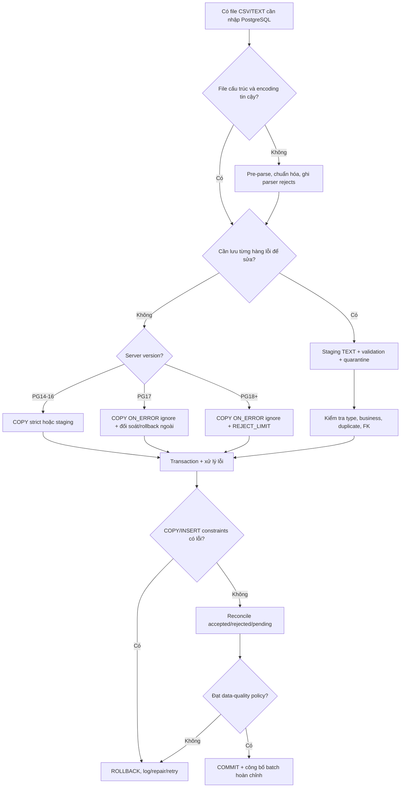

# Xử lý hàng lỗi và giới hạn hỗ trợ theo phiên bản khi nhập xuất dữ liệu PostgreSQL

Một file CSV có 100.000 đơn hàng. Trong đó 50 hàng có ngày không hợp lệ, 3 hàng trùng mã đơn, 2 hàng có số tiền âm và một hàng bị hỏng dấu nháy kép. Nếu dùng `COPY FROM` để nạp trực tiếp vào bảng nghiệp vụ, những lỗi này **không được PostgreSQL xử lý giống nhau**. Một số phiên bản có thể bỏ qua hàng không chuyển được sang kiểu SQL; nhưng **vi phạm khóa chính, CHECK, trigger và lỗi cú pháp CSV không tự biến thành “hàng bị bỏ qua”**.

Điều cốt lõi khi thiết kế pipeline nhập liệu không phải chỉ là “làm sao để lệnh COPY không báo lỗi”, mà là:

1. **Thế nào là hàng hợp lệ?** Có hợp lệ cú pháp CSV, hợp lệ kiểu SQL và hợp lệ nghiệp vụ không?
2. **Lỗi nào được bỏ qua, lỗi nào phải dừng cả lô?**
3. **Có bắt buộc lưu lại chính xác dữ liệu nguồn của hàng bị từ chối không?**
4. **Ngưỡng lỗi nào khiến lô phải thất bại?**
5. **PostgreSQL đang chạy major version nào, và công cụ client có hỗ trợ lựa chọn đó không?**
6. **Nếu việc nạp thất bại giữa chừng, dữ liệu nào đã commit và sẽ retry thế nào?**

Ví dụ tính năng mới nhất trong PostgreSQL ổn định:

```sql
-- PostgreSQL 18+
COPY demo_import.orders (
    order_id, customer_code, amount, ordered_on,
    source_uuid, status
)
FROM STDIN
WITH (
    FORMAT csv,
    HEADER true,
    ON_ERROR ignore,
    REJECT_LIMIT 2,
    LOG_VERBOSITY verbose
);
```

Cú pháp này cho phép bỏ qua **tối đa hai hàng có lỗi chuyển đổi dữ liệu đầu vào sang kiểu cột**. Nó không phải chế độ “bất cứ lỗi gì cũng bỏ qua” và không tự ghi dữ liệu sai vào một bảng lỗi.

Bài học thuộc chương **Nhập xuất dữ liệu** của module *Database Engine Relational PostgreSQL*. Chúng ta sẽ phân tích hành vi `COPY` trên PostgreSQL 14–18, phân biệt `COPY` với `\copy`, khám phá `ON_ERROR`, `REJECT_LIMIT`, `LOG_VERBOSITY`, giới hạn định dạng/constraint/transaction, rồi thực hành hai chiến lược nạp liệu có khả năng quan sát và khôi phục.

> **Giới hạn phạm vi:** Các mốc tính năng theo tài liệu PostgreSQL phát hành chính thức: PostgreSQL 17 bổ sung `ON_ERROR ignore` và `LOG_VERBOSITY`; PostgreSQL 18 bổ sung `REJECT_LIMIT` và mức `LOG_VERBOSITY silent`. Nếu đang dùng một major version khác hoặc bản preview, kiểm tra tài liệu **đúng phiên bản server**. Các lệnh thao tác dữ liệu bên dưới chỉ dành cho database thử nghiệm.

---

## 1. Mục tiêu học tập

Sau bài này, bạn có thể:

- Giải thích thứ tự các tầng phát sinh lỗi khi nhập CSV/TEXT vào PostgreSQL.
- Biết tình huống `COPY FROM` mặc định dừng ở lỗi đầu tiên và câu lệnh thất bại.
- Xác định chính xác phạm vi `ON_ERROR ignore` có từ PostgreSQL 17.
- Dùng `REJECT_LIMIT` từ PostgreSQL 18 để giới hạn số hàng bị bỏ qua do lỗi chuyển kiểu.
- Chọn `LOG_VERBOSITY default`, `verbose`, `silent` theo phiên bản và yêu cầu audit.
- Không nhầm lỗi chuyển đổi kiểu với lỗi unique, foreign key, NOT NULL, CHECK hoặc trigger.
- Không nhầm lỗi parser CSV (thiếu cột, thừa cột, quote lỗi) với lỗi chuyển kiểu dữ liệu.
- Hiểu `COPY count` là số hàng đã được copy thành công, không phải tổng số dòng của file.
- Hiểu `COPY` là câu lệnh có tính transaction; `ON_ERROR ignore` không tạo partial commits độc lập theo từng hàng.
- Dựng staging table chứa giá trị nguồn ở dạng text để cách ly dữ liệu lỗi.
- Dùng `pg_input_is_valid`, `pg_input_error_info` từ PostgreSQL 16 khi phù hợp.
- Lưu bảng quarantine/reject cùng batch ID, vị trí dòng, lý do và giá trị nguồn.
- Thiết kế cơ chế tránh trùng khóa và xử lý lỗi nghiệp vụ trước khi chuyển vào bảng chính.
- Phân biệt quyền đọc file server của `COPY` và file client của `\copy`.
- Tích hợp Java/pgJDBC `CopyManager` với transaction, thống kê và xử lý exception.
- Giám sát `pg_stat_progress_copy` và phân biệt import thành công, thất bại hoặc bỏ qua.
- Thiết kế retry, idempotency, ngưỡng lỗi, kiểm thử phiên bản và kế hoạch rollback.

## 2. Sơ đồ vòng đời một hàng CSV

```text
File / stream nguồn
      │
      ▼
[Đọc bytes, ENCODING]
      │ lỗi encoding/protocol?
      ▼
[CSV/TEXT parser: số cột, quote, delimiter, dòng]
      │ lỗi cấu trúc?
      ▼
[NULL/DEFAULT, ép văn bản sang kiểu SQL]
      │ lỗi chuyển kiểu?
      │   ├── PG < 17 hoặc ON_ERROR stop ──► ERROR, COPY thất bại
      │   └── PG 17+ ON_ERROR ignore ──────► bỏ hàng, đếm skipped
      ▼
[DEFAULT / generated expression / constraints / triggers]
      │ lỗi PK, UNIQUE, CHECK, FK, NOT NULL, trigger?
      └────────────────────────────────────► ERROR, COPY thất bại
      │
      ▼
[Hàng hợp lệ được chèn trong transaction]
      │
      ▼
COMMIT hoặc ROLLBACK theo ứng dụng
```

Sơ đồ này mô tả **những ranh giới ngữ nghĩa cần quan tâm**, không cam kết thứ tự vi mô của mọi xử lý nội bộ cho mọi table/trigger. Quan trọng nhất: chức năng bỏ qua của `ON_ERROR ignore` chỉ áp dụng cho lỗi **chuyển dữ liệu trường đầu vào sang kiểu cột**, không phải cơ chế catch-all.

## 3. Bảng tính năng theo major version

| Tính năng | PG 14–15 | PG 16 | PG 17 | PG 18 |
|---|---|---|---|---|
| `COPY FROM` CSV/TEXT/BINARY | Có | Có | Có | Có |
| Dừng toàn lệnh khi lỗi theo mặc định | Có | Có | Có | Có |
| `COPY FROM ... ON_ERROR ignore` | **Không** | **Không** | **Có** | **Có** |
| `LOG_VERBOSITY default/verbose` cho hàng bị bỏ qua | Không | Không | Có | Có |
| `LOG_VERBOSITY silent` | Không | Không | Không | **Có** |
| `REJECT_LIMIT` | Không | Không | Không | **Có** |
| `pg_stat_progress_copy.tuples_skipped` | Không | Không | **Có** | Có |
| `pg_input_is_valid` / `pg_input_error_info` | Không | **Có** | Có | Có |
| Dùng staging text và SQL validation | Có | Có | Có | Có |
| `\copy` của psql, `COPY ... STDIN` | Có | Có | Có | Có |

Bảng chỉ so sánh **những tính năng liên quan bài**, không khẳng định mọi cú pháp `COPY` trên các phiên bản là giống hệt. Trong một hệ thống đang nâng cấp, kiểm tra cả minor version, extension, driver và managed-service restrictions.

### 3.1. Điểm chuyển phiên bản quan trọng nhất

- **PostgreSQL 17:** cho phép `ON_ERROR ignore` trong `COPY FROM` dạng `text`/`csv`; có `LOG_VERBOSITY default` và `verbose`.
- **PostgreSQL 18:** bổ sung ngưỡng `REJECT_LIMIT` và `LOG_VERBOSITY silent`.
- **PostgreSQL 16:** bổ sung các hàm kiểm tra giá trị đầu vào có ích cho staging `pg_input_is_valid`/`pg_input_error_info`; chúng không thay thế toàn bộ kiểm tra nghiệp vụ.
- **PostgreSQL 14–15:** vẫn làm được pipeline nhập liệu có phân loại/quarantine, nhưng phải tự triển khai validation ngoài hoặc trong database, không dựa vào `COPY ON_ERROR ignore`.

### 3.2. Đừng chọn theo phiên bản psql

Một bản `psql` mới kết nối vào server PostgreSQL 16 **không nâng server thành PostgreSQL 18**. Cú pháp `COPY ... ON_ERROR ignore` được server phân tích và thực thi. Khả năng hỗ trợ phụ thuộc server, không phải chỉ vào version của binary `psql`.

## 4. Kiểm tra phiên bản server

```sql
SELECT version();

SHOW server_version;

SHOW server_version_num;
```

Có thể kiểm tra điều kiện trong SQL:

```sql
SELECT
    current_setting('server_version_num')::integer
        AS server_version_num,
    current_setting('server_version_num')::integer >= 170000
        AS has_copy_on_error,
    current_setting('server_version_num')::integer >= 180000
        AS has_reject_limit;
```

### 4.1. Đừng phân tích phiên bản bằng chuỗi tùy tiện

`server_version_num` thuận tiện cho feature gating của các major versions đã phát hành. Khi PostgreSQL 17 là server, giá trị bắt đầu từ `170000`; PostgreSQL 18 bắt đầu từ `180000`.

### 4.2. Kiểm tra tài liệu đúng version

- [PostgreSQL 16 — COPY](https://www.postgresql.org/docs/16/sql-copy.html)
- [PostgreSQL 17 — COPY](https://www.postgresql.org/docs/17/sql-copy.html)
- [PostgreSQL 18 — COPY](https://www.postgresql.org/docs/18/sql-copy.html)

Đối với một câu lệnh production, hãy kiểm tra tài liệu của **server đang chạy**, không sao chép lựa chọn từ bản `current` mà chưa xác minh.

## 5. COPY FROM mặc định dừng khi lỗi

Cơ chế cơ bản:

```sql
COPY some_table (id, amount)
FROM '/path/on/server/input.csv'
WITH (FORMAT csv, HEADER true);
```

Khi một giá trị không thể chuyển sang kiểu cột, hoặc constraint bị vi phạm, PostgreSQL mặc định báo lỗi và lệnh `COPY` **thất bại**. Những hàng có thể đã được xử lý trước lỗi **không được commit riêng** thành phần thành công của cùng lệnh.

### 5.1. Transaction của COPY

Trong PostgreSQL, `COPY FROM` là một statement thuộc transaction giống DML. Nếu statement thất bại, các thay đổi của nó không được commit như các hàng hợp lệ độc lập.

Với explicit transaction:

```sql
BEGIN;

-- COPY thất bại ở đây sẽ khiến transaction ở trạng thái lỗi.
-- Cần ROLLBACK hoặc xử lý theo savepoint/transaction policy.

ROLLBACK;
```

Không suy từ “đã xử lý 10.000 hàng trước khi lỗi” rằng 10.000 hàng đó có thể được nhìn thấy sau commit nếu cả statement thất bại.

### 5.2. Một tác động tài nguyên quan trọng

PostgreSQL có thể đã ghi vật lý những tuple trước khi COPY thất bại; những tuple đó không còn visible nhưng có thể vẫn chiếm disk space cho tới khi VACUUM dọn. Vì thế một lần COPY file khổng lồ rồi lỗi gần cuối vừa thất bại logic, vừa có thể tạo áp lực lưu trữ.

### 5.3. Không có per-row transaction tự động

`ON_ERROR ignore` **không** có nghĩa cứ mỗi hàng hợp lệ là COMMIT riêng. Các hàng được chấp nhận vẫn thuộc cùng statement/transaction. Một lỗi không được xử lý ở cuối lệnh có thể làm thất bại toàn bộ COPY.

## 6. Bốn loại lỗi phải phân biệt

| Nhóm | Ví dụ | `ON_ERROR ignore` PG17/18? |
|---|---|---|
| **Input type conversion** | `"abc"` vào `integer`; ngày không hợp lệ; UUID sai | **Có thể bỏ qua hàng** |
| **CSV/TEXT structure** | Thừa cột, thiếu cột, CSV quote chưa đóng, lỗi định dạng | **Không** |
| **Constraint** | PK/UNIQUE trùng; NOT NULL; CHECK; FK | **Không** |
| **Trigger/routine/other execution error** | Trigger báo exception, permission denied, mất kết nối | **Không** |

Đây là phân loại thực tế quan trọng hơn việc chỉ biết từ khóa `ON_ERROR`.

### 6.1. Lỗi chuyển kiểu

`COPY` nhận trường text `not-a-number` rồi cần đưa vào `NUMERIC`. Bộ chuyển kiểu cột báo lỗi; `ON_ERROR ignore` được thiết kế chính cho trường hợp đó.

### 6.2. Lỗi constraint

Số tiền `-5.00` là một giá trị `NUMERIC` **hợp lệ về kiểu**. Nhưng nếu bảng khai `CHECK (amount >= 0)`, đó là lỗi nghiệp vụ/constraint, không phải lỗi conversion.

### 6.3. Lỗi parser

CSV có tám trường thay vì sáu là lỗi cấu trúc bản ghi. PostgreSQL không có đủ thông tin để biết nên gắn giá trị vào cột nào. Đừng mong `ON_ERROR ignore` tự sửa alignment.

### 6.4. Lỗi trigger

Trigger có thể ném exception sau khi values đã chuyển kiểu thành công. `ON_ERROR ignore` không phải một khối `EXCEPTION WHEN OTHERS` bao lấy trigger.

## 7. Chuẩn bị database lab

Tạo schema độc lập:

```sql
CREATE SCHEMA IF NOT EXISTS demo_import;
```

Tạo bảng đích có kiểm tra cả kiểu và nghiệp vụ:

```sql
CREATE TABLE demo_import.orders (
    order_id BIGINT PRIMARY KEY,
    customer_code TEXT NOT NULL
        CHECK (btrim(customer_code) <> ''),
    amount NUMERIC(12, 2) NOT NULL
        CHECK (amount >= 0),
    ordered_on DATE NOT NULL,
    source_uuid UUID NOT NULL,
    status TEXT NOT NULL
        CHECK (status IN ('NEW', 'PAID', 'CANCELLED')),
    imported_at TIMESTAMPTZ NOT NULL
        DEFAULT clock_timestamp()
);
```

Điểm thiết kế:

- `order_id` cần chuyển được sang `BIGINT` và không trùng khóa.
- `amount` cần chuyển sang `NUMERIC(12,2)`, không âm.
- `ordered_on` phải là ngày hợp lệ.
- `source_uuid` phải là UUID hợp lệ.
- `status` chỉ nhận 3 giá trị.
- `customer_code` không được để rỗng sau khi loại khoảng trắng hai đầu.

Như vậy có thể cố ý tạo những ví dụ **lỗi kiểu** và **lỗi constraint** riêng biệt.

### 7.1. Xác minh schema

```sql
SELECT
    column_name,
    data_type,
    is_nullable
FROM information_schema.columns
WHERE table_schema = 'demo_import'
  AND table_name = 'orders'
ORDER BY ordinal_position;
```

Nếu chạy lại bài trên một database đã có schema, đảm bảo các objects cùng cấu trúc; không dùng `DROP ... CASCADE` trước khi xem dữ liệu đang tồn tại.

---

## 8. Lab PG18: bỏ qua hai lỗi conversion, nạp ba hàng

Khối sau dành cho **psql nối trực tiếp PostgreSQL 18+**, khi database lab vừa tạo và bảng `orders` chưa có dữ liệu. `COPY FROM STDIN` đọc những dòng CSV nằm ngay sau lệnh tới dấu kết thúc `\.`.

```sql
BEGIN;

COPY demo_import.orders (
    order_id, customer_code, amount,
    ordered_on, source_uuid, status
)
FROM STDIN
WITH (
    FORMAT csv,
    HEADER true,
    ON_ERROR ignore,
    REJECT_LIMIT 2,
    LOG_VERBOSITY verbose
);
order_id,customer_code,amount,ordered_on,source_uuid,status
101,C001,120.50,2026-11-10,11111111-1111-4111-8111-111111111111,PAID
102,C002,not-money,2026-11-11,22222222-2222-4222-8222-222222222222,NEW
103,C003,90.00,not-a-date,33333333-3333-4333-8333-333333333333,PAID
104,C004,80.25,2026-11-12,44444444-4444-4444-8444-444444444444,NEW
105,C005,35.00,2026-11-13,55555555-5555-4555-8555-555555555555,PAID
\.

SELECT
    order_id, customer_code, amount, ordered_on, status
FROM demo_import.orders
ORDER BY order_id;

ROLLBACK;
```

### 8.1. Dự kiến gì?

| Order ID | Giá trị quan trọng | Kết quả |
|---:|---|---|
| 101 | Dữ liệu hợp lệ | Chèn |
| 102 | `amount = not-money` | Bỏ vì không chuyển NUMERIC |
| 103 | `ordered_on = not-a-date` | Bỏ vì không chuyển DATE |
| 104 | Dữ liệu hợp lệ | Chèn |
| 105 | Dữ liệu hợp lệ | Chèn |

Dự kiến command tag của COPY thành công: **`COPY 3`**. `LOG_VERBOSITY verbose` báo thêm thông tin vị trí đầu vào/cột chuyển kiểu thất bại khi bỏ hàng, và cơ chế thông báo số hàng bỏ qua có thể được client hiển thị dưới dạng NOTICE.

### 8.2. Vì sao ROLLBACK ở cuối?

Lệnh COPY đã thành công trong transaction; `SELECT` trước ROLLBACK thấy ba hàng. `ROLLBACK` chỉ dùng để **dọn lab**, giúp bài tiếp theo có thể thử cùng các order IDs từ bảng trống.

Nếu thay `ROLLBACK` bằng `COMMIT`, ba hàng hợp lệ được lưu bền vững.

### 8.3. Đừng chạy nguyên CSV block qua JDBC Statement

Khối `COPY ... FROM STDIN; data ... \.` là dạng tiện cho **psql script**. Với JDBC, ứng dụng dùng giao thức COPY/`CopyManager` để gửi bytes, chứ không gửi cả CSV text nối với SQL bằng một `Statement.execute()`.

### 8.4. Không dùng REJECT_LIMIT trên PG17

Nếu server PostgreSQL 17, bỏ riêng `REJECT_LIMIT 2` vì option đó chỉ xuất hiện từ PostgreSQL 18. Phần còn lại `ON_ERROR ignore, LOG_VERBOSITY verbose` có thể dùng.

## 9. ON_ERROR stop và ignore

`ON_ERROR` nhận hành động lỗi phù hợp.

```sql
-- Mặc định: lỗi chuyển kiểu làm lệnh thất bại.
COPY demo_import.orders
FROM STDIN
WITH (FORMAT csv, ON_ERROR stop);

-- PG17+: bỏ hàng khi conversion lỗi, tiếp tục.
COPY demo_import.orders
FROM STDIN
WITH (FORMAT csv, ON_ERROR ignore);
```

Hai câu trên minh họa syntax; khi dùng `STDIN` trong psql phải có khối dữ liệu hoặc client gửi COPY protocol để hoàn tất.

### 9.1. ON_ERROR stop không phải thông số mới để cứu lỗi

`stop` chỉ thể hiện rõ hành vi mặc định. Nó không tạo reject log hoặc tự rollback những statements trước đó trong transaction khác.

### 9.2. ON_ERROR ignore là best-effort theo một nhóm lỗi

Nếu input chứa một triệu hàng có lỗi chuyển kiểu, `ON_ERROR ignore` **không kèm REJECT_LIMIT** có thể bỏ tất cả những hàng đó và command vẫn thành công nếu không gặp lỗi loại khác.

Đây là lý do từ PostgreSQL 18 nên có ngưỡng lỗi khi độ tin cậy của nguồn dữ liệu chưa cao.

### 9.3. Bỏ qua lỗi chuyển kiểu không tự sửa data quality

Dù COPY thành công, đơn hàng bị bỏ vẫn không nằm trong bảng đích. Nếu những hàng ấy quan trọng, phải có cơ chế đếm, đối chiếu và lưu nguồn lỗi để sửa.

## 10. REJECT_LIMIT của PostgreSQL 18

`REJECT_LIMIT` giới hạn số lỗi chuyển kiểu được phép bỏ qua.

```sql
COPY demo_import.orders
FROM STDIN
WITH (
    FORMAT csv,
    ON_ERROR ignore,
    REJECT_LIMIT 10
);
```

Ý nghĩa: **tối đa 10** hàng bị bỏ do lỗi chuyển kiểu. Khi số lỗi này **vượt quá 10**, COPY thất bại.

### 10.1. REJECT_LIMIT 10 không phải “chỉ chèn 10 hàng”

Nếu file có 100.000 hàng hợp lệ và 8 hàng sai kiểu, vẫn có thể chèn 100.000 hàng. REJECT_LIMIT kiểm soát **số lỗi conversion**, không phải số row inserted.

### 10.2. Ngưỡng phải là số dương

`REJECT_LIMIT` chấp nhận giá trị dương kiểu `bigint`. Không dùng `REJECT_LIMIT 0` để biểu diễn “không cho lỗi”: khi muốn dừng lỗi đầu tiên, dùng `ON_ERROR stop`, là mặc định.

### 10.3. REJECT_LIMIT yêu cầu ON_ERROR ignore

```sql
-- Không hợp lệ:
COPY demo_import.orders
FROM STDIN
WITH (FORMAT csv, REJECT_LIMIT 5);
```

Khi muốn ngưỡng, phải bật `ON_ERROR ignore` cùng option đó.

### 10.4. Vượt ngưỡng làm thất bại cả câu COPY

Nếu ngưỡng 1 nhưng file có hai hàng sai kiểu, hàng lỗi thứ hai khiến câu COPY thất bại. Những hàng hợp lệ của **cùng statement** không được commit riêng như thành công từng phần.

Đây là khác biệt giữa:

- **Thành công, 1 lỗi conversion bị bỏ, các hàng còn lại được chèn**.
- **Thất bại vì 2 lỗi conversion > ngưỡng 1, câu COPY không được commit**.

### 10.5. REJECT_LIMIT không quản lý lỗi nghiệp vụ

Ngay cả ngưỡng 1.000, một hàng chứa amount `-10.00` vi phạm CHECK vẫn có thể làm COPY thất bại, không được đếm vào số hàng conversion được bỏ.

## 11. Log verbosity theo phiên bản

`LOG_VERBOSITY` điều chỉnh mức thông tin về hàng conversion bị bỏ.

| Option | PG17 | PG18 | Ý nghĩa đối với ignored rows |
|---|---|---|---|
| `default` | Có | Có | Thông báo tổng số hàng bị bỏ khi có lỗi |
| `verbose` | Có | Có | Thêm NOTICE cho từng hàng/cột conversion lỗi |
| `silent` | **Không** | Có | Không in thông báo về các hàng bị bỏ |

`LOG_VERBOSITY silent` không biến mọi lỗi database thành thành công. Unique constraint violation hoặc REJECT_LIMIT exceeded vẫn làm COPY thất bại và cần được ứng dụng xử lý.

### 11.1. Vì sao chọn verbose khi debug?

Khi một file nhỏ có lỗi, thông tin về dòng và cột chuyển kiểu giúp tìm input ban đầu.

```sql
WITH (
    FORMAT csv,
    HEADER true,
    ON_ERROR ignore,
    LOG_VERBOSITY verbose
)
```

### 11.2. Tại sao verbose có thể đắt?

Một file có 50.000 hàng conversion lỗi có thể phát nhiều NOTICE, làm client/server logging ồn, lộ dữ liệu về vị trí/cột và tăng chi phí quan sát. Trong production, cân nhắc staging + reject audit thay vì phụ thuộc NOTICE per row.

### 11.3. Vì sao silent cần đối soát riêng?

Nếu chọn:

```sql
WITH (
    FORMAT csv,
    ON_ERROR ignore,
    REJECT_LIMIT 100,
    LOG_VERBOSITY silent
)
```

bạn chủ động không nhận thông báo ignored rows. Điều đó chỉ hợp lý khi pipeline có metrics/đối chiếu source count và danh sách reject ở tầng khác.

### 11.4. LOG_VERBOSITY không phải log_min_messages

Tên gần giống, nhưng `LOG_VERBOSITY` là option của COPY; `log_min_messages`/`client_min_messages` là cấu hình thông báo hệ thống. Đừng thay cấu hình cluster toàn cục chỉ để che cảnh báo của một batch lỗi.

## 12. Các lỗi ON_ERROR ignore không cứu được: CHECK

Thử dữ liệu:

```text
201,C201,-5.00,2026-11-10,
    11111111-1111-4111-8111-111111111111,PAID
```

`-5.00` chuyển thành `NUMERIC(12,2)` thành công, nhưng:

```sql
CHECK (amount >= 0)
```

không cho giá trị âm. Kết quả: COPY thất bại do CHECK; **không** skip vì lỗi loại này nằm sau khâu conversion.

### 12.1. CHECK là business validation

Nếu muốn giữ hàng lỗi cho sửa sau, cần staging text + validation hoặc xử lý row-level có checkpoint. Không tắt CHECK chỉ để nhập thành công rồi mong dữ liệu tự sạch.

## 13. Các lỗi ON_ERROR ignore không cứu được: UNIQUE/PRIMARY KEY

Giả sử file chứa:

```text
301,C301,20.00,2026-11-10,11111111-1111-4111-8111-111111111111,PAID
301,C302,30.00,2026-11-11,22222222-2222-4222-8222-222222222222,NEW
```

Cả hai `order_id` đều là số BIGINT hợp lệ. Hàng thứ hai trùng `PRIMARY KEY` với hàng đầu.

`ON_ERROR ignore` **không** tự biến COPY thành:

```sql
INSERT ... ON CONFLICT DO NOTHING
```

Nếu cần upsert/deduplication, dùng staging rồi `INSERT ... ON CONFLICT` theo một chính sách rõ hoặc xử lý bên ngoài.

### 13.1. Không xóa primary key để “sửa”

Gỡ PK trên production chỉ để nạp file trùng dễ làm hỏng integrity. Tách việc phát hiện trùng vào pipeline và quyết định giữ bản nào/ghi lỗi gì.

## 14. Các lỗi ON_ERROR ignore không cứu được: NOT NULL và FK

Nếu CSV mặc định biểu diễn NULL bằng trường rỗng không được quote:

```text
401,C401,,2026-11-10,11111111-1111-4111-8111-111111111111,PAID
```

thì `amount` có thể được nhận là SQL NULL theo CSV NULL option. Nếu cột `NOT NULL`, constraint thất bại.

Tương tự, `customer_id` là bigint hợp lệ nhưng không tồn tại ở parent table thì FK violation không phải conversion failure.

### 14.1. Phân biệt EMPTY, NULL và invalid numeric

| CSV field | NULL option mặc định của CSV | Kết quả NUMERIC |
|---|---|---|
| `12.30` | Không NULL | `12.30` |
| Trường rỗng không quote | Là null string mặc định | SQL NULL |
| `""` | Có quote, không tự NULL theo default | Chuỗi rỗng -> có thể conversion lỗi |
| `abc` | Không NULL | Conversion lỗi |

`FORCE_NULL`/`FORCE_NOT_NULL` có thể thay cách xử lý quoted/unquoted null strings; xem phần riêng.

## 15. Các lỗi ON_ERROR ignore không cứu được: CSV structure

Các trường hợp:

- Thêm một dấu phẩy ngoài dự kiến.
- Thiếu một cột trong hàng.
- Một trường quote không kết thúc đúng.
- Số fields không bằng column list.
- Dữ liệu không phải CSV hợp lệ theo quote/escape configuration.

`COPY` có thể báo:

```text
ERROR: extra data after last expected column
ERROR: missing data for column ...
ERROR: unterminated CSV quoted field
```

Đây không đơn giản là text của một field không chuyển được sang kiểu SQL. `ON_ERROR ignore` không là CSV repair engine.

### 15.1. Có dấu phẩy bên trong field thì quote đúng

Hợp lệ:

```csv
order_id,customer_code,amount
1,"Khách hàng, VIP",100.00
```

Không hợp lệ về ý định ba cột nếu không quote:

```csv
order_id,customer_code,amount
1,Khách hàng, VIP,100.00
```

Dòng thứ hai của ví dụ sau có bốn trường, khiến COPY dự kiến ba cột báo lỗi.

### 15.2. CSV nhiều dòng trong một field

CSV có thể chứa newline bên trong trường đã quote. **Một record CSV không luôn tương đương một physical text line**. Nếu hệ thống audit dùng line number, cần hiểu thông báo parser/byte offsets và metadata nguồn, không giả định line k luôn là row k.

## 16. Chuyển UUID và JSON không đồng nghĩa qua mọi lỗi

Một giá trị:

```text
not-a-uuid
```

vào cột `uuid` là lỗi input conversion, có thể được `ON_ERROR ignore` bỏ qua theo tài liệu.

Một field `jsonb` chứa JSON syntax không hợp lệ có thể bị báo qua input function; tùy đường xử lý, đó là conversion error. Nhưng đừng suy ra **mọi** lỗi tạo ra khi deserialize payload, gọi trigger, CHECK JSON schema hoặc xử lý encoding đều được ignore.

### 16.1. JSON hợp lệ nhưng sai business schema

`{"amount":"abc"}` là JSONB hợp lệ; PostgreSQL `COPY` vào `jsonb` có thể chèn nó dù nghiệp vụ muốn amount number. Bản thân `ON_ERROR ignore` **không validate JSON schema domain**.

### 16.2. VARCHAR length và domain constraints

Một chuỗi không phù hợp với độ dài cột hoặc domain constraint có thể bị từ chối ở các giai đoạn khác nhau tùy type/input path. Không mở rộng tuyên bố “ignore mọi lỗi nhập liệu” từ một vài ví dụ numeric/date.

## 17. BINARY format không nhận ON_ERROR ignore

`COPY` có ba format chính:

```text
text
csv
binary
```

`ON_ERROR ignore` chỉ được hỗ trợ cho **COPY FROM khi FORMAT text hoặc csv** trong PostgreSQL 17/18.

```sql
-- Không dùng như một cấu hình hợp lệ:
COPY demo_import.orders
FROM STDIN
WITH (FORMAT binary, ON_ERROR ignore);
```

### 17.1. Vì sao không nên ép binary để tránh lỗi?

Binary COPY có định dạng, OID/kiểu/phiên bản và giao thức riêng. Nó không phải một cách tự động sửa file CSV sai encoding, quote hoặc types.

### 17.2. COPY TO không dùng ON_ERROR ignore

`COPY TO` là xuất dữ liệu từ PostgreSQL, không đọc các trường text vào SQL types. Không có chức năng “bỏ qua hàng input chuyển kiểu lỗi” cho nó như COPY FROM.

## 18. HEADER true khác HEADER MATCH

`HEADER true` của CSV **bỏ qua hàng header**, không nhất thiết kiểm tra tên cột header khớp với column list.

```sql
COPY demo_import.orders (
    order_id, customer_code, amount,
    ordered_on, source_uuid, status
)
FROM STDIN
WITH (FORMAT csv, HEADER true);
```

Nếu file đảo header `amount,order_id,...` nhưng data cũng đảo theo header, lệnh trên vẫn đọc **theo vị trí của column list**; có thể báo conversion error, hoặc tệ hơn nhập sai ý nghĩa nếu các cột cùng kiểu.

### 18.1. HEADER MATCH chặt hơn

Trên server có hỗ trợ:

```sql
COPY demo_import.orders (
    order_id, customer_code, amount,
    ordered_on, source_uuid, status
)
FROM STDIN
WITH (FORMAT csv, HEADER MATCH);
```

`HEADER MATCH` yêu cầu số lượng, tên và thứ tự header phù hợp các cột đang import.

### 18.2. HEADER MATCH không thay schema validation

Dù header đúng, dữ liệu phía dưới vẫn có thể sai kiểu, trùng ID, âm tiền hoặc dùng status không hợp lệ.

### 18.3. Header có UTF-8 BOM

Một file xuất từ spreadsheet có thể bắt đầu bằng UTF-8 BOM. Tùy path/reader, BOM có thể làm tên cột đầu tiên không match hoặc tạo giá trị lạ. Kiểm tra/chuẩn hóa encoding từ pipeline, không tự loại ký tự đầu một cách mù quáng nếu đang xử lý dữ liệu có giá trị.

## 19. ENCODING: lỗi bytes khác lỗi type conversion

`COPY FROM` nhận bytes theo `ENCODING` option hoặc client encoding thích hợp.

```sql
COPY demo_import.orders
FROM STDIN
WITH (
    FORMAT csv,
    HEADER true,
    ENCODING 'UTF8'
);
```

Nếu nguồn là Windows-1258, Latin-1, Shift-JIS hoặc chứa invalid UTF-8, một lỗi encoding/character sequence có thể xảy ra **trước khi** có chuỗi text hợp lệ để đưa vào input conversion của cột.

### 19.1. ON_ERROR ignore không phải bộ sửa encoding

Không kỳ vọng nó loại riêng bytes hỏng rồi tiếp tục như thể từng hàng hợp lệ. Với dữ liệu Unicode lỗi, cần xác định nguồn encoding hoặc làm sạch ở tầng file ingestion.

### 19.2. Không áp “UTF8” chỉ vì application dùng UTF-8

Nếu file thực tế có encoding khác, khai sai encoding có thể làm lỗi hoặc tạo ký tự mojibake. Dùng kiểm tra nguồn, ETL transformation và đối chiếu với hệ thống xuất.

### 19.3. Vietnamese text cần được đối soát

Ví dụ tên `Nguyễn, Trần, Đặng`. Kiểm thử dấu tiếng Việt và các trường có newline/quotes để chắc bộ mã và parser đúng; không chỉ test toàn ASCII.

## 20. CSV NULL, chuỗi rỗng và quoted field

Mặc định trong CSV, một trường **rỗng không quote** tương ứng null string, trong khi `""` thường được hiểu là chuỗi rỗng.

```csv
id,note
1,
2,""
3,"Cần gọi lại"
```

Kết quả thường:

- Row 1: SQL NULL.
- Row 2: text rỗng `''`.
- Row 3: text `Cần gọi lại`.

### 20.1. Tự chọn NULL token

```sql
COPY some_text_stage
FROM STDIN
WITH (
    FORMAT csv,
    HEADER true,
    NULL '__NULL__'
);
```

Khi chọn token `__NULL__`, trường rỗng sẽ là text rỗng (trừ khi áp các FORCE options), còn token được xác định là SQL NULL.

### 20.2. FORCE_NULL

Với CSV và cột cụ thể:

```sql
WITH (
    FORMAT csv,
    FORCE_NULL (note)
)
```

có thể khiến cả giá trị null string đã quote cũng được nhận là SQL NULL.

### 20.3. FORCE_NOT_NULL

`FORCE_NOT_NULL` thay cách nhận diện null string không quote theo cột, hữu ích khi muốn giữ chuỗi rỗng thay vì NULL.

### 20.4. Chính sách NULL phải thống nhất với bên xuất

Một bên export dùng `NULL '__NULL__'` nhưng bên import dùng mặc định rỗng có thể nhập sai dữ liệu. Nên có data contract mô tả `DELIMITER`, `QUOTE`, `ESCAPE`, `NULL`, `HEADER`, `ENCODING`.

## 21. DEFAULT values không là cơ chế sửa row hỏng

Nếu COPY ghi danh sách cột không chứa `created_at`:

```sql
COPY demo_import.orders (
    order_id, customer_code, amount,
    ordered_on, source_uuid, status
)
FROM STDIN
WITH (FORMAT csv, HEADER true);
```

thì `imported_at` nhận default `clock_timestamp()`.

Nếu cột được liệt kê nhưng field dữ liệu là SQL NULL, database **không tự biến mọi NULL thành DEFAULT**.

### 21.1. DEFAULT option của COPY

PostgreSQL có option `DEFAULT 'token'` cho phép một chuỗi marker được diễn giải thành default value trên cột tương ứng trong `COPY FROM` text/csv theo phiên bản hỗ trợ.

Điều đó khác `ON_ERROR ignore`: marker DEFAULT được chọn rõ và hợp lệ; nó không chữa một giá trị `not-a-date` bất kỳ.

### 21.2. Đừng dùng marker trùng dữ liệu thực

Nếu một khách thật có tên `DEFAULT` nhưng bạn cũng chọn marker `DEFAULT` cho option, dễ có va chạm ý nghĩa. Chọn token đã thỏa thuận với nguồn và escape/quote phù hợp.

## 22. COPY FROM WHERE có lọc, không giữ hàng lỗi

`COPY FROM ... WHERE` cho phép chỉ chèn những rows thỏa điều kiện, theo hạn chế syntax của server:

```sql
COPY demo_import.orders (
    order_id, customer_code, amount,
    ordered_on, source_uuid, status
)
FROM STDIN
WITH (FORMAT csv, HEADER true)
WHERE amount >= 0;
```

Nhưng:

- WHERE không là bảng quarantine.
- Để so `amount >= 0`, giá trị phải được chuyển thành numeric.
- Hàng có type conversion lỗi không tự thành row rejected có thể tra cứu.
- Một số expressions như subqueries/generated columns không được hỗ trợ trong COPY WHERE.
- Nếu CHECK/PK/trigger khác lỗi, lệnh vẫn có thể thất bại.

### 22.1. WHERE không nhìn thấy thay đổi từ chính COPY theo cách dùng để dedup

Không dùng `COPY WHERE NOT EXISTS(...)` làm bộ lọc uniqueness phức tạp; cú pháp/semantics COPY WHERE hạn chế, và nó không thay `ON CONFLICT` hay staging.

## 23. COPY FROM không hỗ trợ ON CONFLICT trực tiếp

`INSERT INTO ... ON CONFLICT` là DML có cơ chế chọn cách xử lý unique violation.

`COPY FROM` **không có** mệnh đề chuẩn:

```sql
-- Không hợp lệ:
COPY demo_import.orders FROM STDIN
WITH (FORMAT csv)
ON CONFLICT DO NOTHING;
```

Nếu nguồn có duplicate IDs, tách:

```text
COPY → staging → kiểm tra/dedup → INSERT ... ON CONFLICT ...
```

hoặc chọn chiến lược ngoài database (ETL/app) có transactions đúng.

### 23.1. DO NOTHING cũng chưa đủ để audit lỗi

`ON CONFLICT DO NOTHING` bỏ một row trùng khóa, nhưng không tự ghi reason/source row vào bảng lỗi. Với yêu cầu đối soát nghiêm ngặt, cần ghi duplicate vào quarantine trước/sau với cơ chế chống race.

### 23.2. DO UPDATE cần quy tắc nguồn dữ liệu

Nếu hai rows trùng khóa trong cùng batch nhưng muốn upsert, cần biết giữ row nào, version nào mới hơn và có “last write wins” hay không. Không dùng `DO UPDATE` vô điều kiện khi bản ghi trùng có thể do file lỗi.

---

## 24. REJECT_LIMIT là guardrail, không phải reject file

Một pipeline có hai nhu cầu:

1. **Guardrail:** dừng file nếu quá nhiều lỗi.
2. **Traceability:** ghi lại từng hàng sai cùng nguyên nhân và dữ liệu gốc.

`REJECT_LIMIT` đáp ứng nhu cầu 1 cho conversion errors trên PG18. Nó **không tự tạo**:

```text
rejected_rows.csv
reject_reason_table
error_code_per_record
source_byte_offset
```

Muốn giữ dữ liệu gốc để sửa, cần thiết kế thêm ở ETL hoặc staging/quarantine.

### 24.1. NOTICE không là nguồn audit bền vững

`LOG_VERBOSITY verbose` phát thông báo, nhưng client có thể không thu thập, log bị rotate, hoặc thông báo không chứa đủ raw record. Không xem NOTICE là kho lưu lỗi có bảo đảm.

### 24.2. Đếm số hàng cũng chưa đủ

Một file có 2 hàng lỗi có thể bị chấp nhận bởi REJECT_LIMIT 5, nhưng nếu đó là hai hóa đơn giá trị lớn, nghiệp vụ vẫn có thể muốn thất bại. Guardrail cần kết hợp phân loại mức độ quan trọng.

## 25. Chiến lược staging: nạp text trước, xử lý sau

Mô hình:

```text
CSV từ nguồn
   │
   ▼
[Staging: raw strings + batch ID + source row]
   │
   ├── [Kiểm tra conversion/NULL/domain]
   │         ├── bad ──► [Quarantine: reason + raw record]
   │         └── good
   ▼
[Deduplicate + business validation]
   │
   ├── bad / duplicate ──► [Quarantine]
   └── good ────────────► [INSERT/UPSERT bảng đích]
                              │
                              ▼
                      [Batch metrics + COMMIT]
```

Ưu điểm:

- Áp dụng được cho PostgreSQL 14–18.
- Giữ raw values để sửa và reprocess.
- Kiểm tra nhiều lỗi nghiệp vụ và dữ liệu liên bảng.
- Có thể đưa metrics về batch/quarantine.
- Hỗ trợ retry theo batch ID.

Giới hạn:

- Một CSV thực sự **không parse được** vẫn không thể COPY an toàn vào staging chỉ vì mọi cột là text. Phải pre-parse/repair cấu trúc trước.
- Staging không tự giải quyết encoding lỗi hoặc malicious input.
- Phải xác định transaction/idempotency/concurrency.
- Lưu raw PII cần chính sách bảo mật và thời hạn xóa.

## 26. Tạo staging và quarantine tables

Tạo staging. `source_line` là **số thứ tự bản ghi do ETL/preprocessor cung cấp**, không tự là physical line của CSV có field newline.

```sql
CREATE TABLE demo_import.raw_orders (
    batch_id TEXT NOT NULL,
    source_line BIGINT NOT NULL,

    order_id_text TEXT,
    customer_code_text TEXT,
    amount_text TEXT,
    ordered_on_text TEXT,
    source_uuid_text TEXT,
    status_text TEXT,

    loaded_at TIMESTAMPTZ NOT NULL
        DEFAULT clock_timestamp()
);
```

Tạo bảng lưu từ chối:

```sql
CREATE TABLE demo_import.rejected_rows (
    batch_id TEXT NOT NULL,
    source_line BIGINT NOT NULL,
    reason_code TEXT NOT NULL,
    raw_record JSONB NOT NULL,
    rejected_at TIMESTAMPTZ NOT NULL
        DEFAULT clock_timestamp(),

    PRIMARY KEY (batch_id, source_line)
);
```

### 26.1. Vì sao raw fields là TEXT?

Ta muốn đưa những chuỗi `not-money` hoặc `wrong-date` vào staging mà không cần ép ngay thành NUMERIC/DATE, tránh thất bại ở bước COPY sơ cấp.

### 26.2. Vì sao metadata không nhất thiết là TEXT?

`batch_id` và `source_line` là metadata do importer kiểm soát. Khi chúng được sinh đúng, có thể chọn TEXT/BIGINT có constraint. Nếu metadata cũng đến từ nguồn không đáng tin, hãy xử lý nó như một phần của dữ liệu cần validate trước.

### 26.3. Một reason cho mỗi raw row trong lab

Primary key `(batch_id,source_line)` lưu **một lý do đầu tiên** cho một row. Nếu muốn ghi nhiều lỗi trên cùng row, thay schema bằng `(batch_id,source_line,reason_code)` hoặc tách bảng `reject_diagnostics`.

### 26.4. Bảng lỗi không nên lưu secrets vô thời hạn

`raw_record` có thể chứa tên, email, số tài khoản hoặc nội dung nhạy cảm. Giới hạn `GRANT SELECT`, mã hóa/bảo mật storage, masking, retention và audit access.

## 27. Nạp staging không phụ thuộc ON_ERROR ignore

Khối sau chạy được trên PostgreSQL 14–18 trong **psql**. Dùng CSV có sẵn metadata `batch_id`/`source_line` đã được thêm trước khi import.

```sql
COPY demo_import.raw_orders (
    batch_id, source_line,
    order_id_text, customer_code_text, amount_text,
    ordered_on_text, source_uuid_text, status_text
)
FROM STDIN
WITH (
    FORMAT csv,
    HEADER true,
    NULL '__NULL__'
);
batch_id,source_line,order_id_text,customer_code_text,amount_text,ordered_on_text,source_uuid_text,status_text
batch-A,2,101,C101,120.50,2026-11-10,11111111-1111-4111-8111-111111111111,PAID
batch-A,3,102,C102,not-money,2026-11-11,22222222-2222-4222-8222-222222222222,NEW
batch-A,4,103,C103,90.00,not-a-date,33333333-3333-4333-8333-333333333333,PAID
batch-A,5,104,C104,80.25,2026-11-12,not-a-uuid,NEW
batch-A,6,101,C106,77.00,2026-11-13,66666666-6666-4666-8666-666666666666,PAID
batch-A,7,106,C106,-5.00,2026-11-14,77777777-7777-4777-8777-777777777777,NEW
batch-A,8,107,C107,20.00,2026-11-15,88888888-8888-4888-8888-888888888888,UNKNOWN
batch-A,9,108,,25.00,2026-11-16,99999999-9999-4999-8999-999999999999,PAID
batch-A,10,109,C109,99.95,2026-11-17,aaaaaaaa-aaaa-4aaa-8aaa-aaaaaaaaaaaa,NEW
batch-A,11,110,C110,200.00,2026-11-18,bbbbbbbb-bbbb-4bbb-8bbb-bbbbbbbbbbbb,PAID
\.
```

### 27.1. Mười bản ghi nguồn

Có **10 records** có dữ liệu, không tính header. Theo hợp đồng lab:

- **3 records hợp lệ**: source_line 2, 10, 11.
- **3 lỗi chuyển kiểu**: line 3 (numeric), 4 (date), 5 (uuid).
- **1 duplicate order ID**: line 6 trùng ID 101 của line 2.
- **3 lỗi nghiệp vụ**: line 7 amount âm, line 8 status UNKNOWN, line 9 customer_code rỗng.

Sau khi kiểm tra/loại trùng, kỳ vọng **3 accepted + 7 rejected = 10**.

### 27.2. NULL token được đặt khác trường rỗng

`NULL '__NULL__'` khiến trường rỗng của customer ở line 9 giữ thành text `''`, để business validator quyết định sai vì empty code. Nếu dùng default CSV NULL rỗng, giá trị đó thành SQL NULL; vẫn phải reject theo business rule, nhưng lý do được phân loại khác.

### 27.3. COPY staging vẫn có thể thất bại nếu CSV cấu trúc sai

Đó là giới hạn thiết yếu: staging text bỏ qua lỗi **chuyển kiểu business fields**, không bỏ qua lỗi lệch cột/quote/encoding của parser. Pipeline chuyên nghiệp cần preflight parsing hoặc đầu vào đúng format contract.

## 28. Kiểm tra staging row count

```sql
SELECT
    batch_id,
    COUNT(*) AS raw_count,
    MIN(source_line) AS first_line,
    MAX(source_line) AS last_line
FROM demo_import.raw_orders
GROUP BY batch_id;
```

Dự kiến `batch-A` có 10 records với source_line từ 2 tới 11.

### 28.1. Một batch ID cố định dễ đối chiếu

Khi chia nhiều files/chunks, nên có batch ID độc lập với filename để phân biệt import attempts và nguồn dữ liệu. Trong production dùng UUID/metadata table phù hợp và enforce uniqueness policy.

### 28.2. COUNT(*) không tự cho biết file có bao nhiêu CSV records

Nếu một số rows đã bị bỏ bởi COPY ON_ERROR trước khi vào staging, `COUNT(*)` của staging không biết số records bị bỏ. Với staging TEXT không ignore conversion, ta cố gắng nhận đủ **các records đã parse hợp lệ**. Vẫn cần đối soát count từ file parser ở ngoài.

## 29. PostgreSQL 16+: pg_input_is_valid

`pg_input_is_valid(text, type_name)` kiểm tra liệu một chuỗi có thể được input function của một kiểu SQL chấp nhận hay không.

```sql
SELECT
    pg_input_is_valid('123.45', 'numeric(12,2)')
        AS good_amount,
    pg_input_is_valid('not-money', 'numeric(12,2)')
        AS bad_amount,
    pg_input_is_valid('2026-11-14', 'date')
        AS good_date,
    pg_input_is_valid('not-a-date', 'date')
        AS bad_date,
    pg_input_is_valid('not-a-uuid', 'uuid')
        AS bad_uuid;
```

Hàm này có từ **PostgreSQL 16**. Với PostgreSQL 14–15, cần dùng validation ở application/ETL hoặc PL/pgSQL exception handling có kiểm soát.

### 29.1. Lưu ý soft error support

Theo tài liệu, `pg_input_is_valid` chỉ hoạt động theo cách trả TRUE/FALSE cho lỗi nếu input function của type đã hỗ trợ cơ chế **soft error**. Với kiểu không hỗ trợ, input sai vẫn có thể làm statement lỗi.

Đừng dùng nó như một catch-all validator cho bất kỳ extension/custom type nào mà chưa kiểm thử.

### 29.2. Input validity không bảo đảm business validity

`pg_input_is_valid('-5.00','numeric(12,2)')` là TRUE dù bảng có CHECK amount >= 0. Nó kiểm tra khả năng chuyển kiểu, không tự truy cập table constraints.

### 29.3. Numeric typmod

`numeric(12,2)` khác `numeric` vô hạn precision/scale. Kiểm tra input theo type declaration thực giúp nhận diện value overflow/precision issues phù hợp. Nhưng vẫn cần kiểm thử rounding policy của giá trị được chấp nhận.

## 30. pg_input_error_info: lấy lý do conversion

`pg_input_error_info` trả metadata của lỗi input conversion khi soft error được hỗ trợ:

```sql
SELECT *
FROM pg_input_error_info(
    'not-money',
    'numeric(12,2)'
);
```

Kết quả gồm các trường như:

```text
message
detail
hint
sql_error_code
```

### 30.1. Không dùng error text như khóa nghiệp vụ

Thông báo có thể thay đổi theo locale/version. Để phân loại, dùng `reason_code` ổn định do ETL định nghĩa như `BAD_AMOUNT`, `BAD_DATE`, `BAD_UUID`; giữ database error message như thông tin chẩn đoán bổ sung nếu cần.

### 30.2. Không log data nhạy cảm trong messages

Một input value lỗi có thể bị nêu trong error message. Với file chứa dữ liệu cá nhân, mask trước khi gửi logs/observability.

## 31. Materialize kết quả kiểm tra kiểu

Tạo temporary table trong session hiện tại:

```sql
CREATE TEMP TABLE checked_raw AS
SELECT
    r.*,
    COALESCE(
        pg_input_is_valid(r.order_id_text, 'bigint'),
        false
    ) AS id_ok,
    COALESCE(
        pg_input_is_valid(r.amount_text, 'numeric(12,2)'),
        false
    ) AS amount_ok,
    COALESCE(
        pg_input_is_valid(r.ordered_on_text, 'date'),
        false
    ) AS date_ok,
    COALESCE(
        pg_input_is_valid(r.source_uuid_text, 'uuid'),
        false
    ) AS uuid_ok
FROM demo_import.raw_orders AS r
WHERE r.batch_id = 'batch-A';
```

Lệnh này dùng PG16+ và các built-in types trong lab.

### 31.1. Tại sao materialize bước kiểm tra?

Khi bảng `checked_raw` đã tồn tại, các lần kiểm tra sau không cần parse lại mỗi value. Nó cũng làm pipeline dễ hiểu: bước sau chỉ chuyển kiểu những records có các flags `*_ok = TRUE`.

### 31.2. Không nhầm checked với accepted

Một row có numeric/date/uuid hợp lệ vẫn có thể amount âm, status sai hoặc duplicate key. Những vấn đề này sẽ được kiểm tra ở bước sau.

### 31.3. Quyết định với raw NULL

`COALESCE(...,false)` khiến raw NULL bị coi là không hợp lệ cho các required typed fields của bảng đích. Nếu một field thực sự nullable, không thể dùng quy tắc này nguyên xi; phải xem SQL NULL có được phép hay không.

## 32. Lưu các lỗi conversion vào quarantine

```sql
INSERT INTO demo_import.rejected_rows (
    batch_id, source_line, reason_code, raw_record
)
SELECT
    c.batch_id,
    c.source_line,
    CASE
        WHEN NOT c.id_ok THEN 'BAD_ORDER_ID'
        WHEN NOT c.amount_ok THEN 'BAD_AMOUNT'
        WHEN NOT c.date_ok THEN 'BAD_DATE'
        WHEN NOT c.uuid_ok THEN 'BAD_UUID'
        ELSE 'UNKNOWN_TYPE_ERROR'
    END,
    to_jsonb(c)
        - 'id_ok'
        - 'amount_ok'
        - 'date_ok'
        - 'uuid_ok'
FROM checked_raw AS c
WHERE NOT (
    c.id_ok AND c.amount_ok
    AND c.date_ok AND c.uuid_ok
);
```

Dự kiến **3 rejected rows**: source_line 3, 4 và 5.

### 32.1. Nếu một row sai nhiều fields?

`CASE` chọn **lỗi đầu tiên theo thứ tự được khai**, không ghi tất cả. Nếu phải hiển thị mọi lỗi cho người dùng, lưu nhiều diagnostics rows hoặc JSON array các lỗi.

### 32.2. Raw record trong JSONB

`to_jsonb(c)` ở đây lưu dữ liệu từng cột của staging, không giữ byte-exact CSV gốc (quote/escape/whitespace có thể đã được parser biến đổi). Nếu cần chứng cứ raw file nguyên bản, lưu object gốc vào storage riêng kèm checksum, không xem JSONB staging là bản sao byte-for-byte.

### 32.3. Không trộn reason_code với SQLSTATE một cách mù quáng

Một field `BAD_DATE` có thể ứng với nhiều SQLSTATE theo format/out-of-range; business reason cố định thường thuận tiện cho dashboards và retry policy hơn.

## 33. Tạo tập chỉ chứa raw fields chuyển kiểu được

```sql
CREATE TEMP TABLE good_raw AS
SELECT *
FROM checked_raw
WHERE id_ok
  AND amount_ok
  AND date_ok
  AND uuid_ok;
```

Bây giờ chỉ những rows có thể parse các kiểu `BIGINT`, `NUMERIC(12,2)`, `DATE`, `UUID` mới được chuyển kiểu.

### 33.1. Vì sao không viết một câu SELECT cast toàn bộ raw ngay?

`SELECT amount_text::numeric FROM raw_orders` sẽ báo lỗi tại `not-money` trước khi bạn có cơ hội gắn reason. Dùng hai bước vật chất hóa/đánh dấu giúp tránh việc cast không điều kiện trên raw lỗi.

### 33.2. Với custom type phải kiểm tra riêng

Nếu một kiểu input function không hỗ trợ soft errors, `checked_raw` có thể không được tạo thành công. Đặt bước import validation ngoài database hoặc PL/pgSQL được kiểm soát đối với các kiểu đó.

## 34. Chuyển good_raw thành typed rows

```sql
CREATE TEMP TABLE typed_rows AS
SELECT
    batch_id,
    source_line,

    order_id_text::bigint AS order_id,
    customer_code_text AS customer_code,
    amount_text::numeric(12,2) AS amount,
    ordered_on_text::date AS ordered_on,
    source_uuid_text::uuid AS source_uuid,
    status_text AS status
FROM good_raw;
```

Đã có ba rows conversion-failed bị loại ở bước trước, nên những rows còn lại của lab có thể cast.

### 34.1. Kiểu SQL đã định nghĩa rõ

`typed_rows.amount` là numeric và `typed_rows.source_uuid` là uuid; từ bước này không cần so sánh date như text hoặc parse UUID theo regular expression.

### 34.2. Sai business rule chưa được giải quyết

Những rows có amount âm, status UNKNOWN hoặc customer_code rỗng **vẫn hiện diện** trong `typed_rows`. Đây là chủ đích: kiểm tra kiểu và kiểm tra nghiệp vụ là hai tầng khác nhau.

## 35. Lưu lỗi nghiệp vụ vào quarantine

```sql
INSERT INTO demo_import.rejected_rows (
    batch_id, source_line, reason_code, raw_record
)
SELECT
    t.batch_id,
    t.source_line,
    CASE
        WHEN t.amount < 0 THEN 'NEGATIVE_AMOUNT'
        WHEN NULLIF(btrim(t.customer_code), '') IS NULL
            THEN 'EMPTY_CUSTOMER'
        WHEN t.status IS NULL
             OR t.status NOT IN ('NEW', 'PAID', 'CANCELLED')
            THEN 'UNKNOWN_STATUS'
        ELSE 'UNKNOWN_BUSINESS_ERROR'
    END,
    to_jsonb(t)
FROM typed_rows AS t
WHERE t.amount < 0
   OR NULLIF(btrim(t.customer_code), '') IS NULL
   OR t.status IS NULL
   OR t.status NOT IN ('NEW', 'PAID', 'CANCELLED');
```

Dự kiến thêm **3 rejected rows**: source_line 7, 8, 9.

### 35.1. CHECK trong bảng đích vẫn là tuyến phòng thủ cuối

Việc validate trong pipeline giúp ghi lỗi có lý do tốt, nhưng **không thay** NOT NULL/CHECK/UNIQUE trên bảng đích. Nếu importer bị bug hoặc một client khác ghi dữ liệu, database constraints vẫn bảo vệ invariants.

### 35.2. Nếu cần validate FK

Có thể LEFT JOIN bảng tham chiếu để tìm customer không tồn tại. Nhưng foreign key vẫn bắt buộc tại bảng đích; tránh race giữa kiểm tra và insert bằng transaction/isolation/constraint design phù hợp.

## 36. Tạo tập đủ điều kiện nghiệp vụ

```sql
CREATE TEMP TABLE eligible_rows AS
SELECT *
FROM typed_rows AS t
WHERE t.amount >= 0
  AND NULLIF(btrim(t.customer_code), '') IS NOT NULL
  AND t.status IN ('NEW', 'PAID', 'CANCELLED');
```

Dự kiến còn bốn rows: source_line 2, 6, 10, 11.

Trong đó source_line 2 và 6 cùng `order_id = 101`. Cần quyết định duplicate trước khi INSERT.

## 37. Xác định trùng ID ngay trong batch

```sql
CREATE TEMP TABLE numbered_rows AS
SELECT
    e.*,
    row_number() OVER (
        PARTITION BY e.order_id
        ORDER BY e.source_line
    ) AS id_rank
FROM eligible_rows AS e;
```

`id_rank = 1` là bản ghi đầu tiên theo source_line cho một order ID, `id_rank > 1` là bản ghi trùng sau.

### 37.1. Thứ tự chọn duplicate phải được công bố

Ở lab: “giữ row đầu tiên theo source_line”. Nghiệp vụ khác có thể giữ row có `updated_at` mới nhất, ưu tiên trusted source hoặc reject cả group duplicate.

Đừng chọn một hàng ngẫu nhiên vì thiếu ORDER BY.

### 37.2. Duplicates vẫn phải được audit

`row_number` chỉ đánh dấu. Nếu không ghi quarantine, pipeline có thể mất dấu rằng dữ liệu nguồn chứa ID trùng.

## 38. Ghi duplicate vào quarantine

```sql
INSERT INTO demo_import.rejected_rows (
    batch_id, source_line, reason_code, raw_record
)
SELECT
    n.batch_id,
    n.source_line,
    'DUPLICATE_ORDER_ID_IN_BATCH',
    to_jsonb(n)
FROM numbered_rows AS n
WHERE n.id_rank > 1;
```

Dự kiến thêm **1 rejected row**: source_line 6.

### 38.1. Trùng với dữ liệu đã có trong bảng đích

Nếu bảng `orders` đã có `order_id` trong một batch trước, cần xử lý theo policy khác: skip, update, reject hoặc error. Không dùng một rule trùng trong batch để suy luôn cách xử lý existing-target conflicts.

## 39. Ghi các hàng hợp lệ vào bảng đích

Với lab chạy lần đầu, target `orders` đang rỗng:

```sql
INSERT INTO demo_import.orders (
    order_id, customer_code, amount,
    ordered_on, source_uuid, status
)
SELECT
    n.order_id,
    n.customer_code,
    n.amount,
    n.ordered_on,
    n.source_uuid,
    n.status
FROM numbered_rows AS n
WHERE n.id_rank = 1
  AND NOT EXISTS (
      SELECT 1
      FROM demo_import.orders AS o
      WHERE o.order_id = n.order_id
  )
ON CONFLICT (order_id) DO NOTHING;
```

Dự kiến chèn **3 rows**: order_id 101, 109, 110.

### 39.1. Vì sao có ON CONFLICT DO NOTHING?

Đó là lưới an toàn ở constraint khi retry/concurrent insert. Nó không thay logic audit: một row bị DO NOTHING do race có thể **chưa được ghi vào quarantine** trong ví dụ đơn giản này.

### 39.2. Cần reconcile actual inserted IDs trong production

Để bảo đảm không mất dấu rejects trong trường hợp concurrency, thêm một bước nhận diện rows thực được insert bằng `RETURNING`/batch marker, khóa phù hợp hoặc transaction/canonical import key; mọi row được xử lý phải có một trạng thái cuối.

### 39.3. Không dùng source_line làm khóa nghiệp vụ

`source_line` là metadata audit trong một batch. Khóa duy nhất ở bảng đích vẫn là `order_id` theo contract nghiệp vụ.

## 40. Đối soát accepted và rejected

```sql
SELECT
    order_id, customer_code, amount, ordered_on, status
FROM demo_import.orders
ORDER BY order_id;

SELECT
    batch_id, source_line, reason_code
FROM demo_import.rejected_rows
ORDER BY batch_id, source_line;
```

Dự kiến:

- Accepted: 3 (101, 109, 110).
- Rejected: 7.
- Tổng: 10.

### 40.1. Bảng tổng hợp

```sql
SELECT
    (SELECT COUNT(*)
     FROM demo_import.raw_orders
     WHERE batch_id = 'batch-A') AS raw_count,

    (SELECT COUNT(*)
     FROM demo_import.rejected_rows
     WHERE batch_id = 'batch-A') AS rejected_count,

    (SELECT COUNT(*)
     FROM demo_import.orders
     WHERE order_id IN (101,109,110)) AS accepted_count;
```

Chỉ dùng truy vấn accepted_count mẫu khi dataset vẫn đúng như lab và target không có records cũ trùng; trong production hãy theo dõi `batch_id` trên bảng đích/ledger để đếm chuẩn.

### 40.2. Đừng chỉ so raw_count = accepted + rejected nếu có trạng thái pending

Một pipeline có thể có rows chờ manual review, duplicate target, retry in-progress hoặc skipped-by-policy. Thiết kế ledger để mỗi raw row có **một trạng thái cuối hoặc một trạng thái chờ rõ ràng**.

## 41. Tạo import batch ledger

Trong production, có thể thêm:

```sql
CREATE TABLE demo_import.import_batch (
    batch_id TEXT PRIMARY KEY,
    source_name TEXT NOT NULL,
    source_checksum TEXT NOT NULL,
    started_at TIMESTAMPTZ NOT NULL DEFAULT now(),
    finished_at TIMESTAMPTZ,
    status TEXT NOT NULL
        CHECK (status IN (
            'RECEIVED', 'LOADING', 'VALIDATING',
            'ACCEPTED', 'PARTIAL', 'REJECTED', 'FAILED'
        )),
    raw_count BIGINT,
    accepted_count BIGINT,
    rejected_count BIGINT
);
```

### 41.1. Checksum phải đi kèm file identity

Một filename không bảo đảm hai lần import có cùng nội dung. Hash/checksum của file nguồn giúp phát hiện retry nhầm file đã thay đổi.

### 41.2. Nhãn trạng thái phải có semantics rõ

`PARTIAL` có thể nghĩa một số row bị reject nhưng phần accepted đã commit; `FAILED` có thể nghĩa cả batch transaction bị rollback. Đừng dùng nhãn mơ hồ nếu hệ thống downstream phải biết có thể tiêu thụ dữ liệu hay không.

### 41.3. Reconciliation là một invariant nghiệp vụ

Mục tiêu:

```text
raw_count = accepted_count + rejected_count + pending_count
```

Với một trạng thái cuối loại trừ nhau cho từng row. Nếu hệ thống có retry versions hoặc một nguồn row tạo nhiều targets, điều chỉnh invariant phù hợp và ghi rõ.

## 42. Staging trên PG14–15 khi chưa có pg_input_is_valid

Bạn vẫn có thể:

1. COPY CSV vào staging text.
2. Parse và validate các fields trong Java/Python/ETL đáng tin.
3. Ghi candidates hợp lệ qua prepared statements/COPY thứ hai.
4. Ghi rejects với reason code vào quarantine.

Hoặc viết PL/pgSQL function có `BEGIN ... EXCEPTION ... END` cho từng row, nhưng cần hiểu chi phí subtransaction.

### 42.1. Ví dụ kiểm tra row bằng PL/pgSQL với exception

```sql
CREATE FUNCTION demo_import.try_parse_amount(
    p_value TEXT
)
RETURNS NUMERIC
LANGUAGE plpgsql
AS $$
DECLARE
    v_amount NUMERIC;
BEGIN
    v_amount := p_value::numeric(12,2);
    RETURN v_amount;

EXCEPTION
    WHEN invalid_text_representation
      OR numeric_value_out_of_range THEN
        RETURN NULL;
END;
$$;
```

Hàm minh họa kỹ thuật, **không** đủ để phân biệt amount thật sự NULL với parse failed, và có chi phí exception. Để pipeline production, dùng result record có `is_valid` và `error_code` riêng nếu NULL là giá trị hợp lệ.

### 42.2. Cẩn thận với WHEN OTHERS THEN NULL

`WHEN OTHERS` nuốt cả lỗi lập trình, permission/locking/constraint hoặc dữ liệu không dự tính, làm pipeline im lặng mất dữ liệu. Chỉ catch SQLSTATE cụ thể và ghi chẩn đoán cần thiết.

### 42.3. Một lỗi conversion không phải lỗi nghiệp vụ

Ngay cả khi parse amount thành numeric thành công, vẫn cần CHECK nonnegative, currency policy, business validation và uniqueness.

## 43. Chi phí của exception per row

Một PL/pgSQL block có EXCEPTION sử dụng cơ chế subtransaction. Nếu hàng triệu rows và tỷ lệ lỗi cao, overhead có thể đáng kể.

Cân nhắc:

- Prevalidate ở ETL theo file schema.
- Các hàm `pg_input_is_valid` khi hỗ trợ (PG16+).
- Set-based SQL trên các raw fields đã phân loại.
- Batching theo chunks có thể retry.
- External data processing cho CSV malformed.

Không xây một loop `FOR row IN SELECT ... LOOP BEGIN INSERT ... EXCEPTION WHEN OTHERS ... END END LOOP` làm giải pháp mặc định cho tất cả dữ liệu lớn.

## 44. So sánh ba chiến lược nhập liệu

| Tiêu chí | COPY strict | COPY ignore PG17/18 | Staging + validation |
|---|---|---|---|
| Hỗ trợ lỗi kiểu | Dừng | Bỏ hàng conversion lỗi | Phân loại theo luật tự định |
| Kiểm soát số lỗi | 0 | PG18 có REJECT_LIMIT | Tự đặt limit/ratio |
| Tự giữ raw rejected records | Không | Không | Có, nếu thiết kế |
| Lỗi unique/CHECK/trigger | Dừng | Dừng | Có thể phát hiện trước; DB vẫn enforce |
| Lỗi CSV cấu trúc | Dừng | Dừng | Staging COPY cũng dừng, cần pre-parser |
| Hỗ trợ PostgreSQL 14 | Có | Không | Có |
| Độ phức tạp | Thấp | Thấp-trung bình | Trung bình-cao |
| Audit/reprocess | Hạn chế | Hạn chế | Tốt khi xây đúng |
| Throughput tiềm năng | Cao | Cao cho lỗi conversion ít | Phụ thuộc nhiều bước |
| Phù hợp tài chính/hệ thống nhạy cảm | Khi fail-fast | Chỉ nếu có policy rất rõ | Thường phù hợp hơn nếu cần lưu mọi lỗi |

Không có một cách luôn tốt nhất. Nếu file đã được kiểm tra từ nguồn đáng tin, strict COPY dễ bảo đảm toàn vẹn. Nếu dữ liệu bên ngoài chất lượng biến động, staging có thể đáng đầu tư.

---

## 45. \copy khác COPY server file

SQL:

```sql
COPY demo_import.orders
FROM '/var/lib/postgresql/import/orders.csv'
WITH (FORMAT csv, HEADER true);
```

đọc file bằng **tiến trình PostgreSQL server**; path phải nằm trên server hoặc storage server truy cập được. Quyền server-file bị hạn chế với superuser hoặc predefined roles như `pg_read_server_files`.

Trong `psql`, meta-command:

```text
\copy demo_import.orders FROM './orders.csv' WITH (FORMAT csv, HEADER true)
```

đọc file trên **máy chạy psql**, gửi stream qua `COPY ... FROM STDIN`.

### 45.1. \copy là lệnh của psql

Không gửi một chuỗi bắt đầu bằng `\copy` qua JDBC `Statement.execute()`. Nó không phải cú pháp SQL server.

### 45.2. \copy option vẫn chịu server version

Dù psql đọc file tại client, những lựa chọn như `ON_ERROR ignore`/`REJECT_LIMIT` vẫn được server thực thi. PG16 sẽ không hiểu REJECT_LIMIT chỉ vì psql mới.

### 45.3. \copy thường phù hợp ứng dụng và laptop hơn

Bạn không cần cấp `pg_read_server_files` cho service chỉ muốn đưa file từ máy ứng dụng lên database. Chỉ cấp server-file privileges khi bài toán và security review thực sự cần.

### 45.4. \copy và quyền bảng

Dù file nằm ở client, user vẫn cần quyền `INSERT` trên target table, schema USAGE và những quyền khác phù hợp. `\copy` không bypass database ACL.

## 46. psql \copy và file CSV

Ví dụ PG18:

```text
\copy demo_import.orders (order_id, customer_code, amount, ordered_on, source_uuid, status) FROM './orders.csv' WITH (FORMAT csv, HEADER true, ON_ERROR ignore, REJECT_LIMIT 5, LOG_VERBOSITY verbose)
```

Đặt toàn bộ `\copy` meta-command trên một dòng trong script psql vì parser của `\copy` không tuân theo mọi quy tắc xuống dòng giống câu SQL thông thường.

### 46.1. Không giả định đường dẫn giống nhau trên máy chủ

`./orders.csv` là đường dẫn tương đối của **psql client process**, không của PostgreSQL backend. Nếu chạy Docker, CI hay remote host, “current directory” có thể khác kỳ vọng.

### 46.2. \copy to stdout

`\copy ... TO STDOUT` giúp xuất CSV qua client. Nếu redirect vào file, áp quyền file OS, encoding và xử lý escaping. Không đưa file dữ liệu thô chứa thông tin nhạy cảm vào log terminal.

## 47. psql ON_ERROR_STOP khác COPY ON_ERROR

Hai cái tên gần giống:

- `COPY ... ON_ERROR ignore`: **server** bỏ conversion-error rows trong cùng COPY.
- `psql -v ON_ERROR_STOP=1`: **client psql** dừng thực thi script sau SQL error.

```text
psql -v ON_ERROR_STOP=1 -d mydb -f import.sql
```

Một COPY báo lỗi do CHECK/duplicate vẫn là SQL ERROR; psql ON_ERROR_STOP có thể dừng script sau lỗi đó.

### 47.1. Nếu COPY ignore thành công

Khi chỉ có conversion errors được bỏ trong giới hạn và statement thành công, psql không coi đó là SQL ERROR phải dừng script (nhưng có thể in NOTICE).

### 47.2. ON_ERROR_STOP không là reject collector

Nó không lưu từng hàng sai hoặc tự xác định các lỗi nghiệp vụ. Chỉ quyết định việc chạy tiếp script.

## 48. COPY và pg_restore/pg_dump

`pg_dump`/`pg_restore` là công cụ backup/restore; nhiều định dạng dump dùng COPY để nạp dữ liệu.

Nhưng:

- Backup/restore hướng tới **khôi phục dữ liệu chính xác**, không phải best-effort bỏ qua hàng lỗi.
- `pg_restore --exit-on-error` kiểm soát việc tool dừng khi một lệnh restore báo lỗi; **không giống** COPY ON_ERROR ignore.
- `--single-transaction` giúp kiểm soát atomicity restore khi phù hợp, nhưng cần đánh giá workload và locks.
- Đừng sửa dump rồi bật skip rows để “restore gần đúng” khi yêu cầu integrity.

### 48.1. Restore fail và đối soát

Nếu restore từ bản backup đáng tin mà COPY báo conversion lỗi, cần xác định schema mismatch, encoding, extension/version compatibility hoặc file hỏng. Chỉ bỏ rows có thể làm sai toàn bộ dữ liệu và foreign keys.

### 48.2. Không sửa constraints để import nhanh rồi quên bật lại

Vô hiệu hóa triggers hoặc bỏ FKs có thể dẫn đến dữ liệu không nhất quán nếu không tái validate. Những thao tác này cần migration/DBA procedure có kiểm soát, không là phương pháp sửa CSV hỏng thông thường.

## 49. Quyền COPY và Row-Level Security

PostgreSQL 18 docs lưu ý `COPY FROM` trực tiếp **không hỗ trợ** trên tables bật Row-Level Security; dùng `INSERT` tương đương khi cần kiểm tra policies, hoặc thiết kế staging rồi INSERT qua role/policy phù hợp.

### 49.1. COPY TO và RLS

`COPY table TO` chịu chính sách SELECT thích hợp. Nếu cần một SELECT phức tạp từ view/RLS scope, dùng `COPY (SELECT ...) TO STDOUT` theo các quyền hợp lệ.

### 49.2. Staging không được bypass RLS

Đưa dữ liệu vào staging rồi chạy INSERT bằng privileged owner có thể vô tình vượt tenant restrictions nếu thiết kế sai. Xác định role, SECURITY DEFINER/INVOKER, policies và auditing rõ ràng.

### 49.3. Không cấp superuser cho importer

User chỉ cần đọc file client và INSERT bảng không cần quyền superuser hoặc `pg_read_server_files`. Hạn chế privileges là một phần quan trọng của pipeline.

## 50. Triggers có chạy khi COPY FROM không?

Có. `COPY FROM` kích hoạt triggers và CHECK constraints theo quy tắc PostgreSQL; nó không kích hoạt SQL rewrite rules theo cùng cách thông thường.

Ví dụ trigger:

```sql
CREATE FUNCTION demo_import.validate_status_trigger()
RETURNS trigger
LANGUAGE plpgsql
AS $$
BEGIN
    IF NEW.status = 'PAID'
       AND NEW.amount = 0 THEN
        RAISE EXCEPTION
            'PAID order cannot have amount zero';
    END IF;

    RETURN NEW;
END;
$$;

CREATE TRIGGER trg_validate_status
BEFORE INSERT ON demo_import.orders
FOR EACH ROW
EXECUTE FUNCTION demo_import.validate_status_trigger();
```

### 50.1. ON_ERROR ignore không catch trigger exceptions

Nếu một hàng `PAID` có amount `0`, input numeric hợp lệ, CHECK `amount>=0` hợp lệ, nhưng trigger báo exception. COPY thất bại, không skip hàng đó như conversion error.

### 50.2. Trigger side effects và transaction

Những thay đổi dữ liệu được trigger thực hiện trong cùng transaction bị rollback khi statement/transaction thất bại. Nhưng external effects do function gọi ra ngoài database (nếu có) cần được đánh giá riêng; không giả định PostgreSQL có thể rollback một HTTP call.

### 50.3. Trigger test nên chạy cuối lab

Ví dụ này thay behavior INSERT; nếu tạo trước các bài khác có order PAID amount zero, tác động sẽ khác. Mục tiêu là minh họa ranh giới lỗi, không hướng dẫn thay business rule chung của mọi hệ thống.

## 51. Không dùng COPY để kiểm tra business uniqueness trước import

Ngay cả khi CSV đã được prevalidated ở application, hai importer đồng thời vẫn có thể tranh cùng primary key. Database UNIQUE constraint là tuyến bảo vệ cuối.

Thiết kế có thể gồm:

- Unique key theo source event ID.
- Idempotency key theo batch ID + source row.
- Serializing/batch claim theo nguồn.
- `INSERT ... ON CONFLICT` với policy rõ.
- Per-row acceptance ledger và reconciliation.

Không dùng check `NOT EXISTS` đơn thuần mà bỏ qua unique constraint và concurrency races.

## 52. Bắt lỗi ở tầng application

Nếu dùng Java/ETL, hãy phân biệt:

- **ValidationError:** row invalid theo contract trước COPY.
- **CsvParseError:** file malformed/field count/quote/encoding.
- **CopyConversionError:** input value không parse được bởi SQL type.
- **DatabaseConstraintError:** SQLSTATE 23xxx theo PK/FK/CHECK.
- **OperationalError:** timeout, disk full, permission, connection loss.

### 52.1. Chỉ retry lỗi có thể hồi phục

- Một UUID sai format **không tự sửa** nếu retry nguyên giá trị.
- Một lỗi network tạm thời có thể retry, nhưng phải tránh nhập trùng.
- Unique violation có thể là dấu hiệu retry hợp lệ hoặc lỗi dữ liệu; cần source identity.
- Constraint violation thường là lỗi cần sửa nguồn/logic, không phải tăng retry count vô hạn.

### 52.2. SQLSTATE hữu ích hơn error message

| SQLSTATE | Ý nghĩa thường gặp |
|---|---|
| `22P02` | Invalid text representation, ví dụ UUID/numeric sai |
| `22007` | Invalid datetime format |
| `22003` | Numeric value out of range |
| `23502` | NOT NULL violation |
| `23503` | Foreign key violation |
| `23505` | Unique violation |
| `23514` | CHECK violation |
| `42501` | Insufficient privilege |

Thông báo và SQLSTATE cụ thể còn tùy code path; đừng hard-code text lỗi tiếng Anh để điều khiển business flow.

## 53. pgJDBC CopyManager: gửi dữ liệu qua STDIN

Với Java, pgJDBC hỗ trợ COPY protocol qua `org.postgresql.copy.CopyManager`.

```java
import java.io.Reader;
import java.nio.charset.StandardCharsets;
import java.nio.file.Files;
import java.nio.file.Path;
import java.sql.Connection;
import org.postgresql.PGConnection;
import org.postgresql.copy.CopyManager;

Connection conn = dataSource.getConnection();

try {
    conn.setAutoCommit(false);

    int serverVersionNum;
    try (var st = conn.createStatement();
         var rs = st.executeQuery(
             "SELECT current_setting('server_version_num')::integer")) {
        rs.next();
        serverVersionNum = rs.getInt(1);
    }

    if (serverVersionNum < 180000) {
        throw new IllegalStateException(
            "PG18+ required for REJECT_LIMIT");
    }

    String copySql = """
        COPY demo_import.orders (
            order_id, customer_code, amount,
            ordered_on, source_uuid, status
        )
        FROM STDIN
        WITH (
            FORMAT csv,
            HEADER true,
            ON_ERROR ignore,
            REJECT_LIMIT 20,
            LOG_VERBOSITY verbose
        )
        """;

    CopyManager copy =
        conn.unwrap(PGConnection.class).getCopyAPI();

    try (Reader input = Files.newBufferedReader(
            Path.of("orders.csv"), StandardCharsets.UTF_8)) {

        long copiedCount = copy.copyIn(copySql, input);

        System.out.println(
            "Accepted COPY rows: " + copiedCount);
    }

    conn.commit();

} catch (Exception ex) {
    conn.rollback();
    throw ex;
} finally {
    conn.close();
}
```

### 53.1. Đây là ví dụ thành phần Java, không là toàn bộ ứng dụng

Cần có `DataSource`, xử lý cấu hình/kết nối, module dependencies và transaction policy đúng trong project. Không thực thi sample trên database production với file tùy ý.

### 53.2. copiedCount không phải rawCount

Giá trị trả về biểu thị số rows COPY thành công, không nhất thiết bằng số records nguồn khi `ON_ERROR ignore` bỏ các lỗi conversion.

### 53.3. Dùng cùng physical connection

`CopyManager` lấy từ `PGConnection` đang giữ transaction. Không lấy manager từ connection A rồi commit connection B.

### 53.4. Reader và encoding

`Files.newBufferedReader(..., UTF_8)` đọc văn bản UTF-8. Driver chuyển thành dữ liệu COPY theo connection/encoding. Nếu nguồn là binary COPY hoặc encoding khác, cần API/strategy phù hợp; không dùng Reader để xử lý raw bytes binary mà không hiểu protocol.

## 54. CopyManager trên PostgreSQL 17

Nếu server version nằm trong nhóm 17:

```java
String copySqlPg17 = """
    COPY demo_import.orders (
        order_id, customer_code, amount,
        ordered_on, source_uuid, status
    )
    FROM STDIN
    WITH (
        FORMAT csv,
        HEADER true,
        ON_ERROR ignore,
        LOG_VERBOSITY verbose
    )
    """;
```

Không truyền `REJECT_LIMIT` hoặc `LOG_VERBOSITY silent`.

### 54.1. Tự giới hạn tỷ lệ rejected ở PG17

Vì không có server-side REJECT_LIMIT, ứng dụng có thể:

1. Đếm tổng records từ parser tin cậy.
2. Chạy COPY ON_ERROR ignore trong transaction.
3. Lấy count accepted và skipped (thông báo/metrics).
4. Nếu vượt ngưỡng chấp nhận, `ROLLBACK` trước commit.
5. Nếu đạt policy, `COMMIT`.

Cách này cần **đối soát số liệu chính xác** và xử lý lỗi định dạng/constraint. Nếu dùng riêng metrics mà không có raw rejects, pipeline vẫn có hạn chế audit.

### 54.2. Driver có thể không cung cấp một reject list

`CopyManager.copyIn` trả row count, không tự gửi lại toàn bộ raw malformed rows. Nếu cần danh sách lỗi, parse/file staging riêng.

## 55. CopyManager trên PostgreSQL 16 trở xuống

Với PG16 trở xuống:

```java
String copySqlOld = """
    COPY demo_import.orders (
        order_id, customer_code, amount,
        ordered_on, source_uuid, status
    )
    FROM STDIN
    WITH (FORMAT csv, HEADER true)
    """;
```

Một conversion error sẽ khiến COPY thất bại. Nếu yêu cầu partial acceptance, dùng staging text + ETL hoặc split file thành chunks có transaction/retry rõ.

### 55.1. Không dựa vào client emulate ON_ERROR ignore âm thầm

Một thư viện bên ngoài có thể pre-filter bad rows, nhưng đó là **functionality của client**, không phải COPY server. Chứng minh nó xử lý quote/Unicode/NULL/schema và lưu rejects theo đúng hợp đồng.

## 56. Batch transaction và thông báo lỗi trong JDBC

Nếu COPY thất bại trong transaction:

- Exception được ném ở JDBC.
- Transaction có thể ở trạng thái aborted.
- Caller nên `rollback()` hoặc xử lý theo savepoint policy đúng.
- Không gọi `commit()` theo đường “thành công” khi COPY error.
- Cần ghi batch outcome trong transaction/ledger phù hợp.

### 56.1. Không phụ thuộc chỉ vào số rows copyIn()

Nếu COPY thành công nhưng bỏ 20 conversion-error rows, `copiedCount` không có nghĩa input file chỉ có đúng từng ấy rows.

### 56.2. Đừng nuốt SQLException

`catch (SQLException ex) { log.warn(...); conn.commit(); }` là thiết kế nguy hiểm nếu transaction đã abort và pipeline vẫn tuyên bố thành công.

### 56.3. Ghi metadata lỗi có kiểm soát

Lưu batch_id, phase, SQLSTATE, elapsed time và error category. Tránh lưu password/connection URI chứa secrets hay full CSV nhạy cảm vào log chung.

## 57. pg_stat_progress_copy

Các backend đang chạy COPY có thể được quan sát:

```sql
SELECT
    pid,
    datname,
    command,
    type,
    bytes_processed,
    bytes_total,
    tuples_processed,
    tuples_excluded,
    tuples_skipped
FROM pg_stat_progress_copy
WHERE datname = current_database();
```

**Query này dành cho PostgreSQL 17+**, nơi `tuples_skipped` được bổ sung. Với phiên bản cũ hơn, chọn các cột thực sự có trong view (bỏ `tuples_skipped`).

### 57.1. Đọc các counters

- `bytes_processed`: số bytes xử lý.
- `bytes_total`: tổng bytes khi hệ thống biết được, có thể không sẵn với stream.
- `tuples_processed`: tiến độ tuples được xử lý theo view semantics.
- `tuples_excluded`: rows bị loại theo `COPY WHERE`.
- `tuples_skipped`: rows bỏ qua vì input conversion errors theo PG17+.

### 57.2. View chỉ có rows khi COPY đang chạy

`pg_stat_progress_copy` không phải lịch sử batch đã hoàn tất. Khi backend kết thúc COPY, entry biến mất. Muốn biết lô hôm qua bỏ bao nhiêu hàng, cần persist metrics vào bảng/application monitoring.

### 57.3. Không tính exact reject list từ view

`tuples_skipped` là counter tiến độ, không chứa data/column/reason của từng row. Staging hoặc ETL reject log vẫn cần thiết khi nghiệp vụ đòi reprocess.

## 58. Phân biệt tuples_skipped và tuples_excluded

Ví dụ:

```sql
COPY demo_import.orders (...)
FROM STDIN
WITH (FORMAT csv, ON_ERROR ignore)
WHERE amount > 0;
```

Có thể có:

- Hàng numeric `abc`: bị skip vì conversion error.
- Hàng numeric `0`: chuyển kiểu hợp lệ, nhưng bị excluded bởi WHERE.
- Hàng numeric `100`: pass, được insert nếu không vi phạm constraints.

**Không cộng dồn hai loại thành một “bad row” khi đánh giá chất lượng nguồn**. Hàng bị lọc có thể hoàn toàn hợp lệ về dữ liệu.

## 59. COPY count và đối soát

Sau COPY thành công, PostgreSQL trả command tag:

```text
COPY 3
```

Nó cho biết số rows được copy thành công. Không bao gồm:

- Hàng bị bỏ do `ON_ERROR ignore`.
- Hàng bị loại theo `COPY WHERE`.
- Header line.
- Các records chưa được đọc do file/lệnh thất bại.

### 59.1. Công thức đối soát đơn giản

Nếu file parser xác định **N logical records**, không có COPY WHERE và chỉ có conversion-error skips:

```text
N = accepted + skipped
```

Nhưng nếu file malformed, constraints abort, dữ liệu bị biến đổi trước COPY, hoặc nhiều phases có dedup, công thức phải mở rộng. Đừng suy từ physical newline count.

### 59.2. Không tính rejected bằng tổng dòng file - COPY count vô điều kiện

Một field CSV có embedded newline tạo nhiều physical lines; HEADER, blank lines, COPY WHERE, parser error và tiền xử lý cũng ảnh hưởng kết quả.

## 60. Lỗi khi đặt REJECT_LIMIT quá cao

Với `ON_ERROR ignore, REJECT_LIMIT 100000000`, một file thiếu phần lớn dữ liệu hợp lệ vẫn có thể COPY thành công. Đây là **data loss hợp lệ theo cú pháp nhưng sai nghiệp vụ**.

### 60.1. Kết hợp ngưỡng tuyệt đối và tỷ lệ

Một policy ví dụ:

```text
accepted_count > 0
skipped_count <= 50
skipped_count / total_records <= 0.001
zero unexpected constraint failures
all source checksums verified
```

`REJECT_LIMIT` chỉ hỗ trợ một phần của policy đó. Tỷ lệ, critical fields, file-level integrity phải được kiểm tra ngoài.

### 60.2. Không có “magic threshold”

Ngưỡng 2 lỗi hợp lý với lab 5 records nhưng có thể quá nghiêm với 100 triệu telemetry rows; ngược lại, 2 lỗi trong sổ kế toán có thể không được phép.

## 61. Retry toàn batch và idempotency

Giả sử COPY đã commit 100.000 rows, nhưng client timeout trước khi nhận ACK. Nếu tự chạy lại y nguyên file:

- Các IDs có thể trùng primary key.
- COPY trực tiếp có thể thất bại.
- Nếu không có unique key, dữ liệu có thể bị nhân đôi.
- Rejected rows có thể bị ghi lặp.

### 61.1. Idempotency key

Lưu `batch_id` và checksum của file, định nghĩa một batch được chấp nhận bao nhiêu lần, và bảo vệ bằng unique constraints/ledger.

### 61.2. Dùng staging để retry

Khi raw data được lưu và có batch metadata, có thể validate/merge lại mà không phụ thuộc file gốc còn ở cùng client path. Nhưng cần tránh chạy lại rows đã accepted hoặc biến rejected thành accepted vô tình sau thay đổi policy.

### 61.3. Network error không nói kết quả commit

Một lỗi kết nối lúc commit có thể khiến client không biết server đã commit hay chưa. Hỏi lại batch ledger trên connection mới trước khi retry, không dùng cảm giác “không nhận ACK nên chưa commit”.

## 62. Parallel COPY và concurrency

Nạp nhiều files/chunks song song có thể tăng throughput, nhưng phải xét:

- Unique key conflicts giữa chunks.
- Locks và index page contention.
- WAL/I/O/CPU saturation.
- Batch-level consistency.
- Transaction rollback khi một chunk fail.
- Duplicate same source rows giữa files.
- Quarantine reconciliation.

### 62.1. ON_ERROR ignore không làm concurrency failures biến mất

Một unique violation do hai COPY song song cùng chèn ID vẫn có thể abort một statement.

### 62.2. Chọn partitions/keys

Partitioning hoặc tách target theo workload có thể giúp, nhưng không thay correctness. Tránh chia file chỉ theo row count nếu có business dependencies giữa các records.

## 63. Staging và transaction boundaries

Có hai phương án:

**Atomic batch:**

```text
BEGIN
  COPY raw
  validate
  write rejects
  insert accepted
  write batch ledger
COMMIT
```

Ưu: accepted/rejected/metrics nhất quán cùng commit. Nhược: transaction lâu, lock/WAL/storage lớn.

**Phased batch:**

```text
TX1: persist raw + batch metadata
TX2: validate + quarantine
TX3: merge accepted + reconcile
```

Ưu: có thể resume và xử lý khối lớn. Nhược: cần explicit states và retry idempotency.

### 63.1. Không có một transaction strategy đúng mọi nơi

Bảng 10 rows có thể làm trong một transaction. Nạp 100 triệu records có thể cần chunks và checkpoint, nhưng phải thiết kế consistency giữa chunks.

### 63.2. Quarantine phải chịu cùng chính sách khôi phục

Nếu accepted rows đã commit nhưng reject table fail, pipeline có thể mất audit. Chọn transaction grouping hoặc outbox/reconciliation có thể khôi phục.

## 64. Chuỗi CSV có số, ngày và locale

File nhập liệu từ spreadsheet có thể dùng:

```text
1.234,56
11/14/2026
14.11.2026
14-11-2026
```

Ý nghĩa phụ thuộc locale và format. PostgreSQL input functions chấp nhận một số dạng, từ chối dạng khác; ngày có thể bị diễn giải khác theo `DateStyle`.

### 64.1. Chuẩn hóa contract trước COPY

Ví dụ nên dùng:

```text
numeric: 1234.56 (dấu chấm thập phân, không phân cách hàng nghìn)
date:    2026-11-14 (ISO YYYY-MM-DD)
uuid:    canonical 8-4-4-4-12 hex
timestamp: ISO 8601 có offset nếu là instant
```

### 64.2. DateStyle ảnh hưởng input/output

```sql
SHOW DateStyle;
```

Nếu import/export cần portable, dùng ISO dates trong file hoặc cấu hình DateStyle tương ứng trong session/workflow; không kỳ vọng môi trường dev/prod dùng cùng DateStyle mặc định.

### 64.3. ON_ERROR ignore có thể che dữ liệu sai

Một file toàn ngày `DD/MM/YYYY` vào server dùng cấu hình khác có thể tạo conversion errors và bị skip hàng loạt. Guardrail kiểm tra tỷ lệ accepted bắt buộc với dữ liệu kiểu này.

## 65. TIMESTAMPTZ và timezone trong CSV

Ví dụ:

```text
2026-11-14T09:30:00+07:00
```

là mốc thời gian xác định. Nếu source chỉ có:

```text
2026-11-14 09:30:00
```

và target là `timestamptz`, server có thể diễn giải theo session `TimeZone`. Dữ liệu có thể **được parse hợp lệ nhưng sai instant** — `ON_ERROR ignore` không giúp gì.

### 65.1. Không đánh đồng “parse OK” với “dữ liệu đúng”

Sai timezone, sai currency, sai tenant ID và sai unit (cents vs dollars) vẫn có thể hợp lệ theo SQL types.

### 65.2. Timezone phải nằm trong source contract

Nếu field là instant, yêu cầu offset/UTC trong input hoặc có source timezone metadata đã được kiểm chứng.

## 66. Số tiền và đơn vị

Giá trị `150.00` vào `NUMERIC(12,2)` là hợp lệ. Nhưng nó có thể nghĩa 150 VND, 150 USD hoặc 150 cents.

COPY type conversion không kiểm tra unit. Hệ thống nhập liệu cần xác định:

- Currency code.
- Decimal scale.
- Rounding policy.
- Max/min amount.
- Tax-inclusive/exclusive semantics.

Không dùng `ON_ERROR ignore` thay kiểm tra đơn vị tiền.

## 67. Identity/sequence và retry

Nếu bảng đích sinh ID bằng identity/default nextval, một COPY lỗi sau khi sinh một số IDs có thể để lại **khoảng trống trong sequence**, vì sequence state không tuân rollback như table rows.

### 67.1. Sequence gaps là bình thường

Không lấy giả định ID tăng liên tục không có lỗ hổng làm invariant đối soát số rows.

### 67.2. Source key vẫn quan trọng

Nếu mỗi retry được cấp ID mới, dễ có duplicate business records. Lưu source unique ID/idempotency key khác với surrogate sequence nếu business cần xác định cùng một record.

### 67.3. COPY với identity columns

Khi COPY nhận giá trị identity column trong input, PostgreSQL xử lý chúng theo quy tắc riêng tương đương cho phép giá trị identity explicit. Đừng mặc định identity sẽ sinh số mới khi file đã truyền ID. Muốn dùng default, không đưa cột đó vào input column list.

## 68. File quá lớn và thất bại cuối

Nếu import 100 GB, hàng cuối gây constraint failure:

- COPY không commit những rows của statement thất bại.
- Có thể tạo table bloat/dead tuples.
- File phải import lại hoặc xử lý từ checkpoint.
- Thời gian/WAL/I/O bị lãng phí.

### 68.1. Preflight giảm rủi ro

- Kiểm tra encoding và CSV structure.
- Kiểm tra header/schema agreement.
- Kiểm tra số records/chunk checksum.
- Kiểm tra kiểu/constraints trong staging.
- Chạy pilot batch.
- Mở rộng theo chunks có transaction policy.

### 68.2. Chunks không tự cho atomic full-file

Nếu chunk 1 commit và chunk 2 fail, dữ liệu sẽ ở trạng thái partial. Cần batch status/consumer gating nếu downstream không được nhìn thấy file chưa hoàn chỉnh.

## 69. Xử lý lỗi CSV trước database

Một parser CSV ngoài database nên:

1. Đọc đúng encoding.
2. Tôn trọng quoted commas, doubled quotes, embedded newlines.
3. Xác định records, không chỉ đếm `\n`.
4. Kiểm tra số fields theo header.
5. Gắn batch ID/source record number.
6. Ghi parser rejects riêng với raw bytes/offset nếu được phép.
7. Chỉ gửi records parse được vào staging.
8. Bảo vệ khỏi input file khổng lồ hoặc deeply nested fields/CSV formula injection ở downstream spreadsheet.

### 69.1. CSV formula injection khi export sang spreadsheet

Nếu export dữ liệu không đáng tin vào CSV rồi người dùng mở bằng spreadsheet, text bắt đầu bằng `=`, `+`, `-` hoặc `@` có thể bị ứng dụng spreadsheet hiểu như công thức tùy sản phẩm. PostgreSQL COPY tạo CSV đúng cú pháp, **không tự xử lý an toàn công thức trong Excel/Sheets**.

Khi CSV là báo cáo người dùng mở trong spreadsheet, áp policy escaping/sanitization theo target application mà không làm phá raw data audit.

### 69.2. Không dùng split(",")

`line.split(",")` không là CSV parser đúng khi quoted values có dấu phẩy, quote hoặc newline. Dùng thư viện CSV đáng tin với format policy.

## 70. COPY vào partitioned table

`COPY FROM` có thể dùng với partitioned tables theo quy tắc PostgreSQL; rows được route vào partitions phù hợp. Nhưng lỗi thiếu partition, CHECK/constraint/trigger hoặc unique conflict không tự thành conversion ignored row.

### 70.1. Missing partition không phải bad numeric

Nếu `ordered_on` parse DATE hợp lệ nhưng không có partition cho ngày đó, import có thể fail do partition routing.

### 70.2. Staging hữu ích để kiểm tra partition range

Precheck date range và partition availability trước khi chuyển dữ liệu lớn, nhất là import lịch sử.

## 71. Các lỗi operational không được ON_ERROR ignore

| Lỗi | Vì sao không là conversion row error |
|---|---|
| Disk full | Không thể ghi storage/WAL |
| Connection reset | Mất COPY protocol/session |
| Cancel/statement timeout | Statement bị dừng |
| Deadlock | Transaction conflict |
| Permission denied | User không được INSERT/đọc file |
| RLS unsupported for COPY FROM | Giới hạn target relation/policy |
| Trigger exception | Lỗi execution sau conversion |
| Missing partition | Không có nơi route row |
| Numeric conversion từ khóa invalid | **Đúng nhóm có thể skip** |

### 71.1. Không tăng REJECT_LIMIT để sửa disk full

Đó là lỗi tài nguyên/hạ tầng, cần vận hành và retry có kiểm soát.

### 71.2. Không coi mọi SQLSTATE 22xxx đều được ignore

`ON_ERROR ignore` được định nghĩa theo vị trí lỗi **chuyển dữ liệu column input**; không phải mọi SQLSTATE trong lớp data exception từ mọi giai đoạn đều được skip.

## 72. Thống kê lỗi và cảnh báo

Một dashboard cho batch nên có:

```text
batch_id
source_file / checksum
source_logical_records
staged_records
type_conversion_rejects
business_rejects
duplicate_rejects
accepted_rows
pending_rows
duration_seconds
bytes_processed
failure_phase
SQLSTATE / reason_code
PG server_version_num
copy_options
```

### 72.1. Lưu phiên bản trong batch metadata

Khi nâng từ PG17 sang PG18, số lỗi được bỏ có thể giống nhau nhưng policy có thêm `REJECT_LIMIT`/silent. Lưu version/flags giúp điều tra batch xảy ra trước hay sau rollout.

### 72.2. Alert khi tỷ lệ lỗi đột biến

Một import accepted 50.000/100.000 là đáng ngờ dù REJECT_LIMIT unlimited cho phép. Thiết kế alert theo tỷ lệ, bất thường theo source, loại lỗi và tác động nghiệp vụ.

### 72.3. Warning count phải bền vững

NOTICE trong CLI không đủ để báo cáo quản trị hàng tháng. Persist counters ở batch ledger khi transaction đã có outcome cuối.

## 73. Quy trình vận hành đề xuất

**Bước A — trước nhập:**

- Kiểm tra file identity/size/checksum/encoding.
- Kiểm tra server version và danh sách COPY options.
- Kiểm tra header/field count/CSV parser.
- Xác định schema và null policy.
- Định nghĩa số lỗi được phép và business-critical fields.

**Bước B — trong nhập:**

- Dùng transaction/batch ID.
- COPY strict hoặc COPY ignore phù hợp.
- Thu counters/progress.
- Đảm bảo đủ privileges và timeouts.
- Với staging, validate và ghi rejects.

**Bước C — sau nhập:**

- Reconcile source = accepted + rejected + pending.
- Kiểm tra uniqueness, foreign keys, RLS/tenant.
- Đánh giá reject percentage/criticality.
- COMMIT/mark status theo policy.
- Xuất báo cáo lỗi an toàn và xử lý reimport.

### 73.1. Không đổi trạng thái batch ACCEPTED trước COMMIT

Nếu process crash sau khi ghi status accepted ở app memory nhưng trước transaction commit, downstream có thể tin sai. Ghi trạng thái bền vững và publication/outbox theo transaction policy.

## 74. Sơ đồ chọn chiến lược



---

## 75. Bài tập 1: PostgreSQL 16 và ON_ERROR ignore

**Đề:** Server PG16 chạy `COPY ... WITH (ON_ERROR ignore)`.

**Đáp án:** PG16 chưa hỗ trợ option này. Dùng strict COPY hoặc staging/text-validation. Không thể sửa bằng cách nâng riêng psql.

## 76. Bài tập 2: PostgreSQL 17 và REJECT_LIMIT

**Đề:** Server PG17 chạy `ON_ERROR ignore, REJECT_LIMIT 5`.

**Đáp án:** `ON_ERROR ignore` có từ PG17, nhưng `REJECT_LIMIT` chỉ từ PG18. Bỏ option hoặc nâng server; nếu cần ngưỡng trên PG17, tự đối soát trong transaction trước commit.

## 77. Bài tập 3: Tỷ lệ lỗi và ngưỡng

**Đề:** PG18 COPY 1000 records, 4 numeric conversion failures, `REJECT_LIMIT 5`, không có lỗi khác.

**Đáp án:** COPY có thể thành công, 996 rows accepted, 4 conversion-error rows skipped. Vẫn cần policy nghiệp vụ chấp nhận 4 lỗi hay không.

## 78. Bài tập 4: Vượt ngưỡng

**Đề:** PG18 `REJECT_LIMIT 1`, hai ngày sai kiểu trong cùng COPY.

**Đáp án:** lỗi thứ hai vượt ngưỡng, statement thất bại; không có partial commit những rows còn lại của câu COPY.

## 79. Bài tập 5: REJECT_LIMIT 0

**Đề:** Muốn dừng ngay khi thấy một conversion error.

**Đáp án:** dùng `ON_ERROR stop` (mặc định); `REJECT_LIMIT` yêu cầu giá trị dương và ON_ERROR ignore.

## 80. Bài tập 6: Amount âm

**Đề:** Giá trị `-1.00` vào numeric có CHECK >=0, ON_ERROR ignore bật.

**Đáp án:** numeric conversion thành công; CHECK thất bại khiến COPY error, không được skip theo ON_ERROR ignore.

## 81. Bài tập 7: Unique duplicate

**Đề:** Hai CSV records cùng order_id hợp lệ.

**Đáp án:** PK/UNIQUE violation không được ON_ERROR ignore xử lý. Dùng staging + dedup/INSERT ON CONFLICT theo policy.

## 82. Bài tập 8: UUID sai

**Đề:** `source_uuid = abc` vào cột uuid.

**Đáp án:** đây là kiểu lỗi input conversion có thể được skip bởi `ON_ERROR ignore` trên PG17/18, nếu không có lỗi khác.

## 83. Bài tập 9: CSV sai số cột

**Đề:** File có 7 fields ở một row, COPY yêu cầu 6.

**Đáp án:** lỗi cấu trúc CSV, không phải lỗi chuyển kiểu một field. ON_ERROR ignore không biến nó thành skipped row.

## 84. Bài tập 10: CSV quoted comma

**Đề:** Customer code có dấu phẩy. Nên viết thế nào?

**Đáp án:** dùng CSV quoting `"Nguyen, VIP"` trong một field, không tách tùy ý bằng `split(",")`.

## 85. Bài tập 11: CSV multiline

**Đề:** Một trường ghi chú chứa newline bên trong double quotes.

**Đáp án:** có thể là một logical CSV record dù chiếm nhiều physical lines. Không đếm rejects bằng line count thô.

## 86. Bài tập 12: NULL và chuỗi rỗng

**Đề:** Trong CSV default, field rỗng không quote và `""` có giống nhau?

**Đáp án:** thường không; trường không quote là null marker mặc định, trường quoted empty là text rỗng. FORCE_NULL/FORCE_NOT_NULL và NULL option thay semantics.

## 87. Bài tập 13: LOG_VERBOSITY silent

**Đề:** PG17 muốn `LOG_VERBOSITY silent`.

**Đáp án:** silent được thêm trong PG18, PG17 chỉ có default/verbose cho trường hợp COPY ON_ERROR ignore.

## 88. Bài tập 14: Silent có bỏ lỗi CHECK không?

**Đề:** PG18 `ON_ERROR ignore, LOG_VERBOSITY silent`, có CHECK violation.

**Đáp án:** CHECK vẫn làm COPY thất bại; silent chỉ suppress notices liên quan ignored rows, không chuyển mọi lỗi thành success.

## 89. Bài tập 15: COPY BINARY với ON_ERROR ignore

**Đề:** `FORMAT binary, ON_ERROR ignore`.

**Đáp án:** không hỗ trợ cho binary. ON_ERROR ignore áp dụng cho COPY FROM format text/csv.

## 90. Bài tập 16: COPY TO với REJECT_LIMIT

**Đề:** Muốn export CSV, bỏ các rows có lỗi chuyển kiểu bằng REJECT_LIMIT.

**Đáp án:** REJECT_LIMIT thuộc COPY FROM ON_ERROR ignore PG18. Export là COPY TO; nếu cần lọc dữ liệu, dùng `COPY (SELECT ... WHERE ...) TO` và validation thích hợp.

## 91. Bài tập 17: \copy path

**Đề:** psql chạy trên laptop, database server ở cloud, file `./orders.csv` nằm trên laptop.

**Đáp án:** dùng `\copy ... FROM './orders.csv'` hoặc COPY STDIN qua driver. Server-side `COPY FROM '/path'` đọc filesystem của server, không phải laptop.

## 92. Bài tập 18: \copy có dùng REJECT_LIMIT trên PG16?

**Đáp án:** không. `\copy` chỉ là meta-command gửi dữ liệu; server PG16 không hỗ trợ REJECT_LIMIT.

## 93. Bài tập 19: psql ON_ERROR_STOP

**Đề:** `-v ON_ERROR_STOP=1` có nghĩa bỏ các conversion-error rows không?

**Đáp án:** không. Đó là policy dừng script psql khi một SQL statement lỗi; COPY ON_ERROR ignore là policy xử lý conversion errors ở server.

## 94. Bài tập 20: Staging TEXT và malformed CSV

**Đề:** Một record thiếu dấu quote kết thúc, staging all TEXT.

**Đáp án:** COPY staging vẫn có thể lỗi parser. Cần sửa/pre-parse cấu trúc file trước khi COPY.

## 95. Bài tập 21: pg_input_is_valid

**Đề:** `pg_input_is_valid('-5','numeric')` trả TRUE nhưng business amount phải >=0.

**Đáp án:** hàm chỉ kiểm tra kiểu; CHECK business rule riêng vẫn phải được áp.

## 96. Bài tập 22: PostgreSQL 15 và pg_input_error_info

**Đề:** Muốn dùng `pg_input_error_info` trực tiếp trên PG15.

**Đáp án:** hàm này có từ PG16; dùng ETL validation/PLpgSQL exceptions phù hợp trên PG15 hoặc nâng version.

## 97. Bài tập 23: Soft errors

**Đề:** `pg_input_is_valid` được gọi với một custom type input function không hỗ trợ soft errors.

**Đáp án:** input sai vẫn có thể ném ERROR. Cần kiểm thử kiểu cụ thể hoặc dùng validator khác, không xem hàm là universal try_cast.

## 98. Bài tập 24: Quarantine

**Đề:** Business cần biết exact source row, lỗi và nguyên văn CSV.

**Đáp án:** cần batch metadata/source ordinal, reject table và lưu file/byte source thích hợp. LOG_VERBOSITY verbose không tự bảo đảm lưu raw CSV byte-exact.

## 99. Bài tập 25: COUNT và copy success

**Đề:** COPY trả `COPY 500` nhưng source parser có 520 records.

**Đáp án:** 500 là accepted count; cần xác định 20 rows do conversion skip, WHERE exclude, prefilter hay logic khác. Không suy mặc định cả 20 đều là errors.

## 100. Bài tập 26: pg_stat_progress_copy

**Đề:** Muốn xem số hàng đang bị bỏ trong COPY PG17.

**Đáp án:** có thể xem `pg_stat_progress_copy.tuples_skipped` khi COPY đang chạy. View không lưu lịch sử sau khi lệnh hoàn tất.

## 101. Bài tập 27: Import 100GB lỗi ở cuối

**Đề:** Lệnh COPY fail sau khi xử lý gần hết file.

**Đáp án:** rows từ statement không commit, nhưng PostgreSQL có thể còn dead tuples và chi phí disk/WAL; cần kế hoạch VACUUM/space và phân chia import phù hợp.

## 102. Bài tập 28: Batch idempotency

**Đề:** Client timeout đúng lúc COMMIT, không biết batch đã commit chưa.

**Đáp án:** kiểm tra trạng thái batch bằng checksum/idempotency key trên kết nối mới trước khi retry, không chạy lại mù quáng.

## 103. Bài tập 29: RLS và COPY FROM

**Đề:** Target table bật RLS, role importer muốn COPY FROM trực tiếp.

**Đáp án:** PostgreSQL chưa hỗ trợ COPY FROM trực tiếp vào table có RLS theo tài liệu 18; dùng INSERT phù hợp với policy hoặc thiết kế staging và role đúng.

## 104. Bài tập 30: Lỗi source timezone

**Đề:** Một timestamp thiếu offset vẫn parse thành TIMESTAMPTZ nhưng source thực tế ở Việt Nam, server session UTC.

**Đáp án:** có thể **nhập thành công nhưng sai instant**. ON_ERROR ignore không giúp vì không có conversion error. Sửa source contract/timezone transformation.

## 105. Bài tập 31: Sequence gaps

**Đề:** COPY lỗi nhưng sequence ID đã tăng.

**Đáp án:** sequence state không rollback như table row changes. Không lấy ID continuity để chứng minh số rows đã được commit.

## 106. Bài tập 32: Trigger exception

**Đề:** Trigger từ chối PAID amount 0 trong COPY ON_ERROR ignore.

**Đáp án:** lệnh thất bại vì trigger exception; không được skip như lỗi numeric conversion.

## 107. Bài tập 33: HEADER MATCH

**Đề:** File có header đúng số cột nhưng đảo `amount` và `ordered_on`.

**Đáp án:** `HEADER true` chỉ skip header; `HEADER MATCH` phù hợp khi cần kiểm tra tên và thứ tự, nhưng vẫn cần data validation.

## 108. Bài tập 34: Retry rejects

**Đề:** Quarantine có 7 rows, người dùng sửa 3 rows và nạp lại.

**Đáp án:** tạo một reprocess attempt/version, giữ link tới original batch/row, không ghi đè raw evidence; validate lại và đánh dấu trạng thái giải quyết, tránh duplicate accepted IDs.

## 109. Bài tập 35: Định nghĩa success

**Đề:** COPY ON_ERROR ignore chèn 0 rows và skip tất cả 500 conversion-error rows, không có REJECT_LIMIT.

**Đáp án:** statement có thể kết thúc thành công về cú pháp; nghiệp vụ nên từ chối một batch accepted_count=0 hoặc vượt tỷ lệ lỗi. Tách **SQL success** khỏi **data quality success**.

---

## 110. Bảng tra cứu nhanh

| Mục tiêu | Cách làm |
|---|---|
| COPY strict | `COPY t FROM STDIN WITH (FORMAT csv, HEADER true)` |
| Bỏ conversion-error rows PG17+ | `ON_ERROR ignore` |
| Dừng ngay khi lỗi | `ON_ERROR stop` hoặc mặc định |
| Giới hạn lỗi conversion PG18+ | `ON_ERROR ignore, REJECT_LIMIT n` |
| Báo vị trí/cột conversion lỗi PG17+ | `LOG_VERBOSITY verbose` |
| Giảm notices ignored rows PG18+ | `LOG_VERBOSITY silent` |
| Bỏ header CSV | `HEADER true` |
| Kiểm tra header khớp | `HEADER MATCH` khi hỗ trợ |
| Chọn null token | `NULL 'token'` |
| Giữ empty string với CSV null policy | `FORCE_NOT_NULL(column)` khi phù hợp |
| Kiểm tra input type PG16+ | `pg_input_is_valid(value, type)` |
| Lấy conversion error detail PG16+ | `pg_input_error_info(value, type)` |
| Lưu raw rejected values | Staging TEXT + quarantine |
| Bỏ trùng business keys | Stage + dedup + `INSERT ON CONFLICT` |
| Import file của psql client | `\copy ... FROM 'path'` |
| Import qua Java | pgJDBC `CopyManager.copyIn` |
| Giám sát COPY | `pg_stat_progress_copy` |
| Xem skipped progress PG17+ | `tuples_skipped` |
| Biết số rows COPY chèn | Command tag `COPY count` |
| Dừng script psql khi statement lỗi | `-v ON_ERROR_STOP=1` |
| Export query lọc | `COPY (SELECT ...) TO STDOUT` |
| An toàn với RLS | `INSERT`/staging theo policy, không direct COPY FROM RLS |
| Reprocess sau crash | Batch ID + checksum + durable checkpoint |

## 111. Checklist thiết kế import/export

1. PostgreSQL server đang chạy major/minor version nào?
2. Có dùng `REJECT_LIMIT` trên server PG17 hoặc cũ hơn không?
3. Có dùng `ON_ERROR ignore` trên server PG16 hoặc cũ hơn không?
4. Có dùng `LOG_VERBOSITY silent` ngoài PG18+ không?
5. Input là text/csv hay binary?
6. Có phân biệt lỗi conversion với parser/constraint/trigger không?
7. Có đang dựa vào ON_ERROR ignore để bỏ unique conflict không?
8. CSV có đúng delimiter, quote, escape, header không?
9. File có embedded commas/newlines trong quoted fields không?
10. Có kiểm tra encoding thực, không chỉ giả định UTF-8 không?
11. Có xử lý BOM và Unicode tiếng Việt đúng không?
12. NULL và empty string có data contract riêng không?
13. Có dùng HEADER MATCH khi cần phát hiện đảo cột không?
14. Có định nghĩa date/time format, timezone, numeric locale không?
15. Có xác định lỗi nghiệp vụ độc lập với input conversion không?
16. Có cần bảng rejected rows để sửa dữ liệu không?
17. Có lưu raw source/checksum an toàn và có retention không?
18. Có đánh số logical source rows thay vì đếm newline tùy tiện không?
19. Có lựa chọn COPY strict hoặc staging rõ ràng không?
20. Có check pg_input_is_valid soft-error behavior cho types đang dùng không?
21. Có xác định ngưỡng lỗi tuyệt đối và theo tỷ lệ không?
22. Có biết REJECT_LIMIT vượt ngưỡng abort toàn COPY không?
23. Có coi COPY count là accepted, không phải raw count không?
24. Có metric excluded-by-WHERE khác skipped-by-conversion không?
25. Có đối soát accepted/rejected/pending theo batch không?
26. Có ghi trạng thái batch sau commit phù hợp không?
27. Có idempotency key/source checksum cho retries không?
28. Có kế hoạch giải quyết unique conflicts giữa chunks không?
29. Có quan sát `pg_stat_progress_copy` và persistence sau khi xong không?
30. Có timeout/lock/disk/WAL/VACUUM capacity phù hợp không?
31. Có tránh đưa server-file privileges cho ứng dụng không cần thiết không?
32. Có phân biệt `COPY` và `\copy` cùng path scope không?
33. Có dùng CopyManager STDIN chứ không nhét CSV vào Statement.execute() không?
34. Có quản lý JDBC transaction rollback/commit và connection close không?
35. Có xác định RLS/table privileges/trigger impact không?
36. Có kiểm thử CSV malformed thay vì chỉ type errors không?
37. Có kiểm thử CHECK, FK, UNIQUE, NOT NULL riêng không?
38. Có kiểm thử file chỉ toàn bad rows và accepted_count=0 không?
39. Có tránh log raw PII/secret khi gặp lỗi không?
40. Có phân biệt backup/restore integrity với best-effort ETL không?
41. Có test production-like data size và throughput không?
42. Có phương án re-import một nguồn đã sửa mà không phá audit không?

## 112. Nguồn tài liệu chính thức

- [PostgreSQL 18 — COPY](https://www.postgresql.org/docs/18/sql-copy.html): `ON_ERROR`, `REJECT_LIMIT`, `LOG_VERBOSITY`, CSV/TEXT/BINARY, transaction/constraint notes.
- [PostgreSQL 17 — COPY](https://www.postgresql.org/docs/17/sql-copy.html): `ON_ERROR ignore` và `LOG_VERBOSITY default/verbose`.
- [PostgreSQL 16 — COPY](https://www.postgresql.org/docs/16/sql-copy.html): hành vi trước `ON_ERROR ignore`.
- [PostgreSQL 17 — Release Notes](https://www.postgresql.org/docs/17/release-17.html): giới thiệu `COPY ON_ERROR ignore` và `tuples_skipped`.
- [PostgreSQL 18 — Release Notes](https://www.postgresql.org/docs/18/release-18.html): thêm `REJECT_LIMIT` và `LOG_VERBOSITY silent`.
- [PostgreSQL 18 — COPY Progress Reporting](https://www.postgresql.org/docs/18/progress-reporting.html): `pg_stat_progress_copy` và counters.
- [PostgreSQL 18 — System Information Functions](https://www.postgresql.org/docs/18/functions-info.html): `pg_input_is_valid`, `pg_input_error_info`.
- [PostgreSQL 18 — psql](https://www.postgresql.org/docs/18/app-psql.html): `\copy`, client variables và `ON_ERROR_STOP`.
- [PostgreSQL 18 — Constraints](https://www.postgresql.org/docs/18/ddl-constraints.html): NOT NULL/CHECK/UNIQUE/FK.
- [PostgreSQL 18 — Row Security Policies](https://www.postgresql.org/docs/18/ddl-rowsecurity.html): RLS khi nhập dữ liệu.
- [PostgreSQL 18 — pg_dump](https://www.postgresql.org/docs/18/app-pgdump.html) và [pg_restore](https://www.postgresql.org/docs/18/app-pgrestore.html): sao lưu/khôi phục và xử lý lỗi tool.
- [pgJDBC — CopyManager](https://jdbc.postgresql.org/documentation/publicapi/org/postgresql/copy/CopyManager.html): Java COPY protocol.
- [pgJDBC — PGConnection](https://jdbc.postgresql.org/documentation/publicapi/org/postgresql/PGConnection.html): `getCopyAPI()`.

Các đường dẫn trên dẫn tới tài liệu chính thức của những major versions cụ thể. Với PostgreSQL preview/development, behavior có thể thay đổi trước release; không dùng tính năng development để viết migration production mà chưa xác minh ổn định.

## 113. Tổng kết

**Xử lý hàng lỗi trong PostgreSQL COPY là bài toán phân tầng: cú pháp file, kiểu dữ liệu, ràng buộc nghiệp vụ, giao dịch và khả năng khôi phục.** Có thể tóm tắt bằng các nguyên tắc:

1. **Mặc định COPY strict:** gặp lỗi thì statement thất bại. Không có commit từng hàng; copy fail có thể để lại dead tuples cần VACUUM.
2. **PostgreSQL 17 thêm ON_ERROR ignore:** chỉ bỏ hàng có lỗi **chuyển giá trị cột đầu vào sang kiểu SQL** trong `COPY FROM` text/csv. Không tự bỏ duplicate, CHECK, NOT NULL, FK, trigger hoặc CSV parser errors.
3. **PostgreSQL 18 thêm REJECT_LIMIT:** giới hạn conversion-error rows được bỏ. Vượt ngưỡng khiến COPY thất bại toàn statement. `LOG_VERBOSITY silent` cũng từ PG18; verbose hữu ích để debug nhưng không phải kho audit.
4. **Nhập thành công không đồng nghĩa dữ liệu đủ:** `COPY count` là số hàng accepted; nếu có ignore, cần đối chiếu với logical source records, rows bị WHERE loại, rows bị skip và chất lượng nghiệp vụ.
5. **Staging + quarantine:** khi phải lưu từng hàng lỗi hoặc hỗ trợ PostgreSQL cũ, COPY vào TEXT staging, kiểm tra types và business rules, ghi rejected rows, dedup rồi INSERT/UPSERT vào bảng chính. PostgreSQL 16+ có `pg_input_is_valid` hỗ trợ nhiều built-in types, nhưng không thay constraint checks hoặc parser CSV.
6. **COPY server, \copy client, CopyManager JDBC:** ba đường đưa dữ liệu vào PostgreSQL có scope file và quyền khác nhau, nhưng cùng bị chi phối bởi server version và database transaction semantics.
7. **Vận hành:** batch ID, checksum, transaction boundaries, idempotency, metrics, file encoding, timezone, RLS, logs và rollback/retry quan trọng không kém cú pháp SQL.

Trước mỗi lần nhập một file có khả năng chứa dữ liệu lỗi, hãy đặt câu hỏi: **“Nếu 1% hàng bị sai, lỗi đó thuộc tầng nào, có được phép bỏ qua không, dữ liệu gốc được lưu ở đâu và hệ thống có thể chứng minh đã nhận đủ những hàng còn lại không?”** Nếu pipeline trả lời được, bạn có thể chọn giữa fail-fast, COPY ignore có giới hạn hoặc staging/quarantine mà không đánh đổi tính toàn vẹn dữ liệu lấy một thông báo “COPY thành công”.
