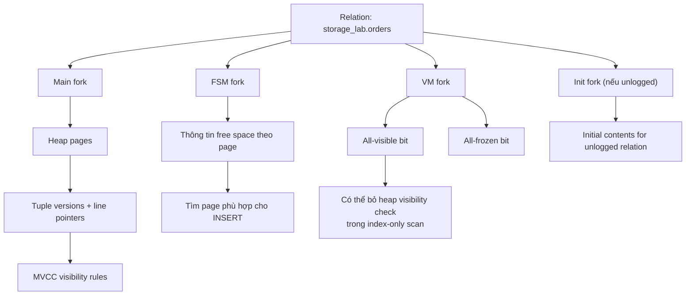
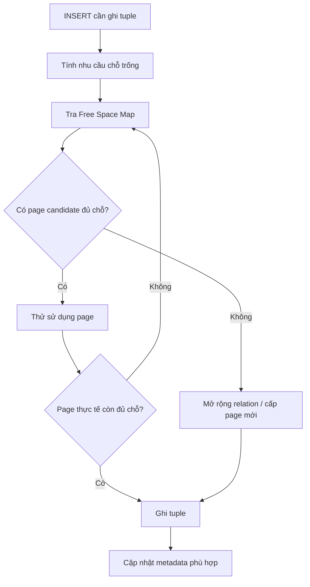
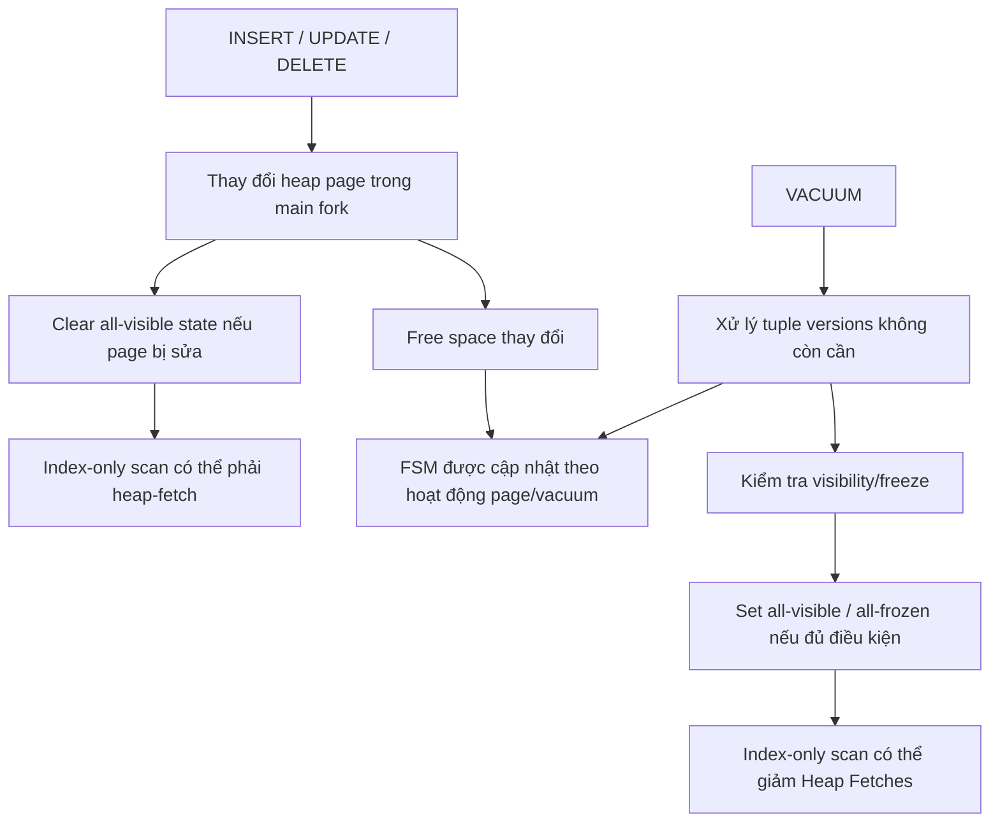

# Fork chính, Free Space Map và Visibility Map trong PostgreSQL

Một bảng PostgreSQL không chỉ là một tệp chứa các hàng dữ liệu. Mỗi relation có thể được lưu thành nhiều **fork** (nhánh lưu trữ) với nhiệm vụ khác nhau. Fork chính giữ nội dung bảng hoặc index; **Free Space Map (FSM)** giúp PostgreSQL tìm những page còn chỗ trống; **Visibility Map (VM)** ghi nhận những page mà các tuple đã đủ điều kiện hiển thị để PostgreSQL có thể bỏ qua một số bước kiểm tra hoặc vacuum.

Ba thành phần này liên hệ trực tiếp với cách PostgreSQL quản lý page, MVCC, INSERT/UPDATE, VACUUM và **index-only scan**.

Bài học thuộc chương **Lưu trữ** của PostgreSQL, tập trung vào:

- **Main fork:** nơi lưu nội dung chính của heap table hoặc index.
- **FSM:** cấu trúc phụ ghi nhận gần đúng lượng free space theo page, phục vụ tìm chỗ đặt tuple.
- **VM:** cấu trúc phụ ghi nhận trạng thái all-visible và all-frozen của các heap pages.
- **Tương tác với MVCC và VACUUM:** khi dữ liệu thay đổi, vacuum dọn tuple cũ, cập nhật FSM/VM và ảnh hưởng tới khả năng dùng index-only scan.
- **Quan sát thực tế:** dùng các hàm kích thước, catalog, pg_freespacemap, pg_visibility, pg_stat_user_tables và EXPLAIN.

> **Điểm cần nhớ:** FSM nói về **khả năng còn chỗ trống**; VM nói về **khả năng bỏ qua kiểm tra visibility**. Hai map này không thay thế nhau và cũng không phải nơi lưu nội dung hàng nghiệp vụ.

## 1. Relation được lưu thành các fork

PostgreSQL quản lý table, index, materialized view và một số loại đối tượng lưu trữ khác dưới dạng **relation**. Một relation có thể gồm nhiều fork độc lập về mặt lưu trữ.

Các fork thường gặp:

| Fork | Tên logic | Nội dung |
| --- | --- | --- |
| Main | `main` | Dữ liệu chính: heap pages của bảng hoặc pages của index |
| Free Space Map | `fsm` | Thông tin về lượng không gian trống có thể dùng lại trên các pages |
| Visibility Map | `vm` | Các bit all-visible và all-frozen cho heap pages |
| Init | `init` | Bản khởi tạo dùng cho unlogged relations để phục hồi trạng thái sau crash |

Main fork là nội dung mà ta thường nghĩ đến khi nói “dữ liệu bảng”. FSM và VM là **metadata phụ trợ** giúp PostgreSQL thực hiện thao tác hiệu quả hơn.

### 1.1. Sơ đồ quan hệ giữa các fork



Sơ đồ khái quát vai trò, không mô tả mọi chi tiết cấu trúc nhị phân bên trong các fork.

### 1.2. Fork không phải partition

Đừng nhầm:

- **Fork:** phần lưu trữ vật lý phụ trợ của cùng một relation.
- **Partition:** một relation con chứa một phần dữ liệu theo partition key.
- **Tablespace:** vị trí lưu trữ vật lý mà relation có thể được đặt vào.
- **Segment:** tệp vật lý chia nhỏ khi relation lớn hơn giới hạn kích thước một segment.

Một partition có relation files và forks riêng. Một bảng partitioned parent thường không lưu tuple trực tiếp; dữ liệu nằm trong các partitions.

## 2. Main fork: dữ liệu chính của relation

Main fork lưu nội dung chính:

- Với **heap table**, nó chứa heap pages và tuple versions.
- Với **index**, nó chứa cấu trúc pages của index, ví dụ B-tree.
- Với **materialized view**, main fork chứa dữ liệu đã materialize.
- Các relation đặc biệt khác có cách lưu trữ riêng nhưng vẫn có khái niệm fork phù hợp.

Khi chạy:

```sql
SELECT *
FROM storage_lab.orders
WHERE order_id = 100;
```

PostgreSQL tìm dữ liệu trong main fork của heap table và có thể sử dụng main fork của index nếu planner chọn đường truy cập index.

### 2.1. Page và tuple

Một heap relation được chia thành các **pages** có kích thước cố định theo block_size của cluster (thường là 8 KiB trong build mặc định, nhưng không nên hardcode giả định này).

Một heap page thường gồm:

- Page header: metadata quản lý page.
- Line pointer array: vị trí các tuple items.
- Tuple data: các phiên bản hàng.
- Free space: vùng chưa được sử dụng giữa line pointers và tuple data.

Sơ đồ khái niệm:

```text
+--------------------------------------------------+
| Page Header                                      |
+--------------------------------------------------+
| Line Pointer 1 | Line Pointer 2 | ...            |
+--------------------------------------------------+
|                 Free Space                      |
|                                                  |
+--------------------------------------------------+
| Tuple data ...                                   |
| Tuple data ...                                   |
+--------------------------------------------------+
```

Hình chỉ minh họa cách chia vùng; bố cục thực tế và hướng tăng của các vùng tuân theo cấu trúc page PostgreSQL.

### 2.2. Một hàng có thể có nhiều tuple versions

PostgreSQL dùng MVCC. UPDATE thông thường không nhất thiết ghi đè tuple cũ tại chỗ; nó có thể tạo **tuple version mới**, trong khi version cũ được giữ lại cho những transaction/snapshot còn cần nhìn thấy.

Ví dụ:

1. Transaction A đọc một hàng.
2. Transaction B UPDATE hàng và COMMIT.
3. Snapshot của A vẫn có thể cần nhìn version cũ.
4. Version cũ chỉ có thể được dọn khi không còn snapshot nào cần nó và vacuum/pruning thực hiện công việc phù hợp.

Do đó, “hàng đã UPDATE” không có nghĩa bytes của version cũ lập tức trở thành free space có thể cấp lại.

### 2.3. Main fork và kích thước bảng

```sql
SELECT
    pg_size_pretty(
        pg_relation_size('public.some_table'::regclass)
    ) AS main_fork_size;
```

pg_relation_size() mặc định trả kích thước main fork. Kết quả không bao gồm toàn bộ chi phí của index, TOAST và các thành phần liên quan. Để hiểu tổng dung lượng, cần dùng các hàm kích thước khác ở phần sau.

## 3. Free Space Map là gì?

**Free Space Map (FSM)** là cấu trúc phụ trợ giúp PostgreSQL biết page nào có thể còn bao nhiêu chỗ trống. Khi cần chèn tuple, PostgreSQL có thể tra FSM để tìm page có đủ không gian thay vì dò từ đầu mọi heap pages.

Ví dụ, bảng có hàng triệu pages. Một INSERT mới cần đặt tuple kích thước khoảng 300 bytes. FSM giúp tìm một page được ghi nhận là có khoảng trống phù hợp.

### 3.1. FSM không chứa tuple data

FSM không chứa:

- Nội dung cột status.
- Giá trị order_id.
- Tuple versions.
- Quyền truy cập.
- MVCC snapshot.

Nó chỉ giữ thông tin **free space ước lượng/được lượng hóa theo page** để hỗ trợ lựa chọn page.

### 3.2. FSM giúp INSERT tìm page

Luồng khái niệm:



Đây là mô hình đơn giản. Quá trình thực tế còn liên quan tới page locks, buffer management, WAL, visibility, pruning và concurrency.

### 3.3. FSM là thông tin gần đúng, không phải lời hứa

Không nên xem FSM như một bản kiểm kê byte-by-byte luôn chính xác tuyệt đối:

- Không gian có thể thay đổi sau lần cập nhật map gần nhất.
- Tuple chết có thể chưa được dọn nên chưa dùng lại được.
- Một page candidate có thể cần được kiểm tra lại khi nhiều transaction cùng ghi.
- Giá trị FSM được biểu diễn theo các mức không gian, không phải một cam kết chính xác cho mọi yêu cầu tuple.

PostgreSQL kiểm tra page thực tế trước khi ghi. FSM giúp **thu hẹp tìm kiếm**, không thay thế việc xác nhận khả năng ghi.

### 3.4. FSM có cấu trúc dạng cây

FSM được tổ chức thành các pages có cấu trúc phân cấp để tìm nhanh page có free space đủ lớn. Các mức phía trên tổng hợp khả năng của các nhánh phía dưới; leaf entries đại diện free space cho các relation blocks.

Vì vậy, FSM không chỉ là một mảng phẳng một số nguyên cho mỗi heap page. Chi tiết layout là implementation detail, nhưng ý tưởng quan trọng là **tìm kiếm phân cấp theo lượng không gian có thể cấp**.

## 4. Visibility Map là gì?

**Visibility Map (VM)** là một cấu trúc phụ ghi trạng thái visibility của các heap pages. Mỗi heap page được đại diện bằng hai trạng thái bit chính:

- **All-visible:** mọi tuple trên page đủ điều kiện hiển thị với tất cả các transaction hiện hành theo quy tắc MVCC.
- **All-frozen:** mọi tuple trên page đã ở trạng thái frozen phù hợp, nên vacuum không cần freeze lại các tuple đó.

All-frozen là trạng thái mạnh hơn; một page all-frozen cũng phải all-visible.

### 4.1. Hai bit có hai mục tiêu khác nhau

| Bit | Ý nghĩa | Tác dụng chính |
| --- | --- | --- |
| All-visible | Mọi tuple trên heap page đều visible với mọi transaction hiện hành | Hỗ trợ index-only scan bỏ heap visibility check |
| All-frozen | Mọi tuple trên page đã frozen | Hỗ trợ vacuum bỏ qua công việc freeze trên page |

Không diễn giải all-frozen là “page không bao giờ thay đổi nữa”. Một INSERT/UPDATE/DELETE mới có thể làm page thay đổi và khiến trạng thái map phải được cập nhật.

### 4.2. VM không lưu snapshot cho từng transaction

VM không nói “transaction 123 thấy tuple A, transaction 456 không thấy tuple B”. Nó là **tóm tắt ở cấp page** đủ mạnh để PostgreSQL bỏ qua một số kiểm tra khi bit tương ứng được set.

Nếu page không all-visible, PostgreSQL vẫn có thể đọc heap và kiểm tra visibility của từng tuple theo snapshot. VM không thay thế MVCC.

### 4.3. VM áp dụng cho heap pages

Visibility Map gắn với heap-like relation chứa tuple versions. B-tree index có cơ chế page/index metadata riêng; không nên mô tả VM như một bitmap cho mọi index page.

Index-only scan dùng index để lấy dữ liệu cột, nhưng khi cần xác nhận tuple visibility, nó tra VM của **heap relation tương ứng**.

## 5. Index-only scan và all-visible bit

Index-only scan là một kiểu truy cập trong đó PostgreSQL có thể lấy những cột cần thiết trực tiếp từ index, không cần đọc heap tuple cho mỗi kết quả, **nếu** index chứa đủ dữ liệu và visibility map cho phép bỏ kiểm tra heap visibility.

Ví dụ tạo index có các cột cần thiết:

```sql
CREATE INDEX idx_orders_tenant_status_created
ON storage_lab.orders (
    tenant_id,
    status,
    created_at DESC
)
INCLUDE (amount);
```

Query:

```sql
SELECT created_at, amount
FROM storage_lab.orders
WHERE tenant_id = 2
  AND status = 'paid'
ORDER BY created_at DESC
LIMIT 20;
```

Index có thể cung cấp predicate, ordering và output columns. Nếu page heap tương ứng được VM đánh dấu all-visible, PostgreSQL có thể không cần fetch heap tuple để xác minh visibility.

### 5.1. Index-only scan không chỉ cần index

Để index-only scan có ích:

1. Index phải chứa mọi cột cần cho predicate/output theo điều kiện phù hợp.
2. Planner phải đánh giá index path có chi phí hợp lý.
3. Visibility Map cần có đủ all-visible pages cho các heap tuples được truy cập.
4. Statistics và phân bố dữ liệu phải hỗ trợ lựa chọn đó.

Ngay cả khi index bao phủ đầy đủ cột, VM chưa có all-visible bits thì executor có thể vẫn phải truy cập heap để kiểm tra tuple visibility.

### 5.2. Heap Fetches trong EXPLAIN

```sql
EXPLAIN (ANALYZE, BUFFERS)
SELECT created_at, amount
FROM storage_lab.orders
WHERE tenant_id = 2
  AND status = 'paid'
ORDER BY created_at DESC
LIMIT 20;
```

Nếu planner chọn Index Only Scan, output có thể có:

```text
Index Only Scan using idx_orders_tenant_status_created ...
  Heap Fetches: 0
```

Heap Fetches cho biết số lần executor phải truy cập heap để xác minh visibility trong lần chạy đó. Số bằng 0 là dấu hiệu VM hỗ trợ tốt cho workload này.

Không đảm bảo query luôn chọn Index Only Scan hoặc Heap Fetches luôn bằng 0. Một thay đổi dữ liệu, vacuum chưa chạy, hoặc plan khác có thể làm kết quả thay đổi.

### 5.3. All-visible bit bị xóa khi page thay đổi

Một INSERT/UPDATE/DELETE trên heap page có thể làm page mất trạng thái all-visible. PostgreSQL cần bảo đảm không tiếp tục dựa vào một bit cũ sau khi tuple visibility đã thay đổi.

Khi page bị sửa, VM bit phù hợp được clear; một lần VACUUM sau đó có thể kiểm tra page và set lại nếu điều kiện được thỏa mãn.

Vì thế, bảng ghi liên tục có thể có ít all-visible pages hơn bảng chủ yếu đọc. Index-only scan trên bảng write-heavy có thể vẫn phải heap-fetch nhiều.

## 6. All-frozen, freezing và transaction ID wraparound

PostgreSQL dùng transaction IDs để xác định visibility. Transaction IDs có không gian hữu hạn và cần quản lý tuổi tuple để tránh wraparound.

VACUUM có nhiệm vụ freeze những tuple đủ cũ theo chính sách để chúng không còn phụ thuộc vào transaction IDs cũ theo cách gây nguy hiểm.

### 6.1. Frozen không đồng nghĩa deleted

- **Frozen tuple:** tuple đã được đánh dấu để xử lý visibility an toàn qua các chu kỳ transaction ID.
- **Dead tuple:** tuple version không còn cần thiết cho bất kỳ snapshot hợp lệ nào và có thể được dọn theo quy tắc.
- **Live tuple:** version còn cần thiết theo visibility rules.

Một tuple frozen vẫn có thể là dữ liệu live. Freeze không xóa hàng.

### 6.2. All-frozen bit hỗ trợ VACUUM

Nếu VM đánh dấu page all-frozen, VACUUM có thể bỏ qua việc kiểm tra freeze trên page đó trong những trường hợp phù hợp. Điều này giảm lượng heap pages phải đọc khi vacuum thường xuyên.

Một page all-visible nhưng chưa all-frozen vẫn có thể cần vacuum xem xét để freeze tuple theo tuổi transaction ID.

### 6.3. VACUUM FREEZE

```sql
VACUUM (FREEZE, VERBOSE) storage_lab.orders;
```

Lệnh này yêu cầu freeze mạnh hơn trong phạm vi VACUUM. Không nên chạy hàng loạt trên production mà không hiểu workload, locks, I/O và version behavior.

VACUUM thông thường cũng có cơ chế freeze theo ngưỡng; không phải chỉ VACUUM FREEZE mới freeze tuple.

## 7. VACUUM cập nhật FSM và VM thế nào?

VACUUM chuẩn thực hiện nhiều công việc liên quan heap/index:

- Xác định tuple versions không còn cần thiết.
- Dọn/prune hoặc đánh dấu không gian có thể tái sử dụng theo quy tắc.
- Cập nhật Free Space Map.
- Kiểm tra visibility và cập nhật Visibility Map.
- Có thể thực hiện index cleanup tùy tình trạng và tùy lựa chọn.
- Cập nhật các thống kê liên quan theo hành vi của VACUUM; ANALYZE là công việc thu thập statistics riêng.

### 7.1. VACUUM không tương đương VACUUM FULL

| Lệnh | Hành vi chính | Không gian đĩa |
| --- | --- | --- |
| VACUUM table_name | Dọn tuple dead có thể thu hồi, cập nhật map và giúp tái sử dụng page space | Thường giữ kích thước relation file; free space được dùng lại nội bộ |
| VACUUM (ANALYZE) table_name | VACUUM và thu thập planner statistics | Không tự co relation về nhỏ nhất |
| VACUUM FULL table_name | Rewrite relation để thu hồi không gian và sắp xếp lại storage theo cơ chế rewrite | Có thể trả dung lượng file cho hệ điều hành, cần lock mạnh |

VACUUM FULL thường yêu cầu ACCESS EXCLUSIVE lock và cần thêm dung lượng tạm trong quá trình rewrite. Không dùng nó như lệnh dọn dẹp định kỳ không có kế hoạch.

### 7.2. VACUUM thường làm không gian có thể tái sử dụng

Giả sử bảng chiếm 10 GB, nhiều tuple đã chết. VACUUM thường có thể làm các pages bên trong relation có free space để INSERT/UPDATE sau dùng lại.

Kích thước file main fork có thể vẫn gần 10 GB. Điều đó không có nghĩa VACUUM thất bại; mục tiêu là **tái sử dụng không gian trong relation**, không nhất thiết giảm ngay dung lượng filesystem.

### 7.3. VACUUM không chạy trong transaction block thông thường

Lệnh:

```sql
VACUUM (ANALYZE, VERBOSE) storage_lab.orders;
```

phải chạy ngoài transaction block. Trong psql/autocommit, có thể chạy trực tiếp. Không đặt nó bên trong:

```sql
BEGIN;
VACUUM storage_lab.orders;
COMMIT;
```

vì PostgreSQL từ chối VACUUM trong transaction block thông thường.

### 7.4. ANALYZE không phải là VM/FSM maintenance

ANALYZE thu thập statistics phục vụ planner, ví dụ phân bố giá trị và ước lượng selectivity. Nó không thay thế công việc VACUUM về tuple cleanup, FSM và VM.

Có thể chạy:

```sql
ANALYZE storage_lab.orders;
```

độc lập khi cần cập nhật planner statistics. VACUUM (ANALYZE) kết hợp cả hai công việc.

## 8. Khi INSERT, UPDATE và DELETE tác động tới các fork

### 8.1. INSERT

Khi INSERT:

1. PostgreSQL xác định page có chỗ phù hợp, thường dùng FSM như một gợi ý.
2. Nếu không có page thích hợp, relation có thể được mở rộng thêm page/segment.
3. Tuple mới được ghi vào main fork theo transaction/WAL semantics.
4. Visibility Map all-visible của page bị clear nếu page trước đó có bit này.
5. Free space của page thay đổi; FSM được cập nhật theo cơ chế quản lý page.

Một page vừa có tuple mới chưa thể mặc định all-visible cho mọi transaction.

### 8.2. UPDATE

UPDATE có thể tạo tuple version mới và đánh dấu version cũ là obsolete theo MVCC:

1. PostgreSQL tìm tuple cũ.
2. Tạo version mới hoặc thực hiện HOT update nếu đủ điều kiện.
3. Page nguồn/đích bị thay đổi.
4. VM all-visible bit liên quan có thể bị clear.
5. Free space map được cập nhật khi không gian trở nên khả dụng theo quy tắc.

Không gian của tuple cũ chưa chắc được tái sử dụng ngay vì snapshot cũ có thể vẫn cần nó.

### 8.3. DELETE

DELETE đánh dấu tuple version không còn visible cho những snapshot phù hợp; nó không nhất thiết xóa bytes ngay.

Sau khi không còn transaction nào cần version đó, VACUUM/pruning có thể thu hồi không gian, cập nhật FSM và VM.

### 8.4. Sơ đồ tác động khái quát



Đây là mô hình quan hệ; chi tiết cập nhật map có thể xảy ra tại nhiều điểm khác nhau trong page lifecycle.

## 9. HOT update và free space

**Heap-Only Tuple (HOT) update** là một tối ưu khi PostgreSQL có thể tạo version mới trên cùng heap page mà không phải thêm entry mới vào mọi index liên quan.

HOT có thể xảy ra khi:

- Các cột được UPDATE không làm thay đổi những index keys có liên quan theo điều kiện HOT.
- Cùng heap page có đủ chỗ cho tuple version mới.
- Những điều kiện khác của PostgreSQL được thỏa mãn.

### 9.1. Vì sao fillfactor liên quan FSM?

fillfactor điều khiển mức độ lấp đầy page khi tạo/ghi dữ liệu. Ví dụ:

```sql
CREATE TABLE storage_lab.orders_hot (
    order_id bigint,
    status text,
    note text
) WITH (fillfactor = 80);
```

Fillfactor 80 thường để lại khoảng trống có chủ đích trên page khi dữ liệu được nạp, tạo cơ hội cho UPDATE cùng page và HOT.

FSM có thể ghi nhận phần free space này để các thao tác phù hợp tìm được page.

### 9.2. Fillfactor không bảo đảm HOT

HOT vẫn có thể không xảy ra nếu:

- Tuple mới lớn hơn phần free space còn lại.
- Update thay đổi cột được index.
- Không còn page space phù hợp.
- Điều kiện HOT khác không được thỏa mãn.

Fillfactor chỉ tạo **cơ hội**, không phải cam kết mọi UPDATE đều HOT.

### 9.3. Thay fillfactor không tự rewrite các pages hiện có

```sql
ALTER TABLE storage_lab.orders_hot
SET (fillfactor = 80);
```

thay đổi storage parameter cho những lần page được ghi/fill về sau theo quy tắc; nó không tự di chuyển toàn bộ tuple cũ để tạo ra khoảng trống trên mọi page đã tồn tại.

Muốn áp dụng layout mới lên dữ liệu hiện có có thể cần rewrite relation theo kế hoạch, ví dụ thao tác rewrite phù hợp. VACUUM FULL có lock mạnh và yêu cầu dung lượng tạm, nên phải đánh giá kỹ.

## 10. Tạo lab để quan sát các fork

Các ví dụ tiếp theo dùng schema storage_lab. Thực hiện trên database học tập mà bạn có quyền tạo extension/table.

### 10.1. Tạo bảng

```sql
CREATE SCHEMA IF NOT EXISTS storage_lab;

DROP TABLE IF EXISTS storage_lab.orders;

CREATE TABLE storage_lab.orders (
    order_id bigint GENERATED ALWAYS AS IDENTITY PRIMARY KEY,
    tenant_id integer NOT NULL,
    status text NOT NULL,
    amount numeric(12, 2) NOT NULL,
    created_at timestamptz NOT NULL,
    note text
);
```

DROP TABLE ở đây chỉ dành cho lab có thể tạo lại; không chạy trên bảng có dữ liệu cần giữ.

### 10.2. Tạo index hỗ trợ index-only scan

```sql
CREATE INDEX idx_storage_orders_tenant_status_time
ON storage_lab.orders (
    tenant_id,
    status,
    created_at DESC
)
INCLUDE (amount);
```

Index này chứa các cột được dùng trong ví dụ SELECT. Planner vẫn tự quyết định có dùng index hay không.

### 10.3. Nạp dữ liệu

```sql
INSERT INTO storage_lab.orders (
    tenant_id, status, amount, created_at, note
)
SELECT
    (g % 20) + 1,
    CASE WHEN g % 5 = 0 THEN 'pending' ELSE 'paid' END,
    (g % 100000)::numeric / 100,
    TIMESTAMPTZ '2026-01-01 00:00:00+00'
        + (g % 120) * INTERVAL '1 day',
    CASE WHEN g % 7 = 0 THEN NULL ELSE 'sample' END
FROM generate_series(1, 50000) AS s(g);

ANALYZE storage_lab.orders;
```

### 10.4. Chạy VACUUM riêng

Sau khi tạo và nạp dữ liệu, chạy VACUUM ở chế độ autocommit, không đặt trong transaction:

```sql
VACUUM (ANALYZE, VERBOSE) storage_lab.orders;
```

Lệnh này tạo cơ hội để heap pages được đánh giá và VM được cập nhật theo điều kiện visibility/freeze.

## 11. Đo kích thước từng fork

PostgreSQL cung cấp pg_relation_size():

```sql
SELECT
    pg_size_pretty(
        pg_relation_size('storage_lab.orders'::regclass, 'main')
    ) AS main_size,
    pg_size_pretty(
        pg_relation_size('storage_lab.orders'::regclass, 'fsm')
    ) AS fsm_size,
    pg_size_pretty(
        pg_relation_size('storage_lab.orders'::regclass, 'vm')
    ) AS vm_size;
```

Có thể dùng dạng mặc định để lấy main fork:

```sql
SELECT pg_relation_size('storage_lab.orders'::regclass);
```

### 11.1. Các fork có thể có kích thước nhỏ hoặc bằng 0

Một relation nhỏ có thể chưa cần hoặc chưa có nhiều pages cho FSM/VM. Kích thước fork phụ thuộc kích thước relation và hoạt động storage; đừng mong một con số cố định sau mỗi lần chạy lab.

VM thường rất nhỏ so với heap vì mỗi heap page chỉ cần một số bit trạng thái. FSM cũng là metadata phụ, không chiếm dung lượng bằng main fork trong nhiều workload.

### 11.2. So sánh các hàm kích thước

```sql
SELECT
    pg_size_pretty(
        pg_relation_size('storage_lab.orders'::regclass)
    ) AS main_fork,
    pg_size_pretty(
        pg_table_size('storage_lab.orders'::regclass)
    ) AS table_size_including_auxiliary,
    pg_size_pretty(
        pg_indexes_size('storage_lab.orders'::regclass)
    ) AS indexes_size,
    pg_size_pretty(
        pg_total_relation_size('storage_lab.orders'::regclass)
    ) AS total_size;
```

Diễn giải:

- pg_relation_size: kích thước fork được yêu cầu; mặc định là main.
- pg_table_size: dung lượng của table cùng các thành phần liên quan như TOAST và auxiliary forks theo định nghĩa hàm.
- pg_indexes_size: tổng dung lượng các indexes gắn với table.
- pg_total_relation_size: tổng table và indexes.

Đây là các cách đo **logical relation storage**, không phải phép đo chính xác mọi filesystem overhead, WAL, archive hay shared buffers.

### 11.3. Tablespace và file path

```sql
SELECT
    'storage_lab.orders'::regclass AS relation,
    pg_relation_filepath('storage_lab.orders'::regclass)
        AS main_fork_path;
```

Hàm trả đường dẫn tương đối trong cấu trúc data directory/tablespace theo quy tắc PostgreSQL. Fork phụ dùng hậu tố tương ứng; không tự sửa/xóa những tệp đó bằng thao tác filesystem khi server đang chạy.

### 11.4. Segment files

Một relation lớn có thể được chia thành nhiều segment files để tránh giới hạn kích thước một file. Các segment tiếp theo có hậu tố số, ví dụ .1, .2 theo cách đặt tên vật lý.

Mỗi fork có thể có các segments riêng. Không giả định toàn bộ relation chỉ là một tệp duy nhất.

## 12. Đọc FSM bằng extension pg_freespacemap

Extension pg_freespacemap cung cấp hàm và view để quan sát free space map.

Trong môi trường được phép:

```sql
CREATE EXTENSION IF NOT EXISTS pg_freespacemap;
```

Xem các heap blocks:

```sql
SELECT
    blkno,
    avail
FROM pg_freespace('storage_lab.orders'::regclass)
ORDER BY blkno
LIMIT 30;
```

avail biểu diễn lượng free space mà FSM ghi nhận cho block tương ứng, tính bằng bytes.

### 12.1. Đọc một page cụ thể

```sql
SELECT
    pg_freespace('storage_lab.orders'::regclass, 0)
        AS page_0_available_bytes;
```

Page 0 có thể có ít free space vì tuple/header/line pointers; page khác có thể còn nhiều hơn. Giá trị có thể thay đổi sau INSERT, UPDATE, page pruning và VACUUM.

### 12.2. Tính phân bố free space

```sql
SELECT
    CASE
        WHEN avail = 0 THEN '0 bytes'
        WHEN avail < 256 THEN '< 256 bytes'
        WHEN avail < 1024 THEN '256-1023 bytes'
        WHEN avail < 4096 THEN '1-4 KiB'
        ELSE '>= 4 KiB'
    END AS free_space_bucket,
    COUNT(*) AS pages
FROM pg_freespace('storage_lab.orders'::regclass)
GROUP BY 1
ORDER BY MIN(avail);
```

Bảng bucket chỉ giúp quan sát xu hướng. Một tuple cần chỗ trống lớn hơn mức free space được báo sẽ không phù hợp với page đó.

### 12.3. FSM không phải exact free-space oracle

Nếu pg_freespace() cho thấy 500 bytes, đừng kết luận chắc chắn tuple 500 bytes sẽ ghi được:

- Còn cần line pointer/tuple overhead.
- Free space có thể thay đổi bởi transaction khác.
- Map là metadata hỗ trợ tìm kiếm và có thể cần được làm mới.
- Một page candidate phải được kiểm tra trong quá trình ghi thực tế.

Không dùng FSM để quyết định tính đúng đắn của nghiệp vụ; dùng nó để chẩn đoán storage và hiểu lựa chọn page.

### 12.4. Extension có quyền truy cập riêng

Khả năng cài extension và đọc các hàm/view có thể phụ thuộc quyền, package cài đặt và chính sách managed service. Không cấp superuser cho ứng dụng chỉ để lấy số free space.

## 13. Đọc VM bằng extension pg_visibility

Extension pg_visibility cung cấp cách quan sát trạng thái visibility map của relation.

Trong lab có quyền:

```sql
CREATE EXTENSION IF NOT EXISTS pg_visibility;
```

Xem tóm tắt:

```sql
SELECT *
FROM pg_visibility_map_summary('storage_lab.orders'::regclass);
```

Kết quả thường có số heap pages đang all-visible và all-frozen.

### 13.1. Xem theo từng block

```sql
SELECT
    blkno,
    all_visible,
    all_frozen
FROM pg_visibility('storage_lab.orders'::regclass)
ORDER BY blkno
LIMIT 30;
```

Hàm cho phép nhìn trạng thái từng heap block, hữu ích khi so sánh trước/sau UPDATE và VACUUM.

Tên hàm/đầu ra chi tiết cần đối chiếu tài liệu extension của đúng major version.

### 13.2. So sánh số page với số bit VM

```sql
SELECT
    pg_relation_size('storage_lab.orders'::regclass, 'main')
        / current_setting('block_size')::integer
        AS heap_pages,
    s.all_visible,
    s.all_frozen
FROM pg_visibility_map_summary('storage_lab.orders'::regclass) AS s;
```

heap_pages là số main-fork blocks theo block size hiện tại. all_visible và all_frozen là số blocks có bit tương ứng được set.

Không yêu cầu mọi page đều all-visible/all-frozen. Những page mới được ghi hoặc có tuple versions chưa đủ điều kiện vẫn cần heap visibility checks.

### 13.3. So sánh trước và sau UPDATE

Sau VACUUM, ghi lại số all-visible:

```sql
SELECT *
FROM pg_visibility_map_summary('storage_lab.orders'::regclass);
```

Thực hiện UPDATE một số hàng:

```sql
UPDATE storage_lab.orders
SET note = 'changed'
WHERE order_id BETWEEN 1 AND 20;
```

Quan sát lại:

```sql
SELECT *
FROM pg_visibility_map_summary('storage_lab.orders'::regclass);
```

Những heap pages bị sửa có thể mất all-visible bits. Nếu UPDATE không tác động hàng nào hoặc dữ liệu/page đã khác, kết quả có thể không thay đổi như dự đoán. VACUUM sau đó có thể set lại bit khi điều kiện visibility được thỏa mãn.

### 13.4. Không chạy VACUUM trong transaction demo

Sau khi thử UPDATE, chạy VACUUM riêng:

```sql
VACUUM (VERBOSE) storage_lab.orders;
```

Rồi xem VM summary lần nữa. Có thể cần transaction cũ kết thúc để tuple cũ đủ điều kiện dọn và page trở lại all-visible.

## 14. HOT, FSM và VM trong cùng một UPDATE

Giả sử bảng có index trên (tenant_id, status, created_at) và UPDATE chỉ sửa note.

Nếu đủ điều kiện HOT:

- Tuple version mới có thể nằm trên cùng heap page.
- PostgreSQL không cần thêm index entries cho những index keys không thay đổi theo điều kiện HOT.
- Heap page vẫn bị sửa.
- All-visible bit của page có thể bị clear.
- FSM/free space thay đổi theo lượng không gian còn lại.

Vì vậy, **HOT update có lợi cho index maintenance nhưng không có nghĩa VM vẫn all-visible**.

### 14.1. Quan sát HOT statistics

```sql
SELECT
    relname,
    n_tup_upd,
    n_tup_hot_upd,
    n_dead_tup,
    last_autovacuum,
    last_vacuum
FROM pg_stat_user_tables
WHERE schemaname = 'storage_lab'
  AND relname = 'orders';
```

n_tup_hot_upd là số HOT updates theo thống kê kể từ lần reset thống kê phù hợp. Đây là số liệu thống kê, không phải bộ đếm tức thời tuyệt đối trong mọi tình huống.

### 14.2. HOT không phải “không tạo tuple version”

HOT vẫn tạo version mới trên heap; điểm tối ưu là tránh một số index updates. Version cũ vẫn tuân theo MVCC và cần được xử lý khi không còn snapshot cần nó.

## 15. VACUUM, all-visible và index-only scan: thí nghiệm đầy đủ

Với bảng lab, thử theo thứ tự:

### Bước 1 — Cập nhật planner statistics và vacuum

```sql
VACUUM (ANALYZE) storage_lab.orders;
```

### Bước 2 — Kiểm tra VM summary

```sql
SELECT *
FROM pg_visibility_map_summary('storage_lab.orders'::regclass);
```

### Bước 3 — Chạy query bao phủ index

```sql
EXPLAIN (ANALYZE, BUFFERS)
SELECT created_at, amount
FROM storage_lab.orders
WHERE tenant_id = 2
  AND status = 'paid'
ORDER BY created_at DESC
LIMIT 20;
```

### Bước 4 — Cập nhật một tập hàng

```sql
UPDATE storage_lab.orders
SET note = 'touch'
WHERE tenant_id = 2
  AND order_id BETWEEN 1 AND 200;
```

### Bước 5 — Xem VM và chạy lại EXPLAIN

```sql
SELECT *
FROM pg_visibility_map_summary('storage_lab.orders'::regclass);

EXPLAIN (ANALYZE, BUFFERS)
SELECT created_at, amount
FROM storage_lab.orders
WHERE tenant_id = 2
  AND status = 'paid'
ORDER BY created_at DESC
LIMIT 20;
```

### Bước 6 — VACUUM và đo lại

Chạy ngoài transaction:

```sql
VACUUM (ANALYZE, VERBOSE) storage_lab.orders;
```

Sau đó kiểm tra VM summary và EXPLAIN lại.

**Quan sát cần ghi lại:**

- Số heap pages all-visible trước/sau.
- Heap Fetches trong index-only scan.
- Plan có thay đổi hay không.
- Actual time và buffers có thay đổi không.
- Query có trả đúng kết quả không.

Không đảm bảo một UPDATE nhỏ làm Heap Fetches tăng theo một số lượng cố định: nhiều hàng có thể nằm trên cùng page, planner có thể chọn plan khác và page visibility phụ thuộc toàn bộ tuples trên page.

## 16. Autovacuum giữ FSM và VM hoạt động

Trong production, VACUUM thường được thực hiện tự động bởi **autovacuum** dựa trên thresholds và cấu hình.

Autovacuum giúp:

- Thu hồi dead tuples để page space được tái sử dụng.
- Cập nhật FSM.
- Duy trì visibility map.
- Freeze tuples để phòng transaction ID wraparound.
- Chạy ANALYZE theo điều kiện/cấu hình tương ứng.

### 16.1. Quan sát thống kê vacuum

```sql
SELECT
    schemaname,
    relname,
    n_live_tup,
    n_dead_tup,
    n_tup_ins,
    n_tup_upd,
    n_tup_del,
    n_tup_hot_upd,
    last_vacuum,
    last_autovacuum,
    last_analyze,
    last_autoanalyze
FROM pg_stat_user_tables
WHERE schemaname = 'storage_lab'
ORDER BY n_dead_tup DESC;
```

Các trường n_live_tup và n_dead_tup là **ước lượng thống kê**, không phải số đếm chính xác ngay tại mọi thời điểm.

### 16.2. Kiểm tra autovacuum đang chạy

```sql
SELECT
    p.pid,
    p.datname,
    p.relid::regclass AS relation,
    p.phase,
    p.heap_blks_total,
    p.heap_blks_scanned,
    p.heap_blks_vacuumed,
    p.index_vacuum_count
FROM pg_stat_progress_vacuum AS p;
```

View này chỉ hiển thị VACUUM đang chạy và các cột chi tiết có thể thay đổi theo version. Nếu không có dòng, không có nghĩa VACUUM chưa từng chạy.

### 16.3. Vì sao autovacuum không chạy ngay?

Một số lý do:

- Chưa đạt ngưỡng dead tuples/insert thresholds.
- Worker đang bận hoặc giới hạn worker.
- Relation có cấu hình storage parameters riêng.
- Transaction/snapshot lâu làm giảm khả năng thu hồi tuple.
- I/O throttling và cost delay làm tiến độ chậm.
- Autovacuum bị tắt hoặc cấu hình không phù hợp.

Không nên tắt autovacuum để “tăng tốc ghi” mà không hiểu hậu quả về bloat, visibility map và wraparound.

### 16.4. Relation-specific storage parameters

```sql
ALTER TABLE storage_lab.orders
SET (
    autovacuum_vacuum_scale_factor = 0.05,
    autovacuum_analyze_scale_factor = 0.05
);
```

Đây chỉ là ví dụ cấu hình cho lab, không phải khuyến nghị production chung. Giá trị phù hợp phụ thuộc tốc độ thay đổi, số rows, chi phí vacuum và SLA. Thay đổi scale factor có thể khiến vacuum/analyze chạy thường xuyên hơn hoặc ít hơn.

## 17. Free space, dead tuples và bloat không giống nhau

Các khái niệm dễ bị trộn:

| Khái niệm | Ý nghĩa |
| --- | --- |
| Free space | Vùng trống trên page có thể dùng cho tuple mới theo điều kiện phù hợp |
| Dead tuple | Tuple version không còn cần thiết sau khi visibility horizon cho phép cleanup |
| FSM entry | Thông tin map về free space của page |
| Bloat | Phần storage dư thừa so với layout hiệu quả mong muốn, cần đánh giá theo relation/workload |
| VM all-visible | Page có thể bỏ qua một số heap visibility checks |
| VM all-frozen | Tuple trên page đã frozen theo điều kiện |

### 17.1. Dead tuple chưa chắc đã là free space

Một tuple cũ có thể đã được đánh dấu dead theo transaction nhưng chưa được VACUUM/prune thu hồi. Khi ấy bytes vẫn chiếm chỗ trong page và không nhất thiết được FSM xem là free space có thể dùng ngay.

### 17.2. Free space không đồng nghĩa OS disk đã giảm

VACUUM thường làm page có thể tái sử dụng bên trong relation. Kích thước file không giảm tương ứng.

VACUUM FULL rewrite relation để co lại, nhưng cần lock mạnh. Đánh giá bloat và lựa chọn công cụ theo impact, không chỉ dựa trên số n_dead_tup.

### 17.3. VM không phải chỉ số bloat

Một bảng có nhiều page all-visible có thể phù hợp index-only scan, nhưng điều đó không chứng minh bảng không có bloat. Ngược lại, một page không all-visible không đồng nghĩa page có nhiều dead tuples; có thể đơn giản vừa có dữ liệu mới.

## 18. Tại sao index-only scan cần VM?

Index B-tree lưu index keys và TID trỏ tới heap tuple. Trong MVCC, index entry không tự cho biết tuple version có visible với snapshot hiện tại hay không.

Nếu index-only scan phải kiểm tra visibility từng tuple trong heap, nó vẫn cần đọc heap page. VM cung cấp một shortcut an toàn ở cấp page:

1. Executor lấy TID từ index.
2. Xác định heap block.
3. Kiểm tra all-visible bit trong VM.
4. Nếu bit được set, có thể tin mọi tuple trên page visible và không cần heap fetch chỉ để visibility check.
5. Nếu bit không được set, phải kiểm tra tuple visibility ở heap.

### 18.1. VM giúp tránh random heap reads

Nếu index scan tìm nhiều hàng nằm trên những pages all-visible, việc không phải fetch heap có thể giảm random I/O và tăng hiệu quả.

Đây là lý do VACUUM và VM đặc biệt quan trọng cho các bảng **ít thay đổi, đọc nhiều** như dữ liệu lịch sử hoặc bảng báo cáo đã ổn định.

### 18.2. Index-only scan vẫn có thể đọc heap vì các lý do khác

Không phải mọi heap access đều chỉ là visibility check. Tùy plan và query, có thể cần heap cho cột không nằm trong index, điều kiện không được đáp ứng bởi index hoặc các yêu cầu executor khác.

Chỉ khi plan là Index Only Scan và index cover được dữ liệu thì VM mới giúp bỏ heap visibility fetch theo cách mô tả.

### 18.3. INCLUDE columns có trade-off

INCLUDE thêm payload columns vào index để hỗ trợ index-only scans, nhưng:

- Làm index lớn hơn.
- Tăng chi phí INSERT/UPDATE.
- Có thể làm giảm cache efficiency.
- Cột payload không phải search key theo cùng cách cột index key.
- VM vẫn phải đủ all-visible để giảm heap fetches.

Không thêm mọi cột vào INCLUDE chỉ để ép một query thành index-only.

## 19. Đọc kích thước relation và các fork trong catalog

Có thể dùng pg_class và các hàm size:

```sql
SELECT
    c.oid::regclass AS relation,
    c.relkind,
    pg_relation_size(c.oid, 'main') AS main_bytes,
    pg_relation_size(c.oid, 'fsm') AS fsm_bytes,
    pg_relation_size(c.oid, 'vm') AS vm_bytes
FROM pg_class AS c
WHERE c.oid = 'storage_lab.orders'::regclass;
```

relkind giúp phân biệt table/index/view/partitioned relation theo mã loại relation. Không phải mọi relkind đều có cùng fork/VM behavior.

### 19.1. Partitioned parent và partitions

Với partitioned table, parent relation thường không có heap storage trực tiếp. Cần xem các leaf partitions:

```sql
SELECT
    relid::regclass AS partition,
    pg_size_pretty(pg_relation_size(relid, 'main')) AS main_size,
    pg_size_pretty(pg_relation_size(relid, 'fsm')) AS fsm_size,
    pg_size_pretty(pg_relation_size(relid, 'vm')) AS vm_size
FROM pg_partition_tree('storage_lab.partitioned_orders')
WHERE isleaf;
```

Đây là template dành cho bảng partitioned đã tồn tại; tên bảng trong ví dụ không được tạo trong lab mặc định. Thay bằng relation thật khi sử dụng.

### 19.2. TOAST relation có fork riêng

Một bảng có cột lớn như text, jsonb hoặc bytea có thể dùng TOAST relation. TOAST table là relation riêng và có main/FSM/VM theo đặc tính lưu trữ phù hợp.

Khi chỉ đo main fork của bảng cha, bạn có thể bỏ sót dung lượng TOAST. pg_table_size() và pg_total_relation_size() hữu ích khi muốn tính tổng.

## 20. FSM và VM có thể được kiểm tra bằng công cụ nào?

| Công cụ | Mục tiêu | Cần chú ý |
| --- | --- | --- |
| pg_relation_size(..., 'main'/'fsm'/'vm') | Đo kích thước từng fork | Không cho biết nội dung bit/space từng page |
| pg_freespacemap | Đọc free space map | Cần extension/quyền; số liệu là map hỗ trợ |
| pg_visibility | Đọc all-visible/all-frozen | Cần extension/quyền phù hợp |
| pg_stat_user_tables | Thống kê tuple/vacuum/analyze | Nhiều counters là ước lượng hoặc tích lũy |
| pg_stat_progress_vacuum | Quan sát VACUUM đang chạy | Chỉ có row khi tiến trình tương ứng hoạt động |
| EXPLAIN (ANALYZE, BUFFERS) | Đo plan/heap fetch/buffers | Thực thi query thật |
| pageinspect | Xem cấu trúc page ở mức thấp | Công cụ chuyên sâu, cần quyền và hiểu version |

### 20.1. pageinspect không phải công cụ vận hành thường ngày

Extension pageinspect có thể đọc raw pages và page headers trong môi trường đủ quyền. Đây là công cụ học storage internals/debug chuyên sâu, không nên cấp cho role ứng dụng.

Khi cần đọc raw page, phải hiểu rằng page format là implementation detail phụ thuộc version và không nên tự ghi/sửa bytes của relation file.

### 20.2. Không chỉnh trực tiếp file fork

Không xóa *_fsm, *_vm hay sửa main relation files khi PostgreSQL đang chạy. PostgreSQL quản lý đồng bộ page, WAL, buffers, locks và metadata. Can thiệp filesystem trực tiếp có thể gây corruption hoặc mất dữ liệu.

Nếu nghi metadata lỗi, dùng công cụ/kiểm tra chính thức và quy trình DBA; không “xóa map để PostgreSQL tự tạo lại” trên production theo mẹo không kiểm chứng.

## 21. VACUUM FULL, CLUSTER và rewrite relation

Một số thao tác rewrite tạo relation storage mới và thay thế relation cũ:

- VACUUM FULL.
- CLUSTER.
- Một số dạng ALTER TABLE cần rewrite do thay đổi cấu trúc.
- Dump/restore hoặc tạo bảng mới rồi swap.

Khi relation được rewrite, main fork và auxiliary forks được xây dựng/cập nhật theo storage mới. Filenode/path có thể thay đổi.

### 21.1. Không lưu filenode như định danh nghiệp vụ

OID/relfilenode là metadata nội bộ có thể đổi sau rewrite, move tablespace hoặc các thao tác quản trị. Dùng tên relation/schema trong catalog functions để tra cứu; không lưu filenode trong ứng dụng như ID bất biến.

### 21.2. Rewrite có chi phí và lock

Rewrite có thể:

- Đọc và ghi lượng lớn dữ liệu.
- Tạo WAL và I/O đáng kể.
- Cần thêm dung lượng disk tạm.
- Giữ lock làm gián đoạn readers/writers tùy lệnh.
- Tác động replica lag.

Không dùng VACUUM FULL chỉ vì FSM cho thấy nhiều free space. Free space có thể chính là dung lượng cần để INSERT tiếp theo mà không phải mở rộng file.

## 22. Những tình huống thực tế

### 22.1. Bảng append-only, đọc nhiều

Một bảng lịch sử chủ yếu INSERT theo thời gian, sau đó ít UPDATE/DELETE:

- FSM giúp chèn tuple mới vào pages còn chỗ.
- VACUUM có thể đánh dấu những pages đã ổn định là all-visible/all-frozen khi đủ điều kiện.
- Index-only scans có thể giảm heap fetch.
- Các partition cũ có thể đạt visibility tốt hơn partition đang ghi.

### 22.2. Bảng cập nhật liên tục

Một bảng trạng thái đơn hàng bị UPDATE thường xuyên:

- Tuple versions mới liên tục được tạo.
- Pages thay đổi và all-visible bits bị clear.
- HOT có thể giảm index churn nếu đủ điều kiện.
- VACUUM cần theo kịp dead tuples.
- Index-only scan có thể phải heap fetch nhiều hơn trên pages nóng.

### 22.3. Bảng có transaction lâu

Một transaction/snapshot lâu có thể ngăn VACUUM thu hồi tuple versions mà transaction đó vẫn cần:

- Dead tuples tồn tại lâu hơn.
- Free space có thể không tăng như mong muốn.
- VM all-visible không được set trên những pages chưa đủ điều kiện.
- Index-only scan có thể tăng heap fetch.
- Vacuum progress có thể bị ảnh hưởng bởi visibility horizon.

Điều tra pg_stat_activity.xact_start, backend_xmin, replication slots và transaction age nếu vacuum không thể thu hồi như mong đợi.

### 22.4. Bảng mới nạp bulk

Sau bulk load, chạy ANALYZE và cân nhắc VACUUM theo nhu cầu. Nếu dữ liệu mới chưa có transaction cũ cần nhìn và pages đã ổn định, vacuum có thể giúp thiết lập VM. Không phải lúc nào bulk load xong cũng cần VACUUM FULL.

## 23. Giới hạn của những số liệu quan sát

Một số kết quả dễ bị diễn giải quá mức:

- n_dead_tup trong statistics là ước lượng, không phải số tuple chết chính xác.
- pg_freespace() cho biết thông tin FSM, không phải cam kết page sẽ nhận tuple tiếp theo.
- pg_visibility phản ánh map/page state tại thời điểm đọc; concurrent writes có thể thay đổi sau đó.
- Heap Fetches phụ thuộc plan và dữ liệu của lần EXPLAIN đó.
- pg_relation_size đo relation fork, không đo WAL, archive hoặc mọi filesystem overhead.
- VACUUM VERBOSE mô tả hoạt động của lần vacuum cụ thể, không phải audit lịch sử toàn hệ thống.
- pg_stat_progress_vacuum chỉ phản ánh tiến trình đang chạy.

Khi so sánh trước/sau, ghi rõ thời điểm, session, transaction state và thao tác vừa thực hiện.

## 24. Những sai lầm thường gặp

| Hiểu nhầm | Thực tế |
| --- | --- |
| FSM chứa dữ liệu tuple | FSM chỉ lưu thông tin free space |
| VM chứa snapshot của từng transaction | VM là metadata tóm tắt visibility theo heap page |
| FSM và VM giống nhau | Một map cho free space, một map cho visibility/freeze |
| Main fork là toàn bộ dung lượng table | Có thể còn FSM, VM, TOAST và indexes |
| UPDATE ghi đè tuple cũ ngay | MVCC thường tạo tuple version mới |
| DELETE giải phóng bytes ngay | Dead tuple cần cleanup khi đủ điều kiện |
| Có FSM free space thì chắc chắn INSERT thành công vào page đó | Map là gợi ý, page thực tế cần kiểm tra |
| All-visible nghĩa mọi tuple frozen | All-visible và all-frozen là hai bit khác nhau |
| All-frozen nghĩa dữ liệu bị xóa/không đổi nữa | Frozen liên quan transaction ID, không phải delete/immutable |
| Index-only scan không bao giờ đọc heap | VM chưa all-visible có thể buộc heap fetch |
| Có index INCLUDE là chắc chắn index-only scan | Còn planner, predicate và VM |
| VACUUM thường luôn giảm file size | Thường giúp tái sử dụng space bên trong relation |
| VACUUM FULL giống VACUUM | FULL rewrite và cần lock mạnh |
| ANALYZE cập nhật VM/FSM | ANALYZE thu thập planner statistics |
| HOT update giữ VM all-visible | Heap page bị sửa nên all-visible có thể bị clear |
| Fillfactor 80 bảo đảm HOT | Chỉ tạo cơ hội, còn điều kiện index/page |
| pg_relation_size mặc định là tổng table+index | Mặc định là main fork của relation |
| Xóa file *_fsm hoặc *_vm là cách sửa lỗi | Không can thiệp relation files trực tiếp |
| Mọi relation đều có VM | VM gắn với heap-like relations, không phải mọi relkind |
| n_dead_tup là số chết chính xác | Đây là thống kê ước lượng |
| VACUUM trong BEGIN/COMMIT thông thường | VACUUM phải chạy ngoài transaction block |
| Partitioned parent có toàn bộ heap storage | Data pages thường nằm ở leaf partitions |

## 25. Runbook điều tra free space và visibility

Khi một bảng tăng kích thước, INSERT chậm hoặc index-only scan có nhiều heap fetch, làm theo trình tự:

**Bước 1 — Xác định relation vật lý.** Kiểm tra schema, relkind, partitions, tablespace và TOAST liên quan.

**Bước 2 — Đo kích thước.** So main, FSM, VM, table_size, indexes_size và total_size.

**Bước 3 — Xem hoạt động ghi.** INSERT/UPDATE/DELETE rate, HOT update rate và workload có append-only hay write-heavy.

**Bước 4 — Xem thống kê vacuum.** n_dead_tup, last_autovacuum, last_vacuum và tiến trình VACUUM hiện tại.

**Bước 5 — Kiểm tra transaction lâu.** xact_start, backend_xmin, replication slots và snapshot horizon có thể ngăn cleanup.

**Bước 6 — Quan sát FSM.** Dùng pg_freespacemap để xem phân bố free space; không coi kết quả là exact guarantee.

**Bước 7 — Quan sát VM.** Dùng pg_visibility_map_summary và block-level visibility nếu cần.

**Bước 8 — Kiểm tra index-only scan.** EXPLAIN (ANALYZE, BUFFERS) xem plan, Heap Fetches, actual rows và buffers.

**Bước 9 — Thực hiện VACUUM/ANALYZE phù hợp.** Chạy ngoài transaction; đánh giá autovacuum settings và impact I/O.

**Bước 10 — Đánh giá bloat/rewrite.** Chỉ cân nhắc VACUUM FULL/CLUSTER/rewrite khi có bằng chứng và kế hoạch lock/disk/replica.

**Bước 11 — Kiểm chứng lại.** Đo cùng query và cùng loại workload sau thay đổi; không kết luận chỉ từ kích thước fork.

**Bước 12 — Ghi nhận giới hạn.** Số liệu map/statistics là snapshot hoặc estimate; phân biệt kết quả đo với giả thuyết nguyên nhân.

## 26. Bài thực hành

Các bài sử dụng schema storage_lab ở phần 10. Những lệnh VACUUM phải chạy ngoài transaction block. Chỉ dùng database lab hoặc môi trường bạn có quyền quản trị.

### Bài 1 — Liệt kê fork

Chạy:

```sql
SELECT
    pg_relation_size('storage_lab.orders'::regclass, 'main') AS main_bytes,
    pg_relation_size('storage_lab.orders'::regclass, 'fsm') AS fsm_bytes,
    pg_relation_size('storage_lab.orders'::regclass, 'vm') AS vm_bytes;
```

Giải thích mỗi fork phục vụ mục đích gì và vì sao không có cùng kích thước.

### Bài 2 — Block size

```sql
SHOW block_size;
```

Tính số main-fork blocks bằng pg_relation_size / block_size. Vì sao không hardcode 8192 bytes cho mọi cluster?

### Bài 3 — File path

```sql
SELECT pg_relation_filepath('storage_lab.orders'::regclass);
```

Giải thích đây là đường dẫn nào và vì sao không tự mở/sửa file bằng editor khi server đang chạy.

### Bài 4 — So sánh hàm size

Chạy pg_relation_size, pg_table_size, pg_indexes_size và pg_total_relation_size. Thành phần nào được tính ở mỗi hàm?

### Bài 5 — Cài pg_freespacemap

Tạo extension trong lab và chạy:

```sql
SELECT * FROM pg_freespace('storage_lab.orders'::regclass)
ORDER BY blkno LIMIT 20;
```

Giải thích blkno và avail.

### Bài 6 — Free space theo bucket

Phân nhóm avail thành các dải 0, dưới 256 bytes, 256–1023 bytes, 1–4 KiB và từ 4 KiB trở lên. Dải nào có nhiều pages nhất?

### Bài 7 — FSM sau INSERT

Ghi lại một số page free space. Chèn thêm hàng rồi đọc lại. Vì sao free space của một số pages giảm hoặc relation mở rộng?

### Bài 8 — FSM sau DELETE

Xóa một tập rows trong lab. Đọc FSM ngay sau DELETE và sau VACUUM. Giải thích vì sao bytes của dead tuples chưa chắc trở thành free space ngay khi DELETE kết thúc.

### Bài 9 — Tạo pg_visibility

Cài extension pg_visibility nếu môi trường cho phép và đọc pg_visibility_map_summary. Hai con số all-visible/all-frozen đại diện điều gì?

### Bài 10 — Xem VM theo block

Chạy pg_visibility('storage_lab.orders'::regclass). Tìm page có all-visible=false. Những thao tác nào có thể khiến bit bị clear?

### Bài 11 — VM sau VACUUM

Chạy VACUUM (ANALYZE) storage_lab.orders ngoài transaction rồi xem summary. Vì sao không nhất thiết mọi page đều all-visible hoặc all-frozen?

### Bài 12 — VM sau UPDATE

UPDATE một hàng đã xác định, đọc VM summary trước/sau. Vì sao sửa một tuple có thể làm mất all-visible bit của cả heap page?

### Bài 13 — Index-only scan

Tạo index có INCLUDE columns, chạy EXPLAIN ANALYZE. Tìm Index Only Scan và Heap Fetches. Nếu planner chọn Index Scan, nêu những lý do có thể.

### Bài 14 — Heap Fetches trước/sau VACUUM

Chạy cùng query trước và sau VACUUM. Ghi lại Heap Fetches. Vì sao kết quả còn phụ thuộc pages được truy cập và dữ liệu có thay đổi không?

### Bài 15 — HOT update

Tạo bảng có fillfactor thấp, index một cột, UPDATE cột không nằm trong index. Xem n_tup_hot_upd. Vì sao HOT vẫn tạo tuple version và vẫn có thể clear VM?

### Bài 16 — Thay fillfactor

Thay fillfactor từ 100 xuống 80 trên bảng đã có dữ liệu. Vì sao thao tác này không tự tạo khoảng trống trên mọi page hiện tại? Cần cơ chế nào nếu muốn rewrite layout?

### Bài 17 — Transaction lâu

Mở transaction lâu ở Session A, đọc một snapshot, để đó. Ở Session B UPDATE/DELETE và VACUUM. Quan sát pg_stat_activity, backend_xmin và khả năng cleanup. Kết thúc transaction A rồi VACUUM lại.

### Bài 18 — Autovacuum statistics

Đọc pg_stat_user_tables. Giải thích n_dead_tup là estimate và last_autovacuum nói gì. Vì sao một giá trị dead tuples cao không tự động đồng nghĩa phải chạy VACUUM FULL?

### Bài 19 — VACUUM progress

Trong khi một VACUUM đang chạy trên bảng đủ lớn, đọc pg_stat_progress_vacuum. Giải thích phase, heap_blks_total, heap_blks_scanned, heap_blks_vacuumed.

### Bài 20 — VACUUM và kích thước file

Tạo nhiều dead tuples rồi VACUUM. So main fork size trước/sau. Vì sao kích thước có thể không giảm dù không gian nội bộ đã được tái sử dụng?

### Bài 21 — VACUUM FULL

Trong lab riêng, so sánh VACUUM và VACUUM FULL về rewrite, lock và disk. Vì sao không dùng VACUUM FULL trong transaction block thông thường?

### Bài 22 — TOAST và tổng size

Tạo bảng có cột text lớn, nạp dữ liệu đủ lớn để TOAST hoạt động. So pg_relation_size, pg_table_size, pg_total_relation_size. Vì sao đo main fork của bảng cha có thể bỏ sót dung lượng?

### Bài 23 — Partition storage

Tạo bảng partitioned đơn giản và hai partitions. Dùng pg_partition_tree cùng các hàm size để so parent và leaf. Vì sao cần đo từng partition khi tìm partition tăng nhanh?

### Bài 24 — Phân biệt map và statistics

Giải thích khác nhau giữa:
- FSM.
- VM.
- pg_stat_user_tables.
- Planner statistics được ANALYZE thu thập.

Tại sao không thể dùng một trong bốn để thay cho ba thành phần còn lại?

### Bài 25 — Chẩn đoán index-only scan regression

Một query trước đây có Heap Fetches: 0, sau deploy có Heap Fetches: 20000. Xây trình tự điều tra: UPDATE rate, VACUUM, VM summary, plan, index coverage, transaction horizon và statistics.

### Bài 26 — Runbook production

Một bảng orders 500 GB tăng dung lượng nhanh, autovacuum chạy liên tục, index-only scan giảm hiệu quả và một số INSERT mở rộng relation thường xuyên.

Đề xuất quy trình gồm:
1. Đo main/FSM/VM/TOAST/index sizes.
2. Kiểm tra dead tuples, HOT updates và update/delete rates.
3. Xem vacuum progress và autovacuum thresholds.
4. Tìm transaction/snapshot lâu và backend_xmin.
5. Đo free space distribution qua FSM.
6. Đo all-visible/all-frozen qua VM.
7. EXPLAIN query có Heap Fetches.
8. Đánh giá fillfactor và HOT eligibility.
9. Phân biệt VACUUM thường với rewrite/VACUUM FULL.
10. Xem disk headroom, WAL, replica lag, locks và rollout window.
11. Định nghĩa metric trước/sau và rollback plan.

Không đề xuất VACUUM FULL chỉ từ con số table size. Cần chứng minh bloat, đánh giá lock/disk và xác định chính xác mục tiêu cần đạt.

## 27. Tổng kết

Những điều quan trọng nhất về **fork chính, Free Space Map và Visibility Map**:

1. Một relation có thể có nhiều fork: **main**, **fsm**, **vm** và **init** trong trường hợp phù hợp.
2. **Main fork** chứa heap pages của table hoặc pages của index; đây là nội dung lưu trữ chính.
3. **FSM** ghi nhận free space theo page để PostgreSQL tìm nơi đặt tuple khi INSERT/UPDATE.
4. FSM là thông tin hỗ trợ/ước lượng, không phải lời bảo đảm page sẽ nhận được tuple với kích thước bất kỳ.
5. **VM** lưu hai trạng thái quan trọng cho heap pages: all-visible và all-frozen.
6. **All-visible** hỗ trợ index-only scan tránh heap visibility fetch khi index chứa đủ cột và planner chọn plan đó.
7. **All-frozen** giúp VACUUM bỏ qua một số công việc freeze; nó không có nghĩa tuple bị xóa hay page bất biến.
8. INSERT/UPDATE/DELETE làm thay đổi heap pages; all-visible bits liên quan có thể bị clear.
9. VACUUM xử lý dead tuples, cập nhật FSM/VM và hỗ trợ freeze; ANALYZE thu thập planner statistics là công việc riêng.
10. VACUUM thường giúp tái sử dụng space bên trong relation, không nhất thiết làm file nhỏ lại; VACUUM FULL rewrite và cần lock mạnh.
11. HOT update giảm index maintenance khi đủ điều kiện nhưng vẫn tạo tuple version và không giữ nguyên all-visible state của page bị sửa.
12. Fillfactor có thể để chỗ cho HOT, nhưng không bảo đảm HOT và không tự rewrite những pages đã tồn tại.
13. pg_relation_size, pg_freespacemap, pg_visibility, pg_stat_user_tables và EXPLAIN trả lời các câu hỏi khác nhau.
14. Không chỉnh/xóa trực tiếp relation fork files bằng filesystem; dùng công cụ PostgreSQL và quy trình DBA.
15. Khi điều tra storage, luôn kết hợp **kích thước, free space, visibility, tuple churn, vacuum, transaction horizon và execution plan**.

Hãy nhớ hai câu hỏi phân biệt: **FSM cho biết page còn chỗ nào để ghi? VM cho biết page nào có thể bỏ qua kiểm tra visibility?** Nắm rõ hai câu này sẽ giúp bạn hiểu vì sao INSERT, VACUUM và index-only scan phụ thuộc vào những metadata khác nhau.

## 28. Tài liệu PostgreSQL chính thức

- [Database File Layout — relation files và forks](https://www.postgresql.org/docs/current/storage-file-layout.html)
- [Database Page Layout — block/page và tuple storage](https://www.postgresql.org/docs/current/storage-page-layout.html)
- [Free Space Map — cách PostgreSQL theo dõi free space](https://www.postgresql.org/docs/current/storage-fsm.html)
- [Visibility Map — all-visible/all-frozen](https://www.postgresql.org/docs/current/storage-vm.html)
- [Routine Vacuuming — VACUUM, ANALYZE và autovacuum](https://www.postgresql.org/docs/current/routine-vacuuming.html)
- [VACUUM command — options và behavior](https://www.postgresql.org/docs/current/sql-vacuum.html)
- [Index-Only Scans and Covering Indexes](https://www.postgresql.org/docs/current/indexes-index-only-scans.html)
- [Heap-Only Tuples (HOT)](https://www.postgresql.org/docs/current/storage-hot.html)
- [pg_freespacemap extension](https://www.postgresql.org/docs/current/pgfreespacemap.html)
- [pg_visibility extension](https://www.postgresql.org/docs/current/pgvisibility.html)
- [Monitoring Database Activity — pg_stat_user_tables, vacuum progress](https://www.postgresql.org/docs/current/monitoring-stats.html)
- [Database Object Size Functions — pg_relation_size, pg_table_size, pg_total_relation_size](https://www.postgresql.org/docs/current/functions-admin.html)

Các liên kết current trỏ tới tài liệu PostgreSQL hiện hành. Trong dự án thật, hãy đối chiếu đúng major version của server, đặc biệt đối với catalog/statistics columns, extension functions và các chi tiết implementation của page/fork storage.
