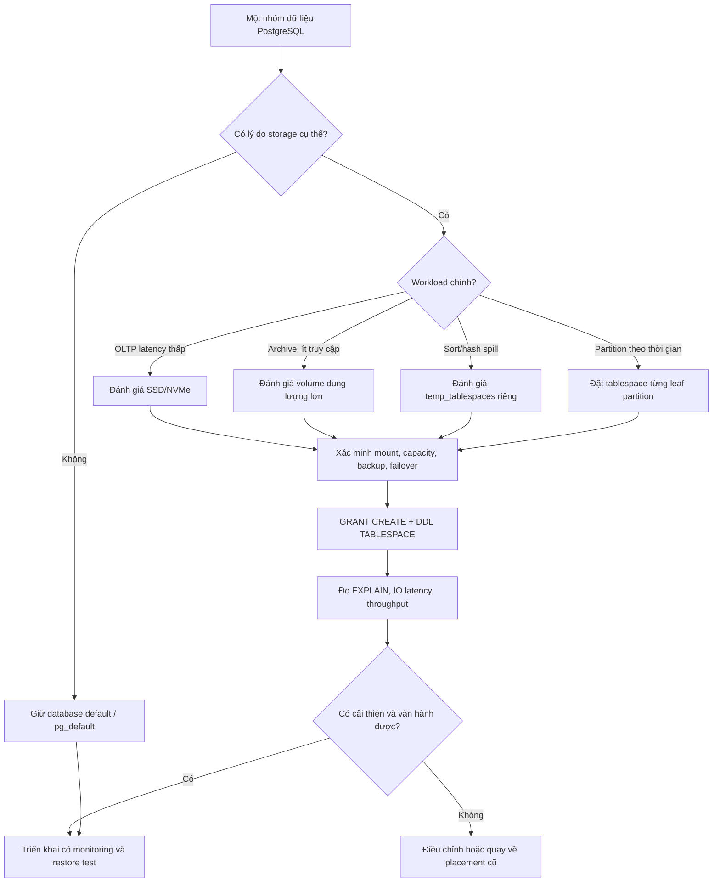

# Phân bố dữ liệu qua tablespace và đặc tính thiết bị lưu trữ trong PostgreSQL

Khi một PostgreSQL cluster phát triển, database có thể chứa nhiều nhóm dữ liệu với đặc điểm truy cập rất khác nhau: bảng giao dịch được đọc/ghi liên tục, index cần truy cập ngẫu nhiên nhanh, bảng lịch sử ít thay đổi, dữ liệu staging chỉ tồn tại ngắn hạn và các file tạm phát sinh khi sort/hash vượt bộ nhớ. Đặt tất cả objects trên cùng một filesystem có thể đơn giản lúc đầu, nhưng không phải lúc nào cũng phù hợp về dung lượng, hiệu năng và khả năng vận hành.

PostgreSQL cung cấp **tablespace** để quản trị viên đặt relation objects trên những vị trí lưu trữ khác nhau. Một tablespace gắn với một thư mục trên filesystem của máy chủ database; PostgreSQL quản lý dữ liệu trong đó thông qua cơ chế nội bộ của cluster. Ta có thể đặt một bảng, một index, materialized view hoặc database default vào tablespace được chọn, rồi điều chỉnh một số giả định chi phí I/O của query planner theo đặc tính thiết bị.

Ví dụ:

```sql
CREATE TABLESPACE ts_fast
    OWNER storage_owner
    LOCATION '/srv/postgresql/ts_fast';

CREATE TABLE app.orders (
    order_id BIGINT PRIMARY KEY,
    customer_id BIGINT NOT NULL,
    created_at TIMESTAMPTZ NOT NULL
) TABLESPACE ts_fast;

CREATE INDEX orders_customer_created_idx
ON app.orders (customer_id, created_at)
TABLESPACE ts_fast;
```

Bảng và index có thể được bố trí riêng. Điều này hữu ích khi có nhiều filesystem hoặc thiết bị phù hợp với workload khác nhau. Tuy nhiên, **tablespace không phải một lớp cache, không phải cơ chế replication và không tự bảo đảm một thiết bị nhanh hơn**. Nếu hai thư mục thực tế cùng nằm trên một volume, việc tạo hai tablespaces không tạo thêm IOPS hay throughput. Nếu storage có latency cao, cấu hình planner sai có thể làm query chọn execution plan tệ hơn.

Bài học thuộc chương **Lưu trữ** trong module *Database Engine Relational PostgreSQL*. Chúng ta sẽ tìm hiểu kiến trúc tablespace, cách tạo và phân quyền, vị trí bảng/index/partition/temp objects, chuyển dữ liệu, điều chỉnh chi phí truy cập, giám sát thiết bị và xử lý backup/restore khi dữ liệu nằm ngoài thư mục dữ liệu mặc định.

> **Nguyên tắc vận hành:** Chọn tablespace theo bằng chứng đo workload và khả năng quản trị storage. Xác nhận mount point, quyền hệ điều hành, dung lượng, backup, replication và kế hoạch khôi phục trước khi đưa object production vào vị trí mới.

## 1. Mục tiêu học tập

Sau bài này, bạn có thể:

1. Giải thích tablespace là một vùng lưu trữ logic gắn với thư mục vật lý của PostgreSQL server.
2. Phân biệt `pg_default`, `pg_global` và tablespace do quản trị viên tạo.
3. Hiểu phạm vi cluster-wide của tablespace và database default tablespace.
4. Tạo tablespace đúng điều kiện filesystem và phân quyền hệ điều hành.
5. Phân biệt quyền `CREATE` trên database, schema và tablespace.
6. Chọn tablespace riêng cho table, index và materialized view.
7. Hiểu cách bố trí TOAST, partition và objects được tạo trong tương lai.
8. Sử dụng `default_tablespace` và `temp_tablespaces` có kiểm soát.
9. Chuyển table/index/database giữa tablespaces và ước lượng lock, I/O, dung lượng tạm.
10. Đọc catalog `pg_tablespace`, `pg_class`, `pg_database` và đường dẫn relation.
11. Đo kích thước tablespace, table, index và dung lượng filesystem.
12. Hiểu các tham số planner `seq_page_cost`, `random_page_cost` và I/O concurrency.
13. Đánh giá HDD, SSD, NVMe, RAID, SAN/NAS và network filesystem theo workload thực.
14. Phân biệt data tablespaces với WAL trong `pg_wal`.
15. Thiết kế backup/restore, physical standby và tablespace path mapping.
16. Xử lý hết dung lượng, mount mất, permission sai và tablespace không còn truy cập được.
17. Thiết kế chiến lược phân bố dữ liệu có thể kiểm thử, giám sát và rollback.

## 2. Tablespace là gì?

**Tablespace** là một tên logic đại diện cho vị trí lưu trữ vật lý của các database objects. PostgreSQL quản lý files của relations trong tablespace thông qua OID và các đường dẫn dưới data directory.

Mỗi tablespace có:

- Một tên duy nhất trong cluster.
- Một OID được lưu trong system catalog.
- Một owner database role.
- Một đường dẫn thư mục trên filesystem server.
- Một tập quyền để roles được phép tạo objects ở đó.
- Có thể có các thiết lập chi phí I/O dùng bởi query planner.

Một bảng PostgreSQL không nhất thiết nằm trong cùng thư mục với `PGDATA/base/...`. Nếu nó ở tablespace riêng, file relation nằm dưới thư mục tablespace và PostgreSQL có liên kết nội bộ từ `PGDATA/pg_tblspc`.

### 2.1. Tablespace là logic, filesystem mới là nơi chứa bytes

```text
PostgreSQL cluster
│
├── PGDATA/
│   ├── base/              ← objects thuộc pg_default
│   ├── global/            ← shared cluster catalogs
│   ├── pg_wal/            ← write-ahead log
│   └── pg_tblspc/
│       ├── 24576 -> /srv/pg/fast
│       └── 24577 -> /srv/pg/archive
│
├── /srv/pg/fast/PG_VERSION/...
└── /srv/pg/archive/PG_VERSION/...
```

Sơ đồ minh họa quan hệ giữa data directory và tablespace locations. OID ở `pg_tblspc` chỉ là ví dụ; không tự tạo hoặc chỉnh sửa các symlinks này bằng tay khi PostgreSQL đang chạy.

### 2.2. Tablespace không chứa một database theo nghĩa độc lập

Một database có thể có objects ở nhiều tablespaces. Một tablespace cũng có thể chứa objects thuộc **nhiều databases trong cùng PostgreSQL cluster**. Tablespace không là một cluster PostgreSQL mới, không có riêng process, connection pool hoặc transaction manager.

### 2.3. Tablespace không là partitioning

Partitioning chia dữ liệu logic thành các relations con theo key/range/list/hash. Tablespace chỉ quyết định nơi lưu relation. Bạn có thể dùng partitioning và tablespaces cùng nhau, ví dụ partition tháng gần đây trên SSD và partition lịch sử trên dung lượng lớn.

## 3. Hai tablespaces hệ thống

PostgreSQL khởi tạo hai tablespaces mặc định:

| Tên | Vai trò |
|---|---|
| `pg_default` | Tablespace mặc định cho objects của databases nếu database không chọn tablespace khác |
| `pg_global` | Nơi chứa các shared system catalogs dùng chung toàn cluster |

### 3.1. pg_default

Nếu database được tạo mà không chỉ định tablespace, database thường dùng `pg_default`. Các bảng/index được tạo mà không có lựa chọn tablespace riêng sẽ kế thừa default tablespace của database (trừ khi `default_tablespace`/session policy chỉ định khác).

### 3.2. pg_global

`pg_global` chứa shared catalogs như thông tin roles và tablespaces. Đây không phải vị trí để đặt bảng ứng dụng hoặc index tự tạo. Không cố chuyển user tables vào `pg_global`.

### 3.3. Tablespace mặc định của database

Có thể xem database default tablespace bằng catalog:

```sql
SELECT
    d.datname,
    t.spcname AS default_tablespace
FROM pg_database AS d
JOIN pg_tablespace AS t
    ON t.oid = d.dattablespace
ORDER BY d.datname;
```

Tablespace mặc định của database không nhất thiết là nơi mọi object trong database đang nằm. Một object có thể được tạo với `TABLESPACE` riêng hoặc di chuyển sau đó.

## 4. Phạm vi cluster-wide và database-specific

Tablespace được tạo ở cấp cluster. Tên tablespace phải duy nhất trong cluster, không phải chỉ trong một database.

```text
PostgreSQL cluster A
├── database app_db
│   ├── schema sales
│   ├── table sales.orders       → ts_fast
│   └── index orders_pk          → ts_fast
├── database report_db
│   └── table report.monthly     → ts_archive
└── database staging_db
    └── table import.raw         → pg_default
```

Tất cả databases trên đều có thể dùng tablespaces đã tạo trong cluster nếu role có quyền phù hợp.

### 4.1. Tablespace không thể dùng chung giữa hai clusters độc lập

Không mount cùng một tablespace directory cho hai PostgreSQL server độc lập cùng lúc để chúng ghi dữ liệu. Các server sẽ không phối hợp transaction, locking, WAL và relation metadata; hậu quả có thể là corruption.

### 4.2. Tablespace không tự đồng bộ sang replica

Physical replication truyền WAL và cần cấu trúc tablespace tương ứng ở standby. Nếu primary và standby dùng đường dẫn khác nhau, phải thiết lập mapping/đường dẫn phù hợp khi tạo standby. Logical replication không tự sao chép tablespace placement như một cấu hình storage.

## 5. Cấu trúc vật lý trong pg_tblspc

Trong `PGDATA/pg_tblspc`, PostgreSQL tạo liên kết cho tablespaces ngoài default/global. Đường dẫn vật lý của relation có thể được kiểm tra bằng:

```sql
SELECT
    pg_relation_filepath('public.some_table'::regclass);
```

Kết quả thường là đường dẫn tương đối từ data directory. Với object ở tablespace riêng, đường dẫn thường đi qua `pg_tblspc/<tablespace_oid>/...`.

### 5.1. Không thao tác trực tiếp file relation

Không copy, rename, delete hoặc chỉnh sửa file relation khi PostgreSQL đang chạy. Những thao tác đó bỏ qua buffer manager, WAL, locks, catalog metadata và có thể làm database hỏng.

### 5.2. Không tự tạo symlink thủ công

Tạo tablespace bằng `CREATE TABLESPACE`; di chuyển objects bằng SQL command; chuyển cluster bằng backup/restore hoặc công cụ được hỗ trợ. `pg_tblspc` là cấu trúc nội bộ do server quản lý.

### 5.3. OID không phải đường dẫn ổn định giữa clusters

Tablespace OID có thể khác khi tạo cluster/restore. Script vận hành nên dùng tên tablespace và catalog, không hard-code OID từ một môi trường khác.

## 6. Chuẩn bị filesystem trước khi CREATE TABLESPACE

Ví dụ trên Linux, quản trị viên hệ điều hành tạo một mount point và thư mục dành riêng:

```bash
sudo mkdir -p /srv/postgresql/ts_fast
sudo chown postgres:postgres /srv/postgresql/ts_fast
sudo chmod 700 /srv/postgresql/ts_fast
```

Đây là ví dụ tên tài khoản `postgres`; hệ điều hành/service manager có thể dùng user/group khác.

Điều kiện cơ bản của thư mục tablespace:

- Đường dẫn tuyệt đối.
- Thư mục đã tồn tại trước khi chạy `CREATE TABLESPACE`.
- Thư mục rỗng.
- Thuộc quyền sở hữu của operating-system user chạy PostgreSQL server.
- Không nằm bên trong data directory của cluster.
- Server process có thể truy cập và ghi trên filesystem/mount tương ứng.

### 6.1. Vì sao thư mục phải rỗng?

PostgreSQL sẽ tạo cấu trúc riêng của tablespace bên trong. Nếu directory chứa dữ liệu hoặc file không liên quan, không nên cho server quản lý nhầm những files đó.

### 6.2. Quyền OS và quyền SQL là hai lớp khác nhau

Role có quyền `CREATE ON TABLESPACE` vẫn không thể ghi nếu OS permissions/mount không cho PostgreSQL service user truy cập. Ngược lại, sửa filesystem permissions không tự cấp quyền SQL cho database role.

### 6.3. Mount phải tồn tại trước khi PostgreSQL khởi động

Nếu tablespace mount bị thiếu, PostgreSQL có thể không truy cập được các relations nằm ở đó. Cấu hình mount/service dependency để database không khởi động trong trạng thái storage chưa sẵn sàng.

### 6.4. Tránh dùng thư mục tạm hoặc home directory

Đường dẫn tablespace là dữ liệu bền vững. Không đặt dưới `/tmp`, thư mục user có cleanup tự động hoặc mount không có persistence phù hợp.

## 7. Tạo tablespace

Một role đủ quyền tạo tablespace có thể chạy:

```sql
CREATE TABLESPACE ts_fast
    OWNER storage_owner
    LOCATION '/srv/postgresql/ts_fast';
```

Lệnh tạo tablespace không được thực thi bên trong transaction block. Vì vậy không đặt nó trong migration wrapper luôn `BEGIN`/`COMMIT` nếu tool không hỗ trợ statement ngoài transaction.

### 7.1. Quyền tạo tablespace

Người tạo cần đặc quyền thích hợp (superuser hoặc quyền `CREATE` trên database hiện tại theo quy tắc PostgreSQL). Owner của tablespace là một database role, còn quyền truy cập directory thuộc OS account của PostgreSQL server.

### 7.2. Tạo tablespace có tham số storage cost

Có thể khai báo các tham số liên quan planner/I/O:

```sql
CREATE TABLESPACE ts_fast
    OWNER storage_owner
    LOCATION '/srv/postgresql/ts_fast'
    WITH (
        seq_page_cost = 1.0,
        random_page_cost = 1.2
    );
```

Các con số chỉ là ví dụ minh họa. Không copy chúng sang production nếu chưa đo storage và workload.

### 7.3. Tên tablespace không phải tên mount

`ts_fast` là tên logic trong PostgreSQL; `/srv/postgresql/ts_fast` là đường dẫn server. Một tên tablespace có thể vẫn giữ nguyên khi storage backend được thay thế theo quy trình bảo trì, miễn path/cluster được quản lý đúng.

### 7.4. CREATE TABLESPACE không tạo filesystem

PostgreSQL không tự format disk, tạo partition, mount volume, cấp quota hoặc thiết lập RAID. Đó là trách nhiệm của hệ điều hành/cloud storage/platform team.

## 8. Quyền trên tablespace

Tablespace có object privilege riêng là `CREATE`, cho phép role tạo objects trong đó:

```sql
GRANT CREATE ON TABLESPACE ts_fast TO app_deployer;
```

Thu hồi:

```sql
REVOKE CREATE ON TABLESPACE ts_fast FROM app_deployer;
```

### 8.1. Tablespace CREATE khác database CREATE

- `CREATE ON DATABASE`: cho phép tạo schema và một số objects cấp database theo quy định.
- `CREATE ON SCHEMA`: cho phép tạo tables, indexes, functions và objects trong namespace đó.
- `CREATE ON TABLESPACE`: cho phép đặt objects vào vị trí tablespace đó.

Để tạo table trong schema `sales` tại `ts_fast`, role thường cần **cả** quyền CREATE trên schema và quyền CREATE trên tablespace, cùng các điều kiện khác.

### 8.2. Owner của tablespace

Owner có thể thay đổi tablespace theo quyền quản trị phù hợp. Chuyển owner:

```sql
ALTER TABLESPACE ts_fast OWNER TO storage_admin;
```

Role mới cần đáp ứng membership/ownership rules của PostgreSQL. Đổi owner SQL không đổi OS owner của directory.

### 8.3. Không cấp quyền tablespace rộng tùy tiện

Một role có CREATE trên tablespace có thể tiêu thụ dung lượng thiết bị đó bằng cách tạo objects. Với volume nhỏ hoặc đắt tiền, cấp quyền theo nhóm deployer/database owner có kiểm soát.

## 9. Tạo database với default tablespace

Có thể đặt tablespace mặc định cho database mới:

```sql
CREATE DATABASE app_db
    OWNER app_owner
    TABLESPACE ts_fast;
```

Database default tablespace ảnh hưởng nơi các objects mới sẽ nằm khi không có lựa chọn khác. Nó không tự di chuyển các objects hiện có trong một database khác.

### 9.1. Tablespace phải tồn tại trước

Tạo tablespace trước rồi mới tạo database sử dụng nó. Role thực hiện cần quyền phù hợp trên tablespace và database creation.

### 9.2. Không phải mọi object buộc nằm ở database default

Một table/index có thể chọn tablespace riêng khi được tạo; session có `default_tablespace` cũng có thể ảnh hưởng các objects được tạo mà không ghi TABLESPACE clause.

### 9.3. Database template và tablespace

Khi tạo database từ template, PostgreSQL sao chép objects của template theo quy tắc CREATE DATABASE; lựa chọn tablespace của database mới và các object có explicit tablespace cần được xem xét theo tài liệu. Không giả định mọi objects sẽ tự được tái bố trí vào một volume mới nếu template có objects ở tablespace khác.

## 10. Đặt table vào tablespace

Dùng `TABLESPACE` trong DDL:

```sql
CREATE TABLE sales.orders (
    order_id BIGINT GENERATED ALWAYS AS IDENTITY,
    customer_id BIGINT NOT NULL,
    created_at TIMESTAMPTZ NOT NULL,
    total_amount NUMERIC(14,2) NOT NULL
) TABLESPACE ts_fast;
```

Nếu bỏ clause, PostgreSQL xác định tablespace theo `default_tablespace` của session hoặc database default.

### 10.1. Đặt index riêng

```sql
CREATE INDEX orders_created_at_idx
ON sales.orders (created_at)
TABLESPACE ts_fast;
```

Index là relation riêng. Đặt table ở `ts_fast` không có nghĩa mọi indexes được tạo sau này tự động cùng vị trí nếu default tablespace khác hoặc có clause riêng.

### 10.2. Primary key tạo index

Khi tạo PRIMARY KEY/UNIQUE constraint, PostgreSQL tạo index tương ứng. Có thể chỉ định tablespace cho index được tạo qua cú pháp hỗ trợ của constraint/index DDL, hoặc tạo index riêng theo quy trình phù hợp. Kiểm tra catalog sau migration để xác nhận vị trí thực tế.

### 10.3. Tablespace của TOAST

Một table có cột varlena lớn có thể có TOAST relation/index riêng. Khi di chuyển table bằng lệnh tablespace phù hợp, TOAST relation đi cùng table; không nên suy mọi files của table chỉ có một relfilenode.

## 11. Đặt materialized view vào tablespace

Materialized view lưu kết quả vật lý, nên có thể được đặt riêng:

```sql
CREATE MATERIALIZED VIEW report.monthly_sales
TABLESPACE ts_archive
AS
SELECT
    date_trunc('month', created_at) AS sales_month,
    count(*) AS order_count,
    sum(total_amount) AS total_amount
FROM sales.orders
GROUP BY 1;
```

Materialized view có thể tiêu tốn nhiều dung lượng và có chi phí refresh; tablespace placement nên xét cả query workload và refresh workload.

### 11.1. Refresh không tự đổi tablespace

`REFRESH MATERIALIZED VIEW` cập nhật nội dung view theo cơ chế của PostgreSQL; nó không phải lệnh chuyển object sang một tablespace khác. Dùng lệnh `ALTER MATERIALIZED VIEW ... SET TABLESPACE` khi cần di chuyển.

### 11.2. Index của materialized view là object riêng

Index được tạo trên materialized view có tablespace riêng. Kiểm tra chúng sau khi tạo hoặc di chuyển.

## 12. Partitioning kết hợp tablespaces

Một bảng partitioned không lưu heap rows trực tiếp như một table thường; dữ liệu nằm trong các leaf partitions. Có thể đặt các partitions ở tablespaces khác nhau:

```sql
CREATE TABLE telemetry.events (
    event_id BIGINT NOT NULL,
    occurred_at TIMESTAMPTZ NOT NULL,
    payload JSONB
) PARTITION BY RANGE (occurred_at);

CREATE TABLE telemetry.events_2026_10
PARTITION OF telemetry.events
FOR VALUES FROM ('2026-10-01 00:00:00+00')
         TO   ('2026-11-01 00:00:00+00')
TABLESPACE ts_archive;

CREATE TABLE telemetry.events_2026_11
PARTITION OF telemetry.events
FOR VALUES FROM ('2026-11-01 00:00:00+00')
         TO   ('2026-12-01 00:00:00+00')
TABLESPACE ts_fast;
```

### 12.1. Parent không có heap data

Tablespace placement quan trọng nhất với các partition relations thực sự lưu rows. Một partitioned parent là relation định nghĩa/metadata, không là nơi chứa toàn bộ dữ liệu.

### 12.2. Index partitioned và index partitions

Index partitioned parent có cấu trúc metadata; các indexes vật lý trên leaf partitions là những objects cần kiểm tra vị trí thực. Đừng chỉ xem tên parent index rồi kết luận mọi index files đã ở đúng thiết bị.

### 12.3. Tự động tạo partition tương lai

Nếu partition được tạo bởi job định kỳ, job phải xác định tablespace theo chính sách. Một tháng mới vô tình dùng database default có thể làm mất phân bố mong muốn.

### 12.4. Partition theo tuổi dữ liệu không tự cân bằng thiết bị

Nếu partition cũ ít truy cập, chuyển sang storage dung lượng lớn có thể hợp lý; nhưng cần xem retention, backup/restore time, vacuum, index bloat và truy vấn lịch sử.

## 13. default_tablespace

`default_tablespace` xác định tablespace mặc định cho những objects được tạo mà không ghi `TABLESPACE` clause, trong phạm vi những object types có hỗ trợ.

```sql
SHOW default_tablespace;

SET default_tablespace = 'ts_fast';

CREATE TABLE sales.import_buffer (
    id BIGINT,
    payload JSONB
);
```

Nếu quyền hợp lệ, table mới có thể được tạo ở `ts_fast`.

### 13.1. SET LOCAL theo transaction

```sql
BEGIN;

SET LOCAL default_tablespace = 'ts_fast';

CREATE TABLE sales.batch_work (
    id BIGINT,
    raw_value TEXT
);

COMMIT;
```

`SET LOCAL` hết hiệu lực khi transaction kết thúc, thích hợp khi chỉ một migration/job cần tablespace riêng.

### 13.2. SET session-level có thể rò qua connection pool

Nếu dùng `SET default_tablespace` và connection trả lại pool mà không reset, request sau có thể tạo objects ở vị trí không dự định. Dùng `SET LOCAL`, reset session state hoặc cấu hình pool.

### 13.3. default_tablespace không di chuyển objects cũ

Đổi setting chỉ ảnh hưởng các object được tạo sau đó. Table/index đã tồn tại vẫn ở tablespace hiện tại cho đến khi có lệnh di chuyển.

### 13.4. Không thay thế database default

`default_tablespace` là setting của session/user/database configuration. `ALTER DATABASE ... SET TABLESPACE` là thao tác di chuyển database objects khỏi default tablespace cũ sang default mới, có yêu cầu riêng.

## 14. temp_tablespaces cho temporary objects và files

`temp_tablespaces` cho phép chọn một hoặc nhiều tablespaces để đặt temporary tables và temporary files (ví dụ sort/hash spill) theo quy tắc PostgreSQL.

```sql
SHOW temp_tablespaces;

SET temp_tablespaces = 'ts_temp';

CREATE TEMP TABLE temp_import_ids (
    id BIGINT
);
```

### 14.1. Temporary files không chỉ là TEMP TABLE

Một query sort/hash lớn vượt memory budget có thể tạo temporary files. `temp_tablespaces` có thể định hướng nơi đặt các files tạm đó, giúp giảm cạnh tranh với data files trên một số storage layouts.

### 14.2. Danh sách nhiều tablespaces

Có thể cấu hình danh sách tablespaces để PostgreSQL chọn một vị trí cho từng temporary object. Điều này có thể giúp phân tán tải khi các vị trí thực sự độc lập, nhưng không bảo đảm cân bằng byte/IO chính xác giữa thiết bị.

### 14.3. Quyền và fallback

Role cần quyền phù hợp để tạo objects trong tablespaces được chọn. Nếu một tablespace không có quyền/không sẵn sàng, temporary operation có thể thất bại; đừng dựa vào fallback ngầm mà chưa thử trên phiên bản và cấu hình thật.

### 14.4. temp_tablespaces không phải nơi đặt mọi bảng staging

Bảng TEMP được đặt theo chính sách temporary tablespaces, nhưng bảng thường có tên `staging.raw_orders` vẫn là relation thường, chịu `default_tablespace`/DDL clause.

### 14.5. Theo dõi temp file

Có thể xem thống kê ở mức database:

```sql
SELECT
    datname,
    temp_files,
    pg_size_pretty(temp_bytes) AS temp_written
FROM pg_stat_database
WHERE datname = current_database();
```

Cấu hình `log_temp_files` có thể giúp tìm query tạo temp files lớn; kiểm tra logging volume và chính sách dữ liệu trước khi bật rộng.

## 15. Đặc tính thiết bị: HDD, SSD và NVMe

Các thiết bị khác nhau về latency, throughput, IOPS, queue depth, endurance và chi phí.

| Loại storage | Đặc điểm thường gặp | Workload có thể phù hợp |
|---|---|---|
| HDD | Random access chậm hơn, sequential throughput tốt theo dung lượng/giá | Archive, backup staging, dữ liệu ít truy cập |
| SATA SSD | Random latency thấp hơn HDD, throughput/queue giới hạn hơn NVMe | OLTP vừa, index, hot tables |
| NVMe SSD | Latency thấp, IOPS/parallelism cao | Hot indexes, transaction data, temp spill có tải |
| RAID array | Đặc tính phụ thuộc RAID level, controller, cache, disk set | Cần capacity/redundancy và throughput đo được |
| SAN / block storage | Có thể chia volume, latency phụ thuộc fabric/provider | Workload doanh nghiệp có QoS/HA |
| Network filesystem | Latency/locking/fsync semantics phụ thuộc triển khai | Chỉ dùng khi PostgreSQL và vendor support rõ ràng |

Bảng chỉ là xu hướng. Một HDD RAID tốt có thể có sequential throughput cao; một volume SSD bị giới hạn IOPS có thể chậm hơn dự kiến. Đo trên hạ tầng thực.

### 15.1. Random I/O và sequential I/O

- Sequential scan đọc pages theo luồng; có thể hưởng throughput tuần tự và read-ahead.
- Index scan có thể truy cập heap pages ngẫu nhiên; latency random I/O có ảnh hưởng lớn.
- Bitmap heap scan gom các heap page accesses thành pattern thuận lợi hơn.
- Sort/hash spill tạo temporary I/O.
- VACUUM/CREATE INDEX/backup tạo các mẫu I/O riêng.

Không có một thiết bị “nhanh nhất cho mọi query”.

### 15.2. Latency và IOPS

IOPS là số thao tác I/O mỗi giây; latency là thời gian mỗi thao tác. Khi query có nhiều random page fetch tuần tự, latency thấp có thể quan trọng hơn throughput tổng.

### 15.3. Queue depth và concurrency

NVMe có khả năng xử lý nhiều I/O đồng thời. Tuy nhiên, tăng concurrency quá mức có thể tạo contention, queueing và làm tail latency tệ hơn. Tham số PostgreSQL phải được đo cùng device limits.

### 15.4. Endurance và write amplification

Workload WAL-heavy, index updates, vacuum và temporary spill có thể tạo nhiều writes. Xem endurance, write amplification và cloud volume billing trước khi đặt hot OLTP data lên volume có giới hạn ghi.

## 16. Tách dữ liệu và index: khi nào có ích?

Một cách bố trí thường được cân nhắc:

```text
ts_data  → table heap / TOAST
ts_index → B-tree / GIN / GiST indexes
ts_temp  → sort/hash temporary files
ts_cold  → historical partitions
```

Không có quy tắc phải tách. Nếu table và index nằm trên cùng một thiết bị NVMe nhanh, chia thành hai tablespaces trên cùng volume không đem lại độc lập I/O.

### 16.1. Index-heavy OLTP

Index được truy cập thường xuyên; đặt trên storage random-read latency thấp có thể cải thiện một số query. Nhưng table heap cũng có random reads/writes và WAL/index maintenance; đo cả hai.

### 16.2. Archive-heavy workload

Partition lịch sử ít truy cập có thể chuyển sang storage dung lượng lớn/giá thấp. Trước khi làm, đo thời gian truy vấn báo cáo, vacuum, backup và khả năng phục hồi từ thiết bị chậm hơn.

### 16.3. Temp-heavy workload

Sort/hash spills có thể gây cạnh tranh với OLTP. Đặt temp tablespaces trên storage riêng có thể giúp, nhưng cần xem dung lượng tạm và concurrency để tránh volume temp đầy.

### 16.4. Tách index không thay tuning index

Một index sai thứ tự cột, thiếu selective predicate hoặc quá rộng vẫn tốn I/O dù đặt ở NVMe. Tablespace không thay query/index design.

## 17. Query planner và chi phí I/O

PostgreSQL planner ước tính chi phí thực thi dựa trên CPU, I/O và các giả định. Hai tham số thường gặp:

- `seq_page_cost`: chi phí đọc một page tuần tự.
- `random_page_cost`: chi phí đọc một page ngẫu nhiên.

Giá trị mặc định phổ biến là `seq_page_cost = 1.0`, `random_page_cost = 4.0`, nhưng giá trị thực tế cần cân theo storage/cache/workload.

### 17.1. Tablespace-specific planner costs

Có thể đặt cost riêng trên tablespace:

```sql
ALTER TABLESPACE ts_fast
SET (random_page_cost = 1.2);

ALTER TABLESPACE ts_archive
SET (random_page_cost = 3.5);
```

Khi planner ước lượng truy cập relation nằm trong tablespace đó, thiết lập phù hợp có thể được dùng thay global defaults.

### 17.2. Chỉ có ý nghĩa tương đối

Planner cost là đơn vị tương đối, không phải milliseconds hay IOPS. Nếu giảm `random_page_cost` mà không điều chỉnh assumptions khác, planner có thể thiên về index scans nhiều hơn; điều đó không tự bảo đảm nhanh hơn.

### 17.3. Cache làm thay đổi effective random cost

Nếu working set vừa `shared_buffers`/OS cache, nhiều page fetch không phải đọc vật lý từ disk. Random page access trong cache rẻ hơn trên storage. Đừng chỉ nhìn thông số thiết bị mà bỏ qua cache hit ratio và working set.

### 17.4. Không gán random_page_cost = 1.0 chỉ vì dùng SSD

SSD vẫn có latency và queueing; sequential throughput, CPU, cache, storage virtualization và query shape khác nhau. Đo bằng benchmark/query plans đại diện trước khi thay đổi.

### 17.5. So sánh EXPLAIN trước/sau

```sql
EXPLAIN (ANALYZE, BUFFERS, WAL)
SELECT *
FROM sales.orders
WHERE customer_id = 42
ORDER BY created_at DESC
LIMIT 50;
```

Thực hiện trên dataset đủ lớn và workload gần thực tế. `EXPLAIN ANALYZE` thực thi query; với DML phải dùng safeguards/rollback khi cần.

## 18. effective_io_concurrency và maintenance_io_concurrency

PostgreSQL có các tham số điều khiển số I/O requests có thể được phát đồng thời trong một số hoạt động:

- `effective_io_concurrency`: ảnh hưởng một số hoạt động đọc, đặc biệt bitmap heap scans.
- `maintenance_io_concurrency`: ảnh hưởng một số hoạt động maintenance như VACUUM/CREATE INDEX tùy version/operation.

Có thể cấu hình ở tablespace khi phiên bản hỗ trợ:

```sql
ALTER TABLESPACE ts_fast
SET (effective_io_concurrency = 100);

ALTER TABLESPACE ts_archive
SET (effective_io_concurrency = 10);
```

Các giá trị này chỉ là ví dụ, không phải preset cho SSD/HDD.

### 18.1. Vì sao tăng concurrency có thể không nhanh hơn?

- Device đã đạt queue depth/IOPS giới hạn.
- Cloud volume có burst credits hết.
- Storage backend có contention.
- Nhiều queries đồng thời tạo quá nhiều outstanding I/O.
- CPU/locks hoặc memory mới là bottleneck.

### 18.2. Không nhầm với max_parallel_workers

Parallel query workers là CPU/query execution parallelism, khác số I/O requests. Tăng một tham số không thay thế điều chỉnh tham số kia.

### 18.3. Kiểm tra GUC và tablespace options đúng version

Tham số được hỗ trợ và khả năng đặt ở tablespace phụ thuộc server version. Kiểm tra tài liệu và `pg_settings`/`pg_tablespace` trên cluster thực trước khi đưa vào migration.

## 19. Tablespace không thay đổi WAL placement

WAL thường nằm dưới `PGDATA/pg_wal`, không được chuyển chỉ bằng cách tạo tablespace hoặc đặt table/index vào tablespace riêng.

```text
PGDATA/
  base/             ← pg_default database objects
  pg_tblspc/        ← links to tablespaces
  pg_wal/           ← WAL segments
```

### 19.1. Vì sao phân biệt quan trọng?

Một workload ghi nhiều có thể bị giới hạn bởi WAL device dù table data nằm trên NVMe riêng. Tách data tablespace không tự tách WAL I/O.

### 19.2. WAL có yêu cầu durability riêng

WAL flush/fsync và data file writes phối hợp qua PostgreSQL durability protocol. Đừng đặt WAL trên storage mất dữ liệu/không bảo đảm fsync chỉ để benchmark nhanh.

### 19.3. Tablespace không tách shared_buffers

`shared_buffers` là memory cache của PostgreSQL cluster, không có một buffer cache riêng cho mỗi tablespace. Cũng không có memory isolation tự động giữa hot/cold tablespaces.

## 20. Tạo tablespace cho archive và fast storage

Một ví dụ môi trường có hai mount points:

```bash
sudo mkdir -p /mnt/pg-fast/ts_fast
sudo mkdir -p /mnt/pg-archive/ts_archive
sudo chown postgres:postgres /mnt/pg-fast/ts_fast
sudo chown postgres:postgres /mnt/pg-archive/ts_archive
sudo chmod 700 /mnt/pg-fast/ts_fast
sudo chmod 700 /mnt/pg-archive/ts_archive
```

SQL:

```sql
CREATE TABLESPACE ts_fast
    OWNER storage_owner
    LOCATION '/mnt/pg-fast/ts_fast';

CREATE TABLESPACE ts_archive
    OWNER storage_owner
    LOCATION '/mnt/pg-archive/ts_archive';
```

### 20.1. Cần kiểm tra đúng filesystem

`df -hT /mnt/pg-fast/ts_fast` (Linux) cho biết mount/filesystem type và dung lượng. `findmnt`/`lsblk` giúp xác định volume thực. Không kết luận hai tablespaces độc lập chỉ vì path khác nhau.

### 20.2. Dùng mount UUID hoặc cloud volume identity

Trong production, mount qua UUID/volume ID và cấu hình service dependencies để tránh sau reboot mount nhầm một thư mục trống ở root filesystem.

### 20.3. Capacity planning

Để dành không gian cho:
- Table/index growth.
- VACUUM và rewrite operations.
- CREATE INDEX và temporary files.
- WAL/checkpoints.
- Backup/restore staging.
- Emergency recovery và filesystem metadata.

Không dùng 100% dung lượng làm target vận hành thường ngày.

## 21. Kiểm tra tablespace và location

```sql
SELECT
    oid,
    spcname,
    pg_get_userbyid(spcowner) AS owner,
    pg_tablespace_location(oid) AS location
FROM pg_tablespace
ORDER BY spcname;
```

`pg_tablespace_location` trả đường dẫn location của tablespace; các tablespaces mặc định có location đặc biệt/empty string theo catalog semantics.

### 21.1. Tablespace ACL

```sql
SELECT
    spcname,
    spcacl
FROM pg_tablespace
ORDER BY spcname;
```

`spcacl` có thể NULL khi sử dụng default privileges. Đọc raw ACL không thay kiểm tra effective privilege.

### 21.2. Kiểm tra role có CREATE hay không

```sql
SELECT
    has_tablespace_privilege(
        'app_deployer',
        'ts_fast',
        'CREATE'
    ) AS can_create_in_fast;
```

Dùng `has_tablespace_privilege` để kiểm tra quyền hiệu lực của role được chỉ định.

## 22. Kiểm tra object thực nằm ở tablespace nào

Một relation có `pg_class.reltablespace = 0` nghĩa là nó dùng tablespace mặc định của database chứa relation, không có nghĩa luôn luôn `pg_default`.

```sql
SELECT
    n.nspname AS schema_name,
    c.relname AS relation_name,
    c.relkind,
    pg_get_userbyid(c.relowner) AS owner,
    CASE
        WHEN c.reltablespace = 0
            THEN dbts.spcname
        ELSE relts.spcname
    END AS effective_tablespace
FROM pg_class AS c
JOIN pg_namespace AS n
    ON n.oid = c.relnamespace
JOIN pg_database AS d
    ON d.datname = current_database()
JOIN pg_tablespace AS dbts
    ON dbts.oid = d.dattablespace
LEFT JOIN pg_tablespace AS relts
    ON relts.oid = c.reltablespace
WHERE n.nspname NOT IN ('pg_catalog', 'information_schema')
ORDER BY effective_tablespace, n.nspname, c.relname;
```

Query trên minh họa relations trong database hiện tại. Cần mở rộng filters khi muốn bao gồm TOAST/system objects hoặc partition index relations.

### 22.1. relkind

`pg_class.relkind` phân biệt table, index, sequence, view, materialized view, foreign table, partitioned table/index và các loại relation khác. Không coi mọi dòng `pg_class` là table heap.

### 22.2. Effective tablespace không nhất thiết là path vật lý của từng file phụ

Một table có thể có TOAST relation và indexes riêng. Kiểm tra các relations đó riêng nếu cần kiểm kê storage chính xác.

## 23. Đo dung lượng tablespace

```sql
SELECT
    spcname,
    pg_size_pretty(pg_tablespace_size(oid)) AS total_size
FROM pg_tablespace
ORDER BY pg_tablespace_size(oid) DESC;
```

`pg_tablespace_size` trả tổng dung lượng của tablespace trên cluster, có thể bao gồm objects thuộc nhiều databases.

### 23.1. Đo relation

```sql
SELECT
    pg_size_pretty(pg_relation_size('sales.orders')) AS heap_size,
    pg_size_pretty(pg_indexes_size('sales.orders')) AS indexes_size,
    pg_size_pretty(pg_total_relation_size('sales.orders'))
        AS total_including_toast_indexes;
```

`pg_total_relation_size` hữu ích khi muốn ước lượng toàn bộ storage liên quan table, bao gồm TOAST và indexes.

### 23.2. Đo theo filesystem

Database catalog không thay thế `df`, cloud volume metrics hoặc monitoring của storage provider. Một tablespace có thể có files khác/metadata/backup artifacts ngoài phạm vi query SQL.

### 23.3. Không so số liệu khác scope

`pg_tablespace_size` là tổng tablespace; `pg_relation_size` là relation; `df` là filesystem. Chúng không nhất thiết bằng nhau vì filesystem có overhead, free space, files ngoài PostgreSQL và các relation khác.

## 24. pg_relation_filepath

```sql
SELECT
    'sales.orders'::regclass AS relation,
    pg_relation_filepath('sales.orders'::regclass) AS relative_path;
```

Đường dẫn trả về giúp kiểm tra relation đang ở vùng nào. Với tablespace riêng, thường có đoạn `pg_tblspc/<tablespace_oid>/...`.

### 24.1. File segment

Relation lớn có thể gồm nhiều segment files; `pg_relation_filepath` chỉ cung cấp base path của relation. Không giả định một table chỉ có một file.

### 24.2. Forks

Một relation có thể có forks như main, FSM, VM và init fork cho unlogged tables. Catalog/path diagnostics không đồng nghĩa đã đo toàn bộ disk usage chỉ bằng một file.

### 24.3. Không chỉnh file path bằng OS command

Dùng SQL và công cụ backup/restore. Không tự `mv` file relation để “đưa table sang SSD”.

## 25. Chuyển table sang tablespace khác

```sql
ALTER TABLE sales.orders
SET TABLESPACE ts_archive;
```

Lệnh này di chuyển table relation sang tablespace mới. Nó có thể phải copy dữ liệu vật lý, gây I/O lớn và giữ lock mạnh trên relation trong quá trình thực thi.

### 25.1. Index không tự động di chuyển cùng table

Indexes là relations riêng. Sau khi move table, indexes có thể vẫn ở tablespace cũ. Kiểm tra và di chuyển riêng:

```sql
ALTER INDEX sales.orders_pkey
SET TABLESPACE ts_archive;

ALTER INDEX sales.orders_created_at_idx
SET TABLESPACE ts_archive;
```

### 25.2. TOAST relation

Associated TOAST relation của table được xử lý cùng việc di chuyển table theo semantics của PostgreSQL. Nếu đang kiểm kê từng file, vẫn nên xác nhận catalog/size sau migration.

### 25.3. Lock và downtime

`ALTER TABLE ... SET TABLESPACE` cần lock mạnh (thường ACCESS EXCLUSIVE) và copy dữ liệu. Query/transactions khác có thể bị chặn. Thời gian phụ thuộc table size, storage throughput, index handling và concurrent workload.

### 25.4. Cần đủ dung lượng tạm thời

Khi chuyển, dữ liệu cũ và bản mới có thể cùng tồn tại trong quá trình copy cho tới khi commit/cleanup. Dự phòng dung lượng ở destination và khả năng rollback/temporary space.

### 25.5. Transactional behavior

Lệnh di chuyển là DDL có transaction semantics, nhưng filesystem I/O và thời gian lock vẫn có tác động vận hành. Không chạy trên production trong giờ cao điểm chỉ vì lệnh SQL ngắn.

## 26. Chuyển index

```sql
ALTER INDEX sales.orders_created_at_idx
SET TABLESPACE ts_fast;
```

Có thể chuyển tất cả indexes thuộc một tablespace bằng cú pháp `ALTER INDEX ALL IN TABLESPACE ... SET TABLESPACE ...` theo quyền sở hữu và options của phiên bản:

```sql
ALTER INDEX ALL IN TABLESPACE ts_archive
SET TABLESPACE ts_fast;
```

### 26.1. Kiểm tra phạm vi trước khi dùng ALL

Lệnh ALL có thể ảnh hưởng nhiều objects và databases/owners theo phạm vi catalog. Trước khi chạy, liệt kê chính xác index owners, database, target path và dung lượng.

### 26.2. Index partitioned

Index partitioned parent không có một index file duy nhất như leaf indexes. Kiểm tra các index partitions vật lý và migration behavior phù hợp.

### 26.3. Tablespace của index không đổi semantics index

Di chuyển B-tree/GIN/GiST index không thay operator class, uniqueness, collation hoặc query semantics; nó thay location và có thể ảnh hưởng hiệu năng/storage.

## 27. Di chuyển nhiều tables

PostgreSQL hỗ trợ dạng:

```sql
ALTER TABLE ALL IN TABLESPACE ts_archive
SET TABLESPACE ts_fast;
```

Lệnh này tác động tới các tables/materialized views phù hợp trong tablespace nguồn theo quyền/điều kiện của command.

### 27.1. NOWAIT

Một số forms hỗ trợ `NOWAIT` để không chờ lock nếu không lấy được ngay. Đây là lựa chọn hữu ích cho maintenance automation, nhưng cần kiểm tra syntax và behavior theo version.

### 27.2. Không thay thế kế hoạch migration

Một lệnh ALL có thể di chuyển nhiều terabytes, chiếm I/O và gây lock. Chia nhóm theo schema/table/size và đo từng bước có thể dễ kiểm soát hơn.

### 27.3. Đếm objects trước và sau

Ghi lại danh sách relations, sizes, owners và tablespaces trước migration. Sau khi chạy, xác nhận mọi table/index cần di chuyển đã ở đúng location; không chỉ dựa vào command tag.

## 28. Di chuyển materialized view

```sql
ALTER MATERIALIZED VIEW report.monthly_sales
SET TABLESPACE ts_archive;
```

Index của materialized view là objects riêng; kiểm tra và di chuyển chúng nếu cần.

### 28.1. Refresh và storage

Refresh materialized view có thể tạo tải lớn và dùng temporary resources. Chọn storage theo cả query đọc kết quả và workload refresh, không chỉ kích thước cuối cùng.

## 29. Chuyển database default tablespace

Có thể đổi default tablespace của database:

```sql
ALTER DATABASE app_db
SET TABLESPACE ts_fast;
```

Lệnh này di chuyển các objects trong database đang nằm ở **default tablespace cũ** sang tablespace mới và thay database default. Các objects đã được đặt rõ ở tablespaces khác không tự bị kéo về.

### 29.1. Database phải không có active connections

Để chuyển database default tablespace, database cần không có connections khác; hãy ngắt/quản lý sessions và chạy từ database khác. Lệnh không thể chạy trong transaction block.

### 29.2. Không phải đổi default_tablespace setting

`ALTER DATABASE ... SET TABLESPACE` di chuyển objects và đổi database default. `ALTER DATABASE ... SET default_tablespace` chỉ đặt một GUC cho sessions mới theo cấu hình, không phải migration dữ liệu.

### 29.3. Kiểm tra database-wide objects

Objects trong tablespaces explicitly assigned khác không tự di chuyển. Lập inventory trước/sau để biết toàn bộ storage footprint của database.

## 30. DROP TABLESPACE

Chỉ có thể drop tablespace khi nó không còn chứa objects:

```sql
DROP TABLESPACE ts_archive;
```

Nếu vẫn còn relations, PostgreSQL từ chối.

### 30.1. Không dùng CASCADE

`DROP TABLESPACE` không có cơ chế CASCADE tự xóa mọi tables/indexes trong đó như `DROP SCHEMA ... CASCADE`. Hãy di chuyển hoặc drop objects một cách chủ đích trước.

### 30.2. Kiểm tra usage trước

```sql
SELECT
    c.oid::regclass AS relation,
    n.nspname AS schema_name,
    c.relkind
FROM pg_class AS c
JOIN pg_namespace AS n
    ON n.oid = c.relnamespace
WHERE c.reltablespace = (
    SELECT oid FROM pg_tablespace WHERE spcname = 'ts_archive'
);
```

Query này tìm explicit relation assignments. Cần xem cả database defaults và các object types liên quan trước khi kết luận tablespace hoàn toàn rỗng.

### 30.3. OS directory cleanup

Sau khi PostgreSQL drop tablespace thành công, kiểm tra directory trên OS theo quy trình vận hành; không tự xóa path khi server còn quản lý tablespace.

## 31. ALTER TABLESPACE options

Có thể thay đổi planner/storage options:

```sql
ALTER TABLESPACE ts_fast
SET (random_page_cost = 1.3);

ALTER TABLESPACE ts_fast
RESET (random_page_cost);
```

### 31.1. SET khác ALTER SYSTEM

Tablespace options là thuộc tính riêng của tablespace, không ghi đè cấu hình cluster toàn cục cho mọi objects. `ALTER SYSTEM` thay đổi cấu hình server-wide và cần cân nhắc scope lớn hơn.

### 31.2. Kiểm tra catalog

```sql
SELECT
    spcname,
    spcoptions
FROM pg_tablespace
ORDER BY spcname;
```

`spcoptions` lưu các tablespace-specific options.

### 31.3. Không thay planner cost liên tục theo từng query

Thay đổi cost giả định để ép planner chọn một plan cụ thể thường che vấn đề. Dùng EXPLAIN/ANALYZE, statistics, index design và benchmark trước.

## 32. Storage placement không thay fillfactor

`fillfactor` là storage parameter của table/index, điều khiển mức lấp đầy page khi tạo/ghi mới theo object type. Nó khác tablespace.

```sql
CREATE TABLE sales.mutable_orders (
    id BIGINT,
    status TEXT
)
WITH (fillfactor = 80)
TABLESPACE ts_fast;
```

Table có thể nằm ở `ts_fast` và có fillfactor 80. Một thuộc tính không thay thuộc tính còn lại.

### 32.1. Fillfactor và HOT updates

Với table cập nhật thường xuyên, để chỗ trống trên page có thể tăng cơ hội HOT updates khi các điều kiện khác phù hợp. Nhưng fillfactor thấp hơn cũng tăng dung lượng; đo workload.

### 32.2. Tablespace không làm giảm bloat

Nếu table/index có bloat, chuyển sang NVMe không giải quyết nguyên nhân update/delete churn, vacuum lag hoặc index maintenance. Storage nhanh hơn có thể che triệu chứng nhưng không sửa thiết kế.

## 33. Storage và autovacuum

Autovacuum đọc/ghi relations trên tablespaces tương ứng, chịu ảnh hưởng I/O device, concurrency, table size và thresholds. Chuyển table sang archive volume chậm có thể làm vacuum/maintenance lâu hơn.

### 33.1. Archive không có nghĩa là bất biến

Một partition lịch sử vẫn có thể cần vacuum/analyze, index maintenance, retention deletion hoặc refresh. Lên lịch maintenance cho cả tablespaces lạnh.

### 33.2. Storage throughput ảnh hưởng vacuum lag

Khi write churn cao và vacuum không theo kịp, dead tuples/bloat tăng. Tách volume có thể giúp cô lập một số workload nhưng không loại bỏ nhu cầu cấu hình autovacuum phù hợp.

### 33.3. Không tắt autovacuum vì bảng nằm ở archive

Tuổi dữ liệu không đồng nghĩa không cần vacuum. Nếu dữ liệu append-only và không update/delete, policy có thể khác; hãy đo và xác minh visibility map/freeze requirements.

## 34. Storage và CREATE INDEX

`CREATE INDEX` đọc table và ghi index; có thể tạo temporary files/sort. Đặt index ở tablespace nhanh có thể giảm một số I/O, nhưng thao tác vẫn đọc table ở nơi hiện tại.

```sql
CREATE INDEX CONCURRENTLY orders_customer_idx
ON sales.orders (customer_id)
TABLESPACE ts_fast;
```

### 34.1. CONCURRENTLY không thể dùng trong transaction block

`CREATE INDEX CONCURRENTLY` có hạn chế transaction riêng. Đừng ghép với migration framework tự động wrap mọi statement trong một transaction.

### 34.2. Concurrent build không miễn phí

Nó giảm blocking writes theo cơ chế riêng nhưng có nhiều scans/overhead và có thể để invalid index nếu fail. Tablespace không thay behavior này.

### 34.3. Destination phải đủ chỗ

Index build có thể cần không gian cho index mới và temporary sort files. Kiểm tra `temp_tablespaces`, `maintenance_work_mem`, storage quota và free space.

## 35. Storage và temporary spills

Sort/hash operation có thể dùng memory tới giới hạn theo `work_mem` (và concurrency/multiple operations). Khi vượt, PostgreSQL dùng temporary files.

### 35.1. temp_tablespaces có thể giảm cạnh tranh

Đặt temp files trên volume riêng có thể giữ I/O của data tables bớt bị ảnh hưởng bởi analytical sorts. Nhưng nếu volume temp quá nhỏ, một query lớn có thể làm filesystem đầy.

### 35.2. work_mem nhân theo operations/connections

Không đặt `work_mem` cực lớn cho toàn cluster chỉ vì temp disk chậm. Nhiều sessions và nhiều plan nodes có thể cùng dùng memory, dẫn tới OOM.

### 35.3. Temp table khác temp file

Temporary table là relation có schema/session lifecycle; temporary file có thể là spill/sort/hash data. Cùng chịu `temp_tablespaces` policy nhưng không phải một loại object giống nhau.

## 36. Đo thiết bị ở tầng OS

PostgreSQL catalog không cho bạn đầy đủ latency/queue/IOPS vật lý. Trên Linux có thể dùng:

```bash
iostat -xz 1
lsblk -o NAME,TYPE,SIZE,FSTYPE,MOUNTPOINT
df -hT
findmnt
```

Các metrics cần theo dõi:

- Read/write IOPS.
- Read/write throughput.
- Average latency và p95/p99 nếu provider cung cấp.
- Queue depth/utilization.
- Disk free space/inodes.
- Burst credits/IOPS caps trên cloud volumes.
- Filesystem errors, mount state, kernel I/O errors.

### 36.1. Device utilization 100% chưa nói hết nguyên nhân

Có thể storage bị saturate, nhưng query latency còn do CPU, locks, buffer contention, network, checkpoint hoặc vacuum. Kết hợp DB metrics và OS metrics.

### 36.2. SSD không loại bỏ fsync cost

Commit durability vẫn cần WAL flush theo cấu hình. Thiết bị latency thấp giúp giảm một phần thời gian, nhưng `synchronous_commit`, group commit và storage guarantees vẫn quan trọng.

### 36.3. Network storage cần xác nhận durability semantics

NFS/SAN/cloud block devices có behavior khác nhau. Kiểm tra vendor support, fsync guarantees, caching, fencing và recovery behavior. Không chọn storage chỉ theo giá/throughput quảng cáo.

## 37. pg_stat_io và giới hạn attribution

Từ PostgreSQL 16, view `pg_stat_io` cung cấp thống kê I/O theo backend type, object và context.

```sql
SELECT
    backend_type,
    object,
    context,
    reads,
    writes,
    extends,
    hits,
    evictions,
    read_time,
    write_time
FROM pg_stat_io
ORDER BY backend_type, object, context;
```

Các cột cụ thể thay đổi theo version; kiểm tra `\d pg_stat_io` trên server đang chạy.

### 37.1. Không có tablespace column để quy mọi I/O

`pg_stat_io` hữu ích ở mức hoạt động/object/context, nhưng không phải báo cáo per-tablespace đầy đủ. Kết hợp OS device metrics, query plans, relation locations và workload attribution.

### 37.2. pg_stat_database

```sql
SELECT
    datname,
    blks_read,
    blks_hit,
    temp_files,
    pg_size_pretty(temp_bytes) AS temp_bytes
FROM pg_stat_database
WHERE datname = current_database();
```

Counters ở database scope, không trực tiếp chỉ ra tablespace/volume. Reset semantics và cumulative counters cần được tính khi phân tích theo thời gian.

### 37.3. pg_stat_statements

Nếu extension được cài, `pg_stat_statements` có thể cung cấp block/temp metrics theo query fingerprint. Nó không thay OS device telemetry hoặc relation-level storage inventory.

## 38. Kiểm tra file và mount trước khi restart

Một tablespace path là dependency vận hành. Trước restart/upgrade:

1. Kiểm tra mount đã tồn tại.
2. Kiểm tra owner/mode và quyền traversal của parent directories.
3. Kiểm tra filesystem không read-only.
4. Kiểm tra dung lượng và inode.
5. Kiểm tra path mapping trên standby/restore target.
6. Kiểm tra backup đã bao gồm external tablespace directories.
7. Kiểm tra system service đợi mount trước khi start PostgreSQL.

Nếu tablespace directory bị mất hoặc mount trỏ nhầm, relations trong đó có thể không truy cập được và server có thể gặp lỗi nghiêm trọng.

## 39. Backup logical với tablespaces

`pg_dump` là logical backup cho một database. Nó lưu schema/data theo định dạng dump, và có thể chứa các lệnh tablespace placement trong output tùy option. Nhưng tablespace definitions là cluster-wide globals, không nên giả định một `pg_dump` database duy nhất chứa đầy đủ role/tablespace setup của cluster.

### 39.1. Backup globals

Có thể dùng:

```bash
pg_dumpall --globals-only -f globals.sql
```

để lưu các global objects như roles và tablespace definitions theo tool behavior/version. Bảo vệ file vì nó có thể chứa thông tin nhạy cảm về cluster roles/configuration.

### 39.2. --no-tablespaces

Khi restore sang môi trường không có các tablespace gốc, `pg_dump --no-tablespaces` hoặc option tương ứng của restore workflow có thể tránh giữ nguyên placement commands, tùy dump format/tool. Kiểm tra đúng lệnh/version trước khi chạy.

### 39.3. Logical restore có thể chọn layout mới

Đây là một lợi thế của logical dump: có thể khôi phục objects vào layout tablespace khác bằng options/restore script phù hợp. Nhưng phải tạo tablespaces và permissions trước nếu dump vẫn tham chiếu chúng.

## 40. Backup physical và tablespace directories

Physical backup cần bao gồm toàn bộ data files của cluster, trong đó có external tablespace locations. Chỉ copy `PGDATA` mà bỏ các directories ngoài sẽ không đủ để khôi phục cluster đầy đủ.

### 40.1. pg_basebackup tablespace mapping

Khi tạo physical backup, `pg_basebackup` hỗ trợ mapping tablespace paths sang locations mới bằng option `--tablespace-mapping` (`-T`) theo tài liệu/version.

```bash
pg_basebackup \
  -D /backup/pgdata \
  -T /srv/postgresql/ts_fast=/backup/tablespaces/ts_fast \
  -T /srv/postgresql/ts_archive=/backup/tablespaces/ts_archive
```

Đây là ví dụ đường dẫn; mapping phải khớp đúng source paths của cluster. Không chạy lệnh backup vào thư mục đang chứa data production.

### 40.2. Tablespace mapping khi restore

`pg_restore` có option mapping tablespace paths cho một số archive formats/workflows; `pg_basebackup -T` dành cho physical backup. Không nhầm hai công cụ và option syntax.

### 40.3. Kiểm tra backup thực tế

Sau backup, kiểm tra manifests, tablespace maps và restore test. Một backup job exit 0 chưa chứng minh mọi volume/permissions có thể restore.

## 41. Physical replication và standby

Physical standby cần cùng logical cluster state qua WAL. Tablespaces phải có vị trí vật lý tương ứng và được map đúng trên standby.

### 41.1. Tablespace path khác giữa primary và standby

Nếu primary dùng `/srv/pg/fast` nhưng standby dùng `/data/pg/fast`, cấu hình `pg_basebackup -T`/tablespace mapping hoặc cơ chế triển khai phù hợp để tạo path mapping đúng.

### 41.2. Không để hai nodes cùng ghi một tablespace directory

Primary và standby không thể đồng thời mở cùng directory để ghi như hai database servers độc lập. Standby replay WAL trên storage của chính nó.

### 41.3. Failover cần mount/permissions sẵn sàng

Một standby có WAL replay thành công nhưng tablespace mount không sẵn sàng vẫn có thể không phục vụ được relations đặt ở đó. HA readiness phải kiểm tra mọi tablespace.

## 42. PITR và tablespace

Point-in-time recovery cần khôi phục base backup, WAL và tablespace locations nhất quán với thời điểm cần phục hồi.

### 42.1. Tablespace directory không nằm trong PGDATA

Backup/PITR scripts cần ghi nhận mọi external path. Không giả định restore PGDATA tự tạo ra đầy đủ dữ liệu tablespaces nếu backup không bao gồm chúng.

### 42.2. Tablespace_map

Một số physical backup/restore workflows sử dụng metadata `tablespace_map` để ánh xạ tên/locations. Không chỉnh file map tùy tiện; dùng công cụ backup/restore hỗ trợ.

### 42.3. Restore test phải có dữ liệu thật

Test một database nhỏ chỉ có pg_default không chứng minh quy trình khôi phục tablespaces. Tạo test object ở từng tablespace, backup, restore vào path khác và đọc/ghi xác minh.

## 43. Di chuyển tablespace path

Không dùng `mv /old/path /new/path` khi PostgreSQL đang chạy và relations đang mở. Quy trình thay path phải theo hướng dẫn phiên bản, thường liên quan shutdown sạch, đảm bảo mount mới có data đúng, điều chỉnh symlink/location theo quy trình được hỗ trợ hoặc tạo tablespace mới rồi move objects bằng SQL.

### 43.1. Cách an toàn thường dễ kiểm soát hơn

- Tạo tablespace mới ở mount mới.
- GRANT quyền cần thiết.
- Di chuyển objects bằng `ALTER TABLE/INDEX ... SET TABLESPACE`.
- Xác nhận dữ liệu và query.
- Xác nhận tablespace cũ rỗng.
- DROP TABLESPACE cũ.
- Sau đó mới xử lý directory cũ theo quy trình OS.

### 43.2. Dung lượng và rollback

Trong lúc move có thể cần đủ chỗ ở cả hai volumes. Nếu volume đích thiếu dung lượng, operation fail; không xóa file nguồn để cố tiếp tục.

### 43.3. Di chuyển cluster không giống move một table

`pg_upgrade`, base backup, filesystem snapshot và PITR có quy trình riêng. Không áp `ALTER TABLE SET TABLESPACE` lên từng object như phương pháp thay thế backup/migration toàn cluster.

## 44. Storage failure: tablespace mất mount

Triệu chứng có thể là:

- PostgreSQL không đọc được relation file.
- Lỗi I/O hoặc file not found.
- Query vào table/index ở tablespace bị lỗi.
- Startup/recovery bị ảnh hưởng tùy object/phase.
- Monitoring OS báo mount missing hoặc read-only.

### 44.1. Đừng tạo thư mục rỗng trùng path rồi restart

Nếu mount thật mất nhưng thư mục mountpoint trên root filesystem vẫn tồn tại, tạo/để thư mục rỗng không phục hồi relation data. Nó chỉ che mất dấu hiệu volume chưa mount.

### 44.2. Khôi phục storage trước khi thao tác DB

Xác định volume/device, filesystem health, mount options, path ownership, snapshot/backup. Không chạy VACUUM/REINDEX/DROP trên object mất storage để “dọn lỗi”.

### 44.3. Nếu mất dữ liệu thật

Khôi phục từ backup/PITR/replica theo kế hoạch. Không tự tạo lại relation file hoặc copy từ một tablespace của cluster khác có OID tương tự.

## 45. Storage đầy

Một tablespace hết dung lượng có thể làm INSERT/UPDATE/CREATE INDEX hoặc maintenance fail. Nếu `pg_wal` trên volume khác vẫn còn chỗ, cluster có thể vẫn sống nhưng objects trên tablespace đầy không ghi được.

### 45.1. Không chỉ xem df của PGDATA

Kiểm tra mọi mount point của tablespaces, WAL, temp storage và backup destinations.

### 45.2. Xác định object tiêu thụ dung lượng

Dùng catalog relation size, tablespace size và OS `du`/filesystem tooling. Xem table heap, TOAST, indexes, temp files, bloat và files ngoài PostgreSQL.

### 45.3. Giải pháp khẩn cấp có kiểm soát

Có thể thêm storage capacity, chuyển một số objects sang tablespace khác khi server/storage vẫn ổn định, hoặc dọn dữ liệu theo retention policy. Không xóa file relation bằng tay.

### 45.4. WAL và checkpoint

Nếu vấn đề là `pg_wal` đầy, di chuyển table sang tablespace khác không giải quyết. Điều tra replication slots giữ WAL, archive failures, checkpoint, disk và `max_wal_size` theo nguyên nhân thực.

## 46. Planner cost không sửa được thiết bị quá tải

Nếu NVMe volume bị saturate bởi writes, giảm `random_page_cost` không làm nó có thêm IOPS. Nếu archive disk latency cao, tăng `effective_io_concurrency` không biến nó thành SSD.

Phân biệt:
- **Placement:** object nằm ở volume nào.
- **Planner model:** PostgreSQL ước lượng chi phí truy cập.
- **Resource control:** IOPS/throughput/quota/device queue.
- **Query design:** scan/index/join/order strategy.
- **Workload scheduling:** concurrency, maintenance, batch jobs.

Chúng liên quan nhưng không thay thế nhau.

## 47. Tablespace và security

Tablespace path là một bề mặt bảo mật ở OS. Nếu user không tin cậy có thể ghi file trong directory PostgreSQL sử dụng, họ có thể can thiệp vào dữ liệu/metadata ngoài privilege model SQL.

### 47.1. Chỉ PostgreSQL OS user quản lý thư mục

Không cấp write permission cho application OS users hoặc người dùng shell không tin cậy. Role database không cần quyền OS trực tiếp.

### 47.2. Không dùng symlink tùy tiện

Symlink/mount changes cần được kiểm soát bởi administrator và tuân theo PostgreSQL storage semantics. Tránh path mà người dùng khác có thể thay target.

### 47.3. Tablespace CREATE là quyền tiêu thụ storage

Một role được cấp CREATE trên tablespace có thể tạo objects làm tăng disk usage. Giám sát quota/capacity và thu hồi quyền khi không cần.

### 47.4. Tablespace không mã hóa dữ liệu

Đặt dữ liệu ở volume riêng không tự encrypt. Dùng encryption at rest của storage/OS/provider và quản lý keys/backup encryption theo policy.

## 48. Tablespace và managed PostgreSQL

Dịch vụ PostgreSQL managed có thể không cho người dùng:
- Tự tạo arbitrary filesystem directories.
- Chạy `CREATE TABLESPACE` với path tùy ý.
- Truy cập host OS hoặc `pg_tblspc`.
- Chọn volume riêng cho từng table/index.
- Dùng mọi predefined roles hoặc superuser capabilities.

### 48.1. Kiểm tra provider-specific storage model

Một số dịch vụ cung cấp storage tier/IOPS ở cấp instance/cluster, không phơi tablespaces như self-managed server. Khi đó cần partitioning, workload separation, database instances hoặc service-specific features thay vì tự giả định có path.

### 48.2. Không vượt quyền bằng extension hoặc shell

Nếu provider không hỗ trợ tablespace, không tìm cách ghi vào host filesystem qua extension/command execution. Dùng API và storage options được provider hỗ trợ.

## 49. Lab: tạo tablespace trên máy chủ thử nghiệm

Phần này cần hai lớp thao tác: OS administrator tạo thư mục, database administrator tạo tablespace. Nếu không có quyền OS, dùng môi trường local/container được phép hoặc bỏ qua phần tạo physical path và đọc phần catalog/DDL.

Ví dụ OS:

```bash
sudo install -d -o postgres -g postgres -m 700 /srv/pg-lab/ts_fast
sudo install -d -o postgres -g postgres -m 700 /srv/pg-lab/ts_cold
```

SQL (chạy ngoài transaction block):

```sql
CREATE ROLE storage_owner NOLOGIN;

CREATE TABLESPACE lab_fast
    OWNER storage_owner
    LOCATION '/srv/pg-lab/ts_fast';

CREATE TABLESPACE lab_cold
    OWNER storage_owner
    LOCATION '/srv/pg-lab/ts_cold';
```

Nếu đã tồn tại role/tablespace, kiểm tra owner/path trước; không drop để chạy lại một cách mù quáng.

### 49.1. Cấp quyền tạo objects

```sql
GRANT CREATE ON TABLESPACE lab_fast TO app_deployer;
GRANT CREATE ON TABLESPACE lab_cold TO app_deployer;
```

Ngoài quyền tablespace, deployer còn cần CREATE trên schema mục tiêu và quyền thực hiện DDL tương ứng.

### 49.2. Xác nhận metadata

```sql
SELECT
    spcname,
    pg_get_userbyid(spcowner) AS owner,
    pg_tablespace_location(oid) AS location,
    spcoptions
FROM pg_tablespace
WHERE spcname IN ('lab_fast', 'lab_cold');
```

### 49.3. Kiểm tra trên OS

```bash
df -hT /srv/pg-lab/ts_fast /srv/pg-lab/ts_cold
findmnt /srv/pg-lab/ts_fast
findmnt /srv/pg-lab/ts_cold
```

Nếu cả hai path cùng filesystem, đây vẫn là hai tablespaces logic nhưng chưa có storage-device isolation.

## 50. Lab: tạo table và index ở hai tablespaces

Giả sử schema `storage_lab` đã tồn tại và role hiện tại có quyền tạo table/index cùng CREATE trên tablespaces:

```sql
CREATE TABLE storage_lab.events (
    event_id BIGINT GENERATED ALWAYS AS IDENTITY,
    tenant_id BIGINT NOT NULL,
    occurred_at TIMESTAMPTZ NOT NULL,
    payload JSONB NOT NULL,
    PRIMARY KEY (event_id)
) TABLESPACE lab_fast;

CREATE INDEX events_tenant_time_idx
ON storage_lab.events (tenant_id, occurred_at DESC)
TABLESPACE lab_fast;

CREATE INDEX events_payload_gin_idx
ON storage_lab.events USING GIN (payload)
TABLESPACE lab_cold;
```

Ví dụ đặt GIN index ở `lab_cold` chỉ để minh họa quyền chọn độc lập. Trong thực tế, nếu JSONB index phục vụ truy vấn hot path, storage lạnh có thể làm query chậm hơn.

### 50.1. Kiểm tra tablespace thực tế

```sql
SELECT
    c.oid::regclass AS relation,
    c.relkind,
    ts.spcname AS explicit_tablespace,
    pg_relation_filepath(c.oid) AS path
FROM pg_class AS c
LEFT JOIN pg_tablespace AS ts
    ON ts.oid = c.reltablespace
WHERE c.relnamespace = 'storage_lab'::regnamespace
ORDER BY c.relkind, relation::text;
```

Nếu `explicit_tablespace` NULL/`reltablespace=0`, hãy xét database default tablespace để biết effective location.

### 50.2. Insert dữ liệu test

```sql
INSERT INTO storage_lab.events
    (tenant_id, occurred_at, payload)
SELECT
    (g % 100)::bigint,
    now() - (g || ' seconds')::interval,
    jsonb_build_object(
        'event_no', g,
        'kind', CASE WHEN g % 2 = 0 THEN 'read' ELSE 'write' END
    )
FROM generate_series(1, 10000) AS g;
```

### 50.3. Đo sizes

```sql
SELECT
    pg_size_pretty(pg_relation_size('storage_lab.events'))
        AS heap_size,
    pg_size_pretty(pg_indexes_size('storage_lab.events'))
        AS indexes_size,
    pg_size_pretty(pg_total_relation_size('storage_lab.events'))
        AS total_size;
```

### 50.4. EXPLAIN query đại diện

```sql
EXPLAIN (ANALYZE, BUFFERS)
SELECT event_id, occurred_at
FROM storage_lab.events
WHERE tenant_id = 42
ORDER BY occurred_at DESC
LIMIT 100;
```

Trên 10.000 rows, planner có thể chọn plan khác tùy stats/cache. Không đánh giá storage chỉ từ một lần chạy.

## 51. Lab: default_tablespace và temp_tablespaces

```sql
BEGIN;

SET LOCAL default_tablespace = 'lab_fast';

CREATE TABLE storage_lab.new_events (
    id BIGINT,
    payload TEXT
);

COMMIT;
```

Kiểm tra `new_events` nằm ở `lab_fast` hoặc database default tương ứng nếu session/privileges/config thay đổi.

Temporary table:

```sql
BEGIN;

SET LOCAL temp_tablespaces = 'lab_cold';

CREATE TEMP TABLE temp_ids (
    id BIGINT
);

INSERT INTO temp_ids
SELECT generate_series(1, 1000);

SELECT count(*) FROM temp_ids;

ROLLBACK;
```

### 51.1. Temp files thử nghiệm

Có thể thử sort lớn và quan sát `pg_stat_database.temp_files/temp_bytes`, nhưng cần dataset đủ lớn và `work_mem` phù hợp. Không tăng `work_mem` hoặc tạo file hàng chục GB chỉ để demo trên máy dùng chung.

## 52. Lab: di chuyển table và index

```sql
ALTER TABLE storage_lab.events
SET TABLESPACE lab_cold;

ALTER INDEX storage_lab.events_tenant_time_idx
SET TABLESPACE lab_fast;

ALTER INDEX storage_lab.events_payload_gin_idx
SET TABLESPACE lab_cold;
```

### 52.1. Kiểm tra sau move

Chạy query catalog ở phần trước, so path/size và chạy lại query workload. Table và index có thể nằm ở các tablespaces khác nhau sau migration.

### 52.2. Không đo performance chỉ bằng một lần query nóng cache

Chạy benchmark có kiểm soát với cache state, concurrency và dataset đại diện; không xóa OS cache trên máy production để làm benchmark.

### 52.3. Rollback layout

Nếu tablespace đích không phù hợp, có thể di chuyển object về tablespace trước đó bằng lệnh tương ứng, nhưng phải tính lock/disk/time lần nữa.

## 53. Lab: đọc và đối chiếu tablespace size

```sql
SELECT
    spcname,
    pg_size_pretty(pg_tablespace_size(oid)) AS size
FROM pg_tablespace
WHERE spcname LIKE 'lab_%'
ORDER BY spcname;
```

Nếu một tablespace chứa objects từ nhiều databases, size này là tổng cluster-level. Để quy về database/schema, tổng hợp relation sizes từ catalogs trong từng database.

### 53.1. Tablespace size có thể gồm objects không phải user tables

Indexes, TOAST, materialized views, temp objects và system-related relations tùy scope đều có thể góp vào disk usage. Xem `relkind` và namespace filters khi phân tích.

## 54. Lab: dọn dẹp

Sau khi đã hoàn thành các phép đo, trong database thử nghiệm:

```sql
DROP SCHEMA storage_lab CASCADE;
```

Sau đó xác minh tablespaces rỗng trước khi drop:

```sql
DROP TABLESPACE lab_fast;
DROP TABLESPACE lab_cold;
```

Không chạy lệnh drop tablespace nếu còn objects hoặc nếu tablespace được dùng bởi database khác. `DROP SCHEMA ... CASCADE` chỉ là cleanup của schema lab; nó không tự xóa tablespaces.

## 55. Chiến lược placement theo workload

Một thiết kế minh họa:

| Nhóm dữ liệu | Tính chất | Placement có thể cân nhắc |
|---|---|---|
| Orders hiện tại | OLTP read/write, latency nhạy | SSD/NVMe |
| Index hot | Random access thường xuyên | SSD/NVMe |
| Historical partitions | Ít ghi, truy vấn thỉnh thoảng | Storage dung lượng lớn |
| Staging import | Batch writes/cleanup | Volume có throughput tốt |
| Temp spills | Sort/hash tạm | Temp volume riêng nếu có lợi |
| Materialized reports | Đọc theo lịch, refresh định kỳ | Storage theo latency/refresh profile |

### 55.1. Đặt data và index riêng không phải mặc định

Nhiều hệ thống chạy tốt với tất cả trên một NVMe RAID hoặc cloud volume được tối ưu. Chỉ tách khi có mục tiêu đo được: isolation, capacity tier, backup policy hoặc latency.

### 55.2. Tránh phân mảnh quá nhiều mount points

Mỗi volume thêm failure modes, capacity alerts, backup mappings, failover dependencies và operational overhead. Lợi ích phải lớn hơn chi phí quản trị.

### 55.3. Tính tổng workload trên thiết bị

Một volume archive vẫn chịu sequential scans, vacuum, index builds, backups và restores. Không chỉ nhìn query OLTP để dự đoán.

## 56. Tablespace và cloud volumes

Cloud block volumes có thể cung cấp IOPS/throughput provisioned, burst credits hoặc performance tiers. Một tablespace path trên volume riêng có thể tạo ranh giới dung lượng và performance theo provider, nhưng cần xác nhận:

- Volume có được attach bền vững qua reboot/failover không?
- IOPS/throughput có giới hạn theo volume size không?
- Có burst-credit depletion không?
- Snapshot consistency với PostgreSQL/WAL ra sao?
- Multi-AZ/replica có mapping tương ứng không?
- Restore có thể mount vào path mới không?
- Encryption keys và access policy có được backup không?

### 56.1. Một tablespace không phải QoS guarantee

PostgreSQL không tự reserve IOPS cho tablespace. QoS phải đến từ storage backend/provider.

### 56.2. Hai tablespaces trên cùng volume không tách tải vật lý

Chúng chỉ phân chia namespace/path. I/O vẫn đi qua cùng device/volume queue.

### 56.3. Snapshot phải nhất quán với WAL

Snapshot volume table data mà không phối hợp backup mode/WAL có thể không tạo backup PostgreSQL hợp lệ. Dùng công cụ backup được hỗ trợ hoặc quy trình snapshot-consistent.

## 57. Network filesystem và NFS

Tablespaces dùng directory filesystem. Tuy nhiên, không phải mọi network filesystem đều phù hợp với database storage. Cần đánh giá:

- Locking semantics.
- Durability và fsync behavior.
- Cache coherence.
- Failure/fencing behavior.
- Latency và tail latency.
- Vendor support của PostgreSQL deployment.
- Khả năng restore và failover.

Không dùng một thư mục NFS chia sẻ đồng thời cho nhiều PostgreSQL primaries để “có chung dữ liệu”. PostgreSQL không phải distributed filesystem database.

## 58. Tablespace và encryption at rest

Tablespace riêng có thể nằm trên volume có encryption at rest riêng. Nhưng SQL tablespace không mã hóa nội dung tự thân. Nếu attacker đọc được filesystem files/backup và key policy không bảo vệ, data có thể lộ.

Xem thêm:
- Encryption của block volume/filesystem.
- Encryption của backups.
- TLS cho network connections.
- Key rotation/retention.
- OS access control.
- Audit access đến raw database files.

## 59. Tablespace và replication logical

Logical replication truyền row changes qua publication/subscription; subscriber tạo schema/objects theo DDL do quản trị viên triển khai. Tablespace placement cần được cấu hình ở subscriber độc lập, không tự suy ra từ publisher.

### 59.1. DDL không tự replicate đầy đủ

Logical replication không tự đồng bộ mọi DDL như CREATE TABLESPACE, CREATE INDEX hoặc ALTER TABLE SET TABLESPACE. Quản lý schema/placement qua migration tooling.

### 59.2. Subscriber storage có thể khác

Một subscriber báo cáo có thể dùng tablespaces khác với publisher OLTP, miễn schema và logical replication contract phù hợp.

## 60. Tablespace và physical replication

Physical replication áp dụng WAL để duy trì physical cluster. Mọi tablespaces cần hiện diện và đúng mapping trên standby. Đây là yêu cầu vận hành khác với logical subscriber.

### 60.1. Kiểm tra sau failover

Sau promotion, chạy catalog checks và query trên relations ở mọi tablespaces. Đảm bảo mount paths, service account permissions và storage health phù hợp.

### 60.2. Không di chuyển tablespace độc lập khi standby đang replay

Thay đổi location phải theo quy trình có phối hợp primary/standby và backup/recovery. Một thao tác chỉ đúng trên primary có thể làm standby không replay được WAL liên quan.

## 61. Database default và object explicit tablespace khi restore

Khi restore logical dump, có thể có explicit `TABLESPACE` clauses trong dump. Nếu môi trường đích không có tablespace đó, restore có thể fail trừ khi dùng option/mapping/no-tablespace phù hợp.

### 61.1. Dựng global objects trước

Nếu dump tham chiếu roles/tablespaces, cần tạo globals phù hợp trước khi restore hoặc điều chỉnh dump theo policy. `pg_dump` một database không đồng nghĩa đã tạo tất cả global roles/tablespace.

### 61.2. Kiểm tra ownership và grants

Restore có thể cần owner roles và tablespace CREATE privileges. Dùng `--no-owner`/`--no-acl` chỉ khi có chính sách mapping quyền rõ; đừng xóa quyền chỉ để lệnh chạy.

## 62. Capacity planning cho tablespaces

Ước lượng dung lượng:

```text
Required capacity
  = current relation size
  + expected growth
  + index/TOAST growth
  + maintenance/rewrite headroom
  + temporary workload
  + backup/restore overhead (nếu cùng volume)
  + operational safety margin
```

### 62.1. Table size tăng không tuyến tính

Tốc độ tăng phụ thuộc retention, update churn, fillfactor, index cardinality, TOAST, vacuum và compression. Dùng growth trend theo tuần/tháng, không nhân một con số hiện tại bằng cảm tính.

### 62.2. Dung lượng khi ALTER TABLE SET TABLESPACE

Trong move/rewrite, cần khoảng trống đủ cho bản mới và có thể cả index/TOAST/temporary resources. Kiểm tra size thực và overhead trước khi bắt đầu.

### 62.3. Không đặt alert chỉ ở 95%

Với volume lớn, 5% free có thể là hàng trăm GB; với volume nhỏ, 5% có thể không đủ một index build. Alert theo free bytes, percentage, growth rate và workload headroom.

## 63. Giám sát và cảnh báo

Một dashboard storage PostgreSQL nên kết hợp:

**Database:**
- `pg_tablespace_size`.
- `pg_total_relation_size`.
- `pg_stat_database.temp_files/temp_bytes`.
- `pg_stat_io` (PG16+).
- Query temp blocks từ `pg_stat_statements` nếu cài.
- Progress của VACUUM/CREATE INDEX/COPY theo view phù hợp.

**Operating system/provider:**
- Filesystem free bytes/inodes.
- IOPS, throughput, latency, queue.
- Read-only mount/errors.
- Volume burst credits.
- Disk health/SMART hoặc provider events.
- Snapshot/backup completion.

### 63.1. Tính scope cluster/database

Tablespace size là cluster-level; database stats là database-level; relation size là object-level. Dashboard phải ghi scope rõ ràng.

### 63.2. Alert theo tốc độ tăng

Nếu volume tăng 2 GB/ngày và còn 100 GB, có thể dự đoán runway. Nếu tăng đột biến, tìm query/import/vacuum/backup gây tăng.

### 63.3. Không chỉ theo dõi dung lượng

Một NVMe còn 80% dung lượng vẫn có thể latency tăng do IOPS cap/queue. Capacity và performance là hai chiều khác nhau.

## 64. Troubleshooting: permission denied for tablespace

Lỗi khi tạo object có thể do thiếu `CREATE` privilege trên tablespace:

```sql
SELECT has_tablespace_privilege(
    current_user,
    'ts_fast',
    'CREATE'
);
```

Cũng kiểm tra schema CREATE, database context, role membership và SQL owner.

### 64.1. OS permission không hiện trong has_tablespace_privilege

Nếu hàm trả TRUE nhưng server vẫn không ghi được, kiểm tra owner/mode/parent directory, mount read-only, SELinux/AppArmor và OS logs.

### 64.2. Không cấp SUPERUSER để sửa

Cấp đúng `GRANT CREATE ON TABLESPACE ...` hoặc sửa filesystem path qua admin. Superuser che nguyên nhân và mở quyền không cần thiết.

## 65. Troubleshooting: tablespace location missing

Kiểm tra:

```sql
SELECT
    spcname,
    pg_tablespace_location(oid)
FROM pg_tablespace
WHERE spcname = 'ts_fast';
```

Sau đó trên host:
- `findmnt` xem volume có mount.
- `stat`/`namei -l` xem directory và parent permissions.
- `df -hT` xem filesystem.
- system logs xem I/O errors.

Không tạo thư mục giả để đánh lừa PostgreSQL rằng storage đã trở lại.

## 66. Troubleshooting: tablespace đầy

Các bước:

1. Xác định mount point và free space.
2. Xem tablespace size tổng.
3. Xác định database/schema/relation tiêu thụ.
4. Kiểm tra temp files và index builds.
5. Kiểm tra bloat/vacuum.
6. Dừng/điều chỉnh workload gây tăng nếu cần.
7. Thêm capacity hoặc move objects có kế hoạch.
8. Reconcile backup/recovery sau thao tác.

Không `rm` file trong tablespace để giải phóng dung lượng; PostgreSQL catalog vẫn tham chiếu relation đó.

## 67. Troubleshooting: query chậm sau khi chuyển tablespace

So sánh:

- `EXPLAIN (ANALYZE, BUFFERS)`.
- Relation/index placement.
- Device latency/IOPS/queue.
- Cache hit ratio và working set.
- Planner cost parameters.
- Query concurrency.
- Vacuum/analyze statistics.
- Network storage behavior.

Một query có thể chậm vì planner chọn sequential scan sau khi cost thay đổi, hoặc vì index nằm ở volume có latency cao. Move object và đổi cost đồng thời khiến khó xác định nguyên nhân; thay từng biến và đo.

## 68. Tablespace và tables/index bloat

Tablespace chỉ đổi location, không tự compact relation. Nếu cần giảm bloat, đánh giá VACUUM, REINDEX, `pg_repack` (extension bên ngoài), CLUSTER hoặc rewrite strategy phù hợp. Những thao tác này có locks, extra disk space và recovery implications.

### 68.1. VACUUM FULL

`VACUUM FULL` rewrite table và cần lock mạnh/space tạm; có thể tạo lại relation trong tablespace hiện tại. Kiểm tra docs/version và placement trước khi dùng.

### 68.2. REINDEX TABLESPACE

`REINDEX ... TABLESPACE` có forms để rebuild indexes vào tablespace cụ thể theo version. Reindex có thể tiêu thụ I/O và space; chọn concurrently/transaction restrictions đúng.

### 68.3. CLUSTER

`CLUSTER` rewrite table theo index ordering, có thể thay đổi locality và placement semantics; cần lock mạnh. Không nhầm nó với việc chỉ move tablespace.

## 69. Những điều tablespace không làm

| Kỳ vọng sai | Thực tế |
|---|---|
| Tạo hai tablespaces trên cùng disk sẽ tăng throughput | Cùng device vẫn cùng I/O limits |
| Tablespace tự replicate | Physical/logical replication cần setup riêng |
| Tablespace tách WAL | WAL nằm ở pg_wal, cơ chế riêng |
| Tablespace có buffer cache riêng | shared_buffers là cluster-wide |
| Move table tự move mọi index | Index là relation riêng |
| Tablespace mã hóa dữ liệu | Cần encryption ở storage/OS/backup |
| default_tablespace move object cũ | Chỉ ảnh hưởng objects mới |
| temp_tablespaces chỉ chứa TEMP TABLE | Còn có temporary files |
| planner cost là milliseconds | Là relative cost units |
| ON storage fast mọi query đều nhanh | Query/CPU/cache/locks/device vẫn quyết định |
| Drop tablespace xóa object bên trong | Phải rỗng trước khi drop |
| pg_dump một DB chứa mọi tablespace globals | Cần backup globals/cluster setup riêng |
| Mount path khác là thiết bị khác | Phải kiểm tra filesystem/device thật |

## 70. Bài tập 1 — Phân biệt pg_default và pg_global

**Đề:** Có nên tạo bảng ứng dụng trong `pg_global` để dùng chung nhiều databases không?

**Đáp án:** Không. `pg_global` dành cho shared system catalogs. Dùng tablespace tự tạo cho relations ứng dụng; nếu cần dữ liệu logic dùng chung giữa databases, thiết kế replication/service/schema phù hợp.

## 71. Bài tập 2 — Tablespace có phạm vi nào?

**Đề:** Tạo `ts_fast` trong database `app_db`; database `report_db` có dùng được không?

**Đáp án:** Có thể, vì tablespace là cluster-wide; role cần quyền CREATE trên tablespace và quyền DDL/schema tương ứng trong database report_db.

## 72. Bài tập 3 — CREATE TABLESPACE path

**Đề:** Directory tồn tại nhưng chứa một file README.

**Đáp án:** Tablespace directory phải rỗng; chọn directory riêng, rỗng, thuộc OS user chạy PostgreSQL.

## 73. Bài tập 4 — SQL CREATE privilege

**Đề:** Role có CREATE trên schema nhưng không CREATE trên tablespace được chọn.

**Đáp án:** Có thể không tạo được object ở tablespace đó. Cần quyền CREATE trên schema và tablespace tương ứng.

## 74. Bài tập 5 — OS ownership

**Đề:** `has_tablespace_privilege` trả TRUE nhưng PostgreSQL báo permission denied khi ghi.

**Đáp án:** Kiểm tra OS ownership/mode, parent directory, mount read-only, SELinux/AppArmor và service user. SQL privilege không thay OS permissions.

## 75. Bài tập 6 — Database default

**Đề:** Database default là `ts_archive`, session default_tablespace là `ts_fast`.

**Đáp án:** Objects mới không có explicit TABLESPACE có thể dùng session `default_tablespace`; xác minh theo object type và privilege. Database default vẫn là cấu hình của database.

## 76. Bài tập 7 — SET default_tablespace

**Đề:** SET default_tablespace rồi mong table đã tồn tại di chuyển.

**Đáp án:** Không. Chỉ object tạo sau đó bị ảnh hưởng; dùng `ALTER TABLE ... SET TABLESPACE`.

## 77. Bài tập 8 — Index placement

**Đề:** Table nằm trên SSD, index nằm trên HDD.

**Đáp án:** Có thể về mặt kỹ thuật, nhưng index scan có thể bị ảnh hưởng bởi random-read latency. Benchmark query thực; không mặc định tách index là tốt.

## 78. Bài tập 9 — Table move

**Đề:** `ALTER TABLE ... SET TABLESPACE` đã chạy; index có tự di chuyển không?

**Đáp án:** Không tự động theo table; kiểm tra và di chuyển indexes riêng.

## 79. Bài tập 10 — TOAST

**Đề:** Table có JSONB lớn; chỉ nhìn heap file có đủ đo dung lượng không?

**Đáp án:** Không. Cần xét TOAST và indexes; `pg_total_relation_size` giúp tổng hợp storage liên quan table.

## 80. Bài tập 11 — Partitioned table

**Đề:** Parent partitioned table khai TABLESPACE ts_fast, mọi partitions tương lai chắc chắn nằm đó?

**Đáp án:** Không nên giả định. Parent không lưu heap rows; xác định tablespace khi tạo từng partition và kiểm tra partitions thực.

## 81. Bài tập 12 — Temporary storage

**Đề:** `temp_tablespaces='ts_temp'` chỉ ảnh hưởng CREATE TEMP TABLE?

**Đáp án:** Không. Nó còn liên quan temporary files của sort/hash spills.

## 82. Bài tập 13 — WAL placement

**Đề:** Đặt table trong `ts_fast` có chuyển WAL sang SSD đó không?

**Đáp án:** Không. WAL có vị trí riêng dưới `pg_wal` trừ khi quản trị cluster theo một quy trình khác.

## 83. Bài tập 14 — Hai tablespaces cùng volume

**Đề:** Tạo `ts_data` và `ts_index` trên cùng một mount point. Có độc lập IOPS không?

**Đáp án:** Không. Chúng là namespace logic riêng nhưng vẫn chia sẻ cùng thiết bị/volume.

## 84. Bài tập 15 — random_page_cost

**Đề:** SSD thì đặt random_page_cost = 1.0 luôn?

**Đáp án:** Không. Cost tương đối; cache, latency, workload và storage virtualization ảnh hưởng. Đo plan trước/sau.

## 85. Bài tập 16 — pg_stat_io

**Đề:** Muốn xem chính xác IOPS từng tablespace bằng pg_stat_io.

**Đáp án:** `pg_stat_io` không có attribution per-tablespace đầy đủ. Kết hợp catalog relation placement với OS/provider metrics và query stats.

## 86. Bài tập 17 — Tablespace size

**Đề:** `pg_tablespace_size('ts_fast')` là dung lượng riêng database hiện tại?

**Đáp án:** Không nhất thiết; tablespace cluster-wide có thể chứa objects từ nhiều databases.

## 87. Bài tập 18 — pg_relation_filepath

**Đề:** Có thể dùng path trả về rồi `mv` file table sang thư mục khác?

**Đáp án:** Không. Dùng SQL ALTER TABLE/INDEX SET TABLESPACE hoặc công cụ backup/restore; không di chuyển file relation thủ công khi server quản lý.

## 88. Bài tập 19 — ALTER DATABASE SET TABLESPACE

**Đề:** Chỉ đổi database default hay di chuyển objects?

**Đáp án:** Lệnh di chuyển objects thuộc default tablespace cũ sang tablespace mới và đổi database default; objects đã explicit ở tablespaces khác không tự chuyển. Database phải không có active connections.

## 89. Bài tập 20 — DROP TABLESPACE

**Đề:** `DROP TABLESPACE ts_archive` báo tablespace not empty.

**Đáp án:** Liệt kê/move/drop objects có chủ đích trước. Không có DROP TABLESPACE CASCADE để xóa hết dữ liệu.

## 90. Bài tập 21 — Backup logical

**Đề:** pg_dump một database có đủ định nghĩa mọi roles và tablespaces cluster không?

**Đáp án:** Không. Backup globals (ví dụ pg_dumpall --globals-only) và kiểm tra tablespace DDL/restore mapping.

## 91. Bài tập 22 — Backup physical

**Đề:** Chỉ copy PGDATA mà bỏ external tablespace directories.

**Đáp án:** Backup không đầy đủ. Physical backup cần include/mapping mọi tablespace locations.

## 92. Bài tập 23 — Standby path khác

**Đề:** Primary `/srv/pg/fast`, standby `/data/pg/fast`.

**Đáp án:** Cần tablespace mapping khi base backup/standby setup và xác nhận paths/permissions trước replay/failover.

## 93. Bài tập 24 — Volume mất mount

**Đề:** Tạo directory rỗng cùng path rồi restart.

**Đáp án:** Không phục hồi dữ liệu; có thể che mất volume thật bị thiếu. Khôi phục mount/device và data từ backup/replica.

## 94. Bài tập 25 — Volume đầy

**Đề:** Tablespace đầy, pg_wal vẫn còn chỗ. Tăng WAL size có giải quyết?

**Đáp án:** Không. Điều tra filesystem của tablespace, relation growth/temp/index build và mở rộng/di chuyển có kiểm soát.

## 95. Bài tập 26 — temp files

**Đề:** Query sort lớn gây temp_bytes tăng dù không có CREATE TEMP TABLE.

**Đáp án:** Sort/hash spill tạo temporary files; `temp_tablespaces` có thể định hướng nơi lưu chúng.

## 96. Bài tập 27 — Tablespace và encryption

**Đề:** Dữ liệu nằm ở tablespace riêng thì đã encrypted chưa?

**Đáp án:** Không. Cần encryption at rest của volume/filesystem/backup và key management.

## 97. Bài tập 28 — Cloud IOPS

**Đề:** Tạo nhiều tablespaces trên cùng một cloud volume để tăng IOPS.

**Đáp án:** Không. IOPS/throughput do volume/provider quy định; cần volume riêng hoặc tier phù hợp nếu muốn isolation.

## 98. Bài tập 29 — Move large table

**Đề:** Move 5 TB table trong giờ cao điểm, không kiểm tra free space/locks.

**Đáp án:** Rủi ro lock và dung lượng tạm lớn. Lập migration window, đo size, capacity, backup, rollback và query impact trước.

## 99. Bài tập 30 — Tablespace vs partition

**Đề:** Muốn tách dữ liệu theo tháng và đặt tháng cũ lên HDD.

**Đáp án:** Dùng partitioning theo thời gian kết hợp tablespace placement cho từng leaf partition. Tablespace một mình không chia row ranges.

## 100. Bảng tra cứu nhanh

| Nhu cầu | Lệnh/công cụ |
|---|---|
| Liệt kê tablespaces | `SELECT * FROM pg_tablespace` hoặc `\db+` |
| Xem location | `pg_tablespace_location(oid)` |
| Tạo tablespace | `CREATE TABLESPACE name LOCATION '/absolute/path'` |
| Cấp quyền đặt objects | `GRANT CREATE ON TABLESPACE ts TO role` |
| Kiểm tra quyền | `has_tablespace_privilege(role, ts, 'CREATE')` |
| Tạo table tại vị trí | `CREATE TABLE ... TABLESPACE ts` |
| Tạo index tại vị trí | `CREATE INDEX ... TABLESPACE ts` |
| Default cho objects mới | `SET default_tablespace = 'ts'` |
| Temp objects/files | `SET temp_tablespaces = 'ts_temp'` |
| Chuyển table | `ALTER TABLE t SET TABLESPACE ts` |
| Chuyển index | `ALTER INDEX i SET TABLESPACE ts` |
| Chuyển materialized view | `ALTER MATERIALIZED VIEW v SET TABLESPACE ts` |
| Chuyển database default | `ALTER DATABASE db SET TABLESPACE ts` |
| Chuyển nhiều tables | `ALTER TABLE ALL IN TABLESPACE old SET TABLESPACE new` |
| Chuyển nhiều indexes | `ALTER INDEX ALL IN TABLESPACE old SET TABLESPACE new` |
| Đổi planner cost | `ALTER TABLESPACE ts SET (random_page_cost = x)` |
| Đổi tablespace owner | `ALTER TABLESPACE ts OWNER TO role` |
| Xem relation path | `pg_relation_filepath('schema.table'::regclass)` |
| Xem tablespace size | `pg_tablespace_size('ts')` |
| Xem table total size | `pg_total_relation_size('schema.table')` |
| Xem database default | `pg_database.dattablespace` join `pg_tablespace` |
| Drop tablespace | `DROP TABLESPACE ts` khi rỗng |
| Xem IO stats PG16+ | `pg_stat_io` |
| Xem temp stats | `pg_stat_database.temp_files/temp_bytes` |
| Kiểm tra filesystem Linux | `df -hT`, `findmnt`, `lsblk`, `iostat -xz` |
| Backup globals | `pg_dumpall --globals-only` |
| Physical backup mapping | `pg_basebackup --tablespace-mapping=old=new` |

## 101. Sơ đồ chọn tablespace



## 102. Checklist trước khi đưa tablespace vào production

1. Có mục tiêu cụ thể về latency, capacity, isolation, temp I/O hoặc archive retention không?
2. Hai tablespace có thực sự nằm trên hai devices/volumes độc lập không?
3. Mount point có persistent qua reboot không?
4. PostgreSQL service có phụ thuộc mount trước khi startup không?
5. Directory đã tồn tại, rỗng và thuộc OS user chạy PostgreSQL chưa?
6. Tablespace path có nằm ngoài PGDATA không?
7. OS permissions và parent directory traversal đã đúng chưa?
8. Filesystem/mount có durability/fsync semantics được hỗ trợ không?
9. Có kiểm tra dung lượng, inode và growth headroom không?
10. Có xác định owner và GRANT CREATE tablespace đúng roles không?
11. Role có CREATE trên schema/database phù hợp không?
12. `default_tablespace`/`temp_tablespaces` có được reset đúng trong connection pool không?
13. Tables/index/TOAST/partition/materialized view có placement được xác nhận không?
14. Có nhớ index không tự di chuyển cùng table không?
15. Có ước lượng lock, copy duration và temporary space khi move không?
16. Có kiểm tra temp files, work_mem và temp volume capacity không?
17. Có đo random/sequential latency và throughput trên storage thực không?
18. Planner cost có được benchmark bằng query plans đại diện không?
19. Có tránh ép random_page_cost theo nhãn SSD/HDD một cách máy móc không?
20. Có phân biệt tablespace với WAL placement không?
21. Có xác nhận shared_buffers và memory không được tách theo tablespace không?
22. Có monitoring pg_tablespace_size và OS filesystem không?
23. Có biết pg_stat_io không attribution đầy đủ theo tablespace không?
24. Có alert theo free bytes, growth rate, IOPS, latency và queue không?
25. Backup có bao gồm external tablespace directories không?
26. Globals/roles/tablespace definitions có được backup riêng không?
27. Physical standby có tablespace mapping và mount paths đúng không?
28. PITR/restore test có thử objects trong từng tablespace không?
29. Có quy trình xử lý mất mount, read-only filesystem và volume full không?
30. Có tránh sửa/xóa relation files trực tiếp ở OS không?
31. Có xác nhận managed service cho phép tablespace paths hay không?
32. Có bảo vệ raw files bằng OS access control/encryption at rest không?
33. Có retention và backup policy phù hợp với archive storage không?
34. Có kiểm thử failover trên storage topology thật không?
35. Có ghi lại layout, path, OID, owner, mount identity và runbook không?

## 103. Tài liệu chính thức tham khảo

- [PostgreSQL 18 — Tablespaces](https://www.postgresql.org/docs/18/manage-ag-tablespaces.html): khái niệm, tạo, sử dụng, di chuyển và xóa tablespaces.
- [PostgreSQL 18 — CREATE TABLESPACE](https://www.postgresql.org/docs/18/sql-createtablespace.html): quyền, directory, owner và tablespace options.
- [PostgreSQL 18 — ALTER TABLESPACE](https://www.postgresql.org/docs/18/sql-altertablespace.html): owner và storage cost options.
- [PostgreSQL 18 — CREATE TABLE](https://www.postgresql.org/docs/18/sql-createtable.html): table storage parameters và TABLESPACE.
- [PostgreSQL 18 — CREATE INDEX](https://www.postgresql.org/docs/18/sql-createindex.html): index placement.
- [PostgreSQL 18 — ALTER TABLE](https://www.postgresql.org/docs/18/sql-altertable.html): SET TABLESPACE và các forms di chuyển.
- [PostgreSQL 18 — Runtime Query Planner Configuration](https://www.postgresql.org/docs/18/runtime-config-query.html): seq/random page cost và I/O concurrency.
- [PostgreSQL 18 — Resource Consumption](https://www.postgresql.org/docs/18/runtime-config-resource.html): shared buffers, work_mem, temp_buffers.
- [PostgreSQL 18 — Monitoring Statistics](https://www.postgresql.org/docs/18/monitoring-stats.html): pg_stat_io, pg_stat_database và statistics views.
- [PostgreSQL 18 — Backup and Restore](https://www.postgresql.org/docs/18/backup.html): physical/logical backup.
- [PostgreSQL 18 — pg_basebackup](https://www.postgresql.org/docs/18/app-pgbasebackup.html): tablespace mapping với `-T`.
- [PostgreSQL 18 — pg_dump](https://www.postgresql.org/docs/18/app-pgdump.html) và [pg_dumpall](https://www.postgresql.org/docs/18/app-pg-dumpall.html): database dumps và globals.
- [PostgreSQL 18 — CREATE DATABASE](https://www.postgresql.org/docs/18/sql-createdatabase.html) và [ALTER DATABASE](https://www.postgresql.org/docs/18/sql-alterdatabase.html): database default tablespace.
- [PostgreSQL 18 — Progress Reporting](https://www.postgresql.org/docs/18/progress-reporting.html): quan sát các hoạt động dài như COPY/VACUUM/CREATE INDEX.

Luôn đối chiếu tài liệu của major version đang chạy, đặc biệt khi dùng tablespace-specific I/O parameters, partition DDL, backup/restore và managed PostgreSQL. Các lệnh ví dụ dùng đường dẫn Linux; Windows service, container và cloud provider có cách quản lý filesystem khác.

## 104. Tổng kết

Tablespace cho phép PostgreSQL đặt các relation objects ở những filesystem locations khác nhau và điều chỉnh một số giả định I/O của query planner. Nó hữu ích khi có nhiều storage tiers hoặc cần tách workload, nhưng thêm trách nhiệm vận hành về mount, quyền OS, backup và failover.

1. **Phạm vi:** tablespace là cluster-wide; database có default tablespace, còn table/index/materialized view/partition có thể được đặt riêng. `pg_default` là mặc định, `pg_global` dành cho shared catalogs.
2. **Tạo và phân quyền:** `CREATE TABLESPACE` trỏ tới directory tuyệt đối, rỗng, thuộc OS user chạy PostgreSQL và nằm ngoài PGDATA. SQL `GRANT CREATE ON TABLESPACE` không thay filesystem permissions; tạo table còn cần quyền schema.
3. **Placement:** table và index là relations riêng. Di chuyển table không tự di chuyển indexes; TOAST/partition/materialized view cần được xét theo object thực. `default_tablespace` ảnh hưởng objects mới; `temp_tablespaces` ảnh hưởng temporary objects/files.
4. **Thiết bị:** HDD, SSD, NVMe, SAN/NAS và cloud volumes có latency, throughput, IOPS, queue và durability khác nhau. Hai tablespaces trên cùng volume không tạo isolation vật lý.
5. **Planner:** `seq_page_cost`, `random_page_cost` và I/O concurrency chỉ là assumptions/controls cho một số operations. Benchmark EXPLAIN và device metrics thay vì chọn con số theo tên thiết bị.
6. **WAL và memory:** tablespace không tự chuyển `pg_wal`, không tạo shared_buffers riêng và không mã hóa dữ liệu.
7. **Vận hành:** theo dõi catalog size cùng filesystem/device metrics; backup/restore và standby phải bao gồm mọi tablespace paths; xử lý mất mount/volume đầy theo runbook, không sửa relation files bằng tay.
8. **Thiết kế:** chỉ tạo thêm tablespaces khi có mục tiêu đo được và có năng lực quản trị backup, capacity, monitoring, permissions, failover.

Trước khi đặt một object vào tablespace mới, hãy trả lời ba câu hỏi: **thiết bị thực tế nào sẽ chứa dữ liệu, workload nào được cải thiện, và nếu volume đó mất hoặc đầy thì hệ thống khôi phục ra sao?** Khi ba câu trả lời đều có bằng chứng và runbook, tablespace mới trở thành một lựa chọn lưu trữ có thể vận hành thay vì một đường dẫn khác trong filesystem.
