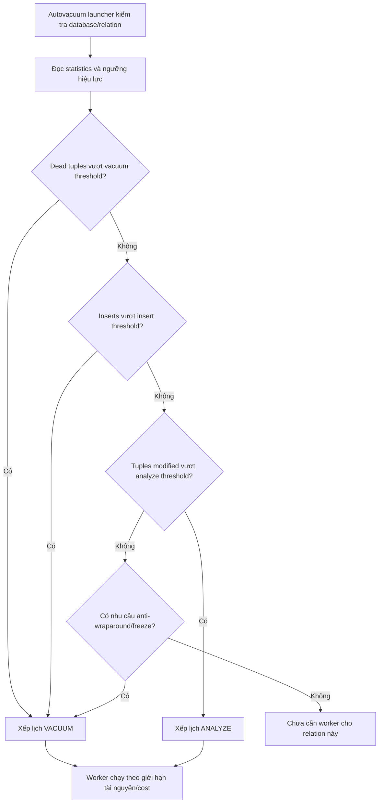

# Ngưỡng, hệ số và cấu hình autovacuum theo bảng trong PostgreSQL

Một bảng PostgreSQL nhỏ có thể được vacuum thường xuyên mà gần như không ai nhận ra. Một bảng khác có hàng trăm triệu hàng lại tích lũy dead tuples trong thời gian dài, làm tăng dung lượng, giảm hiệu quả index-only scan và khiến truy vấn chậm dần. Cả hai có thể đang dùng cùng cấu hình autovacuum ở cấp cluster. Sự khác biệt nằm ở quy mô dữ liệu, tốc độ thay đổi, phân bố workload và **công thức ngưỡng kích hoạt autovacuum**.

PostgreSQL dùng autovacuum để tự động thực hiện hai nhóm công việc quan trọng:

- **VACUUM:** thu hồi tuple versions không còn cần thiết, cập nhật Free Space Map (FSM), Visibility Map (VM) và freeze tuple theo chính sách.
- **ANALYZE:** thu thập statistics để planner ước lượng số hàng và chọn execution plan.

Autovacuum không đơn giản chạy theo lịch cố định trên mọi bảng. Daemon kiểm tra các relation, theo dõi statistics và quyết định công việc dựa trên **threshold + scale factor × kích thước relation**, cùng các điều kiện insert/freeze và giới hạn tài nguyên.

Bài học thuộc chương **VACUUM**, tập trung vào cách hiểu và cấu hình ngưỡng autovacuum theo bảng:

1. Công thức kích hoạt auto-vacuum cho dead tuples, inserts và auto-analyze.
2. Ý nghĩa của threshold, scale factor, ước lượng `reltuples` và các counters thống kê.
3. Cách chọn giá trị theo bảng nhỏ, bảng lớn, bảng ghi nhiều và bảng append-only.
4. Cấu hình ở cluster và override theo từng relation bằng `ALTER TABLE ... SET (storage_parameter = value)`.
5. Tác động của worker slots, naptime, cost delay/limit, memory, transaction lâu và freeze/anti-wraparound.
6. Quan sát, tính ngưỡng, kiểm tra autovacuum đang chạy và xây runbook vận hành.

> **Nguyên tắc:** cấu hình theo từng bảng cần dựa trên tốc độ thay đổi, kích thước, khả năng chịu I/O và mục tiêu latency. Một scale factor dùng chung cho mọi bảng thường không phù hợp khi hệ thống có cả bảng vài nghìn hàng và bảng hàng trăm triệu hàng.

## 1. Autovacuum giải quyết vấn đề gì?

PostgreSQL dùng MVCC. Khi một transaction UPDATE hoặc DELETE hàng, phiên bản tuple cũ không nhất thiết biến mất ngay. PostgreSQL phải giữ những version còn có thể được transaction/snapshot khác nhìn thấy. Khi không còn snapshot nào cần version cũ, VACUUM có thể thu hồi chúng để không gian được tái sử dụng.

Autovacuum còn hỗ trợ:

- Cập nhật free space map để tìm page có chỗ ghi.
- Cập nhật visibility map để hỗ trợ index-only scan.
- Freeze tuple đủ cũ, phòng transaction ID wraparound.
- Thu thập statistics cho planner qua auto-analyze.
- Giảm nhu cầu DBA phải chạy VACUUM/ANALYZE thủ công theo lịch cố định.

### 1.1. VACUUM và ANALYZE là hai công việc khác nhau

| Công việc | Mục tiêu | Thường được kích hoạt bởi |
| --- | --- | --- |
| Auto-vacuum theo dead tuples | Dọn tuple versions không còn cần thiết, cập nhật map | Số dead tuples vượt ngưỡng |
| Auto-vacuum theo inserts | Duy trì visibility/freeze trên bảng insert-heavy | Số inserts kể từ vacuum vượt ngưỡng |
| Auto-analyze | Cập nhật planner statistics | Số rows bị insert/update/delete kể từ analyze vượt ngưỡng |
| Anti-wraparound vacuum | Freeze để tránh transaction ID wraparound | Tuổi XID/MultiXact tiến gần ngưỡng an toàn |

Một bảng có thể cần ANALYZE dù chưa có nhiều dead tuples. Ngược lại, một bảng có nhiều dead tuples nhưng ít thay đổi phân bố giá trị có thể cần VACUUM trước khi cần ANALYZE. Không nên gộp mọi việc vào một khái niệm “vacuum threshold”.

### 1.2. Sơ đồ quyết định ở mức khái niệm



Đây là sơ đồ giản lược. Thực tế còn phụ thuộc autovacuum enablement, loại relation, worker availability, database state, table options, transaction horizons và các điều kiện bảo vệ XID/MultiXact.

## 2. Threshold và scale factor có ý nghĩa gì?

Một ngưỡng autovacuum thường gồm hai thành phần:

- **Threshold:** số lượng thay đổi tối thiểu cố định.
- **Scale factor:** tỷ lệ nhân với số tuple ước lượng của relation.

Công thức phổ biến:

\[
\text{trigger threshold}
=
\text{threshold}
+
\text{scale factor}
\times
\text{estimated tuples}
\]

Ví dụ:

```text
threshold = 50
scale_factor = 0.20
estimated tuples = 10,000

trigger = 50 + (0.20 × 10,000)
        = 2,050
```

Với relation 10.000 tuple ước lượng, ngưỡng 2.050 thay đổi có thể phù hợp hơn một con số cố định cho mọi bảng.

### 2.1. Threshold là phần cố định

Nếu `autovacuum_vacuum_threshold = 50`, phần cố định là 50 dead tuples.

Khi bảng nhỏ, phần cố định có thể chiếm phần lớn ngưỡng. Khi bảng lớn, scale factor thường chi phối.

### 2.2. Scale factor là tỷ lệ, không phải phần trăm nguyên

Các ví dụ:

| Giá trị | Ý nghĩa |
| --- | --- |
| `0.20` | 20% số tuple ước lượng |
| `0.10` | 10% |
| `0.05` | 5% |
| `0.01` | 1% |
| `0.001` | 0,1% |
| `0` | Không có thành phần tỷ lệ; chỉ còn threshold cố định |

Đừng nhập `20` khi muốn 20%. Giá trị đúng là `0.20`.

### 2.3. Scale factor bằng 0 không tắt autovacuum

Ví dụ:

```sql
ALTER TABLE public.orders
SET (
    autovacuum_vacuum_threshold = 1000,
    autovacuum_vacuum_scale_factor = 0
);
```

Ngưỡng dead tuples thông thường sẽ dựa vào phần cố định 1.000, thay vì tăng theo kích thước bảng. Autovacuum vẫn hoạt động khi đạt ngưỡng đó; scale factor bằng 0 không có nghĩa tắt vacuum.

### 2.4. Threshold âm có thể tắt trigger thông thường

Một số threshold hỗ trợ giá trị `-1` để vô hiệu hóa trigger tương ứng, ví dụ `autovacuum_vacuum_threshold = -1` cho ngưỡng vacuum dead tuples thông thường, hoặc `autovacuum_analyze_threshold = -1` cho auto-analyze.

Đây là cấu hình chuyên biệt, cần hiểu các trigger khác và anti-wraparound vẫn có thể yêu cầu vacuum. Không dùng `-1` như cách “giảm tần suất một chút”; hãy điều chỉnh threshold/scale factor có chủ đích.

## 3. Ngưỡng autovacuum cho dead tuples

Hai tham số cơ bản:

- `autovacuum_vacuum_threshold`
- `autovacuum_vacuum_scale_factor`

Công thức:

\[
V = T_v + S_v \times R
\]

Trong đó:

- \(T_v\): `autovacuum_vacuum_threshold`.
- \(S_v\): `autovacuum_vacuum_scale_factor`.
- \(R\): số tuple ước lượng của relation (`reltuples`).

Khi số dead tuples ước lượng vượt ngưỡng hiệu lực, relation đủ điều kiện cho auto-vacuum thông thường, nếu các điều kiện khác cho phép.

### 3.1. Giá trị mặc định thường gặp

Trên nhiều phiên bản PostgreSQL, các giá trị mặc định phổ biến là:

| Tham số | Giá trị mặc định thường gặp |
| --- | ---: |
| `autovacuum_vacuum_threshold` | `50` |
| `autovacuum_vacuum_scale_factor` | `0.2` |

Luôn kiểm tra `pg_settings` trên server thật. Giá trị có thể thay đổi theo phiên bản, cấu hình nhà cung cấp hoặc cấu hình quản trị của cluster.

### 3.2. Ví dụ bảng nhỏ

Giả sử:

- `reltuples = 1,000`
- `autovacuum_vacuum_threshold = 50`
- `autovacuum_vacuum_scale_factor = 0.20`

Tính:

\[
50 + 0.20 \times 1,000 = 250
\]

Ngưỡng là khoảng **250 dead tuples**.

Với bảng nhỏ, 250 hàng có thể là tỷ lệ đáng kể. Nếu bảng liên tục UPDATE/DELETE, vacuum có thể chạy khá thường xuyên; đây thường là hành vi hợp lý vì chi phí quét bảng nhỏ thấp.

### 3.3. Ví dụ bảng rất lớn

Giả sử:

- `reltuples = 100,000,000`
- threshold = `50`
- scale factor = `0.20`

Tính:

\[
50 + 0.20 \times 100,000,000
= 20,000,050
\]

Một bảng 100 triệu tuple có thể phải tích lũy khoảng 20 triệu dead tuples trước khi đạt ngưỡng dead-tuple vacuum theo công thức cơ bản.

Đó là lý do cấu hình mặc định có thể không phù hợp với bảng lớn có workload UPDATE/DELETE thường xuyên. Scale factor nhỏ hơn có thể giúp vacuum chạy sớm hơn.

### 3.4. Ví dụ giảm scale factor cho bảng lớn

Nếu đặt:

```sql
ALTER TABLE public.orders
SET (
    autovacuum_vacuum_threshold = 1000,
    autovacuum_vacuum_scale_factor = 0.01
);
```

Với `reltuples = 100,000,000`:

\[
1,000 + 0.01 \times 100,000,000
= 1,001,000
\]

Ngưỡng còn khoảng 1 triệu dead tuples, thấp hơn nhiều so với khoảng 20 triệu ở ví dụ mặc định.

Đây vẫn là con số minh họa. Một triệu dead tuples có thể quá cao với workload latency-sensitive, hoặc quá thấp nếu vacuum tốn I/O và dữ liệu thay đổi ít. Cần đo thời gian vacuum, lượng dead tuples phát sinh mỗi giây, bloat và khả năng tài nguyên.

### 3.5. Giới hạn tối đa trên các phiên bản hỗ trợ

Một số phiên bản PostgreSQL mới cung cấp `autovacuum_vacuum_max_threshold`, cho phép giới hạn trên của ngưỡng dead-tuple vacuum. Khi tham số này được hỗ trợ và giá trị không phải `-1`, ngưỡng được tính theo công thức rồi bị cap ở giá trị tối đa.

Ví dụ khái niệm:

\[
V_{\text{effective}} =
\min(T_v + S_v \times R,\ V_{\max})
\]

Nếu phiên bản không có tham số này, không được tự thêm vào cấu hình. Kiểm tra bằng:

```sql
SELECT name, setting, unit, source
FROM pg_settings
WHERE name = 'autovacuum_vacuum_max_threshold';
```

Nếu không có row, server không hỗ trợ GUC đó. Không suy luận phiên bản chỉ từ một bài viết hoặc một file cấu hình khác.

## 4. Ngưỡng vacuum dựa trên inserts

Một bảng append-only có thể gần như không UPDATE/DELETE nhưng vẫn cần autovacuum. Lý do là các pages mới được insert có thể cần được kiểm tra/freeze và visibility map cần được duy trì để hỗ trợ các thao tác đọc sau đó.

Các tham số:

- `autovacuum_vacuum_insert_threshold`
- `autovacuum_vacuum_insert_scale_factor`

Công thức:

\[
I = T_i + S_i \times R
\]

Trong đó:

- \(T_i\): threshold cho inserts kể từ lần vacuum phù hợp.
- \(S_i\): insert scale factor.
- \(R\): số tuple ước lượng của relation.

### 4.1. Giá trị mặc định thường gặp

| Tham số | Giá trị mặc định thường gặp |
| --- | ---: |
| `autovacuum_vacuum_insert_threshold` | `1000` |
| `autovacuum_vacuum_insert_scale_factor` | `0.2` |

Tham số insert threshold có thể được đặt `-1` để tắt trigger vacuum dựa riêng trên inserts; các lý do vacuum khác, đặc biệt anti-wraparound, vẫn tồn tại.

### 4.2. Ví dụ bảng event append-only

Bảng event có 50 triệu tuple, chỉ INSERT:

- `T_i = 1000`
- `S_i = 0.20`
- `R = 50,000,000`

\[
I = 1,000 + 0.20 \times 50,000,000
= 10,001,000
\]

Ngưỡng insert-trigger theo công thức mặc định thường gặp khoảng 10 triệu inserts kể từ vacuum.

Với một bảng append-only rất lớn, khoảng cách vacuum có thể trở nên dài. Nếu cần giữ visibility map và freeze tiến triển đều hơn, có thể giảm insert scale factor theo bảng.

### 4.3. Vì sao insert-trigger vacuum có ích?

- Các heap pages mới có thể cần được vacuum để đánh dấu all-visible/all-frozen khi đủ điều kiện.
- Vacuum giúp quản lý tuổi transaction IDs.
- Các query index-only scan trên dữ liệu đã ổn định có thể hưởng lợi khi VM được cập nhật.
- Bảng insert-heavy không có dead tuples vẫn có thể cần vacuum.

Không nên hiểu insert-trigger vacuum là “dọn dead tuples do INSERT”. INSERT tạo tuple mới; trigger này phục vụ các nhu cầu vacuum liên quan tới pages/visibility/freeze.

## 5. Ngưỡng auto-analyze

ANALYZE thu thập thống kê planner như phân bố giá trị, most common values, histogram và ước lượng selectivity. Khi dữ liệu thay đổi đủ nhiều, statistics cũ có thể khiến planner chọn plan không phù hợp.

Các tham số:

- `autovacuum_analyze_threshold`
- `autovacuum_analyze_scale_factor`

Công thức:

\[
A = T_a + S_a \times R
\]

Trong đó:

- \(T_a\): threshold cho auto-analyze.
- \(S_a\): analyze scale factor.
- \(R\): số tuple ước lượng.

Trigger thường dựa trên số tuples bị insert, update hoặc delete kể từ lần analyze phù hợp, không chỉ dead tuples.

### 5.1. Giá trị mặc định thường gặp

| Tham số | Giá trị mặc định thường gặp |
| --- | ---: |
| `autovacuum_analyze_threshold` | `50` |
| `autovacuum_analyze_scale_factor` | `0.1` |

### 5.2. Ví dụ bảng 1 triệu tuple

\[
A = 50 + 0.1 \times 1,000,000
= 100,050
\]

Khoảng 100.050 tuple modifications có thể kích hoạt auto-analyze theo công thức cơ bản.

Nếu bảng có phân bố dữ liệu thay đổi nhanh hoặc query planner rất nhạy với statistics, scale factor thấp hơn có thể hữu ích.

### 5.3. Auto-analyze không dọn dead tuples

ANALYZE không thay VACUUM. Nó không thu hồi tuple versions, không cập nhật free space map theo mục tiêu vacuum và không thay thế freeze.

Nếu một bảng vừa có dead tuples cao vừa statistics stale, nó có thể cần cả VACUUM và ANALYZE. `VACUUM (ANALYZE)` thủ công có thể kết hợp hai công việc, nhưng autovacuum cũng có trigger riêng cho từng loại.

### 5.4. Partitioned tables cần lưu ý riêng

Autovacuum xử lý các leaf partitions như relation riêng, nhưng không tự động đảm bảo statistics trên partitioned parent được cập nhật theo cách người vận hành mong đợi sau mọi thay đổi partition. Sau khi thêm/bỏ partitions hoặc thay đổi phân bố dữ liệu lớn, có thể cần chạy `ANALYZE` thủ công trên parent theo kế hoạch.

## 6. Ba công thức đặt cạnh nhau

| Trigger | Công thức cơ bản | Counter cần theo dõi |
| --- | --- | --- |
| Dead-tuple vacuum | `vacuum_threshold + vacuum_scale_factor × reltuples` | `n_dead_tup` |
| Insert-trigger vacuum | `insert_threshold + insert_scale_factor × reltuples` | `n_ins_since_vacuum` trên phiên bản hỗ trợ |
| Auto-analyze | `analyze_threshold + analyze_scale_factor × reltuples` | `n_mod_since_analyze` |

Các counters trong statistics là thông tin vận hành/ước lượng và có thể bị ảnh hưởng bởi reset, snapshot, phiên bản và thời điểm cập nhật. Chúng không phải một bộ đếm chính xác theo từng tuple transaction trong mọi tình huống.

### 6.1. Ví dụ tổng hợp

Giả sử bảng `public.orders` có:

- `reltuples = 10,000,000`
- Dead tuples ước lượng: 350.000
- Inserts kể từ vacuum: 700.000
- Modifications kể từ analyze: 1.200.000

Dùng các defaults thường gặp:

Dead vacuum:

\[
50 + 0.2 \times 10,000,000 = 2,000,050
\]

Insert vacuum:

\[
1000 + 0.2 \times 10,000,000 = 2,001,000
\]

Auto-analyze:

\[
50 + 0.1 \times 10,000,000 = 1,000,050
\]

Diễn giải:

- Dead tuples 350.000 chưa đạt ngưỡng vacuum dead-tuples mặc định.
- Inserts 700.000 chưa đạt insert-vacuum threshold mặc định.
- Modifications 1.200.000 đã vượt analyze threshold ước lượng.

Vì vậy relation có thể đủ điều kiện auto-analyze mà chưa đủ điều kiện cho hai trigger vacuum thông thường. Anti-wraparound hoặc lý do khác vẫn có thể kích hoạt vacuum độc lập.

## 7. `reltuples` là ước lượng, không phải COUNT(*) chính xác

Trong các công thức, PostgreSQL dùng số tuple ước lượng từ catalog, thường quan sát qua `pg_class.reltuples`.

```sql
SELECT
    c.oid::regclass AS relation,
    c.reltuples,
    c.relpages
FROM pg_class AS c
WHERE c.oid = 'public.orders'::regclass;
```

`reltuples` có thể:

- Bằng `-1` nếu chưa có ước lượng phù hợp.
- Stale sau khi dữ liệu thay đổi mạnh.
- Được cập nhật bởi VACUUM/ANALYZE hoặc những thao tác quản trị phù hợp.
- Không phản ánh chính xác số hàng hiện tại như `COUNT(*)`.

### 7.1. Không chạy COUNT(*) toàn bảng chỉ để tính threshold

Tính ngưỡng autovacuum không yêu cầu ứng dụng thực hiện `SELECT COUNT(*)` trước mỗi lần đánh giá. PostgreSQL dùng catalog estimates và statistics counters để tránh chi phí quét bảng đầy đủ liên tục.

Dùng `COUNT(*)` trên bảng hàng trăm triệu rows để “tính cho chính xác” có thể tốn tài nguyên mà không làm daemon dùng con số đó thay cho `reltuples`.

### 7.2. reltuples có thể stale sau bulk load

Sau bulk load hoặc thay đổi dữ liệu lớn, statistics có thể chưa phản ánh kích thước mới. Chạy `ANALYZE` theo kế hoạch giúp cập nhật planner statistics và ước lượng relation.

Nhưng không nên chạy ANALYZE quá thường xuyên một cách máy móc; nó cũng tiêu tốn I/O/CPU và lấy sample theo cơ chế riêng.

## 8. Xem giá trị GUC autovacuum đang hiệu lực

Để xem các tham số ở cấp cluster/session:

```sql
SELECT
    name,
    setting,
    unit,
    context,
    source,
    sourcefile,
    sourceline
FROM pg_settings
WHERE name LIKE 'autovacuum%'
   OR name LIKE 'vacuum_%'
ORDER BY name;
```

Các cột hữu ích:

- `setting`: giá trị đang hiệu lực.
- `unit`: đơn vị nếu có.
- `context`: phạm vi/điều kiện thay đổi tham số.
- `source`: nguồn cấu hình đã thắng.
- `sourcefile`, `sourceline`: file và dòng cấu hình nếu có quyền nhìn.

Một số nguồn hoặc cột có thể bị giới hạn bởi quyền hoặc phiên bản.

### 8.1. Kiểm tra riêng các threshold

```sql
SELECT name, setting, unit, source
FROM pg_settings
WHERE name IN (
    'autovacuum',
    'autovacuum_naptime',
    'autovacuum_max_workers',
    'autovacuum_vacuum_threshold',
    'autovacuum_vacuum_scale_factor',
    'autovacuum_vacuum_insert_threshold',
    'autovacuum_vacuum_insert_scale_factor',
    'autovacuum_analyze_threshold',
    'autovacuum_analyze_scale_factor',
    'autovacuum_vacuum_cost_delay',
    'autovacuum_vacuum_cost_limit',
    'autovacuum_work_mem',
    'autovacuum_freeze_max_age'
)
ORDER BY name;
```

Nếu một tham số không xuất hiện, kiểm tra tên và major version. Đừng giả định mọi PostgreSQL server hoặc managed service hỗ trợ đúng cùng một bộ GUC.

### 8.2. SHOW cũng hữu ích

```sql
SHOW autovacuum;
SHOW autovacuum_vacuum_threshold;
SHOW autovacuum_vacuum_scale_factor;
SHOW autovacuum_analyze_threshold;
SHOW autovacuum_analyze_scale_factor;
```

`SHOW` trả giá trị trong session hiện tại, có thể chịu ảnh hưởng bởi cấu hình session/role/database nếu tham số cho phép. `pg_settings.source` giúp biết nguồn cấu hình.

## 9. Kiểm tra cấu hình riêng của từng bảng

PostgreSQL cho phép override một số tham số autovacuum ở cấp relation bằng storage parameters.

Ví dụ:

```sql
ALTER TABLE public.orders
SET (
    autovacuum_vacuum_threshold = 1000,
    autovacuum_vacuum_scale_factor = 0.01,
    autovacuum_analyze_threshold = 500,
    autovacuum_analyze_scale_factor = 0.02
);
```

Cấu hình trên áp dụng cho relation `public.orders`. Những tham số không override tiếp tục kế thừa giá trị cấu hình chung phù hợp.

### 9.1. Đọc reloptions

```sql
SELECT
    c.oid::regclass AS relation,
    c.reloptions
FROM pg_class AS c
WHERE c.oid = 'public.orders'::regclass;
```

Ví dụ `reloptions` có thể chứa:

```text
{autovacuum_vacuum_threshold=1000,autovacuum_vacuum_scale_factor=0.01}
```

Đây là các overrides của relation, không phải danh sách mọi giá trị mặc định đang áp dụng.

### 9.2. Chuyển reloptions thành các dòng dễ đọc

```sql
SELECT
    p.option_name,
    p.option_value
FROM pg_class AS c
CROSS JOIN LATERAL pg_options_to_table(c.reloptions) AS p
WHERE c.oid = 'public.orders'::regclass
ORDER BY p.option_name;
```

Câu truy vấn này hữu ích cho DBA inventory hoặc dashboard cấu hình theo bảng.

### 9.3. RESET để trở lại cấu hình chung

```sql
ALTER TABLE public.orders
RESET (
    autovacuum_vacuum_threshold,
    autovacuum_vacuum_scale_factor,
    autovacuum_analyze_threshold,
    autovacuum_analyze_scale_factor
);
```

`RESET` xóa override tương ứng; bảng quay về kế thừa giá trị cấp cao hơn theo cấu hình hiệu lực.

### 9.4. Table option không đồng nghĩa đổi GUC toàn cluster

`ALTER TABLE ... SET (...)` lưu storage parameters trên relation. Nó không thay `postgresql.conf`, không đổi các bảng khác và không sửa cấu hình ứng dụng.

Điều này hữu ích khi chỉ một số bảng có workload đặc biệt, ví dụ:

- Bảng đơn hàng UPDATE thường xuyên.
- Bảng event append-only.
- Bảng audit có tốc độ INSERT cao.
- Bảng nhỏ chứa queue/state thay đổi liên tục.

## 10. Tính ngưỡng cho một bảng từ GUC hiện tại

Có thể tạo phép tính ước lượng dựa trên global GUC và `reltuples`:

```sql
SELECT
    c.oid::regclass AS relation,
    c.reltuples AS estimated_tuples,
    s.n_dead_tup,
    current_setting('autovacuum_vacuum_threshold')::numeric
      + current_setting('autovacuum_vacuum_scale_factor')::numeric
        * GREATEST(c.reltuples, 0) AS estimated_dead_tuple_threshold,
    s.n_mod_since_analyze,
    current_setting('autovacuum_analyze_threshold')::numeric
      + current_setting('autovacuum_analyze_scale_factor')::numeric
        * GREATEST(c.reltuples, 0) AS estimated_analyze_threshold
FROM pg_class AS c
JOIN pg_stat_all_tables AS s
  ON s.relid = c.oid
WHERE c.oid = 'public.orders'::regclass;
```

Đây là phép tính **tham khảo**:

- Nó dùng global GUC, chưa tự áp dụng table-specific reloptions.
- Nó chưa áp dụng giới hạn tối đa của phiên bản có `autovacuum_vacuum_max_threshold`.
- `reltuples` và statistics counters là ước lượng/thông tin tích lũy.
- Autovacuum có thêm các trigger khác, đặc biệt insert vacuum và freeze.
- Relation type, database state và worker availability có thể ảnh hưởng thời điểm chạy.

Không dùng kết quả query này làm dự đoán chính xác tới giây khi autovacuum sẽ bắt đầu.

### 10.1. Đọc cả counters vacuum/analyze

```sql
SELECT
    schemaname,
    relname,
    n_live_tup,
    n_dead_tup,
    n_mod_since_analyze,
    n_ins_since_vacuum,
    last_vacuum,
    last_autovacuum,
    last_analyze,
    last_autoanalyze,
    vacuum_count,
    autovacuum_count,
    analyze_count,
    autoanalyze_count
FROM pg_stat_user_tables
WHERE schemaname = 'public'
ORDER BY n_dead_tup DESC;
```

Một số cột, đặc biệt `n_ins_since_vacuum`, có thể phụ thuộc major version. Nếu cột không tồn tại, xem schema `pg_stat_all_tables` của server trước khi dùng query này.

### 10.2. Đừng so sánh counters với threshold mà bỏ qua reset

Statistics có thể bị reset hoặc thay đổi theo vòng đời instance/database. Nếu `last_autovacuum` mới nhưng counter thấp, đó có thể là do vacuum vừa hoàn tất. Nếu server restart/reset statistics, counters không còn cùng baseline cũ.

Hãy xem timestamp vacuum/analyze gần nhất và log để hiểu counter đang đếm từ mốc nào.

## 11. Chọn threshold theo kích thước và tốc độ thay đổi

Không có một scale factor tối ưu cho mọi relation. Có thể bắt đầu từ workload classification.

| Nhóm bảng | Đặc điểm | Hướng điều chỉnh thường xem xét |
| --- | --- | --- |
| Bảng nhỏ, thay đổi nhiều | Ít rows, tỷ lệ thay đổi cao | Threshold tuyệt đối có ảnh hưởng lớn; có thể giảm threshold |
| Bảng lớn, UPDATE/DELETE thường xuyên | Dead tuples tăng nhanh, vacuum mặc định có thể đợi lâu | Giảm vacuum scale factor, cân nhắc max threshold nếu có |
| Bảng append-only | Ít dead tuples nhưng inserts liên tục | Xem insert threshold/scale factor và freeze/VM |
| Bảng lịch sử ít thay đổi | Chủ yếu đọc, thay đổi ít | Threshold có thể cao hơn; vẫn cần freeze và analyze khi cần |
| Bảng queue/state nóng | Nhiều UPDATE/DELETE ngắn hạn | Threshold thấp hơn, theo dõi dead tuples và vacuum throughput |
| Bảng partitioned | Mỗi partition có kích thước/workload riêng | Cấu hình và quan sát từng leaf partition |

### 11.1. Bảng nhỏ

Giả sử bảng queue chỉ có 5.000 rows nhưng liên tục UPDATE trạng thái. Với defaults thường gặp:

\[
50 + 0.2 \times 5,000 = 1,050
\]

Khoảng 1.050 dead tuples là hơn 20% số hàng ước lượng. Nếu queue cần vacuum thường xuyên để giữ latency ổn định, có thể thử giảm threshold và scale factor.

Ví dụ minh họa:

```sql
ALTER TABLE app.job_queue
SET (
    autovacuum_vacuum_threshold = 100,
    autovacuum_vacuum_scale_factor = 0.02,
    autovacuum_analyze_threshold = 100,
    autovacuum_analyze_scale_factor = 0.05
);
```

Với 5.000 rows, dead threshold xấp xỉ 200; analyze threshold xấp xỉ 350. Đây là điểm khởi đầu để đo, không phải giá trị chuẩn cho mọi queue.

### 11.2. Bảng lớn, update-heavy

Giả sử bảng 200 triệu rows, mỗi ngày thay đổi hàng triệu rows. Defaults có thể cho phép dead tuples tích lũy rất lớn.

Ví dụ:

```sql
ALTER TABLE app.orders
SET (
    autovacuum_vacuum_threshold = 2000,
    autovacuum_vacuum_scale_factor = 0.005,
    autovacuum_analyze_threshold = 1000,
    autovacuum_analyze_scale_factor = 0.01
);
```

Dead vacuum threshold ước lượng:

\[
2,000 + 0.005 \times 200,000,000
= 1,002,000
\]

Analyze threshold ước lượng:

\[
1,000 + 0.01 \times 200,000,000
= 2,001,000
\]

Đây là ví dụ tính toán, không phải recommendation production. Phải kiểm tra vacuum có xử lý nhanh hơn tốc độ dead tuples phát sinh không.

### 11.3. Bảng append-only

Một bảng event có hàng chục triệu INSERT mỗi ngày nhưng ít UPDATE/DELETE. Đừng chỉ nhìn `n_dead_tup` rồi kết luận autovacuum không cần chạy.

Ví dụ:

```sql
ALTER TABLE app.events
SET (
    autovacuum_vacuum_insert_threshold = 5000,
    autovacuum_vacuum_insert_scale_factor = 0.02,
    autovacuum_analyze_threshold = 1000,
    autovacuum_analyze_scale_factor = 0.02
);
```

Mục tiêu là điều chỉnh insert-trigger vacuum và auto-analyze. Cần quan sát freeze age, VM và partition lifecycle.

### 11.4. Bảng đọc nhiều, gần như immutable

Bảng danh mục sản phẩm ít thay đổi có thể không cần vacuum dead-tuple thường xuyên. Nhưng vẫn phải:

- Freeze theo tuổi transaction ID.
- Analyze khi dữ liệu/phân bố thay đổi đáng kể.
- Theo dõi VM/all-visible nếu query index-only scan quan trọng.
- Không tắt autovacuum chỉ vì bảng “hầu như không UPDATE”.

## 12. Tốc độ phát sinh dead tuples quan trọng hơn chỉ nhìn tỷ lệ

Một bảng có 1 triệu dead tuples có thể rất khác nhau:

- Bảng A tạo 1 triệu dead tuples trong một tháng.
- Bảng B tạo 1 triệu dead tuples trong 5 phút.

Bảng B có thể cần vacuum thường xuyên hơn hoặc worker throughput cao hơn.

### 12.1. Ước lượng tốc độ thay đổi

Có thể ghi nhận `n_dead_tup` theo các mốc thời gian từ monitoring system. Hiệu số giữa hai lần lấy mẫu cho một ước lượng tốc độ:

\[
\text{dead tuple rate}
\approx
\frac{\Delta n\_dead\_tup}{\Delta t}
\]

Đây chỉ là xấp xỉ vì counters/statistics có thể được cập nhật theo cơ chế riêng, vacuum chạy giữa hai lần đo, và dead tuple estimates có sai số.

### 12.2. Tính thời gian đạt ngưỡng

Nếu một bảng còn cách threshold 500.000 dead tuples và phát sinh trung bình 50.000 dead tuples/phút:

\[
500,000 / 50,000 = 10 \text{ phút}
\]

Đây là dự đoán đơn giản để định hướng monitoring, không phải lịch autovacuum chính xác. Launcher naptime, worker availability, statistics refresh, cost throttling và vacuum đang chạy đều ảnh hưởng thực tế.

### 12.3. Autovacuum phải bắt kịp workload

Một điều kiện vận hành quan trọng:

\[
\text{vacuum cleanup throughput}
>
\text{dead tuple generation rate}
\]

Nếu workload tạo dead tuples nhanh hơn khả năng vacuum xử lý lâu dài, hạ threshold chỉ khiến vacuum được yêu cầu thường xuyên hơn; nó không tự tăng throughput. Khi đó cần xem workers, I/O, cost delay/limit, index cleanup, long transactions và thiết kế workload.

## 13. Worker, launcher và naptime

Autovacuum có một launcher quản lý việc lập lịch và nhiều workers thực hiện VACUUM/ANALYZE.

Các tham số thường gặp:

- `autovacuum`: bật/tắt daemon ở cấp server.
- `autovacuum_naptime`: khoảng thời gian launcher ngủ giữa các chu kỳ kiểm tra database.
- `autovacuum_max_workers`: số worker autovacuum tối đa chạy đồng thời.
- `autovacuum_work_mem`: memory cho mỗi autovacuum worker theo quy tắc cấu hình.
- `autovacuum_vacuum_cost_delay` và `autovacuum_vacuum_cost_limit`: điều tiết mức độ gây tải I/O.

### 13.1. Naptime không phải chu kỳ vacuum cố định cho từng bảng

Nếu `autovacuum_naptime = 1min`, không có nghĩa mọi bảng được vacuum đúng mỗi phút. Launcher phân phối công việc qua databases/relations, xét threshold và worker slots.

Một bảng vừa đạt threshold có thể phải chờ chu kỳ tiếp theo hoặc chờ worker rảnh.

### 13.2. Worker slots là tài nguyên dùng chung

Giả sử cluster có `autovacuum_max_workers = 3`, chỉ tối đa ba autovacuum workers chạy đồng thời theo giới hạn đó. Nếu nhiều bảng lớn cùng đạt threshold, chúng có thể xếp hàng.

Tăng workers có thể giúp xử lý nhiều bảng song song, nhưng cũng tăng I/O, CPU, memory và contention. Đánh giá tổng workload và dung lượng máy trước khi tăng.

### 13.3. Nhiều database cùng cluster

Autovacuum launcher quản lý công việc trên cluster, không phải một daemon độc lập cho mỗi database. Một database có nhiều bảng lớn có thể chiếm phần lớn worker time và làm database khác chờ.

Khi có nhiều database, nên theo dõi vacuum lag theo database/schema/relation, không chỉ tổng số worker đang chạy.

## 14. Cost delay và cost limit

VACUUM có cơ chế cost-based delay để tránh tiêu thụ I/O liên tục làm ảnh hưởng workload foreground.

Các tham số:

- `vacuum_cost_delay`: độ trễ khi đạt cost limit cho VACUUM thủ công theo cấu hình.
- `vacuum_cost_limit`: ngưỡng cost.
- `autovacuum_vacuum_cost_delay`: delay cho autovacuum.
- `autovacuum_vacuum_cost_limit`: cost limit cho autovacuum; giá trị `-1` thường kế thừa từ `vacuum_cost_limit`.

### 14.1. Cost delay cao có thể làm vacuum chậm

Nếu autovacuum bị throttling quá mạnh:

- Dead tuples tích lũy nhanh hơn.
- Vacuum duration tăng.
- Relation bloat có thể tăng.
- Freeze tiến triển chậm hơn.

Giảm delay hoặc tăng cost limit có thể làm vacuum chạy nhanh hơn, nhưng có thể cạnh tranh I/O với truy vấn ứng dụng.

### 14.2. Nhiều workers chia sẻ cost budget

Trong cấu hình autovacuum, cost limit tổng thể có thể được phân phối giữa các workers đang hoạt động theo quy tắc PostgreSQL. Không suy rằng mỗi worker luôn được cấp nguyên một `autovacuum_vacuum_cost_limit` đầy đủ độc lập.

Đọc tài liệu đúng major version và quan sát actual I/O trước khi điều chỉnh.

### 14.3. Ví dụ cấu hình có kiểm soát

Một thay đổi ở cấp server có thể được xem xét sau khi đo:

```text
autovacuum_vacuum_cost_delay = 2ms
autovacuum_vacuum_cost_limit = 1000
autovacuum_max_workers = 5
```

Đây chỉ là giá trị minh họa, không phải cấu hình tối ưu chung. Thay đổi đồng thời nhiều tham số làm khó xác định nguyên nhân nếu latency/IO thay đổi. Tốt hơn là thay từng nhóm nhỏ, đo trước/sau và có rollback.

## 15. Memory và index cleanup

`autovacuum_work_mem` quy định memory dành cho mỗi autovacuum worker theo hỗ trợ của phiên bản/cấu hình. Nếu đặt `-1`, nó có thể dùng `maintenance_work_mem`.

Vacuum có thể cần quản lý danh sách tuple IDs cần xử lý trong index cleanup. Memory quá thấp có thể làm công việc index cleanup chia thành nhiều vòng hoặc tăng I/O phụ trợ.

### 15.1. Memory tổng không chỉ là một worker

Nếu có 5 workers và mỗi worker có thể sử dụng lượng memory đáng kể, tổng memory dành cho autovacuum có thể nhân theo số workers. Cần tính tổng cùng với:

- `maintenance_work_mem`.
- `autovacuum_work_mem`.
- `autovacuum_max_workers`.
- Memory của query foreground.
- Shared buffers và OS page cache.
- Các tiến trình maintenance khác.

Không tăng `autovacuum_work_mem` tới mức lớn trên mọi worker mà không tính worst-case memory.

### 15.2. Index cleanup và workload

Vacuum cần xử lý index entries tương ứng với dead heap tuples. Bảng có nhiều indexes có thể tốn đáng kể thời gian/I/O cho cleanup.

Nếu vacuum kéo dài, xem số lượng và kích thước indexes, HOT update rate, dead tuple churn và `pg_stat_progress_vacuum`. Không bỏ index cleanup một cách tùy tiện chỉ để làm lần vacuum hiện tại nhanh hơn; điều đó có thể để lại dead index entries và nợ bảo trì.

## 16. Freeze và anti-wraparound không phụ thuộc dead-tuple threshold

PostgreSQL dùng transaction IDs hữu hạn. Để tránh wraparound, hệ thống phải freeze tuples đủ cũ. Đây là yêu cầu correctness và an toàn dữ liệu, không chỉ là tối ưu hiệu năng.

Tham số liên quan gồm:

- `autovacuum_freeze_max_age`
- `vacuum_freeze_min_age`
- `vacuum_freeze_table_age`
- `autovacuum_multixact_freeze_max_age`
- `vacuum_multixact_freeze_min_age`
- Các table storage parameters tương ứng nếu phiên bản hỗ trợ.

### 16.1. Anti-wraparound vacuum có thể chạy dù autovacuum bị tắt

Ngay cả khi `autovacuum` bị tắt ở cấp server hoặc `autovacuum_enabled=false` trên một relation, PostgreSQL vẫn phải thực hiện các vacuum cần thiết để ngăn transaction ID wraparound.

Không xem `autovacuum_enabled=false` là cách loại bỏ mọi hoạt động vacuum trên bảng.

### 16.2. Đây không phải threshold dead tuples

Một bảng có thể gần như không UPDATE/DELETE nhưng vẫn cần vacuum freeze vì tuổi XID/MultiXact. Ngược lại, một bảng có nhiều dead tuples có thể cần vacuum theo ngưỡng thường trước khi có rủi ro wraparound.

Đừng chỉ xem `n_dead_tup` để đánh giá tình trạng freeze.

### 16.3. Xem tuổi transaction ID của database

```sql
SELECT
    datname,
    age(datfrozenxid) AS xid_age,
    datallowconn
FROM pg_database
ORDER BY age(datfrozenxid) DESC;
```

Đây là một chỉ báo quan trọng ở cấp database. Cần kết hợp cảnh báo server, age của relation, MultiXact age và vacuum logs.

### 16.4. Freeze age là giới hạn an toàn, không phải tuning tùy tiện

Không tăng `autovacuum_freeze_max_age` chỉ để giảm tần suất vacuum. Làm như vậy có thể đẩy hệ thống gần nguy cơ wraparound hơn và khiến một lần anti-wraparound vacuum trở nên rất nặng.

Thay đổi các ngưỡng freeze cần hiểu rõ tuổi XID, dung lượng, thời gian vacuum, replication và khả năng hoàn tất trước ngưỡng bảo vệ.

## 17. Long transactions có thể ngăn vacuum cleanup

Một transaction giữ snapshot lâu có thể khiến VACUUM không thể thu hồi tuple versions mà snapshot ấy còn cần.

Ví dụ:

1. Session A mở transaction `REPEATABLE READ` và giữ snapshot.
2. Session B UPDATE/DELETE hàng loạt rồi COMMIT.
3. Autovacuum chạy trên bảng.
4. Một số old tuple versions vẫn cần cho snapshot của A.
5. Vacuum không thể thu hồi chúng cho tới khi transaction A kết thúc.

### 17.1. Tìm transaction lâu

```sql
SELECT
    pid,
    datname,
    usename,
    application_name,
    state,
    xact_start,
    clock_timestamp() - xact_start AS xact_age,
    backend_xmin,
    left(query, 200) AS query_preview
FROM pg_stat_activity
WHERE xact_start IS NOT NULL
ORDER BY xact_start;
```

### 17.2. Replication slots cũng có thể giữ xmin

Replication slots có thể giữ `xmin` hoặc `catalog_xmin`, ngăn cleanup một số tuple/catalog versions theo nhu cầu replication.

```sql
SELECT
    slot_name,
    slot_type,
    active,
    xmin,
    catalog_xmin,
    restart_lsn
FROM pg_replication_slots
ORDER BY slot_name;
```

Một slot không active nhưng vẫn giữ horizon cũ có thể là nguyên nhân đáng điều tra. Không xóa slot chỉ để vacuum chạy; cần xác định owner và tác động replication trước.

### 17.3. Standby feedback

Hot standby feedback có thể giữ xmin trên primary trong một số topology, ảnh hưởng vacuum cleanup. Khi điều tra, xem replication lag, `backend_xmin` và cấu hình standby feedback.

### 17.4. Hạ threshold không giải quyết horizon bị giữ

Nếu VACUUM chạy nhưng không thể thu hồi tuple versions vì transaction lâu, giảm threshold chỉ khiến nó được gọi thường xuyên hơn. Root cause là snapshot horizon và transaction lifecycle, không phải ngưỡng kích hoạt.

## 18. Cấu hình autovacuum theo từng bảng

Một cách thực hành tốt là phân loại bảng trước khi cấu hình:

| Thuộc tính bảng | Câu hỏi cần trả lời |
| --- | --- |
| Estimated rows | Bảng có bao nhiêu tuple ước lượng? |
| Insert rate | Mỗi phút/giờ tạo bao nhiêu rows? |
| Update/delete rate | Dead tuples phát sinh nhanh tới đâu? |
| Row width | Tuple lớn hay nhỏ? |
| Index count/size | Vacuum index cleanup tốn bao nhiêu? |
| HOT update rate | Bao nhiêu updates tránh được index churn? |
| Query sensitivity | Bảng có query latency nhạy với bloat/statistics không? |
| Long transactions | Có snapshot lâu giữ old versions không? |
| Partitioning | Mỗi partition có workload riêng không? |
| Maintenance window | Có giới hạn I/O/CPU theo giờ không? |

### 18.1. Ví dụ: bảng queue nhỏ, UPDATE liên tục

```sql
ALTER TABLE app.job_queue
SET (
    autovacuum_vacuum_threshold = 100,
    autovacuum_vacuum_scale_factor = 0.02,
    autovacuum_analyze_threshold = 100,
    autovacuum_analyze_scale_factor = 0.05,
    autovacuum_vacuum_cost_delay = 2
);
```

Mục tiêu là vacuum sớm hơn khi số dead tuples tuyệt đối nhỏ. Theo dõi vacuum frequency, query latency và I/O để tránh chạy quá dày.

### 18.2. Ví dụ: bảng orders lớn, update-heavy

```sql
ALTER TABLE app.orders
SET (
    autovacuum_vacuum_threshold = 2000,
    autovacuum_vacuum_scale_factor = 0.005,
    autovacuum_analyze_threshold = 1000,
    autovacuum_analyze_scale_factor = 0.01
);
```

Mục tiêu là tránh chờ một tỷ lệ dead tuples quá lớn. Kiểm tra thời gian vacuum và dead tuple generation rate để xác nhận worker bắt kịp workload.

### 18.3. Ví dụ: bảng event append-only

```sql
ALTER TABLE app.events
SET (
    autovacuum_vacuum_insert_threshold = 5000,
    autovacuum_vacuum_insert_scale_factor = 0.02,
    autovacuum_analyze_threshold = 2000,
    autovacuum_analyze_scale_factor = 0.02
);
```

Mục tiêu là điều chỉnh insert-trigger vacuum và auto-analyze. Cần quan sát freeze age, VM và partition lifecycle.

### 18.4. Ví dụ: bảng lịch sử ít thay đổi

Có thể giữ thresholds tương đối cao theo workload, nhưng không tắt cơ chế freeze. Khi bulk load hoặc thay đổi phân bố dữ liệu đáng kể, chạy ANALYZE theo kế hoạch để planner không dùng statistics quá cũ.

## 19. Đặt lại cấu hình và quản lý thay đổi

Mọi thay đổi per-table cần có owner, lý do và cách rollback.

Xem hiện trạng:

```sql
SELECT
    c.oid::regclass AS relation,
    c.reloptions
FROM pg_class AS c
WHERE c.oid IN (
    'app.orders'::regclass,
    'app.events'::regclass,
    'app.job_queue'::regclass
)
ORDER BY c.oid::regclass::text;
```

Đặt một override:

```sql
ALTER TABLE app.orders
SET (autovacuum_vacuum_scale_factor = 0.005);
```

Đặt lại kế thừa global:

```sql
ALTER TABLE app.orders
RESET (autovacuum_vacuum_scale_factor);
```

Có thể thay nhiều storage parameters trong một ALTER TABLE để quản lý cùng một thay đổi. Kiểm tra quyền sở hữu bảng và khả năng thay đổi DDL của môi trường.

### 19.1. Cấu hình có hiệu lực không nhất thiết chỉ đến từ postgresql.conf

Thứ tự nguồn cấu hình có thể gồm:

- Defaults built-in.
- `postgresql.conf` và include files.
- `ALTER SYSTEM`.
- Command-line startup options.
- `ALTER DATABASE ... SET`.
- `ALTER ROLE ... SET`.
- `SET` trong session.
- Table storage parameters cho các thuộc tính relation-specific.

Nguồn cụ thể nào có thể áp dụng phụ thuộc tham số và context. Dùng `pg_settings.source`/`sourcefile` cùng `reloptions` để hiểu giá trị thật.

### 19.2. Một tham số có thể cần reload hoặc restart

Kiểm tra cột `context` của `pg_settings`:

- `sighup`: thường áp dụng sau reload.
- `postmaster`: cần restart server.
- `user`/`superuser`: có thể thay đổi trong session theo quyền.
- Các context khác có semantics riêng.

Không khẳng định mọi GUC autovacuum đều cần restart. Một số thay đổi có hiệu lực sau reload; table storage parameter được ghi trên relation và áp dụng cho hoạt động relation tương ứng.

## 20. Autovacuum bị chậm hoặc không chạy: phân loại nguyên nhân

Khi một bảng có `n_dead_tup` cao, đừng lập tức hạ threshold. Có nhiều khả năng:

1. Chưa đạt ngưỡng thực tế do scale factor lớn.
2. Table-level reloptions override global GUC.
3. Worker slots đã đầy.
4. Launcher chưa tới chu kỳ kiểm tra tiếp theo.
5. Autovacuum bị disable ở cấp server/relation.
6. Long transaction hoặc replication slot giữ xmin.
7. Cost delay quá cao hoặc I/O throughput thấp.
8. VACUUM đang chạy lâu do bảng/index lớn.
9. Relation không được xử lý theo cách bạn nghĩ, ví dụ partitioned parent.
10. Statistics/counters stale hoặc reset.
11. Autovacuum worker gặp lỗi và ghi log.
12. Freeze/anti-wraparound vacuum cạnh tranh tài nguyên.

### 20.1. Kiểm tra workers đang chạy

```sql
SELECT
    a.pid,
    a.datname,
    a.application_name,
    a.backend_type,
    a.state,
    a.wait_event_type,
    a.wait_event,
    a.query_start,
    a.query
FROM pg_stat_activity AS a
WHERE a.backend_type = 'autovacuum worker'
ORDER BY a.query_start;
```

Một số phiên bản/cấu hình có thể trình bày activity/autovacuum query khác nhau. Dùng view tiến độ để biết worker đang ở phase nào.

### 20.2. Kiểm tra vacuum progress

```sql
SELECT
    p.pid,
    p.datname,
    p.relid::regclass AS relation,
    p.phase,
    p.heap_blks_total,
    p.heap_blks_scanned,
    p.heap_blks_vacuumed,
    p.index_vacuum_count,
    p.num_dead_tuples,
    p.max_dead_tuples
FROM pg_stat_progress_vacuum AS p
ORDER BY p.datname, p.relid;
```

Các cột của `pg_stat_progress_vacuum` phụ thuộc phiên bản. Nếu một cột không tồn tại, xem schema view trên server. Một số phase có thể chưa có giá trị hoặc có semantics riêng.

### 20.3. Kiểm tra số worker tối đa

```sql
SHOW autovacuum_max_workers;
SHOW autovacuum_naptime;
SHOW autovacuum_vacuum_cost_delay;
SHOW autovacuum_vacuum_cost_limit;
```

So với số workers đang chạy và vacuum duration. Worker tối đa đầy liên tục có thể là dấu hiệu capacity chưa đủ hoặc một vài relation vacuum quá lâu.

### 20.4. Đọc log autovacuum

Có thể cấu hình:

```text
log_autovacuum_min_duration = 1s
```

Giá trị ví dụ sẽ ghi log các hoạt động autovacuum kéo dài từ ngưỡng cấu hình. `0` có thể log mọi hoạt động; `-1` tắt log autovacuum theo tham số này. Xem tài liệu phiên bản để hiểu format và mức chi tiết.

Logs có thể cho biết:

- Relation nào được vacuum/analyze.
- Số pages và tuples được xử lý.
- Thời gian và index cleanup.
- Lý do worker chạy trong một số trường hợp, bao gồm wraparound protection.
- Có warning/error nào làm tiến trình thất bại.

Bật log quá chi tiết trên cluster lớn có thể tăng log volume; chọn ngưỡng theo nhu cầu.

## 21. Partitioned tables: cấu hình theo leaf partitions

Mỗi leaf partition là relation riêng, có kích thước và tốc độ thay đổi riêng. Một partition tháng hiện tại có thể nhận hàng triệu INSERT/UPDATE, trong khi partition năm trước gần như bất biến.

Có thể cấu hình riêng:

```sql
ALTER TABLE app.events_2026_11
SET (
    autovacuum_vacuum_insert_threshold = 5000,
    autovacuum_vacuum_insert_scale_factor = 0.02,
    autovacuum_analyze_threshold = 1000,
    autovacuum_analyze_scale_factor = 0.02
);
```

Đối với partitioned parent, cần nhớ autovacuum không tự xử lý parent theo cùng cách với leaf relations. Khi phân bố dữ liệu/partition set thay đổi đáng kể, lên kế hoạch `ANALYZE` parent phù hợp.

### 21.1. Đừng copy cùng một reloption vào mọi partition

Partition lịch sử có thể cần ít vacuum thường xuyên hơn partition active. Cấu hình từng partition theo workload thực tế giúp tránh:

- Vacuum quá thường xuyên trên dữ liệu bất biến.
- Vacuum quá muộn trên partition nóng.
- Analyze không kịp khi phân bố giá trị thay đổi.
- Nhiều workers cùng xử lý partitions lớn không cần thiết.

### 21.2. Partition rotation và detach/drop

Nếu retention policy loại bỏ partition cũ bằng detach/drop, thao tác đó có thể phù hợp hơn DELETE hàng triệu rows. Nó giảm churn trên heap/index của partition cũ, nhưng cần đánh giá locks, foreign keys, replication và lifecycle.

Autovacuum không thay thế chiến lược partition lifecycle.

## 22. Tuning theo workload và SLO

Một quy trình tuning có kiểm soát:

1. Chọn các bảng quan trọng theo query latency/bloat/write rate.
2. Thu thập baseline trong một khoảng thời gian đủ đại diện.
3. Tính threshold hiện tại theo `reltuples` và GUC.
4. Đo dead tuple rate và thời gian vacuum.
5. Xem vacuum workers, cost delay/limit và I/O.
6. Kiểm tra long transactions, replication slots và freeze horizon.
7. Chọn một thay đổi nhỏ, ưu tiên per-table nếu chỉ một relation khác biệt.
8. Đo lại dead tuple accumulation, vacuum duration, query latency và I/O.
9. Giữ hoặc rollback theo kết quả.
10. Ghi cấu hình cùng lý do, owner và ngày review.

### 22.1. Mục tiêu không phải “vacuum càng nhiều càng tốt”

Vacuum quá thường xuyên cũng tốn CPU, I/O và worker capacity. Nếu relation thay đổi ít, vacuum liên tục có thể lãng phí tài nguyên.

Mục tiêu là vacuum **đủ sớm để kiểm soát dead tuples, bloat, visibility và freeze**, nhưng không tạo maintenance load không cần thiết.

### 22.2. Mục tiêu không phải “đợi tới khi đầy bloat”

Nếu scale factor quá cao, dead tuples có thể tích lũy quá nhiều trước lần vacuum tiếp theo. Khi đó một vacuum lớn có thể kéo dài, cạnh tranh I/O và làm latency tăng.

Cần cân bằng giữa trigger frequency và throughput.

### 22.3. Dùng percentile và trend, không chỉ một snapshot

Theo dõi theo thời gian:

- p95/p99 query latency.
- Dead tuples estimate và trend.
- Vacuum duration/frequency.
- Index-only scan Heap Fetches khi liên quan.
- Relation size và index size.
- Worker saturation.
- I/O latency/throughput.
- Transaction age và xmin horizon.
- Replica lag.

Một snapshot đơn lẻ không cho biết autovacuum có bắt kịp workload lâu dài hay không.

## 23. Ví dụ end-to-end: thiết lập autovacuum cho ba bảng

Giả sử hệ thống có:

| Bảng | Quy mô | Workload |
| --- | ---: | --- |
| `app.job_queue` | 5.000 rows | UPDATE/DELETE liên tục |
| `app.orders` | 200 triệu rows | UPDATE trạng thái, đọc thường xuyên |
| `app.events` | 50 triệu rows | INSERT append-only |

### 23.1. Đặt overrides mẫu

```sql
ALTER TABLE app.job_queue
SET (
    autovacuum_vacuum_threshold = 100,
    autovacuum_vacuum_scale_factor = 0.02,
    autovacuum_analyze_threshold = 100,
    autovacuum_analyze_scale_factor = 0.05
);

ALTER TABLE app.orders
SET (
    autovacuum_vacuum_threshold = 2000,
    autovacuum_vacuum_scale_factor = 0.005,
    autovacuum_analyze_threshold = 1000,
    autovacuum_analyze_scale_factor = 0.01
);

ALTER TABLE app.events
SET (
    autovacuum_vacuum_insert_threshold = 5000,
    autovacuum_vacuum_insert_scale_factor = 0.02,
    autovacuum_analyze_threshold = 2000,
    autovacuum_analyze_scale_factor = 0.02
);
```

### 23.2. Tính ngưỡng dự kiến

`job_queue`, 5.000 rows:

\[
V = 100 + 0.02 \times 5,000 = 200
\]

`orders`, 200 triệu rows:

\[
V = 2,000 + 0.005 \times 200,000,000
= 1,002,000
\]

`events`, 50 triệu rows:

\[
I = 5,000 + 0.02 \times 50,000,000
= 1,005,000
\]

Các giá trị là ước lượng để lập kế hoạch; ngưỡng hiệu lực còn phụ thuộc phiên bản, reloptions, statistics và các điều kiện khác.

### 23.3. Theo dõi sau rollout

```sql
SELECT
    schemaname,
    relname,
    n_live_tup,
    n_dead_tup,
    n_mod_since_analyze,
    n_ins_since_vacuum,
    last_autovacuum,
    last_autoanalyze,
    autovacuum_count,
    autoanalyze_count
FROM pg_stat_user_tables
WHERE schemaname = 'app'
  AND relname IN ('job_queue', 'orders', 'events')
ORDER BY relname;
```

Kết hợp với `pg_stat_progress_vacuum`, `pg_stat_activity`, logs và metrics hệ điều hành. Nếu một bảng vẫn tích lũy dead tuples dù threshold thấp, kiểm tra throughput/long transaction trước khi tiếp tục giảm threshold.

## 24. Những anti-pattern cần tránh

| Anti-pattern | Hậu quả | Hướng xử lý |
| --- | --- | --- |
| Dùng scale factor 0.2 cho mọi bảng | Bảng lớn có thể đợi quá lâu | Phân loại theo quy mô/workload |
| Dùng scale factor 0 cho mọi bảng | Trigger cố định có thể quá dày hoặc quá thưa | Chỉ dùng khi cần ngưỡng tuyệt đối |
| Tắt autovacuum trên bảng nóng | Bloat và freeze risk tăng | Giữ autovacuum, tune theo bảng |
| Tăng freeze max age tùy tiện | Tăng rủi ro wraparound | Theo dõi XID age, giữ safety margin |
| Hạ threshold nhưng không xem workers | Nhiều bảng cùng yêu cầu, worker queue dài | Capacity planning và đo throughput |
| Tăng max_workers không tính I/O | Maintenance cạnh tranh foreground workload | Tăng từng bước, đo I/O/latency |
| Giảm cost delay quá thấp | Vacuum có thể chiếm nhiều I/O | Cân bằng maintenance và query SLO |
| Chỉ nhìn n_dead_tup | Bỏ qua insert vacuum/freeze/analyze | Theo dõi đủ counters và tuổi XID |
| COUNT(*) toàn bảng để tính threshold | Tốn chi phí không cần thiết | Dùng reltuples/statistics estimates |
| Quên table reloptions | Global GUC không phải giá trị hiệu lực | Đọc pg_class.reloptions |
| Chỉ chỉnh partition parent | Leaf partitions có workload riêng | Cấu hình/quan sát leaf relations |
| Chạy VACUUM thủ công liên tục | Có thể tăng I/O và tranh chấp workers | Điều tra autovacuum và throughput |
| Dùng VACUUM FULL thay tune autovacuum | Lock mạnh, rewrite và disk overhead | Chỉ rewrite khi có mục tiêu/plan |
| Đổ lỗi threshold khi vacuum không cleanup | Long snapshots/slots có thể giữ tuple | Điều tra xmin horizon |
| Giả định autovacuum chạy đúng mỗi naptime | Naptime là chu kỳ launcher, không phải lịch mỗi bảng | Theo dõi worker scheduling |
| Dùng số liệu một thời điểm làm kết luận | Counters/estimates có sai số | Xem trend và logs |

## 25. Runbook điều tra autovacuum theo bảng

Khi một relation tăng dead tuples, bloat hoặc vacuum chạy quá lâu, thực hiện theo trình tự:

**Bước 1 — Xác định relation.** Schema, tên bảng, leaf partition, TOAST/indexes, estimated tuples và kích thước.

**Bước 2 — Đọc global GUC.** `pg_settings` cho vacuum/analyze thresholds, scale factors, workers, naptime, cost, memory và freeze settings.

**Bước 3 — Đọc table overrides.** `pg_class.reloptions` và `pg_options_to_table()`.

**Bước 4 — Tính trigger ước lượng.** Dead-tuple vacuum, insert-trigger vacuum và auto-analyze; tính cả cap nếu phiên bản hỗ trợ.

**Bước 5 — Đọc statistics.** `n_dead_tup`, `n_mod_since_analyze`, `n_ins_since_vacuum`, `last_autovacuum`, `last_autoanalyze`.

**Bước 6 — Kiểm tra workers.** `pg_stat_activity` và `pg_stat_progress_vacuum`; xem worker slots có bị chiếm hết không.

**Bước 7 — Đọc autovacuum logs.** Xác định thời lượng, số tuples/pages, index cleanup, warnings và anti-wraparound.

**Bước 8 — Kiểm tra blockers đối với cleanup.** Long transactions, `backend_xmin`, replication slots, standby feedback và prepared transactions.

**Bước 9 — Xem workload.** Dead tuple generation rate, insert rate, update/delete patterns, indexes, HOT update rate.

**Bước 10 — Điều chỉnh đúng lớp.** Table thresholds nếu chỉ một relation khác biệt; global workers/cost/memory nếu capacity cluster là vấn đề.

**Bước 11 — Thay đổi từng bước.** Ghi baseline, một nhóm tham số, thời điểm rollout và rollback values.

**Bước 12 — Đo lại.** Vacuum duration, dead tuple trend, relation/index size, query latency, I/O, freeze age và replica lag.

**Bước 13 — Xác nhận không còn backlog.** Worker queue, số bảng vượt ngưỡng, transaction horizon và logs phải cải thiện bền vững.

Không dùng `autovacuum_enabled=false` làm giải pháp cho một vacuum đang tốn I/O. Nếu cần giảm tác động tạm thời, thiết kế giới hạn cost/maintenance window theo phiên bản và workload, nhưng vẫn bảo đảm freeze/anti-wraparound.

## 26. Checklist thiết kế cấu hình theo bảng

Trước khi áp dụng override, trả lời:

1. Bảng có bao nhiêu rows ước lượng (`reltuples`)?
2. Dead tuples phát sinh mỗi phút/giờ bao nhiêu?
3. Inserts kể từ vacuum có tăng nhanh không?
4. Modifications kể từ analyze có làm planner statistics stale không?
5. Ngưỡng hiện tại tính ra bao nhiêu?
6. Có table reloptions đang override GUC không?
7. Phiên bản PostgreSQL có hỗ trợ max vacuum threshold không?
8. Vacuum mất bao lâu và có bắt kịp tốc độ thay đổi không?
9. Autovacuum workers có bị saturation không?
10. Cost delay/limit có đang throttling quá mạnh không?
11. Có long transactions/replication slots giữ xmin không?
12. Có freeze/anti-wraparound warning không?
13. Bảng là leaf partition hay partitioned parent?
14. Thay đổi có ảnh hưởng query latency, I/O và replica lag không?
15. Có baseline, owner, thời điểm review và rollback không?

## 27. Bài thực hành

Dùng một PostgreSQL lab mà bạn có quyền tạo bảng và cấu hình storage parameters. Không áp dụng ví dụ tuning trực tiếp lên bảng production khi chưa có baseline.

### Bài 1 — Xem defaults

Chạy:

```sql
SHOW autovacuum;
SHOW autovacuum_vacuum_threshold;
SHOW autovacuum_vacuum_scale_factor;
SHOW autovacuum_analyze_threshold;
SHOW autovacuum_analyze_scale_factor;
```

Ghi lại giá trị và giải thích threshold khác scale factor như thế nào.

### Bài 2 — Tính dead-tuple threshold

Với `reltuples = 1,000,000`, threshold 50, scale factor 0.2, tính trigger. Sau đó tính lại với scale factor 0.01.

### Bài 3 — Tính cho bảng nhỏ

Với bảng 5.000 rows và defaults thường gặp, tính vacuum threshold. Tỷ lệ dead tuples tương ứng là bao nhiêu phần trăm?

### Bài 4 — Tính cho bảng lớn

Với bảng 200 triệu rows, tính ngưỡng mặc định và ngưỡng nếu scale factor là 0.005, threshold là 2.000. So sánh số dead tuples cần tích lũy.

### Bài 5 — Phân biệt ba trigger

Tạo bảng chỉ INSERT, bảng UPDATE/DELETE và bảng có thay đổi phân bố dữ liệu. Xác định trigger vacuum dead tuples, insert vacuum và auto-analyze nào liên quan.

### Bài 6 — Kiểm tra pg_settings

```sql
SELECT name, setting, unit, source
FROM pg_settings
WHERE name LIKE 'autovacuum%'
ORDER BY name;
```

Liệt kê tham số có trong server của bạn. Nếu thiếu một tham số được nhắc trong bài, kiểm tra version/context.

### Bài 7 — Đọc reloptions

```sql
SELECT relname, reloptions
FROM pg_class
WHERE oid = 'public.your_lab_table'::regclass;
```

Đặt một table override rồi đọc lại. Giải thích tại sao `SHOW` GUC toàn cục không phản ánh riêng giá trị storage parameter của bảng.

### Bài 8 — Dùng pg_options_to_table

Chuyển `reloptions` thành các dòng `option_name/option_value`. Tạo dashboard inventory cho 3 bảng có overrides khác nhau.

### Bài 9 — RESET table options

Đặt threshold và scale factor trên bảng lab, rồi `ALTER TABLE ... RESET (...)`. Kiểm tra reloptions và giải thích giá trị nào được kế thừa sau reset.

### Bài 10 — Scale factor bằng 0

Đặt vacuum threshold cố định 100 và scale factor 0. Tính ngưỡng cho bảng 1.000 rows và 100 triệu rows. Vì sao cả hai có cùng ngưỡng?

### Bài 11 — Threshold âm

Đọc tài liệu đúng version về giá trị `-1` cho một threshold. Phân biệt việc tắt trigger dead-tuple vacuum với việc tắt mọi loại vacuum.

### Bài 12 — Insert-trigger vacuum

Tạo bảng append-only và kiểm tra `n_ins_since_vacuum` nếu server hỗ trợ. Thử tính insert threshold với 10 triệu rows, insert threshold 1.000 và scale factor 0.02.

### Bài 13 — Analyze threshold

Với 5 triệu rows, analyze threshold 50 và scale factor 0.1, tính ngưỡng. Giải thích vì sao auto-analyze có thể chạy dù dead tuples chưa đạt vacuum threshold.

### Bài 14 — Quan sát autovacuum timestamps

```sql
SELECT
    relname,
    n_dead_tup,
    n_mod_since_analyze,
    last_autovacuum,
    last_autoanalyze,
    autovacuum_count,
    autoanalyze_count
FROM pg_stat_user_tables
WHERE schemaname = 'public';
```

Ghi lại các counters trước/sau workload lab và giải thích giới hạn của statistics estimates.

### Bài 15 — Worker progress

Trong khi VACUUM đang chạy trên bảng lab đủ lớn, đọc `pg_stat_progress_vacuum`. Giải thích phase, heap blocks và index vacuum count.

### Bài 16 — Naptime và worker slots

Tìm `autovacuum_naptime` và `autovacuum_max_workers`. Tạo kịch bản nhiều bảng cùng đạt threshold. Vì sao không thể kết luận mỗi bảng sẽ bắt đầu vacuum ngay trong một phút?

### Bài 17 — Cost delay

Đọc `autovacuum_vacuum_cost_delay` và `autovacuum_vacuum_cost_limit`. Mô tả tác động khi delay tăng/giảm. Nêu metrics cần đo trước khi chỉnh.

### Bài 18 — Worker memory

Tìm `autovacuum_work_mem` và `maintenance_work_mem`. Ước tính memory budget nếu có 5 workers. Vì sao phải tính cả query foreground và OS memory?

### Bài 19 — Long transaction

Mở transaction lâu ở một session, thực hiện UPDATE/DELETE ở session khác, sau đó quan sát vacuum. Tìm `backend_xmin` và giải thích vì sao vacuum không thể cleanup mọi old versions.

### Bài 20 — Replication slot xmin

Đọc `pg_replication_slots.xmin` và `catalog_xmin` trong lab có replication slot. Giải thích vì sao slot không active vẫn có thể giữ horizon. Không xóa slot nếu chưa xác định owner/impact.

### Bài 21 — Freeze age

```sql
SELECT datname, age(datfrozenxid)
FROM pg_database
ORDER BY age(datfrozenxid) DESC;
```

Giải thích vì sao tuổi XID là một trục độc lập với dead-tuple threshold.

### Bài 22 — Autovacuum disabled ở bảng

Trong lab riêng, thử `ALTER TABLE ... SET (autovacuum_enabled = false)` và đọc reloptions. Giải thích vì sao đây không phải cách tắt anti-wraparound protection.

### Bài 23 — Partitioned table

Tạo parent và hai leaf partitions có tốc độ insert/update khác nhau. Cấu hình riêng cho leaf hiện tại. Giải thích vì sao cần xem xét manual ANALYZE parent sau khi partition set thay đổi.

### Bài 24 — Tính ba ngưỡng tổng hợp

Một bảng có `reltuples=10,000,000`:
- Vacuum threshold 50, scale 0.2.
- Insert threshold 1.000, scale 0.05.
- Analyze threshold 50, scale 0.1.

Tính cả ba và xác định counter tương ứng cần theo dõi.

### Bài 25 — Tuning bảng queue

Bảng queue có 20.000 rows, cập nhật trạng thái liên tục, vacuum mặc định chỉ chạy sau khi dead tuples đã tích lũy nhiều. Đề xuất threshold/scale factor thử nghiệm, tính ngưỡng và mô tả metrics trước/sau.

### Bài 26 — Tuning bảng append-only

Bảng event có 100 triệu rows, chủ yếu INSERT. Đề xuất insert vacuum/analyze thresholds, giải thích VM/freeze và cách theo dõi `n_ins_since_vacuum`.

### Bài 27 — Tuning bảng orders lớn

Bảng orders có 300 triệu rows, UPDATE trạng thái hàng triệu lần mỗi ngày, nhiều indexes. Đề xuất một cấu hình per-table thử nghiệm và kế hoạch đo vacuum throughput/index cleanup/I/O.

### Bài 28 — Worker saturation

Có 5 bảng lớn cùng vượt threshold nhưng chỉ 3 autovacuum workers. Đề xuất cách xác định backlog và đánh giá tăng workers/cost limit. Vì sao hạ threshold trên cả 5 bảng có thể không giúp?

### Bài 29 — Chẩn đoán vacuum không cleanup

Dead tuples cao dù autovacuum chạy liên tục. Hãy điều tra:
- Long transactions và `backend_xmin`.
- Replication slots.
- Standby feedback.
- Vacuum progress.
- Cost throttling.
- Index cleanup.
- Dead tuple generation rate.

Nêu root cause nào không thể sửa bằng cách giảm scale factor.

### Bài 30 — Runbook production

Một bảng 200 GB có dead tuples tăng nhanh, autovacuum thường xuyên chạy nhưng không bắt kịp workload. Hãy viết runbook gồm:
1. Đọc global GUC và table reloptions.
2. Tính dead/insert/analyze thresholds.
3. Đo dead tuple generation rate.
4. Kiểm tra worker slots/naptime.
5. Kiểm tra cost delay/limit và memory.
6. Xem vacuum progress/logs.
7. Tìm transaction/replication horizons.
8. Xem indexes/HOT rate và I/O.
9. Thử một thay đổi nhỏ per-table.
10. Đo query latency, bloat, vacuum duration và freeze age.
11. Ghi rollback values và owner.

## 28. Tổng kết

Những điểm cốt lõi khi cấu hình **ngưỡng, hệ số và autovacuum theo bảng**:

1. Autovacuum thực hiện cả VACUUM và ANALYZE; hai công việc có trigger riêng.
2. Công thức dead-tuple vacuum cơ bản là `vacuum_threshold + vacuum_scale_factor × reltuples`.
3. Insert-trigger vacuum dùng `insert_threshold + insert_scale_factor × reltuples`.
4. Auto-analyze dùng `analyze_threshold + analyze_scale_factor × reltuples`, dựa trên tuple modifications.
5. Threshold là phần cố định; scale factor là tỷ lệ của số tuple ước lượng, không phải số phần trăm nguyên.
6. `reltuples` là estimate, không phải kết quả `COUNT(*)` chính xác.
7. Bảng nhỏ thường nhạy với threshold cố định; bảng lớn có thể tích lũy rất nhiều dead tuples nếu scale factor cao.
8. Bảng append-only vẫn có thể cần insert-trigger vacuum để duy trì VM/freeze.
9. Table storage parameters có thể override global GUC bằng `ALTER TABLE ... SET (...)`; dùng `RESET (...)` để quay về cấu hình kế thừa.
10. Cần xem cả `pg_class.reloptions`, `pg_settings` và `pg_stat_user_tables` để hiểu giá trị/counters.
11. Worker slots, naptime, cost delay/limit và memory quyết định khả năng thực thi, không chỉ thời điểm trigger.
12. Long transactions, replication slots và standby feedback có thể ngăn cleanup dù threshold đã thấp.
13. Anti-wraparound vacuum là yêu cầu an toàn độc lập; tắt autovacuum không loại bỏ bảo vệ này.
14. Partition leaf có workload riêng; partitioned parent cần kế hoạch ANALYZE phù hợp.
15. Tuning đúng phải đo dead tuple rate, vacuum throughput, I/O, query latency, freeze age và backlog trước/sau.

Khi một bảng có dead tuples cao, hãy hỏi hai câu riêng: **nó đã đạt ngưỡng kích hoạt chưa, và khi worker chạy thì có đủ khả năng cleanup để bắt kịp workload không?** Threshold giải quyết câu hỏi thứ nhất; worker capacity, transaction horizon và I/O quyết định câu hỏi thứ hai.

## 29. Tài liệu PostgreSQL chính thức

- [Routine Vacuuming — VACUUM, ANALYZE và autovacuum](https://www.postgresql.org/docs/current/routine-vacuuming.html)
- [Automatic Vacuuming — launcher, workers và threshold formulas](https://www.postgresql.org/docs/current/routine-vacuuming.html#AUTOVACUUM)
- [Autovacuum Configuration — các tham số runtime](https://www.postgresql.org/docs/current/runtime-config-autovacuum.html)
- [VACUUM command — options và behavior](https://www.postgresql.org/docs/current/sql-vacuum.html)
- [ALTER TABLE — storage parameters per relation](https://www.postgresql.org/docs/current/sql-altertable.html)
- [pg_settings — giá trị cấu hình hiệu lực](https://www.postgresql.org/docs/current/view-pg-settings.html)
- [pg_stat_all_tables / pg_stat_user_tables — tuple và vacuum statistics](https://www.postgresql.org/docs/current/monitoring-stats.html)
- [Progress Reporting — pg_stat_progress_vacuum](https://www.postgresql.org/docs/current/progress-reporting.html)
- [Transaction ID Wraparound Prevention](https://www.postgresql.org/docs/current/routine-vacuuming.html#VACUUM-FOR-WRAPAROUND)
- [Replication Slots — xmin và catalog_xmin](https://www.postgresql.org/docs/current/view-pg-replication-slots.html)
- [Database Object Size Functions](https://www.postgresql.org/docs/current/functions-admin.html)

Các đường dẫn `current` trỏ tới tài liệu PostgreSQL hiện hành. Tên tham số, defaults, cột statistics và tính năng mới như giới hạn tối đa vacuum threshold có thể khác theo major version. Trước khi áp dụng, kiểm tra `SHOW server_version`, `pg_settings` và tài liệu đúng phiên bản đang chạy.
