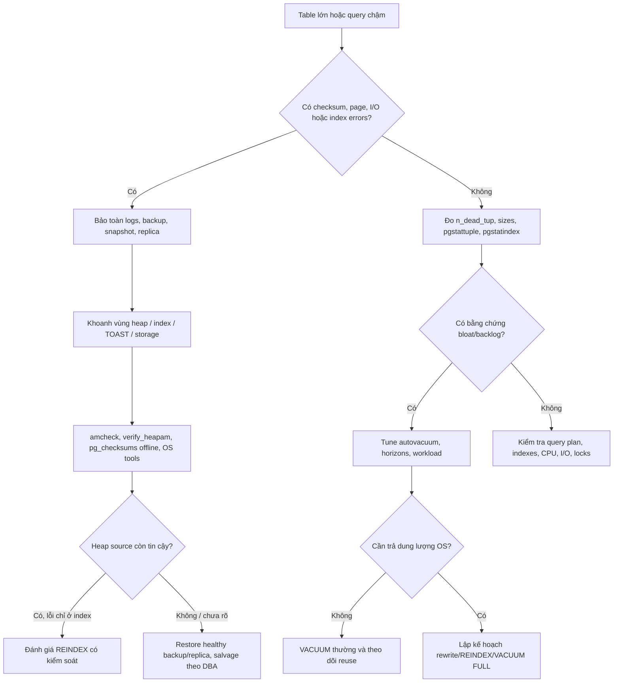

# Kiểm tra tính toàn vẹn và phân biệt lỗi vật lý với bloat trong PostgreSQL

Một PostgreSQL database có thể tăng dung lượng nhanh, query chậm dần và VACUUM chạy lâu hơn sau nhiều tháng ghi, cập nhật và xóa dữ liệu. Những dấu hiệu đó thường khiến người vận hành nghĩ ngay đến **table bloat**. Nhưng database cũng có thể gặp **hỏng dữ liệu vật lý** do storage, filesystem, memory, phần mềm hoặc thao tác sai. Hai vấn đề có thể cùng làm query chậm hoặc gây lỗi, nhưng cách phát hiện và khôi phục hoàn toàn khác nhau.

VACUUM là công cụ bảo trì quan trọng của PostgreSQL. Nó dọn các row versions không còn cần cho MVCC, giúp tái sử dụng không gian, cập nhật visibility map và bảo vệ database khỏi transaction ID wraparound. Tuy vậy, **VACUUM không phải một chương trình kiểm tra toàn diện tính toàn vẹn vật lý**. Một lần VACUUM thành công không chứng minh mọi heap page, index page, WAL, backup và filesystem đều không có lỗi.

Ngược lại, một bảng có nhiều dead tuples, free space hoặc index pages chưa được sử dụng hết không đồng nghĩa dữ liệu bị corrupt. Đó có thể là bloat: dữ liệu vẫn đọc được và database vẫn nhất quán về mặt cấu trúc, nhưng relation chiếm nhiều page hơn cần thiết hoặc locality kém hơn.

Bài học thuộc chương **VACUUM** của module *Database Engine Relational PostgreSQL*. Chúng ta sẽ phân biệt nhiệm vụ của VACUUM với các công cụ kiểm tra như amcheck, pg_amcheck, pg_checksums và pg_verifybackup; đọc statistics để nhận biết bloat; điều tra lỗi I/O/checksum/page; và xây dựng quy trình phản ứng sự cố an toàn.

> **Nguyên tắc:** VACUUM để bảo trì MVCC và tái sử dụng không gian. Dùng công cụ integrity chuyên biệt để kiểm tra cấu trúc dữ liệu. Khi có dấu hiệu corruption, bảo toàn bằng chứng và backup trước khi thử sửa; không dùng VACUUM FULL hoặc REINDEX như một cách chữa mọi lỗi.

## 1. Mục tiêu học tập

Sau bài này, bạn có thể:

1. Giải thích dead tuples phát sinh từ MVCC và vì sao VACUUM cần thiết.
2. Phân biệt VACUUM thường, VACUUM ANALYZE, VACUUM FULL và autovacuum.
3. Hiểu free space, visibility map, freeze và transaction ID wraparound.
4. Giải thích table bloat và index bloat mà không nhầm với corruption.
5. Đọc pg_stat_user_tables, pg_stat_progress_vacuum và các kích thước relation.
6. Dùng pgstattuple/pgstattuple_approx để ước lượng dead tuples và free space.
7. Dùng pgstatindex để khảo sát B-tree index density/fragmentation.
8. Hiểu giới hạn của các số liệu thống kê ước lượng.
9. Nhận diện dấu hiệu page corruption, checksum mismatch, missing relation file và lỗi thiết bị.
10. Dùng amcheck/pg_amcheck để kiểm tra cấu trúc index.
11. Biết khi nào dùng verify_heapam và những giới hạn của heap checks.
12. Dùng pg_checksums trong điều kiện offline để xác minh data page checksums.
13. Phân biệt kiểm tra live cluster, kiểm tra backup và kiểm tra storage.
14. Diễn giải output VACUUM VERBOSE và progress view.
15. Lập kế hoạch điều tra, backup, failover, restore và reindex đúng thứ tự.
16. Không vô tình làm mất dữ liệu bằng các recovery switches nguy hiểm.
17. Thực hành mô phỏng bloat an toàn, quan sát VACUUM và đo trước/sau.
18. Xây dựng checklist integrity/bloat monitoring cho production.

## 2. Vì sao PostgreSQL cần VACUUM?

PostgreSQL dùng MVCC (Multi-Version Concurrency Control). Khi một transaction UPDATE một row, PostgreSQL thường tạo một tuple version mới; version cũ không bị ghi đè ngay. Khi DELETE, tuple được đánh dấu đã xóa theo transaction visibility rules. Những versions cũ có thể vẫn cần cho transaction đang chạy hoặc snapshot cũ.

Ví dụ:

```sql
UPDATE sales.orders
SET status = 'PAID'
WHERE order_id = 1001;

DELETE FROM sales.orders
WHERE order_id = 1002;
```

Sau hai lệnh này, heap có thể chứa tuple version cũ và mới của order 1001, tuple đã bị delete của order 1002, cùng những rows không đổi. Một tuple cũ chỉ có thể được thu hồi khi không còn snapshot nào cần nhìn thấy nó. VACUUM xác định những dead tuples có thể tái sử dụng theo visibility horizons của cluster.

### 2.1. Dead tuple không phải corruption

Dead tuple là một row version hợp lệ về mặt lịch sử MVCC, đã không còn cần cho các snapshot tương lai. Nó là hệ quả bình thường của UPDATE/DELETE.

Corruption là dữ liệu/page/structure không còn đúng định dạng hoặc không nhất quán theo những invariants của PostgreSQL. Một dead tuple không tự nó chứng minh corruption.

### 2.2. Vì sao không ghi đè row cũ ngay?

MVCC cho phép readers và writers hoạt động đồng thời mà không phải khóa mọi row cho mọi SELECT. Một transaction cũ có thể vẫn cần đọc version trước khi UPDATE/DELETE được commit. Việc giữ nhiều versions là một phần của thiết kế concurrency.

### 2.3. VACUUM dựa trên visibility horizon

VACUUM không được xóa tuple mà một transaction/snapshot còn có thể cần. Long-running transactions, prepared transactions, replication slots hoặc standby feedback có thể giữ horizon cũ và trì hoãn việc thu hồi dead tuples.

### 2.4. Dead tuples tích lũy tạo áp lực

Nếu vacuum không theo kịp:
- Heap pages giữ nhiều dead versions.
- Indexes có thể còn entries trỏ tới versions đã chết.
- Sequential scans phải đọc nhiều page hơn.
- Index scans có thể phải xử lý nhiều entries hơn.
- Relation size tăng và cache hiệu quả giảm.
- Transaction ID freezing có thể bị trì hoãn.

## 3. VACUUM làm gì?

VACUUM thường thực hiện một số nhiệm vụ chính:

1. Xác định và loại bỏ tuple versions không còn cần thiết.
2. Làm sạch index entries tương ứng theo chiến lược index cleanup.
3. Cập nhật Free Space Map (FSM) để các thao tác ghi tìm được page có chỗ trống.
4. Cập nhật Visibility Map (VM) cho các pages phù hợp.
5. Freeze transaction IDs đủ cũ để tránh wraparound.
6. Có thể truncate các empty pages ở cuối relation để trả lại filesystem space, nếu điều kiện và options cho phép.
7. Với VACUUM ANALYZE, cập nhật planner statistics qua ANALYZE.

### 3.1. VACUUM thường không rewrite toàn bộ table

VACUUM thường làm việc trên relation tại chỗ, dọn tuple versions và để không gian trống có thể tái sử dụng trong relation. Nó **thường không thu nhỏ file xuống đúng kích thước chỉ còn live rows**.

### 3.2. Không gian tái sử dụng khác không gian trả lại OS

Giả sử table có 10 GB, sau VACUUM còn 3 GB live tuples và 7 GB free space nằm trong các pages ở giữa file. PostgreSQL có thể tái sử dụng free space đó cho inserts/updates sau này, nhưng filesystem vẫn thấy relation gần 10 GB.

Nếu các pages trống nằm ở cuối file và có thể truncate, VACUUM có thể trả một phần dung lượng về OS. Đây không phải bảo đảm rằng toàn bộ free space sẽ được trả lại.

### 3.3. VACUUM ANALYZE

```sql
VACUUM (VERBOSE, ANALYZE) sales.orders;
```

VACUUM dọn dead tuples; ANALYZE lấy mẫu dữ liệu để cập nhật statistics cho planner. Hai việc liên quan đến bảo trì nhưng mục tiêu khác nhau.

### 3.4. VACUUM FULL

```sql
VACUUM (FULL, VERBOSE, ANALYZE) sales.orders;
```

VACUUM FULL rewrite table vào một file mới, thường thu gọn relation và trả free space về filesystem sau khi hoàn tất. Nó cần lock ACCESS EXCLUSIVE trong thời gian dài, cần thêm dung lượng cho bản rewrite và không phù hợp để chạy thường xuyên trên bảng OLTP lớn.

### 3.5. Autovacuum

Autovacuum là các background workers tự động chạy VACUUM/ANALYZE dựa trên thresholds, table settings và wraparound protection. Đây là cơ chế vận hành mặc định quan trọng; không nên tắt toàn cluster để “tránh query chậm” mà không có kế hoạch thay thế.

## 4. VACUUM không phải integrity checker toàn diện

Đây là phân biệt trọng tâm của bài.

VACUUM có thể đọc heap pages, xử lý tuple headers và index cleanup. Nếu gặp một số lỗi cấu trúc hoặc I/O trong quá trình đọc, nó có thể phát hiện và báo lỗi. Nhưng VACUUM:

- Không đảm bảo đọc mọi page trong mọi trường hợp; visibility map có thể cho phép bỏ qua pages phù hợp.
- Không kiểm tra mọi invariant của mọi index như công cụ amcheck.
- Không xác minh checksum của toàn bộ cluster offline như pg_checksums.
- Không xác minh tính toàn vẹn của backup archive như pg_verifybackup.
- Không kiểm tra filesystem/device health toàn diện.
- Không chứng minh WAL/replica/backup đều có thể phục hồi.

Một lệnh VACUUM VERBOSE hoàn tất không phải giấy chứng nhận “database không corrupt”.

### 4.1. Page skipping và visibility map

VACUUM có thể bỏ qua các pages được đánh dấu all-visible/all-frozen trong visibility map khi không cần kiểm tra lại theo chiến lược hiện tại. Đây là tối ưu hiệu năng.

Nếu nghi ngờ visibility map bị corrupt, PostgreSQL có option DISABLE_PAGE_SKIPPING để buộc vacuum scan pages thay vì dựa vào VM skip behavior. Tuy nhiên, điều này **không biến VACUUM thành một công cụ kiểm tra integrity tổng quát**.

### 4.2. Integrity tools có mục tiêu riêng

| Công cụ | Mục tiêu chính |
|---|---|
| VACUUM | MVCC cleanup, free space, freeze |
| ANALYZE | Planner statistics |
| amcheck | Kiểm tra invariants của index và một số heap checks |
| pg_amcheck | CLI điều phối các checks của amcheck |
| pg_checksums | Xác minh data page checksums khi cluster offline |
| pg_verifybackup | Kiểm tra backup theo manifest/checksum và WAL liên quan |
| pgstattuple | Đo tuple/free-space statistics để điều tra bloat |
| OS/storage tools | Filesystem, device, mount, I/O health |

## 5. Table bloat là gì?

**Table bloat** là tình trạng heap relation chiếm nhiều pages/dung lượng hơn cần thiết so với lượng live data hiện tại, thường do UPDATE/DELETE churn, page layout, free space và khả năng tái sử dụng.

Một table có thể có nhiều dead tuples, nhiều free bytes trong các pages, page density thấp, tăng kích thước sau nhiều lần cập nhật, có empty pages nằm rải rác trong relation hoặc có file lớn dù số live rows đã giảm. Đây là vấn đề hiệu quả storage/scan, không nhất thiết là lỗi vật lý.

### 5.1. Nguyên nhân thường gặp

- UPDATE/DELETE thường xuyên.
- Cột được index thay đổi làm giảm cơ hội HOT update.
- Fillfactor không phù hợp với update pattern.
- Autovacuum thresholds/scale factor quá cao so với tốc độ churn.
- Long-running transaction giữ dead tuples chưa thể thu hồi.
- Replication slot/standby feedback giữ xmin horizon.
- Workload xóa hàng loạt nhưng không có partition retention strategy.
- Index page splits và churn tạo index bloat.

### 5.2. Bloat có thể xảy ra dù VACUUM chạy thành công

VACUUM thường đánh dấu space có thể tái sử dụng; nó không luôn rewrite relation để lấp lại pages. Vì vậy table vẫn có thể lớn sau khi vacuum hoàn tất, dù dead tuples đã được dọn.

### 5.3. Không phải mọi free space đều là lãng phí

Free space cần cho future inserts/updates, HOT updates, giảm page splits và giảm rewrite. Một page có 20% free space có thể là layout được thiết kế có chủ ý, không phải bloat cần loại bỏ.

### 5.4. Bloat là khái niệm phụ thuộc workload

Một table append-only lớn có nhiều free space có thể ít gây hại; một index nóng có page density thấp và random I/O lớn có thể tác động rõ hơn. Đánh giá bằng query latency, cache pressure, storage growth và write churn, không chỉ một tỷ lệ.

## 6. Index bloat khác table bloat

Index chứa entries trỏ tới heap tuples. Khi rows bị UPDATE/DELETE, index entries cũ có thể tồn tại cho đến khi vacuum/index cleanup loại bỏ chúng. B-tree index cũng có page splits và pages chưa được lấp đầy.

Index bloat có thể làm index file lớn hơn cần thiết, tăng số pages phải đọc, giảm cache hit ratio, tăng chi phí index scan/maintenance và làm backup lớn hơn.

### 6.1. VACUUM có thể dọn index entries

VACUUM phối hợp với index access methods để loại bỏ entries không còn cần. Nhưng index file không nhất thiết thu nhỏ tương ứng.

### 6.2. REINDEX tạo lại index

```sql
REINDEX INDEX sales.orders_customer_idx;
```

REINDEX rebuild index từ heap data. Nó có thể giảm index bloat hoặc xử lý index structure corruption nếu heap còn nguyên vẹn và có thể đọc đúng.

### 6.3. REINDEX không chữa heap corruption

Nếu heap table bị corrupt, rebuild index có thể đọc chính dữ liệu heap bị lỗi và thất bại hoặc tạo index phản ánh dữ liệu đã hỏng. Trước khi REINDEX, cần xác định phạm vi corruption và bảo toàn nguồn phục hồi.

### 6.4. Không nhầm index fragmentation với corruption

Index page density thấp hoặc leaf fragmentation cao có thể là dấu hiệu layout kém. Nó không tự chứng minh B-tree invariants bị vi phạm. Dùng pgstatindex để đo cấu trúc/density và amcheck để kiểm tra invariants.

## 7. Phân biệt bloat và lỗi vật lý

| Dấu hiệu | Bloat | Physical corruption / I/O failure |
|---|---|---|
| Table/index lớn bất thường | Thường có | Có thể có, nhưng không đủ kết luận |
| Nhiều dead tuples | Thường có | Không phải dấu hiệu đặc trưng |
| Page density thấp | Có thể có | Có thể có nhưng cần thêm bằng chứng |
| Query chậm dần | Có thể có | Có thể có |
| Checksum mismatch | Không phải bloat | Dấu hiệu mạnh của page damage |
| Invalid page header/line pointer | Không phải bloat | Dấu hiệu cấu trúc hỏng |
| Could not read block / I/O error | Không phải bloat | Dấu hiệu storage/read path |
| B-tree parent/child invariant failure | Không phải bloat | Dấu hiệu index corruption |
| VACUUM thành công | Có thể vẫn bloat | Không loại trừ corruption |
| REINDEX giảm size | Có thể | Chỉ sửa được một số lỗi index khi heap tốt |
| VACUUM FULL thu nhỏ file | Có thể | Không phải cách chữa corruption |

### 7.1. Bloat thường là vấn đề về hiệu quả

Dữ liệu vẫn đọc được, queries trả kết quả đúng, nhưng relation cần nhiều pages hơn. Có thể cải thiện bằng tuning autovacuum, giảm churn, partitioning, fillfactor hoặc rewrite/reindex có kế hoạch.

### 7.2. Corruption là vấn đề correctness/durability

Một page có checksum sai, line pointer không hợp lệ, index tree invariant sai hoặc block không đọc được có thể khiến query trả lỗi, bỏ dữ liệu hoặc gây hành vi không xác định nếu bị che giấu.

### 7.3. Một lỗi I/O không tự nói nguyên nhân

Có thể do storage device, filesystem, controller, network, kernel, memory, cable, cloud volume, permission hoặc file bị thao tác ngoài PostgreSQL. Thu thập OS logs và provider events để tìm root cause.

### 7.4. Hai vấn đề có thể cùng tồn tại

Một table có bloat cũng có thể có một page corrupt. Đừng dừng điều tra corruption chỉ vì n_dead_tup cao; cũng đừng chạy REINDEX/VACUUM FULL trước khi xác minh integrity.

## 8. Kiểm tra bloat sơ bộ bằng pg_stat_user_tables

```sql
SELECT
    schemaname,
    relname,
    n_live_tup,
    n_dead_tup,
    round(
        100.0 * n_dead_tup
        / NULLIF(n_live_tup + n_dead_tup, 0),
        2
    ) AS estimated_dead_pct,
    last_vacuum,
    last_autovacuum,
    vacuum_count,
    autovacuum_count
FROM pg_stat_user_tables
ORDER BY n_dead_tup DESC
LIMIT 20;
```

### 8.1. n_live_tup và n_dead_tup là ước lượng

Các trường này đến từ statistics collector và không phải exact count của mọi tuple tại thời điểm query. Chúng hữu ích để tìm candidates, không phải chứng cứ tuyệt đối rằng table bị bloat.

### 8.2. Dead tuple percentage không bằng bloat percentage

Ví dụ table có 1 triệu live rows, 100.000 dead tuples nhưng page layout tốt; một table khác có 100.000 live rows trong 10 triệu pages do lịch sử churn. Hai trường hợp có cùng tỷ lệ không thể so bloat chỉ bằng công thức đó.

### 8.3. Xem thêm table sizes

```sql
SELECT
    schemaname,
    relname,
    pg_size_pretty(
        pg_relation_size(
            format('%I.%I', schemaname, relname)::regclass
        )
    ) AS heap_size,
    pg_size_pretty(
        pg_indexes_size(
            format('%I.%I', schemaname, relname)::regclass
        )
    ) AS indexes_size,
    pg_size_pretty(
        pg_total_relation_size(
            format('%I.%I', schemaname, relname)::regclass
        )
    ) AS total_size
FROM pg_stat_user_tables
ORDER BY pg_total_relation_size(
    format('%I.%I', schemaname, relname)::regclass
) DESC
LIMIT 20;
```

Đây là cách tìm objects lớn. Dung lượng lớn tự nó không phải bloat; cần so với live data, growth history và workload.

## 9. Dùng pgstattuple để đo tuple/free space

Extension pgstattuple cung cấp thống kê vật lý của relation như table_len, tuple_count, tuple_len, tuple_percent, dead_tuple_count, dead_tuple_len, dead_tuple_percent, free_space và free_percent.

Cài extension trong database (cần quyền phù hợp):

```sql
CREATE EXTENSION IF NOT EXISTS pgstattuple;
```

Đo table:

```sql
SELECT *
FROM pgstattuple('sales.orders');
```

### 9.1. Đo chính xác tốn một lượt đọc relation

pgstattuple quét relation để lấy thông tin, có thể tốn I/O đáng kể trên bảng lớn. Đừng chạy liên tục trên mọi bảng production chỉ để có dashboard mỗi phút.

### 9.2. pgstattuple_approx

```sql
SELECT *
FROM pgstattuple_approx('sales.orders');
```

Hàm approximate có thể dùng visibility map và free-space information để giảm lượng đọc, nhưng một số trường là ước lượng. Dùng nó để sàng lọc; nếu cần xác nhận, lên lịch full scan phù hợp.

### 9.3. Free space không luôn là bloat có thể thu hồi

Một table cần chỗ trống để hấp thụ future writes. Nếu workload update-heavy, free space có thể giảm I/O và hỗ trợ HOT updates. Hãy xem tỷ lệ cùng pattern cập nhật.

### 9.4. pgstattuple không kiểm tra mọi loại corruption

Mục tiêu chính là thống kê tuple/free space. Nếu nó báo lỗi đọc page, đó là tín hiệu cần điều tra; nếu chạy thành công, không chứng minh indexes/WAL/filesystem đều khỏe.

## 10. Đo index bằng pgstatindex

Extension pgstattuple cung cấp pgstatindex cho B-tree indexes:

```sql
SELECT *
FROM pgstatindex('sales.orders_customer_idx');
```

Các thông tin có thể gồm index_size, tree_level, index_pages, leaf_pages, empty_pages, deleted_pages, avg_leaf_density và leaf_fragmentation.

### 10.1. Density thấp cần được diễn giải theo workload

B-tree leaf pages không cần luôn đầy 100%. Fillfactor, concurrent inserts, key distribution và page splits ảnh hưởng density.

### 10.2. Fragmentation không đồng nghĩa corruption

Một index có fragmentation cao có thể vẫn hợp lệ. amcheck kiểm tra các invariants; pgstatindex mô tả layout/density.

### 10.3. Index lớn bất thường cần xem usage

Kết hợp pg_stat_user_indexes để biết số lần scan, tuples read/fetched, và query workload. Một index bloat nhưng không dùng có thể là ứng viên drop (sau phân tích dependency); một index hot có thể cần reindex maintenance window.

## 11. Free Space Map và Visibility Map

Hai cấu trúc phụ trợ thường bị nhầm:

**Free Space Map (FSM):** giúp PostgreSQL tìm page còn khoảng trống cho inserts/updates.

**Visibility Map (VM):** ghi nhận pages all-visible hoặc all-frozen, hỗ trợ index-only scans và cho phép VACUUM bỏ qua một số pages phù hợp.

### 11.1. FSM không phải danh sách mọi dead tuples

FSM ghi ước lượng free space theo pages, không phải bản kê từng tuple chết. Thông tin có thể không chính xác tuyệt đối ở mọi thời điểm; PostgreSQL vẫn kiểm tra page khi cần.

### 11.2. VM không phải checksum

Visibility map là metadata về visibility/frozen state, không chứng minh page bytes không bị hỏng. Nếu VM sai, vacuum/index-only scan có thể bị ảnh hưởng; có các công cụ kiểm tra riêng.

### 11.3. Xem visibility map với pg_visibility

```sql
CREATE EXTENSION IF NOT EXISTS pg_visibility;

SELECT *
FROM pg_visibility_map_summary('sales.orders'::regclass);
```

Hàm summary báo số pages all-visible/all-frozen theo visibility map. Nó không phải full heap integrity scan.

### 11.4. Xem free space với pg_freespacemap

```sql
CREATE EXTENSION IF NOT EXISTS pg_freespacemap;

SELECT *
FROM pg_freespace('sales.orders'::regclass)
ORDER BY avail DESC
LIMIT 20;
```

Dữ liệu này hữu ích để hiểu page free space; không nên dùng như một phép đo bloat duy nhất.

## 12. Đọc VACUUM VERBOSE

Ví dụ:

```sql
VACUUM (VERBOSE, ANALYZE) sales.orders;
```

VACUUM VERBOSE in thông tin về pages, tuples, index cleanup và freeze. Output cụ thể thay đổi theo PostgreSQL major version và loại relation/index access method.

### 12.1. Các thông tin thường thấy

- Pages scanned/removed.
- Tuples removed/remain.
- Dead tuples không thể xóa do còn cần.
- Index scan/cleanup counts.
- Buffer usage và I/O timings nếu bật phù hợp.
- Pages all-visible/all-frozen.
- Thống kê relation sau vacuum.

### 12.2. Dead tuples còn lại không luôn là lỗi

Một số dead tuples chưa thể xóa vì snapshot/horizon cũ. Kiểm tra long-running transactions, replication slots, standby feedback và prepared transactions trước khi kết luận autovacuum hỏng.

### 12.3. VACUUM bỏ qua pages không có nghĩa pages đó được xác minh

Nếu visibility map cho phép skip, vacuum có thể không đọc page đó trong lần chạy. Đây là lý do một lần vacuum thành công không chứng minh không có corruption trên mọi pages.

### 12.4. Đọc output cùng statistics

So sánh n_dead_tup, last_autovacuum, relation size, pgstattuple và workload trước/sau. Một output verbose đơn lẻ không đủ để xác định nguyên nhân.

## 13. Theo dõi VACUUM đang chạy

```sql
SELECT
    pid,
    relid::regclass AS relation,
    phase,
    heap_blks_total,
    heap_blks_scanned,
    heap_blks_vacuumed,
    index_vacuum_count
FROM pg_stat_progress_vacuum;
```

### 13.1. Phase thay đổi theo tiến trình

Các phase có thể gồm scanning heap, vacuuming indexes, vacuuming heap, cleaning up indexes, truncating heap và performing final cleanup. Không coi một phase đứng lâu là deadlock ngay; cần xem wait events/locks/I/O.

### 13.2. View chỉ phản ánh hoạt động hiện tại

Khi vacuum kết thúc, row progress biến mất. Muốn lịch sử duration, relation và kết quả, thu thập log/metrics bên ngoài hoặc dùng monitoring.

### 13.3. Kiểm tra locks và blockers

```sql
SELECT
    a.pid,
    a.state,
    a.wait_event_type,
    a.wait_event,
    a.query,
    l.locktype,
    l.mode,
    l.granted
FROM pg_stat_activity AS a
LEFT JOIN pg_locks AS l
    ON l.pid = a.pid
WHERE a.query ILIKE '%vacuum%'
ORDER BY a.pid;
```

Query đơn giản này hỗ trợ điều tra; xác định blocker cần join pg_blocking_pids() và phân tích lock graph theo tình huống.

## 14. Autovacuum thresholds

Autovacuum quyết định khi nào vacuum/analyze dựa trên thresholds và scale factors.

Một công thức khái quát cho dead-tuple-triggered vacuum:

```text
vacuum threshold
  = autovacuum_vacuum_threshold
  + autovacuum_vacuum_scale_factor × estimated table tuples
```

Analyze threshold có công thức tương tự với các tham số analyze riêng.

### 14.1. Scale factor mặc định có thể quá lớn với bảng rất lớn

Nếu bảng có hàng trăm triệu rows, scale factor 0.2 có thể cho phép số dead tuples rất lớn trước khi trigger vacuum. Tuning per-table có thể cần thiết.

### 14.2. Table nhỏ và table lớn có nhu cầu khác nhau

Một table nhỏ có thể cần absolute threshold thấp; table lớn có thể cần scale factor thấp hơn để vacuum thường xuyên hơn. Không copy cùng một storage parameter cho mọi bảng.

### 14.3. Insert-triggered vacuum

PostgreSQL có các tham số insert-triggered vacuum để quản lý freezing/visibility cho bảng append-heavy. Kiểm tra autovacuum_vacuum_insert_threshold và autovacuum_vacuum_insert_scale_factor trên version đang chạy.

### 14.4. Tuning không phải chỉ giảm threshold

Autovacuum cần workers, cost limits, I/O budget và thời gian chạy. Nếu hạ thresholds nhưng workers thiếu hoặc bị throttle quá nhiều, backlog vẫn tăng.

## 15. Long-running transactions giữ dead tuples

Kiểm tra transactions lâu:

```sql
SELECT
    pid,
    usename,
    application_name,
    state,
    xact_start,
    now() - xact_start AS xact_age,
    backend_xmin,
    wait_event_type,
    wait_event,
    left(query, 200) AS query_sample
FROM pg_stat_activity
WHERE xact_start IS NOT NULL
ORDER BY xact_start;
```

### 15.1. Idle in transaction

Một session idle in transaction có thể giữ snapshot/horizon lâu dù không chạy query. Connection pool/application cần quản lý transaction lifecycle và timeout.

### 15.2. Replication slots

```sql
SELECT
    slot_name,
    slot_type,
    active,
    xmin,
    catalog_xmin,
    restart_lsn
FROM pg_replication_slots;
```

Replication slot có thể giữ xmin/catalog_xmin hoặc WAL theo loại slot và trạng thái consumer. Slot bị bỏ quên có thể làm vacuum không thu hồi tuples hoặc làm pg_wal tăng.

### 15.3. Standby feedback

Hot standby feedback có thể giữ xmin trên primary để tránh query conflict trên standby, nhưng có thể trì hoãn vacuum cleanup. Cân bằng giữa read availability và bloat/retention.

### 15.4. Prepared transactions

```sql
SELECT
    gid,
    prepared,
    owner,
    database
FROM pg_prepared_xacts;
```

Prepared transaction bị bỏ quên có thể giữ resources và horizons. Resolve theo distributed transaction coordinator/business protocol, không tự COMMIT/ROLLBACK nếu chưa xác định owner.

## 16. Transaction ID wraparound và freezing

PostgreSQL dùng transaction IDs hữu hạn. VACUUM freeze các tuples đủ cũ để hệ thống không mất khả năng phân biệt transaction visibility khi XID wraparound.

### 16.1. Freeze là nhiệm vụ correctness, không chỉ bloat

Một table có thể ít dead tuples nhưng vẫn cần vacuum để freeze old tuples. Vì vậy không được tắt autovacuum chỉ vì bảng ít update.

### 16.2. Theo dõi age

```sql
SELECT
    datname,
    age(datfrozenxid) AS xid_age,
    current_setting('autovacuum_freeze_max_age') AS freeze_max_age
FROM pg_database
ORDER BY age(datfrozenxid) DESC;
```

Đây là chỉ báo database-level; cần kiểm tra relation-level và version-specific wraparound settings khi có cảnh báo.

### 16.3. Wraparound autovacuum có tính bảo vệ

PostgreSQL có cơ chế anti-wraparound autovacuum và cảnh báo nghiêm trọng khi age tiến gần giới hạn. Không tắt hoặc trì hoãn bằng cách tăng max age mà không hiểu rủi ro.

### 16.4. VACUUM FREEZE

```sql
VACUUM (FREEZE, VERBOSE) sales.orders;
```

FREEZE yêu cầu xử lý freezing tích cực hơn theo điều kiện của PostgreSQL. Không cần chạy thủ công thường xuyên nếu autovacuum và freeze policy được vận hành tốt.

## 17. Dấu hiệu corruption vật lý

Một số dấu hiệu cần điều tra ngay:

- Checksum failure khi đọc data page.
- Invalid page header hoặc page checksum mismatch.
- Invalid line pointer / tuple header / page item.
- B-tree index parent/child invariant failure.
- Relation file missing hoặc kích thước bất thường ngoài dự kiến.
- OS reports I/O error, filesystem read-only, device reset.
- Query cụ thể luôn lỗi khi chạm một block.
- Backup verification báo file/checksum mismatch.
- PostgreSQL log ghi lỗi đọc/ghi block liên tục.

### 17.1. Không phải mọi ERROR đều corruption

Một query sai cú pháp, constraint violation, deadlock, out-of-memory hoặc permission denied không chứng minh page bị hỏng. Đọc SQLSTATE, error context và OS logs.

### 17.2. Một checksum mismatch là sự kiện nghiêm trọng

Khi data checksums được bật, checksum mismatch cho biết page bytes đọc được không khớp checksum lưu trong page header. Nguyên nhân có thể là storage, memory, filesystem hoặc phần mềm; không tự kết luận ổ cứng hỏng nếu chưa có bằng chứng.

### 17.3. Không bỏ qua cảnh báo lặp lại

Nếu một block liên tục gây lỗi trên nhiều query/backup/vacuum, dừng các thao tác có thể làm tình hình xấu hơn, bảo toàn logs/snapshot và đánh giá replica/backup.

## 18. Data page checksums

PostgreSQL có thể dùng checksums trên data pages để phát hiện một số dạng corruption. Việc checksum có bật hay không phụ thuộc cluster initialization/configuration và version.

Kiểm tra control data bằng công cụ:

```bash
pg_controldata /path/to/PGDATA
```

Tìm trường liên quan đến data page checksum version trong output của phiên bản đang chạy.

### 18.1. Checksum không phải ECC toàn hệ thống

Checksums giúp phát hiện page corruption khi page được kiểm tra, nhưng không bảo vệ mọi thứ:
- Không thay ECC RAM/hardware monitoring.
- Không kiểm tra logic business data.
- Không bảo đảm mọi index invariant.
- Không kiểm tra mọi backup/replica.
- Không sửa page bị hỏng.

### 18.2. Checksum được kiểm tra khi page được đọc

Khi bật data checksums, PostgreSQL có thể xác minh page checksum trong các đường đọc phù hợp. Page chưa bao giờ được đọc/scan có thể chưa được kiểm tra ở thời điểm đó; offline full check hữu ích khi cần rà soát toàn bộ data files.

### 18.3. Không bật ignore_checksum_failure như cách sửa

ignore_checksum_failure có thể cho phép server tiếp tục qua một số checksum errors trong tình huống cứu dữ liệu, nhưng có nguy cơ che giấu corruption và trả dữ liệu sai. Chỉ xem xét trong recovery/salvage plan do DBA có kinh nghiệm kiểm soát, sau khi bảo toàn bản gốc.

## 19. pg_checksums: kiểm tra offline

pg_checksums là utility làm việc với data checksums. Với mode --check, cluster phải được shutdown sạch và công cụ kiểm tra data files offline.

Ví dụ:

```bash
pg_ctl -D /path/to/PGDATA stop -m fast

pg_checksums --check -D /path/to/PGDATA
```

Đây là ví dụ runbook minh họa. Phải dừng đúng instance, đúng PGDATA, xác nhận không còn PostgreSQL process nào sử dụng cluster trước khi chạy offline checker.

### 19.1. Chỉ kiểm tra được checksums nếu cluster có hỗ trợ/bật

Nếu cluster được khởi tạo không bật checksums, pg_checksums --check không thể tạo ra một kết luận rằng pages hoàn toàn khỏe. Kiểm tra trạng thái checksum version trước.

### 19.2. pg_checksums không phải công cụ sửa mọi page

--check báo page checksum mismatch. Nó không biết nội dung business đúng là gì để tái tạo page. Khôi phục cần backup/replica hoặc salvage có kiểm soát.

### 19.3. --enable/--disable là thao tác offline riêng

Enable/disable checksums thay đổi trạng thái cluster và yêu cầu server dừng; không dùng chúng như một thao tác ứng cứu tùy tiện trên production. Đọc manual đúng major version và backup trước.

## 20. amcheck: kiểm tra cấu trúc index

Extension amcheck cung cấp functions kiểm tra các invariants của index access methods, đặc biệt B-tree.

```sql
CREATE EXTENSION IF NOT EXISTS amcheck;

SELECT bt_index_check(
    'sales.orders_customer_idx'::regclass
);
```

### 20.1. bt_index_check

bt_index_check kiểm tra cấu trúc B-tree theo mức kiểm tra được hỗ trợ và có thể chạy trong môi trường online với lock behavior ít xâm lấn hơn parent check. Đọc docs để chọn option phù hợp.

### 20.2. bt_index_parent_check

```sql
SELECT bt_index_parent_check(
    'sales.orders_customer_idx'::regclass
);
```

Parent check thực hiện thêm các kiểm tra về quan hệ parent/child trong B-tree và có lock/chi phí mạnh hơn. Không chạy tràn lan trên mọi index hot mà không đánh giá workload.

### 20.3. heapallindexed

Một số checks có tùy chọn heapallindexed để kiểm tra tuples trong heap có entries tương ứng trong index. Nó có thể tốn thời gian và memory/I/O; kiểm tra exact signature của PostgreSQL version đang chạy trước khi dùng.

### 20.4. amcheck không tự repair

Nếu phát hiện index invariant failure, kết quả là chẩn đoán. REINDEX có thể là hướng xử lý nếu heap data nguồn còn tốt; phải điều tra checksum/I/O và backup trước.

## 21. pg_amcheck CLI

pg_amcheck là công cụ command-line dùng để chạy các checks từ amcheck trên database/relations theo options.

Ví dụ khái quát:

```bash
pg_amcheck --database=app_db --verbose
```

Có thể giới hạn phạm vi database/schema/table/index bằng options của đúng phiên bản tool. Xem:

```bash
pg_amcheck --help
```

### 21.1. Kiểm tra theo batch nhỏ

Với cluster lớn, chạy theo database/schema hoặc relation groups giúp kiểm soát thời gian, lock và tải. Ghi lại thời điểm, server version, tool version và phạm vi đã kiểm tra.

### 21.2. Quyền kiểm tra

Một số checks cần quyền cao hơn để đọc relation/metadata hoặc chạy các extension functions. Dùng role có quyền tối thiểu đáp ứng nhiệm vụ; không cấp superuser lâu dài cho monitoring service.

### 21.3. Không nhầm exit code với danh sách row lỗi

CLI báo lỗi kiểm tra ở mức relation/index. Nếu cần xác định row/business value sai, đó là một quy trình data validation khác.

## 22. verify_heapam và heap corruption

Trong các phiên bản hỗ trợ, amcheck có hàm verify_heapam để kiểm tra cấu trúc heap tuples/pages và báo các vấn đề phát hiện được.

Ví dụ dạng gọi:

```sql
SELECT *
FROM verify_heapam(
    'sales.orders'::regclass,
    on_error => 'warning'
);
```

Kiểm tra chữ ký, tham số và extension version trong tài liệu server cụ thể trước khi chạy; các lựa chọn và output columns có thể phụ thuộc major version.

### 22.1. Heap check khác index check

- bt_index_check kiểm tra cấu trúc B-tree.
- verify_heapam kiểm tra heap tuple/page invariants theo khả năng của function.
- pg_checksums xác minh page checksums.
- Không công cụ đơn lẻ nào thay thế mọi lớp kiểm tra.

### 22.2. Kiểm tra heap có thể tốn I/O

Một heap integrity scan đọc lượng lớn pages. Chạy trong maintenance window hoặc theo nhóm khi cluster lớn; giám sát read latency và replica lag.

### 22.3. Heap check không sửa tuple

Function báo lỗi không tự khôi phục giá trị tuple. Nếu page corrupt, xác định backup/replica/snapshot tốt trước khi sửa hoặc salvage.

## 23. pageinspect: quan sát page-level

Extension pageinspect cung cấp functions để xem cấu trúc page và một số loại tuples/index internals.

Ví dụ:

```sql
CREATE EXTENSION IF NOT EXISTS pageinspect;

SELECT *
FROM page_header(get_raw_page('sales.orders', 0));
```

get_raw_page đọc một block cụ thể; page_header giải mã header. Đây là công cụ chuyên sâu cho DBA/debug, không phải dashboard bloat thông thường.

### 23.1. Không tự sửa page bytes

Đọc page bằng pageinspect không cho phép sửa trực tiếp file. Không viết bytes trở lại relation bằng hex editor hoặc OS commands.

### 23.2. Một page header hợp lệ không chứng minh toàn relation hợp lệ

Đây chỉ là một block. Corruption có thể nằm ở block khác hoặc index/TOAST/VM/FSM.

### 23.3. Dùng block number từ error context

Nếu PostgreSQL log nói block N của relation X, pageinspect có thể hỗ trợ kiểm tra block cụ thể khi page còn đọc được và quyền phù hợp. Bảo toàn logs và backup trước.

## 24. pg_verifybackup kiểm tra backup, không phải live cluster

pg_verifybackup kiểm tra một physical backup theo manifest/checksum và các kiểm tra liên quan WAL mà tool hỗ trợ.

```bash
pg_verifybackup /backup/basebackup
```

### 24.1. Backup thành công không tự có nghĩa restore thành công

Verification hữu ích nhưng cần restore test thực tế, khởi động cluster, replay WAL và chạy smoke/integrity checks trên bản restore.

### 24.2. Tablespaces ngoài PGDATA

Backup có tablespace mapping/manifest cần được kiểm tra đầy đủ. Không xác minh mỗi PGDATA rồi bỏ external tablespace directories.

### 24.3. Logical dump có validation khác

pg_verifybackup không phải validator cho mọi custom-format logical dump. Dùng pg_restore --list, restore thử và kiểm tra dữ liệu/schema theo quy trình logical backup.

## 25. Kiểm tra OS và storage

Khi có dấu hiệu corruption, database logs chỉ là một phần bằng chứng. Trên Linux có thể dùng:

```bash
df -hT
findmnt
lsblk
iostat -xz 1
dmesg --ctime
```

Các điểm cần kiểm tra:
- Kernel I/O errors/timeouts/resets.
- Filesystem remount read-only.
- Disk SMART/media errors nếu thiết bị expose.
- RAID controller/cache battery.
- SAN/NAS/network interruptions.
- Cloud volume status/IOPS throttling.
- Memory/ECC/host hardware alerts.
- Mount path và permissions.

### 25.1. Không chạy fsck trên filesystem đang mount read-write

Filesystem repair có thể cần unmount hoặc chế độ rescue theo filesystem/tool. Làm theo hướng dẫn OS/vendor; không sửa filesystem khi PostgreSQL vẫn đang ghi lên nó.

### 25.2. Không benchmark destructive trên production

Không dùng fio với write workloads vào device đang chứa PostgreSQL data để chẩn đoán trong giờ chạy. Benchmark cần target riêng và kế hoạch downtime/backup.

### 25.3. Cloud metrics có thể báo throttling thay vì corruption

Latency cao/IOPS limit có thể làm query chậm mà không có page corruption. Kiểm tra provider metrics trước khi kết luận device failure.

## 26. Đọc PostgreSQL logs

Tìm các nhóm thông điệp:

- invalid page / page verification failed.
- checksum verification failed.
- could not read block / could not write block.
- index contains unexpected entry/structure.
- unexpected zero page.
- could not open file / No such file or directory.
- No space left on device.
- Input/output error.

### 26.1. Lưu đủ context

Ghi lại timestamp, PID, database, relation, block number, SQLSTATE, query context, server version và OS device mapping. Không chỉ copy một dòng error bỏ mất context trước/sau.

### 26.2. Một block error có thể quy ra relation path

Dùng catalog/OID và pg_relation_filepath để xác định relation. Nếu relation là index, xác định heap table liên quan; nếu là TOAST, tìm parent relation.

### 26.3. Log statement có thể chứa dữ liệu nhạy cảm

Khi bật logging rộng, có thể ghi literal values/PII. Tuân thủ masking, access control và retention.

## 27. Quy trình ứng cứu khi nghi corruption

Một quy trình an toàn thường gồm:

1. **Dừng thay đổi rủi ro:** không chạy VACUUM FULL, REINDEX hàng loạt hoặc repair switches theo phỏng đoán.
2. **Bảo toàn bằng chứng:** copy logs, server version, OS events, block/relation identifiers và timeline.
3. **Bảo toàn bản gốc:** snapshot/backup theo quy trình nhất quán; tránh thao tác có thể ghi đè dữ liệu duy nhất.
4. **Đánh giá replica:** kiểm tra standby có cùng lỗi hay không và có thể promote an toàn không.
5. **Khoanh vùng:** heap, index, TOAST, data page checksum, WAL, filesystem hay device.
6. **Chạy checks phù hợp:** amcheck/verify_heapam/pg_checksums offline theo maintenance plan.
7. **Khôi phục nguồn tin cậy:** backup/PITR/healthy replica theo RPO/RTO.
8. **Validate sau restore:** application checks, constraints, integrity scans và query smoke tests.
9. **Khắc phục nguyên nhân gốc:** storage/firmware/kernel/memory/permissions/software bug.
10. **Theo dõi tái diễn:** alerts, checksums, backup verification, failover tests.

### 27.1. Nếu chỉ index corrupt và heap khỏe

Sau khi xác nhận heap source đọc tốt, có thể cân nhắc REINDEX index bị ảnh hưởng. Với hệ thống cần giảm blocking, đánh giá REINDEX INDEX CONCURRENTLY theo version và transaction restrictions.

### 27.2. Nếu heap corrupt

REINDEX không thể tái tạo dữ liệu heap đã hỏng. Ưu tiên restore từ backup/PITR hoặc healthy replica. Salvage các rows đọc được chỉ là phương án cuối, cần giữ mapping/consistency và xác nhận các rows bị bỏ.

### 27.3. Nếu storage có lỗi đang tiếp diễn

Trước khi chạy integrity scans nặng hoặc rewrite, xử lý thiết bị/filesystem hoặc chuyển sang bản replica/backup khỏe. Ghi nhiều lên volume đang lỗi có thể làm mất thêm dữ liệu.

## 28. Những recovery switches nguy hiểm

PostgreSQL có một số settings có thể cho phép tiếp tục trong điều kiện hỏng, ví dụ ignore_checksum_failure và zero_damaged_pages. Đây không phải công cụ repair thông thường.

### 28.1. ignore_checksum_failure

Có thể bỏ qua một số checksum errors trong các tình huống đặc biệt, nhưng có thể trả dữ liệu không đáng tin và che giấu lỗi. Chỉ dùng trong kế hoạch salvage do người có chuyên môn kiểm soát.

### 28.2. zero_damaged_pages

Có thể thay page được coi là damaged bằng page rỗng trong tình huống cứu hệ thống, đồng nghĩa **mất dữ liệu trên page đó**. Không bật để “làm VACUUM chạy qua”.

### 28.3. Không sửa corruption bằng cách tắt checks

Tắt detection không khôi phục bytes gốc. Nó chỉ thay cách server phản ứng với bằng chứng lỗi và có thể làm phạm vi mất dữ liệu lớn hơn.

## 29. VACUUM, REINDEX và VACUUM FULL: chọn đúng công cụ

| Mục tiêu | Công cụ | Tác động chính |
|---|---|---|
| Dọn dead tuples, reuse space | VACUUM | Giữ relation file phần lớn tại chỗ |
| Cập nhật planner stats | ANALYZE | Thu thập statistics |
| Thu gọn heap và trả disk | VACUUM FULL | Rewrite table, lock mạnh |
| Rebuild index | REINDEX | Rewrite index |
| Kiểm tra B-tree invariants | amcheck | Đọc/check cấu trúc |
| Đo tuple/free-space | pgstattuple | Scan và thống kê |
| Kiểm tra page checksums offline | pg_checksums | Verify data files |
| Xác minh physical backup | pg_verifybackup | Verify backup manifest/data |

### 29.1. Khi bloat là vấn đề

- Tune autovacuum/transaction horizons.
- Giảm update churn hoặc sửa data model.
- Chọn fillfactor theo workload.
- Dùng partitioning/retention.
- VACUUM thường xuyên.
- REINDEX hoặc rewrite khi có bằng chứng index/table bloat và maintenance window.

### 29.2. Khi corruption là vấn đề

- Bảo toàn dữ liệu và logs.
- Dùng integrity tools xác định phạm vi.
- Khắc phục storage/root cause.
- Restore từ bản tốt hoặc healthy replica.
- REINDEX chỉ khi heap source đáng tin và lỗi nằm ở index.

### 29.3. Không dùng VACUUM FULL để “sửa lỗi page”

VACUUM FULL đọc/rewrite relation. Nếu heap page corrupt, rewrite có thể thất bại hoặc mang dữ liệu sai sang relation mới. Nó không phải integrity repair utility.

## 30. Tác động của VACUUM FULL

VACUUM FULL:
- Cần ACCESS EXCLUSIVE lock.
- Tạo bản rewrite mới, cần free space.
- Có thể tạo tải I/O lớn.
- Làm thay đổi physical file identity/relfilenode.
- Có thể ảnh hưởng replication/WAL volume và backup window.

### 30.1. Dự trù dung lượng

Không chỉ cần phần chênh lệch bloat. Trong lúc rewrite, cần chỗ cho relation mới và index/temp/WAL overhead theo operation. Kiểm tra filesystem của tablespace đích và pg_wal.

### 30.2. Dự trù lock

Một table lớn có query dài có thể làm VACUUM FULL chờ lock; sau đó khi lấy được lock, các queries mới có thể bị xếp hàng. Xem lock queue và application latency.

### 30.3. Online alternatives

Có extension như pg_repack hỗ trợ một số rewrite với blocking ngắn hơn theo cơ chế riêng, nhưng là extension ngoài core, cần kiểm tra compatibility/locks/permissions và dung lượng. Không xem là giải pháp không rủi ro.

## 31. Bloat và autovacuum tuning theo bảng

Xem table options:

```sql
SELECT
    n.nspname,
    c.relname,
    c.reloptions
FROM pg_class AS c
JOIN pg_namespace AS n
    ON n.oid = c.relnamespace
WHERE c.relkind IN ('r', 'm')
  AND c.reloptions IS NOT NULL
ORDER BY n.nspname, c.relname;
```

Có thể đặt storage parameters:

```sql
ALTER TABLE sales.orders SET (
    autovacuum_vacuum_scale_factor = 0.02,
    autovacuum_vacuum_threshold = 5000,
    autovacuum_analyze_scale_factor = 0.01,
    fillfactor = 85
);
```

Đây là ví dụ minh họa. Giá trị đúng phải dựa trên row count, churn rate, write latency, HOT ratio và autovacuum throughput.

### 31.1. Fillfactor không là tỷ lệ bloat

Fillfactor 85 dành chỗ trống trong page khi table được tạo/rewrite; không có nghĩa 15% dữ liệu là dead. Nó có thể hỗ trợ update-heavy workloads.

### 31.2. Thay fillfactor không rewrite ngay toàn table

Thay storage parameter không tự compact mọi page hiện tại. Hiệu ứng đầy đủ thường rõ khi page mới được tạo/rewrite hoặc các updates sử dụng chỗ trống theo cơ chế phù hợp.

### 31.3. Tune table nóng khác table lạnh

Một table insert-only, một table update-heavy và một archive table ít thay đổi có profile khác nhau. Per-table settings có thể hợp lý nhưng tăng complexity; ghi lại rationale và theo dõi.

## 32. HOT updates và bloat

Heap-Only Tuple (HOT) updates có thể tránh tạo index entries mới khi điều kiện cho phép, đặc biệt khi các cột index không thay đổi và page còn đủ free space.

### 32.1. Tại sao HOT giúp?

Ít index entries mới có thể giảm index churn và chi phí vacuum/reindex. Nó cũng giúp update không phải cập nhật mọi indexes khi giá trị indexed columns không thay đổi.

### 32.2. Điều gì làm giảm HOT ratio?

- Update cột được index.
- Page không có đủ free space.
- Index/expression/predicate dependencies ảnh hưởng HOT eligibility.
- Workload update nhiều columns indexed.

### 32.3. Xem HOT statistics

```sql
SELECT
    relname,
    n_tup_upd,
    n_tup_hot_upd,
    round(
        100.0 * n_tup_hot_upd / NULLIF(n_tup_upd, 0),
        2
    ) AS hot_update_pct
FROM pg_stat_user_tables
ORDER BY n_tup_upd DESC;
```

Đây là statistics tích lũy; cần tính khoảng thời gian và reset counters khi phân tích.

## 33. Long-running query và vacuum lag

Một SELECT transaction mở lâu có thể giữ snapshot. Dù query đã trả phần lớn kết quả, transaction chưa commit có thể khiến dead tuples vẫn cần thiết.

### 33.1. Kiểm tra xmin horizon

```sql
SELECT
    pid,
    usename,
    application_name,
    state,
    xact_start,
    backend_xmin,
    age(backend_xmin) AS xmin_age,
    left(query, 160) AS query_sample
FROM pg_stat_activity
WHERE backend_xmin IS NOT NULL
ORDER BY age(backend_xmin) DESC;
```

### 33.2. Replication slots

```sql
SELECT
    slot_name,
    slot_type,
    active,
    xmin,
    catalog_xmin,
    restart_lsn
FROM pg_replication_slots;
```

### 33.3. Prepared transactions

```sql
SELECT
    gid,
    prepared,
    owner,
    database
FROM pg_prepared_xacts;
```

Các nguồn xmin/transaction horizon cũ có thể trì hoãn cleanup. Không drop replication slot hoặc resolve prepared transaction tùy tiện; xác định consumer/coordinator và tác động trước.

## 34. Thống kê autovacuum và logs

```sql
SELECT
    schemaname,
    relname,
    n_dead_tup,
    last_autovacuum,
    autovacuum_count,
    last_autoanalyze,
    autoanalyze_count
FROM pg_stat_user_tables
ORDER BY n_dead_tup DESC;
```

Bật log_autovacuum_min_duration theo policy để ghi nhận autovacuum lâu hoặc đáng chú ý. Cấu hình log_checkpoints và I/O timing phù hợp khi điều tra storage; cân nhắc log volume.

### 34.1. Một bảng không có last_autovacuum vẫn có thể khỏe

Table ít thay đổi hoặc nhỏ có thể chưa vượt thresholds. Không xem NULL timestamp là bằng chứng autovacuum không hoạt động.

### 34.2. Autovacuum_count không là health score

Counter cao có thể bình thường với table nóng; counter thấp có thể do table lạnh hoặc vacuum không chạy. Phân tích theo dead tuple trend, transaction horizon, size và duration.

## 35. Đo hiệu quả sau VACUUM

Trước/sau maintenance, thu:
- Relation heap/index/total size.
- n_dead_tup estimate.
- pgstattuple dead/free percentages khi cần.
- HOT update ratio.
- Query plans/buffers/latency.
- Autovacuum duration và progress.
- Filesystem free space.
- WAL generation/replica lag.

### 35.1. Không kỳ vọng pg_relation_size luôn giảm

VACUUM thường dọn và tái sử dụng space bên trong relation. Kích thước file có thể không giảm nếu free pages nằm giữa relation.

### 35.2. Không chỉ nhìn table size

Index/TOAST có thể chiếm phần lớn. pg_total_relation_size và pg_indexes_size giúp thấy tổng thể.

### 35.3. Query latency là kết quả workload

Cache warming, concurrency, query plan và data distribution có thể làm kết quả trước/sau khác nhau. Benchmark nhiều lần, kiểm soát điều kiện và xem BUFFERS.

## 36. Kiểm tra index-only scans và visibility map

Visibility map đánh dấu pages all-visible giúp index-only scans tránh heap fetch khi điều kiện visibility cho phép.

Xem query plan:

```sql
EXPLAIN (ANALYZE, BUFFERS)
SELECT customer_id, created_at
FROM sales.orders
WHERE customer_id = 42;
```

Nếu plan có Index Only Scan, xem Heap Fetches trong EXPLAIN ANALYZE. Nhiều heap fetches có thể phản ánh pages chưa all-visible, nhưng không tự chứng minh corruption hay bloat.

### 36.1. VACUUM có thể tăng all-visible coverage

Khi không còn dead tuples và visibility conditions phù hợp, vacuum có thể đánh dấu pages all-visible. Điều này có thể cải thiện index-only scans.

### 36.2. Update lại page làm mất all-visible

Một write mới trên page có thể clear all-visible bit; autovacuum cần chạy lại để xác nhận visibility. Đây là behavior bình thường.

### 36.3. VM corruption là một loại integrity issue riêng

Nếu nghi ngờ VM không nhất quán, dùng pg_visibility và công cụ/repair procedures theo docs. Không chỉ chạy ANALYZE để mong sửa visibility map.

## 37. Lab: tạo bảng update/delete để mô phỏng bloat

Chỉ chạy trên database thử nghiệm:

```sql
CREATE SCHEMA IF NOT EXISTS vacuum_lab;

CREATE TABLE vacuum_lab.events (
    event_id BIGINT PRIMARY KEY,
    tenant_id INTEGER NOT NULL,
    status TEXT NOT NULL,
    payload TEXT NOT NULL,
    updated_at TIMESTAMPTZ NOT NULL DEFAULT now()
) WITH (fillfactor = 100);

INSERT INTO vacuum_lab.events (
    event_id, tenant_id, status, payload
)
SELECT
    g,
    g % 100,
    'NEW',
    repeat('x', 500)
FROM generate_series(1, 50000) AS g;

CREATE INDEX events_tenant_status_idx
ON vacuum_lab.events (tenant_id, status);
```

### 37.1. Kiểm tra kích thước ban đầu

```sql
SELECT
    pg_size_pretty(pg_relation_size('vacuum_lab.events'))
        AS heap_size,
    pg_size_pretty(pg_indexes_size('vacuum_lab.events'))
        AS indexes_size,
    pg_size_pretty(pg_total_relation_size('vacuum_lab.events'))
        AS total_size;
```

### 37.2. Tạo churn

```sql
UPDATE vacuum_lab.events
SET status = CASE
        WHEN event_id % 2 = 0 THEN 'PAID'
        ELSE 'PENDING'
    END,
    payload = repeat('y', 700),
    updated_at = clock_timestamp()
WHERE event_id <= 30000;

DELETE FROM vacuum_lab.events
WHERE event_id > 40000;
```

Các updates thay cột được index (status) nên có thể tạo index churn; payload cũng thay đổi kích thước. Deletes tạo dead tuples.

### 37.3. Xem thống kê

```sql
SELECT
    relname,
    n_live_tup,
    n_dead_tup,
    n_tup_upd,
    n_tup_hot_upd,
    last_autovacuum
FROM pg_stat_user_tables
WHERE schemaname = 'vacuum_lab';
```

Statistics có thể cập nhật trễ; nếu cần, chạy ANALYZE rồi đợi stats collector/transaction semantics phù hợp.

### 37.4. Đo pgstattuple

```sql
CREATE EXTENSION IF NOT EXISTS pgstattuple;

SELECT *
FROM pgstattuple('vacuum_lab.events');
```

### 37.5. Chạy VACUUM thường

```sql
VACUUM (VERBOSE) vacuum_lab.events;
```

Sau đó chạy lại pgstattuple và so sánh dead tuple/free space. Heap file size có thể gần như không đổi; free space sẽ được tái sử dụng cho future inserts/updates.

### 37.6. Thử insert lại để thấy reuse

```sql
INSERT INTO vacuum_lab.events (
    event_id, tenant_id, status, payload
)
SELECT
    50000 + g,
    g % 100,
    'NEW',
    repeat('z', 500)
FROM generate_series(1, 10000) AS g;
```

Không nhất thiết size tăng cùng tỷ lệ vì PostgreSQL có thể tái sử dụng free space đã được đánh dấu.

## 38. Lab: so sánh VACUUM với VACUUM FULL

Trước khi thử, ghi lại:

```sql
SELECT
    pg_relation_size('vacuum_lab.events') AS heap_bytes,
    pg_total_relation_size('vacuum_lab.events') AS total_bytes;
```

VACUUM thường:

```sql
VACUUM (VERBOSE) vacuum_lab.events;
```

VACUUM FULL chỉ chạy trên lab, ngoài transaction block:

```sql
VACUUM (FULL, VERBOSE) vacuum_lab.events;
```

### 38.1. So sánh

Sau VACUUM FULL, heap file thường nhỏ hơn đáng kể nếu có free space phân tán/không thể truncate bằng vacuum thường. Tuy nhiên, kết quả tùy dữ liệu, page layout và index.

### 38.2. Đừng thử trên production để “xem nó làm gì”

VACUUM FULL cần lock mạnh, rewrite và thêm dung lượng. Chỉ benchmark trên môi trường có backup, capacity và maintenance window.

### 38.3. Không phải test corruption

Lab này chỉ mô phỏng bloat/free space. Không tạo file relation hỏng, sửa page bytes hoặc bật recovery switches.

## 39. Lab: kiểm tra index bằng amcheck

Trên database lab có extension được hỗ trợ:

```sql
CREATE EXTENSION IF NOT EXISTS amcheck;

SELECT bt_index_check(
    'vacuum_lab.events_tenant_status_idx'::regclass
);
```

### 39.1. Kết quả không có rows/error

Function có thể trả void và không báo lỗi khi check hoàn tất. Điều đó chỉ xác nhận checks được gọi không phát hiện vi phạm trong phạm vi của function/options.

### 39.2. Chạy pg_amcheck

Từ shell với client tools cùng phiên bản phù hợp:

```bash
pg_amcheck --database=app_db --verbose
```

Kiểm tra pg_amcheck --help và tài liệu đúng version để giới hạn scope và chọn options. Không chạy full cluster checks trên giờ cao điểm mà không đo tải.

## 40. Lab: xem page header bằng pageinspect

Trong lab:

```sql
CREATE EXTENSION IF NOT EXISTS pageinspect;

SELECT *
FROM page_header(
    get_raw_page('vacuum_lab.events', 0)
);
```

### 40.1. Đọc output

Page header có thông tin như lower/upper/special offsets, flags và page LSN tùy version. Những giá trị này giúp debug layout page.

### 40.2. Không tự kết luận corruption từ một số lạ

Page layout phụ thuộc page type, version và object. Dùng pageinspect docs và đối chiếu đúng type; không suy từ một field đơn lẻ.

## 41. Lab: checksum và backup verification

Không thực hiện offline checksum scan trên cluster đang dùng. Trong một cluster thử nghiệm riêng, bật data checksums từ lúc initdb (hoặc dùng quy trình enable được hỗ trợ khi cluster dừng), tạo dữ liệu, shutdown sạch rồi chạy:

```bash
pg_checksums --check -D /path/to/lab/PGDATA
```

Để kiểm tra backup được tạo bằng công cụ hỗ trợ manifest:

```bash
pg_verifybackup /path/to/lab/basebackup
```

### 41.1. Không giả lập corruption bằng cách sửa file thật

Không mở relation file và thay một byte để xem server phản ứng trên cluster dùng chung. Nếu cần kiểm thử failure detection, sử dụng test harness/cluster disposable và quy trình do DBA kiểm soát.

### 41.2. Checksum success có phạm vi cụ thể

Nó cho biết page checksums được kiểm tra không mismatch tại thời điểm scan; không chứng minh business values đúng hoặc mọi index invariant hợp lệ.

## 42. REINDEX khi nào?

Dùng REINDEX khi có bằng chứng:
- Index bloat đáng kể và cần thu gọn.
- Index structure corruption được amcheck phát hiện nhưng heap source đáng tin.
- Index cần rebuild sau thay đổi/cấu hình phù hợp.
- Index file bị lỗi nhưng table data vẫn đọc tốt.

Ví dụ:

```sql
REINDEX INDEX sales.orders_customer_idx;
```

### 42.1. REINDEX TABLE

```sql
REINDEX TABLE sales.orders;
```

Rebuild các indexes của table. Đánh giá dung lượng, lock, transaction, WAL và replication impact.

### 42.2. REINDEX CONCURRENTLY

```sql
REINDEX INDEX CONCURRENTLY sales.orders_customer_idx;
```

Concurrent form giảm thời gian block writes theo cơ chế riêng, nhưng có overhead, phases và hạn chế transaction. Đọc docs đúng version; không phải lúc nào cũng áp dụng được (ví dụ một số system/catalog cases).

### 42.3. Không reindex mọi index định kỳ theo lịch cứng

Đo index size/density, query usage và maintenance cost. Reindex vô ích tiêu tốn I/O/WAL, locks và backup capacity.

## 43. Bloat của index không đồng nghĩa mọi index cần rebuild

pgstatindex cung cấp density/fragmentation. Cần kết hợp:
- Index size so với live table size.
- idx_scan, idx_tup_read, idx_tup_fetch.
- Query plans.
- Churn/updates/deletes.
- B-tree key distribution.
- Fillfactor và page split pattern.

Một index lớn nhưng hot và hiệu quả vẫn có thể là đúng thiết kế. Một index lớn không dùng có thể là candidate tối ưu; cần xem write overhead và business query patterns.

## 44. Table rewrite và các lựa chọn

| Cách | Khi phù hợp | Rủi ro/tác động |
|---|---|---|
| VACUUM thường | Dead tuple cleanup, reuse | Không compact toàn relation |
| VACUUM FULL | Cần compact heap mạnh | ACCESS EXCLUSIVE, rewrite, extra space |
| CLUSTER | Muốn sắp xếp vật lý theo index | Rewrite, lock mạnh, không duy trì order sau đó |
| pg_repack | Rewrite với blocking ngắn hơn theo extension | Extension/trigger/log/space requirements |
| Partition drop/detach | Retention theo partition | Chỉ phù hợp data model partitioned |
| REINDEX | Index bloat/corruption với heap khỏe | Rebuild index, I/O/WAL/locks |

### 44.1. Retention bằng partition thường rẻ hơn delete hàng triệu rows

Nếu dữ liệu cũ theo thời gian và partition boundaries phù hợp, detach/drop partition có thể loại bỏ storage nhanh hơn một DELETE lớn + VACUUM. Nhưng cần FK/dependency/replication/backup policy.

### 44.2. CLUSTER không giữ thứ tự lâu dài

Sau CLUSTER, các writes mới tiếp tục theo workload; không phải một index-order guarantee vĩnh viễn. Cần chạy lại khi cần và cân nhắc rewrite cost.

### 44.3. pg_repack là extension ngoài core

Kiểm tra compatibility, version, privileges, trigger/replication behavior và free space. Không coi nó là một lệnh VACUUM thay thế đơn giản.

## 45. Physical corruption và backup strategy

Một chiến lược integrity cần nhiều lớp:

1. Data page checksums bật khi phù hợp.
2. Backup physical/logical định kỳ.
3. WAL archiving và PITR.
4. Backup verification.
5. Restore drills.
6. Healthy standby/failover.
7. OS/storage health monitoring.
8. amcheck/heap checks theo phạm vi/risk.
9. Alert trên checksum/I/O/page errors.
10. Runbook và ownership rõ.

### 45.1. Backup không thay replica

Backup bảo vệ khả năng khôi phục theo thời điểm; standby giúp availability. Một lỗi logic có thể replicate sang standby, còn backup PITR cho phép quay lại trước thời điểm hỏng nếu WAL/retention đủ.

### 45.2. Replica không thay backup

Nếu corruption đã tồn tại trước base backup hoặc được replicate qua WAL, standby có thể mang cùng lỗi. Cần backup lịch sử và verification độc lập.

### 45.3. Restore drill mới chứng minh quy trình dùng được

Thử khôi phục vào môi trường cách ly, start server, replay WAL, đọc dữ liệu và chạy integrity checks. Ghi lại thời gian và dependency để so với RTO/RPO.

## 46. Phân biệt lỗi index và heap

Khi query báo lỗi liên quan relation:
- Xác định relation OID/name/path.
- Xem relation là table, index, TOAST hay system object.
- Chạy checks tương ứng.
- Xác định heap source còn đọc tốt không.
- So với replica/backup.

### 46.1. Index corruption

Có thể ảnh hưởng query dùng index; một sequential scan có thể đọc heap được nếu heap tốt. Đây là dấu hiệu điều tra, không là cách chứng minh hoàn chỉnh.

### 46.2. Heap corruption

Có thể ảnh hưởng mọi access path đọc block hỏng. Index-only scan đôi khi tránh heap fetch cho page all-visible, nên query khác nhau có thể biểu hiện khác nhau. Không coi query chạy thành công là bằng chứng heap khỏe.

### 46.3. TOAST corruption

Large values có thể nằm trong TOAST relation. Query không chọn cột payload lớn có thể chưa chạm TOAST pages; khi truy cập payload mới lỗi. Integrity checks phải xét TOAST.

## 47. VACUUM và TOAST

VACUUM xử lý TOAST relations liên quan table theo quy trình của PostgreSQL. Table có payload lớn có thể có TOAST storage đáng kể.

Xem tổng size:

```sql
SELECT
    pg_size_pretty(pg_relation_size('sales.documents'))
        AS heap,
    pg_size_pretty(pg_total_relation_size('sales.documents'))
        AS total;
```

### 47.1. Heap nhỏ không có nghĩa table nhỏ

Một table JSONB/text lớn có thể có phần lớn bytes trong TOAST. Xem pg_total_relation_size.

### 47.2. Toast corruption có thể biểu hiện khi đọc value

Một row có tuple header hợp lệ nhưng external TOAST chunk mất/hỏng có thể chỉ lỗi khi materialize giá trị lớn. Bảo toàn error context và kiểm tra toast relation liên quan.

## 48. Page skipping và DISABLE_PAGE_SKIPPING

```sql
VACUUM (
    VERBOSE,
    DISABLE_PAGE_SKIPPING
) sales.orders;
```

Option này buộc vacuum không bỏ qua pages dựa trên visibility map theo cơ chế thông thường; tài liệu khuyến nghị chủ yếu khi nghi ngờ visibility map bị corrupt.

### 48.1. Chi phí

Nó có thể đọc nhiều pages hơn, gây I/O và ảnh hưởng workload. Không bật trên mọi table định kỳ.

### 48.2. Không phải thay thế amcheck/pg_checksums

Dù buộc scan, VACUUM vẫn có mục tiêu MVCC cleanup/freezing và các giới hạn riêng. Dùng công cụ integrity phù hợp cho index/checksum/heap.

### 48.3. Visibility map repair

Nếu xác định VM bị sai, xem tài liệu pg_visibility và hướng xử lý theo version. Không tự sửa bytes trong VM files.

## 49. VACUUM và truncate cuối relation

VACUUM thường có thể truncate các empty pages ở cuối heap để trả space về filesystem, nếu TRUNCATE option bật và có thể lấy lock cần thiết.

```sql
VACUUM (VERBOSE, TRUNCATE true) sales.orders;
```

Có thể tắt truncate:

```sql
VACUUM (TRUNCATE false, VERBOSE) sales.orders;
```

### 49.1. Truncate không thu gọn holes ở giữa file

Nếu free pages nằm rải rác giữa relation, chúng được tái sử dụng; không thể chỉ xóa chúng khỏi giữa file mà giữ block numbering liên tục.

### 49.2. Truncate có thể cần lock mạnh trong thời gian ngắn

Nếu không lấy được lock phù hợp, VACUUM có thể không truncate và vẫn hoàn thành phần cleanup khác. Xem log/verbose output.

### 49.3. Không nhầm truncate option với VACUUM FULL

TRUNCATE true chỉ cố cắt empty tail pages; VACUUM FULL rewrite relation và có tác động lớn hơn nhiều.

## 50. Kiểm tra page checksums và data checksum version

Một cluster có thể được khởi tạo với data checksums. Kiểm tra bằng:

```bash
pg_controldata /path/to/PGDATA
```

Tìm trường liên quan đến data page checksum version trong output của phiên bản đang chạy.

### 50.1. Checksum detection phụ thuộc page được kiểm tra

Một checksum mismatch có thể được phát hiện khi page được đọc hoặc khi offline checker scan. Không có lỗi trong log chưa chứng minh mọi blocks đã được kiểm tra gần đây.

### 50.2. Checksum mismatch không cho biết nguồn gốc duy nhất

Có thể do memory, storage, filesystem, controller, software bug hoặc thao tác ngoài server. Cần đối chiếu cùng hardware/OS logs và replica/backup.

## 51. pg_checksums và maintenance window

Quy trình khái quát:
1. Xác định đúng cluster/PGDATA.
2. Kiểm tra data checksums có bật không.
3. Lên maintenance window.
4. Shutdown sạch PostgreSQL.
5. Chạy pg_checksums --check.
6. Lưu output và exit code.
7. Nếu mismatch, không tự sửa; chuyển sang incident procedure.
8. Khởi động lại chỉ khi đã xác nhận trạng thái cluster và có quyết định DBA.

Không chạy pg_checksums --check trên PGDATA đang được server sử dụng.

## 52. Bloat monitoring và integrity monitoring nên tách dashboard

**Bloat dashboard:**
- n_dead_tup trend.
- pgstattuple dead/free percentages.
- Relation size growth.
- Index density.
- Autovacuum duration/backlog.
- Long-running xacts/xmin horizon.
- Query latency/buffers.

**Integrity dashboard:**
- Checksum errors.
- PostgreSQL invalid-page/index errors.
- amcheck/pg_amcheck results.
- Backup verification status.
- Restore drill status.
- OS I/O/media/filesystem errors.
- Replica consistency/lag.
- Storage health alerts.

### 52.1. Không dùng một màu “database unhealthy” cho mọi vấn đề

Bloat cần maintenance planning; corruption cần incident/recovery. Tách severity và owner giúp phản ứng đúng.

### 52.2. Trend quan trọng hơn snapshot

Dead tuple count tăng liên tục có ý nghĩa hơn một lần đo cao sau bulk update. Checksum mismatch dù chỉ một lần vẫn cần điều tra nghiêm túc.

## 53. SQL inventory: relation sizes và dead tuples

```sql
SELECT
    s.schemaname,
    s.relname,
    s.n_live_tup,
    s.n_dead_tup,
    pg_relation_size(
        format('%I.%I', s.schemaname, s.relname)::regclass
    ) AS heap_bytes,
    pg_indexes_size(
        format('%I.%I', s.schemaname, s.relname)::regclass
    ) AS index_bytes,
    pg_total_relation_size(
        format('%I.%I', s.schemaname, s.relname)::regclass
    ) AS total_bytes,
    s.last_autovacuum
FROM pg_stat_user_tables AS s
ORDER BY total_bytes DESC
LIMIT 30;
```

### 53.1. Cẩn thận partition parents

Các partitioned parents có thể không có heap storage như leaf tables; inventory cần xử lý relkind và include partitions nếu muốn tổng hợp chính xác.

### 53.2. Không cộng parent và leaf một cách mù quáng

Tùy catalog/statistics query, tổng size parent có thể khác cách cộng leaf relations. Xác định scope và tránh double count.

## 54. Xem index usage

```sql
SELECT
    s.schemaname,
    s.relname AS table_name,
    s.indexrelname AS index_name,
    s.idx_scan,
    s.idx_tup_read,
    s.idx_tup_fetch,
    pg_size_pretty(pg_relation_size(s.indexrelid))
        AS index_size
FROM pg_stat_user_indexes AS s
ORDER BY pg_relation_size(s.indexrelid) DESC
LIMIT 30;
```

### 54.1. idx_scan thấp không đủ để drop index

Statistics có thể reset, query theo mùa hoặc index phục vụ constraints. Kiểm tra dependencies/uniqueness/foreign keys và thời gian quan sát đủ dài.

### 54.2. Index bloat và usage cần phối hợp

Một index lớn nhưng scan nhiều có thể quan trọng; một index lớn không dùng có thể là candidate tối ưu. Cần xem write overhead và business query patterns.

## 55. Bảng so sánh công cụ

| Công cụ | Đọc dữ liệu nào? | Phát hiện gì? | Có sửa không? |
|---|---|---|---|
| VACUUM | Heap và indexes theo cleanup process | Dead tuples/cleanup conditions; một số lỗi khi đọc | Cleanup MVCC, không repair corruption tổng quát |
| ANALYZE | Sample rows | Planner statistics | Cập nhật stats |
| pgstattuple | Relation pages | Live/dead/free-space metrics | Không |
| pgstatindex | B-tree pages | Density/fragmentation/layout | Không |
| amcheck | Index/heap structures tùy function | Invariant violations | Không |
| pg_checksums | Offline data files | Page checksum mismatch | Không |
| pg_verifybackup | Backup files/manifest | Backup integrity mismatch | Không |
| pageinspect | Page bytes/structures | Debug details | Không |
| REINDEX | Heap để rebuild index | Tạo index mới; có thể loại index corruption nếu heap tốt | Rebuild index |
| VACUUM FULL | Heap rewrite | Compaction/rewrite | Không phải corruption repair |

## 56. Các lỗi chẩn đoán thường gặp

### 56.1. “VACUUM xong, size không giảm, vậy vacuum lỗi”

Không đúng. VACUUM thường tái sử dụng space bên trong relation. Nếu pages rỗng nằm giữa file, size không giảm. Muốn thu gọn mạnh, cần rewrite strategy sau khi xác nhận bloat và tính lock/space.

### 56.2. “Dead tuple cao nghĩa corruption”

Không đúng. Dead tuples là MVCC versions bình thường. Điều tra autovacuum, transaction horizons và workload.

### 56.3. “REINDEX xong là database integrity tốt”

Không đúng. REINDEX chỉ rebuild indexes; không kiểm tra mọi heap/TOAST/WAL/filesystem và không sửa heap corruption.

### 56.4. “pg_checksums không báo lỗi nghĩa mọi thứ đúng”

Không đúng. Nó chỉ kiểm tra data page checksums trong phạm vi scan, khi checksums được bật. Không validate business logic hay mọi index invariants.

### 56.5. “Query chạy được nghĩa table không corrupt”

Không đúng. Query có thể chưa đọc block hỏng, chưa truy cập TOAST value hoặc dùng index-only path tránh heap fetch. Cần checks phù hợp.

### 56.6. “Bật zero_damaged_pages là repair”

Không đúng. Nó có thể làm mất nội dung page để server tiếp tục trong salvage scenario. Không phục hồi bytes gốc.

## 57. Quy trình chọn công cụ



## 58. Bài tập 1 — Dead tuple

**Đề:** UPDATE một row tạo version cũ. Version cũ có phải corruption?

**Đáp án:** Không. Đây là MVCC row version. Khi không còn snapshot cần nó, VACUUM có thể dọn để tái sử dụng space.

## 59. Bài tập 2 — VACUUM xong size không giảm

**Đề:** Dead tuples giảm nhưng pg_relation_size không đổi.

**Đáp án:** Bình thường nếu free pages nằm giữa relation. VACUUM thường ưu tiên reuse; chỉ có thể truncate empty tail pages khi đủ điều kiện.

## 60. Bài tập 3 — VACUUM FULL

**Đề:** Muốn thu nhỏ table, chạy VACUUM FULL trong transaction block?

**Đáp án:** VACUUM commands không chạy trong transaction block. VACUUM FULL rewrite và cần ACCESS EXCLUSIVE lock cùng extra disk space.

## 61. Bài tập 4 — VACUUM có kiểm tra mọi page không?

**Đề:** VACUUM thành công chứng minh không có page corruption?

**Đáp án:** Không. Visibility map có thể cho phép skip pages và VACUUM không là full integrity checker.

## 62. Bài tập 5 — DISABLE_PAGE_SKIPPING

**Đề:** Nghi visibility map corruption, option nào có thể buộc vacuum scan pages?

**Đáp án:** VACUUM với DISABLE_PAGE_SKIPPING theo docs; đây không thay thế amcheck/checksum tools và có thể tăng I/O.

## 63. Bài tập 6 — n_dead_tup

**Đề:** n_dead_tup bằng 100000 có nghĩa đúng 100.000 dead tuples tại thời điểm query?

**Đáp án:** Không. Đây là statistics ước lượng, dùng để sàng lọc và theo dõi trend.

## 64. Bài tập 7 — pgstattuple

**Đề:** Muốn đo live/dead/free bytes của một table.

**Đáp án:** Dùng pgstattuple cho scan đầy đủ hoặc pgstattuple_approx để ước lượng với chi phí đọc thấp hơn theo điều kiện.

## 65. Bài tập 8 — pgstatindex

**Đề:** B-tree có avg_leaf_density thấp. Có chắc index corrupt?

**Đáp án:** Không. Đây là chỉ báo page density/layout; dùng amcheck để kiểm tra invariants.

## 66. Bài tập 9 — Index corruption

**Đề:** amcheck phát hiện index invariant failure, heap được xác nhận đọc tốt.

**Đáp án:** Bảo toàn logs/backup và đánh giá REINDEX index bị ảnh hưởng. REINDEX không thay điều tra root cause storage.

## 67. Bài tập 10 — Heap corruption

**Đề:** Heap page checksum sai. REINDEX TABLE có sửa không?

**Đáp án:** Không đáng tin. REINDEX đọc heap; ưu tiên backup/PITR/healthy replica. Salvage là phương án cuối.

## 68. Bài tập 11 — pg_checksums

**Đề:** Chạy pg_checksums --check khi server đang online.

**Đáp án:** Không. Utility cần cluster dừng sạch cho offline check.

## 69. Bài tập 12 — Checksums disabled

**Đề:** pg_checksums báo cluster không bật data checksums. Có thể kết luận không corruption?

**Đáp án:** Không. Chỉ biết offline checksum validation không có cơ sở checksum đã bật; dùng các integrity tools khác và backup/restore checks.

## 70. Bài tập 13 — pg_verifybackup

**Đề:** pg_verifybackup thành công chứng minh live primary không corrupt?

**Đáp án:** Không. Nó kiểm tra backup theo manifest/checksum/WAL liên quan, không scan live cluster hiện tại.

## 71. Bài tập 14 — Visibility map

**Đề:** Index-only scan có heap fetches. Có nghĩa visibility map corrupt?

**Đáp án:** Không. Page chưa all-visible do writes gần đây là bình thường; vacuum có thể cập nhật khi điều kiện phù hợp.

## 72. Bài tập 15 — Long-running transaction

**Đề:** Dead tuples không được dọn dù autovacuum chạy.

**Đáp án:** Kiểm tra old snapshots, idle-in-transaction, replication slots, standby feedback và prepared transactions.

## 73. Bài tập 16 — Wraparound

**Đề:** Table ít UPDATE nên có thể tắt autovacuum hoàn toàn?

**Đáp án:** Không. Freeze/anti-wraparound vacuum vẫn cần để quản lý transaction IDs.

## 74. Bài tập 17 — REINDEX

**Đề:** REINDEX thu nhỏ index và table cùng lúc?

**Đáp án:** Nó rebuild index; heap table size không được compact chỉ vì REINDEX.

## 75. Bài tập 18 — VACUUM FULL và corruption

**Đề:** Query báo invalid heap page, chạy VACUUM FULL để sửa.

**Đáp án:** Không. VACUUM FULL rewrite từ heap và có thể thất bại/mang dữ liệu hỏng; cần bảo toàn và restore/diagnose.

## 76. Bài tập 19 — Dead tuples và bloat

**Đề:** 20% dead tuple estimate nghĩa table bloat chính xác 20%.

**Đáp án:** Không. Estimate không phản ánh đầy đủ page layout/free space và relation size. Dùng pgstattuple cùng trend/workload.

## 77. Bài tập 20 — pg_stat_progress_vacuum

**Đề:** Muốn xem phase của vacuum đang chạy.

**Đáp án:** Query pg_stat_progress_vacuum; view không lưu lịch sử sau khi process kết thúc.

## 78. Bài tập 21 — TOAST

**Đề:** Table heap nhỏ nhưng tổng size lớn do JSONB.

**Đáp án:** Có thể bytes nằm trong TOAST/indexes. Dùng pg_total_relation_size và kiểm tra TOAST relation.

## 79. Bài tập 22 — Checksum mismatch

**Đề:** Log báo checksum mismatch. Tắt checksum để query tiếp?

**Đáp án:** Không. Bảo toàn logs/snapshot/backup, xác định block/device và recovery path; không che giấu integrity signal.

## 80. Bài tập 23 — I/O error

**Đề:** Một query báo could not read block. Đây có phải chắc chắn disk hỏng?

**Đáp án:** Không thể kết luận duy nhất. Kiểm tra filesystem, controller, memory, cloud volume, kernel logs và relation path.

## 81. Bài tập 24 — Pageinspect

**Đề:** pageinspect xem page header hợp lệ. Toàn table chắc chắn tốt?

**Đáp án:** Không. Chỉ một block được quan sát; các pages/indexes/TOAST khác vẫn cần kiểm tra.

## 82. Bài tập 25 — zero_damaged_pages

**Đề:** Bật zero_damaged_pages trên production để vacuum không fail.

**Đáp án:** Rất nguy hiểm; có thể thay page hỏng bằng nội dung rỗng và mất dữ liệu. Chỉ cân nhắc trong salvage plan có kiểm soát.

## 83. Bài tập 26 — pg_amcheck

**Đề:** Chạy pg_amcheck mỗi phút trên toàn cluster lớn.

**Đáp án:** Không phù hợp nếu chưa đo; checks có I/O/locks. Lập lịch và scope theo risk/maintenance window.

## 84. Bài tập 27 — VACUUM VERBOSE

**Đề:** Output nói còn dead tuples không removable.

**Đáp án:** Điều tra visibility horizon/old transactions/replication slots; không kết luận VACUUM hỏng.

## 85. Bài tập 28 — pg_stat_io

**Đề:** Dùng pg_stat_io để kết luận một relation cụ thể corrupt.

**Đáp án:** Không. Đây là I/O statistics theo backend/object/context; không là integrity checker và không đủ attribution theo relation.

## 86. Bài tập 29 — Backup và replica

**Đề:** Có standby khỏe thì không cần backup.

**Đáp án:** Không. Corruption/logic errors có thể replicate; cần backup lịch sử/PITR và restore verification.

## 87. Bài tập 30 — Bloat monitoring

**Đề:** Chỉ alert khi table size tăng.

**Đáp án:** Kết hợp dead tuple trends, relation/index size, pgstattuple, autovacuum lag, query latency, I/O và transaction horizons.

## 88. Bài tập 31 — HOT updates

**Đề:** HOT ratio thấp có thể liên quan index churn?

**Đáp án:** Có. Kiểm tra indexed columns thay đổi, page free space và fillfactor; đây là hiệu quả update, không phải corruption.

## 89. Bài tập 32 — Index-only scan

**Đề:** Heap Fetches lớn hơn 0 chứng minh visibility map bị hỏng?

**Đáp án:** Không. Pages có thể chưa all-visible do update gần đây hoặc vacuum chưa cập nhật.

## 90. Bài tập 33 — pg_freespacemap

**Đề:** FSM báo page có nhiều free bytes; chắc chắn bloat?

**Đáp án:** Không. Free space có thể được dự trữ/tái sử dụng cho writes; cần workload và relation size context.

## 91. Bài tập 34 — pg_verifybackup

**Đề:** Backup verification pass nhưng restore chưa từng được thử.

**Đáp án:** Vẫn cần restore drill để chứng minh server khởi động, replay WAL và ứng dụng đọc dữ liệu được.

## 92. Bài tập 35 — Incident order

**Đề:** Nghi heap corruption, bước đầu tiên là VACUUM FULL hay snapshot/log preservation?

**Đáp án:** Bảo toàn logs, backup/snapshot và replica evidence trước; khoanh vùng bằng checks phù hợp. Không rewrite relation theo phỏng đoán.

## 93. Bảng tra cứu nhanh

| Nhu cầu | Công cụ/lệnh |
|---|---|
| Dọn dead tuples | VACUUM table_name |
| Dọn + planner stats | VACUUM (ANALYZE) table_name |
| Hiển thị chi tiết | VACUUM (VERBOSE) table_name |
| Buộc scan qua VM skips | VACUUM (DISABLE_PAGE_SKIPPING) table_name khi nghi VM corruption |
| Thu gọn heap bằng rewrite | VACUUM (FULL) table_name có lock mạnh |
| Xem dead tuple estimates | pg_stat_user_tables |
| Xem vacuum progress | pg_stat_progress_vacuum |
| Đo table dead/free | pgstattuple() |
| Đo approximate table stats | pgstattuple_approx() |
| Đo B-tree density | pgstatindex() |
| Xem free space map | pg_freespace() |
| Xem visibility map | pg_visibility_map_summary() |
| Check B-tree | bt_index_check() |
| Parent/child B-tree checks | bt_index_parent_check() |
| Heap verification | verify_heapam() khi hỗ trợ |
| CLI integrity scan | pg_amcheck |
| Offline data page checksum | pg_checksums --check -D PGDATA khi cluster dừng |
| Verify physical backup | pg_verifybackup |
| Inspect page header | pageinspect / page_header(get_raw_page(...)) |
| Rebuild index | REINDEX INDEX ... |
| OS I/O health | iostat, dmesg, findmnt, df, vendor metrics |

## 94. Checklist production

1. Autovacuum có bật và hoạt động trên các tables quan trọng không?
2. Có theo dõi n_dead_tup và relation size trend không?
3. Có theo dõi long-running transactions và idle-in-transaction không?
4. Có kiểm tra replication slots/standby feedback giữ xmin không?
5. Có monitor transaction ID age và wraparound warnings không?
6. Có cấu hình per-table thresholds cho tables lớn/hot không?
7. Có đo HOT update ratio và index churn không?
8. Có phân biệt dead tuple estimates với bloat measurements không?
9. Có dùng pgstattuple theo lịch/scope phù hợp không?
10. Có đo B-tree density bằng pgstatindex khi cần không?
11. Có theo dõi VACUUM duration/progress và blockers không?
12. Có hiểu VACUUM thường không trả hết free space về OS không?
13. Có kế hoạch VACUUM FULL/rewrite với lock và free-space budget không?
14. Có tránh chạy VACUUM FULL như routine maintenance không?
15. Có bật data checksums theo policy của cluster không?
16. Có ghi nhận checksum version và kiểm tra offline khi cần không?
17. Có chạy amcheck/pg_amcheck theo lịch/risk không?
18. Có kiểm tra heap và TOAST khi dấu hiệu phù hợp không?
19. Có tách index corruption khỏi heap corruption không?
20. Có backup verification và restore drills không?
21. Có healthy standby và hiểu corruption có thể replicate không?
22. Có giám sát kernel/filesystem/device/cloud-volume I/O errors không?
23. Có log PostgreSQL đầy đủ relation/block context không?
24. Có bảo vệ log khỏi PII/secrets và retention phù hợp không?
25. Có runbook bảo toàn snapshot/backup trước recovery không?
26. Có cấm sửa/xóa relation files bằng tay không?
27. Có cấm dùng ignore_checksum_failure/zero_damaged_pages như biện pháp routine không?
28. Có xác nhận heap source khỏe trước khi REINDEX không?
29. Có RPO/RTO và recovery ownership rõ ràng không?
30. Có kiểm tra lại integrity sau restore/failover không?

## 95. Tài liệu chính thức tham khảo

- [PostgreSQL 18 — Routine Vacuuming](https://www.postgresql.org/docs/18/routine-vacuuming.html): MVCC cleanup, autovacuum, freeze và wraparound.
- [PostgreSQL 18 — VACUUM](https://www.postgresql.org/docs/18/sql-vacuum.html): options, VERBOSE, FULL, DISABLE_PAGE_SKIPPING, TRUNCATE.
- [PostgreSQL 18 — Progress Reporting](https://www.postgresql.org/docs/18/progress-reporting.html): pg_stat_progress_vacuum.
- [PostgreSQL 18 — Monitoring Statistics](https://www.postgresql.org/docs/18/monitoring-stats.html): table/index/database statistics.
- [PostgreSQL 18 — amcheck](https://www.postgresql.org/docs/18/amcheck.html): B-tree checks và heap verification.
- [PostgreSQL 18 — pg_amcheck](https://www.postgresql.org/docs/18/app-pgamcheck.html): command-line integrity checks.
- [PostgreSQL 18 — pg_checksums](https://www.postgresql.org/docs/18/app-pgchecksums.html): offline page checksum utility.
- [PostgreSQL 18 — Data Checksums](https://www.postgresql.org/docs/18/checksums.html): data page checksum behavior.
- [PostgreSQL 18 — pg_verifybackup](https://www.postgresql.org/docs/18/app-pgverifybackup.html): physical backup verification.
- [PostgreSQL 18 — pgstattuple](https://www.postgresql.org/docs/18/pgstattuple.html): tuple/free-space/index statistics.
- [PostgreSQL 18 — pg_visibility](https://www.postgresql.org/docs/18/pgvisibility.html): visibility map inspection.
- [PostgreSQL 18 — pg_freespacemap](https://www.postgresql.org/docs/18/pgfreespacemap.html): free space map functions.
- [PostgreSQL 18 — pageinspect](https://www.postgresql.org/docs/18/pageinspect.html): low-level page inspection.
- [PostgreSQL 18 — REINDEX](https://www.postgresql.org/docs/18/sql-reindex.html): rebuilding indexes.
- [PostgreSQL 18 — Runtime Configuration: Autovacuum](https://www.postgresql.org/docs/18/runtime-config-autovacuum.html): thresholds, workers và cost controls.

Một số extension functions/options phụ thuộc major version và extension build. Trước khi chạy lệnh integrity hoặc rewrite trên production, đối chiếu đúng tài liệu của server đang chạy, privileges, locks, dung lượng và recovery plan.

## 96. Tổng kết

VACUUM và integrity checks giải quyết hai nhóm mục tiêu khác nhau. VACUUM quản lý vòng đời tuple versions của MVCC, dọn dead tuples, duy trì free-space/visibility information và freeze transaction IDs. Integrity tools kiểm tra các invariants vật lý/cấu trúc cụ thể; backup verification và storage monitoring bổ sung các lớp bảo vệ khác.

1. **Bloat:** thường do update/delete churn, dead tuples, free pages và index page layout. Nó làm tăng storage/I/O nhưng không tự đồng nghĩa dữ liệu corrupt.
2. **VACUUM thường:** dọn tuples không còn cần và để space tái sử dụng; thường không thu nhỏ toàn relation file. VACUUM FULL rewrite, cần ACCESS EXCLUSIVE lock và dung lượng tạm.
3. **Statistics:** n_dead_tup là estimate; pgstattuple/pgstatindex cung cấp số liệu sâu hơn nhưng tốn I/O và cần diễn giải theo workload.
4. **Integrity:** amcheck/pg_amcheck kiểm tra index/heap invariants trong phạm vi hỗ trợ; pg_checksums kiểm tra data page checksums offline; pg_verifybackup xác minh backup.
5. **Visibility/freeze:** FSM, VM và XID horizons ảnh hưởng vacuum, index-only scans và wraparound protection. Long-running transactions/replication slots có thể giữ dead tuples.
6. **Corruption response:** checksum/page/I/O errors cần bảo toàn logs, backup/snapshot, khoanh vùng heap/index/TOAST/storage và khôi phục từ nguồn tin cậy. REINDEX chỉ phù hợp khi heap source khỏe; VACUUM FULL không phải repair tool.
7. **Vận hành:** tách bloat monitoring khỏi integrity monitoring, kiểm tra restore thực tế, theo dõi OS/storage và duy trì runbook RPO/RTO.

Khi một table lớn bất thường, hãy hỏi **“các bytes đang bị chiếm bởi dead tuples/free space hay cấu trúc/page đã hỏng?”**. Khi một query báo lỗi đọc block, hãy hỏi **“relation nào, block nào, heap hay index, checksum và storage có bằng chứng gì?”**. Chẩn đoán đúng loại vấn đề trước khi rewrite hoặc repair là cách bảo vệ dữ liệu và tránh biến một vấn đề hiệu năng thành sự cố mất dữ liệu.
