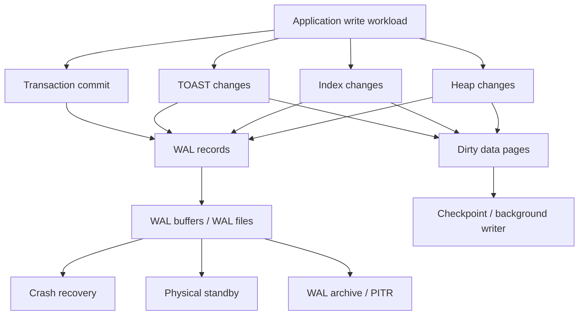

# Đo lượng WAL phát sinh theo khối lượng ghi trong PostgreSQL

Một dịch vụ nhận 20.000 đơn hàng mỗi phút, nhưng sau khi triển khai một thay đổi schema, dung lượng WAL tăng gấp đôi. Database vẫn trả lời truy vấn bình thường, song ổ đĩa WAL ghi nhiều hơn, replica lag tăng và archive storage tiêu thụ nhanh hơn. Làm thế nào xác định WAL tăng do số hàng ghi, do index, do UPDATE tạo tuple versions, hay do full-page images sau checkpoint?

Trong PostgreSQL, **khối lượng dữ liệu ứng dụng ghi** và **lượng Write-Ahead Log (WAL) phát sinh** có liên hệ với nhau, nhưng không bằng nhau. Một hàng INSERT 200 bytes không nhất thiết tạo đúng 200 bytes WAL. Một UPDATE nhỏ có thể tạo nhiều WAL records vì phải ghi heap tuple, index entries, TOAST data và full-page image khi cần. Ngược lại, nhiều thao tác ghi trong một transaction có thể được gom lại và chia sẻ chi phí commit.

Bài học thuộc chương **WAL và checkpoint**, tập trung vào đo lường và diễn giải lượng WAL theo workload ghi:

- Đọc `pg_stat_wal` và các bộ đếm WAL.
- Lấy hai mốc LSN và tính chênh lệch bằng `pg_wal_lsn_diff()`.
- Đo bytes/second, WAL/transaction và WAL/row.
- So sánh INSERT, UPDATE, DELETE, UPSERT, COPY, index và TOAST.
- Hiểu full-page images, checkpoint, `full_page_writes` và `wal_compression`.
- Xây dựng benchmark có thể lặp lại, kiểm soát concurrent workload và reset counters.
- Ước lượng WAL capacity, archive volume, replication bandwidth và tác động tới checkpoint.

> **Điểm cần nhớ:** WAL là log phục hồi và truyền thay đổi của database. Nó không phải bản sao byte-for-byte của payload ứng dụng, cũng không phải số byte dữ liệu bảng được ghi. Hãy đo cả WAL bytes và số lượng công việc ứng dụng trong cùng một khoảng thời gian.

## 1. WAL ghi lại điều gì?

PostgreSQL dùng Write-Ahead Logging để bảo đảm thay đổi dữ liệu có thể được phục hồi sau crash. Trước khi page dữ liệu được ghi xuống data files, các WAL records mô tả thay đổi cần thiết phải được ghi bền vững theo thứ tự thích hợp.

Ví dụ một transaction:

```sql
BEGIN;

INSERT INTO app.orders (customer_id, status, total_amount)
VALUES (42, 'new', 125000);

UPDATE app.inventory
SET available_qty = available_qty - 1
WHERE product_id = 9001;

COMMIT;
```

Các thao tác có thể tạo WAL cho:

- Heap tuple mới trong bảng `orders`.
- Tuple version mới và thông tin liên quan khi UPDATE `inventory`.
- Các index entries cần thêm hoặc thay đổi.
- TOAST chunks nếu có giá trị lớn được lưu ngoài heap.
- Transaction commit record.
- Full-page images (FPI) trong các điều kiện liên quan đến checkpoint và `full_page_writes`.
- Những metadata hoặc page changes khác do thao tác kéo theo.

Không phải mỗi SQL statement tương ứng đúng một WAL record. Một câu lệnh có thể phát sinh nhiều records; nhiều records có thể được gom vào WAL buffers và ghi theo nhóm.

### 1.1. WAL không giống data files

| Thành phần | Mục đích |
| --- | --- |
| Heap/main fork | Lưu các tuple versions của bảng |
| Index files | Lưu cấu trúc index và entries |
| WAL | Ghi lại các thay đổi cần thiết cho crash recovery/replication |
| Archive WAL | Lưu các WAL segments đã hoàn tất để phục hồi/PITR |
| Replication stream | Truyền WAL từ primary tới standby hoặc logical subscriber |

Một transaction có thể tạo WAL trước khi dirty data pages được flush xuống data files. Đây chính là lý do WAL có thể được dùng để redo những thay đổi chưa kịp ghi vào main relation files khi server gặp sự cố.

### 1.2. Một write workload tạo nhiều loại WAL



Sơ đồ cho thấy WAL và data pages có quan hệ nhưng là hai luồng ghi khác nhau. Không lấy kích thước dirty pages để suy ra WAL bytes một cách trực tiếp.

## 2. Ba cách đo lượng WAL

Có ba cách thường dùng, mỗi cách trả lời một câu hỏi hơi khác:

1. **`pg_stat_wal.wal_bytes`:** bộ đếm cumulative WAL bytes ở cấp cluster.
2. **LSN delta:** chênh lệch vị trí WAL giữa hai mốc thời gian.
3. **WAL files/archive:** dung lượng segment files đã được tạo/giữ lại hoặc archive.

Để đo WAL phát sinh trong một khoảng thời gian ngắn, `pg_stat_wal` và LSN delta là hai cách tiện dụng nhất. Để ước lượng dung lượng lưu trữ/archive, phải tính thêm segment lifecycle, retention và replication.

## 3. Đọc pg_stat_wal

Trên các phiên bản PostgreSQL có view `pg_stat_wal` (được giới thiệu từ PostgreSQL 14), truy vấn:

```sql
SELECT
    wal_records,
    wal_fpi,
    wal_bytes,
    wal_buffers_full,
    wal_write,
    wal_sync,
    wal_write_time,
    wal_sync_time,
    stats_reset
FROM pg_stat_wal;
```

Các cột quan trọng:

| Cột | Ý nghĩa |
| --- | --- |
| `wal_records` | Tổng số WAL records được tạo theo thống kê |
| `wal_fpi` | Số full-page images được tạo |
| `wal_bytes` | Tổng số bytes WAL được tạo |
| `wal_buffers_full` | Số lần WAL buffers đầy khiến backend phải tự thực hiện write WAL |
| `wal_write` | Số lần WAL được ghi |
| `wal_sync` | Số lần WAL được sync theo thống kê |
| `wal_write_time` | Thời gian ghi WAL nếu tracking WAL I/O timing được bật |
| `wal_sync_time` | Thời gian sync WAL nếu tracking WAL I/O timing được bật |
| `stats_reset` | Thời điểm thống kê WAL được reset |

Các bộ đếm là cumulative từ mốc reset statistics tương ứng. Một giá trị `wal_bytes` lớn không cho biết riêng workload vừa chạy tạo bao nhiêu WAL; cần lấy hai snapshots và tính delta.

### 3.1. Tính WAL bytes trong một khoảng thời gian

Giả sử lấy hai mẫu:

| Thời điểm | wal_bytes |
| --- | ---: |
| 10:00 | 1.000.000.000 |
| 10:05 | 1.450.000.000 |

WAL phát sinh trong khoảng:

\[
1,450,000,000 - 1,000,000,000
= 450,000,000 \text{ bytes}
\]

WAL rate trung bình:

\[
\frac{450,000,000}{300}
= 1,500,000 \text{ bytes/s}
\]

Tức khoảng 1,5 MB/s theo đơn vị thập phân.

### 3.2. Query chụp một snapshot

```sql
SELECT
    clock_timestamp() AS sampled_at,
    wal_records,
    wal_fpi,
    wal_bytes,
    wal_buffers_full,
    wal_write,
    wal_sync,
    wal_write_time,
    wal_sync_time,
    stats_reset
FROM pg_stat_wal;
```

Chạy query này hai lần cách nhau một khoảng đo, lưu kết quả bên ngoài hoặc trong monitoring system. Không cần reset counters để lấy delta.

### 3.3. Vì sao cần giữ stats_reset?

Nếu statistics bị reset giữa hai snapshots, phép trừ sẽ sai hoặc tạo delta âm. Luôn kiểm tra `stats_reset` ở cả hai mẫu.

Nếu `stats_reset` thay đổi, hãy bắt đầu một cửa sổ đo mới. Không lấy snapshot trước reset trừ snapshot sau reset.

### 3.4. pg_stat_wal là thống kê cấp cluster

`pg_stat_wal` không phân chia WAL bytes theo database, schema, table hay application. Nhiều databases trong cùng cluster cùng đóng góp vào bộ đếm này.

Nếu cluster có nhiều workload đồng thời, delta `wal_bytes` là tổng của toàn cluster. Muốn đo một workload cụ thể, cần chạy benchmark trong môi trường cô lập hoặc đối chiếu với thời gian/counters của workload và chấp nhận sai số do concurrent activity.

## 4. Lấy hai mốc LSN và tính delta

WAL được định danh bằng **Log Sequence Number (LSN)**. LSN biểu diễn vị trí trong WAL stream.

Các hàm thường dùng:

- `pg_current_wal_insert_lsn()`: vị trí WAL insertion hiện tại.
- `pg_current_wal_lsn()`: vị trí WAL write hiện tại.
- `pg_current_wal_flush_lsn()`: vị trí WAL đã flush.
- `pg_wal_lsn_diff(lsn1, lsn2)`: tính chênh lệch bytes giữa hai LSN.

### 4.1. Chụp mốc đầu và cuối

Tại đầu cửa sổ:

```sql
SELECT
    clock_timestamp() AS started_at,
    pg_current_wal_insert_lsn() AS start_lsn;
```

Chạy workload cần đo.

Tại cuối cửa sổ:

```sql
SELECT
    clock_timestamp() AS finished_at,
    pg_current_wal_insert_lsn() AS end_lsn;
```

Sau đó tính:

```sql
SELECT pg_wal_lsn_diff(
    '0/5000100'::pg_lsn,
    '0/4F00000'::pg_lsn
) AS wal_bytes;
```

Hai LSN literal trong ví dụ chỉ minh họa cú pháp. Khi đo thật, thay bằng các LSN đã ghi nhận ở đầu và cuối.

### 4.2. Dùng LSN diff trong một câu truy vấn

Có thể lấy hai mốc và tính ngay cho một khoảng được kiểm soát bằng cách dùng hai lần truy vấn riêng hoặc lưu mốc vào bảng lab. Một truy vấn duy nhất chạy ngay lập tức không tự tạo ra khoảng thời gian benchmark có ý nghĩa.

Ví dụ tính với hai giá trị đã lưu:

```sql
SELECT
    pg_wal_lsn_diff(end_lsn, start_lsn) AS generated_bytes
FROM measurement_samples
WHERE sample_id = 1;
```

Trong đó bảng `measurement_samples` là bảng do bạn tự tạo để lưu các cột `start_lsn` và `end_lsn` kiểu `pg_lsn`.

### 4.3. Nên dùng insert LSN, write LSN hay flush LSN?

| Mục tiêu | Mốc thường dùng |
| --- | --- |
| Đo WAL đã được insert vào WAL stream | `pg_current_wal_insert_lsn()` |
| Đo vị trí WAL đã được ghi bởi WAL writer | `pg_current_wal_lsn()` |
| Đo vị trí WAL đã được flush bền vững | `pg_current_wal_flush_lsn()` |

Để đo lượng WAL được tạo bởi workload, insert LSN là mốc phù hợp. Write/flush LSN trả lời các câu hỏi về tiến độ ghi và độ bền vững, không phải cùng một khái niệm.

### 4.4. LSN delta không phải per-table WAL

WAL stream của PostgreSQL là stream ở cấp cluster. LSN delta bao gồm mọi WAL records được tạo trong khoảng giữa hai mốc:

- Các sessions của database đang đo.
- Workload từ databases khác trong cùng cluster.
- Autovacuum, CREATE INDEX, DDL và các maintenance jobs.
- Checkpoint-related full-page images.
- Những hoạt động hệ thống khác tạo WAL.

Vì thế, nếu có workload đồng thời, LSN delta không phải số WAL chính xác của riêng một câu SQL hoặc một bảng.

### 4.5. Đo theo nhiều cửa sổ

Một lần đo có thể bị ảnh hưởng bởi checkpoint hoặc background workload. Hãy lặp lại cùng thí nghiệm nhiều lần:

```text
Run 1: 10:00–10:05 -> 420 MB
Run 2: 10:10–10:15 -> 438 MB
Run 3: 10:20–10:25 -> 427 MB

Mean = 428.3 MB / 5 min
```

Ghi cả thời điểm checkpoint, lượng rows, transaction count và trạng thái hệ thống để giải thích khác biệt.

## 5. Đo delta pg_stat_wal bằng SQL

Có thể dùng bảng tạm trong session lab để lưu snapshot đầu/cuối.

### 5.1. Tạo bảng tạm lưu mẫu

```sql
CREATE TEMP TABLE wal_sample (
    sample_name text PRIMARY KEY,
    sampled_at timestamptz NOT NULL,
    wal_records bigint NOT NULL,
    wal_fpi bigint NOT NULL,
    wal_bytes numeric NOT NULL,
    wal_buffers_full bigint NOT NULL,
    wal_write bigint NOT NULL,
    wal_sync bigint NOT NULL,
    stats_reset timestamptz
);
```

### 5.2. Lưu snapshot bắt đầu

```sql
INSERT INTO wal_sample
SELECT
    'start',
    clock_timestamp(),
    wal_records,
    wal_fpi,
    wal_bytes,
    wal_buffers_full,
    wal_write,
    wal_sync,
    stats_reset
FROM pg_stat_wal;
```

### 5.3. Chạy workload

Chạy đúng batch cần đo, không trộn các thao tác setup/cleanup vào cửa sổ nếu mục tiêu là đo riêng batch chính.

### 5.4. Lưu snapshot kết thúc

```sql
INSERT INTO wal_sample
SELECT
    'end',
    clock_timestamp(),
    wal_records,
    wal_fpi,
    wal_bytes,
    wal_buffers_full,
    wal_write,
    wal_sync,
    stats_reset
FROM pg_stat_wal;
```

### 5.5. Tính chênh lệch và tốc độ

```sql
WITH samples AS (
    SELECT
        MAX(sampled_at) FILTER (WHERE sample_name = 'start') AS started_at,
        MAX(sampled_at) FILTER (WHERE sample_name = 'end') AS finished_at,
        MAX(wal_bytes) FILTER (WHERE sample_name = 'start') AS start_bytes,
        MAX(wal_bytes) FILTER (WHERE sample_name = 'end') AS end_bytes,
        MAX(wal_records) FILTER (WHERE sample_name = 'start') AS start_records,
        MAX(wal_records) FILTER (WHERE sample_name = 'end') AS end_records,
        MAX(wal_fpi) FILTER (WHERE sample_name = 'start') AS start_fpi,
        MAX(wal_fpi) FILTER (WHERE sample_name = 'end') AS end_fpi,
        MAX(stats_reset) FILTER (WHERE sample_name = 'start') AS start_reset,
        MAX(stats_reset) FILTER (WHERE sample_name = 'end') AS end_reset
    FROM wal_sample
)
SELECT
    started_at,
    finished_at,
    EXTRACT(EPOCH FROM finished_at - started_at) AS elapsed_seconds,
    end_bytes - start_bytes AS wal_bytes,
    end_records - start_records AS wal_records,
    end_fpi - start_fpi AS wal_fpi,
    CASE
        WHEN finished_at > started_at
        THEN (end_bytes - start_bytes)
             / EXTRACT(EPOCH FROM finished_at - started_at)
    END AS wal_bytes_per_second,
    start_reset,
    end_reset,
    start_reset = end_reset AS same_stats_epoch
FROM samples;
```

Nếu `same_stats_epoch` là false, bỏ phép tính delta và lấy lại hai snapshots trong cùng một statistics epoch. Query giả định đã có đúng hai dòng `start` và `end`.

### 5.6. Xóa dữ liệu lab để đo lại

Bảng là TEMP nên biến mất khi session kết thúc. Trong cùng session có thể:

```sql
TRUNCATE wal_sample;

-- Lưu lại sample start, chạy workload, rồi lưu sample end.
```

Không cần reset thống kê WAL toàn cluster.

## 6. Tính WAL rate và các đơn vị

Các dashboard thường dùng MB/s hoặc GB/hour. Hãy xác định rõ đơn vị:

- 1 kB = 1.000 bytes.
- 1 MB = 1.000.000 bytes.
- 1 GB = 1.000.000.000 bytes.
- 1 KiB = 1.024 bytes.
- 1 MiB = 1.048.576 bytes.
- 1 GiB = 1.073.741.824 bytes.

### 6.1. WAL bytes per second

\[
\text{WAL bytes/s}
=
\frac{\Delta \text{wal\_bytes}}{\Delta t \text{ seconds}}
\]

### 6.2. WAL MB/s

\[
\text{WAL MB/s}
=
\frac{\Delta \text{wal\_bytes}}{\Delta t \times 1,000,000}
\]

### 6.3. WAL GB per hour

\[
\text{WAL GB/hour}
=
\frac{\Delta \text{wal\_bytes}}{\Delta t}
\times
\frac{3,600}{1,000,000,000}
\]

### 6.4. Ví dụ

Giả sử 15 phút tạo 9 GB WAL:

\[
9 / 900 = 0.01 \text{ GB/s}
\]

Tương đương khoảng 10 MB/s và:

\[
10 \times 3,600 = 36,000 \text{ MB/hour}
\]

tức khoảng 36 GB/hour theo đơn vị thập phân.

Đây là tốc độ trung bình. Peak rate có thể cao hơn nhiều trong một batch hoặc checkpoint.

## 7. Đo WAL theo transaction và theo hàng

WAL rate cho biết tổng bytes theo thời gian. Để so sánh các loại workload, cần thêm các tỷ lệ chuẩn hóa:

- WAL bytes / transaction.
- WAL bytes / row inserted.
- WAL bytes / row updated.
- WAL bytes / row deleted.
- WAL bytes / logical payload byte.
- WAL bytes / business operation.

### 7.1. WAL per transaction

\[
\text{WAL/transaction}
=
\frac{\Delta \text{WAL bytes}}
{\Delta \text{committed transactions}}
\]

Cần xác định mẫu số có bao gồm transaction rollback hay không. WAL được tạo bởi một transaction sau đó rollback không biến mất khỏi WAL stream; vì thế so sánh với số committed transactions đơn thuần có thể làm ratio cao hơn khi có nhiều rollback.

### 7.2. WAL per inserted row

\[
\text{WAL/inserted row}
=
\frac{\Delta \text{WAL bytes}}
{\Delta \text{inserted rows}}
\]

Đây là ratio thực nghiệm cho một workload và cấu hình cụ thể, không phải hằng số PostgreSQL.

### 7.3. WAL trên payload byte

Nếu application ghi tổng cộng 500 MB payload và tạo 1.2 GB WAL:

\[
1.2 / 0.5 = 2.4
\]

Tức workload tạo khoảng 2,4 bytes WAL trên mỗi payload byte trong phép đo đó.

Tỷ lệ này có thể lớn hơn 1 do tuple headers, indexes, WAL record headers, page images, TOAST, transaction records và các metadata khác. Nó có thể thay đổi đáng kể khi schema/indexes/workload/checkpoint thay đổi.

### 7.4. Đếm số rows bằng pg_stat_database

```sql
SELECT
    datname,
    tup_inserted,
    tup_updated,
    tup_deleted,
    xact_commit,
    xact_rollback,
    stats_reset
FROM pg_stat_database
WHERE datname = current_database();
```

Các counters này là thống kê ở cấp database, trong khi `pg_stat_wal.wal_bytes` là cấp cluster. Dùng delta của chúng để ước lượng workload trong cùng cửa sổ, nhưng nhớ rằng:

- Database stats có thể reset độc lập.
- WAL bytes có thể bao gồm hoạt động từ database khác.
- Tuple counters không cho biết byte size của mỗi row.
- Autovacuum/maintenance có thể làm thay đổi WAL mà không tương ứng trực tiếp với số rows ứng dụng insert/update/delete.

### 7.5. Không chia WAL cluster-wide cho rows của một database rồi gọi là ratio per-row

Nếu cùng cluster có hai databases:

```text
appdb:       100,000 rows updated
analyticsdb:  50,000 rows inserted
system:      autovacuum + catalog changes
```

và WAL toàn cluster tăng 300 MB, không thể chia 300 MB cho 100.000 rows của `appdb` rồi kết luận WAL/row của appdb là 3 KB.

Để tính ratio đáng tin cậy, cô lập workload hoặc dùng một cluster riêng cho benchmark.

## 8. Vì sao cùng số rows nhưng WAL bytes khác nhau?

WAL phụ thuộc vào nhiều yếu tố ngoài số hàng:

1. Kích thước tuple và kiểu dữ liệu.
2. Số lượng indexes và các index keys thay đổi.
3. UPDATE có tạo tuple version mới không.
4. HOT update có áp dụng được không.
5. TOAST có phát sinh không.
6. Full-page images có được tạo không.
7. Checkpoint timing và `full_page_writes`.
8. `wal_compression` và `wal_level`.
9. DDL, catalog updates và maintenance.
10. Transaction boundaries và commit frequency.
11. Concurrent workloads trong cùng cluster.

### 8.1. Tuple width

Một bảng có 20 cột text/JSONB có thể tạo WAL khác bảng chỉ có hai cột integer, dù cùng số rows.

### 8.2. Index count

INSERT vào bảng có 5 indexes thường tạo thêm WAL cho index pages so với bảng chỉ có primary key. UPDATE cột index key có thể làm thay đổi index entries, trong khi HOT update có thể tránh một số index writes nếu đủ điều kiện.

### 8.3. UPDATE không phải chỉ ghi phần cột thay đổi

PostgreSQL MVCC thường tạo tuple version mới. Dù ứng dụng chỉ đổi một cột nhỏ, thao tác có thể tạo heap tuple version và WAL cho các page liên quan. Nếu cột thay đổi nằm trong index, index maintenance có thể phát sinh thêm WAL.

### 8.4. TOAST

Giá trị text/JSONB/bytea lớn có thể được nén hoặc lưu trong TOAST relation. WAL có thể được tạo cho cả heap tuple và TOAST chunks/index. Đừng đo chỉ kích thước row logic rồi suy ra WAL.

## 9. Full-page images và ảnh hưởng của checkpoint

Một nguồn làm WAL tăng mạnh là **full-page images (FPI)**.

Khi `full_page_writes` bật, lần đầu tiên một page được sửa sau checkpoint có thể tạo full-page image trong WAL để bảo vệ khỏi torn page sau crash. Đây là lý do một workload update ít dữ liệu vẫn có thể tạo nhiều WAL sau checkpoint.

### 9.1. FPI là gì?

FPI là ảnh chụp page đầy đủ được ghi vào WAL trong các trường hợp cần thiết. Nó giúp recovery tái tạo page nguyên vẹn nếu crash xảy ra giữa lúc page được ghi xuống storage.

### 9.2. Vì sao sau checkpoint WAL/row có thể tăng?

Giả sử một bảng có 1 triệu heap pages. Sau checkpoint, workload chạm vào 100.000 pages lần đầu. Các page modifications đầu tiên có thể tạo FPI. Những thay đổi tiếp theo trên cùng page trong cùng chu kỳ checkpoint có thể không cần FPI lặp lại theo cùng điều kiện.

Do đó, cùng 10.000 UPDATE có thể tạo lượng WAL khác nhau tùy số pages bị chạm và checkpoint timing.

### 9.3. Đo số FPI

```sql
SELECT
    wal_records,
    wal_fpi,
    wal_bytes,
    CASE
        WHEN wal_records > 0
        THEN wal_fpi::numeric / wal_records
    END AS fpi_per_record,
    stats_reset
FROM pg_stat_wal;
```

`wal_fpi` là số lượng FPI, không phải bytes FPI. Không nhân trực tiếp `wal_fpi` với block size rồi coi đó là tổng FPI bytes chính xác; compression, record headers và các chi tiết format làm kích thước thực tế khác nhau.

### 9.4. full_page_writes

```sql
SHOW full_page_writes;
SHOW wal_compression;
SHOW checkpoint_timeout;
SHOW max_wal_size;
SHOW checkpoint_completion_target;
```

- `full_page_writes`: kiểm soát việc ghi full-page images theo cơ chế WAL.
- `wal_compression`: có thể nén FPI khi được bật và hỗ trợ.
- `checkpoint_timeout`: khoảng thời gian tối đa giữa các checkpoints theo cấu hình.
- `max_wal_size`: ngưỡng WAL gợi ý để checkpoint được kích hoạt sớm hơn, không phải giới hạn cứng kích thước WAL.
- `checkpoint_completion_target`: mục tiêu trải checkpoint trong khoảng thời gian cho phép.

Không tắt `full_page_writes` để giảm WAL nếu chưa hiểu rủi ro corruption sau crash. Đây là tham số bảo vệ độ tin cậy của dữ liệu.

### 9.5. Tách checkpoint effect khỏi write workload

Để so sánh WAL/row giữa hai phiên bản ứng dụng:

- Giữ checkpoint settings giống nhau.
- Chạy các cửa sổ đo tương tự về thời điểm checkpoint.
- Ghi lại `wal_fpi` delta.
- Lặp lại nhiều lần.
- Không ép checkpoint giữa một phép đo và phép đo khác trừ khi đó là một phần có chủ đích của thí nghiệm.

Nếu FPI chiếm phần lớn WAL delta, kết luận “ứng dụng tạo WAL gấp đôi vì tuple size tăng gấp đôi” có thể sai.

## 10. Checkpoint và WAL generation là hai khái niệm khác nhau

Checkpoint là quá trình đồng bộ dirty pages và ghi checkpoint record để rút ngắn recovery. WAL generation là việc tạo WAL records khi các thao tác thay đổi dữ liệu.

Checkpoint có thể làm thay đổi **tỷ lệ WAL/row** thông qua FPI, nhưng checkpoint không phải bộ đếm WAL generation.

### 10.1. Checkpoint statistics

Trên các phiên bản mới, một số thống kê checkpoint nằm trong view `pg_stat_checkpointer`; các phiên bản cũ có thể hiển thị các counters checkpoint trong `pg_stat_bgwriter`.

Vì schema thay đổi theo major version, kiểm tra trước:

```sql
SELECT
    to_regclass('pg_catalog.pg_stat_checkpointer') AS checkpointer_view,
    to_regclass('pg_catalog.pg_stat_bgwriter') AS bgwriter_view;
```

Nếu `pg_stat_checkpointer` tồn tại:

```sql
SELECT *
FROM pg_stat_checkpointer;
```

Nếu đang dùng phiên bản mà checkpoint counters nằm trong `pg_stat_bgwriter`:

```sql
SELECT *
FROM pg_stat_bgwriter;
```

Không copy query của major version khác mà giả định mọi cột luôn tồn tại.

### 10.2. WAL generated vs WAL retained

- WAL generated: lượng WAL mới được tạo.
- WAL written/flushed: tiến độ WAL được ghi/flush.
- WAL retained: các segments còn được giữ bởi checkpoint/recovery/replication/archive policy.

Ba con số có thể khác nhau. Một cluster có thể tạo 20 GB WAL trong một giờ nhưng chỉ giữ một lượng segment khác tùy checkpoint, replication slots, archive và retention.

## 11. Thí nghiệm lab: đo WAL của INSERT

Chạy trên database lab có quyền tạo schema/table. Không dùng bảng production.

### 11.1. Tạo bảng không có secondary index

```sql
CREATE SCHEMA IF NOT EXISTS wal_lab;

DROP TABLE IF EXISTS wal_lab.insert_plain;

CREATE TABLE wal_lab.insert_plain (
    id bigint GENERATED ALWAYS AS IDENTITY PRIMARY KEY,
    tenant_id integer NOT NULL,
    status text NOT NULL,
    amount numeric(12, 2) NOT NULL,
    created_at timestamptz NOT NULL
);
```

Primary key tự tạo một index. “Không có secondary index” nghĩa là chỉ có index phục vụ primary key.

### 11.2. Chụp snapshot WAL trước workload

```sql
SELECT
    clock_timestamp(),
    wal_records,
    wal_fpi,
    wal_bytes,
    stats_reset
FROM pg_stat_wal;
```

Lưu lại kết quả.

### 11.3. Insert 100.000 rows

```sql
INSERT INTO wal_lab.insert_plain (
    tenant_id, status, amount, created_at
)
SELECT
    (g % 1000) + 1,
    CASE WHEN g % 4 = 0 THEN 'pending' ELSE 'paid' END,
    (g % 100000)::numeric / 100,
    TIMESTAMPTZ '2026-01-01 00:00:00+00'
        + (g % 365) * INTERVAL '1 day'
FROM generate_series(1, 100000) AS s(g);
```

### 11.4. Chụp snapshot sau workload

```sql
SELECT
    clock_timestamp(),
    wal_records,
    wal_fpi,
    wal_bytes,
    stats_reset
FROM pg_stat_wal;
```

Tính delta `wal_bytes` và chia cho 100.000 để có WAL bytes/inserted row ước lượng cho thí nghiệm.

### 11.5. Vì sao cần commit trước snapshot cuối?

Trong autocommit, câu INSERT đã commit trước khi trả kết quả. Nếu dùng transaction tường minh, chụp snapshot cuối sau COMMIT để bao gồm commit record và mọi WAL đã được tạo bởi transaction đó.

WAL insertion có thể xảy ra trước COMMIT, nhưng commit record chỉ được tạo khi transaction commit. Đừng trộn hai định nghĩa khi so sánh các batch.

## 12. So sánh INSERT với và không có index

Tạo bảng thứ hai có thêm indexes:

```sql
DROP TABLE IF EXISTS wal_lab.insert_indexed;

CREATE TABLE wal_lab.insert_indexed (
    id bigint GENERATED ALWAYS AS IDENTITY PRIMARY KEY,
    tenant_id integer NOT NULL,
    status text NOT NULL,
    amount numeric(12, 2) NOT NULL,
    created_at timestamptz NOT NULL
);

CREATE INDEX idx_insert_indexed_tenant
ON wal_lab.insert_indexed (tenant_id);

CREATE INDEX idx_insert_indexed_status_time
ON wal_lab.insert_indexed (status, created_at DESC);
```

Chụp snapshot WAL, insert cùng dataset, rồi chụp snapshot cuối.

So sánh:

| Đặc điểm | insert_plain | insert_indexed |
| --- | --- | --- |
| Heap rows | Cùng số lượng | Cùng số lượng |
| Primary key index | Có | Có |
| Secondary indexes | Không | Có hai |
| WAL bytes | Đo thực tế | Đo thực tế |
| WAL/row | Delta / rows | Delta / rows |

Không cần kỳ vọng một tỷ lệ cố định. B-tree splits, page layout, FPI và cache state có thể làm WAL khác giữa các lần chạy.

### 12.1. Index có thể tăng WAL nhiều hơn dự đoán

Mỗi row mới có thể tạo entries trong từng index. Khi B-tree page split xảy ra, nhiều pages có thể bị sửa và tạo WAL. Một index có nhiều columns/payload cũng có thể làm index size và WAL lớn hơn.

### 12.2. Index có thể giúp giảm write amplification ở workload khác

Một index có thể giảm lượng rows phải đọc/update trong một số thao tác, nhưng nó luôn có chi phí maintenance khi dữ liệu liên quan thay đổi. Đo cả read benefit và WAL cost trước khi thêm index.

## 13. Thí nghiệm UPDATE: HOT và non-HOT

UPDATE có thể tạo WAL khác INSERT vì nó thay đổi tuple versions và có thể phải cập nhật indexes.

### 13.1. Tạo bảng update lab

```sql
DROP TABLE IF EXISTS wal_lab.update_lab;

CREATE TABLE wal_lab.update_lab (
    id bigint GENERATED ALWAYS AS IDENTITY PRIMARY KEY,
    status text NOT NULL,
    note text NOT NULL,
    updated_at timestamptz NOT NULL DEFAULT clock_timestamp()
) WITH (fillfactor = 80);

INSERT INTO wal_lab.update_lab (status, note)
SELECT 'pending', repeat('x', 40)
FROM generate_series(1, 100000);

CREATE INDEX idx_update_lab_status
ON wal_lab.update_lab (status);

ANALYZE wal_lab.update_lab;
```

### 13.2. UPDATE cột không nằm trong index

```sql
UPDATE wal_lab.update_lab
SET note = repeat('y', 40),
    updated_at = clock_timestamp()
WHERE id BETWEEN 1 AND 10000;
```

`note` và `updated_at` không nằm trong index `idx_update_lab_status`. Nếu đủ chỗ trên page và các điều kiện HOT khác được thỏa mãn, một phần updates có thể là HOT.

### 13.3. UPDATE cột được index

```sql
UPDATE wal_lab.update_lab
SET status = 'paid'
WHERE id BETWEEN 10001 AND 20000;
```

Thay đổi `status` tác động index key, nên không thể dùng HOT theo index đó trong trường hợp thông thường.

### 13.4. So sánh HOT statistics

```sql
SELECT
    relname,
    n_tup_upd,
    n_tup_hot_upd,
    n_dead_tup
FROM pg_stat_user_tables
WHERE schemaname = 'wal_lab'
  AND relname = 'update_lab';
```

Đây là counters/estimates của relation. Để so WAL cho từng batch, cần snapshot `pg_stat_wal` trước/sau từng câu UPDATE trong cửa sổ đo riêng.

### 13.5. Vì sao HOT có thể giảm WAL?

HOT tránh một số index entry changes khi update phù hợp. Tuy vậy, heap tuple version mới vẫn cần WAL. Vì thế HOT không làm UPDATE “không tạo WAL”; nó có thể giảm phần WAL liên quan index.

## 14. DELETE và cleanup WAL

DELETE đánh dấu tuple version bị xóa trong heap. Nó cũng có thể phát sinh WAL cho page changes và các index/metadata liên quan theo quá trình xử lý.

### 14.1. Đo DELETE

```sql
DELETE FROM wal_lab.insert_plain
WHERE id BETWEEN 1 AND 10000;
```

Chụp `pg_stat_wal` trước/sau để tính WAL delta.

### 14.2. VACUUM cũng có thể tạo WAL

Sau DELETE:

```sql
VACUUM (VERBOSE) wal_lab.insert_plain;
```

VACUUM có thể tạo WAL khi cập nhật heap/index pages và metadata. Vì vậy nếu đo workload DELETE cùng một khoảng thời gian có VACUUM, delta WAL bao gồm cả hai công việc.

Muốn đo riêng DELETE, tách cửa sổ đo DELETE và cửa sổ đo VACUUM.

### 14.3. DELETE hàng triệu rows không giống DROP/TRUNCATE

DELETE xử lý tuple-level changes và có thể tạo lượng WAL lớn theo số rows/pages/indexes. `TRUNCATE` là DDL có semantics khác, thay đổi storage relation và WAL profile khác. Không so sánh hai thao tác như thể chúng cùng thực hiện một công việc nghiệp vụ.

## 15. UPSERT và ON CONFLICT

```sql
INSERT INTO wal_lab.upsert_lab (id, status, amount)
VALUES (100, 'paid', 250)
ON CONFLICT (id)
DO UPDATE SET
    status = EXCLUDED.status,
    amount = EXCLUDED.amount;
```

UPSERT có thể đi theo hai nhánh:

- Không conflict: INSERT.
- Có conflict: UPDATE row hiện có.

Hai nhánh có WAL khác nhau. Nếu `DO UPDATE` không thực sự đổi giá trị, PostgreSQL vẫn có thể thực hiện một UPDATE path theo semantics của statement; không giả định conflict path miễn phí.

Khi benchmark UPSERT, đo tỷ lệ conflict thực tế và số rows insert/update riêng nếu ứng dụng có thể cung cấp.

## 16. COPY và batch insert

```sql
COPY wal_lab.copy_target (tenant_id, status, amount)
FROM STDIN WITH (FORMAT csv);
```

Câu lệnh trên cần client cung cấp stream dữ liệu; đây là cú pháp minh họa cho `COPY FROM STDIN`, không thể chạy độc lập trong mọi SQL editor.

`COPY` thường hiệu quả hơn nhiều câu INSERT đơn lẻ vì giảm overhead giao thức/parse/command, nhưng lượng WAL vẫn phụ thuộc table/index/schema và WAL settings.

So sánh công bằng:

- Cùng dataset.
- Cùng table schema/indexes.
- Cùng transaction boundaries.
- Cùng checkpoint/full-page-write conditions.
- Cùng `wal_level`, `wal_compression`.
- Nhiều lần chạy và lấy median/percentiles.

Batching có thể giảm số commit records và flush operations so với hàng nghìn transactions nhỏ. Nó không nhất thiết giảm WAL bytes/row theo cùng tỷ lệ.

## 17. Transaction size và commit frequency

Một workload có 100.000 inserts có thể chạy theo:

- 100.000 transactions, mỗi transaction một row.
- 1.000 transactions, mỗi transaction 100 rows.
- 1 transaction, 100.000 rows.

Heap/index WAL cho dữ liệu vẫn chiếm phần lớn, nhưng commit records, sync frequency và scheduling khác nhau.

### 17.1. WAL bytes không phải latency

Nhiều transactions nhỏ có thể có `wal_bytes` gần nhau nhưng tốn nhiều `wal_sync` hơn. Ngược lại, một transaction lớn có thể tạo WAL burst lớn và giữ transaction lâu.

Đo cùng lúc:

- `wal_bytes`.
- `wal_records`.
- `wal_write`, `wal_sync`.
- Commit/rollback counts.
- Transaction latency.
- Application batch size.

### 17.2. Synchronous commit

```sql
SHOW synchronous_commit;
```

`synchronous_commit` ảnh hưởng khi transaction commit có phải đợi WAL flush theo policy hay không. Nó có thể thay đổi durability/latency trade-off, nhưng không nên xem nó là nút giảm WAL volume theo tỷ lệ tương ứng.

Tắt synchronous commit có thể làm client nhận xác nhận trước khi WAL được flush; trong crash có thể mất những transactions vừa được xác nhận. Chỉ điều chỉnh khi business chấp nhận semantics đó.

## 18. WAL compression và wal_level

Một số cấu hình thay đổi lượng WAL hoặc kích thước FPI:

### 18.1. wal_compression

```sql
SHOW wal_compression;
```

Khi bật và được hỗ trợ, PostgreSQL có thể nén full-page images trong WAL. Điều này có thể giảm WAL bytes nhưng tiêu tốn CPU và hiệu quả tùy page contents/compression method.

Đừng kỳ vọng nó nén toàn bộ WAL records hay mọi heap tuple payload theo cùng cách.

### 18.2. wal_level

```sql
SHOW wal_level;
```

Các mức thường gặp gồm `minimal`, `replica` và `logical` tùy version. WAL level ảnh hưởng lượng thông tin WAL cần cho replication/decoding. `logical` có thể cần thêm thông tin để logical decoding; do đó WAL volume có thể khác.

Không hạ `wal_level` nếu cluster cần physical/logical replication hoặc logical decoding. Thay đổi có thể yêu cầu restart và ảnh hưởng tính năng.

### 18.3. full_page_writes và wal_log_hints

```sql
SHOW full_page_writes;
SHOW wal_log_hints;
```

Các thiết lập này liên quan tới bảo vệ page và một số hoạt động recovery/replication. Không thay đổi chúng chỉ để làm đẹp chỉ số WAL/row.

## 19. WAL segments và dung lượng lưu trữ

WAL được lưu thành các segment files trong `pg_wal`. Kích thước segment được chọn khi initdb và thường là 16 MiB, nhưng có thể khác.

### 19.1. WAL generated không bằng số file hiện có

Nếu `pg_wal` đang chứa 2 GB, không có nghĩa cluster chỉ tạo 2 GB WAL trong suốt vòng đời. Segments cũ có thể đã được recycle hoặc xóa khi không còn cần thiết.

Ngược lại, `pg_wal` có thể giữ nhiều segments do:

- Checkpoint chưa tiến triển.
- Replication slot giữ WAL.
- Archive command thất bại hoặc archive chậm.
- Standby chưa nhận WAL.
- Backup/recovery requirements.
- `wal_keep_size` và các retention settings.

### 19.2. Kiểm tra segment size

```sql
SHOW wal_segment_size;
```

GUC này có thể không tồn tại trên các version cũ. Nếu không có, tra initdb/build configuration và tài liệu đúng phiên bản.

### 19.3. Đếm file WAL không đo được generation rate

Một snapshot file count trong `pg_wal` chỉ cho biết số files hiện tại, không phải số WAL bytes mới tạo trong một giờ.

Để đo generation rate, dùng delta `pg_stat_wal.wal_bytes` hoặc LSN delta. Để đo storage pressure, theo dõi `pg_wal` disk usage, archive backlog và replication slots.

## 20. WAL, archive và replication bandwidth

Nếu primary tạo 5 MB/s WAL liên tục:

\[
5 \times 3,600 = 18,000 \text{ MB/hour}
\]

Tức khoảng 18 GB WAL mỗi giờ, chưa tính khác biệt giữa raw WAL generation và archive compression/retention.

Nếu archive upload chậm hơn generation, backlog có thể tăng. Nếu standby nhận WAL chậm hơn primary tạo, replication lag tăng.

### 20.1. Physical replication

Physical standby nhận WAL stream để áp dụng changes. Primary WAL generation rate là một đầu vào quan trọng để sizing network và standby apply capacity.

### 20.2. Logical replication

Logical decoding/replication có thể cần thêm WAL information theo `wal_level=logical`. Logical subscriber cũng phải xử lý changes ở tốc độ đủ nhanh; WAL generation rate không trực tiếp bằng logical apply throughput.

### 20.3. Replication slot có thể giữ WAL

Một replication slot chậm hoặc không active có thể giữ WAL segments để subscriber không mất dữ liệu cần đọc. Khi slot lag, disk usage có thể tăng ngay cả khi WAL generation rate không tăng.

Kiểm tra:

```sql
SELECT
    slot_name,
    slot_type,
    active,
    restart_lsn,
    confirmed_flush_lsn,
    pg_size_pretty(
        pg_wal_lsn_diff(pg_current_wal_lsn(), restart_lsn)::bigint
    ) AS retained_wal_estimate
FROM pg_replication_slots
WHERE restart_lsn IS NOT NULL;
```

Lưu ý: `pg_wal_lsn_diff` trả numeric bytes; ép sang bigint chỉ phù hợp khi giá trị nằm trong phạm vi bigint. Trên version có cột slot khác nhau, điều chỉnh query theo schema. Retained WAL estimate là khoảng cách LSN, không phải số bytes file thực tế đang giữ tuyệt đối.

## 21. Đo WAL của một database khi cluster có nhiều databases

`pg_stat_wal` và LSN là cluster-wide. `pg_stat_database` có tuple counters theo database nhưng không có cột WAL bytes chuẩn để phân bổ chính xác WAL cho từng database/table.

Có ba hướng:

1. **Benchmark cluster cô lập:** chỉ workload mục tiêu chạy trong cửa sổ đo.
2. **Dedicated cluster/database environment:** tạo test cluster riêng cho workload.
3. **Ước lượng theo correlation:** dùng per-database tuple counters, logs và workload schedule cùng WAL cluster delta, nhưng báo rõ sai số.

Không có phép chia đơn giản từ `pg_stat_wal.wal_bytes` thành WAL bytes chính xác cho từng relation.

### 21.1. Kiểm tra workload theo database

```sql
SELECT
    datname,
    xact_commit,
    xact_rollback,
    tup_inserted,
    tup_updated,
    tup_deleted,
    stats_reset
FROM pg_stat_database
ORDER BY datname;
```

Dùng các delta counters để biết database nào hoạt động nhiều hơn. Đây là proxy về hoạt động tuples, không phải WAL attribution.

### 21.2. Application metrics

Ứng dụng có thể ghi:

- Số business operations.
- Rows inserted/updated/deleted.
- Batch size.
- Transaction commits/rollbacks.
- Payload bytes.
- Operation type.
- Duration và trace ID.

Đối chiếu những metrics này với WAL delta giúp giải thích thay đổi, nhưng WAL vẫn là số liệu cluster-wide.

## 22. Một benchmark có thể lặp lại

Một benchmark tốt nên kiểm soát các biến sau:

| Biến | Cách kiểm soát |
| --- | --- |
| Dataset | Cùng số rows và phân bố dữ liệu |
| Schema | Cùng kiểu cột, constraints, TOAST behavior |
| Indexes | Ghi rõ số lượng và loại index |
| Transaction | Cùng batch size/commit frequency |
| Checkpoint | Ghi checkpoint settings và timing |
| WAL config | Cùng wal_level, full_page_writes, wal_compression |
| Concurrent load | Tắt workload ngoài hoặc đo baseline |
| Autovacuum | Ghi lại vacuum/analyze diễn ra trong window |
| Cache | Nêu trạng thái warm/cold nếu có ảnh hưởng |
| Runs | Lặp lại nhiều lần và báo mean/median/range |

### 22.1. Không reset stats giữa benchmark nếu không cần

Thường chỉ cần snapshot counters trước/sau. Reset global WAL stats có thể ảnh hưởng monitoring/dashboard của toàn cluster và cần quyền cao.

Nếu lab riêng muốn reset:

```sql
SELECT pg_stat_reset_shared('wal');
```

Hàm này reset WAL statistics dùng chung của cluster. **Không chạy trên production chỉ để đo một batch.** Thay vào đó lưu hai snapshots và tính delta.

### 22.2. Có thể dùng một baseline window

Trước khi chạy workload, đo WAL trong 60 giây khi hệ thống idle tương đối:

\[
W_{\text{baseline}} =
\frac{\Delta WAL_{\text{idle}}}{\Delta t}
\]

Sau đó đo workload window. Nếu concurrent system activity vẫn tồn tại, một ước lượng:

\[
W_{\text{workload estimate}}
\approx
W_{\text{observed}} - W_{\text{baseline}}
\]

Chỉ là ước lượng nếu baseline ổn định. Không trừ baseline khi background activity thay đổi mạnh giữa hai cửa sổ.

## 23. Xây một bảng kết quả benchmark

Một bảng mẫu:

| Workload | Rows | Transactions | WAL bytes | WAL/row | WAL/transaction |
| --- | ---: | ---: | ---: | ---: | ---: |
| INSERT, PK only | 100.000 | 1 | đo thực tế | tính delta/rows | tính delta/tx |
| INSERT, 2 secondary indexes | 100.000 | 1 | đo thực tế | tính delta/rows | tính delta/tx |
| UPDATE non-indexed column | 10.000 | 1 | đo thực tế | tính delta/rows | tính delta/tx |
| UPDATE indexed column | 10.000 | 1 | đo thực tế | tính delta/rows | tính delta/tx |
| DELETE | 10.000 | 1 | đo thực tế | tính delta/rows | tính delta/tx |
| COPY | 100.000 | 1 | đo thực tế | tính delta/rows | tính delta/tx |

Không điền con số giả định cho mọi môi trường. Hãy chạy benchmark với version, schema, hardware và WAL configuration thực tế của bạn.

### 23.1. Ghi rõ workload metadata

Mỗi run nên ghi:

```text
postgres_version
wal_level
full_page_writes
wal_compression
wal_segment_size
checkpoint_timeout
max_wal_size
table_schema
index_definition
row_count
transaction_count
start_time
end_time
start_lsn
end_lsn
start_wal_bytes
end_wal_bytes
wal_fpi_delta
concurrent_activity
```

Khi so sánh qua nhiều ngày, những metadata này giúp phân biệt thay đổi do code với thay đổi do cấu hình/điều kiện vận hành.

## 24. Ví dụ đo WAL với script SQL hoàn chỉnh

Ví dụ dưới đây tạo một bảng tạm lưu snapshots và một bảng lab. Nó dùng `pg_stat_wal`, vì vậy cần PostgreSQL version có view này.

### 24.1. Setup

```sql
CREATE SCHEMA IF NOT EXISTS wal_lab;

DROP TABLE IF EXISTS wal_lab.measure_orders;

CREATE TABLE wal_lab.measure_orders (
    id bigint GENERATED ALWAYS AS IDENTITY PRIMARY KEY,
    tenant_id integer NOT NULL,
    status text NOT NULL,
    amount numeric(12, 2) NOT NULL,
    created_at timestamptz NOT NULL
);

CREATE TEMP TABLE wal_measurement (
    phase text PRIMARY KEY,
    measured_at timestamptz NOT NULL,
    wal_bytes numeric NOT NULL,
    wal_records bigint NOT NULL,
    wal_fpi bigint NOT NULL,
    stats_reset timestamptz
);
```

### 24.2. Snapshot trước

```sql
INSERT INTO wal_measurement
SELECT
    'before',
    clock_timestamp(),
    wal_bytes,
    wal_records,
    wal_fpi,
    stats_reset
FROM pg_stat_wal;
```

### 24.3. Workload

```sql
INSERT INTO wal_lab.measure_orders (
    tenant_id, status, amount, created_at
)
SELECT
    (g % 500) + 1,
    CASE WHEN g % 3 = 0 THEN 'pending' ELSE 'paid' END,
    (g % 100000)::numeric / 100,
    TIMESTAMPTZ '2026-01-01 00:00:00+00'
        + (g % 180) * INTERVAL '1 day'
FROM generate_series(1, 50000) AS s(g);
```

### 24.4. Snapshot sau

```sql
INSERT INTO wal_measurement
SELECT
    'after',
    clock_timestamp(),
    wal_bytes,
    wal_records,
    wal_fpi,
    stats_reset
FROM pg_stat_wal;
```

### 24.5. Tính delta

```sql
SELECT
    a.measured_at AS started_at,
    b.measured_at AS finished_at,
    EXTRACT(EPOCH FROM b.measured_at - a.measured_at) AS elapsed_seconds,
    b.wal_bytes - a.wal_bytes AS wal_bytes_generated,
    b.wal_records - a.wal_records AS wal_records_generated,
    b.wal_fpi - a.wal_fpi AS full_page_images,
    (b.wal_bytes - a.wal_bytes) / 50000 AS wal_bytes_per_inserted_row,
    a.stats_reset = b.stats_reset AS same_stats_epoch
FROM wal_measurement AS a
CROSS JOIN wal_measurement AS b
WHERE a.phase = 'before'
  AND b.phase = 'after';
```

Nếu stats reset giữa hai mẫu, không sử dụng delta. Vì view là cluster-wide, kết quả còn bao gồm WAL từ hoạt động khác trong cùng khoảng.

## 25. Đo theo từng loại thay đổi ứng dụng

Một bảng workload có thể được chia theo operation:

| Operation | Metric ứng dụng | WAL metric cần đối chiếu |
| --- | --- | --- |
| Create order | Orders created, rows inserted | WAL bytes/created order |
| Update status | Status transitions | WAL bytes/transition |
| Inventory decrement | Rows updated, contention | WAL bytes/update, WAL records |
| Delete retention | Rows deleted | WAL bytes/deleted row |
| Bulk import | Rows copied, batch size | WAL bytes/row và duration |
| Index build | Index build duration/size | WAL burst trong build window |
| Vacuum | Tuples/pages cleaned | WAL delta riêng cho maintenance window |

### 25.1. Tách application writes khỏi maintenance writes

Một cửa sổ benchmark có thể đồng thời chứa:

- Autovacuum.
- Manual VACUUM.
- CREATE INDEX.
- DDL migrations.
- Checkpoint.
- Replication/catalog activity.

Nếu mục tiêu là WAL của application, ghi lại maintenance windows hoặc dùng cluster lab cô lập. Không gán toàn bộ WAL delta cho application chỉ vì nó là workload chính.

### 25.2. WAL do index build

CREATE INDEX có thể tạo WAL đáng kể và thay đổi WAL rate trong thời gian build. Concurrent index build có hành vi và chi phí khác với build thường. Đo riêng DDL/migration window nếu cần dự toán deployment WAL.

## 26. Dự báo WAL từ traffic forecast

Giả sử benchmark cho thấy một loại operation tạo trung bình 2.500 bytes WAL/operation. Dự báo 40.000 operations/second:

\[
2,500 \times 40,000
= 100,000,000 \text{ bytes/s}
\]

Khoảng 100 MB/s WAL theo phép ngoại suy đơn giản.

Trong 1 giờ:

\[
100 \times 3,600 = 360,000 \text{ MB}
\]

Tức khoảng 360 GB WAL mỗi giờ.

### 26.1. Không ngoại suy tuyến tính quá xa

WAL/operation có thể thay đổi khi:

- Index pages split nhiều hơn.
- Cache state/checkpoint timing thay đổi.
- Data distribution skew khác.
- Concurrent writes tăng.
- HOT update ratio giảm.
- TOAST values lớn hơn.
- Full-page images tăng.
- Autovacuum/checkpoint phải chạy dày hơn.
- Transaction batch size khác.

Dự báo nên có low/base/high scenarios thay vì một con số duy nhất.

### 26.2. Capacity planning

Từ WAL rate, ước lượng:

- Archive storage theo ngày/tuần.
- Network throughput cho replication.
- Standby replay capacity.
- WAL disk pressure khi archive/replication chậm.
- Backup/PITR retention.
- Burst capacity trong bulk load và migrations.

Đừng đặt `max_wal_size` bằng đúng WAL của một giờ rồi nghĩ đó là giới hạn hard cap. PostgreSQL có thể vượt giá trị đó trong một số điều kiện, và replication/archive retention có thể giữ nhiều WAL hơn.

## 27. WAL retention khác WAL generation

Một hệ thống có WAL rate ổn định 5 MB/s nhưng `pg_wal` tăng từ 5 GB lên 100 GB. Điều này không nhất thiết do ứng dụng bắt đầu ghi nhiều hơn.

Kiểm tra:

- Replication slots.
- `archive_mode`, `archive_command` hoặc archive library.
- Archive failures.
- Standby lag.
- `wal_keep_size`.
- Backup/recovery state.
- Checkpoint progress.

### 27.1. Archive status

```sql
SELECT *
FROM pg_stat_archiver;
```

Các cột như archived_count, failed_count và last_failed_wal/last_failed_time có thể giúp phát hiện archive lỗi. Schema chi tiết cần đối chiếu version.

### 27.2. Replication status

Trên primary, có thể xem:

```sql
SELECT
    application_name,
    state,
    sent_lsn,
    write_lsn,
    flush_lsn,
    replay_lsn,
    write_lag,
    flush_lag,
    replay_lag
FROM pg_stat_replication;
```

Đây là thông tin các WAL sender/standby connections đang được quan sát. Không có row có thể có nghĩa không có physical standby connection tương ứng; logical replication có view khác.

### 27.3. Lưu ý về pg_wal disk usage

Không xóa WAL files thủ công khỏi `pg_wal`. PostgreSQL quản lý segment lifecycle. Xóa file đang cần cho recovery/replication có thể làm cluster không khởi động hoặc standby không thể tiếp tục.

## 28. WAL và unlogged tables

Unlogged tables không ghi WAL cho dữ liệu bảng theo cách thông thường, nên có thể giảm WAL generation cho workload tạm thời. Nhưng trade-offs rất quan trọng:

- Nội dung unlogged table không được bảo đảm phục hồi sau crash như logged table.
- Unlogged tables không được replicate sang physical standby như dữ liệu logged thông thường.
- Sau crash, nội dung có thể bị truncate/reset theo semantics PostgreSQL.
- Indexes của unlogged table cũng chịu semantics tương ứng.

```sql
CREATE UNLOGGED TABLE wal_lab.staging_events (
    id bigint,
    payload text
);
```

Dùng unlogged tables cho staging/rebuildable data khi chấp nhận các giới hạn đó. Không đổi bảng nghiệp vụ quan trọng sang UNLOGGED chỉ để giảm WAL.

## 29. WAL và minimal WAL trong bulk operations

Một số thao tác có thể tạo ít WAL hơn trong những điều kiện đặc biệt, ví dụ bulk load vào relation mới hoặc unlogged relation, với `wal_level=minimal` và điều kiện archive/replication phù hợp theo tài liệu version.

Không suy luận rằng `COPY` luôn bypass WAL. Trong cấu hình production có replication/PITR, bulk load thường vẫn cần WAL.

Trước khi dựa vào minimal-WAL behavior, đọc đúng tài liệu về `wal_level`, archive mode, replication và command-specific conditions. Không hạ `wal_level` trong cluster production có standby/decoding.

## 30. WAL write, sync và latency

```sql
SELECT
    wal_bytes,
    wal_records,
    wal_fpi,
    wal_write,
    wal_sync,
    wal_write_time,
    wal_sync_time
FROM pg_stat_wal;
```

Nếu `track_wal_io_timing` được bật, `wal_write_time` và `wal_sync_time` có thể giúp xem thời gian I/O WAL theo thống kê.

### 30.1. Nhiều syncs có thể ảnh hưởng commit latency

Một workload với nhiều transactions nhỏ có thể gây nhiều flush/sync operations. Group commit cho phép một flush phục vụ nhiều concurrent commits, nên không phải mỗi COMMIT luôn tương ứng một sync riêng.

### 30.2. WAL bytes cao và WAL sync latency cao là hai vấn đề khác nhau

- WAL bytes cao: nhiều WAL data được tạo.
- WAL sync time cao: ghi/flush WAL chậm hoặc storage latency cao.
- `wal_buffers_full` tăng: backend có thể phải tự ghi WAL vì buffers đầy.
- Replication lag cao: standby nhận/flush/replay không theo kịp hoặc network bị nghẽn.

Tìm đúng bottleneck trước khi đổi `wal_buffers`, `wal_writer_delay` hoặc storage.

## 31. Tương quan với pg_stat_io

Từ PostgreSQL 16, `pg_stat_io` cung cấp thống kê I/O theo backend type/object/context. Nó hữu ích để hiểu data file I/O, nhưng không thay `pg_stat_wal` cho lượng WAL bytes.

Kiểm tra:

```sql
SELECT *
FROM pg_stat_io;
```

Dùng `pg_stat_io` để điều tra buffer reads/writes/extends và các loại I/O theo version. Để đo WAL generation, vẫn dùng WAL counters hoặc LSN deltas.

## 32. Kiểm soát quyền và an toàn khi đo

Các hàm thông tin WAL và các statistics views có thể có giới hạn quyền tùy phiên bản. Một số cột chi tiết cần role monitoring như `pg_monitor` hoặc quyền phù hợp.

Không cấp superuser cho ứng dụng chỉ để đọc WAL metrics. Dùng role monitoring riêng, giới hạn kết nối và quyền truy cập dashboard/logs.

### 32.1. Reset statistics là thao tác toàn cluster

`pg_stat_reset_shared('wal')` reset WAL statistics dùng chung. Nó có thể làm dashboard mất baseline và gây sai lệch báo cáo đang theo dõi.

Trong production:

- Ưu tiên lấy snapshots và tính delta.
- Ghi `stats_reset`.
- Không reset counters chỉ để chạy một benchmark.
- Nếu có kế hoạch reset trong lab, ghi rõ thời điểm và bắt đầu statistics epoch mới.

### 32.2. LSN và statistics không chứa business attribution

LSN/WAL counters không tự cho biết row nào thuộc khách hàng nào hoặc transaction nào. Đừng coi chúng là audit log cho từng nghiệp vụ. Dùng application logs, tracing và audit mechanisms theo yêu cầu riêng.

## 33. Một ví dụ phân tích WAL tăng gấp đôi

Giả sử sau deploy:

| Metric | Trước deploy | Sau deploy |
| --- | ---: | ---: |
| Orders inserted/min | 20.000 | 20.000 |
| Orders updated/min | 5.000 | 5.000 |
| WAL MB/min | 600 | 1.200 |
| WAL FPI/min | 10.000 | 80.000 |
| Secondary indexes | 3 | 3 |

Số lượng rows không đổi, nhưng FPI tăng mạnh.

Các giả thuyết cần kiểm tra:

1. Checkpoint frequency thay đổi.
2. Workload chạm nhiều heap/index pages mới hơn sau checkpoint.
3. `full_page_writes`/`wal_compression` thay đổi.
4. Data distribution làm write pattern phân tán hơn.
5. Migration/maintenance tạo thêm WAL trong cùng window.

Không kết luận application payload tăng gấp đôi nếu row counts không đổi và FPI delta tăng rõ rệt.

### 33.1. Một trường hợp khác: index mới

Sau deploy thêm index:

| Metric | Trước | Sau |
| --- | ---: | ---: |
| Rows inserted/min | 20.000 | 20.000 |
| Rows updated/min | 5.000 | 5.000 |
| Index count | 3 | 4 |
| WAL MB/min | 600 | 760 |

Index mới có thể giải thích một phần WAL tăng vì INSERT/UPDATE phải duy trì thêm index. Cần đo read benefit để đánh giá trade-off.

### 33.2. Trường hợp nhiều commits nhỏ

Nếu application đổi từ batch 100 rows/transaction sang một row/transaction:

- Heap/index data WAL có thể không đổi quá nhiều.
- Commit record count có thể tăng.
- `wal_sync`/commit latency có thể tăng tùy concurrency và group commit.
- Application round trips tăng.

WAL bytes và latency cần được phân tích cùng nhau.

## 34. Những sai lầm thường gặp

| Hiểu nhầm | Thực tế |
| --- | --- |
| WAL bytes bằng payload bytes | WAL chứa tuple/index/FPI/metadata/commit records |
| Một INSERT tạo một WAL record | Một statement có thể tạo nhiều records |
| Một row 200 bytes tạo 200 bytes WAL | Row headers, indexes, FPI, TOAST làm thay đổi lượng WAL |
| pg_stat_wal là per-database | Đây là thống kê cấp cluster |
| LSN delta là WAL của riêng một table | LSN stream bao gồm mọi hoạt động trong khoảng |
| pg_wal file count là generation rate | Files hiện có bị recycle/retain |
| wal_fpi là số bytes FPI | Đây là số lượng FPI theo thống kê |
| Checkpoint chính là WAL generation | Checkpoint đồng bộ dirty pages; có thể ảnh hưởng FPI |
| VACUUM không tạo WAL | VACUUM có thể tạo WAL khi cập nhật pages/metadata |
| ANALYZE tạo lượng WAL tương đương UPDATE | ANALYZE chủ yếu thu thập statistics; không đồng nghĩa heap row updates |
| Index không ảnh hưởng WAL | Index maintenance tạo WAL |
| HOT update không tạo WAL | HOT vẫn tạo heap WAL, chỉ tránh một số index changes |
| COPY luôn bypass WAL | Thông thường vẫn tạo WAL theo cấu hình |
| UNLOGGED table có durability như logged | Nội dung không có crash/replication guarantees tương đương |
| Tắt full_page_writes là cách an toàn để giảm WAL | Có thể làm tăng rủi ro page corruption sau crash |
| wal_compression nén toàn bộ WAL | Chủ yếu tác động full-page images theo hỗ trợ/version |
| wal_level có thể hạ tùy ý | Có thể phá replication/logical decoding requirements |
| WAL bytes cao luôn là storage chậm | Generation volume và write/sync latency khác nhau |
| Tăng max_wal_size giới hạn cứng WAL | Đây là ngưỡng checkpoint, không phải hard cap |
| Reset stats là cách duy nhất đo delta | Hai snapshots là đủ, ít ảnh hưởng hơn |
| Chia WAL cluster-wide cho rows một database cho ratio chính xác | Cần workload isolation hoặc báo sai số |
| Tắt synchronous_commit làm giảm WAL volume tương ứng | Chủ yếu thay đổi durability/commit latency semantics |
| Replica lag luôn do WAL generation cao | Có thể do network, receiver, disk hoặc replay bottleneck |

## 35. Runbook đo và điều tra WAL theo workload

Khi WAL rate tăng, archive backlog lớn hoặc replica lag xuất hiện, làm theo trình tự:

**Bước 1 — Xác nhận cửa sổ đo.** Ghi start/end timestamps, LSN, `wal_bytes`, `stats_reset` và concurrent workload.

**Bước 2 — Tính WAL rate.** Delta bytes chia elapsed seconds; báo cả MB/s và GB/hour.

**Bước 3 — Đo workload.** Rows inserted/updated/deleted, transactions committed/rolled back, batch size và payload bytes từ application metrics.

**Bước 4 — Xem FPI.** Delta `wal_fpi`, checkpoint timing, `full_page_writes` và `wal_compression`.

**Bước 5 — Kiểm tra schema/index.** Số lượng indexes, index key updates, HOT ratio, TOAST và row width.

**Bước 6 — Tách maintenance.** Ghi lại VACUUM, CREATE INDEX, DDL, checkpoint và migration windows.

**Bước 7 — Kiểm tra WAL I/O.** `wal_write`, `wal_sync`, timing và `wal_buffers_full`; xem storage latency.

**Bước 8 — Kiểm tra retention.** `pg_wal` usage, replication slots, archive status và WAL keep settings.

**Bước 9 — Kiểm tra standby.** `pg_stat_replication`, network throughput và replay lag.

**Bước 10 — So sánh cùng điều kiện.** Cùng schema, row count, transaction size, checkpoint behavior và WAL configuration.

**Bước 11 — Dự báo capacity.** Tính base/peak WAL rate, archive retention và replication bandwidth.

**Bước 12 — Chọn thay đổi có kiểm soát.** Chỉ tối ưu index/write pattern/batch/checkpoint sau khi xác định nguồn WAL tăng; không tắt durability settings chỉ để giảm số.

**Bước 13 — Đo lại.** Dùng cùng benchmark và ghi metadata để so sánh trước/sau.

## 36. Bài thực hành

Các bài thực hành dùng PostgreSQL lab. `pg_stat_wal` yêu cầu phiên bản hỗ trợ view này; nếu server cũ hơn, dùng LSN delta và các công cụ/metrics phù hợp. Không reset statistics trên production.

### Bài 1 — Đọc pg_stat_wal

Chạy:

```sql
SELECT * FROM pg_stat_wal;
```

Giải thích `wal_records`, `wal_fpi`, `wal_bytes`, `wal_buffers_full`, `wal_write`, `wal_sync` và `stats_reset`.

### Bài 2 — Đo delta wal_bytes

Lấy hai snapshots cách nhau 60 giây. Tính WAL bytes và MB/s. Vì sao delta phải dùng cùng một `stats_reset` epoch?

### Bài 3 — Lấy current WAL insert LSN

```sql
SELECT pg_current_wal_insert_lsn();
```

Chạy hai lần quanh một workload và dùng `pg_wal_lsn_diff` để tính bytes. Vì sao kết quả là cluster-wide?

### Bài 4 — So sánh insert/write/flush LSN

Đọc `pg_current_wal_insert_lsn()`, `pg_current_wal_lsn()` và `pg_current_wal_flush_lsn()`. Nêu câu hỏi mà mỗi mốc trả lời.

### Bài 5 — Đo 100.000 INSERT

Tạo bảng lab, snapshot WAL trước/sau INSERT 100.000 rows. Tính WAL bytes/row.

### Bài 6 — So sánh có secondary indexes

Tạo một bảng giống hệt có thêm hai secondary indexes. Chạy cùng dataset. Tính chênh lệch WAL/row và giải thích.

### Bài 7 — UPDATE non-indexed column

Tạo bảng có fillfactor phù hợp và index trên một cột. UPDATE cột không nằm trong index. Đọc `n_tup_hot_upd` và WAL delta.

### Bài 8 — UPDATE indexed column

UPDATE cột nằm trong index. So WAL delta với bài 7. Giải thích index maintenance và HOT eligibility.

### Bài 9 — DELETE và VACUUM riêng

Đo DELETE trong một window, VACUUM trong window khác. Vì sao phải tách hai cửa sổ?

### Bài 10 — INSERT so với COPY

Nạp cùng dataset bằng INSERT batch và COPY. So thời gian, WAL bytes/row, records, commit count. Vì sao COPY không mặc định bỏ WAL?

### Bài 11 — Transaction batching

Thử 1 row/transaction, 100 rows/transaction và 10.000 rows/transaction. Đo `wal_bytes`, `wal_sync`, elapsed time và commit count.

### Bài 12 — FPI và checkpoint

Ghi `wal_fpi` trước/sau một workload write-heavy. Ghi checkpoint timing. Giải thích vì sao cùng số rows có thể tạo FPI khác nhau.

### Bài 13 — wal_compression

Đọc `SHOW wal_compression`. Trong lab có thể thay đổi theo quyền/version, so FPI/WAL bytes khi bật/tắt. Không áp dụng trên production nếu chưa đo CPU và durability requirements.

### Bài 14 — full_page_writes

Đọc `SHOW full_page_writes`. Giải thích mục đích bảo vệ page và vì sao không tắt chỉ để giảm WAL.

### Bài 15 — wal_level

Đọc `SHOW wal_level`. Nêu sự khác biệt mục đích giữa replica và logical decoding. Vì sao không hạ khi cluster cần replication?

### Bài 16 — TOAST

Tạo bảng có text/JSONB lớn và bảng có payload ngắn. Nạp cùng số rows, so WAL bytes/row và table size.

### Bài 17 — UPSERT

Đo hai workload `ON CONFLICT DO NOTHING` và `ON CONFLICT DO UPDATE` với tỷ lệ conflict đã biết. So WAL và số rows thực sự insert/update.

### Bài 18 — WAL per database proxy

Đọc `pg_stat_database` và `pg_stat_wal`. Giải thích tại sao tuple counters per database không phân bổ được WAL bytes chính xác.

### Bài 19 — Reset statistics trong lab

Trong cluster lab riêng, tìm hiểu `pg_stat_reset_shared('wal')`. Ghi lại quyền cần thiết và ảnh hưởng tới monitoring. Không chạy trên production.

### Bài 20 — Checkpoint statistics

Kiểm tra `pg_stat_checkpointer` hoặc `pg_stat_bgwriter` theo version. So checkpoint counters với `wal_fpi` delta.

### Bài 21 — Archive status

Đọc `pg_stat_archiver`. Xác định archived_count, failed_count và last_failed_time. Giải thích archive backlog khác WAL generation như thế nào.

### Bài 22 — Replication lag

Trên primary có standby, đọc `pg_stat_replication`. So sent/write/flush/replay LSN và các lag fields. WAL generation rate cao có thể gây áp lực nào?

### Bài 23 — Replication slot retention

Đọc `pg_replication_slots.restart_lsn`. Tính LSN distance từ current WAL LSN. Vì sao retained WAL không phải generation rate?

### Bài 24 — Dự báo archive storage

Nếu WAL rate trung bình 8 MB/s, tính GB/hour và TB/day theo đơn vị thập phân. Thêm retention 7 ngày và hệ số dự phòng 1,5.

### Bài 25 — Phân tích WAL/row tăng

Một workload giữ nguyên rows/min nhưng WAL/min tăng 70%. Đề xuất các phép đo FPI, indexes, TOAST, checkpoint, wal_level, maintenance và concurrent workload.

### Bài 26 — Runbook production

Một primary tạo 25 MB/s WAL trong giờ cao điểm, archive chậm và standby replay lag 15 phút. Viết quy trình gồm:
1. Xác minh WAL rate từ pg_stat_wal/LSN delta.
2. Kiểm tra stats_reset và concurrent workloads.
3. Đối chiếu rows/transactions/batch size.
4. Phân tích FPI/checkpoint/full_page_writes.
5. Xem indexes, HOT, TOAST và DDL.
6. Đọc archive status và replication slots.
7. Xem network/standby write/flush/replay.
8. Dự báo archive storage và network capacity.
9. Xác định thay đổi code/config có thể giảm WAL an toàn.
10. Đo lại cùng benchmark và giữ durability requirements.

## 37. Tổng kết

Những điểm quan trọng khi **đo lượng WAL phát sinh theo khối lượng ghi**:

1. WAL là log phục hồi/replication, không phải bản sao byte-for-byte của payload hay data files.
2. `pg_stat_wal.wal_bytes` là bộ đếm cumulative cấp cluster; lấy hai snapshots để tính delta.
3. LSN delta qua `pg_wal_lsn_diff()` cũng đo khoảng cách bytes trong WAL stream cấp cluster.
4. Dùng insert LSN để ước lượng WAL đã được tạo; write/flush LSN trả lời tiến độ ghi và flush.
5. Luôn ghi `stats_reset` và timestamps để tránh tính delta qua hai statistics epochs khác nhau.
6. Tính WAL bytes/second, MB/s, GB/hour, WAL/transaction và WAL/row để chuẩn hóa theo workload.
7. `pg_stat_database` có tuple counters theo database, nhưng không phân bổ WAL bytes chính xác cho database/table.
8. Indexes, tuple width, UPDATE, HOT, TOAST và transaction boundaries làm thay đổi WAL/row.
9. Full-page images có thể làm WAL tăng sau checkpoint; `wal_fpi` là số lượng FPI, không phải số bytes FPI.
10. `full_page_writes` bảo vệ an toàn page; không tắt chỉ để giảm WAL.
11. `wal_compression`, `wal_level` và checkpoint settings ảnh hưởng WAL profile; kiểm tra đúng version trước khi thay đổi.
12. WAL generation khác WAL retained trong `pg_wal`; replication slots và archive failures có thể giữ segments.
13. `wal_write`, `wal_sync` và timing giúp phân biệt volume với I/O latency.
14. `COPY`/batching có thể giảm overhead giao thức/commit, nhưng không mặc định bypass WAL.
15. Benchmark đáng tin cần cùng schema, indexes, row count, transaction size, checkpoint behavior và workload isolation.
16. Capacity planning phải xét archive storage, network, standby replay, peak bursts và retention.
17. Tối ưu WAL phải giữ đúng yêu cầu crash recovery, replication và durability của ứng dụng.

Khi thấy WAL tăng, hãy tách hai câu hỏi: **workload đã ghi bao nhiêu rows/transactions/payload, và PostgreSQL đã phải ghi bao nhiêu WAL records/bytes để bảo vệ những thay đổi đó?** Đo cả hai trong cùng cửa sổ mới cho phép giải thích WAL/row và tìm nguyên nhân thay đổi.

## 38. Tài liệu PostgreSQL chính thức

- [WAL Configuration — WAL settings và checkpoint](https://www.postgresql.org/docs/current/runtime-config-wal.html)
- [Monitoring Statistics — pg_stat_wal và database statistics](https://www.postgresql.org/docs/current/monitoring-stats.html)
- [WAL Internals — WAL records và recovery](https://www.postgresql.org/docs/current/wal-internals.html)
- [WAL Reliability — full_page_writes và checksums](https://www.postgresql.org/docs/current/wal-reliability.html)
- [Write-Ahead Logging — khái niệm WAL](https://www.postgresql.org/docs/current/wal-intro.html)
- [System Information Functions — LSN functions](https://www.postgresql.org/docs/current/functions-info.html)
- [pg_wal_lsn_diff — LSN arithmetic](https://www.postgresql.org/docs/current/functions-admin.html)
- [pg_stat_archiver — archive statistics](https://www.postgresql.org/docs/current/monitoring-stats.html)
- [pg_stat_replication — sender/standby statistics](https://www.postgresql.org/docs/current/monitoring-stats.html)
- [Replication Slots — WAL retention](https://www.postgresql.org/docs/current/warm-standby.html#STREAMING-REPLICATION-SLOTS)
- [Progress Reporting — checkpoint and maintenance progress](https://www.postgresql.org/docs/current/progress-reporting.html)
- [COPY — bulk loading](https://www.postgresql.org/docs/current/sql-copy.html)

Các liên kết `current` trỏ tới tài liệu PostgreSQL hiện hành. `pg_stat_wal`, checkpoint statistics, `pg_stat_io`, GUCs và cột replication có thể khác theo major version. Trước khi triển khai dashboard hoặc benchmark, kiểm tra `SHOW server_version`, schema của các statistics views và cấu hình WAL thực tế.
