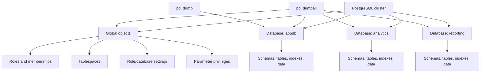

# pg_dumpall cho role và các đối tượng toàn cụm PostgreSQL

Một PostgreSQL cluster có thể chứa nhiều databases, nhưng không phải mọi đối tượng quan trọng đều nằm trong một database riêng lẻ. **Roles, role memberships và tablespaces** có phạm vi toàn cluster. Nếu chỉ chạy `pg_dump` cho từng database, bạn có thể khôi phục bảng và dữ liệu nhưng vẫn thiếu roles sở hữu objects, quyền truy cập hoặc tablespaces mà các database đó cần.

`pg_dumpall` là công cụ logical backup ở cấp cluster. Nó xuất các đối tượng toàn cụm và có thể xuất toàn bộ databases thành một SQL script. Bài học này giải thích cách dump roles và các đối tượng toàn cụm, cách khôi phục đúng thứ tự, và cách xác nhận một bản dump có đủ để phục hồi môi trường hay không.

Bài học thuộc chương **Sao lưu**, tập trung vào:

- Phân biệt database objects với cluster-wide objects.
- Dump roles, memberships, tablespaces và các thiết lập/quyền liên quan.
- Dùng `--globals-only`, `--roles-only`, `--tablespaces-only` và các tùy chọn bảo mật.
- Hiểu nội dung mà `pg_dumpall` không sao lưu.
- Khôi phục bằng `psql`, chuẩn bị tablespace và xử lý ownership.
- Quản lý password hashes, quyền backup và file dump nhạy cảm.
- Lập lịch backup, kiểm tra kết quả và thực hành restore định kỳ.

> **Điểm cần nhớ:** `pg_dumpall` tạo logical SQL dump. Nó giúp tái tạo roles, tablespaces, databases và nội dung database theo script, nhưng không thay thế physical backup, WAL archive hay việc sao lưu cấu hình và các thành phần bên ngoài PostgreSQL.

## 1. Database và cluster là hai phạm vi khác nhau

Một PostgreSQL server instance quản lý một **database cluster**. Cluster gồm nhiều databases dùng chung một số catalog và tài nguyên cấp server.

### 1.1. Đối tượng nằm trong từng database

Ví dụ các đối tượng thường thuộc một database:

- Schemas, tables, views, materialized views.
- Indexes, sequences, constraints và triggers.
- Functions, procedures, types và domains.
- Extensions được cài trong database đó.
- Database-local privileges trên schemas, tables, sequences, functions.
- Large objects và dữ liệu của các bảng.
- Publications và một số đối tượng replication ở phạm vi database tùy version.

Khi dùng `pg_dump`, bạn thường sao lưu một database tại một thời điểm. Một database dump có thể chứa DDL, dữ liệu và ACL của database đó.

### 1.2. Đối tượng có phạm vi toàn cluster

Một số đối tượng được dùng chung giữa nhiều databases:

| Đối tượng | Phạm vi | Vì sao cần sao lưu |
| --- | --- | --- |
| Roles | Toàn cluster | Là chủ sở hữu objects và principal dùng để đăng nhập/ủy quyền |
| Role memberships | Toàn cluster | Quy định role nào được phép kế thừa hoặc SET ROLE sang role khác |
| Tablespaces | Toàn cluster | Xác định nơi lưu trữ relation files |
| Database definitions | Toàn cluster | Tên database, owner, encoding, locale, tablespace mặc định và ACL |
| Role/database settings | Catalog cấp cluster | Các thiết lập ALTER ROLE hoặc ALTER DATABASE |
| Quyền trên configuration parameters | Toàn cluster trên các version hỗ trợ | Lưu các GRANT/REVOKE quyền SET tham số cấu hình |

Roles và tablespaces không được tạo độc lập trong mỗi database. Nếu restore một database vào cluster mới mà thiếu role owner, các lệnh ownership hoặc ACL có thể thất bại hoặc phải chuyển sang owner khác.

### 1.3. Sơ đồ phạm vi backup



`pg_dump` xử lý một database. `pg_dumpall` có thể kết hợp global objects và các database dumps thành một script.

## 2. pg_dumpall hoạt động như thế nào?

`pg_dumpall` là chương trình client chạy từ máy quản trị hoặc máy backup. Nó kết nối tới PostgreSQL server, xuất global objects và gọi `pg_dump` để dump nội dung từng database.

Một lệnh dump toàn cluster:

```bash
pg_dumpall --host=db.example.internal --port=5432 --username=backup_admin --file=cluster_backup.sql
```

Script kết quả thường chứa:

1. Các lệnh tạo roles và role memberships.
2. Các lệnh tạo tablespaces và thiết lập liên quan.
3. Các lệnh tạo databases.
4. Các lệnh kết nối tới từng database.
5. Nội dung SQL dump của từng database.

Các phần được ghi theo thứ tự để role và global objects cần thiết có thể tồn tại trước khi database objects tham chiếu đến chúng.

### 2.1. Định dạng đầu ra

`pg_dumpall` tạo **plain-text SQL script**. Bạn có thể đọc file, tìm câu lệnh, lưu trong hệ thống backup hoặc nén bằng công cụ bên ngoài.

Ví dụ:

```bash
pg_dumpall --username=backup_admin | gzip > cluster_backup.sql.gz
```

Khôi phục file plain SQL bằng `psql`, không dùng `pg_restore`. `pg_restore` dành cho archive formats do `pg_dump` tạo như custom hoặc directory format.

### 2.2. Vì sao pg_dumpall gọi pg_dump?

Mỗi database có catalog, schemas và dữ liệu riêng. `pg_dumpall` điều phối các lệnh dump database bằng `pg_dump` và ghép output với phần global objects.

Điều này có nghĩa:

- Các tùy chọn dump database tương thích với `pg_dump` có thể được cung cấp qua `pg_dumpall` tùy phiên bản.
- Cần kiểm tra `pg_dumpall --help` của binary đang sử dụng.
- Một số tùy chọn chỉ có ý nghĩa với global objects, một số được chuyển tiếp cho database dumps.
- Option set có thể thay đổi theo major version.

### 2.3. Không phải physical backup

`pg_dumpall` xuất câu lệnh SQL để tái tạo objects và dữ liệu. Nó không sao chép nguyên data directory, WAL segments, shared buffers hoặc toàn bộ trạng thái vật lý của server.

Vì vậy, nó phù hợp với logical migration/backup và khôi phục object-level. Nếu cần phục hồi cluster về một thời điểm chính xác bằng WAL/PITR, cần physical base backup và WAL archive theo kế hoạch riêng.

## 3. Dump chỉ các đối tượng toàn cụm với --globals-only

Khi mục tiêu là backup roles, tablespaces và các global objects mà không dump dữ liệu các databases, dùng:

```bash
pg_dumpall --globals-only --username=backup_admin --file=globals.sql
```

Viết tắt:

```bash
pg_dumpall -g -U backup_admin -f globals.sql
```

Đây là cách thường dùng để tạo một file global backup riêng trước khi dump từng database bằng `pg_dump`.

### 3.1. Nội dung thường được xuất

Global dump có thể chứa:

- Role definitions và attributes.
- Role memberships/grants.
- Tablespaces.
- Role settings và database settings theo khả năng của version.
- Quyền trên configuration parameters trên các version hỗ trợ.

Nội dung chính xác phụ thuộc major version và các tùy chọn được dùng. Đọc file SQL và đối chiếu với `pg_dumpall --help` của client trước khi xây quy trình restore.

### 3.2. Global dump không chứa bảng dữ liệu

`--globals-only` không dump rows của tables, views hay dữ liệu nghiệp vụ. Nó cũng không tạo đầy đủ database schema/data như một `pg_dump` database dump.

Một quy trình logical backup tách file có thể như sau:

```bash
pg_dumpall --globals-only -U backup_admin -f globals.sql
pg_dump -Fc -U backup_admin -d appdb -f appdb.dump
pg_dump -Fc -U backup_admin -d analytics -f analytics.dump
```

Khôi phục global objects trước, sau đó tạo/restore từng database theo kế hoạch.

### 3.3. Khi nào nên tách globals?

Tách global dump hữu ích khi:

- Database được backup bằng `pg_dump` custom format để có thể restore chọn lọc.
- Cần dựng roles/tablespaces trước khi restore nhiều databases.
- Cần chuyển một database sang cluster đã có sẵn các global objects.
- Cần review role definitions và memberships riêng.
- Muốn quản lý quyền và password hashes trong một artifact riêng có kiểm soát.

Cần tránh tạo nhiều bản global dump không đồng bộ với database dumps nếu role ownership hoặc memberships thay đổi trong lúc backup. Ghi cùng backup timestamp và cấu hình để biết artifacts thuộc cùng một bộ.

## 4. Chỉ dump roles hoặc tablespaces

`pg_dumpall` có các lựa chọn chuyên biệt cho global objects.

### 4.1. --roles-only

Dump role definitions và các thông tin role liên quan:

```bash
pg_dumpall --roles-only -U backup_admin -f roles.sql
```

Phù hợp khi cần dựng lại principals trước khi restore databases hoặc khi review quyền truy cập.

Role dump có thể chứa các attributes như:

- `LOGIN` hoặc `NOLOGIN`.
- `SUPERUSER` hoặc `NOSUPERUSER`.
- `CREATEDB`, `CREATEROLE`.
- `REPLICATION`.
- `BYPASSRLS`.
- Connection limit và validity.
- Role memberships và các quyền liên quan.
- Password verifier nếu được phép dump và không yêu cầu loại bỏ password.

Không xem role dump là bản sao đầy đủ của toàn bộ authentication infrastructure. `pg_hba.conf`, LDAP/Kerberos/OIDC configuration, certificates và secrets của hệ thống bên ngoài vẫn cần backup riêng.

### 4.2. --tablespaces-only

Dump các tablespaces:

```bash
pg_dumpall --tablespaces-only -U backup_admin -f tablespaces.sql
```

Tablespace definition lưu tên và location path. File dump không chứa dữ liệu vật lý trong thư mục tablespace và không tự tạo các thư mục đó trên máy đích.

### 4.3. Chọn đúng option

| Tùy chọn | Phạm vi |
| --- | --- |
| `--globals-only` | Global objects, không dump databases |
| `--roles-only` | Chỉ role-related objects |
| `--tablespaces-only` | Chỉ tablespaces |
| Không dùng các option trên | Dump global objects và tất cả databases mà tài khoản có thể dump |

Không kết hợp các lựa chọn theo cách chưa được tài liệu version xác nhận. Nếu cần một tập con, tạo file riêng và kiểm tra output trước khi đưa vào automation.

## 5. Roles, ownership và memberships

Role là principal của PostgreSQL. Một role có thể đăng nhập, sở hữu object, được cấp quyền hoặc đóng vai trò nhóm quyền.

### 5.1. Role có LOGIN và NOLOGIN

```sql
CREATE ROLE app_login
    LOGIN
    CONNECTION LIMIT 50;

CREATE ROLE app_readonly
    NOLOGIN;

GRANT app_readonly TO app_login;
```

`app_login` là role có thể đăng nhập. `app_readonly` là role nhóm không đăng nhập trực tiếp, có thể chứa các privileges được cấp chung.

Global dump cần giữ cả role definitions và membership relationships để sau restore, authorization model vẫn hoạt động.

### 5.2. Role attributes

```sql
CREATE ROLE deployment_admin
    LOGIN
    CREATEDB
    CREATEROLE
    CONNECTION LIMIT 10;

CREATE ROLE replication_agent
    LOGIN
    REPLICATION;
```

Không cấp `SUPERUSER` chỉ để ứng dụng hoạt động. Các attributes nhạy cảm phải được giữ theo nguyên tắc least privilege.

### 5.3. Membership và quyền SET ROLE

Role memberships xác định quan hệ giữa roles:

```sql
GRANT app_readonly TO analyst_user;
GRANT app_writer TO order_service;
```

Các phiên bản PostgreSQL mới có thể biểu diễn thêm membership options như quyền admin, quyền kế thừa hoặc quyền SET ROLE theo syntax tương ứng. Khi dump/restore giữa các major versions, kiểm tra compatibility của membership options.

### 5.4. Object owner phải tồn tại khi restore

Ví dụ database dump có:

```sql
ALTER TABLE public.orders OWNER TO order_owner;
```

Nếu role `order_owner` chưa tồn tại, lệnh sẽ thất bại. Vì vậy, restore global roles trước database objects là thứ tự thông thường.

Nếu cố ý restore với owner khác, có thể dùng tùy chọn phù hợp của `pg_dump` hoặc thực hiện ownership migration có kế hoạch. Việc đổi owner có thể ảnh hưởng default privileges, SECURITY DEFINER routines, policies và ứng dụng.

### 5.5. Role settings và database settings

Các thiết lập như:

```sql
ALTER ROLE analyst_user SET statement_timeout = '30s';
ALTER DATABASE analytics SET timezone = 'UTC';
ALTER ROLE analyst_user IN DATABASE analytics
    SET search_path = reporting, public;
```

được lưu trong catalog cấu hình role/database. Global dump có thể xuất những thiết lập liên quan theo version. Khi restore, kiểm tra các giá trị này nếu ứng dụng phụ thuộc vào session defaults.

Không nhầm các thiết lập trong catalog với file cấu hình server. `ALTER SYSTEM` và nội dung `postgresql.conf` là một phạm vi quản trị khác.

## 6. Tablespaces và điều kiện restore

Tablespace ánh xạ một tên logic tới vị trí lưu relation files trên filesystem.

Ví dụ:

```sql
CREATE TABLESPACE fast_storage
LOCATION '/pgdata/tablespaces/fast_storage';

CREATE DATABASE appdb
    TABLESPACE fast_storage;
```

### 6.1. Dump chỉ lưu định nghĩa, không lưu thư mục dữ liệu

Global dump có thể xuất câu lệnh tương tự:

```sql
CREATE TABLESPACE fast_storage
    OWNER postgres
    LOCATION '/pgdata/tablespaces/fast_storage';
```

Nó không đóng gói nội dung thư mục tablespace thành file SQL.

Trên server đích, cần:

1. Tạo đường dẫn filesystem theo kế hoạch.
2. Bảo đảm đường dẫn tồn tại, trống và thuộc quyền sở hữu của OS user chạy PostgreSQL.
3. Bảo đảm mount point/storage đã được gắn đúng.
4. Khôi phục tablespace definition bằng role đủ quyền.
5. Kiểm tra quyền truy cập và dung lượng trước khi restore database objects.

Không tạo thư mục tablespace bằng user ứng dụng rồi kỳ vọng PostgreSQL tự sửa ownership.

### 6.2. Tablespace path có thể khác giữa source và target

Khi chuyển server, đường dẫn source có thể không tồn tại trên target. Có thể:

- Tạo đúng path cũ nếu kiến trúc target cho phép.
- Dựng mapping storage tương đương trước restore.
- Dùng `--no-tablespaces` trong quy trình dump phù hợp để không phát ra lệnh chọn tablespace, rồi restore objects vào default tablespace.
- Điều chỉnh tablespace/database/object placement theo kế hoạch migration.

Không bỏ qua tablespace definitions nếu database dump tham chiếu tới chúng mà chưa xác định nơi lưu trữ thay thế.

### 6.3. Quyền tạo tablespace

Tạo tablespace yêu cầu quyền quản trị phù hợp ở PostgreSQL và một filesystem location đáp ứng yêu cầu của server. Thường cần superuser hoặc quyền tablespace phù hợp theo version, đồng thời OS directory phải được chuẩn bị bởi quản trị viên hệ điều hành.

### 6.4. Kiểm tra tablespaces sau restore

```sql
SELECT
    spcname,
    pg_get_userbyid(spcowner) AS owner,
    pg_tablespace_location(oid) AS location
FROM pg_tablespace
ORDER BY spcname;
```

Tablespace `pg_default` và `pg_global` là tablespaces hệ thống đặc biệt; không xử lý chúng như các custom tablespaces cần tự tạo.

## 7. Password hashes và bảo mật role dump

Role dump có thể chứa password verifier của roles. Dù đây không phải plaintext password, nó vẫn là dữ liệu nhạy cảm cần bảo vệ.

### 7.1. Password verifier có thể xuất trong file

Nếu tài khoản backup có quyền đọc role password data và không yêu cầu loại bỏ password, output có thể chứa giá trị password verifier được lưu trong PostgreSQL.

Một file dump bị lộ có thể giúp kẻ tấn công thực hiện offline password guessing. Vì vậy:

- Lưu dump trong thư mục có quyền truy cập hạn chế.
- Mã hóa backup khi lưu trữ và truyền tải.
- Không gửi file dump vào ticket/chat/log không được phép.
- Không in nội dung role dump ra console công khai.
- Quản lý retention và xóa bản cũ theo chính sách.
- Audit ai có thể tải/đọc backup artifacts.

### 7.2. --no-role-passwords

Nếu không muốn đưa password verifiers vào output:

```bash
pg_dumpall --globals-only --no-role-passwords -U backup_admin -f globals_without_passwords.sql
```

Sau restore, roles có thể cần được cấp password mới hoặc cấu hình authentication phù hợp trước khi ứng dụng đăng nhập.

Một số trường hợp tài khoản dump không đủ quyền để đọc password data thì password hashes cũng không được xuất. Nếu yêu cầu backup authentication state đầy đủ, cần hiểu quyền của tài khoản và kiểm tra output trong môi trường an toàn.

### 7.3. Không đưa password trực tiếp trên command line

Tránh đặt password trực tiếp trong command line. Password có thể bị lộ qua process listings, shell history hoặc log.

Dùng các phương thức phù hợp:

- `.pgpass` với permission chặt chẽ trên Unix-like systems.
- `pgpass.conf` theo cơ chế của Windows.
- PostgreSQL service file để quản lý connection parameters.
- Prompt tương tác khi chạy thủ công.
- Secret manager hoặc cơ chế credential injection của nền tảng backup.

Không đặt `PGPASSWORD` trong script/log dài hạn nếu có lựa chọn credential management an toàn hơn.

### 7.4. Password hashes và authentication compatibility

Password verifier có thể dùng thuật toán/format khác nhau theo cấu hình và version, ví dụ MD5 hoặc SCRAM. Sau restore, xác nhận:

- Server đích hỗ trợ phương thức verifier đã dump.
- `pg_hba.conf` cho phép authentication method tương ứng.
- Role có password hợp lệ và chưa hết hạn.
- TLS/certificate hoặc external authentication dependencies có sẵn.
- Ứng dụng kết nối được bằng credential mới/đã khôi phục.

Đừng giả định role LOGIN có nghĩa là ứng dụng chắc chắn đăng nhập thành công.

## 8. Quyền cần thiết để chạy pg_dumpall

`pg_dumpall` phải kết nối vào server và truy cập các databases/global catalogs cần dump.

### 8.1. Tài khoản backup

Đối với một cluster backup đầy đủ, tài khoản quản trị có quyền cao thường được dùng vì cần đọc global role information, dump tất cả databases và truy cập những objects mà role thường không đọc được.

Managed database services có thể cung cấp một role quản trị đặc biệt với một số giới hạn.

### 8.2. Least privilege

Không cấp superuser cho ứng dụng chỉ để backup. Có thể dùng một tài khoản backup riêng:

- Chỉ sử dụng cho backup/restore.
- Không dùng bởi application connection pool.
- Có password/certificate riêng.
- Được giám sát và rotate credential.
- Có quyền đủ theo yêu cầu backup của server.
- Không được cấp quyền DDL không cần thiết ngoài phạm vi backup.

Cần kiểm tra thực tế rằng tài khoản đó có thể dump tất cả databases, roles và tablespaces mà chính sách yêu cầu.

### 8.3. Thiếu quyền có thể tạo bản dump không đầy đủ

Các tình huống:

- Không đọc được password hashes.
- Không connect được một database.
- Không đọc được một số table/sequence.
- Không truy cập được extension objects hoặc large objects.
- Không đủ quyền dump global settings/privileges.

Không đánh dấu backup là thành công chỉ vì file SQL đã được tạo. Kiểm tra exit code, stderr, log và nội dung dump; `pg_dumpall` có thể báo lỗi khi một database không dump được.

### 8.4. Kiểm tra role đang kết nối

```sql
SELECT
    current_user,
    session_user,
    current_database(),
    version();
```

`current_user` có thể khác `session_user` nếu session đã thực hiện `SET ROLE`. Ghi lại user và server endpoint dùng cho backup để truy vết.

## 9. Các tùy chọn pg_dumpall thường dùng

Tập tùy chọn cụ thể thay đổi theo major version. Kiểm tra:

```bash
pg_dumpall --help
```

Một số option phổ biến:

| Tùy chọn | Ý nghĩa |
| --- | --- |
| `-f, --file` | Ghi output vào file |
| `-g, --globals-only` | Dump global objects, không dump databases |
| `--roles-only` | Dump roles |
| `--tablespaces-only` | Dump tablespaces |
| `--no-role-passwords` | Không xuất password verifiers |
| `--no-tablespaces` | Không phát lệnh chọn tablespaces trong phạm vi option áp dụng |
| `-h, --host` | Host PostgreSQL server |
| `-p, --port` | Port server |
| `-U, --username` | Role dùng để kết nối |
| `-l, --database` | Database ban đầu dùng để kết nối |
| `-w, --no-password` | Không hỏi password; fail nếu cần mà không có credential |
| `-W, --password` | Buộc prompt password |
| `-v, --verbose` | Hiển thị chi tiết tiến trình |
| `--clean` | Thêm lệnh DROP trước lệnh tạo tương ứng khi được hỗ trợ |
| `--if-exists` | Dùng IF EXISTS với các lệnh DROP phù hợp khi kết hợp clean |
| `--quote-all-identifiers` | Quote tất cả identifiers để tăng khả năng tương thích |
| `--no-sync` | Bỏ chờ đồng bộ file output trước khi kết thúc trên version hỗ trợ |

### 9.1. -l chỉ chọn database kết nối ban đầu

Ví dụ:

```bash
pg_dumpall -U backup_admin -l postgres -f cluster.sql
```

`-l postgres` chọn database ban đầu để kết nối thực hiện công việc. Nó không có nghĩa chỉ dump database `postgres`.

### 9.2. --clean có thể phá hủy dữ liệu khi restore

Nếu dùng:

```bash
pg_dumpall --clean --if-exists -U backup_admin -f cluster_clean.sql
```

script restore có thể chứa lệnh DROP database/objects trước khi tạo lại. Chạy script đó trên target có thể xóa objects hiện có.

Chỉ dùng `--clean` khi target đã được xác định là môi trường có thể thay thế hoặc có kế hoạch migration rõ ràng. Không chạy script clean vào cluster production đang chứa dữ liệu cần giữ.

### 9.3. --no-tablespaces có trade-off

Option này hữu ích khi target không có cùng filesystem paths hoặc muốn restore về default tablespace. Tuy nhiên, việc bỏ tablespace placement có thể làm thay đổi hiệu năng, dung lượng và chính sách lưu trữ. Ghi rõ mapping source/target trong migration plan.

### 9.4. Xem option của đúng binary

Client utilities có thể khác version server. Chạy `pg_dumpall --version` và `pg_dumpall --help` từ binary được dùng trong automation. Đừng copy một option từ tài liệu major version mới vào script chạy trên client cũ.

## 10. Kết nối và quản lý credentials

Các ví dụ có thể chạy trên máy quản trị kết nối tới server remote.

### 10.1. Kết nối qua host/port

```bash
pg_dumpall --host=192.0.2.20 --port=5432 --username=backup_admin --file=cluster.sql
```

Host IP chỉ là ví dụ. Trong production, dùng DNS/service endpoint đã được xác nhận.

### 10.2. Dùng service file

Ví dụ file service:

```text
[prod-backup]
host=db.example.internal
port=5432
dbname=postgres
user=backup_admin
sslmode=verify-full
sslrootcert=/etc/postgresql/certs/root.crt
```

Sau đó:

```bash
pg_dumpall "service=prod-backup" --file=cluster.sql
```

Cú pháp service file và đường dẫn cần phù hợp hệ điều hành, client version và policy. Không đưa password vào file service nếu file đó không được bảo vệ đúng cách.

### 10.3. TLS và xác thực server

Backup chứa dữ liệu nhạy cảm nên kết nối qua mạng cần xác thực server và mã hóa khi phù hợp. Với `sslmode=verify-full`, client xác minh certificate chain và hostname theo cấu hình. Chỉ bật SSL không đồng nghĩa đã xác thực đúng server.

### 10.4. Không backup nhầm cluster

Trước khi chạy backup, xác nhận endpoint:

```sql
SELECT
    inet_server_addr() AS server_address,
    inet_server_port() AS server_port,
    current_database() AS connected_database,
    current_user AS connected_role,
    version();
```

Có thể bổ sung environment label từ service inventory. Không suy ra production/staging chỉ từ tên database hoặc host alias.

## 11. Backup toàn cluster bằng pg_dumpall

Ví dụ backup đầy đủ thành SQL file:

```bash
pg_dumpall --host=db.example.internal --port=5432 --username=backup_admin --verbose --file=/backups/postgres/cluster-2026-11-14.sql
```

Nếu muốn nén:

```bash
pg_dumpall --host=db.example.internal --username=backup_admin --verbose | gzip -c > /backups/postgres/cluster-2026-11-14.sql.gz
```

### 11.1. Kiểm tra exit status

Khi chạy qua shell pipeline, phải kiểm tra exit status của `pg_dumpall` và `gzip`. Trên shell hỗ trợ `pipefail`, dùng cơ chế đó để lỗi từ lệnh đầu không bị che bởi lệnh nén thành công.

Ví dụ Bash:

```bash
set -o pipefail
pg_dumpall -U backup_admin | gzip -c > cluster.sql.gz
status=$?
if [ "$status" -ne 0 ]; then
  echo "Backup failed" >&2
  exit "$status"
fi
```

Trên PowerShell/Windows, kiểm tra `$LASTEXITCODE` của chương trình native và xác minh file output. Cách xử lý pipeline khác Bash; không copy nguyên shell syntax sang PowerShell.

### 11.2. Không coi file tồn tại là backup thành công

Một file có thể tồn tại nhưng:

- Lệnh dump bị ngắt giữa chừng.
- Một database không dump được.
- Disk đầy.
- Credential hết hạn.
- Network timeout.
- Script chỉ chứa phần đầu.
- Pipeline nén che mất lỗi của `pg_dumpall`.

Automation cần kiểm tra exit code, kích thước hợp lý, log, checksum và restore test.

### 11.3. Ghi metadata backup

Nên lưu metadata bên cạnh artifact:

```text
backup_started_at
backup_finished_at
source_server
source_port
server_version
pg_dumpall_version
backup_scope
dump_options
database_list
globals_file
output_path
output_size_bytes
sha256
exit_code
stderr_log
encryption_method
retention_until
```

Metadata không thay thế file dump nhưng giúp truy vết nguồn gốc và xác định khả năng restore.

## 12. Khôi phục globals bằng psql

Global dump là plain SQL. Restore bằng `psql` kết nối tới một database có sẵn trên target, thường là `postgres`.

```bash
psql --host=db-target.example.internal --port=5432 --username=postgres --dbname=postgres --no-psqlrc --set=ON_ERROR_STOP=on --file=globals.sql
```

`--no-psqlrc` giúp không nạp cấu hình psql cá nhân có thể thay đổi hành vi script. `ON_ERROR_STOP` làm psql dừng khi gặp lỗi SQL thay vì tiếp tục âm thầm.

### 12.1. Restore bằng superuser hoặc role quản trị phù hợp

Tạo roles, memberships và tablespaces thường yêu cầu quyền cao. Dùng tài khoản restore có quyền phù hợp và tuân theo chính sách quản trị target.

Không dùng role ứng dụng thường để chạy global restore.

### 12.2. Restore tablespaces cần chuẩn bị filesystem trước

Nếu globals.sql có `CREATE TABLESPACE`, thư mục đích phải tồn tại và có quyền phù hợp trước khi chạy restore. Nếu path source không dùng được, cần mapping hoặc dump lại theo phương án không giữ tablespace placement.

### 12.3. Restore idempotency

Global script không phải lúc nào cũng có thể chạy lặp lại trên cluster đã chứa một phần roles/tablespaces. Các câu CREATE có thể thất bại vì object đã tồn tại; membership/ACL có thể được áp dụng lại theo trạng thái hiện có.

Trước khi chạy lần hai, xác định script đã chạy tới đâu và target đang ở trạng thái nào. Không thêm `--clean` hoặc xóa roles/tablespaces tùy tiện để làm script chạy qua.

## 13. Khôi phục toàn cluster từ pg_dumpall

Nếu tạo một full cluster SQL dump:

```bash
psql --host=db-target.example.internal --port=5432 --username=postgres --dbname=postgres --no-psqlrc --set=ON_ERROR_STOP=on --file=cluster.sql
```

Với file nén:

```bash
gzip -dc cluster.sql.gz | psql -X -v ON_ERROR_STOP=1 -U postgres -d postgres
```

Lệnh restore sẽ thực thi script và có thể dùng các lệnh chuyển kết nối tới từng database.

### 13.1. Vì sao phải restore vào database có sẵn?

`psql` cần kết nối tới một database trước khi đọc script. Database khởi đầu thường là `postgres` hoặc một database quản trị có sẵn trên target.

Script sau đó có thể tạo databases và chuyển kết nối vào chúng.

### 13.2. Không bọc toàn bộ restore trong một transaction

Không dùng `psql -1` hoặc `--single-transaction` cho full `pg_dumpall` restore nói chung. Script có thể chứa `CREATE DATABASE`, `DROP DATABASE` và lệnh chuyển database, những thao tác không tương thích với một transaction duy nhất.

### 13.3. Restore có thể cần điều chỉnh môi trường

Các lệnh có thể thất bại nếu target:

- Thiếu tablespace paths.
- Thiếu extension packages hoặc shared libraries.
- Dùng major version cũ không hỗ trợ syntax được dump.
- Thiếu quyền cho role restore.
- Có database/role trùng tên nhưng khác owner/attributes.
- Có collation/locale khác hoặc encoding không tương thích.
- Có cấu hình authentication khác.
- Không cho phép tạo một số objects theo policy managed service.

Thực hiện restore rehearsal trên target tương tự production trước khi phụ thuộc vào backup trong DR.

## 14. Restore theo hai giai đoạn: globals rồi từng database

Một chiến lược khác là:

1. `pg_dumpall --globals-only` để backup global objects.
2. `pg_dump -Fc` riêng cho từng database.
3. Restore globals trước.
4. Tạo database hoặc dùng `pg_restore --create` theo kế hoạch.
5. Restore từng database bằng `pg_restore`.

Ví dụ:

```bash
pg_dumpall --globals-only -U backup_admin -f globals.sql
pg_dump -Fc -U backup_admin -d appdb -f appdb.dump
```

Khôi phục:

```bash
psql -X -v ON_ERROR_STOP=1 -U postgres -d postgres -f globals.sql
createdb -U postgres appdb
pg_restore --username=postgres --dbname=appdb --exit-on-error appdb.dump
```

### 14.1. Lợi ích của custom format

Custom format hỗ trợ:

- Restore chọn object.
- Parallel restore ở những trường hợp phù hợp.
- Xem danh mục archive bằng `pg_restore -l`.
- Tách schema/data/ACL theo yêu cầu.
- Không cần một plain SQL script khổng lồ cho mọi database.

### 14.2. Thứ tự ownership

Global roles phải tồn tại trước khi restore object ownership. Nếu database dump được tạo với owner/ACL, roles tương ứng cần có mặt hoặc phải dùng options để đổi ownership theo kế hoạch.

### 14.3. Không bỏ global backup khi dùng pg_dump

Một bộ backup chỉ có `appdb.dump` không tự chứa cluster roles và tablespaces. Hãy lưu globals cùng bộ artifacts hoặc duy trì một global backup có phiên bản và lịch sử phù hợp.

## 15. Tính nhất quán của pg_dumpall

`pg_dumpall` gọi `pg_dump` cho từng database. Mỗi database dump có snapshot nhất quán riêng theo cơ chế của `pg_dump`, nhưng toàn bộ cluster dump không phải một snapshot nguyên tử chung cho mọi databases.

### 15.1. Snapshot giữa các databases có thể khác thời điểm

Giả sử:

- `appdb` được dump lúc 10:00.
- Một thao tác nghiệp vụ thay đổi `appdb` và `analytics` lúc 10:02.
- `analytics` được dump lúc 10:05.

File full dump có thể chứa `appdb` ở trạng thái trước thay đổi và `analytics` ở trạng thái sau thay đổi. Nếu dữ liệu được đồng bộ logic giữa các databases, hai database có thể không phản ánh cùng một thời điểm.

### 15.2. Vì sao thường vẫn chấp nhận được?

PostgreSQL không hỗ trợ transaction thông thường xuyên qua nhiều databases trong cùng cluster. Nhiều ứng dụng cũng không yêu cầu một snapshot atomic giữa các databases. Tuy nhiên, các hệ thống có workflow đồng bộ ngoài database hoặc cross-database data pipelines cần đánh giá kỹ.

### 15.3. Khi cần consistent whole-cluster recovery point

Nếu yêu cầu phục hồi mọi database và global state về một thời điểm chung, hãy cân nhắc physical backup kết hợp WAL archiving/PITR theo thiết kế PostgreSQL. Physical backup hoạt động ở cấp cluster và có cơ chế recovery bằng WAL.

`pg_dumpall` phù hợp cho logical export/migration; không tự tạo một recovery point atomic cho mọi database.

## 16. Các thành phần pg_dumpall không sao lưu

Một bản full `pg_dumpall` không phải bản sao đầy đủ của toàn bộ PostgreSQL installation.

| Thành phần | Có trong pg_dumpall? | Ghi chú |
| --- | --- | --- |
| Roles | Có | Bao gồm role definitions theo quyền/options |
| Role memberships | Có | Theo version và role-related dump |
| Tablespaces | Có định nghĩa | Không chứa dữ liệu filesystem trong tablespace |
| Database definitions | Có trong full dump | Không có khi `--globals-only` |
| Database schema/data | Có trong full dump | Dump logic từng database |
| `postgresql.conf` | Không | Sao lưu file cấu hình riêng |
| `pg_hba.conf` | Không | Authentication policy riêng |
| `pg_ident.conf` | Không | User mapping riêng |
| SSL certificates/private keys | Không | Quản lý ngoài database |
| WAL segments/archive | Không | Cần WAL archive/physical backup |
| Physical data directory | Không | Cần base backup/filesystem backup hợp lệ |
| Extension binaries/shared libraries | Không | Cài package tương ứng trên target |
| OS users, groups, mount points | Không | Quản trị hệ điều hành |
| Backup scripts/credentials/service files | Không | Quản lý secret/config riêng |
| Replication slots và toàn bộ replication runtime state | Không nên giả định | Kiểm tra và dựng lại theo quy trình replication |
| Monitoring agents/log shipping | Không | Hạ tầng ngoài PostgreSQL |

### 16.1. Extension metadata và extension files

Database dump có thể chứa `CREATE EXTENSION` và các đối tượng thuộc extension theo cơ chế dump. Tuy nhiên, server đích vẫn cần cài extension package/shared library tương thích.

Nếu thiếu extension files, câu lệnh restore có thể thất bại dù SQL dump hợp lệ.

### 16.2. Server configuration phải có backup riêng

Các tham số như:

- `shared_buffers`.
- `work_mem`.
- `max_connections`.
- `wal_level`.
- `archive_mode`.
- `ssl` settings.
- `log_line_prefix`.
- `pg_hba.conf` rules.

được quản lý qua GUC/config files và hệ thống triển khai. `pg_dumpall` không thay thế việc version-control hoặc backup những file này.

### 16.3. WAL và PITR

Nếu cần point-in-time recovery, cần physical base backup và liên tục lưu WAL segments cần thiết. Logical SQL dump không đủ để replay WAL tới một timestamp tùy ý.

## 17. Nâng cấp và di chuyển major version

`pg_dumpall` thường được dùng để chuyển logical data giữa các clusters hoặc major versions.

### 17.1. Chọn binary tương thích

Dùng `pg_dumpall`/`pg_dump` cùng major version với source hoặc client version mới hơn được hỗ trợ. Một dump utility cũ hơn server có thể từ chối kết nối tới server mới hơn.

Kiểm tra:

```bash
pg_dumpall --version
psql --version
```

Và trên source:

```sql
SHOW server_version;
```

### 17.2. Restore vào major version cũ hơn không được bảo đảm

SQL output có thể chứa syntax hoặc object attributes mà target cũ không hiểu. Không giả định dump từ PostgreSQL mới hơn sẽ restore sạch vào server cũ hơn.

Đọc upgrade compatibility notes và thử restore trên clone trước khi migration.

### 17.3. Collation và locale

Database creation có thể chứa encoding, locale provider, collation và locale settings. Target cần hỗ trợ các giá trị tương ứng. Nếu OS/libc/ICU versions khác, behavior sorting/index có thể khác hoặc cần rebuild indexes theo hướng dẫn version.

### 17.4. Extension versions

Cài extension packages phù hợp trước restore và kiểm tra extension versions. Một extension upgrade có thể cần chạy `ALTER EXTENSION ... UPDATE` theo hướng dẫn vendor sau khi database restore hoàn tất.

## 18. Backup trong môi trường managed PostgreSQL

Managed database services có thể giới hạn một số thao tác:

- Không cấp superuser thực sự.
- Không cho tạo tablespace tùy ý.
- Hạn chế truy cập `pg_authid` hoặc password hashes.
- Không cho restore một số global objects.
- Tự quản lý WAL archive, backups và replication.
- Cung cấp API riêng để backup/restore hoặc clone.

Trước khi chọn `pg_dumpall` làm chiến lược duy nhất:

1. Xác nhận quyền role backup được nhà cung cấp hỗ trợ.
2. Kiểm tra có thể dump toàn bộ databases không.
3. Xác nhận roles/password verifiers nào được xuất.
4. Xác nhận tablespace objects có được phép hay không.
5. Xác định cách khôi phục database/roles trên target service.
6. Dùng native backup/PITR của nhà cung cấp nếu cần recovery point/availability mà logical dump không đáp ứng.

Không cố tạo tablespace hoặc truy cập catalog nhạy cảm bằng cách vượt qua giới hạn dịch vụ.

## 19. Kiểm tra global objects sau backup

Một backup cần được kiểm chứng ở mức nội dung và khả năng restore.

### 19.1. Xem roles hiện có

```sql
SELECT
    rolname,
    rolsuper,
    rolinherit,
    rolcreaterole,
    rolcreatedb,
    rolcanlogin,
    rolreplication,
    rolbypassrls,
    rolconnlimit,
    rolvaliduntil
FROM pg_roles
ORDER BY rolname;
```

`pg_roles` là view không hiển thị password verifier. Không dùng nó để xác nhận password hash có nằm trong dump.

### 19.2. Xem role memberships

```sql
SELECT
    parent.rolname AS granted_role,
    member.rolname AS member_role,
    grantor.rolname AS grantor
FROM pg_auth_members AS m
JOIN pg_roles AS parent ON parent.oid = m.roleid
JOIN pg_roles AS member ON member.oid = m.member
JOIN pg_roles AS grantor ON grantor.oid = m.grantor
ORDER BY parent.rolname, member.rolname;
```

Trên major versions mới, membership catalog có thể có thêm columns cho options. Query trên chỉ đọc các quan hệ cơ bản; kiểm tra catalog schema nếu cần audit chi tiết admin/inherit/set options.

### 19.3. Xem tablespaces

```sql
SELECT
    spcname,
    pg_get_userbyid(spcowner) AS owner,
    pg_tablespace_location(oid) AS location
FROM pg_tablespace
ORDER BY spcname;
```

### 19.4. Xem databases và owners

```sql
SELECT
    datname,
    pg_get_userbyid(datdba) AS owner,
    pg_encoding_to_char(encoding) AS encoding,
    datcollate,
    datctype,
    dattablespace::regclass AS default_tablespace,
    datallowconn
FROM pg_database
ORDER BY datname;
```

Kết quả giúp lập inventory databases, owners, encoding, locale và default tablespace.

### 19.5. Kiểm tra role/database settings

```sql
SELECT
    COALESCE(r.rolname, 'ALL ROLES') AS role_name,
    COALESCE(d.datname, 'ALL DATABASES') AS database_name,
    unnest(s.setconfig) AS setting
FROM pg_db_role_setting AS s
LEFT JOIN pg_roles AS r ON r.oid = s.setrole
LEFT JOIN pg_database AS d ON d.oid = s.setdatabase
ORDER BY role_name, database_name, setting;
```

Catalog output có thể khác đôi chút theo version. Dùng kết quả để đối chiếu các thiết lập đã được xuất trong globals dump.

## 20. Kiểm tra file dump và log

Sau khi dump:

- Kiểm tra exit code của `pg_dumpall`.
- Kiểm tra stderr/log không có database bị bỏ qua.
- Kiểm tra file size khác 0 và có tăng hợp lý so với baseline.
- Tạo checksum.
- Nén/mã hóa theo policy.
- Kiểm tra quyền đọc file.
- Đảm bảo artifact đã được upload tới backup destination.
- Thử restore định kỳ.

### 20.1. Tạo checksum

Trên Linux:

```bash
sha256sum cluster.sql > cluster.sql.sha256
```

Trên PowerShell:

```powershell
Get-FileHash -Algorithm SHA256 .\cluster.sql
```

Checksum giúp phát hiện file thay đổi hoặc hỏng trong quá trình lưu/chuyển. Nó không chứng minh SQL script có thể restore thành công.

### 20.2. Kiểm tra phần đầu/cuối của script

Có thể xem một phần file:

```bash
head -n 40 globals.sql
tail -n 40 globals.sql
```

Không in toàn bộ role dump vào terminal log hoặc hệ thống CI có lưu output. Nếu file chứa password hashes, giữ việc kiểm tra trong môi trường bảo mật.

### 20.3. Parse SQL không thay thế restore test

Một file có cú pháp nhìn hợp lý vẫn có thể thất bại vì target thiếu roles, tablespaces, extensions, privileges hoặc locale. Chỉ một restore test vào môi trường tương tự mới kiểm tra được quy trình thực tế.

## 21. Thiết kế backup schedule

Lịch backup phụ thuộc tốc độ thay đổi global objects và yêu cầu RPO/RTO.

### 21.1. Globals có thể thay đổi ít hơn database data

Roles và tablespaces thường thay đổi ít hơn rows. Tuy nhiên, thay đổi quyền, tạo role mới, rotate role attributes hoặc migration owner có thể cần được backup ngay.

Một mô hình thường dùng:

- Full logical dump định kỳ theo lịch.
- Global objects dump sau thay đổi role/tablespace quan trọng.
- Database dumps theo RPO/RTO từng database.
- Physical base backups và WAL archive nếu cần PITR.
- Configuration/secret backups riêng.

### 21.2. Đồng bộ artifacts

Nếu backup global objects lúc 02:00 và database dump lúc 23:00, role mới tạo giữa hai thời điểm có thể chưa tồn tại trong globals artifact. Hãy đồng bộ lịch hoặc tạo global dump cùng backup batch.

### 21.3. Retention và encryption

Global dump có thể chứa password verifiers, role names, ownership model và quyền quản trị. Áp dụng:

- Encryption at rest.
- Encryption in transit.
- Least-privilege access.
- Audit download/access.
- Retention theo chính sách.
- Secure deletion khi hết hạn.
- Key rotation và kiểm soát key access.

## 22. Phục hồi khi chỉ mất roles hoặc global metadata

Không phải sự cố nào cũng yêu cầu restore toàn bộ database.

### 22.1. Mất một role

Nếu một role bị drop nhầm nhưng database objects vẫn còn, global backup có thể cung cấp role definition/membership để khôi phục. Tuy nhiên, cần kiểm tra ownership và ACL hiện tại trước khi chạy các lệnh tạo lại.

Không tạo role mới cùng tên nhưng attributes khác một cách máy móc. So sánh:

- LOGIN/NOLOGIN.
- SUPERUSER/CREATEDB/CREATEROLE.
- REPLICATION/BYPASSRLS.
- Memberships.
- Connection limit và validity.
- Role settings.
- Ownership và privileges liên quan.

### 22.2. Mất tablespace definition

Nếu thư mục tablespace và relation files vẫn còn nhưng metadata tablespace bị mất/hỏng, việc khôi phục không đơn giản chỉ là chạy `CREATE TABLESPACE` với path cũ. Phải tuân thủ quy trình recovery/restore PostgreSQL phù hợp và đảm bảo catalog, symlinks, data files nhất quán.

Không tự tạo tablespace trỏ vào một thư mục chứa dữ liệu cũ rồi giả định server sẽ nhận relation files như trước.

### 22.3. Mất cả cluster

Nếu mất data directory hoặc storage, `pg_dumpall` SQL dump có thể dựng lại logical objects và rows trên cluster mới. Nhưng để phục hồi chính xác tới một thời điểm, WAL history và physical backups có thể cần thiết.

## 23. Quy trình restore rehearsal

Một restore rehearsal nên chạy định kỳ trên cluster test tương tự target production.

### Bước 1 — Chuẩn bị target

- Cài PostgreSQL major version được hỗ trợ.
- Cài extension packages cần thiết.
- Tạo OS directories cho tablespaces.
- Kiểm tra locale/encoding.
- Chuẩn bị credentials và quyền restore.

### Bước 2 — Xác minh artifacts

- Kiểm tra checksum.
- Kiểm tra backup timestamp.
- Kiểm tra version source/client.
- Kiểm tra output không bị truncate.
- Đọc log và exit status.

### Bước 3 — Restore globals

Dùng `psql` với `ON_ERROR_STOP`, ghi log và dừng khi lỗi. Kiểm tra roles, memberships và tablespaces.

### Bước 4 — Restore databases

Nếu dùng full `pg_dumpall`, chạy full script theo quy trình. Nếu dùng per-database custom dumps, tạo database và `pg_restore` theo dependency/owner plan.

### Bước 5 — Kiểm tra ứng dụng

- Kết nối bằng từng service role.
- Kiểm tra quyền schema/table/function.
- Kiểm tra owner và default privileges.
- Chạy smoke queries.
- Kiểm tra extensions và routines.
- Xác nhận tablespaces/paths.
- Kiểm tra role/database settings.

### Bước 6 — Ghi thời gian và lỗi

Đo restore duration, tổng dung lượng, lỗi, bước cần thao tác thủ công và RTO đạt được. Cập nhật runbook khi môi trường thay đổi.

## 24. Những lỗi thường gặp khi dùng pg_dumpall

| Lỗi | Nguyên nhân thường gặp | Hướng xử lý |
| --- | --- | --- |
| permission denied khi dump role | Role backup thiếu quyền đọc global role data | Dùng role backup có quyền phù hợp hoặc loại password hashes theo policy |
| Không connect được một database | Credential/host/ACL/database state | Kiểm tra kết nối tới từng database và log |
| role does not exist khi restore | Globals chưa được restore hoặc role bị thiếu | Restore globals trước database objects |
| tablespace does not exist | Chưa restore tablespace definition | Chuẩn bị filesystem và restore tablespaces trước |
| Tablespace location invalid | Path không tồn tại, không trống hoặc sai owner | Chuẩn bị directory trên OS theo yêu cầu |
| Syntax error khi restore | Client/server major versions không tương thích | Dùng dump utility phù hợp và test upgrade path |
| Extension không tồn tại | Thiếu package/shared library trên target | Cài extension trước restore |
| Password login thất bại | Hash bị omit hoặc auth config khác | Reset credential và kiểm tra pg_hba.conf |
| Script chạy một phần rồi dừng | Một lệnh DDL/ACL thất bại | Dùng ON_ERROR_STOP, xem log và xử lý trạng thái partial |
| File dump quá lớn/đầy disk | Output không nén, disk capacity thiếu | Dùng streaming compression và dự báo dung lượng |
| Restore xóa nhầm objects | Script có --clean | Review SQL và xác nhận target trước khi chạy |
| Backup có file nhưng không hoàn chỉnh | Process bị kill hoặc pipeline che lỗi | Kiểm tra exit code, checksum và restore rehearsal |

## 25. Những anti-pattern cần tránh

- Chỉ backup `pg_dump` của database rồi giả định roles/tablespaces đã nằm trong file.
- Chạy `pg_dumpall` bằng role thiếu quyền nhưng vẫn đánh dấu backup thành công.
- Lưu global dump chứa password verifiers trong thư mục mọi user đều đọc được.
- Đưa password vào command line hoặc commit password vào script.
- Restore database trước khi tạo roles mà database objects cần.
- Tạo tablespace mà không chuẩn bị filesystem path.
- Dùng `--clean` trên cluster có dữ liệu cần giữ.
- Dùng `pg_restore` cho plain SQL output của `pg_dumpall`.
- Dùng `psql -1` cho full cluster script có CREATE DATABASE/chuyển database.
- Giả định một full `pg_dumpall` là snapshot nguyên tử chung giữa tất cả databases.
- Dùng logical dump thay physical backup khi yêu cầu PITR.
- Bỏ qua extension binaries và server configuration trong DR plan.
- Giả định password hash trong dump đảm bảo ứng dụng đăng nhập được trên target.
- Không test restore cho tới khi xảy ra sự cố.
- Dùng binary client cũ hơn server mà không kiểm tra compatibility.

## 26. Ví dụ runbook backup global objects

### 26.1. Dump globals

```bash
pg_dumpall --globals-only --host=db.example.internal --port=5432 --username=backup_admin --verbose --file=/backups/postgres/globals.sql
```

### 26.2. Xác minh kết quả

```bash
test -s /backups/postgres/globals.sql
sha256sum /backups/postgres/globals.sql
```

Ghi exit status của lệnh dump, log, checksum và thời gian hoàn thành trong backup inventory.

### 26.3. Upload/mã hóa

Mã hóa file bằng hệ thống backup/secret management được tổ chức phê duyệt. Không để bản plaintext trong thư mục staging mở quyền.

### 26.4. Restore thử nghiệm

Trên target lab:

```bash
psql -X -v ON_ERROR_STOP=1 -U postgres -d postgres -f globals.sql
```

Sau đó kiểm tra roles, memberships, tablespaces và settings bằng catalog queries ở phần 19.

### 26.5. Lưu kết quả

Ghi:

- Source/target version.
- Global objects được restore.
- Objects bị bỏ qua do giới hạn quyền/version.
- Tablespace path mappings.
- Role login tests.
- Restore duration.
- Errors và remediation.

## 27. Bài thực hành

Thực hiện trên cluster lab riêng. Không dùng `--clean`, không drop roles/tablespaces và không reset cluster production.

### Bài 1 — Phân biệt pg_dump và pg_dumpall

Tạo hai databases và một role dùng chung. Dump một database bằng `pg_dump`, rồi dump cluster bằng `pg_dumpall`. Xác định role definition xuất hiện ở đâu.

### Bài 2 — Dump globals-only

Chạy `pg_dumpall --globals-only`. Tìm các lệnh CREATE ROLE, GRANT và CREATE TABLESPACE trong file. Giải thích vì sao không có table rows.

### Bài 3 — Dump roles-only

Chạy `pg_dumpall --roles-only`. Liệt kê role attributes được xuất và xác định membership statements.

### Bài 4 — Dump tablespaces-only

Tạo tablespace lab với directory hợp lệ, dump bằng `--tablespaces-only`, đọc output. Phân biệt SQL definition và dữ liệu vật lý.

### Bài 5 — Role membership

Tạo hai roles NOLOGIN và một LOGIN role, cấp membership. Dump globals rồi kiểm tra các GRANT statements.

### Bài 6 — Role attributes

Tạo role lab có CREATEDB, connection limit và validity. Dump roles và tìm cách attributes được thể hiện trong SQL.

### Bài 7 — Password verifiers

Trong lab, dump globals với và không có `--no-role-passwords`. Bảo vệ output và xác định khác biệt. Không chia sẻ file có password hashes.

### Bài 8 — Khôi phục globals

Tạo cluster test trống, restore globals bằng psql với ON_ERROR_STOP. Kiểm tra roles/memberships sau restore.

### Bài 9 — Owner dependency

Tạo bảng thuộc sở hữu của một role riêng, dump database và globals. Thử restore globals trước database rồi kiểm tra ownership.

### Bài 10 — Tablespace directory

Tạo tablespace trong lab, dump globals. Dựng target với path khác và ghi lại bước mapping filesystem cần thiết.

### Bài 11 — No tablespaces

Tìm hiểu `--no-tablespaces` trên version đang dùng. Tạo database dump theo option này và so sánh placement behavior khi restore.

### Bài 12 — Role/database settings

Dùng `ALTER ROLE SET`, `ALTER DATABASE SET` và `ALTER ROLE IN DATABASE SET`. Dump globals-only và kiểm tra settings có được xuất không.

### Bài 13 — Kiểm tra role inventory

Chạy query trên `pg_roles`. So sánh với role definitions trong globals SQL. Vì sao `pg_roles` không cho thấy password verifier?

### Bài 14 — Membership catalog

Đọc `pg_auth_members`. So sánh quan hệ granted_role/member_role với GRANT statements trong dump.

### Bài 15 — Database owners

Đọc `pg_database` để liệt kê owners, encoding và default tablespace. So sánh với database definitions trong full pg_dumpall output.

### Bài 16 — Full cluster dump

Tạo full SQL dump trên cluster lab có hai databases. Xác định vị trí global section, database creation và các lệnh chuyển kết nối.

### Bài 17 — Restore full dump

Tạo cluster lab target và restore bằng psql với ON_ERROR_STOP. Kiểm tra cả globals và database objects.

### Bài 18 — Không dùng single transaction

Quan sát vì sao full dump có CREATE DATABASE và lệnh chuyển database không phù hợp với `psql -1`. Thử trên lab riêng và ghi lại lỗi/giải thích.

### Bài 19 — Clean option

Trong một cluster lab có thể tạo lại, tạo dump với `--clean`. Đọc kỹ DROP statements. Không chạy trên cluster có dữ liệu cần giữ.

### Bài 20 — Plain SQL và custom archive

Dump một database bằng `pg_dump -Fc`, rồi dump full cluster bằng `pg_dumpall`. So sánh cách restore bằng pg_restore và psql.

### Bài 21 — Version compatibility

Ghi `pg_dumpall --version` và `SHOW server_version`. Tìm hiểu điều kiện client version khi dump server mới hơn và rủi ro restore vào major version cũ.

### Bài 22 — Thiếu extension

Tạo extension trong lab, dump database, thử restore trên target chưa cài package extension. Giải thích vì sao SQL dump không chứa shared library.

### Bài 23 — Password authentication

Restore role có password verifier vào target lab. Kiểm tra pg_hba.conf, TLS và authentication method. Xác định trường hợp cần reset password.

### Bài 24 — Backup pipeline

Chạy pg_dumpall qua gzip trong lab. Kiểm tra exit status của cả hai tiến trình, file size và checksum. Mô phỏng lỗi disk/output nếu có thể mà không ảnh hưởng production.

### Bài 25 — Restore rehearsal

Viết runbook gồm chuẩn bị target, restore globals, restore databases, smoke tests, role login checks và ghi RTO. Thực hiện ít nhất một lần.

### Bài 26 — Phân biệt logical và physical recovery

So sánh pg_dumpall với base backup + WAL archive. Xác định giải pháp nào đáp ứng yêu cầu PITR và vì sao logical dump không phải snapshot atomic toàn cluster.

## 28. Tổng kết

Những điểm quan trọng khi dùng **pg_dumpall cho role và các đối tượng toàn cụm**:

1. PostgreSQL cluster có global objects dùng chung giữa nhiều databases.
2. `pg_dump` dump một database; `pg_dumpall` có thể dump globals và toàn bộ databases.
3. `--globals-only` dump global objects như roles và tablespaces mà không dump database contents.
4. `--roles-only` và `--tablespaces-only` tạo các dump chuyên biệt.
5. Roles, memberships và ownership phải được khôi phục đúng thứ tự trước database objects cần chúng.
6. Tablespace dump chứa definition/path, không chứa filesystem data; target phải chuẩn bị directory và storage.
7. Role dump có thể chứa password verifiers; bảo vệ file, hoặc dùng `--no-role-passwords` nếu cần loại bỏ chúng.
8. `pg_dumpall` tạo plain SQL script và restore bằng `psql`, không phải `pg_restore`.
9. Full restore có thể chứa CREATE DATABASE và lệnh chuyển database, vì vậy không bọc toàn bộ script trong một transaction.
10. `pg_dumpall` dump từng database với snapshot riêng; không phải một snapshot atomic chung giữa mọi databases.
11. Nó không sao lưu server config files, WAL archive, physical data directory, OS directories hay extension binaries.
12. Managed services có thể giới hạn quyền dump/restore global objects; kiểm tra capability trước khi chọn quy trình.
13. Luôn kiểm tra exit code, log, checksum, file permissions và thực hiện restore rehearsal.
14. Khi cần PITR hoặc recovery point vật lý toàn cluster, kết hợp physical backup và WAL archiving.
15. Một backup chỉ có giá trị vận hành khi bạn đã chứng minh có thể restore nó trên môi trường tương tự target.

Khi thiết kế backup, hãy tách rõ hai câu hỏi: **database objects và dữ liệu đã được dump chưa, và cluster có đủ roles, memberships, tablespaces cùng cấu hình bên ngoài để vận hành sau restore không?** `pg_dumpall` giúp bảo vệ phần global SQL objects; runbook DR cần bao phủ cả những thành phần mà logical dump không chứa.

## 29. Tài liệu PostgreSQL chính thức

- [pg_dumpall — dump a PostgreSQL database cluster](https://www.postgresql.org/docs/current/app-pg-dumpall.html)
- [pg_dump — dump a database](https://www.postgresql.org/docs/current/app-pgdump.html)
- [psql — PostgreSQL interactive terminal](https://www.postgresql.org/docs/current/app-psql.html)
- [Database Roles](https://www.postgresql.org/docs/current/user-manag.html)
- [Role Membership](https://www.postgresql.org/docs/current/role-membership.html)
- [Tablespaces](https://www.postgresql.org/docs/current/manage-ag-tablespaces.html)
- [Backup and Restore](https://www.postgresql.org/docs/current/backup.html)
- [SQL Dump](https://www.postgresql.org/docs/current/backup-dump.html)
- [Continuous Archiving and Point-in-Time Recovery](https://www.postgresql.org/docs/current/continuous-archiving.html)
- [Client Authentication](https://www.postgresql.org/docs/current/client-authentication.html)
- [Server Configuration](https://www.postgresql.org/docs/current/runtime-config.html)
- [pg_roles and pg_auth_members system catalogs](https://www.postgresql.org/docs/current/view-pg-roles.html)

Các liên kết `current` trỏ tới tài liệu PostgreSQL hiện hành. Tùy chọn pg_dumpall, role membership syntax, password formats, parameter privileges và các catalog columns có thể khác theo major version. Trước khi chạy automation hoặc restore production, kiểm tra `pg_dumpall --version`, `pg_dumpall --help`, `SHOW server_version` và tài liệu đúng phiên bản.
