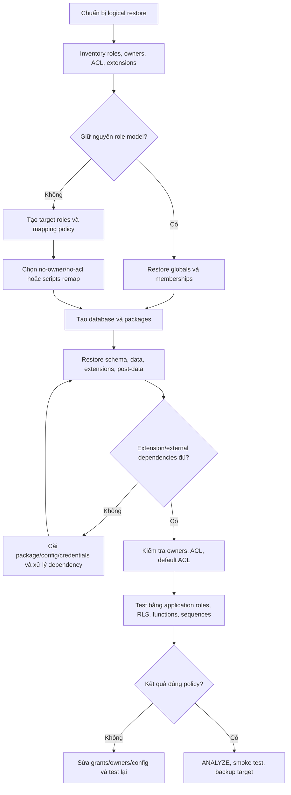

# Role, owner, ACL, extension và phụ thuộc khi phục hồi PostgreSQL

Một bản backup PostgreSQL có thể chứa đầy đủ table rows, indexes, constraints và functions nhưng database được phục hồi vẫn chưa sẵn sàng cho ứng dụng. Ứng dụng có thể không đăng nhập được vì thiếu role; một migration có thể thất bại vì object owner không tồn tại; người dùng có thể đọc được table nhưng không dùng được sequence; một function SECURITY DEFINER có thể chạy dưới sai owner; hoặc CREATE EXTENSION thất bại vì máy chủ đích thiếu package tương ứng.

Những lỗi này xuất hiện vì PostgreSQL quản lý nhiều lớp đối tượng và quyền. **Roles, role memberships và tablespaces là đối tượng cấp cluster**; database, schema, tables, functions, ACL và extensions có phạm vi riêng; một số phụ thuộc còn nằm bên ngoài database như shared libraries, cấu hình server, filesystem, secrets, foreign services và hệ thống xác thực.

Khi phục hồi, cần tái tạo đúng thứ tự các phụ thuộc và quyết định rõ có giữ nguyên ownership/ACL hay chuyển chúng sang mô hình quyền mới. Một lệnh pg_restore thành công chỉ cho biết các lệnh trong phạm vi dump đã được xử lý; nó không tự chứng minh người dùng ứng dụng có đúng quyền hoặc mọi extension bên ngoài đã hoạt động.

Bài học thuộc chương **Khôi phục** trong module *Database Engine Relational PostgreSQL*. Chúng ta sẽ xây dựng quy trình phục hồi roles, owners, ACL, default privileges, extensions và các dependency; sử dụng pg_dumpall, pg_dump, pg_restore; lựa chọn preserve ownership hoặc remap; và xác minh quyền truy cập sau restore.

> **Nguyên tắc:** Khôi phục cấu trúc và dữ liệu cùng với danh tính, ownership, grants, extension packages và cấu hình cần thiết. Kiểm tra bằng role ứng dụng thực tế sau khi restore; đừng chỉ kiểm tra bằng superuser.

## 1. Mục tiêu học tập

Sau bài này, bạn có thể:

1. Phân biệt role, user, group role và role membership.
2. Hiểu role attributes như LOGIN, SUPERUSER, CREATEDB, CREATEROLE, REPLICATION và BYPASSRLS.
3. Giải thích vì sao roles là đối tượng dùng chung toàn PostgreSQL cluster.
4. Backup và phục hồi global objects bằng pg_dumpall --globals-only.
5. Xử lý an toàn password hashes trong global dump.
6. Phân biệt owner của database, schema, table, sequence, function và extension.
7. Hiểu ACL, GRANT, REVOKE, GRANT OPTION và PUBLIC.
8. Phục hồi default privileges đúng creator role và schema.
9. Dùng pg_restore --no-owner, --no-acl, --role và --use-set-session-authorization đúng mục đích.
10. Hiểu vì sao --no-owner không tự remap mọi ACL references.
11. Tái tạo extension packages, control files, shared libraries và version.
12. Phân biệt extension-owned objects với extension configuration data.
13. Xử lý shared_preload_libraries và cấu hình ngoài database.
14. Đọc dependency metadata qua pg_depend và pg_shdepend ở mức khái niệm.
15. Nhận biết phụ thuộc không được lưu trong database dump.
16. Phục hồi theo thứ tự roles, tablespaces, database, extensions, schema, data, ACL và post-data.
17. Xử lý foreign data wrappers, external credentials, collations và SECURITY DEFINER.
18. Chọn restore giữ nguyên owner hay dùng owner mới.
19. Kiểm tra quyền bằng catalog, psql meta-commands và privilege functions.
20. Xây dựng runbook, lab và checklist kiểm tra quyền sau phục hồi.

## 2. Bản đồ các loại đối tượng khi phục hồi

PostgreSQL có nhiều phạm vi quản lý khác nhau:

| Đối tượng | Phạm vi | Ví dụ |
|---|---|---|
| Role | Cluster-wide | login role, owner role, group role |
| Role membership | Cluster-wide | app_runtime là member của app_readonly |
| Tablespace | Cluster-wide | pg_default, ts_fast |
| Database | Cluster-wide object | app_db |
| Schema | Trong database | app, reporting |
| Table/index/sequence | Trong database/schema | app.orders, app.orders_id_seq |
| Function/procedure/type | Trong database | app.calculate_total() |
| ACL | Gắn với từng object | GRANT SELECT ON app.orders |
| Default ACL | Trong database, theo creator role | quyền mặc định cho table mới |
| Extension | Trong từng database | pgcrypto, amcheck |
| Server configuration | Host/cluster runtime | shared_preload_libraries, pg_hba.conf |
| External dependency | Ngoài PostgreSQL catalog | shared library, API, secret, FDW endpoint |

### 2.1. Roles tồn tại xuyên databases

Một role được tạo trong PostgreSQL cluster có thể kết nối vào nhiều databases nếu được phép. Role không được tạo riêng bên trong từng database.

Ví dụ cluster có ba databases:

```text
PostgreSQL cluster
├── roles
│   ├── app_owner
│   ├── app_runtime
│   └── report_reader
├── database app_db
│   ├── schema app
│   └── tables, sequences, functions
├── database report_db
│   └── schema reporting
└── database audit_db
    └── schema audit
```

Một database dump riêng không phải bản backup đầy đủ các role dùng chung cluster.

### 2.2. ACL nằm trên object

Role là danh tính; ACL là danh sách quyền trên một object. Có role không có nghĩa role tự động được đọc table. Có thể cần CONNECT trên database, USAGE trên schema và SELECT trên table.

### 2.3. Extension có hai lớp

Một extension được đăng ký trong database qua catalog pg_extension, nhưng package/control files/shared libraries có thể nằm ở hệ điều hành hoặc PostgreSQL installation. Dump database có thể lưu lệnh CREATE EXTENSION nhưng không đóng gói mọi binary cần để chạy extension.

### 2.4. Phụ thuộc có cả trong và ngoài catalog

PostgreSQL lưu quan hệ phụ thuộc giữa nhiều objects trong system catalogs. Nhưng endpoint của dịch vụ ngoài, file cấu hình, secret, certificate, package OS và DNS không tự được phục hồi từ pg_dump.

## 3. Role, user và group role

Trong PostgreSQL, role là khái niệm chung cho danh tính và nhóm quyền. Lệnh CREATE USER chỉ là cách viết tương đương CREATE ROLE với thuộc tính LOGIN.

```sql
CREATE ROLE app_runtime LOGIN;
CREATE USER report_reader;
```

Cả hai đều tạo roles có thể đăng nhập theo cú pháp trên.

### 3.1. Login role

Role có LOGIN có thể được dùng làm database connection identity:

```sql
CREATE ROLE api_service
    LOGIN
    CONNECTION LIMIT 40;
```

### 3.2. Group role

Role không có LOGIN thường dùng để gom quyền:

```sql
CREATE ROLE app_readonly NOLOGIN;
CREATE ROLE app_writer NOLOGIN;

GRANT app_readonly TO api_service;
```

Ứng dụng có thể nhận quyền qua membership theo thuộc tính INHERIT/SET và membership options của version.

### 3.3. Role không phải database user riêng lẻ

Role tồn tại cluster-wide. Không thể tạo một role cùng tên khác nhau độc lập trong hai databases của cùng cluster.

### 3.4. Các thuộc tính role quan trọng

| Thuộc tính | Ý nghĩa |
|---|---|
| LOGIN | Có thể đăng nhập |
| SUPERUSER | Bỏ qua phần lớn kiểm tra quyền |
| CREATEDB | Có thể tạo database |
| CREATEROLE | Có thể quản lý roles trong phạm vi được phép |
| REPLICATION | Cho phép một số thao tác replication |
| BYPASSRLS | Bỏ qua row-level security |
| INHERIT | Có thể kế thừa quyền từ memberships theo semantics của version |
| CONNECTION LIMIT | Giới hạn số kết nối đồng thời |
| VALID UNTIL | Thời điểm hết hạn password |
| PASSWORD | Password hoặc password verifier/hash theo cấu hình |

Không cấp SUPERUSER, BYPASSRLS hoặc CREATEROLE chỉ để làm restore chạy qua. Tạo role với quyền tối thiểu cần thiết cho workload.

## 4. Role attributes và membership phải được phục hồi

Một role chỉ có tên và LOGIN chưa chắc có cùng khả năng với nguồn. Cần xét:
- Role attributes.
- Membership trong group roles.
- Membership admin/set/inherit options.
- Password verifier hoặc cơ chế xác thực khác.
- Connection limit và validity.
- Role/database-specific configuration.
- Quyền trên database, schema, tablespace và objects.

Ví dụ:

```sql
CREATE ROLE app_owner NOLOGIN;
CREATE ROLE app_runtime LOGIN;
CREATE ROLE app_migrator LOGIN CREATEROLE;

GRANT app_owner TO app_migrator;
GRANT app_readonly TO app_runtime;
```

Đây là ví dụ cấu trúc, không phải khuyến nghị cấp CREATEROLE cho mọi migration account.

### 4.1. Membership không đồng nghĩa ownership

GRANT app_owner TO app_migrator tạo quan hệ membership. Nó không tự chuyển owner của các tables hiện tại sang app_migrator.

### 4.2. INHERIT và SET ROLE

Tùy PostgreSQL version và options của membership, member có thể tự động sử dụng privileges được kế thừa hoặc phải SET ROLE để dùng identity của role được cấp. PostgreSQL 16 bổ sung các membership options rõ hơn như INHERIT và SET; cú pháp/behavior cần đối chiếu version đích.

### 4.3. ADMIN OPTION

ADMIN OPTION cho phép member quản trị membership của role được cấp trong phạm vi quy tắc hiện hành. Đây là quyền quản trị nhạy cảm; không cấp rộng cho application roles.

### 4.4. Restore membership theo đúng thứ tự

Các role được tham chiếu phải tồn tại trước khi khôi phục membership grants. Global dump thường sắp xếp các lệnh global objects phù hợp, nhưng nếu script được tách/chỉnh sửa, cần bảo đảm role definitions được tạo trước GRANT role.

## 5. Backup global roles bằng pg_dumpall

Dùng pg_dumpall chỉ lấy global objects:

```bash
pg_dumpall --globals-only -f globals.sql
```

File globals.sql thường chứa các định nghĩa global như roles, memberships, tablespaces và một số grants/cấu hình liên quan đối tượng toàn cluster theo tool/version.

### 5.1. Vì sao pg_dump không đủ?

`pg_dump app_db` chỉ backup một database. Nó không tạo bản backup hoàn chỉnh của roles dùng chung cluster hoặc mọi tablespaces/global objects.

### 5.2. Global dump và database dump là hai artifact khác nhau

Một workflow phổ biến:

```bash
pg_dumpall --globals-only -f globals.sql
pg_dump -Fc -f app_db.dump app_db
```

- globals.sql: roles, memberships, tablespaces và global setup.
- app_db.dump: schema/data/ACL/database objects trong app_db.

Cần quản lý hai files cùng một backup set và ghi lại source server version, dump client version, timestamp và encryption/retention policy.

### 5.3. Chỉ dump globals không backup server configuration

pg_dumpall không thay thế backup các file như postgresql.conf, pg_hba.conf, certificates, service unit, OS packages, environment variables hoặc cloud infrastructure configuration.

### 5.4. Global dump cần được xem xét trước khi chạy

Khi restore sang cluster đã tồn tại, globals.sql có thể chứa CREATE ROLE hoặc CREATE TABLESPACE trùng với đối tượng hiện có. Không chạy mù quáng; so sánh và hợp nhất theo policy đích.

## 6. Password hashes và bảo mật global dump

Global dump có thể chứa password verifiers/hashes của roles, trừ khi yêu cầu loại bỏ.

```bash
pg_dumpall --globals-only --no-role-passwords -f globals-no-passwords.sql
```

### 6.1. Password hash vẫn là dữ liệu nhạy cảm

Password hash không phải plaintext, nhưng vẫn có giá trị cho tấn công offline nếu file bị lộ. Bảo vệ globals dump như một secret-bearing artifact.

### 6.2. Khi dùng --no-role-passwords

Roles được tạo nhưng không có password hash được phục hồi từ nguồn. Cần provision credentials mới qua secret manager hoặc quy trình identity được tổ chức phê duyệt trước khi application login.

### 6.3. Không chép password hash vào log/chat

Không paste globals.sql, password hashes hoặc connection strings vào ticket/log không được bảo vệ. Nếu cần chia sẻ lỗi restore, chỉ trích xuất thông báo đã loại bỏ secret.

### 6.4. SCRAM và xác thực đích

Nếu dùng password authentication, xác nhận target server hỗ trợ auth method phù hợp, password_encryption policy, pg_hba rules và client drivers. Có thể rotate password thay vì giữ verifier cũ khi môi trường khôi phục có ranh giới bảo mật mới.

## 7. Phục hồi global objects

Trên target cluster, sau khi đã chuẩn bị roles/tablespaces/paths, có thể chạy:

```bash
psql -X -v ON_ERROR_STOP=1 -d postgres -f globals.sql
```

Thực hiện bằng một database quản trị có sẵn, ví dụ postgres, với role đủ quyền.

### 7.1. -X

Tùy chọn -X không đọc psqlrc cá nhân, giúp script restore có behavior ổn định hơn.

### 7.2. ON_ERROR_STOP

Tùy chọn này yêu cầu psql dừng khi gặp lỗi SQL. Nếu script tiếp tục sau lỗi CREATE ROLE, những GRANT hoặc ownership statements sau đó có thể thất bại dây chuyền và khó nhận biết.

### 7.3. Không tự chạy lại toàn bộ globals.sql sau một lỗi

Trước khi retry, xác định câu lệnh nào đã chạy, object nào đã được tạo và target state hiện tại. Global scripts không phải lúc nào cũng idempotent.

### 7.4. Existing roles

Nếu role đã tồn tại, CREATE ROLE có thể lỗi. So sánh attributes/membership, rồi quyết định ALTER ROLE/GRANT tương ứng. Không drop role đang được objects hoặc ACL tham chiếu chỉ để script chạy lại.

## 8. Tablespace paths khi restore

Global dump có thể chứa CREATE TABLESPACE với đường dẫn của source server:

```sql
CREATE TABLESPACE ts_fast
    OWNER storage_admin
    LOCATION '/srv/postgresql/ts_fast';
```

Target có thể dùng path khác, mount khác hoặc managed service không cho tạo arbitrary tablespaces.

### 8.1. Provision filesystem trước

Với self-managed PostgreSQL, tạo mount/directory đúng trước khi tạo tablespace. Directory phải đáp ứng yêu cầu PostgreSQL, được OS service user truy cập và có dung lượng phù hợp.

### 8.2. Không giả định pg_dumpall tự map path

Logical global dump không tự ánh xạ source tablespace path sang destination path theo cách physical backup mapping làm. Review script và tạo target tablespaces với paths đúng.

### 8.3. Không cần tablespaces riêng ở target

Nếu target layout dùng database default, có thể điều chỉnh global setup và restore options để bỏ tablespace placement commands. Xác nhận mọi objects được phép rơi vào target default và đủ dung lượng.

### 8.4. --no-tablespaces

pg_dump/pg_restore có option no-tablespaces để không phát ra lệnh gán objects vào tablespaces cụ thể trong database dump/restore. Nó không tự giải quyết mọi CREATE TABLESPACE statements trong globals.sql; xử lý globals riêng.

### 8.5. Managed PostgreSQL

Managed service có thể giới hạn SUPERUSER, CREATE TABLESPACE hoặc filesystem paths. Dùng storage tier và khả năng được provider hỗ trợ; không cố chạy global script nguyên xi nếu provider không expose tablespaces.

## 9. Database owner và object owner

Mỗi database có owner. Schema, table, sequence, view, function, type, materialized view và nhiều objects khác cũng có owner.

Owner có quyền quản trị object theo mô hình PostgreSQL. Ownership không chỉ là một ACL entry thông thường.

### 9.1. Database owner

```sql
CREATE DATABASE app_db OWNER app_owner;
```

Role app_owner cần tồn tại trước khi database được tạo với owner này.

### 9.2. Schema owner

```sql
CREATE SCHEMA app AUTHORIZATION app_owner;
```

Schema owner có thể quản lý objects trong schema theo quyền và membership phù hợp.

### 9.3. Table owner

Table thường thuộc role thực hiện CREATE TABLE, trừ khi DDL hoặc restore ownership đặt owner khác.

### 9.4. Function owner

Function owner đặc biệt quan trọng với SECURITY DEFINER, vì function có thể chạy với privileges của owner thay vì caller. Phục hồi sai owner có thể thay đổi security boundary.

### 9.5. Extension owner

Extension có owner được ghi trong catalog pg_extension. Extension owner và owner của mọi object trong database không nhất thiết là cùng một role.

## 10. Ownership không giống GRANT

Ví dụ:

```sql
GRANT SELECT ON app.orders TO app_runtime;
```

Lệnh này cấp quyền SELECT. Nó không chuyển owner của table.

Chuyển owner:

```sql
ALTER TABLE app.orders OWNER TO app_owner;
```

### 10.1. Owner có quyền quản trị

Owner có thể ALTER/DROP object và quản lý privileges trên object theo semantics của PostgreSQL. Một role chỉ có SELECT không có các quyền quản trị đó.

### 10.2. GRANT ALL không đồng nghĩa owner

GRANT ALL cấp các privileges được định nghĩa cho object type. Nó không tự chuyển ownership và không trao mọi khả năng đặc biệt của owner.

### 10.3. Owner role thường nên NOLOGIN

Một pattern thường dùng là owner roles không đăng nhập trực tiếp; deployer/migrator có membership và dùng SET ROLE khi thực hiện DDL. Application runtime nhận quyền qua group roles/ACL.

## 11. ACL là gì?

ACL (Access Control List) là danh sách quyền được cấp trên object. PostgreSQL hỗ trợ privileges khác nhau theo object type.

| Object | Privileges thường gặp |
|---|---|
| Database | CONNECT, CREATE, TEMPORARY |
| Schema | USAGE, CREATE |
| Table/view | SELECT, INSERT, UPDATE, DELETE, TRUNCATE, REFERENCES, TRIGGER |
| Sequence | USAGE, SELECT, UPDATE |
| Function/procedure | EXECUTE |
| Type/domain | USAGE |
| Tablespace | CREATE |
| Large object | SELECT, UPDATE |
| Foreign server | USAGE |

Các privileges cụ thể phụ thuộc object type và PostgreSQL version.

### 11.1. ACL được lưu ở catalog

Ví dụ:
- pg_class.relacl cho nhiều relation objects.
- pg_namespace.nspacl cho schema.
- pg_proc.proacl cho functions/procedures.
- pg_database.datacl cho database.
- pg_tablespace.spcacl cho tablespace.
- pg_default_acl lưu default privileges.

ACL có thể là NULL nếu đang dùng defaults. NULL không có nghĩa object không có quyền hiệu lực.

### 11.2. PUBLIC

PUBLIC là pseudo-role đại diện mọi roles. Một GRANT TO PUBLIC có thể ảnh hưởng mọi user, bao gồm roles tạo sau này.

### 11.3. Grant option

GRANT OPTION cho phép grantee cấp lại privilege cho role khác trong phạm vi được phép:

```sql
GRANT SELECT ON app.orders
TO report_reader
WITH GRANT OPTION;
```

Chỉ giữ grant option nếu người nhận thật sự cần quản lý quyền tiếp.

### 11.4. GRANTOR

ACL có thể ghi nhận grantor. Restore privileges dưới một role khác có thể làm thay đổi grantor context hoặc yêu cầu quyền phù hợp. Đừng coi ACL chỉ là danh sách tên người được cấp quyền.

## 12. Các lớp quyền cần phục hồi cùng nhau

Để app_runtime đọc table app.orders, thường cần:

```sql
GRANT CONNECT ON DATABASE app_db TO app_runtime;
GRANT USAGE ON SCHEMA app TO app_runtime;
GRANT SELECT ON app.orders TO app_runtime;
```

Nếu thiếu một lớp, query có thể vẫn lỗi dù lớp còn lại đã được cấp.

### 12.1. CONNECT trên database

CONNECT cho phép role tạo session tới database (subject to pg_hba, authentication, connection limits và các điều kiện khác).

### 12.2. USAGE trên schema

USAGE cho phép resolve/access objects trong schema theo privileges trên từng object. Nó không tự cấp SELECT trên table.

### 12.3. SELECT trên table

SELECT cho phép đọc table columns/rows theo privilege rules, RLS policies và các yếu tố khác.

### 12.4. Sequence privileges

INSERT vào table có serial/identity sequence có thể cần quyền dùng sequence tùy cách gọi/role:

```sql
GRANT USAGE, SELECT ON SEQUENCE app.orders_id_seq TO app_runtime;
```

Identity columns có một số đặc tính privilege riêng trong các thao tác INSERT; kiểm tra đúng DDL và cách ứng dụng gọi nextval/currval. Không suy quyền sequence chỉ từ quyền INSERT table.

### 12.5. Function EXECUTE

Một stored function có thể cần EXECUTE privilege riêng:

```sql
GRANT EXECUTE ON FUNCTION app.calculate_total(bigint)
TO app_runtime;
```

Function overloading nghĩa là phải xác định đúng signature.

## 13. Default privileges

Default privileges quyết định quyền mặc định được gán cho các objects được tạo trong tương lai bởi một role cụ thể.

Ví dụ:

```sql
ALTER DEFAULT PRIVILEGES
FOR ROLE app_owner
IN SCHEMA app
GRANT SELECT ON TABLES TO report_reader;
```

### 13.1. Default privileges không sửa ACL hiện tại

Lệnh trên chỉ ảnh hưởng objects được tạo sau đó bởi creator role app_owner trong schema app. Tables đã tồn tại cần GRANT riêng.

### 13.2. Default privileges gắn với creator role

Nếu migration chạy CREATE TABLE dưới app_migrator thay vì SET ROLE app_owner, default privileges của app_owner có thể không áp dụng. Đây là lỗi restore/deploy phổ biến.

### 13.3. Schema-specific và global defaults

Có thể cấu hình default privileges toàn database cho creator role hoặc thêm cấu hình theo schema. Per-schema defaults được cộng thêm với global defaults; không thể dùng một per-schema REVOKE để xóa privilege đã được cấp bởi global default.

### 13.4. Membership không làm default privileges tự kế thừa

Default privileges của role khác không tự áp dụng chỉ vì creator là member của role đó. Hãy tạo object dưới đúng creator role.

### 13.5. Default privileges phải được backup

Chúng là một phần của database-level configuration. Khi restore có ACL, kiểm tra chúng bằng psql và catalog sau khi hoàn tất.

### 13.6. Xem default ACL

```sql
SELECT
    pg_get_userbyid(defaclrole) AS creator_role,
    COALESCE(n.nspname, '(all schemas)') AS schema_name,
    defaclobjtype,
    defaclacl
FROM pg_default_acl AS d
LEFT JOIN pg_namespace AS n
    ON n.oid = d.defaclnamespace
ORDER BY creator_role, schema_name, defaclobjtype;
```

Catalog hiển thị ACL raw; dùng \ddp để xem cách trình bày thuận tiện trong psql.

## 14. Phục hồi ACL bằng pg_dump/pg_restore

Với custom-format dump, pg_dump lưu ACL trong archive và pg_restore có thể áp dụng chúng trong quá trình restore.

Ví dụ:

```bash
pg_dump -Fc -f app_db.dump app_db

pg_restore --dbname=app_db --verbose app_db.dump
```

Mặc định, restore cố giữ ownership và privileges được ghi trong archive. Vì vậy roles liên quan phải tồn tại và restore identity phải đủ quyền.

### 14.1. --no-acl

```bash
pg_restore --no-acl --dbname=app_db app_db.dump
```

Tùy chọn này bỏ các lệnh khôi phục access privileges (GRANT/REVOKE), phù hợp khi target sẽ dùng ACL policy mới và được cấp quyền sau bằng migration/security script.

### 14.2. --no-owner

```bash
pg_restore --no-owner --dbname=app_db app_db.dump
```

Tùy chọn này bỏ việc đặt owner gốc của các objects. Objects sẽ thuộc role thực hiện restore/role hiện hành theo cách thực thi lệnh.

### 14.3. Hai tùy chọn giải quyết hai việc khác nhau

| Option | Tác động |
|---|---|
| --no-owner | Không khôi phục ownership gốc |
| --no-acl | Không khôi phục GRANT/REVOKE |
| --role=role | SET ROLE sang role chỉ định sau khi kết nối |
| --use-set-session-authorization | Dùng SET SESSION AUTHORIZATION để khôi phục owner theo archive |
| --no-tablespaces | Không áp placement tablespace từ dump |

Không dùng --no-owner với suy nghĩ nó cũng bỏ ACL. Một GRANT vẫn có thể tham chiếu role không tồn tại.

### 14.4. --role không phải mapping owner cũ sang owner mới

--role chỉ đổi role mà restore session sử dụng sau khi connect, nếu membership/quyền cho phép. Nó không tự ánh xạ từng owner trong archive sang một role đích tương ứng. Nếu cần mapping nhiều owners, tạo roles tương ứng hoặc thiết kế quy trình restore/DDL ownership riêng.

### 14.5. --use-set-session-authorization

Option này dùng SET SESSION AUTHORIZATION để khôi phục ownership theo archive. Nó cần quyền thích hợp và có yêu cầu chặt hơn về restore identity. Đối chiếu tài liệu version và privilege trước khi sử dụng.

## 15. Chọn chiến lược ownership khi phục hồi

Có ba hướng thường gặp:

| Chiến lược | Khi dùng | Cần chuẩn bị |
|---|---|---|
| Giữ nguyên owners | DR clone, migration giữ nguyên role model | Tạo roles và memberships trước |
| Một owner mới cho objects | Khôi phục sang môi trường đơn giản hơn | Dùng --no-owner, restore identity phù hợp |
| Remap theo nhóm owner | Tách môi trường/team hoặc đổi naming | Role mapping script/DDL có kiểm soát |

### 15.1. Giữ nguyên owners

Đây là lựa chọn tự nhiên khi phục hồi cùng hệ thống hoặc cần bảo toàn separation giữa owner/runtime/admin roles. Phục hồi globals và role memberships trước database dump.

### 15.2. Dùng owner mới

Có thể restore với --no-owner, sau đó gán ownership theo schema/table groups:

```sql
ALTER SCHEMA app OWNER TO app_owner;

ALTER TABLE app.orders OWNER TO app_owner;
ALTER SEQUENCE app.orders_id_seq OWNER TO app_owner;
```

Với nhiều objects, cần script liệt kê chính xác và kiểm soát transaction/permissions. Không giả định ALTER SCHEMA chuyển owner mọi objects bên trong.

### 15.3. Remap theo nhóm

Ví dụ source có role legacy_sales_owner, target muốn dùng sales_owner. Tạo target role, restore theo chiến lược không giữ owner gốc, rồi gán owner mới theo inventory/schema. Nếu vẫn giữ ACL, các GRANT tới legacy_sales_owner vẫn có thể còn; cần quyết định giữ, map hoặc bỏ ACL tương ứng.

### 15.4. Không dùng DROP ROLE để xử lý role cũ ngay

Role có thể đang sở hữu objects hoặc được ACL tham chiếu trong nhiều databases. Xác định dependencies trên toàn cluster trước khi xóa.

## 16. REASSIGN OWNED và DROP OWNED

PostgreSQL cung cấp các lệnh quản lý ownership/privileges của một role cũ.

### 16.1. REASSIGN OWNED

```sql
REASSIGN OWNED BY legacy_owner TO app_owner;
```

Lệnh này chuyển ownership các objects thuộc role cũ trong database hiện tại và một số shared objects mà lệnh hỗ trợ (ví dụ database/tablespace). Nó cần quyền/membership phù hợp đối với cả hai roles.

### 16.2. Phạm vi theo database

Phải kết nối và chạy trong từng database có objects cần chuyển. Một lần chạy trong app_db không tự quét mọi user databases trong cluster.

### 16.3. DROP OWNED

```sql
DROP OWNED BY legacy_owner;
```

DROP OWNED có thể drop objects role sở hữu trong database hiện tại và revoke privileges role đó đã được cấp trên các objects trong phạm vi. Nó cũng xử lý shared objects theo semantics của PostgreSQL.

**Đây là lệnh có thể xóa dữ liệu.** Không chạy như một bước cleanup mặc định nếu chưa inventory owners và dependency.

### 16.4. DROP ROLE sau cùng

Sau khi xử lý ownership, grants, memberships và các references trong mọi databases, mới cân nhắc:

```sql
DROP ROLE legacy_owner;
```

PostgreSQL từ chối DROP ROLE nếu còn dependencies. Không dùng CASCADE theo cảm tính; xác định từng object và quyền cần giữ.

### 16.5. Role grants trên objects khác

Role có thể không sở hữu object nhưng vẫn được GRANT quyền trên đó. REASSIGN OWNED không thay thế việc xử lý mọi ACL grant; DROP OWNED có thể revoke privileges role đã nhận trong phạm vi hiện hành. Lập kế hoạch riêng cho owner và grantee.

## 17. Kiểm tra ownership sau restore

Liệt kê table-like relations và owners:

```sql
SELECT
    n.nspname AS schema_name,
    c.relname AS relation_name,
    c.relkind,
    pg_get_userbyid(c.relowner) AS owner
FROM pg_class AS c
JOIN pg_namespace AS n
    ON n.oid = c.relnamespace
WHERE n.nspname NOT IN ('pg_catalog', 'information_schema')
ORDER BY n.nspname, c.relname;
```

### 17.1. relkind

Catalog pg_class chứa table, index, sequence, view, materialized view, foreign table, partitioned relation và một số object kinds khác. Dùng relkind để lọc đúng loại cần kiểm tra.

### 17.2. Schema owner

```sql
SELECT
    nspname,
    pg_get_userbyid(nspowner) AS owner
FROM pg_namespace
ORDER BY nspname;
```

### 17.3. Database owner và default tablespace

```sql
SELECT
    datname,
    pg_get_userbyid(datdba) AS owner,
    dattablespace::regclass AS default_tablespace
FROM pg_database
ORDER BY datname;
```

Không nhầm database default tablespace với explicit tablespace của từng relation.

## 18. Kiểm tra ACL bằng psql

Các meta-commands hữu ích:

| Lệnh | Mục đích |
|---|---|
| \du+ | Roles và attributes |
| \l+ | Databases, owners, ACL và thông tin liên quan |
| \dn+ | Schemas, owners và privileges |
| \dp | Table/view/sequence ACL |
| \ddp | Default privileges |
| \df+ | Functions và thuộc tính/ACL |
| \dx+ | Extensions và versions |
| \db+ | Tablespaces và owners |
| \dp app.* | ACL trong phạm vi pattern phù hợp |

### 18.1. psql meta-command không phải SQL

Các lệnh bắt đầu bằng backslash là lệnh của psql client, không gửi trực tiếp như SQL qua JDBC/ORM.

### 18.2. ACL NULL và default ACL

Một catalog ACL có thể NULL nhưng privileges mặc định vẫn có hiệu lực. Dùng psql display hoặc privilege-check functions để đánh giá quyền thực tế.

### 18.3. Kiểm tra privilege hiệu lực

```sql
SELECT
    has_database_privilege(
        'app_runtime', 'app_db', 'CONNECT'
    ) AS can_connect,
    has_schema_privilege(
        'app_runtime', 'app', 'USAGE'
    ) AS can_use_schema,
    has_table_privilege(
        'app_runtime', 'app.orders', 'SELECT'
    ) AS can_select_orders;
```

Hàm kiểm tra quyền hiệu lực tính đến memberships và quyền được cấp theo rules của PostgreSQL.

## 19. Kiểm tra role memberships

```sql
SELECT
    granted.rolname AS granted_role,
    member.rolname AS member_role,
    grantor.rolname AS grantor_role,
    m.admin_option
FROM pg_auth_members AS m
JOIN pg_roles AS granted
    ON granted.oid = m.roleid
JOIN pg_roles AS member
    ON member.oid = m.member
JOIN pg_roles AS grantor
    ON grantor.oid = m.grantor
ORDER BY granted_role, member_role;
```

Các cột membership options có thể thay đổi theo major version. PostgreSQL mới có thêm options liên quan INHERIT/SET; điều chỉnh query theo catalog của server đích.

### 19.1. Role membership không tạo quyền database tự động nếu không có quyền tương ứng

Một role được member của app_readonly nhưng app_readonly không có SELECT trên table thì member cũng không có quyền SELECT từ membership đó.

### 19.2. Membership có thể cần SET ROLE

Nếu quyền không được inherit theo cấu hình, session có thể cần:

```sql
SET ROLE app_owner;
```

Việc này yêu cầu membership options/privileges cho phép SET. Kiểm tra behavior trên target version.

### 19.3. Kiểm tra login riêng

Role có thể có đúng ACL nhưng LOGIN bị tắt hoặc password chưa được provision. Kiểm tra attributes và thử connection bằng chính application identity.

## 20. Phục hồi extension: cần package trên target

Extension thường gồm:
- Control file, ví dụ extension.control.
- SQL install/update scripts.
- Shared library nếu extension có C code.
- Các dependency packages.
- Cấu hình server cần thiết.

Một logical dump có thể chứa CREATE EXTENSION nhưng không mang theo mọi file cài đặt extension.

### 20.1. Cài package theo PostgreSQL major version

Cài extension package tương thích với PostgreSQL major version và OS/architecture của target. Không copy tùy tiện shared object (.so/.dll) từ một PostgreSQL major khác.

### 20.2. Extension ngoài core

Một số extensions được phân phối qua contrib packages hoặc vendor packages riêng. Cần xác định đúng package name, repository, version và compatibility matrix.

### 20.3. Control file quyết định availability

Nếu PostgreSQL không tìm thấy control file, CREATE EXTENSION sẽ báo extension không available. Kiểm tra package installation và extension directory trên target.

### 20.4. Shared library

Extension có C code cần binary phù hợp. Binary phải được build/cài cho PostgreSQL target, kiến trúc và ABI tương ứng. Restore SQL không thể thay thế việc cài binary.

## 21. Kiểm kê extensions ở source

Trong database nguồn:

```sql
SELECT
    e.extname,
    e.extversion,
    n.nspname AS extension_schema,
    e.extrelocatable,
    pg_get_userbyid(e.extowner) AS owner
FROM pg_extension AS e
JOIN pg_namespace AS n
    ON n.oid = e.extnamespace
ORDER BY e.extname;
```

Kiểm tra extension packages có sẵn trên server:

```sql
SELECT
    name,
    default_version,
    installed_version,
    comment
FROM pg_available_extensions
ORDER BY name;
```

### 21.1. Installed version khác available version

installed_version là phiên bản extension đang cài trong database; default_version là phiên bản mặc định mà server có thể tạo từ package hiện tại. Hai giá trị có thể khác nhau.

### 21.2. Liệt kê version scripts có sẵn

```sql
SELECT
    name,
    version,
    installed,
    superuser,
    trusted,
    relocatable
FROM pg_available_extension_versions
ORDER BY name, version;
```

Đây là thông tin target package installation; nó không chứng minh source và target có cùng extension files.

### 21.3. Ghi lại package và OS dependencies

Bổ sung inventory từ package manager/container image: extension package version, library path, config, shared_preload_libraries và external services. Database catalog không chứa đủ thông tin triển khai này.

## 22. CREATE EXTENSION khi restore

Một extension đã được cài trong source database thường xuất hiện trong database dump dưới dạng CREATE EXTENSION thay vì dump từng object do extension quản lý.

Ví dụ:

```sql
CREATE EXTENSION pgcrypto;
```

### 22.1. Cần package trước khi restore

Target phải có extension control files và SQL scripts. Nếu extension dùng C library, binary phải được cài đúng phiên bản trước khi gọi function.

### 22.2. Quyền tạo extension

Một số extensions là trusted và có thể được role có quyền phù hợp tạo; nhiều extensions yêu cầu superuser hoặc quyền quản trị cao. Kiểm tra metadata/package và docs của extension cụ thể.

### 22.3. CREATE EXTENSION IF NOT EXISTS không xác minh đúng version

Nếu extension đã tồn tại, IF NOT EXISTS có thể chỉ đưa notice và không kiểm tra nó có đúng schema/version/owner mà dump cần hay không. Kiểm tra pg_extension sau restore.

### 22.4. Extension schema

Một số extensions relocatable, số khác yêu cầu schema cố định hoặc schema phải tồn tại. Restore phải đáp ứng extension control script và schema placement requirements.

## 23. Extension versions và update paths

Kiểm kê version:

```sql
SELECT
    extname,
    extversion
FROM pg_extension
ORDER BY extname;
```

Nếu target package có version khác source, xác định phương án:
- Cài package có version tương thích với source.
- Restore extension đúng version nếu scripts có sẵn.
- Restore rồi chạy ALTER EXTENSION UPDATE theo update path được hỗ trợ.
- Dùng quy trình upgrade chính thức của extension vendor.

### 23.1. ALTER EXTENSION UPDATE

```sql
ALTER EXTENSION pgcrypto UPDATE;
```

Câu lệnh ví dụ này chỉ minh họa syntax. Không phải extension nào cũng có update script từ mọi phiên bản cũ sang mới.

### 23.2. Update path có thể nhiều bước

Extension package có thể định nghĩa update scripts từ một số version tới version khác. Nếu thiếu đường nâng cấp trực tiếp, cần cài intermediate package/version hoặc dùng hướng dẫn vendor.

### 23.3. Không nâng extension tùy tiện trong restore

Một extension có thể thay đổi schema, data format, operators hoặc behavior. Kiểm tra release notes và tương thích application trước khi update.

### 23.4. PostgreSQL major version và extension version là hai trục riêng

Nâng PostgreSQL server không tự bảo đảm extension binaries và SQL scripts được nâng tương thích. Lập ma trận PostgreSQL major, extension version, OS package và application compatibility.

## 24. shared_preload_libraries và cấu hình extension

Một số extensions yêu cầu khai báo trong server configuration:

```conf
shared_preload_libraries = 'extension_name'
```

### 24.1. Đây là server configuration

pg_dump không đóng gói postgresql.conf hoặc service startup configuration. Phải phục hồi/cấu hình riêng trên target.

### 24.2. Thường cần restart

Thay đổi shared_preload_libraries thường yêu cầu server restart. Kiểm tra context và parameter metadata trước khi lên kế hoạch.

### 24.3. Extension có thể cần background workers/hooks

Nếu library chưa được preload, extension SQL có thể tạo được nhưng một số tính năng runtime không hoạt động hoặc báo lỗi. Kiểm tra tài liệu của extension.

### 24.4. Không preload mọi library từ source một cách mù quáng

Một library cũ hoặc không tương thích có thể làm server không khởi động. Cài package, xác minh compatibility và thử trên staging trước.

## 25. Extension configuration tables

Một số extensions có bảng cấu hình mà dữ liệu trong đó cần được backup cùng database. Extension có thể đánh dấu các tables này bằng pg_extension_config_dump() để pg_dump biết cần dump data.

### 25.1. Extension objects và config data khác nhau

- Extension objects: functions, types, operators, tables và objects do extension cài đặt.
- Configuration data: rows trong các tables extension cho phép user tùy chỉnh và cần mang sang restore.

### 25.2. pg_dump không dump mọi extension internals như table thường

Objects thuộc extension được quản lý thông qua CREATE EXTENSION và scripts. Các config tables được khai báo mới có data được dump theo extension mechanism.

### 25.3. Kiểm tra tài liệu extension

Một số extension yêu cầu export/import state riêng, backup external files hoặc chạy post-restore commands. Không giả định một pg_dump duy nhất chứa mọi state ngoài database.

## 26. Extension dependencies và pg_depend

PostgreSQL theo dõi nhiều dependency giữa objects qua system catalogs.

`pg_depend` ghi nhận dependency giữa objects trong database. `pg_shdepend` ghi nhận shared dependencies như quan hệ giữa roles và các objects cấp cluster.

### 26.1. Extension membership

Objects thuộc extension được catalog đánh dấu là thành viên của extension. Khi dump/restore, PostgreSQL có thể tạo extension và để extension script dựng lại các member objects.

### 26.2. Dependency types

Dependency types phân biệt các quan hệ như normal dependency, auto dependency, internal dependency, extension membership và một số loại khác. Không chỉnh các catalog này trực tiếp.

### 26.3. Restore order dựa trên dependency metadata

pg_dump tạo archive TOC và pg_restore sắp xếp các object entries theo dependency để phục hồi đúng thứ tự trong phạm vi tool hỗ trợ.

### 26.4. Không thể suy mọi dependency từ pg_depend

OS library, filesystem path, secret, network endpoint, external API, cloud IAM và service account không phải database object dependency thông thường. Chúng cần inventory riêng.

## 27. Các phụ thuộc ngoài database cần chuẩn bị

| Phụ thuộc | Ví dụ | Cách chuẩn bị |
|---|---|---|
| OS package | extension binary, client library | Cài package đúng version |
| Server config | shared_preload_libraries | Khôi phục config và restart khi cần |
| Filesystem | tablespace path, extension files | Provision mount/directory |
| Authentication | pg_hba.conf, LDAP, certificates | Khôi phục identity/config |
| Secrets | password, FDW credentials, API keys | Provision qua secret manager |
| Network | DNS, firewall, endpoint | Kiểm tra connectivity |
| External database | FDW server | Tạo endpoint/credential mới |
| Locale/collation | libc/ICU | Cài locale/provider phù hợp |
| Scheduler | cron, systemd timer | Khôi phục jobs riêng |
| Monitoring | exporters, alert rules | Provision lại theo platform |

### 27.1. pg_dump không backup server files

Không có file cấu hình, certificates, service definitions, extension binaries hoặc OS users trong một logical database dump tiêu chuẩn.

### 27.2. Secrets cần tái cấp

Một số credentials có thể bị lược bỏ hoặc không nên được mang sang môi trường mới. Xác minh external auth/FDW mappings và cấp lại secret qua kênh bảo mật.

### 27.3. External service có thể thay endpoint

DR environment thường dùng hostname/credentials khác production. Cập nhật FDW servers, connection strings và network policy theo môi trường đích.

## 28. Foreign Data Wrappers và user mappings

Foreign Data Wrapper (FDW) kết nối PostgreSQL tới nguồn dữ liệu ngoài. Restore database có thể khôi phục extension/foreign server metadata, nhưng nguồn ngoài và credentials vẫn cần hoạt động.

### 28.1. Cài FDW extension trước

Ví dụ một FDW cần package/binary trên target. CREATE EXTENSION sẽ thất bại nếu package không có.

### 28.2. Foreign server

```sql
CREATE SERVER remote_sales
    FOREIGN DATA WRAPPER postgres_fdw
    OPTIONS (host 'db.example.internal', dbname 'sales');
```

Đây là metadata endpoint. Hostname/port/dbname có thể cần đổi theo target environment.

### 28.3. User mapping

```sql
CREATE USER MAPPING FOR app_runtime
    SERVER remote_sales
    OPTIONS (user 'remote_reader', password 'replace-through-secret-process');
```

Không đưa password thật vào script chia sẻ hoặc log. Xác minh behavior dump/restore của user mappings theo tool/version và cấp lại credentials khi cần.

### 28.4. Kiểm tra kết nối sau restore

Test bằng role ứng dụng thực tế, truy vấn foreign table, xác nhận network, remote grants, TLS, credentials và timeout. Một foreign server object tồn tại không có nghĩa endpoint truy cập được.

## 29. Security-definer functions và ownership

Function SECURITY DEFINER chạy với quyền của function owner theo quy tắc PostgreSQL. Vì vậy owner và search_path có thể ảnh hưởng bảo mật.

Ví dụ:

```sql
CREATE FUNCTION app.read_private_summary()
RETURNS TABLE (order_count bigint)
LANGUAGE sql
SECURITY DEFINER
SET search_path = pg_catalog, app
AS $function$
    SELECT count(*) FROM app.orders;
$function$;
```

### 29.1. Owner sai có thể đổi quyền thực thi

Nếu function được restore thành owner app_runtime thay vì app_owner, caller có thể nhận quyền thực thi rộng hơn hoặc hẹp hơn dự kiến.

### 29.2. search_path phải được xem xét

SECURITY DEFINER function nên dùng search_path an toàn và schema-qualified references phù hợp. Tránh để schema writable bởi untrusted roles đứng trước các schema tin cậy.

### 29.3. EXECUTE ACL

Kiểm tra ai được EXECUTE function. Không mặc định mọi role đều nên gọi được SECURITY DEFINER routines.

### 29.4. Kiểm tra sau restore bằng identity thật

Test function dưới application role, xác nhận caller không có quyền trực tiếp ngoài ý muốn và function vẫn truy cập đúng objects.

## 30. Row-Level Security (RLS) và policies

RLS policies có thể tham chiếu roles và functions. Nếu role thiếu hoặc membership thay đổi, kết quả truy cập rows có thể khác source.

### 30.1. RLS policy không thay ACL table

Role thường vẫn cần quyền table-level như SELECT/INSERT/UPDATE/DELETE; policy quyết định row nào được phép thấy/sửa khi RLS áp dụng.

### 30.2. Table owner và BYPASSRLS

Table owner thường có thể bypass RLS trừ khi FORCE ROW LEVEL SECURITY được bật; superusers và roles có BYPASSRLS cũng có semantics riêng. Phục hồi owner/attributes sai có thể làm thay đổi security behavior.

### 30.3. Policy phụ thuộc role/function

Khôi phục các roles, functions và memberships được policy tham chiếu trước khi test application. Kiểm tra policy catalog và thực thi bằng app role.

### 30.4. Không chỉ test bằng superuser

Superuser thường bypass nhiều kiểm tra. Chỉ test bằng superuser có thể bỏ sót việc application role không đọc được dữ liệu hoặc RLS không hoạt động như dự kiến.

## 31. Functions, procedures, languages và dependencies

Functions có thể phụ thuộc:
- Language như SQL, PL/pgSQL hoặc procedural language khác.
- Types/domains/composite types.
- Operators/casts.
- Extension functions.
- Shared libraries.
- Roles và ACL.
- Search path và configuration.

### 31.1. Procedural languages

PL/pgSQL thường được cung cấp sẵn trong PostgreSQL distributions, nhưng các languages khác có thể cần package/extension riêng. Xác nhận language availability trước restore.

### 31.2. C functions

Function khai báo LANGUAGE C tham chiếu shared library. Target cần binary tương thích và đúng library path; SQL definition alone không đủ.

### 31.3. Function owner và ACL

Sau restore, kiểm tra owner, SECURITY DEFINER, volatility, configuration settings và EXECUTE grants. Không chỉ kiểm tra function name có tồn tại.

### 31.4. Event triggers

Event triggers là database objects có thể tác động DDL trong restore. Nếu có event trigger đặc thù, hiểu behavior và thời điểm enable; một trigger có thể chặn hoặc biến đổi các DDL restore.

## 32. Collations, locale và index dependencies

Database encoding, locale provider và collation definitions ảnh hưởng sorting/comparison và indexes.

### 32.1. Target cần locale tương thích

Khi tạo database đích, chọn encoding/locale provider/collation theo yêu cầu ứng dụng và khả năng của OS. Không mặc định locale source có sẵn trên target.

### 32.2. Collation version changes

libc/ICU version có thể thay đổi sort order. Sau restore hoặc OS upgrade, kiểm tra collation version mismatch warnings và indexes phụ thuộc collation.

### 32.3. Refresh version không tự rebuild indexes

ALTER COLLATION ... REFRESH VERSION cập nhật metadata version đã ghi nhận; nó không tự tái tạo indexes bị ảnh hưởng. Cần lập kế hoạch REINDEX các indexes liên quan trước khi coi collation state nhất quán.

### 32.4. Database template

Tạo database với template0 khi cần encoding/locale mới hoặc muốn tránh objects của template1. Đối chiếu CREATE DATABASE options với source và target OS.

## 33. Publications, subscriptions và logical replication

Logical replication setup có nhiều đối tượng và phụ thuộc ngoài database.

### 33.1. Publications

Publication là database object xác định tables/operations được publish. Kiểm tra owner, privileges và table membership sau restore.

### 33.2. Subscriptions

Subscription chứa kết nối tới publisher và trạng thái replication. Connection string, credentials, slot và publisher availability có thể cần được provision lại. Không bật consumer kết nối vào production publisher trước khi xác nhận target topology.

### 33.3. Replication slots không phải object dump thông thường

Replication slots là trạng thái cluster/runtime và cần quy trình riêng. Không giả định pg_dump hoặc pg_dumpall globals-only đã sao lưu mọi slot/WAL retention state.

### 33.4. Không để restore vô tình tạo subscription đang kết nối

Kiểm tra các tùy chọn restore và trạng thái subscription theo version. Khi cần, tạo subscription ở trạng thái disabled hoặc dùng connect=false workflow, sau đó enable sau khi xác minh endpoint và slot.

## 34. Trình tự phục hồi được khuyến nghị

Một trình tự thực tế cho logical restore:

```text
1. Chuẩn bị PostgreSQL target và server configuration
2. Cài extension packages/shared libraries
3. Chuẩn bị filesystem, tablespaces và external services
4. Phục hồi roles và role memberships
5. Tạo database với owner/encoding/locale phù hợp
6. Restore schema/pre-data và extension definitions
7. Restore table data, large objects và sequence state
8. Restore indexes, constraints, triggers và post-data
9. Restore ACL/default privileges theo chiến lược
10. Cập nhật extension nếu kế hoạch yêu cầu
11. Cấu hình FDW/secrets/replication/external connections
12. ANALYZE và kiểm tra query plans
13. Test quyền bằng application roles
14. Smoke test ứng dụng và chuyển traffic theo change plan
```

### 34.1. Roles trước ACL

Các GRANT/owner statements có thể tham chiếu roles. Tạo roles trước giúp tránh lỗi role does not exist.

### 34.2. Packages trước CREATE EXTENSION

Extension SQL scripts/binaries cần có trên target trước khi restore extension definitions.

### 34.3. Database trước database objects

Nếu không dùng pg_restore -C, phải tạo database đích trước. Database owner và tablespace default cần đúng.

### 34.4. pg_restore xử lý dependency trong archive

Không cần tự sắp xếp từng table/index/function khi dùng archive chuẩn; pg_restore dựa vào TOC/dependencies. Tuy nhiên, external prerequisites như roles, tablespaces, packages và config vẫn phải có trước.

## 35. Tạo database đích

Ví dụ tạo database với owner:

```bash
createdb --owner=app_owner --template=template0 --encoding=UTF8 app_db
```

Cần chọn đúng locale/collation và tablespace nếu ứng dụng yêu cầu.

### 35.1. Restore có -C

Nếu archive được tạo có database metadata và muốn pg_restore tạo database:

```bash
pg_restore --create --dbname=postgres --verbose app_db.dump
```

Option --create yêu cầu kết nối tới một database khác để tạo database đích từ metadata trong archive.

### 35.2. Không dùng -C khi cần custom database name mà chưa điều chỉnh

Database name trong archive có thể là source name. Nếu target dùng tên khác, tạo database trước rồi restore vào database đó hoặc dùng workflow đổi tên rõ ràng.

### 35.3. Database owner và ACL

Nếu giữ nguyên database owner/ACL, roles phải tồn tại và restore identity phải đủ quyền. Nếu dùng --no-owner/--no-acl, provision owner và grants mới theo policy.

## 36. Dump custom format và restore

Tạo custom-format dump:

```bash
pg_dump --format=custom --file=app_db.dump app_db
```

Xem TOC:

```bash
pg_restore --list app_db.dump
```

Restore vào database đã tạo:

```bash
pg_restore \
  --dbname=app_db \
  --verbose \
  --exit-on-error \
  app_db.dump
```

### 36.1. --exit-on-error

Yêu cầu pg_restore dừng khi gặp lỗi. Nếu không bật, restore có thể tiếp tục và tạo một database chỉ hoàn thành một phần; luôn đọc output và exit status.

### 36.2. Parallel restore

Có thể dùng:

```bash
pg_restore --jobs=4 --dbname=app_db --verbose app_db.dump
```

Parallel restore có thể tăng tốc nhưng tạo thêm concurrency/I/O và có giới hạn với các tùy chọn transaction. Không kết hợp --jobs với --single-transaction.

### 36.3. Single transaction

```bash
pg_restore --single-transaction --dbname=app_db app_db.dump
```

Cách này giúp atomicity ở phạm vi lệnh restore khi phù hợp, nhưng không tương thích với parallel jobs và có thể tạo transaction rất lớn. Đánh giá dung lượng WAL/locks và dump size.

### 36.4. Plain SQL dump

Plain text dump được phục hồi bằng psql, không phải pg_restore:

```bash
psql -X -v ON_ERROR_STOP=1 --dbname=app_db --file=app_db.sql
```

## 37. Dùng --no-owner và --no-acl trong môi trường mới

Ví dụ target có mô hình owner/runtime mới:

```bash
pg_restore \
  --dbname=app_db \
  --no-owner \
  --no-acl \
  --exit-on-error \
  app_db.dump
```

Sau đó cấp ownership và ACL bằng scripts đã review.

### 37.1. Khi nào bỏ owner?

- Source roles không còn được dùng.
- Target có owner role chuẩn hóa.
- Restore identity cần sở hữu objects mới.
- Security policy yêu cầu owner mới.

### 37.2. Khi nào bỏ ACL?

- Muốn áp dụng ACL policy mới.
- Target có role naming khác và grants được quản lý bằng migration/security scripts.
- Không muốn giữ quyền source cũ.

### 37.3. Nếu chỉ bỏ owner mà giữ ACL

Các GRANT có thể vẫn tham chiếu roles source. Tạo những grantees/grantors cần thiết hoặc bỏ ACL và cấp lại.

### 37.4. Nếu chỉ bỏ ACL mà giữ owner

Original owners vẫn cần tồn tại và restore phải có quyền gán owner. Không dùng --no-acl để giải quyết lỗi owner missing.

## 38. --clean và phục hồi lên database đã có dữ liệu

Option --clean yêu cầu pg_restore drop các objects trước khi tạo lại:

```bash
pg_restore --clean --if-exists --dbname=app_db app_db.dump
```

### 38.1. Có thể xóa objects đích

Đây không phải option an toàn mặc định cho database đang có dữ liệu. Review database name, target connection, archive contents và dependency trước khi chạy.

### 38.2. --if-exists chỉ giảm lỗi drop missing objects

Nó không làm --clean trở nên non-destructive. Các objects hiện có vẫn có thể bị drop.

### 38.3. Restore vào database mới thường dễ kiểm soát

Tạo database đích riêng, restore, validate rồi mới chuyển application traffic. Giữ database cũ theo retention/rollback plan.

## 39. Chọn phần restore theo TOC

Archive có thể liệt kê các sections:
- pre-data: schema definitions, types, functions, tables.
- data: table data, large objects, sequence values.
- post-data: indexes, triggers, constraints và nhiều object phụ thuộc.

Có thể tạo TOC list:

```bash
pg_restore --list app_db.dump > restore.list
```

Sau đó chỉnh restore list có kiểm soát và chạy:

```bash
pg_restore --use-list=restore.list --dbname=app_db app_db.dump
```

### 39.1. Selective restore có thể bỏ dependencies

Nếu bỏ một type/function/schema mà object khác cần, restore sẽ fail. Đọc TOC và dependency order trước khi tạo list tùy chỉnh.

### 39.2. Data-only restore

Data-only phù hợp khi schema đã tồn tại và tương thích. Kiểm tra sequence states, constraints, triggers, RLS và data ordering.

### 39.3. Schema-only restore

Schema-only tạo DDL nhưng không data. Cần xác nhận extension packages và roles trước; schema-only không có nghĩa mọi external prerequisites được dựng lên.

## 40. Large objects, sequences và state

Logical dump thường bao gồm large objects trừ khi chọn option loại trừ. Sequence values cũng được dump/restored như một phần data/sequence state theo tool behavior.

### 40.1. Large objects

Nếu application dùng OID large objects, xác nhận chúng có trong archive và quyền large object được khôi phục phù hợp. Không chỉ đếm table rows.

### 40.2. Sequence state

Sau restore, sequence phải ở vị trí phù hợp với dữ liệu hiện có để tránh duplicate key. Kiểm tra nextval/currval behavior bằng role ứng dụng.

### 40.3. Identity columns

Identity sequences có quan hệ với table/column và ownership dependencies. Không tự đổi owner sequence hoặc setval tùy tiện mà chưa kiểm tra dữ liệu max key.

## 41. Restore order và dependency failures

Một số lỗi thường gặp:

| Lỗi | Nguyên nhân thường gặp | Hướng xử lý |
|---|---|---|
| role does not exist | Chưa restore globals | Tạo role/membership trước |
| permission denied to create extension | Thiếu quyền hoặc extension yêu cầu superuser | Dùng role phù hợp, kiểm tra extension trust |
| extension is not available | Target thiếu package/control file | Cài package đúng version |
| could not load library | Thiếu/không tương thích shared library | Cài binary phù hợp, kiểm tra preload |
| tablespace does not exist | Chưa tạo target tablespace | Tạo tablespace hoặc bỏ placement có chủ đích |
| permission denied for schema | Schema owner/CREATE ACL sai | Cấp quyền đúng hoặc restore bằng owner |
| must be owner of relation | Ownership restore context sai | Tạo owner role/SET ROLE hoặc no-owner strategy |
| permission denied for sequence | Thiếu sequence ACL | GRANT sequence privileges |
| function does not exist | Thiếu extension/type/function dependency | Restore package/pre-data theo đúng order |
| collation version mismatch | Target locale provider khác | Đánh giá/rebuild indexes liên quan |
| foreign server connection fails | Endpoint/secret/network chưa có | Provision external dependency |

### 41.1. Đừng sửa catalog trực tiếp

Không INSERT/UPDATE/DELETE trong pg_class, pg_authid, pg_depend, pg_shdepend hoặc pg_extension để vượt lỗi restore. Dùng DDL, grants, package/config và công cụ PostgreSQL hỗ trợ.

### 41.2. Đọc câu lệnh đầu tiên thất bại

Một error đầu tiên có thể làm các errors sau dây chuyền. Dừng, xác định root cause, sửa prerequisite và retry trên target sạch/đã biết trạng thái.

### 41.3. Ghi nhận partial restore

Nếu restore dừng giữa chừng, database có thể chứa một phần objects/data. Ghi nhận archive, command, exit code và objects đã tạo; quyết định clean/recreate hoặc selective retry sau khi đánh giá.

## 42. Dependency catalogs: pg_depend và pg_shdepend

Đây là các catalogs phục vụ PostgreSQL quản lý dependency.

### 42.1. pg_depend

Theo dõi nhiều quan hệ giữa objects trong cùng database, ví dụ table-column dependency, function/type dependency, extension membership và dependency của views.

### 42.2. pg_shdepend

Theo dõi dependencies tới shared objects như roles và tablespaces, có phạm vi cluster.

### 42.3. Không dùng catalog query làm dependency resolver tự viết

Các dependency types và object address fields có semantics riêng. pg_dump/pg_restore đã có cơ chế xử lý TOC/dependencies; chỉ dùng catalog queries để chẩn đoán khi cần.

### 42.4. Không xóa rows khỏi dependency catalogs

Sửa trực tiếp metadata có thể khiến PostgreSQL drop object sai, bỏ sót dependency hoặc làm catalog không nhất quán.

## 43. Extension dependency graph

Ví dụ database dùng:
- Extension A cung cấp type.
- Extension B cung cấp operator class dựa trên type đó.
- Table có column dùng type của A.
- Index dùng operator class của B.
- Function ứng dụng gọi function từ A.

Target cần packages/extensions phù hợp và scripts tạo dependencies trước các objects phụ thuộc. pg_restore thường sắp xếp extension/pre-data/data/post-data theo archive, nhưng package phải có trước khi restore.

### 43.1. Extension upgrade có thể đổi dependency

Một version mới có thể đổi object definitions hoặc internal dependencies. Đọc release notes và test restore/upgrade trên staging.

### 43.2. Extension không có trên target

Nếu không thể cài extension, không thể giả vờ extension đã được phục hồi bằng cách bỏ qua CREATE EXTENSION rồi tiếp tục. Objects phụ thuộc có thể fail hoặc thiếu behavior.

### 43.3. Thay extension bằng object tương đương cần migration

Nếu target không dùng extension cũ nữa, thiết kế migration thay thế types/functions/indexes và data; không chỉ remove extension command khỏi dump.

## 44. Role dependencies và drop role an toàn

Một role có thể:
- Sở hữu database.
- Sở hữu schema/table/function/sequence.
- Được GRANT privileges trên objects.
- Là grantee/grantor của ACL.
- Là member của roles khác.
- Được dùng trong RLS policies, SECURITY DEFINER ownership hoặc default privileges.
- Được tham chiếu bởi server/user mappings và external auth.

### 44.1. Kiểm kê trước khi drop

Kiểm tra tất cả databases, object owners, ACLs, memberships, default ACLs và shared objects. Không chỉ query pg_class ở một database.

### 44.2. REASSIGN OWNED theo từng database

Chạy trong từng database có objects cần chuyển. Lệnh không tự đi qua mọi databases.

### 44.3. DROP OWNED có thể xóa objects

Chỉ dùng khi mục tiêu là xóa objects role sở hữu và revoke privileges của role trong phạm vi được lệnh xử lý. Review trước từng database.

### 44.4. Role có thể cần giữ dù không còn login

Owner role NOLOGIN có thể vẫn cần tồn tại để bảo toàn ownership separation. Không drop chỉ vì role không đăng nhập.

## 45. Default privileges sau restore

Kiểm tra bằng psql:

```psql
\ddp
```

Hoặc catalog:

```sql
SELECT
    pg_get_userbyid(defaclrole) AS creator_role,
    defaclnamespace::regnamespace AS schema_name,
    defaclobjtype,
    defaclacl
FROM pg_default_acl
ORDER BY 1, 2, 3;
```

### 45.1. Test object mới

Tạo table thử dưới đúng creator role, sau đó kiểm tra app_runtime có quyền dự kiến không. Đây là cách phát hiện default privileges không áp dụng do migration chạy bằng role khác.

### 45.2. Default ACL không thay grants hiện tại

Nếu app_runtime cần đọc cả các table cũ, phải kiểm tra GRANT hiện tại. Default ACL chỉ áp dụng objects tương lai.

### 45.3. Script deploy phải SET ROLE đúng

Nếu ownership model quy định app_owner tạo objects, migration runner nên dùng SET ROLE app_owner hoặc cơ chế tương đương được phê duyệt.

## 46. Quyền sequence và identity sau restore

Một lỗi phổ biến: application role có INSERT trên table nhưng không có quyền gọi sequence.

Kiểm tra:

```sql
SELECT
    has_sequence_privilege(
        'app_runtime',
        'app.orders_id_seq',
        'USAGE'
    ) AS can_nextval,
    has_sequence_privilege(
        'app_runtime',
        'app.orders_id_seq',
        'SELECT'
    ) AS can_currval;
```

### 46.1. SERIAL

Serial thường tạo sequence riêng và default column gọi nextval. Application role cần privileges phù hợp với cách insert và sequence API được dùng.

### 46.2. IDENTITY

Identity columns gắn sequence nội bộ với column; INSERT thông thường có thể khác việc gọi trực tiếp sequence function. Nếu application gọi currval/nextval bằng tên sequence, kiểm tra quyền và behavior cụ thể.

### 46.3. Default privileges cho sequences

```sql
ALTER DEFAULT PRIVILEGES
FOR ROLE app_owner
IN SCHEMA app
GRANT USAGE, SELECT ON SEQUENCES TO app_runtime;
```

Cần đặt dưới đúng creator role và xác nhận sequence mới nhận ACL mong muốn.

## 47. ACL theo schema và table

Một pattern phân quyền:

```sql
GRANT CONNECT ON DATABASE app_db TO app_runtime;
GRANT USAGE ON SCHEMA app TO app_runtime;

GRANT SELECT, INSERT, UPDATE, DELETE
ON ALL TABLES IN SCHEMA app
TO app_runtime;

GRANT USAGE, SELECT
ON ALL SEQUENCES IN SCHEMA app
TO app_runtime;
```

### 47.1. ON ALL TABLES IN SCHEMA

Lệnh áp dụng objects hiện có trong schema theo loại được PostgreSQL hỗ trợ. Nó không thay default privileges cho objects tương lai.

### 47.2. Views và materialized views

Quyền SELECT trên view/materialized view và owner/underlying table behavior cần kiểm tra riêng. Với security-invoker views và các features mới, semantics phụ thuộc version.

### 47.3. Functions

Nếu cần quyền thực thi functions hiện có:

```sql
GRANT EXECUTE ON ALL FUNCTIONS IN SCHEMA app
TO app_runtime;
```

Cân nhắc security impact trước khi cấp EXECUTE rộng.

## 48. Role/database configuration settings

Roles và databases có thể có các GUC settings riêng, ví dụ search_path, statement_timeout hoặc application-specific settings.

```sql
ALTER ROLE app_runtime
SET statement_timeout = '30s';

ALTER ROLE app_runtime IN DATABASE app_db
SET search_path = app, public;
```

### 48.1. Settings không thay ACL

search_path không cấp USAGE schema; nó chỉ ảnh hưởng name resolution. Quyền vẫn cần được cấp riêng.

### 48.2. Review search_path

Đặc biệt với SECURITY DEFINER functions, search_path không an toàn có thể mở đường cho object shadowing. Không phục hồi một search_path tùy tiện từ source nếu target có schema trust model khác.

### 48.3. Server config riêng

Các settings trong postgresql.conf/auto.conf, pg_hba.conf, TLS và service environment cần backup/restore theo hạ tầng. Đừng giả định globals.sql chứa toàn bộ server configuration.

## 49. Version compatibility khi dump/restore

Nên dùng pg_dump client cùng major hoặc mới hơn source server theo compatibility rules; pg_dump không thể dump server major mới hơn client của nó. Archive được tạo bởi client mới có thể không đọc được bởi pg_restore quá cũ.

### 49.1. Restore sang major version mới hơn

Logical dump thường là con đường phổ biến để chuyển sang major mới. Tuy nhiên, extension versions, removed features, SQL behavior, collations và reserved words có thể cần xử lý.

### 49.2. Restore ngược về major cũ

Không giả định dump từ major mới sẽ restore nguyên vẹn vào major cũ. SQL syntax/catalog features có thể không tồn tại.

### 49.3. Ghi version trong backup manifest

Lưu:
- Source PostgreSQL server version.
- pg_dump/pg_dumpall client version.
- Archive format.
- Extension names/versions.
- OS/architecture/package versions.
- Database encoding/locale/collation.
- Target version đã test restore.

## 50. Xử lý restore khi target đã có roles

Nếu target có một số roles trùng tên, không chạy nguyên globals.sql trước khi so sánh.

Quy trình:
1. Dump/list roles source và target.
2. So sánh attributes, memberships và password policy.
3. Xác định roles giữ nguyên, tạo mới, đổi tên hoặc bỏ.
4. Tạo/ALTER roles theo policy.
5. Phục hồi memberships sau khi cả hai đầu tồn tại.
6. Xử lý owner/grants references.
7. Test login/SET ROLE bằng identity thích hợp.

### 50.1. Không ghi đè password ngoài ý muốn

Global script có thể đặt password verifier từ source. Nếu target cần credential mới, dùng --no-role-passwords hoặc loại bỏ/điều chỉnh phần password theo quy trình được review.

### 50.2. Không hạ quyền production role để phù hợp staging

Target security policy có thể khác source. Xác định quyền cần thiết cho target thay vì sao chép SUPERUSER/CREATEROLE/BYPASSRLS một cách máy móc.

### 50.3. Không xóa role built-in

PostgreSQL có predefined roles và system identities. Không drop/rename chúng để giải quyết name collision.

## 51. Restore theo môi trường: production, staging và development

| Môi trường | Ownership | ACL | Credentials |
|---|---|---|---|
| DR production | Thường giữ nguyên | Giữ theo policy | Phục hồi/rotate theo quy trình |
| Staging | Có thể remap | Giới hạn dữ liệu/quyền | Credentials staging riêng |
| Development | Owner dev/shared | ACL đơn giản hơn | Local secrets |
| Analytics | Owner analytics | Read-only/selective | Identity riêng |

### 51.1. Không copy production secrets vào dev

Dùng --no-role-passwords khi phù hợp, tạo credentials riêng, thay external endpoints và loại bỏ quyền không cần thiết.

### 51.2. Anonymization là công việc riêng

pg_dump không tự anonymize PII. Nếu staging cần dữ liệu đã mask, áp dụng data transformation có kiểm soát sau restore và kiểm tra mọi data copies.

### 51.3. Role names có thể giữ nhưng attributes phải khác

Một role app_runtime trên staging có thể chỉ đọc dữ liệu hoặc không kết nối external systems. Tên giống nhau không có nghĩa quyền/credential phải giống production.

## 52. Kiểm tra extensions sau restore

```sql
SELECT
    e.extname,
    e.extversion,
    n.nspname AS schema_name,
    pg_get_userbyid(e.extowner) AS owner
FROM pg_extension AS e
JOIN pg_namespace AS n
    ON n.oid = e.extnamespace
ORDER BY e.extname;
```

### 52.1. So sánh source và target

Tạo inventory extension từ source backup metadata và target. Mỗi extension cần version tương thích và package/binary sẵn có.

### 52.2. Test function của extension

Không chỉ xem extension row tồn tại. Gọi một function/type/operator quan trọng với test input an toàn.

### 52.3. Preload state

Kiểm tra:

```sql
SHOW shared_preload_libraries;
```

So với yêu cầu của từng extension và cấu hình target.

### 52.4. Extension owner và schema

Xác nhận extowner/extnamespace đúng. Nếu extension relocatable và cần chuyển schema, dùng ALTER EXTENSION ... SET SCHEMA theo docs; không di chuyển member objects thủ công.

## 53. Kiểm tra ACL sau restore bằng privilege functions

Một bộ kiểm tra:

```sql
SELECT
    has_database_privilege('app_runtime', 'app_db', 'CONNECT')
        AS database_connect,
    has_schema_privilege('app_runtime', 'app', 'USAGE')
        AS schema_usage,
    has_table_privilege('app_runtime', 'app.orders', 'SELECT')
        AS table_select,
    has_table_privilege('app_runtime', 'app.orders', 'INSERT')
        AS table_insert,
    has_sequence_privilege(
        'app_runtime', 'app.orders_id_seq', 'USAGE'
    ) AS sequence_usage,
    has_function_privilege(
        'app_runtime',
        'app.calculate_total(bigint)',
        'EXECUTE'
    ) AS function_execute;
```

### 53.1. Test cả quyền được phép và bị từ chối

Security validation cần xác nhận role làm được thao tác hợp lệ và không làm được thao tác ngoài policy. Chỉ test SELECT thành công không chứng minh không có quyền DELETE ngoài ý muốn.

### 53.2. RLS test

Kết nối bằng application role, chạy SELECT/UPDATE và xác nhận rows hiển thị theo tenant/user policy. Superuser test không thay thế.

### 53.3. Sequence test

Thử insert row mới trong transaction test/rollback phù hợp và xác nhận sequence state không tạo duplicate keys.

## 54. Kiểm tra database/schema/table ownership

Một inventory query cho relation owners:

```sql
SELECT
    n.nspname,
    c.relname,
    c.relkind,
    pg_get_userbyid(c.relowner) AS owner,
    c.relacl
FROM pg_class AS c
JOIN pg_namespace AS n
    ON n.oid = c.relnamespace
WHERE n.nspname NOT IN ('pg_catalog', 'information_schema')
ORDER BY n.nspname, c.relname;
```

### 54.1. ACL raw có thể khó đọc

relacl là ACL array; NULL dùng defaults. Dùng \dp hoặc aclexplode nếu cần phân tích chi tiết.

### 54.2. Functions và procedures

```sql
SELECT
    n.nspname,
    p.proname,
    pg_get_userbyid(p.proowner) AS owner,
    p.prosecdef AS security_definer,
    p.proacl
FROM pg_proc AS p
JOIN pg_namespace AS n
    ON n.oid = p.pronamespace
WHERE n.nspname NOT IN ('pg_catalog', 'information_schema')
ORDER BY n.nspname, p.proname;
```

### 54.3. Schema ACL

```sql
SELECT
    nspname,
    pg_get_userbyid(nspowner) AS owner,
    nspacl
FROM pg_namespace
ORDER BY nspname;
```

## 55. Backup global state và database state cùng nhau

Một backup set nên ghi nhận:
- globals.sql hoặc tương đương.
- Một logical dump cho mỗi database.
- Tablespace mapping/target path plan.
- Extension inventory và package versions.
- Server configuration snapshots.
- Role/ACL inventory.
- External service/secret references (không lưu secret plaintext trong manifest).
- Restore order/runbook.
- Verification output và restore test result.

### 55.1. Đồng bộ thời điểm

Nếu roles, grants hoặc extension versions thay đổi trong khi database dump được tạo, global dump và DB dump có thể không phản ánh cùng một instant. Có thể cần change freeze hoặc capture metadata/timestamp rõ ràng.

### 55.2. Global object changes hiếm hơn data writes nhưng vẫn quan trọng

Một GRANT mới sau globals dump nhưng trước database dump có thể làm target không khớp security state. Backup automation nên ghi nhận hoặc capture global changes theo policy.

### 55.3. Giữ artifact liên quan cùng nhau

Không tách globals.sql khỏi database dump mà mất manifest/relationship. Gắn backup ID, cluster ID, source version và timestamp để tránh restore nhầm cặp.

## 56. Troubleshooting: role does not exist

Nguyên nhân:
- Chỉ restore pg_dump database mà quên globals.
- Role bị đổi tên trên target.
- ACL hoặc owner references tới role không được tạo.
- Restore script bị chạy sai thứ tự.

Hướng xử lý:
1. Xác định role bị thiếu là owner, grantee, grantor hay membership target.
2. Kiểm tra source role inventory.
3. Tạo role với attributes phù hợp hoặc chọn --no-owner/--no-acl strategy.
4. Retry trên target state đã biết.
5. Kiểm tra privileges hiệu lực bằng role ứng dụng.

Không tạo SUPERUSER role giả chỉ để bỏ lỗi.

## 57. Troubleshooting: must be owner of relation

Nguyên nhân thường gặp:
- Restore session không phải owner/superuser.
- Owner role chưa tồn tại.
- Role được kết nối không có membership/SET option thích hợp.
- DDL/ALTER OWNER chạy dưới sai role.

Kiểm tra:
- Object owner hiện tại.
- Restore identity.
- Membership chain.
- Role attributes và target version.
- Có thể dùng --no-owner nếu policy yêu cầu owner mới.

Không cấp SUPERUSER lâu dài để xử lý một lần restore.

## 58. Troubleshooting: permission denied for schema/table/sequence

Xác định lớp thiếu quyền:
- Database CONNECT.
- Schema USAGE/CREATE.
- Table privileges.
- Sequence privileges.
- Function EXECUTE.
- Tablespace CREATE nếu object cần được đặt vào tablespace đó.

Dùng has_database_privilege, has_schema_privilege, has_table_privilege, has_sequence_privilege và has_function_privilege. Sau đó cấp quyền tối thiểu cần thiết.

## 59. Troubleshooting: extension is not available

Kiểm tra:
1. Package có cài đúng PostgreSQL major không?
2. Control file có ở extension directory không?
3. Version được dump yêu cầu có scripts tương ứng không?
4. Shared library có tương thích architecture/ABI không?
5. Extension có yêu cầu shared_preload_libraries không?
6. User có quyền CREATE EXTENSION không?
7. Extension vendor có hướng dẫn upgrade/restore riêng không?

Không tự tạo file control giả hoặc copy binary từ máy khác mà không kiểm tra compatibility.

## 60. Troubleshooting: extension version mismatch

Nếu pg_extension cho thấy version target khác source:
- Kiểm tra dump yêu cầu version nào.
- Kiểm tra available versions.
- Kiểm tra update path.
- Đọc release notes.
- Test migration trên staging.
- Chạy ALTER EXTENSION UPDATE chỉ khi package/update scripts hỗ trợ.

Một version number lớn hơn không luôn có nghĩa tương thích dữ liệu/application.

## 61. Troubleshooting: ACL được restore nhưng app vẫn bị từ chối

Kiểm tra theo thứ tự:
1. Role LOGIN/password/authentication.
2. pg_hba.conf và network.
3. CONNECT database.
4. USAGE schema.
5. Object privilege.
6. Sequence/function privileges.
7. Role membership INHERIT/SET.
8. RLS policy và BYPASSRLS/owner behavior.
9. Search path và object resolution.
10. External dependency/FDW credentials.

Một lỗi permission denied có thể đến từ nhiều lớp; đọc object name trong error và test bằng chính application identity.

## 62. Troubleshooting: restore thành công nhưng SECURITY DEFINER behavior khác

Kiểm tra:
- Function owner.
- prosecdef.
- EXECUTE ACL.
- search_path setting.
- Schema ownership/CREATE privileges.
- Referenced functions/types.
- RLS and BYPASSRLS behavior.
- Target extension/function versions.

Không sửa bằng cách cấp SUPERUSER cho application role.

## 63. Troubleshooting: default privileges không áp dụng

Nguyên nhân thường gặp:
- Default privileges được khai báo cho app_owner nhưng DDL chạy dưới app_migrator.
- Default ACL không được restore hoặc bị bỏ bởi --no-acl.
- Schema-specific default chưa được tạo.
- Role grantee thiếu.
- Application đang truy cập objects cũ thay vì objects mới.

Dùng \ddp, catalog pg_default_acl và tạo object test dưới đúng creator role.

## 64. Troubleshooting: collation mismatch

Nếu server cảnh báo collation version khác:
- Xác định locale provider và version source/target.
- Liệt kê indexes phụ thuộc collation.
- Lập kế hoạch REINDEX các indexes bị ảnh hưởng.
- Sau khi dữ liệu/index được xử lý, cập nhật collation version metadata theo docs.
- Test ORDER BY, equality, uniqueness và application comparisons.

Không chỉ refresh metadata rồi bỏ qua indexes cũ.

## 65. Troubleshooting: foreign server không kết nối

Kiểm tra:
- Extension FDW đã cài.
- Foreign server options đúng target.
- User mapping tồn tại cho app role.
- Password/secret đã provision.
- Network route, DNS, firewall, TLS.
- Remote database grants.
- Remote schema/table names.
- Connection timeout và certificate trust.

Restore foreign server metadata không bảo đảm remote service đang tồn tại hoặc truy cập được.

## 66. Lab: thiết kế roles và ACL nguồn

Thực hiện trong database thử nghiệm:

```sql
CREATE ROLE app_owner NOLOGIN;
CREATE ROLE app_runtime LOGIN;
CREATE ROLE report_reader LOGIN;
CREATE ROLE app_migrator LOGIN;

CREATE ROLE app_readonly NOLOGIN;

GRANT app_owner TO app_migrator;
GRANT app_readonly TO report_reader;

CREATE SCHEMA app AUTHORIZATION app_owner;
```

### 66.1. Tạo objects dưới owner role

```sql
SET ROLE app_owner;

CREATE TABLE app.orders (
    order_id BIGINT GENERATED BY DEFAULT AS IDENTITY PRIMARY KEY,
    customer_id BIGINT NOT NULL,
    total_amount NUMERIC(12,2) NOT NULL
);

CREATE TABLE app.audit_events (
    event_id BIGINT GENERATED ALWAYS AS IDENTITY PRIMARY KEY,
    event_text TEXT NOT NULL
);

RESET ROLE;
```

### 66.2. Cấp quyền runtime

```sql
GRANT CONNECT ON DATABASE app_db TO app_runtime;
GRANT USAGE ON SCHEMA app TO app_runtime;
GRANT SELECT, INSERT ON app.orders TO app_runtime;
GRANT SELECT ON app.orders TO report_reader;
```

### 66.3. Default privileges

```sql
ALTER DEFAULT PRIVILEGES
FOR ROLE app_owner
IN SCHEMA app
GRANT SELECT ON TABLES TO report_reader;

ALTER DEFAULT PRIVILEGES
FOR ROLE app_owner
IN SCHEMA app
GRANT USAGE, SELECT ON SEQUENCES TO app_runtime;
```

### 66.4. Xác nhận owner và ACL

```sql
SELECT
    n.nspname,
    c.relname,
    pg_get_userbyid(c.relowner) AS owner,
    c.relacl
FROM pg_class AS c
JOIN pg_namespace AS n ON n.oid = c.relnamespace
WHERE n.nspname = 'app'
ORDER BY c.relname;
```

## 67. Lab: tạo extension và inventory

Trong môi trường có package pgcrypto:

```sql
CREATE EXTENSION pgcrypto;

SELECT
    extname,
    extversion,
    extnamespace::regnamespace AS extension_schema,
    pg_get_userbyid(extowner) AS owner
FROM pg_extension
WHERE extname = 'pgcrypto';
```

### 67.1. Test function extension

```sql
SELECT encode(digest('restore-lab', 'sha256'), 'hex');
```

Nếu target restore có extension row nhưng package/library không tương thích, test function sẽ phát hiện vấn đề runtime mà chỉ query pg_extension không cho thấy.

### 67.2. Ghi version inventory

Lưu extname/extversion, PostgreSQL major, OS package version và cấu hình preload nếu có.

## 68. Lab: tạo logical backup

Trên source cluster thử nghiệm:

```bash
pg_dumpall --globals-only --no-role-passwords -f lab-globals.sql
pg_dump --format=custom --file=lab-app.dump app_db
pg_restore --list lab-app.dump > lab-app.list
```

Giữ files trong thư mục test có access control; không commit globals dump chứa password hashes vào repository.

### 68.1. Kiểm tra TOC

Đọc lab-app.list để thấy schema, extension, table data, sequence, ACL, indexes và post-data entries theo archive.

### 68.2. Lưu manifest

Ghi source PostgreSQL version, pg_dump client version, extension versions, database encoding/locale và timestamp.

## 69. Lab: restore vào target thử nghiệm

Trên target đã cài packages và chuẩn bị roles:

```bash
psql -X -v ON_ERROR_STOP=1 -d postgres -f lab-globals.sql

createdb --owner=app_owner --template=template0 app_db_restore

pg_restore \
  --dbname=app_db_restore \
  --verbose \
  --exit-on-error \
  lab-app.dump
```

### 69.1. Nếu dùng owner mới

```bash
createdb --owner=restore_owner --template=template0 app_db_restore

pg_restore \
  --dbname=app_db_restore \
  --no-owner \
  --no-acl \
  --exit-on-error \
  lab-app.dump
```

Sau đó tạo ACL/ownership bằng target policy scripts.

### 69.2. Không chạy hai ví dụ trên cùng target database

Đây là hai chiến lược khác nhau. Chọn một chiến lược trên database restore riêng để tránh object conflicts.

## 70. Lab: xác minh quyền bằng application roles

Kết nối bằng app_runtime và thử:
- CONNECT vào app_db_restore.
- SELECT app.orders.
- INSERT app.orders nếu policy cho phép.
- Gọi function được cấp EXECUTE.
- Gọi nextval nếu ứng dụng cần trực tiếp.
- Thử DELETE/ALTER TABLE và xác nhận bị từ chối nếu không được phép.

### 70.1. Test report_reader

Kết nối bằng report_reader, xác nhận SELECT được phép và INSERT/UPDATE bị từ chối theo policy.

### 70.2. Test owner/deployer

Dùng app_migrator, SET ROLE app_owner rồi tạo table test. Kiểm tra default privileges có áp dụng cho object mới hay không.

### 70.3. Test RLS nếu có

Dùng các application identities/tenant contexts khác nhau để xác nhận mỗi role chỉ thấy rows được policy cho phép.

## 71. Lab: kiểm tra extension sau restore

```sql
SELECT
    e.extname,
    e.extversion,
    n.nspname,
    pg_get_userbyid(e.extowner) AS owner
FROM pg_extension AS e
JOIN pg_namespace AS n ON n.oid = e.extnamespace
ORDER BY e.extname;
```

Sau đó chạy một function test của mỗi extension quan trọng và kiểm tra shared_preload_libraries nếu extension yêu cầu.

## 72. Lab: kiểm tra role memberships và default ACL

Membership:

```sql
SELECT
    granted.rolname AS granted_role,
    member.rolname AS member_role
FROM pg_auth_members AS m
JOIN pg_roles AS granted ON granted.oid = m.roleid
JOIN pg_roles AS member ON member.oid = m.member
ORDER BY 1, 2;
```

Default ACL:

```sql
SELECT
    pg_get_userbyid(defaclrole) AS creator_role,
    defaclnamespace::regnamespace AS schema_name,
    defaclobjtype,
    defaclacl
FROM pg_default_acl;
```

Đối chiếu kết quả với source inventory và target security policy.

## 73. Lab: cleanup có kiểm soát

Trong database lab, xóa schema test nếu chắc chắn không còn cần:

```sql
DROP SCHEMA app CASCADE;
```

Nếu roles còn sở hữu objects hoặc được ACL tham chiếu, DROP ROLE có thể thất bại. Trên lab, xử lý dependencies theo thứ tự và chỉ sau đó mới xóa roles.

Không dùng DROP OWNED/DROP ROLE trên production chỉ để dọn test.

## 74. Checklist trước khi restore

1. Có backup globals và database dump cùng một backup set không?
2. Source/target PostgreSQL major versions đã được ghi nhận chưa?
3. pg_dump/pg_restore client version có tương thích không?
4. Có inventory roles, attributes và memberships không?
5. Password hashes có cần giữ hay rotate không?
6. Global dump có được bảo vệ như artifact nhạy cảm không?
7. Tablespace paths có tồn tại trên target không?
8. Target có dùng managed service giới hạn CREATE TABLESPACE không?
9. Extension packages/control files/shared libraries đã cài chưa?
10. Extension versions và update paths đã được xác nhận chưa?
11. shared_preload_libraries có cần cấu hình/restart không?
12. External services, FDW endpoints và credentials đã được provision chưa?
13. Locale/encoding/collation của database đích có tương thích không?
14. Database owner và tablespace default đã xác định chưa?
15. Chọn preserve owner hay remap owner?
16. Chọn preserve ACL hay áp policy ACL mới?
17. Các roles được ACL/policies/functions tham chiếu đã tồn tại chưa?
18. Default privileges đã được inventory chưa?
19. SECURITY DEFINER owners/search_path đã được kiểm tra chưa?
20. RLS policies và role attributes đã được xác định chưa?
21. Có quyết định --clean/--if-exists/--no-owner/--no-acl rõ ràng không?
22. Có đủ disk/WAL/IOPS cho restore và index builds không?
23. Có kiểm tra TOC/restore list trước selective restore không?
24. Có phương án xử lý partial restore không?
25. Có backup target trước khi ghi đè objects hiện tại không?

## 75. Checklist sau restore

1. Roles có đủ và đúng attributes không?
2. Role memberships có đúng không?
3. Application roles có thể login theo auth policy không?
4. Database owner và database ACL có đúng không?
5. Schema owners/USAGE/CREATE có đúng không?
6. Table/view/sequence/function owners có đúng không?
7. ACL grants/revokes và grant options có đúng không?
8. Default privileges có đúng creator role/schema không?
9. Extension names/versions/schemas/owners có đúng không?
10. Extension functions/types/operators hoạt động không?
11. shared_preload_libraries và restart state đúng không?
12. FDW servers/user mappings kết nối được không?
13. External credentials được cấp qua secret manager chưa?
14. SECURITY DEFINER functions có owner/search_path/EXECUTE ACL an toàn không?
15. RLS policies hoạt động với application roles không?
16. Sequence/identity values không gây duplicate keys không?
17. Collation mismatch đã được xử lý và indexes liên quan được rebuild chưa?
18. Large objects và extension config data có đủ không?
19. Publications/subscriptions/replication slots được thiết lập đúng không?
20. Application smoke tests chạy bằng identity thật chưa?
21. Query plans và ANALYZE statistics đã được cập nhật chưa?
22. Backup target mới và restore test tiếp theo đã được lên kế hoạch chưa?

## 76. Bảng tra cứu nhanh

| Nhu cầu | Lệnh/công cụ |
|---|---|
| Backup roles/tablespaces | pg_dumpall --globals-only |
| Bỏ password hashes khỏi globals | pg_dumpall --globals-only --no-role-passwords |
| Backup database custom | pg_dump -Fc -f app.dump app_db |
| Xem archive TOC | pg_restore --list app.dump |
| Restore globals | psql -X -v ON_ERROR_STOP=1 -d postgres -f globals.sql |
| Restore archive | pg_restore --dbname=app_db --exit-on-error app.dump |
| Tạo database owner | createdb --owner=app_owner --template=template0 app_db |
| Không restore owner | pg_restore --no-owner |
| Không restore ACL | pg_restore --no-acl |
| Chạy restore dưới role | pg_restore --role=restore_role |
| Session authorization ownership | pg_restore --use-set-session-authorization |
| Bỏ tablespace placement | pg_restore --no-tablespaces |
| Drop objects trước restore | pg_restore --clean --if-exists (destructive) |
| Parallel restore | pg_restore --jobs=4 |
| Một transaction | pg_restore --single-transaction (không dùng cùng jobs) |
| Đổi object owner | ALTER TABLE/SCHEMA/FUNCTION ... OWNER TO |
| Chuyển owners cũ | REASSIGN OWNED BY old_role TO new_role |
| Dọn objects/privileges của role | DROP OWNED BY old_role (có thể xóa data) |
| Xem roles | \du+ |
| Xem database ACL/owners | \l+ |
| Xem schema ACL | \dn+ |
| Xem table ACL | \dp |
| Xem default ACL | \ddp |
| Xem extensions | \dx+ |
| Xem extension inventory | pg_extension, pg_available_extensions |
| Kiểm tra quyền | has_database/schema/table/sequence/function_privilege |
| Xem owner relation | pg_class.relowner |
| Xem default privileges | pg_default_acl |
| Xem dependencies | pg_depend, pg_shdepend (diagnostics only) |

## 77. Sơ đồ quyết định restore identity và ACL



## 78. Các sai lầm cần tránh

| Sai lầm | Hậu quả |
|---|---|
| Chỉ pg_dump database rồi quên roles | Owner/ACL restore thất bại |
| Restore globals mà không review | Trùng roles/tablespaces hoặc password bị ghi đè |
| Đưa globals.sql vào repository công khai | Lộ password hashes và metadata nhạy cảm |
| Nghĩ --no-owner cũng bỏ ACL | GRANT vẫn tham chiếu role cũ |
| Nghĩ --role remap từng owner | Objects vẫn không có owner mapping mong muốn |
| Chỉ GRANT SELECT table | Thiếu CONNECT/USAGE/sequence/function privileges |
| Bỏ default ACL | Objects mới sau restore/deploy có quyền sai |
| Cài extension sau pg_restore | CREATE EXTENSION thất bại |
| Chỉ có extension SQL nhưng thiếu binary | Function/runtime load thất bại |
| Không cấu hình shared_preload_libraries | Extension feature không hoạt động |
| Drop role trước khi xử lý dependencies | Không drop được hoặc làm mất quyền/objects nếu cleanup sai |
| Dùng DROP OWNED để dọn nhanh | Có thể xóa objects |
| Test chỉ bằng superuser | Bỏ sót lỗi ACL/RLS/application identity |
| Dùng --clean trên database đang dùng | Drop objects/dữ liệu ngoài ý muốn |
| Chỉ kiểm tra pg_extension row | Không xác minh extension binary/function |
| Bỏ qua FDW secrets | Foreign queries thất bại |
| Bỏ qua collation version | Index comparison/order có thể không còn phù hợp |
| Chỉnh system catalogs bằng tay | Catalog dependency có thể hỏng thêm |

## 79. Bài tập 1 — Role có phạm vi nào?

**Đề:** Tạo role api_user trong app_db; report_db có thấy role đó không?

**Đáp án:** Có. Role là đối tượng cluster-wide, không thuộc riêng một database.

## 80. Bài tập 2 — pg_dump có chứa mọi roles?

**Đề:** Chỉ chạy pg_dump -Fc app_db, sau đó restore sang cluster trống. Roles nguồn có tự xuất hiện đầy đủ không?

**Đáp án:** Không. Backup globals bằng pg_dumpall --globals-only hoặc tạo roles theo target policy trước.

## 81. Bài tập 3 — Password hashes

**Đề:** Muốn phục hồi roles nhưng rotate mọi password ở target.

**Đáp án:** Có thể dùng pg_dumpall --globals-only --no-role-passwords rồi provision credentials mới qua secret manager.

## 82. Bài tập 4 — Owner và GRANT ALL

**Đề:** GRANT ALL ON TABLE cho role có biến role thành owner không?

**Đáp án:** Không. Privileges và ownership là hai khái niệm khác nhau.

## 83. Bài tập 5 — CONNECT và SELECT

**Đề:** Role có SELECT trên table nhưng không CONNECT database.

**Đáp án:** Không thể mở session tới database nếu không có CONNECT hoặc quyền cao hơn theo rules; cần kiểm tra từng lớp.

## 84. Bài tập 6 — Schema USAGE

**Đề:** Role có SELECT table nhưng thiếu USAGE trên schema.

**Đáp án:** Name resolution/access qua schema có thể bị từ chối; cấp USAGE phù hợp.

## 85. Bài tập 7 — Sequence privilege

**Đề:** Application INSERT thất bại vì permission denied trên sequence dù có INSERT table.

**Đáp án:** Kiểm tra sequence ACL và cách ứng dụng gọi nextval/currval; cấp USAGE/SELECT phù hợp.

## 86. Bài tập 8 — Default privileges

**Đề:** Default ACL cho app_owner nhưng migration chạy dưới app_migrator.

**Đáp án:** Default privileges của app_owner không tự áp dụng chỉ vì membership; tạo objects dưới đúng creator role.

## 87. Bài tập 9 — --no-owner

**Đề:** Restore dùng --no-owner, nhưng vẫn lỗi role legacy_reader trong GRANT.

**Đáp án:** --no-owner không bỏ ACL. Tạo role grantee hoặc dùng --no-acl và áp target grants.

## 88. Bài tập 10 — --no-acl

**Đề:** Muốn giữ owner gốc nhưng cấp quyền theo policy mới.

**Đáp án:** Dùng chiến lược giữ ownership và --no-acl; tạo roles/owners trước và cấp grants sau.

## 89. Bài tập 11 — --role

**Đề:** pg_restore --role=app_owner tự đổi tất cả original owners thành app_owner?

**Đáp án:** Không. --role thay role restore session; không phải mapping original object owners.

## 90. Bài tập 12 — Global dump

**Đề:** Restore globals.sql có thể thất bại vì role đã tồn tại.

**Đáp án:** Đúng. Review/merge role definitions và memberships; không chạy lặp mù quáng.

## 91. Bài tập 13 — Tablespace path

**Đề:** Source tablespace ở /srv/pg/data, target dùng /mnt/pg/data.

**Đáp án:** Điều chỉnh global tablespace setup và target paths; logical dump không tự map source path.

## 92. Bài tập 14 — Extension package

**Đề:** Archive có CREATE EXTENSION postgis nhưng target thiếu package.

**Đáp án:** Cài package tương thích trước khi restore extension.

## 93. Bài tập 15 — Extension version

**Đề:** Target có extension version mới hơn source.

**Đáp án:** Kiểm tra restore behavior, version scripts và compatibility; không giả định version cao hơn luôn tương thích.

## 94. Bài tập 16 — Shared preload

**Đề:** Extension cần shared_preload_libraries nhưng target chưa cấu hình.

**Đáp án:** Khôi phục/cấu hình server setting và restart theo yêu cầu extension trước khi dùng feature cần preload.

## 95. Bài tập 17 — Extension config data

**Đề:** CREATE EXTENSION thành công nhưng extension settings table rỗng.

**Đáp án:** Kiểm tra extension có khai báo config table bằng pg_extension_config_dump và có yêu cầu export/import riêng hay không.

## 96. Bài tập 18 — Dependency order

**Đề:** Table column dùng type từ extension nhưng extension package chưa cài.

**Đáp án:** Cài package và phục hồi extension trước các objects phụ thuộc.

## 97. Bài tập 19 — pg_depend

**Đề:** Có thể xóa row trong pg_depend để bỏ lỗi dependency?

**Đáp án:** Không. Dùng DDL/restore options; chỉnh system catalogs trực tiếp có thể làm hỏng metadata.

## 98. Bài tập 20 — DROP OWNED

**Đề:** Chạy DROP OWNED BY old_role để chuẩn bị DROP ROLE có thể xóa table không?

**Đáp án:** Có. Nó có thể drop objects role sở hữu; review dependencies và chạy đúng database trước.

## 99. Bài tập 21 — REASSIGN OWNED

**Đề:** Chạy REASSIGN OWNED một lần ở app_db có chuyển objects trong report_db?

**Đáp án:** Không. Chạy trong từng database có objects cần chuyển.

## 100. Bài tập 22 — SECURITY DEFINER

**Đề:** Function SECURITY DEFINER được restore với owner runtime role thay vì owner chuyên dụng.

**Đáp án:** Có thể làm thay đổi security boundary. Kiểm tra owner, search_path, EXECUTE ACL và function dependencies.

## 101. Bài tập 23 — RLS

**Đề:** Test RLS bằng superuser trả mọi rows.

**Đáp án:** Superuser bypass RLS. Test bằng application role và tenant context thực tế.

## 102. Bài tập 24 — FDW

**Đề:** Foreign server tồn tại nhưng query foreign table lỗi authentication.

**Đáp án:** Provision user mapping credentials, remote grants, network/TLS và endpoint.

## 103. Bài tập 25 — Collation

**Đề:** Target ICU/libc version khác source.

**Đáp án:** Kiểm tra collation version và indexes phụ thuộc; rebuild indexes cần thiết trước khi refresh metadata.

## 104. Bài tập 26 — --clean

**Đề:** Dùng pg_restore --clean lên database đang có dữ liệu.

**Đáp án:** Option có thể drop objects hiện tại. Chỉ dùng khi đã xác nhận target và có backup/rollback plan.

## 105. Bài tập 27 — Parallel restore

**Đề:** Kết hợp --jobs=4 với --single-transaction.

**Đáp án:** Hai options không tương thích. Chọn parallel restore hoặc một transaction.

## 106. Bài tập 28 — Extension binaries

**Đề:** Copy .so từ PostgreSQL 15 sang PostgreSQL 18 để restore nhanh.

**Đáp án:** Không. Cài/build binary tương thích PostgreSQL target, OS và architecture.

## 107. Bài tập 29 — Role NOLOGIN

**Đề:** Owner role NOLOGIN có thể vẫn cần tồn tại sau restore?

**Đáp án:** Có. Nó có thể là ownership/security boundary cho schema và objects.

## 108. Bài tập 30 — Restore thành công

**Đề:** pg_restore exit code 0 là đủ chứng minh ứng dụng hoạt động?

**Đáp án:** Không. Cần kiểm tra owners, ACL, default privileges, extension functions, external services và smoke tests bằng application roles.

## 109. Tổng kết

Phục hồi PostgreSQL cần tái tạo cả dữ liệu lẫn mô hình danh tính, ownership, quyền và extension dependencies. Roles và memberships tồn tại ở cấp cluster; ACL/default privileges gắn với database objects; extensions phụ thuộc package/binary/config; còn external services và secrets cần quy trình hạ tầng riêng.

1. **Roles:** backup global objects bằng pg_dumpall --globals-only; bảo vệ password hashes; phục hồi role attributes và memberships trước khi áp ACL/ownership.
2. **Ownership:** owner khác GRANT ALL. Chọn giữ nguyên owners hoặc remap rõ ràng; --no-owner không tự bỏ ACL và --role không phải owner mapping.
3. **ACL:** kiểm tra CONNECT, schema USAGE, table privileges, sequence/function privileges, memberships và default privileges. Test quyền bằng application roles.
4. **Extensions:** cài package/control files/shared libraries đúng PostgreSQL major và version; xử lý preload settings, update paths và extension configuration data.
5. **Dependencies:** pg_dump/pg_restore quản lý phần lớn database object order, nhưng không tự dựng OS packages, server config, credentials, network endpoints, locale hoặc external services.
6. **Restore:** chuẩn bị target, globals, packages và database trước; sau đó restore schema/data/post-data, cấp ACL theo policy và kiểm tra runtime.
7. **Validation:** kiểm tra owners, grants, RLS, SECURITY DEFINER, sequences, FDW và extension functions bằng identity thật; backup target sau khi xác nhận.

Một lần restore chỉ hoàn tất khi **đúng role sở hữu đúng object, đúng người dùng nhận đúng quyền, extension chạy được trên target và mọi phụ thuộc bên ngoài đã sẵn sàng**. Hãy coi globals, database dump, extension inventory và infrastructure configuration là các phần liên kết của cùng một restore set.
