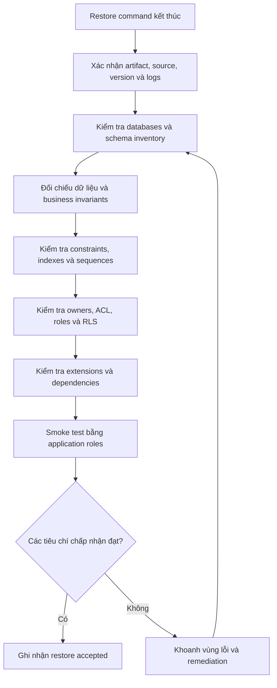

# Xác minh dữ liệu, ràng buộc, quyền và tính đầy đủ sau phục hồi PostgreSQL

Một lệnh restore kết thúc với exit code 0 là tín hiệu tốt, nhưng chưa chứng minh hệ thống đã sẵn sàng phục vụ ứng dụng. Database có thể thiếu bảng do dump scope không đầy đủ, foreign key chưa được validate, index ở trạng thái invalid, sequence đứng sau giá trị khóa lớn nhất, hoặc role của ứng dụng mất quyền truy cập. Một bản phục hồi chỉ được xem là hoàn tất khi **dữ liệu, cấu trúc, ràng buộc, quyền và hành vi ứng dụng đều đáp ứng yêu cầu**.

Bài học thuộc chương **Khôi phục**, tập trung vào cách xác minh một PostgreSQL database hoặc cluster sau khi restore:

- Xác định phạm vi, thời điểm và nguồn của bản backup.
- Kiểm tra database, schema, tables, partitions, indexes, constraints và extensions.
- Đối chiếu dữ liệu bằng row counts, aggregates, key ranges, checksums và business invariants.
- Xác minh foreign keys, check constraints, unique constraints và trạng thái validation.
- Kiểm tra sequence/identity state sau import.
- Xác minh owner, role memberships, ACL, default privileges, RLS và quyền kết nối.
- Kiểm tra large objects, functions, triggers, publications và các đối tượng đặc biệt.
- Chạy smoke tests, kiểm tra hiệu năng ban đầu và lập biên bản chấp nhận phục hồi.

> **Nguyên tắc:** restore thành công về mặt kỹ thuật và phục hồi đúng về mặt nghiệp vụ là hai kết luận khác nhau. Hãy dùng bằng chứng có thể lặp lại, ghi rõ giới hạn của từng phép đo và kiểm tra bằng đúng role mà ứng dụng sẽ sử dụng.

## 1. Các lớp xác minh sau restore

Không nên chỉ kiểm tra một vài bảng rồi kết luận database đã đầy đủ. Một quy trình tốt xem xét nhiều lớp độc lập.

| Lớp | Câu hỏi cần trả lời | Bằng chứng thường dùng |
| --- | --- | --- |
| Backup và restore execution | Đúng artifact, đúng source, lệnh restore hoàn tất? | Backup manifest, checksum, exit code, logs |
| Database và schema | Đúng databases, schemas, objects? | Catalog inventory, schema dump/diff |
| Data completeness | Rows và nội dung có đủ, đúng mốc? | Counts, aggregates, checksums, key ranges |
| Constraints | PK/FK/CHECK/UNIQUE có tồn tại và được validate? | `pg_constraint`, validation queries |
| Indexes | Index có hợp lệ và dùng được? | `pg_index.indisvalid`, `indisready` |
| Sequences | Giá trị sequence có thể cấp khóa mới mà không collision? | Sequence state và maximum key |
| Ownership và privileges | Đúng role sở hữu, ACL và membership? | `pg_roles`, ACL, `has_*_privilege()` |
| Security | RLS, policies, SECURITY DEFINER và authentication có đúng? | `pg_policies`, role-specific tests |
| Dependencies | Extensions, large objects, functions, triggers có đủ? | System catalogs và application tests |
| Application readiness | Ứng dụng có đọc/ghi/commit được? | Smoke tests, health checks, logs |
| Operational readiness | Capacity, monitoring, backup tiếp theo đã sẵn sàng? | Metrics, storage, replication, DR record |

Một lớp có thể đạt trong khi lớp khác thất bại. Ví dụ, mọi bảng đều tồn tại nhưng ứng dụng không đăng nhập được do role membership thiếu; hoặc số rows đúng nhưng sequence đứng sau `MAX(id)`.

### 1.1. Luồng xác minh



Đừng cho traffic production chuyển sang target chỉ vì bước B thành công. Hãy xác định trước tiêu chí chấp nhận và người có quyền quyết định cutover.

## 2. Xác nhận đúng nguồn backup và recovery point

Trước khi kiểm tra nội dung database, xác nhận bạn đã restore đúng artifact vào đúng target.

### 2.1. Ghi metadata của backup

Một backup inventory nên có ít nhất:

```text
backup_id
source_cluster
source_host_or_service
source_server_version
dump_client_version_or_base_backup_tool
backup_type
backup_scope
started_at
finished_at
snapshot_or_recovery_target
database_list
included_globals
included_tablespaces
included_extensions
wal_archive_range
artifact_path
artifact_size
checksum_algorithm
checksum
encryption_key_reference
restore_started_at
restore_finished_at
restore_target
restore_exit_code
restore_log
```

Với logical dump, ghi rõ dump toàn cluster, chỉ globals hay chỉ một database/schema/table. Với physical backup/PITR, ghi base backup và mốc WAL/recovery target.

### 2.2. Kiểm tra checksum

Nếu backup được lưu kèm SHA-256:

```bash
sha256sum -c cluster_backup.sql.sha256
```

Trên PowerShell:

```powershell
Get-FileHash -Algorithm SHA256 .\cluster_backup.sql
```

Checksum xác nhận artifact khớp với checksum đã ghi tại thời điểm tạo. Nó không chứng minh dữ liệu logic trong backup đúng, cũng không chứng minh restore thành công.

### 2.3. Xác nhận endpoint sau restore

Kết nối tới target và ghi nhận:

```sql
SELECT
    current_database() AS database_name,
    current_user AS current_role,
    session_user AS login_role,
    inet_server_addr() AS server_address,
    inet_server_port() AS server_port,
    version() AS server_version,
    current_setting('server_version_num') AS server_version_num,
    clock_timestamp() AS checked_at;
```

Đối chiếu host, port, version và environment label với kế hoạch restore. Trong môi trường có proxy hoặc managed service, `inet_server_addr()` có thể không phải địa chỉ endpoint người dùng kết nối; hãy kết hợp service inventory.

### 2.4. Phân biệt logical restore và PITR

Logical dump thường phục hồi trạng thái tại snapshot của quá trình dump. Physical backup kết hợp WAL archive có thể phục hồi tới recovery target đã chọn.

Vì vậy, câu hỏi “dữ liệu có đầy đủ không?” phải gắn với mốc thời gian:

- Logical dump: dữ liệu phản ánh snapshot của từng database được dump.
- PITR: dữ liệu phản ánh trạng thái đã replay WAL tới target time/LSN.
- Nhiều database được logical dump tuần tự: snapshot từng database có thể không cùng một thời điểm toàn cluster.

Nếu ứng dụng phụ thuộc vào dữ liệu đồng bộ giữa nhiều databases, cần ghi rõ consistency boundary khi đánh giá.

## 3. Xác nhận database và schema inventory

Bắt đầu bằng việc xác nhận đúng databases, owners, encoding, locale và tablespaces.

### 3.1. Liệt kê databases

```sql
SELECT
    d.datname,
    pg_get_userbyid(d.datdba) AS owner,
    pg_encoding_to_char(d.encoding) AS encoding,
    d.datcollate,
    d.datctype,
    t.spcname AS default_tablespace,
    d.datallowconn,
    d.datconnlimit
FROM pg_database AS d
JOIN pg_tablespace AS t ON t.oid = d.dattablespace
WHERE d.datistemplate = false
ORDER BY d.datname;
```

So sánh với backup manifest hoặc source inventory. Không phải mọi cluster đều cần database postgres và database ứng dụng có cùng mục tiêu phục hồi; xác định rõ database nào nằm trong scope.

### 3.2. Liệt kê schemas

Trong từng database:

```sql
SELECT
    n.nspname AS schema_name,
    pg_get_userbyid(n.nspowner) AS owner
FROM pg_namespace AS n
WHERE n.nspname NOT LIKE 'pg_temp_%'
  AND n.nspname NOT LIKE 'pg_toast_temp_%'
ORDER BY n.nspname;
```

Một schema hệ thống như `pg_catalog`, `information_schema` và các schema extension cần được phân biệt với schema do ứng dụng sở hữu. Đối chiếu schema ứng dụng theo manifest hoặc schema-only dump.

### 3.3. Đếm các loại relation

```sql
SELECT
    n.nspname AS schema_name,
    c.relkind,
    CASE c.relkind
        WHEN 'r' THEN 'table'
        WHEN 'p' THEN 'partitioned table'
        WHEN 'i' THEN 'index'
        WHEN 'I' THEN 'partitioned index'
        WHEN 'S' THEN 'sequence'
        WHEN 'v' THEN 'view'
        WHEN 'm' THEN 'materialized view'
        WHEN 'f' THEN 'foreign table'
        ELSE c.relkind::text
    END AS object_type,
    count(*) AS object_count
FROM pg_class AS c
JOIN pg_namespace AS n ON n.oid = c.relnamespace
WHERE n.nspname NOT IN ('pg_catalog', 'information_schema')
  AND n.nspname NOT LIKE 'pg_toast%'
GROUP BY n.nspname, c.relkind
ORDER BY n.nspname, c.relkind;
```

Đây là inventory catalog, không phải bằng chứng dữ liệu bên trong relation đã đầy đủ. Nó giúp phát hiện schema/table/index/sequence bị thiếu hoặc thừa.

### 3.4. So sánh schema bằng dump

Có thể tạo schema-only dump từ source và target:

```bash
pg_dump --schema-only --no-owner --no-privileges -d source_db -f source_schema.sql
pg_dump --schema-only --no-owner --no-privileges -d target_db -f target_schema.sql
```

Sau đó dùng diff tool để so sánh. Nếu cố ý bỏ owner/privileges bằng options, hãy kiểm tra chúng riêng qua catalog; đừng dùng hai file đã bỏ ACL để kết luận quyền đã giống nhau.

Dump SQL có thể chứa khác biệt do version, extension, object ordering hoặc metadata. Đọc diff theo semantics thay vì chỉ đếm số dòng khác nhau.

## 4. Xác minh số lượng dữ liệu

Row count là một kiểm tra dễ hiểu, nhưng phải dùng đúng cách.

### 4.1. Lấy row counts chính xác

```sql
SELECT count(*) AS exact_rows
FROM app.orders;
```

`COUNT(*)` cho kết quả chính xác tại snapshot của câu truy vấn, nhưng có thể quét toàn bảng và tốn I/O/CPU trên bảng lớn. Chạy theo lịch kiểm tra và cân nhắc tải hệ thống.

Không dùng `pg_class.reltuples` hoặc `pg_stat_user_tables.n_live_tup` như row count chính xác; đó là estimates.

### 4.2. Lấy estimates cho inventory nhanh

```sql
SELECT
    schemaname,
    relname,
    n_live_tup,
    n_dead_tup,
    last_analyze,
    last_autoanalyze
FROM pg_stat_user_tables
ORDER BY schemaname, relname;
```

Các estimates hữu ích để sàng lọc nhanh và xác định bảng bất thường. Sau restore, statistics có thể chưa được cập nhật; không coi `n_live_tup` là bằng chứng cuối cùng.

### 4.3. Đếm nhiều bảng trong một schema

Có thể tạo danh sách bảng cần đếm rồi chạy `COUNT(*)` cho từng bảng bằng script quản trị. Ví dụ lab dùng PL/pgSQL:

```sql
DO $$
DECLARE
    r record;
    row_count bigint;
BEGIN
    FOR r IN
        SELECT schemaname, tablename
        FROM pg_tables
        WHERE schemaname = 'app'
        ORDER BY tablename
    LOOP
        EXECUTE format(
            'SELECT count(*) FROM %I.%I',
            r.schemaname,
            r.tablename
        ) INTO row_count;

        RAISE NOTICE '%.%: % rows',
            r.schemaname, r.tablename, row_count;
    END LOOP;
END
$$;
```

Thông báo NOTICE có thể được ghi trong client output/log; với hệ thống lớn, nên lưu kết quả có cấu trúc vào bảng inventory hoặc file CSV thay vì dựa vào console text.

### 4.4. So sánh counts phải cùng consistency point

Nếu source vẫn nhận writes trong lúc bạn đếm, source count và target count có thể khác dù restore đúng. Hãy:

- Dừng writes trong cửa sổ kiểm tra, hoặc
- So sánh source tại snapshot/mốc phù hợp, hoặc
- Dùng logical replication/CDC watermark để xác định phần thay đổi sau backup, hoặc
- Chấp nhận và ghi rõ sai số do writes đang tiếp diễn.

Đừng kết luận mất dữ liệu chỉ từ hai counts lấy ở các thời điểm khác nhau.

### 4.5. Kiểm tra key range và business aggregates

Ngoài số rows, kiểm tra min/max key, số lượng theo trạng thái và tổng nghiệp vụ:

```sql
SELECT
    count(*) AS order_count,
    min(order_id) AS min_order_id,
    max(order_id) AS max_order_id,
    count(*) FILTER (WHERE status = 'paid') AS paid_orders,
    count(*) FILTER (WHERE status = 'pending') AS pending_orders,
    sum(total_amount) FILTER (WHERE status = 'paid') AS paid_amount
FROM app.orders;
```

Các aggregate nghiệp vụ có thể phát hiện thiếu một nhóm dữ liệu dù tổng row count gần như giống nhau. Chọn các invariants có ý nghĩa: số đơn theo ngày, tổng số dư, tổng số lượng inventory, số bản ghi theo tenant hoặc trạng thái.

## 5. Xác minh nội dung bằng checksum

Row count giống nhau không đảm bảo rows giống nhau. Có thể một row bị mất và một row khác bị duplicate, hoặc values bị thay đổi trong khi số lượng không đổi.

### 5.1. Checksum theo row

Nếu có extension `pgcrypto`, có thể tạo hash từ một biểu diễn dữ liệu ổn định:

```sql
SELECT
    order_id,
    encode(
        digest(
            concat_ws(
                '|',
                coalesce(customer_id::text, '<NULL>'),
                coalesce(status, '<NULL>'),
                coalesce(total_amount::text, '<NULL>'),
                coalesce(created_at::text, '<NULL>')
            ),
            'sha256'
        ),
        'hex'
    ) AS row_hash
FROM app.orders
ORDER BY order_id;
```

Ví dụ chỉ minh họa cách tạo row hash; delimiter-based concatenation cần tránh collision nếu dữ liệu có thể chứa delimiter hoặc literal `'<NULL>'`. Với dữ liệu quan trọng, dùng encoding không nhập nhằng, JSON/bytea canonicalization hoặc hash từng cột có length prefix.

### 5.2. Không giả định text serialization luôn giống nhau

Các giá trị timestamp, numeric, floating point, JSON, arrays, collations và custom types có thể được serialize khác nhau giữa versions hoặc settings.

Trước khi so checksum source/target:

- Chọn timezone cố định.
- Dùng format numeric ổn định.
- Chuẩn hóa JSON nếu thứ tự key không mang ý nghĩa.
- Xử lý NULL riêng biệt.
- Chuẩn hóa text encoding/collation nếu cần.
- Loại bỏ cột thay đổi theo restore nếu mục tiêu so sánh không bao gồm chúng.

Hash chỉ hữu ích khi cách canonicalize hai phía giống nhau.

### 5.3. Checksum tổng hợp theo chunks

Không nhất thiết kéo toàn bộ row hashes về máy quản trị. Chia dữ liệu theo key ranges và tính hash/aggregates theo từng chunk:

```sql
SELECT
    (order_id / 100000) AS key_bucket,
    count(*) AS row_count,
    min(order_id) AS min_id,
    max(order_id) AS max_id,
    sum(total_amount) AS amount_sum
FROM app.orders
GROUP BY (order_id / 100000)
ORDER BY key_bucket;
```

So sánh các bucket source/target giúp khoanh vùng khoảng key có vấn đề. Đây là aggregate check, chưa phải cryptographic checksum của mọi column.

### 5.4. Dùng pgcrypto digest khi cần hash bytes

Nếu `pgcrypto` đã cài:

```sql
SELECT encode(
    digest(convert_to('stable test value', 'UTF8'), 'sha256'),
    'hex'
);
```

Không cài extension chỉ để chạy một câu kiểm tra trên production khi chưa xem policy. Có thể tính hash ở application/ETL layer hoặc dùng công cụ so sánh dữ liệu chuyên dụng.

### 5.5. Hash toàn bảng có thể tốn tài nguyên

Một phép hash phải đọc dữ liệu. Với bảng hàng terabytes, full scan có thể gây I/O lớn. Thực hiện theo chunks, chọn giờ phù hợp, đo impact và ưu tiên các bảng/columns quan trọng theo RPO/RTO.

## 6. Xác minh primary keys và unique constraints

Primary key/unique constraints bảo đảm uniqueness và thường dựa trên unique indexes.

### 6.1. Liệt kê constraints

```sql
SELECT
    n.nspname AS schema_name,
    c.relname AS table_name,
    con.conname AS constraint_name,
    con.contype,
    con.convalidated,
    pg_get_constraintdef(con.oid, true) AS definition
FROM pg_constraint AS con
JOIN pg_class AS c ON c.oid = con.conrelid
JOIN pg_namespace AS n ON n.oid = c.relnamespace
WHERE n.nspname = 'app'
ORDER BY c.relname, con.conname;
```

Các loại thường gặp:

| contype | Loại constraint |
| --- | --- |
| p | Primary key |
| u | Unique |
| f | Foreign key |
| c | Check |
| x | Exclusion |

`convalidated = false` cho biết constraint chưa được validate đầy đủ trên dữ liệu hiện có. Đừng chỉ kiểm tra tên constraint có tồn tại.

### 6.2. Kiểm tra primary key bị thiếu

Tìm tables trong schema ứng dụng không có primary key:

```sql
SELECT
    n.nspname AS schema_name,
    c.relname AS table_name
FROM pg_class AS c
JOIN pg_namespace AS n ON n.oid = c.relnamespace
WHERE n.nspname = 'app'
  AND c.relkind IN ('r', 'p')
  AND NOT EXISTS (
      SELECT 1
      FROM pg_constraint AS con
      WHERE con.conrelid = c.oid
        AND con.contype = 'p'
  )
ORDER BY c.relname;
```

Một số bảng staging/log có thể được thiết kế không có primary key. So sánh với schema contract thay vì mặc định mọi bảng đều phải có PK.

### 6.3. Kiểm tra duplicate trước khi tạo unique constraint

Ví dụ với `order_number`:

```sql
SELECT
    order_number,
    count(*) AS duplicate_count
FROM app.orders
GROUP BY order_number
HAVING count(*) > 1
ORDER BY duplicate_count DESC
LIMIT 100;
```

Nếu có duplicates, tìm nguồn dữ liệu, xác định quy tắc nghiệp vụ và remediation trước khi tạo unique constraint. Không xóa duplicates tùy tiện sau restore.

## 7. Xác minh foreign keys và quan hệ tham chiếu

Foreign key đảm bảo rows ở bảng con tham chiếu tới key hợp lệ của bảng cha. Một foreign key tồn tại nhưng chưa validate có thể không bảo đảm toàn bộ dữ liệu cũ thỏa mãn quan hệ.

### 7.1. Liệt kê foreign keys và trạng thái validation

```sql
SELECT
    conrelid::regclass AS child_table,
    conname AS constraint_name,
    confrelid::regclass AS parent_table,
    convalidated,
    condeferrable,
    condeferred,
    pg_get_constraintdef(oid, true) AS definition
FROM pg_constraint
WHERE contype = 'f'
  AND connamespace = 'app'::regnamespace
ORDER BY conrelid::regclass::text, conname;
```

Kiểm tra cả bảng con, bảng cha, cột tham chiếu, ON DELETE/UPDATE actions và deferrability theo yêu cầu ứng dụng.

### 7.2. Tìm foreign keys chưa validate

```sql
SELECT
    conrelid::regclass AS child_table,
    conname,
    confrelid::regclass AS parent_table,
    pg_get_constraintdef(oid, true) AS definition
FROM pg_constraint
WHERE contype = 'f'
  AND NOT convalidated
ORDER BY conrelid::regclass::text, conname;
```

Nếu constraint được tạo bằng `NOT VALID`, nó vẫn có thể kiểm soát các thay đổi mới theo semantics PostgreSQL, nhưng các rows cũ chưa được xác minh. Cần đánh giá và validate sau khi dữ liệu đã được kiểm tra.

### 7.3. Validate foreign key

Sau khi xác nhận dữ liệu thỏa mãn:

```sql
ALTER TABLE app.order_items
VALIDATE CONSTRAINT order_items_order_id_fkey;
```

`VALIDATE CONSTRAINT` kiểm tra dữ liệu hiện có và có thể tốn thời gian/I/O. Lập kế hoạch với bảng lớn; theo dõi locks và workload. Không chạy validate hàng loạt trong giờ cao điểm mà không đánh giá.

### 7.4. Tìm orphan rows

Ví dụ tìm order items không có order tương ứng:

```sql
SELECT count(*) AS orphan_rows
FROM app.order_items AS i
LEFT JOIN app.orders AS o
  ON o.order_id = i.order_id
WHERE i.order_id IS NOT NULL
  AND o.order_id IS NULL;
```

Kết quả mong đợi thường là 0 nếu quan hệ bắt buộc. Nếu FK composite, phải join đủ mọi cột và xử lý NULL theo semantics của constraint. Với các match modes được hỗ trợ, logic kiểm tra cần tương ứng.

### 7.5. Deferrable constraints

Constraint `DEFERRABLE` có thể được kiểm tra cuối transaction thay vì ngay khi statement chạy. Sau restore, smoke test cần thử transaction commit để xác nhận các quan hệ thực sự hợp lệ; statement thành công trước COMMIT chưa đủ.

## 8. Xác minh CHECK constraints

CHECK constraint bảo đảm một biểu thức đúng cho mỗi row được kiểm tra.

### 8.1. Liệt kê check constraints

```sql
SELECT
    conrelid::regclass AS table_name,
    conname,
    convalidated,
    pg_get_constraintdef(oid, true) AS definition
FROM pg_constraint
WHERE contype = 'c'
  AND connamespace = 'app'::regnamespace
ORDER BY conrelid::regclass::text, conname;
```

### 8.2. Tìm rows vi phạm biểu thức

Ví dụ constraint:

```sql
ALTER TABLE app.orders
ADD CONSTRAINT orders_amount_nonnegative
CHECK (total_amount >= 0)
NOT VALID;
```

Truy vấn tìm vi phạm:

```sql
SELECT count(*) AS invalid_amount_rows
FROM app.orders
WHERE total_amount < 0;
```

Điều chỉnh biểu thức theo đúng constraint. Cần chú ý SQL CHECK cho kết quả TRUE hoặc NULL được xem là đạt; nếu muốn cột bắt buộc có giá trị, phải có `NOT NULL` riêng.

### 8.3. Validate check constraint

```sql
ALTER TABLE app.orders
VALIDATE CONSTRAINT orders_amount_nonnegative;
```

Sau khi validation thành công, `convalidated` sẽ là true. Ghi lại constraint nào cố ý để NOT VALID và lý do nếu chưa thể validate.

## 9. Xác minh indexes

Index có thể tồn tại trong catalog nhưng không hợp lệ để planner hoặc DML sử dụng. Điều này có thể xảy ra sau thao tác build concurrently thất bại hoặc restore/maintenance bị gián đoạn.

### 9.1. Liệt kê indexes không hợp lệ

```sql
SELECT
    ns.nspname AS schema_name,
    tbl.relname AS table_name,
    idx.relname AS index_name,
    i.indisvalid,
    i.indisready,
    i.indislive,
    pg_get_indexdef(idx.oid) AS index_definition
FROM pg_index AS i
JOIN pg_class AS idx ON idx.oid = i.indexrelid
JOIN pg_class AS tbl ON tbl.oid = i.indrelid
JOIN pg_namespace AS ns ON ns.oid = tbl.relnamespace
WHERE ns.nspname = 'app'
  AND (
      NOT i.indisvalid
      OR NOT i.indisready
      OR NOT i.indislive
  )
ORDER BY tbl.relname, idx.relname;
```

Nếu query trả về rows, điều tra trạng thái từng index. Không tự động drop/rebuild nếu chưa hiểu constraint dependencies và workload.

### 9.2. Kiểm tra index của primary/unique constraints

Index hỗ trợ constraint được tham chiếu trong `pg_constraint.conindid`. Một unique index invalid có thể khiến uniqueness enforcement không hoạt động như kỳ vọng. Đối chiếu constraint inventory với index state.

### 9.3. Rebuild index khi cần

Một lựa chọn là:

```sql
REINDEX INDEX app.orders_customer_id_idx;
```

Hoặc rebuild bảng/index theo quy trình thích hợp. `REINDEX` có thể tiêu thụ I/O, CPU, disk space và lock; `REINDEX CONCURRENTLY` có giới hạn và semantics riêng theo version. Lập kế hoạch trước khi chạy trên production.

### 9.4. Kiểm tra index definition và size

```sql
SELECT
    schemaname,
    tablename,
    indexname,
    indexdef
FROM pg_indexes
WHERE schemaname = 'app'
ORDER BY tablename, indexname;
```

Đối chiếu definition, column order, expressions, predicates, opclasses và INCLUDE columns với source schema. Chỉ thấy tên index giống nhau chưa đủ.

## 10. Xác minh sequences và identity columns

Một lỗi thường gặp sau restore dữ liệu là sequence chưa theo kịp giá trị khóa lớn nhất trong bảng. Lần INSERT tiếp theo có thể tạo duplicate key.

### 10.1. Liệt kê sequences

```sql
SELECT
    schemaname,
    sequencename,
    data_type,
    start_value,
    min_value,
    max_value,
    increment_by,
    cycle,
    cache_size,
    last_value
FROM pg_sequences
WHERE schemaname = 'app'
ORDER BY sequencename;
```

`last_value` có thể NULL nếu sequence chưa được sử dụng hoặc role không có quyền đọc theo semantics của view. `pg_sequences` cung cấp inventory, nhưng cần so sánh từng sequence với cột sở hữu tương ứng.

### 10.2. Tìm sequence được gắn với cột

```sql
SELECT
    table_schema,
    table_name,
    column_name,
    pg_get_serial_sequence(
        format('%I.%I', table_schema, table_name),
        column_name
    ) AS sequence_name
FROM information_schema.columns
WHERE table_schema = 'app'
  AND column_default LIKE 'nextval(%'
ORDER BY table_name, ordinal_position;
```

Query này tìm serial-style defaults. Identity columns có metadata khác; inventory identity columns riêng bằng `is_identity` và `identity_generation`.

### 10.3. Kiểm tra identity columns

```sql
SELECT
    table_schema,
    table_name,
    column_name,
    is_identity,
    identity_generation,
    is_generated,
    column_default
FROM information_schema.columns
WHERE table_schema = 'app'
  AND (is_identity = 'YES' OR column_default LIKE 'nextval(%')
ORDER BY table_name, ordinal_position;
```

### 10.4. So sánh sequence state với MAX(id)

Với một sequence cụ thể, đọc state trong maintenance window:

```sql
SELECT last_value, is_called
FROM app.orders_order_id_seq;
```

So sánh với:

```sql
SELECT max(order_id) AS max_existing_id
FROM app.orders;
```

Cần hiểu `is_called`:

- Nếu true, lần `nextval()` tiếp theo sẽ lấy giá trị kế tiếp theo increment.
- Nếu false, lần `nextval()` tiếp theo có thể trả chính `last_value`.

Vì vậy, không chỉ so `last_value` với MAX(id) mà bỏ qua `is_called`, increment và cycle.

### 10.5. Điều chỉnh sequence khi có bằng chứng cần thiết

Ví dụ sequence tăng dương 1, bảng không có writes đồng thời và muốn lần cấp tiếp theo lớn hơn max key:

```sql
SELECT setval(
    'app.orders_order_id_seq',
    COALESCE((SELECT max(order_id) FROM app.orders), 1),
    EXISTS (SELECT 1 FROM app.orders)
);
```

Ví dụ trên giả định sequence bắt đầu từ 1, increment dương 1 và giá trị mặc định phù hợp. Với bảng rỗng, `setval(..., 1, false)` làm lần `nextval()` kế tiếp trả 1. Nếu sequence có start/increment khác, hãy tính theo metadata thực tế.

Không chạy `setval()` đồng loạt bằng một công thức copy-paste cho mọi sequence. Kiểm tra ownership, data type, min/max, increment, cycle và concurrent inserts. Nên tạm dừng writers hoặc dùng maintenance window để tránh race giữa `MAX(id)` và `nextval()`.

## 11. Xác minh owners và role inventory

Một database có đủ objects nhưng owner sai có thể khiến migration, DDL, default privileges hoặc security-definer code hoạt động khác.

### 11.1. Kiểm tra roles quan trọng

```sql
SELECT
    rolname,
    rolsuper,
    rolinherit,
    rolcreaterole,
    rolcreatedb,
    rolcanlogin,
    rolreplication,
    rolbypassrls,
    rolconnlimit,
    rolvaliduntil
FROM pg_roles
ORDER BY rolname;
```

So sánh các service roles, owner roles, readonly roles và administrative roles với source inventory. `pg_roles` không hiển thị password verifier.

### 11.2. Kiểm tra owners của relations

```sql
SELECT
    n.nspname AS schema_name,
    c.relname AS relation_name,
    c.relkind,
    pg_get_userbyid(c.relowner) AS owner
FROM pg_class AS c
JOIN pg_namespace AS n ON n.oid = c.relnamespace
WHERE n.nspname = 'app'
  AND c.relkind IN ('r', 'p', 'v', 'm', 'S', 'f')
ORDER BY n.nspname, c.relname;
```

Kiểm tra thêm owners của schemas, functions, procedures, types và databases nếu chúng thuộc scope ứng dụng.

### 11.3. Kiểm tra owners của schemas

```sql
SELECT
    nspname,
    pg_get_userbyid(nspowner) AS owner
FROM pg_namespace
WHERE nspname = 'app'
ORDER BY nspname;
```

### 11.4. Kiểm tra role memberships

```sql
SELECT
    granted.rolname AS granted_role,
    member.rolname AS member_role,
    grantor.rolname AS grantor
FROM pg_auth_members AS m
JOIN pg_roles AS granted ON granted.oid = m.roleid
JOIN pg_roles AS member ON member.oid = m.member
JOIN pg_roles AS grantor ON grantor.oid = m.grantor
ORDER BY granted.rolname, member.rolname;
```

Các PostgreSQL versions mới có thể lưu thêm membership options như ADMIN, INHERIT và SET. Nếu các options này là một phần của security model, đối chiếu đầy đủ catalog columns của version đang chạy.

## 12. Xác minh ACL và privileges

Đừng chỉ nhìn role có LOGIN. Hãy kiểm tra quyền thực tế trên database, schema, tables, sequences và functions.

### 12.1. Quyền kết nối database

```sql
SELECT
    datname,
    has_database_privilege('app_service', datname, 'CONNECT') AS can_connect,
    has_database_privilege('app_service', datname, 'CREATE') AS can_create,
    has_database_privilege('app_service', datname, 'TEMP') AS can_temp
FROM pg_database
WHERE datname = current_database();
```

Thay `app_service` bằng role thực tế. Quyền CONNECT cũng phụ thuộc database ACL và các lớp authentication bên ngoài như `pg_hba.conf`.

### 12.2. Quyền trên schema

```sql
SELECT
    has_schema_privilege('app_service', 'app', 'USAGE') AS can_use_schema,
    has_schema_privilege('app_service', 'app', 'CREATE') AS can_create_in_schema;
```

`USAGE` cho phép truy cập/resolve objects trong schema theo quyền object tương ứng; `CREATE` cho phép tạo objects trong schema. Có USAGE không đồng nghĩa role có SELECT trên mọi table.

### 12.3. Quyền trên tables

```sql
SELECT
    has_table_privilege('app_service', 'app.orders', 'SELECT') AS can_select,
    has_table_privilege('app_service', 'app.orders', 'INSERT') AS can_insert,
    has_table_privilege('app_service', 'app.orders', 'UPDATE') AS can_update,
    has_table_privilege('app_service', 'app.orders', 'DELETE') AS can_delete,
    has_table_privilege('app_service', 'app.orders', 'TRUNCATE') AS can_truncate;
```

Dùng role-specific checks cho từng thao tác mà ứng dụng thực sự cần. Không cấp thêm quyền chỉ để làm cho test xanh.

### 12.4. Quyền trên sequences

```sql
SELECT
    has_sequence_privilege('app_service', 'app.orders_order_id_seq', 'USAGE') AS can_nextval,
    has_sequence_privilege('app_service', 'app.orders_order_id_seq', 'SELECT') AS can_read_state,
    has_sequence_privilege('app_service', 'app.orders_order_id_seq', 'UPDATE') AS can_set_value;
```

INSERT vào cột serial/identity có thể cần quyền sequence tùy cấu hình và cách ứng dụng sử dụng sequence. Kiểm tra đúng role và thao tác thực tế.

### 12.5. Quyền trên functions

```sql
SELECT has_function_privilege(
    'app_service',
    'app.calculate_tax(numeric)',
    'EXECUTE'
) AS can_execute;
```

Tên function cần xác định signature đầy đủ khi có overloads. Kiểm tra cả procedures và routines mà ứng dụng gọi.

### 12.6. ACL của relation

```sql
SELECT
    n.nspname,
    c.relname,
    c.relacl
FROM pg_class AS c
JOIN pg_namespace AS n ON n.oid = c.relnamespace
WHERE n.nspname = 'app'
ORDER BY c.relname;
```

ACL NULL thường có nghĩa dùng default privileges mặc định của object type/owner, không có nghĩa “không có quyền”. `has_*_privilege()` phù hợp hơn để kiểm tra quyền hiệu lực của một role.

## 13. Xác minh default privileges

Default privileges áp dụng cho objects được tạo trong tương lai bởi owner/role tương ứng. Chúng không tự sửa ACL của objects đã tồn tại.

### 13.1. Xem default ACL catalog

```sql
SELECT
    pg_get_userbyid(defaclrole) AS owner_role,
    COALESCE(n.nspname, '(all schemas)') AS schema_name,
    defaclobjtype,
    defaclacl
FROM pg_default_acl AS d
LEFT JOIN pg_namespace AS n ON n.oid = d.defaclnamespace
ORDER BY owner_role, schema_name, defaclobjtype;
```

Đối chiếu owner role, schema scope và object type với source.

### 13.2. Vì sao default privileges quan trọng?

Giả sử application role được cấp quyền SELECT mặc định trên mọi table mới do `app_owner` tạo. Nếu default ACL bị thiếu, các table hiện tại vẫn có thể truy cập được nhưng deployment tiếp theo tạo table mới sẽ khiến ứng dụng gặp permission denied.

### 13.3. Kiểm tra bằng object mới trong lab

Trên target test, tạo một object bằng đúng owner role, sau đó kiểm tra quyền của service role. Không tạo object thử trên production schema nếu chưa có kế hoạch cleanup và approval phù hợp.

## 14. Xác minh Row-Level Security (RLS)

RLS có thể làm cho cùng một role nhìn thấy số rows khác nhau. Một phép `COUNT(*)` bằng role quản trị không chứng minh application role có thể nhìn thấy dữ liệu mà nó cần.

### 14.1. Liệt kê bảng có RLS

```sql
SELECT
    n.nspname AS schema_name,
    c.relname AS table_name,
    c.relrowsecurity AS rls_enabled,
    c.relforcerowsecurity AS rls_forced,
    pg_get_userbyid(c.relowner) AS owner
FROM pg_class AS c
JOIN pg_namespace AS n ON n.oid = c.relnamespace
WHERE n.nspname = 'app'
  AND c.relkind IN ('r', 'p')
  AND (c.relrowsecurity OR c.relforcerowsecurity)
ORDER BY c.relname;
```

### 14.2. Liệt kê policies

```sql
SELECT
    schemaname,
    tablename,
    policyname,
    permissive,
    roles,
    cmd,
    qual,
    with_check
FROM pg_policies
WHERE schemaname = 'app'
ORDER BY tablename, policyname;
```

So sánh policy expressions, role lists, command scope và permissive/restrictive behavior.

### 14.3. Kiểm tra theo đúng application role

Có thể dùng session lab:

```sql
BEGIN;
SET LOCAL ROLE app_service;

SELECT count(*) FROM app.orders;

ROLLBACK;
```

`SET LOCAL ROLE` cần membership/SET ROLE permission phù hợp. Nếu không thể assume role, kết nối trực tiếp bằng credential application role trên môi trường test. Không dùng superuser để kiểm tra RLS vì superuser và role có BYPASSRLS có thể bỏ qua policy.

### 14.4. FORCE ROW LEVEL SECURITY

Table owner thường có thể bypass RLS trừ khi policy được force theo cấu hình tương ứng. `relforcerowsecurity` là một phần cần xác minh nếu application security phụ thuộc vào owner behavior.

## 15. Xác minh extensions, functions, triggers và dependencies

Database dump có thể khôi phục object definitions nhưng server target vẫn phải có các thành phần cần thiết.

### 15.1. Extensions

```sql
SELECT
    e.extname,
    e.extversion,
    n.nspname AS schema_name
FROM pg_extension AS e
JOIN pg_namespace AS n ON n.oid = e.extnamespace
ORDER BY e.extname;
```

Đối chiếu extension names và versions với source. Cài package/shared library tương thích trên target trước restore nếu extension yêu cầu. Không tự động nâng extension version trong quá trình xác minh; upgrade cần kế hoạch riêng.

### 15.2. Functions và procedures

```sql
SELECT
    n.nspname AS schema_name,
    p.proname AS routine_name,
    pg_get_userbyid(p.proowner) AS owner,
    p.prokind,
    p.prosecdef AS security_definer,
    pg_get_function_identity_arguments(p.oid) AS arguments
FROM pg_proc AS p
JOIN pg_namespace AS n ON n.oid = p.pronamespace
WHERE n.nspname = 'app'
ORDER BY p.proname, arguments;
```

Kiểm tra routines quan trọng có mặt, đúng owner, security mode và signature. Với SECURITY DEFINER, kiểm tra `search_path` và quyền execute để tránh thay đổi bảo mật ngoài ý muốn.

### 15.3. Triggers

```sql
SELECT
    t.tgrelid::regclass AS table_name,
    t.tgname AS trigger_name,
    t.tgenabled,
    pg_get_triggerdef(t.oid, true) AS definition
FROM pg_trigger AS t
JOIN pg_class AS c ON c.oid = t.tgrelid
JOIN pg_namespace AS n ON n.oid = c.relnamespace
WHERE NOT t.tgisinternal
  AND n.nspname = 'app'
ORDER BY t.tgrelid::regclass::text, t.tgname;
```

`tgenabled` biểu thị trạng thái trigger. Một số restore workflows tạm disable triggers hoặc dùng session replication role; xác minh cuối cùng rằng trigger được bật đúng như thiết kế.

### 15.4. Views và materialized views

Kiểm tra views có definition và dependencies hợp lệ. Materialized views có thể cần refresh theo kế hoạch nếu backup/restore strategy không chứa dữ liệu materialized như mong muốn hoặc phụ thuộc vào trạng thái nguồn.

```sql
SELECT
    schemaname,
    matviewname,
    ispopulated
FROM pg_matviews
WHERE schemaname = 'app'
ORDER BY matviewname;
```

`ispopulated = false` nghĩa materialized view chưa có dữ liệu để đọc. Nếu refresh, xem chi phí, lock và thời gian hoàn thành.

## 16. Xác minh partitions và partition bounds

Với partitioned tables, kiểm tra parent, leaf partitions, bounds và số lượng rows theo partition.

### 16.1. Liệt kê partition tree

```sql
SELECT
    parentrelid::regclass AS parent_table,
    relid::regclass AS partition_table,
    isleaf,
    level
FROM pg_partition_tree('app.events'::regclass)
ORDER BY level, partition_table::text;
```

Hàm `pg_partition_tree()` có trên các PostgreSQL versions hỗ trợ partitioning tương ứng. Kiểm tra version trước khi đưa query vào automation.

### 16.2. Kiểm tra partition bounds

```sql
SELECT
    c.oid::regclass AS partition_name,
    pg_get_expr(c.relpartbound, c.oid) AS partition_bound
FROM pg_class AS c
WHERE c.relispartition
  AND c.relnamespace = 'app'::regnamespace
ORDER BY c.oid::regclass::text;
```

Đối chiếu khoảng thời gian/key range của partitions với source. Partition bị thiếu có thể không tạo lỗi trong restore nhưng làm query bỏ sót dữ liệu hoặc insert mới không tìm được partition.

### 16.3. Kiểm tra rows theo partition

```sql
SELECT tableoid::regclass AS partition_name, count(*) AS rows
FROM app.events
GROUP BY tableoid
ORDER BY partition_name;
```

Với partition lớn, `COUNT(*)` vẫn tốn scan. Dùng statistics estimates cho inventory nhanh và exact count cho partitions quan trọng theo maintenance window.

## 17. Xác minh large objects và dữ liệu ngoài bảng

PostgreSQL hỗ trợ large objects lưu trong hệ thống catalog riêng, không giống cột bytea thông thường.

### 17.1. Đếm large objects

```sql
SELECT count(*) AS large_object_count
FROM pg_largeobject_metadata;
```

Đối chiếu count với source nếu large objects nằm trong backup scope. Cần kiểm tra ACL/owner của large objects theo nhu cầu ứng dụng.

### 17.2. Xem owners của large objects

```sql
SELECT
    oid,
    lomowner::regrole AS owner,
    lomacl
FROM pg_largeobject_metadata
ORDER BY oid;
```

Không giả định `pg_dump` luôn bao gồm large objects nếu dump options hoặc scope đã loại bỏ chúng. Xác nhận option và restore logs.

### 17.3. File ngoài database

Nếu ứng dụng lưu file trong object storage, filesystem hoặc dịch vụ khác, logical database restore không tự phục hồi các bytes đó. Cần kiểm tra object keys, file counts, checksums và referential links giữa database với external storage.

## 18. Kiểm tra data consistency theo quan hệ nghiệp vụ

Row counts và constraints là nền tảng. Ứng dụng còn có các quy tắc nghiệp vụ không được biểu diễn đầy đủ bằng constraints.

### 18.1. Kiểm tra tổng số dư

Ví dụ hệ thống ledger:

```sql
SELECT
    account_id,
    sum(amount) AS net_amount
FROM app.ledger_entries
GROUP BY account_id
ORDER BY account_id;
```

Đối chiếu với balance snapshots hoặc ledger totals đã được chốt tại cùng recovery point. Không so với số dư live nếu source đã nhận giao dịch sau thời điểm backup.

### 18.2. Kiểm tra quan hệ trạng thái

Ví dụ order đã thanh toán phải có payment record:

```sql
SELECT count(*) AS paid_without_payment
FROM app.orders AS o
WHERE o.status = 'paid'
  AND NOT EXISTS (
      SELECT 1
      FROM app.payments AS p
      WHERE p.order_id = o.order_id
        AND p.status = 'captured'
  );
```

Kết quả kỳ vọng phụ thuộc business rules: partial payments, refunds hoặc asynchronous settlement có thể làm thay đổi điều kiện.

### 18.3. Kiểm tra thời gian và vùng dữ liệu

```sql
SELECT
    date_trunc('day', created_at) AS day,
    count(*) AS rows_per_day
FROM app.events
GROUP BY 1
ORDER BY 1;
```

Đặc biệt chú ý timezone và recovery target. Dữ liệu ở cuối ngày có thể bị lệch bucket nếu source và target dùng timezone/session settings khác nhau.

### 18.4. Kiểm tra khoảng trống khóa

Với sequence-generated IDs, khoảng trống không nhất thiết là lỗi: rollback, cache, sequence allocation và deletes đều có thể tạo gaps. Dùng key range và business identifiers để tìm dữ liệu thiếu; không yêu cầu IDs phải liên tiếp.

## 19. Kiểm tra statistics và khả năng chạy query

Sau restore, planner statistics có thể chưa phù hợp. Query có thể đúng nhưng chậm do estimate sai.

### 19.1. Xem thời điểm ANALYZE

```sql
SELECT
    schemaname,
    relname,
    last_analyze,
    last_autoanalyze,
    n_live_tup,
    n_mod_since_analyze
FROM pg_stat_user_tables
ORDER BY schemaname, relname;
```

Nếu statistics chưa có hoặc stale, chạy `ANALYZE` theo kế hoạch. Không cần chạy `VACUUM FULL` chỉ vì restore vừa xong.

### 19.2. Analyze database hoặc bảng quan trọng

```sql
ANALYZE;
ANALYZE app.orders;
ANALYZE app.order_items;
ANALYZE app.customers;
```

`ANALYZE` thu thập planner statistics, không kiểm tra tính đầy đủ dữ liệu và không thay thế constraint validation.

### 19.3. Smoke test query plans

Chạy các query quan trọng với:

```sql
EXPLAIN (COSTS, VERBOSE)
SELECT order_id, created_at, total_amount
FROM app.orders
WHERE customer_id = 42
ORDER BY created_at DESC
LIMIT 50;
```

Đừng dùng `EXPLAIN ANALYZE` một cách máy móc trên query có side effects hoặc tải lớn. Nó thực thi query thật. So sánh plan với baseline và xác nhận indexes/column statistics cần thiết.

## 20. Kiểm tra quyền bằng role thực tế của ứng dụng

Một trong các lỗi phổ biến nhất là chỉ chạy kiểm tra bằng superuser. Superuser bỏ qua nhiều giới hạn mà ứng dụng phải tuân thủ.

### 20.1. Kết nối trực tiếp bằng service role

Ưu tiên kiểm tra qua connection string/secret test của application role trên môi trường restore. Chạy:

```sql
SELECT
    current_user,
    session_user,
    current_database(),
    current_setting('search_path'),
    current_setting('row_security');
```

Đảm bảo đúng database, role và session settings.

### 20.2. Smoke tests đọc/ghi trong transaction có rollback

Trong database test, có thể tạo một row kiểm tra rồi rollback:

```sql
BEGIN;

INSERT INTO app.restore_smoke_test (test_key, test_value)
VALUES ('restore-check', 'temporary');

SELECT *
FROM app.restore_smoke_test
WHERE test_key = 'restore-check';

ROLLBACK;
```

Thực hiện bằng application role. Điều này kiểm tra schema usage, INSERT/SELECT và một số trigger/policy behavior. Nó không kiểm tra commit durability hay external side effects vì transaction được rollback.

### 20.3. Test commit chỉ trên dữ liệu test có cleanup plan

Nếu cần xác minh sequence, triggers hoặc asynchronous workers sau commit, dùng một test tenant/record có thể xóa theo quy trình. Không tạo dữ liệu giả trong bảng nghiệp vụ production mà không có owner và cleanup.

### 20.4. Kiểm tra authentication riêng

SQL privilege test không xác minh TLS, certificate, `pg_hba.conf`, password rotation, IAM token hoặc connection pool. Hãy thử kết nối bằng đúng phương thức authentication của ứng dụng.

## 21. Kiểm tra database-level settings và search_path

Role/database settings có thể làm thay đổi hành vi sau restore.

### 21.1. Xem settings theo role/database

```sql
SELECT
    COALESCE(r.rolname, '(all roles)') AS role_name,
    COALESCE(d.datname, '(all databases)') AS database_name,
    unnest(s.setconfig) AS setting
FROM pg_db_role_setting AS s
LEFT JOIN pg_roles AS r ON r.oid = s.setrole
LEFT JOIN pg_database AS d ON d.oid = s.setdatabase
ORDER BY role_name, database_name, setting;
```

### 21.2. Kiểm tra search_path

```sql
SHOW search_path;
```

Một `search_path` khác có thể khiến ứng dụng resolve nhầm function/table hoặc tạo objects vào schema sai. Với SECURITY DEFINER functions, `search_path` còn là yếu tố bảo mật.

### 21.3. Kiểm tra các tham số quan trọng

```sql
SELECT name, setting, unit, source
FROM pg_settings
WHERE name IN (
    'TimeZone',
    'DateStyle',
    'default_transaction_isolation',
    'default_transaction_read_only',
    'search_path',
    'row_security',
    'standard_conforming_strings'
)
ORDER BY name;
```

Một số giá trị được override ở role/database/session level. `pg_settings.source` và `current_setting()` trong đúng session giúp giải thích effective value.

## 22. Kiểm tra publications, subscriptions và replication objects

Nếu ứng dụng dùng logical replication, xác minh publication/subscription metadata và trạng thái đồng bộ.

### 22.1. Publications

```sql
SELECT
    pubname,
    pubowner::regrole AS owner,
    puballtables,
    pubinsert,
    pubupdate,
    pubdelete,
    pubtruncate
FROM pg_publication
ORDER BY pubname;
```

Các cột và options có thể thay đổi theo version. Kiểm tra publication tables và column/row filters nếu hệ thống sử dụng chúng.

### 22.2. Publication tables

```sql
SELECT *
FROM pg_publication_tables
ORDER BY pubname, schemaname, tablename;
```

Đối chiếu danh sách bảng và filters với source design.

### 22.3. Subscriptions

```sql
SELECT
    subname,
    subowner::regrole AS owner,
    subenabled,
    subslotname,
    subpublications
FROM pg_subscription
ORDER BY subname;
```

Subscriptions có connection information nhạy cảm và behavior phụ thuộc restore scenario/version. Không bật subscriptions trên target production mới nếu điều đó có thể tạo hai consumers cùng apply một stream hoặc gây duplicate processing. Lập kế hoạch reconfiguration rõ ràng.

### 22.4. Physical replication

Với physical standby, kiểm tra recovery state và replication lag:

```sql
SELECT
    pg_is_in_recovery() AS is_standby,
    pg_last_wal_receive_lsn() AS last_received_lsn,
    pg_last_wal_replay_lsn() AS last_replayed_lsn,
    pg_last_xact_replay_timestamp() AS last_replayed_transaction_at;
```

Trên primary, dùng `pg_stat_replication` để kiểm tra sender/standby status. Không coi một timestamp replay cũ là lag chính xác khi primary không có writes; kết hợp LSN delta và workload.

## 23. Kiểm tra dữ liệu sau PITR

Với Point-in-Time Recovery, ngoài kiểm tra cấu trúc và dữ liệu, cần xác minh recovery đã dừng tại đúng target.

### 23.1. Xác nhận recovery state

Trên instance đang recovery:

```sql
SELECT
    pg_is_in_recovery() AS is_in_recovery,
    pg_last_wal_replay_lsn() AS replay_lsn,
    pg_last_xact_replay_timestamp() AS last_replayed_transaction_at;
```

Đối chiếu với recovery target time/LSN và log startup. Sau khi promote, `pg_is_in_recovery()` thay đổi; giữ log và evidence trước/sau promote.

### 23.2. Transaction timestamp không phải recovery target chính xác

`pg_last_xact_replay_timestamp()` là timestamp của transaction cuối cùng được replay, không nhất thiết bằng recovery target. Nếu không có transaction gần target, giá trị có thể cũ hơn nhiều dù recovery đã đạt điều kiện target.

Dùng PostgreSQL recovery logs và target configuration để xác nhận chính xác hơn.

### 23.3. Kiểm tra transaction cuối và business watermark

Nếu ứng dụng ghi sequence number/event offset, kiểm tra watermark cuối cùng đã phục hồi. Ví dụ:

```sql
SELECT
    max(event_id) AS max_event_id,
    max(occurred_at) AS latest_event_time,
    count(*) AS event_count
FROM app.events;
```

Đối chiếu với event producer, queue offsets hoặc audit ledger tại target time. Timestamp tối đa không tự chứng minh mọi event trước đó đã có đủ.

## 24. Kiểm tra database size và tablespace placement

Dung lượng khác biệt có thể là dấu hiệu cần điều tra, nhưng không nhất thiết chứng minh thiếu dữ liệu. Index bloat, fillfactor, TOAST, compression, physical layout và version có thể làm size khác nhau.

### 24.1. Database sizes

```sql
SELECT
    datname,
    pg_size_pretty(pg_database_size(datname)) AS database_size
FROM pg_database
WHERE datistemplate = false
ORDER BY pg_database_size(datname) DESC;
```

### 24.2. Table và index sizes

Trong database:

```sql
SELECT
    schemaname,
    relname,
    pg_size_pretty(pg_total_relation_size(
        format('%I.%I', schemaname, relname)::regclass
    )) AS total_size,
    pg_size_pretty(pg_relation_size(
        format('%I.%I', schemaname, relname)::regclass
    )) AS heap_size,
    pg_size_pretty(pg_indexes_size(
        format('%I.%I', schemaname, relname)::regclass
    )) AS indexes_size
FROM pg_stat_user_tables
ORDER BY pg_total_relation_size(
    format('%I.%I', schemaname, relname)::regclass
) DESC;
```

Query dựa vào schema/name của `pg_stat_user_tables`; kiểm tra relation vẫn tồn tại khi chạy. Kích thước là bytes trên target, không thay thế data-level comparison.

### 24.3. Tablespace mapping

```sql
SELECT
    spcname,
    pg_get_userbyid(spcowner) AS owner,
    pg_tablespace_location(oid) AS location
FROM pg_tablespace
ORDER BY spcname;
```

Kiểm tra relation placement nếu source dùng nhiều tablespaces. Nếu restore cố ý đưa mọi thứ vào `pg_default`, ghi nhận đây là thay đổi kiến trúc và đánh giá storage/performance capacity.

## 25. Phát hiện objects bị thiếu hoặc không mong đợi

Dùng inventory từ source backup hoặc schema manifest để so sánh:

- Số lượng schemas và relations.
- Tables, partitions và partition bounds.
- Index definitions.
- Constraints và validation state.
- Views/materialized views.
- Functions/procedures và signatures.
- Triggers và enabled state.
- Sequences/identity columns.
- Extensions và versions.
- Owners, grants và default ACLs.
- Large objects.
- Publications/subscriptions nếu có trong scope.

### 25.1. Không chỉ so object counts

Hai database có cùng số tables vẫn có thể khác một table bị thiếu và một table khác thừa. So theo qualified name và definition, không chỉ đếm tổng.

### 25.2. Xử lý objects phụ thuộc extension

Một số objects do extension quản lý không nên được tạo/drop thủ công. So sánh extension version và extension membership; sử dụng extension scripts theo hướng dẫn thay vì chỉnh catalog.

### 25.3. Object tồn tại nhưng dependency thiếu

Function có thể tồn tại nhưng language handler, extension library hoặc referenced type không có. Smoke test routine quan trọng và xem restore logs để phát hiện dependency errors.

## 26. Restore logs và cách diễn giải lỗi

Restore logs là bằng chứng quan trọng. Với `psql`, bật dừng khi có lỗi:

```bash
psql -X \
  -v ON_ERROR_STOP=1 \
  -U restore_admin \
  -d postgres \
  -f cluster.sql \
  > restore.stdout.log \
  2> restore.stderr.log
```

Với `pg_restore`:

```bash
pg_restore \
  --exit-on-error \
  --verbose \
  --dbname=target_db \
  database.dump \
  > restore.stdout.log \
  2> restore.stderr.log
```

Kiểm tra exit code trong shell sau khi lệnh kết thúc. Một restore có warning có thể vẫn exit 0 tùy loại warning; đọc log và xác định warning nào ảnh hưởng dữ liệu/quyền.

### 26.1. Các nhóm lỗi phổ biến

| Nhóm lỗi | Ví dụ | Ảnh hưởng cần xác định |
| --- | --- | --- |
| Ownership | Role không tồn tại | Owner/ACL có thể thiếu |
| Privilege | Permission denied | Object hoặc ACL không restore đầy đủ |
| Extension | Extension control file missing | Function/type/operator dependencies thiếu |
| Tablespace | Path không tồn tại | Placement hoặc database creation thất bại |
| Constraint | Duplicate key / FK violation | Dữ liệu không thỏa constraint hoặc thứ tự restore |
| Index | Could not create index | Query plan/uniqueness có thể bị ảnh hưởng |
| Encoding/collation | Locale không tương thích | Sort/index semantics có thể khác |
| Version syntax | Unsupported command | Một phần DDL có thể không được áp dụng |
| Disk/resource | No space, OOM, timeout | Restore có thể dừng giữa chừng |

### 26.2. Không bỏ qua lỗi chỉ vì bảng có dữ liệu

Một table có thể được nạp rows nhưng indexes hoặc constraints không tạo được. Query SELECT vẫn chạy, song uniqueness, referential integrity hoặc performance có thể sai.

### 26.3. Sau lỗi giữa chừng, xác định trạng thái partial

Không chạy lại toàn bộ restore một cách mù quáng. Xác định câu lệnh cuối thành công, objects đã tạo, dữ liệu đã nạp và transaction boundaries. Chọn cách tiếp tục, drop/recreate target test hoặc restore lại từ đầu theo runbook.

## 27. Tạo validation report có thể kiểm toán

Một báo cáo phục hồi nên chứa evidence, expected values, observed values và trạng thái.

Mẫu:

| Kiểm tra | Expected | Observed | Evidence | Result |
| --- | --- | --- | --- | --- |
| Backup checksum | Match | Match | SHA-256 record | Pass |
| Database inventory | 4 databases | 4 | `pg_database` | Pass |
| App schemas | 6 schemas | 6 | `pg_namespace` | Pass |
| Orders count | 12.5M | 12.5M | Exact count at snapshot | Pass |
| Orphan order items | 0 | 0 | FK anti-join | Pass |
| Invalid indexes | 0 | 0 | `pg_index` | Pass |
| Unvalidated constraints | 0 expected | 0 | `pg_constraint` | Pass |
| Sequence headroom | Next value safe | Safe | Sequence state vs max key | Pass |
| Application grants | Required set | Verified | `has_*_privilege()` | Pass |
| RLS policies | Match manifest | Match | `pg_policies` | Pass |
| Extensions | Required versions | Match | `pg_extension` | Pass |
| Smoke tests | All pass | All pass | Test log | Pass |

Không dùng “Pass” nếu chưa có evidence. Nếu kiểm tra bị bỏ qua hoặc không thể thực hiện, ghi `Not checked` cùng lý do và owner chịu trách nhiệm.

### 27.1. Ghi thời điểm và role của mỗi phép đo

Một report tốt có:

- Checked timestamp.
- Target endpoint/database.
- Query/script version.
- Role dùng để chạy.
- Snapshot/recovery target.
- Expected value và observed value.
- Result và evidence path.
- Known limitation.
- Người/nhóm phê duyệt cutover.

### 27.2. Phân biệt pass, warning và blocker

- **Pass:** kiểm tra có evidence và đạt expected state.
- **Warning:** sai khác được hiểu, có chấp thuận và không cản trở mục tiêu phục hồi.
- **Blocker:** dữ liệu, cấu trúc, quyền hoặc consistency không đáp ứng yêu cầu; chưa cutover.
- **Not checked:** chưa có evidence; không được diễn giải thành pass.

## 28. Runbook xác minh sau phục hồi

Thực hiện theo thứ tự để giảm khả năng bỏ sót dependency.

**Bước 1 — Xác định backup artifact.** Kiểm tra checksum, scope, source version, database list, backup timestamp và recovery target.

**Bước 2 — Xác nhận target.** Ghi endpoint, version, database, role, timezone và recovery state.

**Bước 3 — Đọc restore logs.** Kiểm tra exit code, errors, warnings, database nào bị bỏ qua và restore có dừng giữa chừng không.

**Bước 4 — Kiểm tra database/schema inventory.** Đối chiếu database, schema, relation, partition, extension và object definitions.

**Bước 5 — Đối chiếu dữ liệu.** Chạy exact counts cho bảng quan trọng, key ranges, aggregates, chunk checksums và business invariants tại cùng consistency point.

**Bước 6 — Kiểm tra constraints.** PK, unique, FK, CHECK, `convalidated`, orphan rows và duplicates.

**Bước 7 — Kiểm tra indexes.** `indisvalid`, `indisready`, `indislive`, index definitions và constraint-backed indexes.

**Bước 8 — Kiểm tra sequences/identity.** So state với max keys, increment, cycle và `is_called`; điều chỉnh chỉ khi có bằng chứng.

**Bước 9 — Kiểm tra ownership/ACL.** Roles, memberships, database/schema/table/sequence/function privileges, default ACL và role/database settings.

**Bước 10 — Kiểm tra security.** RLS enabled/forced, policies, SECURITY DEFINER, trigger state và authentication.

**Bước 11 — Kiểm tra dependencies.** Extensions, large objects, tablespaces, external storage references, publications/subscriptions.

**Bước 12 — Cập nhật statistics.** Chạy ANALYZE theo workload và kiểm tra query plans quan trọng.

**Bước 13 — Smoke test.** Kết nối bằng application roles, đọc/ghi test records, commit theo test plan và xác minh external side effects.

**Bước 14 — Kiểm tra vận hành.** Disk, connection limits, monitoring, replication, archive, backup schedule và alerting.

**Bước 15 — Ghi acceptance report.** Pass/warning/blocker, evidence, known limitations, owner và quyết định cutover.

## 29. Tiêu chí chấp nhận phục hồi

Trước khi bắt đầu restore, định nghĩa acceptance criteria theo hệ thống.

### 29.1. Data criteria

Ví dụ:

- Tất cả databases/schemas trong backup scope tồn tại.
- Các bảng trọng yếu có counts hoặc checksums khớp theo recovery point.
- Các business aggregates nằm trong expected range.
- Không có orphan references ngoài ngoại lệ được phê duyệt.
- Các partition cần thiết và key ranges đã có.

### 29.2. Integrity criteria

- PK/unique constraints đầy đủ và hợp lệ.
- FK/CHECK constraints được validate hoặc có waiver rõ ràng.
- Không có invalid indexes không được giải thích.
- Sequence/identity có thể cấp giá trị tiếp theo an toàn.
- Trigger/function dependencies cần thiết đã hoạt động.

### 29.3. Security criteria

- Owners đúng.
- Service roles tồn tại và có membership phù hợp.
- ACL và default privileges đáp ứng application contract.
- RLS policies và FORCE RLS đúng.
- Authentication, TLS và secrets hoạt động.
- Không có quyền quá mức ngoài policy.

### 29.4. Operational criteria

- Query trọng yếu đáp ứng performance baseline hoặc SLO tạm thời.
- Storage còn headroom.
- Monitoring và alerting hoạt động.
- Replication/archive được cấu hình đúng nếu cần.
- Backup tiếp theo đã được lên lịch và có thể chạy.
- RPO/RTO thực tế được ghi nhận.

## 30. Những anti-pattern cần tránh

| Anti-pattern | Vì sao nguy hiểm | Cách làm tốt hơn |
| --- | --- | --- |
| Chỉ nhìn exit code restore | Có thể bỏ sót warnings và scope thiếu | Đọc logs và xác minh inventory |
| Chỉ so row counts | Rows có thể khác nội dung | Dùng aggregates, hashes và business checks |
| Dùng estimates làm exact counts | Statistics có sai số | Dùng `COUNT(*)` có kiểm soát |
| So source/target ở hai thời điểm khác nhau | Writes đang tiếp diễn tạo chênh lệch giả | Cố định snapshot/recovery point |
| Chỉ kiểm tra bằng superuser | Bỏ qua quyền/RLS mà app phải chịu | Test bằng service roles |
| Bỏ qua `convalidated` | Constraint có thể chưa kiểm tra dữ liệu cũ | Kiểm tra và validate có kế hoạch |
| Bỏ qua index validity | Index có thể tồn tại nhưng invalid | Đọc `pg_index` |
| Set sequence theo MAX(id) máy móc | Sai với increment/cycle/is_called hoặc có writers | Đọc metadata và dừng writers khi sửa |
| Chỉ kiểm tra owner của tables | Schema/functions/sequences có thể sai owner | Kiểm tra toàn bộ object classes |
| Bỏ qua default privileges | Deploy sau restore có thể lỗi | So `pg_default_acl` và test object mới |
| Kiểm tra RLS bằng superuser | Superuser có thể bypass policy | Kết nối bằng application role |
| Bỏ qua extension binaries | SQL definitions không đủ để chạy extension | Cài package đúng version trước restore |
| So database size rồi kết luận mất dữ liệu | Physical layout có thể khác | Dùng size như tín hiệu, không làm bằng chứng duy nhất |
| Chạy REINDEX/VACUUM FULL hàng loạt ngay | Tốn I/O, lock và disk | Điều tra từng object, lập kế hoạch |
| Cutover trước smoke test | Application có thể lỗi auth/sequence/dependencies | Chỉ cutover sau acceptance |
| Không lưu validation evidence | Khó audit và tái hiện | Ghi query, timestamp, role và output |

## 31. Bài thực hành

Thực hiện trong PostgreSQL lab có source và target riêng. Không chạy các câu lệnh sửa dữ liệu, `setval()`, `VALIDATE CONSTRAINT`, `REINDEX` hoặc smoke writes trên production khi chưa có change plan.

### Bài 1 — Xác nhận target

Chạy query endpoint/version/current role. Ghi lại server, database, role và timestamp. Giải thích vì sao cần xác nhận endpoint trước khi đánh giá dữ liệu.

### Bài 2 — Database inventory

Liệt kê databases, owners, encoding, locale và tablespace. So sánh với manifest backup.

### Bài 3 — Schema inventory

Liệt kê schemas và owners. Tạo danh sách qualified names của tables/views/sequences trong schema ứng dụng.

### Bài 4 — Relation counts

Đếm tables, partitioned tables, indexes, views, materialized views và sequences. Vì sao object counts không chứng minh dữ liệu đầy đủ?

### Bài 5 — Exact row counts

Chạy `COUNT(*)` cho ba bảng lab. So với estimates trong `pg_stat_user_tables`. Giải thích chênh lệch và chi phí scan.

### Bài 6 — Key ranges

So min/max primary key và counts theo buckets giữa source/target. Tìm một trường hợp row count giống nhau nhưng key ranges khác.

### Bài 7 — Business aggregates

Tính tổng amount theo trạng thái/ngày/tenant. Xây một invariant nghiệp vụ có expected value tại recovery point.

### Bài 8 — Checksum từng row

Dùng pgcrypto trong lab để hash canonical row representation. So hash source/target và thử thay đổi một value để quan sát khác biệt.

### Bài 9 — Chunk checksums

Chia bảng theo primary key ranges, tính counts và aggregates theo chunk. Xác định chunk nào sai khác.

### Bài 10 — Primary keys

Liệt kê bảng thiếu PK. Phân biệt bảng cố ý không có PK với bảng bị thiếu constraint sau restore.

### Bài 11 — Unique constraints

Liệt kê unique constraints và chạy duplicate detection trên cột nghiệp vụ. Giải thích tại sao tên constraint tồn tại chưa đủ.

### Bài 12 — Foreign key inventory

Liệt kê FK definitions, parent/child tables và `convalidated`. So sánh với schema contract.

### Bài 13 — Orphan rows

Tạo một child row không có parent trong lab trước khi thêm FK NOT VALID. Tìm orphan bằng anti-join.

### Bài 14 — Validate constraint

Sau khi sửa dữ liệu lab, chạy `VALIDATE CONSTRAINT`. Kiểm tra `convalidated` trước/sau.

### Bài 15 — Check constraints

Tạo CHECK NOT VALID, tìm rows vi phạm và validate sau khi dữ liệu hợp lệ. Giải thích vai trò của NOT NULL riêng biệt.

### Bài 16 — Invalid indexes

Tìm indexes có `indisvalid=false`, `indisready=false` hoặc `indislive=false`. Tìm hiểu cách một concurrent index build thất bại có thể để lại trạng thái cần xử lý.

### Bài 17 — Index definition

So `pg_indexes.indexdef` source/target. Kiểm tra column order, expressions, predicates và INCLUDE columns.

### Bài 18 — Sequence inventory

Liệt kê sequences bằng `pg_sequences`. Tìm cột serial/identity liên kết với mỗi sequence.

### Bài 19 — Sequence headroom

So `last_value`, `is_called`, increment và `MAX(id)` trong lab. Mô phỏng nguy cơ duplicate key sau restore khi sequence ở phía sau.

### Bài 20 — Sequence repair

Trong lab không có writers, điều chỉnh sequence bằng `setval()` theo start/increment thực tế. Xác minh lần `nextval()` tiếp theo; sau đó reset lab theo kế hoạch.

### Bài 21 — Object ownership

Liệt kê owners của schemas, tables, sequences và routines. So sánh với owner manifest.

### Bài 22 — Role membership

Đọc `pg_auth_members`. Kiểm tra service role có membership cần thiết và options phù hợp.

### Bài 23 — ACL hiệu lực

Dùng `has_database_privilege`, `has_schema_privilege`, `has_table_privilege`, `has_sequence_privilege` và `has_function_privilege` với role lab.

### Bài 24 — Default privileges

Đọc `pg_default_acl`, tạo object mới trong schema lab bằng owner role và kiểm tra privileges của service role.

### Bài 25 — RLS

Tạo bảng lab có RLS và policy theo tenant. So kết quả SELECT bằng owner, superuser và application role.

### Bài 26 — Extensions

Liệt kê extensions và versions. Thử restore database lab vào target thiếu một extension package để quan sát dependency error.

### Bài 27 — Functions và triggers

Liệt kê routines, SECURITY DEFINER flags và triggers. Kiểm tra trigger enabled state và chạy smoke test có thể rollback.

### Bài 28 — Partitions

Dùng `pg_partition_tree`, kiểm tra bounds và counts theo leaf partition. Xác định partition nào bị thiếu so với manifest.

### Bài 29 — Large objects

Tạo large object lab, dump/restore theo scope phù hợp, kiểm tra `pg_largeobject_metadata` và quyền truy cập.

### Bài 30 — Query plans và statistics

Đọc analyze timestamps, chạy ANALYZE lab và so EXPLAIN plans trước/sau. Giải thích tại sao statistics không phải data validation.

### Bài 31 — Application role smoke test

Kết nối bằng role ứng dụng. Kiểm tra SELECT/INSERT/UPDATE và RLS. Thử transaction rollback rồi thiết kế một commit test có cleanup.

### Bài 32 — PITR recovery point

Trong lab có WAL archive, phục hồi tới target time. Đối chiếu recovery logs, replay LSN và application event watermark.

### Bài 33 — Restore logs

Tạo một lỗi restore có kiểm soát trong lab. Dùng ON_ERROR_STOP, ghi exit code và tìm object nào đã được tạo trước khi lệnh dừng.

### Bài 34 — Validation report

Tạo bảng report với expected, observed, evidence, result, checked_at và limitation. Không đánh dấu pass cho phép kiểm tra chưa thực hiện.

### Bài 35 — Runbook phục hồi hoàn chỉnh

Viết runbook cho một database ứng dụng gồm:
1. Artifact/checksum/source/recovery target.
2. Database/schema inventory.
3. Exact counts và business aggregates.
4. Constraints/FKs/index validity.
5. Sequence/identity state.
6. Owners/ACL/default privileges/RLS.
7. Extensions/large objects/partitions.
8. Application role smoke tests.
9. Performance/monitoring/replication.
10. Acceptance report, owner và quyết định cutover.

## 32. Tổng kết

Những điểm cốt lõi khi **xác minh dữ liệu, ràng buộc, quyền và tính đầy đủ sau phục hồi**:

1. Exit code thành công chỉ xác nhận một phần của restore execution; cần đọc logs và xác minh nội dung.
2. Ghi rõ backup scope, source, version, timestamp và recovery point trước khi so sánh.
3. Đối chiếu databases, schemas, relations, partitions và definitions theo qualified names.
4. Row counts cần cùng consistency point; estimates không thay exact counts.
5. Kết hợp key ranges, aggregates, chunk checksums và business invariants để phát hiện thiếu/sai dữ liệu.
6. Kiểm tra primary keys, unique/FK/CHECK constraints và trạng thái `convalidated`.
7. Kiểm tra `pg_index` để phát hiện indexes invalid hoặc chưa ready.
8. Xác minh sequence/identity state, `is_called`, increment và maximum key trước khi cho phép writes.
9. Kiểm tra owners, role memberships, ACL và default privileges.
10. Kiểm tra RLS bằng đúng application role; superuser không đại diện cho quyền thực tế của ứng dụng.
11. Kiểm tra extensions, functions, triggers, partitions, large objects và external storage dependencies.
12. Chạy ANALYZE khi cần và kiểm tra query plans quan trọng; planner statistics không chứng minh data completeness.
13. Với PITR, đối chiếu recovery logs, target time/LSN và business watermark.
14. Smoke test authentication và read/write behavior bằng service roles.
15. Ghi validation report có evidence, limitation, warning/blocker và acceptance owner trước cutover.

Một database chỉ sẵn sàng sau phục hồi khi **đúng dữ liệu tại đúng recovery point, cấu trúc và ràng buộc hoạt động, quyền truy cập phù hợp, và ứng dụng thực sự chạy được**. Hãy biến những điều kiện này thành tiêu chí có thể đo và lặp lại cho mỗi lần restore.

## 33. Tài liệu PostgreSQL chính thức

- [Backup and Restore](https://www.postgresql.org/docs/current/backup.html)
- [SQL Dump and Restore](https://www.postgresql.org/docs/current/backup-dump.html)
- [pg_restore](https://www.postgresql.org/docs/current/app-pgrestore.html)
- [psql](https://www.postgresql.org/docs/current/app-psql.html)
- [System Catalogs — pg_constraint, pg_index, pg_class](https://www.postgresql.org/docs/current/catalogs.html)
- [Information Schema](https://www.postgresql.org/docs/current/information-schema.html)
- [Privileges](https://www.postgresql.org/docs/current/ddl-priv.html)
- [Role Membership](https://www.postgresql.org/docs/current/role-membership.html)
- [Row Security Policies](https://www.postgresql.org/docs/current/ddl-rowsecurity.html)
- [Sequence Functions](https://www.postgresql.org/docs/current/functions-sequence.html)
- [ANALYZE](https://www.postgresql.org/docs/current/sql-analyze.html)
- [Routine Vacuuming and Statistics](https://www.postgresql.org/docs/current/routine-vacuuming.html)
- [Partitioning](https://www.postgresql.org/docs/current/ddl-partitioning.html)
- [Large Objects](https://www.postgresql.org/docs/current/largeobjects.html)
- [Extensions](https://www.postgresql.org/docs/current/extend-extensions.html)
- [Continuous Archiving and Point-in-Time Recovery](https://www.postgresql.org/docs/current/continuous-archiving.html)
- [Monitoring Database Activity](https://www.postgresql.org/docs/current/monitoring-stats.html)

Các liên kết `current` trỏ tới tài liệu PostgreSQL hiện hành. Catalog columns, membership options, statistics views và một số hàm có thể khác theo major version. Trước khi đưa query vào automation, kiểm tra `SHOW server_version`, schema catalog/view trên target và tài liệu đúng phiên bản.

