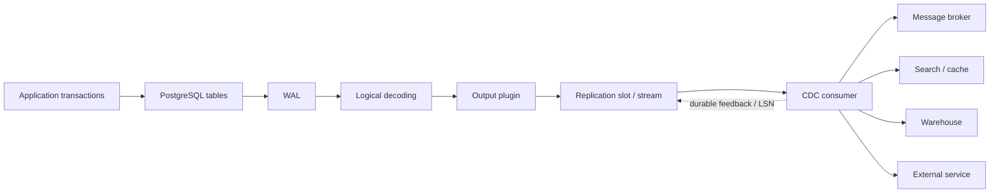

# Logical decoding, output plugin và thay đổi dữ liệu cho hệ thống ngoài

Logical decoding là cơ chế PostgreSQL đọc các thay đổi đã được ghi vào Write-Ahead Log (WAL) và chuyển chúng thành luồng sự kiện logic để hệ thống khác tiêu thụ. Đây là nền tảng của Change Data Capture (CDC): thay vì liên tục quét bảng để tìm rows mới hoặc bị sửa, consumer nhận các sự kiện INSERT, UPDATE, DELETE và một số thông điệp logic theo thứ tự commit.

Trong PostgreSQL, **logical decoding** là cơ chế đọc WAL; **output plugin** quyết định cách biểu diễn thay đổi; **replication slot** giữ vị trí đọc để PostgreSQL biết WAL nào còn cần; còn **consumer** chịu trách nhiệm lưu thay đổi vào hệ thống đích và xác nhận tiến độ. Các thành phần phối hợp với nhau nhưng có vòng đời và trách nhiệm riêng.

Bài học thuộc chương **Sao chép logic**, tập trung vào:

- Hiểu WAL, logical decoding, transaction boundaries, LSN và snapshot.
- Cấu hình PostgreSQL để hỗ trợ logical decoding.
- Tạo và quản lý logical replication slots.
- Phân biệt pgoutput, test_decoding và output plugins bên ngoài.
- Dùng publication, replica identity và logical replication protocol.
- Đọc thay đổi qua SQL functions hoặc streaming client.
- Xây consumer CDC có checkpoint, idempotency và xử lý lỗi.
- Theo dõi WAL retention, slot lag, backpressure và tình trạng slot.
- Xử lý schema evolution, DDL, sequences và dữ liệu ngoài phạm vi.
- Bảo vệ dữ liệu, quyền replication và vận hành CDC an toàn.

> **Điểm quan trọng:** logical decoding cung cấp luồng thay đổi từ WAL. Nó không tự tạo bản sao hoàn chỉnh của database ở hệ thống đích, không tự đồng bộ DDL và không bảo đảm consumer đã ghi dữ liệu bền vững. Consumer phải quản lý snapshot ban đầu, transaction, offset và schema compatibility.

## 1. Logical decoding là gì?

PostgreSQL dùng Write-Ahead Logging để ghi lại các thay đổi cần thiết cho crash recovery và replication. WAL được tổ chức thành records và định vị bằng Log Sequence Number (LSN).

Logical decoding đọc WAL, kết hợp với metadata trong PostgreSQL catalogs, rồi diễn giải các thay đổi vật lý thành thay đổi ở mức dữ liệu, chẳng hạn:

- Một row được INSERT vào bảng.
- Một row được UPDATE.
- Một row được DELETE.
- Một transaction bắt đầu và commit.
- Một TRUNCATE được thực hiện.
- Một logical message được ứng dụng phát ra nếu plugin hỗ trợ.

WAL record vật lý không nhất thiết biểu diễn trực tiếp một câu SQL dễ đọc. Logical decoding giải mã các records liên quan và output plugin chuyển thông tin thành dạng phù hợp cho consumer.

### 1.1. Logical decoding và physical replication

| Tiêu chí | Physical replication | Logical decoding |
| --- | --- | --- |
| Đơn vị truyền | WAL records ở mức vật lý | Thay đổi logic của database |
| Mục đích | Standby, HA, PITR | CDC, tích hợp, logical replication |
| Phạm vi | Toàn bộ cluster vật lý | Thay đổi của một database/slot |
| Phụ thuộc schema | Standby dùng cùng cấu trúc vật lý | Consumer cần hiểu schema và dữ liệu |
| Chọn bảng/cột | Không chọn theo publication | Có thể giới hạn qua publication/plugin |
| Khác major version | Ràng buộc chặt về physical compatibility | Có thể hỗ trợ migration logic theo compatibility |
| Dữ liệu đích | PostgreSQL physical standby | PostgreSQL hoặc hệ thống ngoài |

Physical replication giữ bản sao vật lý của cluster. Logical decoding biến thay đổi thành sự kiện mà hệ thống khác có thể xử lý.

### 1.2. Logical decoding và CDC

CDC là mô hình ghi nhận và chuyển thay đổi dữ liệu từ hệ thống nguồn sang một hoặc nhiều hệ thống đích.

Ví dụ:

- PostgreSQL → Kafka → search index.
- PostgreSQL → data warehouse.
- PostgreSQL → cache invalidation service.
- PostgreSQL → hệ thống phân tích near-real-time.
- PostgreSQL → một PostgreSQL cluster khác qua logical replication.

Logical decoding là một cách lấy change stream từ PostgreSQL. Một CDC platform thường bổ sung snapshot ban đầu, schema history, retry, checkpoint, routing, serialization, monitoring và quản lý schema evolution.

### 1.3. Kiến trúc tổng quát



WAL là nguồn thay đổi. Output plugin định dạng dữ liệu. Slot lưu tiến độ cần giữ. Consumer áp dụng sự kiện và chỉ xác nhận LSN sau khi đã xử lý bền vững theo semantics của hệ thống.

## 2. WAL, LSN và transaction boundaries

Logical decoding dựa trên WAL nên cần hiểu cách PostgreSQL xác định vị trí và thứ tự thay đổi.

### 2.1. LSN là gì?

LSN là địa chỉ trong WAL stream. Nó thường được hiển thị dưới dạng hai phần hex, ví dụ:

```text
0/16B6C50
```

Một LSN không phải timestamp và không phải ID của row. Nó biểu diễn vị trí trong WAL. Consumer thường lưu LSN hoặc commit LSN làm checkpoint để biết đã xử lý đến đâu.

Một số hàm hữu ích:

```sql
SELECT
    pg_current_wal_lsn() AS current_lsn,
    pg_current_wal_insert_lsn() AS current_insert_lsn,
    pg_wal_lsn_diff(
        pg_current_wal_lsn(),
        '0/16B6C50'
    ) AS bytes_since_example_lsn;
```

Hai hàm pg_current_wal_lsn() và pg_current_wal_insert_lsn() phản ánh các vị trí WAL khác nhau. Chúng hữu ích cho monitoring, nhưng không thay thế vị trí xác nhận của một logical slot.

### 2.2. Transaction được phát ra theo commit

Logical decoding phải giữ quan hệ transaction. Một consumer không nên áp dụng nửa transaction rồi coi như transaction đã hoàn tất.

Ví dụ transaction nguồn:

```sql
BEGIN;

INSERT INTO app.orders(order_id, status)
VALUES (1001, 'created');

INSERT INTO app.order_items(order_id, product_id, quantity)
VALUES (1001, 55, 2);

COMMIT;
```

Consumer cần nhận biết hai row changes thuộc cùng một transaction. Nếu hệ thống đích hỗ trợ transaction, có thể áp dụng chúng trong một transaction đích và commit cùng nhau.

Một transaction rollback không được xem là transaction dữ liệu đã commit để downstream áp dụng. Logical decoding xử lý transaction visibility theo cơ chế của PostgreSQL.

### 2.3. XID và LSN không có cùng ý nghĩa

Transaction ID (XID) xác định transaction trong PostgreSQL, nhưng XID có thể wraparound và được tái sử dụng theo vòng đời hệ thống. LSN định vị WAL progress. Consumer nên checkpoint bằng commit LSN và metadata transaction phù hợp, không dùng XID đơn lẻ làm offset lâu dài.

### 2.4. Commit order và thứ tự sự kiện

Output plugin/protocol có thể phát các markers BEGIN, CHANGE và COMMIT. Consumer cần bảo toàn thứ tự cần thiết, đặc biệt khi có nhiều transactions đồng thời.

Với một source stream, commit order là cơ sở quan trọng để tái dựng trạng thái. Nếu consumer chia một transaction thành nhiều worker mà không có cơ chế ordering/dependency, dữ liệu đích có thể tạm thời hoặc vĩnh viễn sai quan hệ.

### 2.5. Transaction lớn

Một transaction lớn có thể tạo nhiều WAL và nhiều change events. Logical decoding có thể phải giữ dữ liệu transaction cho đến khi có thể phát ra theo semantics phù hợp. Hệ quả:

- Độ trễ phát sự kiện có thể tăng.
- Consumer nhận một batch lớn.
- Memory và disk usage tăng.
- Slot có thể giữ WAL lâu hơn.
- Sink cần đủ capacity để apply transaction.

Đừng giả định mỗi SQL statement tương ứng với một message độc lập có thể commit riêng ở downstream.

## 3. Logical replication slot

Replication slot lưu trạng thái cần thiết để PostgreSQL tiếp tục cung cấp WAL từ vị trí mà consumer chưa xác nhận. Logical slot gắn với một database và một output plugin.

### 3.1. Slot giữ lại WAL

Nếu consumer chậm hoặc offline, PostgreSQL không thể xóa WAL segments mà slot còn cần. Điều này giúp consumer tiếp tục đọc khi quay lại, nhưng có thể làm tăng disk usage.

Một slot không hoạt động trong thời gian dài có thể giữ lại nhiều WAL và gây đầy ổ đĩa. Vì vậy, tạo slot đồng nghĩa với việc nhận trách nhiệm vận hành và giám sát slot đó.

### 3.2. Slot có plugin và database

Một logical slot thường có:

- Tên slot duy nhất trong cluster.
- Output plugin, ví dụ test_decoding hoặc pgoutput.
- Database mà slot đọc thay đổi.
- Vị trí WAL cần giữ.
- Vị trí consumer đã xác nhận.
- Trạng thái active/inactive.
- Metadata phục vụ vacuum/catalog retention.

Một logical slot không phải một publication. Slot theo dõi tiến độ decoding; publication định nghĩa nhóm tables và operations mà logical replication với pgoutput sẽ phát.

### 3.3. Tạo slot bằng SQL

Trên môi trường lab đã cấu hình wal_level = logical và có plugin test_decoding:

```sql
SELECT *
FROM pg_create_logical_replication_slot(
    'app_cdc_slot',
    'test_decoding'
);
```

Kết quả trả về tên slot và consistent point LSN. Từ vị trí này, logical decoding có thể bắt đầu phát những thay đổi phù hợp.

Tên slot cần ổn định và có quy ước. Không tạo slot mới cho mỗi lần restart consumer nếu không có kế hoạch dọn slot cũ; mỗi slot có thể giữ WAL độc lập.

### 3.4. Đọc thay đổi qua SQL

Với output plugin hỗ trợ text output như test_decoding, có thể đọc bằng:

```sql
SELECT lsn, xid, data
FROM pg_logical_slot_get_changes(
    'app_cdc_slot',
    NULL,
    NULL
);
```

Hàm này **tiêu thụ** changes và tiến slot. Nếu consumer chưa lưu chúng bền vững, việc đọc rồi crash có thể làm mất cơ hội đọc lại từ vị trí cũ.

Để xem mà không tiến slot:

```sql
SELECT lsn, xid, data
FROM pg_logical_slot_peek_changes(
    'app_cdc_slot',
    NULL,
    NULL
);
```

peek_changes phù hợp để quan sát/test, còn get_changes dùng để consume. Không dùng get_changes như một lệnh kiểm tra vô hại trên slot production.

### 3.5. Slot chỉ phát thay đổi từ consistent point

Logical slot không thể tự tái tạo mọi thay đổi trước thời điểm slot được tạo nếu WAL/catalog history cần thiết không còn. Nếu muốn đồng bộ toàn bộ bảng, cần một initial snapshot được phối hợp với slot, sau đó áp dụng change stream bắt đầu tại consistent point.

Tạo slot sau khi database đã chạy lâu không tự gửi toàn bộ rows hiện có. Đó là nhiệm vụ của initial snapshot.

## 4. Output plugin là gì?

Output plugin là module phía server nhận các callbacks từ logical decoding và tạo representation cho thay đổi. PostgreSQL gọi plugin khi có các sự kiện transaction/change phù hợp.

Plugin quyết định:

- Định dạng output: text, JSON hoặc binary protocol.
- Cách biểu diễn schema, table, columns và values.
- Cách xử lý transaction markers.
- Cách xử lý TOAST values và replica identity.
- Các options cấu hình plugin.
- Có hỗ trợ logical messages, streaming hoặc two-phase decoding hay không, tùy plugin và version.

### 4.1. Các output plugins thường gặp

| Plugin | Nguồn | Mục đích |
| --- | --- | --- |
| pgoutput | PostgreSQL core | Logical replication protocol, dùng với publications |
| test_decoding | PostgreSQL contrib | Output dạng text dễ đọc để thử nghiệm và minh họa |
| wal2json | Extension bên ngoài | Biểu diễn changes dưới dạng JSON |
| Plugin CDC khác | Bên thứ ba/tự phát triển | Định dạng và semantics riêng cho consumer |

Plugin bên ngoài cần được cài trên server PostgreSQL và phải tương thích với major version, build và operating environment. Client không thể tự mang một shared library tùy ý vào server để thay plugin.

### 4.2. pgoutput

pgoutput là output plugin tích hợp, được dùng bởi logical replication protocol của PostgreSQL. Nó làm việc với publication để xác định tables và operations được phát.

pgoutput dùng protocol messages, không phải plain text SQL script. Consumer cần nói chuyện bằng logical replication protocol và hiểu các message types của protocol.

Không nên giả định có thể gọi pg_logical_slot_get_changes() để nhận output text dễ đọc từ pgoutput. SQL decoding functions chủ yếu dành cho plugin hỗ trợ text output; pgoutput được thiết kế cho protocol consumer.

### 4.3. test_decoding

test_decoding hữu ích trong lab vì output có thể đọc được:

```text
BEGIN 742
table app.orders: INSERT: order_id[integer]:1001 status[text]:'created'
COMMIT 742
```

Format thực tế phụ thuộc plugin version và dữ liệu. Đây là công cụ minh họa, không phải schema ổn định để xây production parser nếu chưa cam kết format.

### 4.4. Plugin bên ngoài

Plugin JSON như wal2json có thể giúp consumer tích hợp nhanh với hệ thống không dùng PostgreSQL protocol. Tuy nhiên, cần kiểm tra:

- Phiên bản plugin có tương thích PostgreSQL server không.
- JSON format/version có thay đổi không.
- Cách biểu diễn NULL, numeric, timestamp, binary và TOAST.
- Có giữ transaction boundaries không.
- Có hỗ trợ streaming large transactions không.
- Cách output xử lý schema changes.
- Security và provenance của binary extension.

Không đưa plugin chưa được review vào server production chỉ vì định dạng output thuận tiện.

### 4.5. Tự viết output plugin

PostgreSQL cung cấp logical decoding output plugin API cho C extension. Plugin triển khai các callbacks như startup, begin, change, commit và shutdown; các API cụ thể phụ thuộc PostgreSQL major version.

Một plugin tự viết cần xử lý cẩn thận:

- Memory contexts và lifetime của dữ liệu.
- Transaction boundaries.
- TOAST và replica identity.
- Encoding và type output.
- Error handling và server process safety.
- Plugin options và validation.
- Compatibility giữa các major versions.
- Security review và packaging.

Output plugin chạy trong server process. Bug trong plugin có thể ảnh hưởng backend đang decode, vì vậy nên dùng plugin đã được kiểm thử và giới hạn quyền truy cập slot.

## 5. Cấu hình PostgreSQL cho logical decoding

Logical decoding cần WAL chứa đủ thông tin để tái dựng row-level changes.

### 5.1. wal_level = logical

Kiểm tra:

```sql
SHOW wal_level;
```

Cấu hình trong postgresql.conf:

```conf
wal_level = logical
max_replication_slots = 10
max_wal_senders = 10
```

wal_level = logical cần restart PostgreSQL để có hiệu lực. Các giới hạn slot và WAL sender cũng cần được sizing trước khi triển khai. Số lượng thực tế phụ thuộc số consumer, subscriptions, migration tools và operational reserve.

### 5.2. Các tham số liên quan

| Tham số | Vai trò |
| --- | --- |
| wal_level | Chọn lượng WAL information; logical decoding cần logical |
| max_replication_slots | Giới hạn số replication slots |
| max_wal_senders | Giới hạn các WAL sender processes |
| max_slot_wal_keep_size | Giới hạn WAL được giữ do replication slots trên version hỗ trợ |
| wal_sender_timeout | Timeout cho WAL sender connection |
| max_logical_replication_workers | Worker cho logical replication subscriptions |
| max_sync_workers_per_subscription | Parallel table synchronization workers |
| max_worker_processes | Tổng capacity cho background workers liên quan |

Một số tham số chỉ áp dụng cho built-in subscriptions, một số áp dụng rộng hơn. Đọc tài liệu đúng major version trước khi chỉnh.

### 5.3. Cấu hình authentication

Replication connection cần role có quyền REPLICATION hoặc quyền quản trị phù hợp. Ví dụ:

```sql
CREATE ROLE cdc_reader
    LOGIN
    REPLICATION
    PASSWORD 'replace-through-secret-management';
```

Không dùng password literal trong script production. Tạo credential qua secret manager hoặc phương thức được tổ chức phê duyệt.

pg_hba.conf phải cho phép kết nối từ consumer host tới database tương ứng và xác thực role. Logical replication kết nối tới một database cụ thể; cấu hình HBA cần phù hợp với database đó. Dùng TLS và xác thực server khi truyền changes qua mạng.

### 5.4. Quyền tạo publication

Ví dụ publication chỉ định tables:

```sql
CREATE PUBLICATION app_changes
FOR TABLE app.orders, app.order_items
WITH (publish = 'insert, update, delete');
```

Người tạo publication cần quyền phù hợp trên database và các tables. FOR ALL TABLES có yêu cầu quyền cao hơn. Kiểm tra role ownership/privileges theo tài liệu version.

### 5.5. Xác nhận cấu hình đang có hiệu lực

```sql
SELECT
    name,
    setting,
    unit,
    source,
    pending_restart
FROM pg_settings
WHERE name IN (
    'wal_level',
    'max_replication_slots',
    'max_wal_senders',
    'max_slot_wal_keep_size',
    'wal_sender_timeout'
)
ORDER BY name;
```

pending_restart cho biết tham số đang chờ restart. Đừng bắt đầu CDC trước khi xác nhận cấu hình runtime đáp ứng yêu cầu.

## 6. Publication: xác định dữ liệu được phát

Publication là đối tượng cấp database mô tả tables và loại thay đổi được publish cho logical replication. Nó được dùng bởi pgoutput và built-in logical replication.

### 6.1. Publication cho danh sách tables

```sql
CREATE PUBLICATION orders_publication
FOR TABLE app.orders, app.order_items
WITH (publish = 'insert, update, delete');
```

Publication có thể giới hạn phạm vi tables để consumer chỉ nhận changes cần thiết. Điều này giảm data volume và hạn chế dữ liệu nhạy cảm được chuyển ra ngoài.

### 6.2. Publication cho toàn bộ tables

```sql
CREATE PUBLICATION all_tables_publication
FOR ALL TABLES;
```

Publication cho tất cả tables có phạm vi rộng và cần quyền quản trị phù hợp. Khi thêm table mới, cần hiểu semantics/version của publication và quy trình consumer xử lý schema mới.

### 6.3. Publication theo schema

Các PostgreSQL versions mới hỗ trợ publication theo schema. Syntax và availability thay đổi theo major version; kiểm tra server docs trước khi dùng:

```sql
CREATE PUBLICATION app_schema_publication
FOR TABLES IN SCHEMA app;
```

Schema publication giúp tự động bao gồm các tables đủ điều kiện trong schema, nhưng không biến DDL thành stream change event. Consumer vẫn cần xử lý schema evolution.

### 6.4. Chọn operations

Publication có thể chọn các operations:

- INSERT.
- UPDATE.
- DELETE.
- TRUNCATE.

Ví dụ chỉ phát insert/update:

```sql
CREATE PUBLICATION app_upserts
FOR TABLE app.customer_profiles
WITH (publish = 'insert, update');
```

Nếu bỏ qua DELETE, downstream có thể giữ rows đã bị xóa ở source. Nếu bỏ qua TRUNCATE, consumer có thể không phản ánh đúng thao tác truncate. Hãy thiết kế semantics rõ ràng thay vì chọn option chỉ để giảm lưu lượng.

### 6.5. Row filters

Các version hỗ trợ row filters có thể giới hạn rows được publish, ví dụ:

```sql
CREATE PUBLICATION eu_orders
FOR TABLE app.orders
WHERE (region_code = 'EU');
```

Row filter là điều kiện của publication, không phải RLS policy. RLS không tự lọc logical decoding output. Với row filters, kiểm tra behavior khi UPDATE làm row chuyển từ match sang non-match hoặc ngược lại, vì consumer cần hiểu sự kiện tương ứng.

### 6.6. Column lists

Một số PostgreSQL versions hỗ trợ column lists trong publication. Có thể giới hạn các cột được gửi để giảm dữ liệu hoặc tránh chuyển trường không cần thiết.

Cần kiểm tra yêu cầu replica identity: các cột dùng để xác định row khi UPDATE/DELETE phải có mặt trong dữ liệu cần thiết cho subscriber. Đừng loại bỏ key columns mà consumer cần để áp dụng change.

### 6.7. Kiểm tra publication

```sql
SELECT
    pubname,
    pubowner::regrole AS owner,
    puballtables,
    pubinsert,
    pubupdate,
    pubdelete,
    pubtruncate
FROM pg_publication
ORDER BY pubname;
```

Liệt kê tables:

```sql
SELECT *
FROM pg_publication_tables
ORDER BY pubname, schemaname, tablename;
```

Views và catalog columns có thể khác theo major version. Đối chiếu cả table filters, column lists và partition behavior nếu sử dụng.

## 7. Replica identity và UPDATE/DELETE

Logical decoding cần biết row cũ nào bị thay đổi khi phát UPDATE hoặc DELETE. PostgreSQL dùng replica identity để xác định row.

### 7.1. REPLICA IDENTITY DEFAULT

Mặc định, PostgreSQL dùng primary key nếu có. Đây thường là lựa chọn tốt nhất:

```sql
ALTER TABLE app.orders
REPLICA IDENTITY DEFAULT;
```

Consumer nhận key cần thiết để xác định row ở hệ thống đích. Đảm bảo primary key ổn định và được duy trì trong schema.

### 7.2. REPLICA IDENTITY USING INDEX

Có thể dùng một unique index đủ điều kiện:

```sql
ALTER TABLE app.customer_profiles
REPLICA IDENTITY USING INDEX customer_profiles_replica_key;
```

Index phải đáp ứng các điều kiện của PostgreSQL, chẳng hạn unique, không partial và các cột phù hợp. Kiểm tra docs đúng version trước khi chọn index.

### 7.3. REPLICA IDENTITY FULL

Nếu không có primary/unique key phù hợp:

```sql
ALTER TABLE app.audit_events
REPLICA IDENTITY FULL;
```

PostgreSQL ghi thông tin old row đầy đủ hơn để hỗ trợ nhận diện row khi UPDATE/DELETE. Điều này có thể tăng WAL volume đáng kể, đặc biệt với bảng có nhiều cột lớn.

Dùng FULL khi thực sự cần và đo tác động. Một khóa tự nhiên/unique index thường hiệu quả hơn.

### 7.4. REPLICA IDENTITY NOTHING

NOTHING không cung cấp old-row identity cho UPDATE/DELETE. Với logical replication cần xác định row đích, UPDATE/DELETE có thể không được publish/giải mã theo cách consumer cần hoặc có thể phát sinh lỗi. Không dùng cấu hình này cho tables mà downstream cần phản ánh update/delete.

### 7.5. Kiểm tra replica identity

```sql
SELECT
    n.nspname AS schema_name,
    c.relname AS table_name,
    c.relreplident AS replica_identity
FROM pg_class AS c
JOIN pg_namespace AS n ON n.oid = c.relnamespace
WHERE n.nspname = 'app'
  AND c.relkind IN ('r', 'p')
ORDER BY c.relname;
```

Các ký tự catalog đại diện cho DEFAULT, USING INDEX, FULL hoặc NOTHING. Đối chiếu với schema design và publication operations.

### 7.6. Kiểm tra bằng UPDATE/DELETE trong lab

Tạo một bảng lab có primary key và một bảng không có primary key. Tạo publication/slot tương ứng, thực hiện INSERT/UPDATE/DELETE rồi quan sát output plugin.

Không thay đổi replica identity trên production chỉ để thử; REPLICA IDENTITY FULL có thể tăng lượng WAL và ảnh hưởng hiệu năng.

## 8. Đọc changes bằng test_decoding

Đây là cách dễ nhất để quan sát logical decoding trong lab.

### 8.1. Chuẩn bị bảng

```sql
CREATE SCHEMA IF NOT EXISTS app;

CREATE TABLE app.cdc_demo (
    id bigint PRIMARY KEY,
    message text,
    updated_at timestamptz DEFAULT now()
);
```

### 8.2. Tạo slot

```sql
SELECT *
FROM pg_create_logical_replication_slot(
    'cdc_demo_slot',
    'test_decoding'
);
```

### 8.3. Tạo thay đổi đã commit

```sql
BEGIN;

INSERT INTO app.cdc_demo(id, message)
VALUES (1, 'first event');

UPDATE app.cdc_demo
SET message = 'updated event'
WHERE id = 1;

DELETE FROM app.cdc_demo
WHERE id = 1;

COMMIT;
```

### 8.4. Đọc changes

```sql
SELECT lsn, xid, data
FROM pg_logical_slot_peek_changes(
    'cdc_demo_slot',
    NULL,
    NULL
);
```

Dùng peek để xem output mà chưa tiến slot. Khi đã quan sát xong trong lab, có thể consume:

```sql
SELECT lsn, xid, data
FROM pg_logical_slot_get_changes(
    'cdc_demo_slot',
    NULL,
    NULL
);
```

Output có thể chứa transaction markers và các dòng thay đổi. Cụ thể format phụ thuộc plugin.

### 8.5. Kiểm tra rollback

```sql
BEGIN;
INSERT INTO app.cdc_demo(id, message)
VALUES (2, 'will rollback');
ROLLBACK;
```

Đọc slot lại. Row bị rollback không được consumer áp dụng như một committed change.

### 8.6. Xóa slot lab

Khi không còn cần slot và slot không active:

```sql
SELECT pg_drop_replication_slot('cdc_demo_slot');
```

Không xóa slot production để giải phóng WAL nếu chưa đánh giá consumer và recovery plan. Drop slot làm mất khả năng tiếp tục từ vị trí cũ.

## 9. Streaming changes bằng pg_recvlogical

pg_recvlogical là client utility dùng logical replication protocol để tạo, quản lý và stream từ logical slot. Nó hữu ích với các plugin output dạng stream như test_decoding.

### 9.1. Tạo slot

Ví dụ trong lab:

```bash
pg_recvlogical \
  --dbname="host=db.example.internal port=5432 dbname=appdb user=cdc_reader sslmode=verify-full" \
  --slot=app_cdc_slot \
  --create-slot \
  --plugin=test_decoding
```

Credential nên được cung cấp bằng .pgpass, service file hoặc secret manager. Không ghi password vào command line, shell history hay log.

### 9.2. Bắt đầu stream

```bash
pg_recvlogical \
  --dbname="host=db.example.internal port=5432 dbname=appdb user=cdc_reader sslmode=verify-full" \
  --slot=app_cdc_slot \
  --start \
  --file=-
```

--file=- gửi output tới stdout. Có thể redirect tới file trong lab để quan sát. Production consumer nên quản lý checkpoint và feedback bền vững, thay vì chỉ ghi một file text không có offset protocol được kiểm soát.

### 9.3. Các options hữu ích

- --create-slot: tạo slot.
- --drop-slot: xóa slot.
- --start: bắt đầu stream.
- --slot: chọn slot.
- --plugin: chọn output plugin khi tạo slot.
- --file: chọn output destination.
- --option: truyền plugin options.
- --status-interval: điều chỉnh chu kỳ gửi status/feedback theo khả năng utility.

Kiểm tra pg_recvlogical --help của client đang dùng vì option và behavior có thể thay đổi theo version.

### 9.4. Giới hạn của utility

pg_recvlogical là công cụ client hữu ích để kiểm tra và stream đơn giản. Một CDC service production thường cần xử lý reconnect, durable offsets, schema history, retry, routing, backpressure, monitoring và exactly-once effects ở sink nếu hệ thống hỗ trợ.

## 10. pgoutput và logical replication protocol

pgoutput là plugin được PostgreSQL dùng cho built-in logical replication. Nó phối hợp với publication và gửi protocol messages qua replication connection.

### 10.1. Tạo publication

```sql
CREATE PUBLICATION orders_pub
FOR TABLE app.orders, app.order_items
WITH (publish = 'insert, update, delete');
```

### 10.2. Tạo logical slot cho pgoutput

Logical replication protocol có command tạo slot với plugin pgoutput. Một replication client có thể gửi command tương đương:

```text
CREATE_REPLICATION_SLOT orders_slot LOGICAL pgoutput
```

Nếu cần đồng bộ snapshot ban đầu, protocol hỗ trợ tùy chọn export snapshot trong lệnh tạo slot trên các phiên bản phù hợp. Snapshot name và consistent point phải được phối hợp với tiến trình snapshot.

Đây là replication protocol command, không phải SQL statement chạy trong một session SQL thông thường. Dùng driver/client hỗ trợ replication mode.

### 10.3. Bắt đầu replication

Client gửi command dạng:

```text
START_REPLICATION SLOT orders_slot LOGICAL 0/0
(proto_version '1', publication_names 'orders_pub')
```

LSN và protocol options thực tế phải do client quản lý theo consistent point và server version. Không copy 0/0 làm vị trí bắt đầu production.

### 10.4. Protocol messages

Consumer của pgoutput cần hiểu các message như:

- Begin: transaction bắt đầu.
- Relation: metadata về table/columns.
- Type: metadata type khi cần.
- Insert: row mới.
- Update: row thay đổi, có thể gồm old key/tuple và new tuple.
- Delete: row bị xóa, thường có old key/tuple theo replica identity.
- Truncate: bảng bị truncate.
- Commit: transaction hoàn tất.
- Logical message: message được phát qua cơ chế tương ứng nếu plugin/protocol hỗ trợ.

Protocol có thể có version-specific features như streaming large transactions, binary transfer và two-phase transaction support. Client phải thương lượng protocol version và options phù hợp.

### 10.5. Relation metadata không phải schema migration

Relation message mô tả metadata cần để giải mã row changes, nhưng không thay thế quy trình DDL migration. Khi schema thay đổi, consumer cần có schema contract tương thích trước khi áp dụng các events mới.

## 11. Initial snapshot và consistent point

Logical decoding chỉ phát thay đổi kể từ vị trí slot có thể bắt đầu decoding. Để dựng hệ thống đích đầy đủ, CDC thường cần hai giai đoạn:

1. Copy dữ liệu hiện có bằng snapshot ban đầu.
2. Áp dụng changes phát sinh sau consistent point.

### 11.1. Rủi ro nếu snapshot và slot không đồng bộ

Giả sử consumer bắt đầu copy bảng lúc 10:00 nhưng tạo slot lúc 10:05. Một row được insert lúc 10:02 có thể không nằm trong snapshot được copy nếu snapshot lấy muộn hoặc không nhất quán, đồng thời WAL trước slot không được phát. Row đó bị thiếu ở target.

Nếu tạo slot lúc 10:00 nhưng snapshot copy không được gắn với consistent snapshot của slot, một row có thể xuất hiện trong snapshot và cũng xuất hiện trong change stream, gây duplicate hoặc conflict.

### 11.2. Exported snapshot

Logical replication protocol có thể tạo slot và export snapshot tại consistent point. Client giữ snapshot transaction mở trong lúc dump dữ liệu ban đầu, sau đó bắt đầu stream từ vị trí tương ứng.

Một công cụ CDC hoàn chỉnh thường phối hợp:

- Tạo slot và lấy consistent point/snapshot identifier.
- Giữ snapshot transaction sống.
- Dump tables trong phạm vi publication.
- Bắt đầu consume changes từ đúng LSN.
- Xử lý overlap giữa snapshot và stream theo semantics công cụ.
- Ghi checkpoint sau khi target đã lưu dữ liệu.

### 11.3. Không tự ghép snapshot tùy tiện

Không chạy một pg_dump độc lập và một logical slot độc lập rồi giả định hai tiến trình có chung snapshot. Dùng công cụ có hỗ trợ snapshot coordination hoặc xây protocol chính xác theo tài liệu PostgreSQL.

### 11.4. Snapshot lớn

Initial snapshot có thể kéo dài. Trong thời gian đó, slot phải giữ WAL cần thiết. Nếu snapshot mất nhiều giờ và consumer chưa catch up, WAL retention có thể tăng đáng kể.

Tính dung lượng WAL theo peak write rate và thời gian snapshot/catch-up. Đừng tạo slot trước khi có capacity plan.

## 12. Thiết kế CDC consumer

Consumer nhận events, chuyển đổi format, áp dụng vào sink và xác nhận progress. Đây là nơi quyết định tính đúng đắn đầu cuối.

### 12.1. Consumer cần quản lý state

Một consumer thực tế thường lưu:

- Source cluster/database identity.
- Slot name và plugin/protocol version.
- Last durably applied commit LSN.
- Transaction boundary hiện tại.
- Schema version hoặc schema history reference.
- Sink checkpoint.
- Retry/error state.
- Metrics và timestamps.

Checkpoint phải được lưu bền vững và phục hồi được sau restart.

### 12.2. Apply trước, acknowledge sau

Thứ tự an toàn phổ biến:

1. Đọc một transaction từ source.
2. Chuyển đổi events.
3. Ghi mọi thay đổi vào sink transaction.
4. Ghi checkpoint/commit LSN trong cùng transaction sink nếu có thể.
5. Commit sink.
6. Gửi feedback xác nhận LSN đã flush/apply bền vững.

Nếu acknowledge trước khi sink commit, crash có thể làm mất dữ liệu vì source đã giải phóng WAL mà consumer chưa lưu thay đổi. Nếu sink commit xong nhưng chưa acknowledge, source có thể gửi lại transaction sau reconnect; sink cần idempotency để chống duplicate.

### 12.3. At-least-once delivery

Nhiều CDC consumers vận hành theo at-least-once semantics: một transaction có thể được phát lại nếu consumer crash trước khi xác nhận. Điều này an toàn hơn việc mất dữ liệu nhưng yêu cầu sink có thể xử lý duplicate.

Thiết kế idempotent bằng cách:

- Upsert theo primary key.
- Lưu source commit LSN và event order.
- Dùng unique event key.
- Ghi checkpoint cùng transaction sink.
- Không áp dụng event cũ hơn state đã được ghi.
- Xử lý DELETE idempotently.

### 12.4. Exactly-once là thuộc tính end-to-end

Replication protocol không tự bảo đảm exactly-once side effects trong mọi hệ thống ngoài. Exactly-once cần sink transaction, checkpoint atomicity và idempotency hoặc cơ chế deduplication phù hợp.

Với external API không có transaction chung, có thể dùng idempotency key, outbox/inbox pattern hoặc durable delivery state.

### 12.5. Không checkpoint giữa transaction

Nếu transaction nguồn chứa nhiều row changes, consumer không nên xác nhận commit LSN trước khi tất cả changes thuộc transaction đã được sink lưu bền vững. Nếu checkpoint giữa chừng, restart có thể bỏ qua phần còn lại.

### 12.6. Không dùng XID làm event ID duy nhất

XID có wraparound/reuse và có thể không đủ phân biệt mọi event. Kết hợp source identity, commit LSN, transaction position và event ordinal nếu cần idempotency key.

## 13. Transaction streaming và transaction hai pha

Transactions lớn có thể được stream thành chunks trên các protocol versions hỗ trợ. Điều này giúp giảm memory pressure nhưng làm consumer phức tạp hơn.

### 13.1. Streaming large transactions

Với protocol streaming, consumer có thể nhận transaction data trước khi transaction commit. Các changes đó chưa được phép trở thành state cuối cùng ở sink cho tới khi nhận được commit tương ứng.

Consumer phải hỗ trợ:

- Transaction identifiers và stream start/stop.
- Chunk buffering hoặc staged writes.
- Commit/abort semantics.
- Reconnect/resume theo protocol.
- Không để partial transaction lộ ra ngoài.

### 13.2. Two-phase commit

PostgreSQL hỗ trợ prepared transactions. Logical decoding có thể hỗ trợ two-phase decoding nếu slot và plugin/protocol được cấu hình phù hợp. Consumer cần xử lý PREPARE, COMMIT PREPARED và ROLLBACK PREPARED đúng semantics.

Không bật two-phase decoding nếu sink không có mô hình tương ứng. Tính năng và option cụ thể phụ thuộc major version và output plugin.

## 14. WAL retention, slot lag và backpressure

Đây là một trong những vấn đề vận hành quan trọng nhất của logical decoding.

### 14.1. Vì sao slot giữ WAL?

PostgreSQL không được xóa WAL segments mà slot vẫn cần để tiếp tục decoding. Nếu consumer không đọc hoặc không xác nhận progress, restart_lsn của slot không tiến đủ nhanh và WAL có thể tích tụ.

Điều này xảy ra khi:

- Consumer offline.
- Consumer xử lý sink chậm.
- Network bị gián đoạn.
- Consumer đọc nhưng không gửi feedback.
- Một transaction dài giữ decoding state.
- Snapshot ban đầu mất nhiều thời gian.
- Plugin hoặc sink gặp lỗi liên tục.

### 14.2. restart_lsn và confirmed_flush_lsn

Hai vị trí quan trọng:

- restart_lsn: vị trí WAL cũ nhất mà slot có thể còn cần.
- confirmed_flush_lsn: vị trí consumer đã xác nhận tiến độ theo cơ chế logical slot.

restart_lsn thường dùng để hiểu WAL retention. confirmed_flush_lsn phản ánh consumer progress. Hai giá trị không nhất thiết giống nhau vì PostgreSQL có thể còn cần WAL/catalog history từ vị trí cũ hơn.

### 14.3. Theo dõi slots

```sql
SELECT
    slot_name,
    plugin,
    slot_type,
    database,
    active,
    restart_lsn,
    confirmed_flush_lsn,
    wal_status
FROM pg_replication_slots
WHERE slot_type = 'logical'
ORDER BY slot_name;
```

Một số cột chỉ có trên PostgreSQL major versions mới. Kiểm tra view definition trên server đang chạy trước khi dùng trong monitoring chung.

### 14.4. Ước tính WAL retained

Trên primary, có thể ước tính khoảng cách từ current WAL position đến restart LSN:

```sql
SELECT
    slot_name,
    pg_size_pretty(
        pg_wal_lsn_diff(
            pg_current_wal_lsn(),
            restart_lsn
        )::bigint
    ) AS approximate_wal_backlog
FROM pg_replication_slots
WHERE slot_type = 'logical'
  AND restart_lsn IS NOT NULL;
```

Đây là ước tính khoảng WAL, không phải số bytes changes đang chờ consumer. WAL còn có thể chứa hoạt động khác; một slot có thể cần giữ cả các records không thuộc publication.

### 14.5. max_slot_wal_keep_size

Trên các PostgreSQL versions hỗ trợ, max_slot_wal_keep_size giới hạn lượng WAL được giữ do slots. Nếu vượt ngưỡng, slot có thể mất khả năng tiếp tục từ vị trí cũ hoặc bị invalidated theo cơ chế/version.

Giới hạn này bảo vệ storage nhưng có thể buộc phải tạo lại slot và chạy lại snapshot nếu consumer quá chậm. Không xem nó như cách tự động xóa backlog mà không ảnh hưởng CDC correctness.

### 14.6. Backpressure

Nếu sink chậm, consumer nên kiểm soát tốc độ đọc/ghi, queue size và concurrency. Tuy nhiên, dừng đọc lâu sẽ tăng WAL retention. Thiết kế capacity dựa trên:

- Peak WAL generation rate.
- Thời gian consumer có thể offline.
- Snapshot duration.
- Sink throughput.
- Network bandwidth.
- Transaction size.
- Số lượng slots độc lập.
- Storage dành cho pg_wal.

### 14.7. Cảnh báo slot inactive

Slot inactive trong một khoảng thời gian bất thường cần alert. Không xóa slot tự động chỉ vì inactive; đó có thể là consumer đang chờ restart hoặc là slot dự phòng trong DR plan.

## 15. Monitoring CDC

Theo dõi cả phía PostgreSQL và consumer/sink. Chỉ nhìn replication connection state không đủ.

### 15.1. Monitoring phía PostgreSQL

Các nguồn dữ liệu hữu ích:

- pg_replication_slots: slot active, plugin, restart LSN, confirmed flush LSN, WAL status.
- pg_stat_replication: WAL sender connections và write/flush/replay positions.
- pg_stat_activity: backend, wait events và query/state.
- pg_stat_database: database activity.
- pg_stat_wal: WAL generation metrics trên các versions hỗ trợ.

Ví dụ xem replication senders:

```sql
SELECT
    pid,
    usename,
    application_name,
    client_addr,
    state,
    sent_lsn,
    write_lsn,
    flush_lsn,
    replay_lsn,
    write_lag,
    flush_lag,
    replay_lag
FROM pg_stat_replication
ORDER BY application_name;
```

Một logical consumer không nhất thiết hiển thị giống physical standby; các cột và semantics cần được diễn giải theo connection type.

### 15.2. Monitoring phía consumer

Theo dõi:

- Last received LSN.
- Last durably applied LSN.
- Commit timestamp cuối cùng.
- Event throughput.
- Source-to-sink latency.
- Consumer restart count.
- Retry/error rate.
- Transaction size.
- Queue depth.
- Duplicate/dedup counts.
- Schema compatibility errors.

### 15.3. Lag theo thời gian và theo bytes

Lag thời gian giúp trả lời dữ liệu downstream chậm bao lâu. Lag theo LSN/bytes giúp đo lượng WAL cần xử lý. Không nên dùng một metric duy nhất:

- Khi source ít writes, timestamp cuối có thể cũ nhưng không có backlog lớn.
- Khi source ghi nhanh, bytes lag có thể tăng nhanh dù thời gian lag chưa lớn.
- Consumer có thể đã nhận event nhưng chưa apply; received LSN không phải durable applied LSN.

### 15.4. Alert theo ngưỡng có ý nghĩa

| Metric | Tình trạng cần chú ý |
| --- | --- |
| Slot inactive | Vượt thời gian offline cho phép |
| WAL backlog | Vượt budget disk hoặc growth rate |
| wal_status | Không còn reserved/usable theo expected state |
| Consumer apply lag | Vượt RPO downstream |
| Sink errors | Tăng liên tục hoặc có poison event |
| Last applied LSN | Không tiến dù source đang có writes |
| Schema mismatch | Consumer không thể decode/apply event |
| Disk free | Không đủ headroom cho WAL và workload |

Ngưỡng phải dựa vào write rate và RPO/RTO thực tế. Một con số chung cho mọi cluster dễ tạo alert noise hoặc bỏ sót rủi ro.

## 16. Quản lý slot lifecycle

Slot tồn tại lâu dài nên cần lifecycle policy rõ ràng.

### 16.1. Tạo slot

Chỉ tạo slot sau khi đã có consumer owner, plugin, database, retention budget và recovery plan. Ghi slot name trong inventory.

### 16.2. Consumer reconnect

Khi consumer reconnect, tiếp tục từ durable checkpoint/feedback của slot. Không tự tạo slot khác vì có thể bỏ qua WAL từ slot cũ hoặc tạo một slot mới giữ thêm WAL.

### 16.3. Drop slot

Chỉ drop khi consumer đã dừng và owner xác nhận slot không còn cần. Ví dụ:

```sql
SELECT pg_drop_replication_slot('app_cdc_slot');
```

Lệnh sẽ thất bại nếu slot đang active. Không kill consumer hoặc drop slot như một biện pháp xử lý lag trước khi đánh giá data-loss impact.

### 16.4. Advance slot

pg_replication_slot_advance() có thể đẩy vị trí slot tiến lên. Đây là thao tác bỏ qua changes trước LSN mới; các events bị skip không thể được đọc lại qua slot đó.

Chỉ dùng trong recovery procedure có phê duyệt, khi đã chấp nhận resnapshot/reconciliation. Không dùng để dọn WAL một cách tùy tiện.

### 16.5. Temporary slots

Temporary logical slots có vòng đời gắn với session và không phù hợp cho consumer cần reconnect qua server restart/session disconnect. Dùng persistent slot cho CDC lâu dài.

### 16.6. Failover logical slots

Các PostgreSQL versions mới hỗ trợ một số cơ chế đồng bộ/failover cho logical slots. Tính năng này phụ thuộc major version, slot option và cấu hình standby sync. Không giả định slot tự tồn tại/tiến đúng sau failover; phải test failover thực tế và xác minh slot state trên promoted node.

## 17. Schema evolution và DDL

Logical decoding tập trung vào row changes. DDL không được tự động phát như một row-level schema migration event qua built-in logical replication publication.

### 17.1. DDL không tự replicate

Các lệnh như:

```sql
ALTER TABLE app.orders ADD COLUMN source_channel text;
CREATE INDEX orders_source_channel_idx
ON app.orders(source_channel);
```

không tự được gửi tới consumer như DDL changes thông thường. Consumer có thể nhận row messages theo metadata/schema mà nó đã biết, nhưng nếu target chưa có cột hoặc kiểu dữ liệu tương thích, apply có thể thất bại.

### 17.2. Schema migration phải phối hợp

Một quy trình an toàn thường:

1. Thiết kế thay đổi backward-compatible.
2. Deploy schema change tới sink/consumer trước hoặc theo thứ tự phù hợp.
3. Deploy source DDL.
4. Cập nhật schema registry/connector metadata.
5. Xác minh event decoding và apply.
6. Loại bỏ compatibility cũ sau thời gian chuyển tiếp.

Ví dụ expand-contract: thêm cột nullable, deploy consumer hiểu cả schema cũ/mới, deploy writer, backfill, rồi mới loại bỏ cột cũ.

### 17.3. Thay đổi kiểu dữ liệu

Type changes có thể thay đổi representation trong plugin output. Test các giá trị biên, NULL, precision, timezone và casting behavior trước khi rollout.

### 17.4. Rename/drop column

Rename/drop có thể khiến consumer không map được field hoặc sink schema. Không triển khai destructive DDL khi CDC lag chưa về mức an toàn hoặc consumer chưa tương thích.

### 17.5. Schema history

CDC platform có thể lưu schema history riêng. Schema history giúp giải mã events theo schema tại thời điểm phát sinh, đặc biệt khi schema thay đổi trong lúc consumer đang xử lý backlog.

## 18. Các dữ liệu không được logical decoding/publication bao phủ theo cách thông thường

Không nên coi logical decoding là bản sao đầy đủ của mọi trạng thái PostgreSQL.

| Thành phần | Lưu ý |
| --- | --- |
| DDL/schema migrations | Không tự được replicate như row changes qua publication |
| Sequence state | Không được logical replication publication tự đồng bộ như table rows |
| Large objects | Không được built-in logical replication replicate theo cách thông thường |
| Unlogged tables | Không có WAL row changes phù hợp cho logical decoding |
| Temporary tables | Có vòng đời session và không thuộc stream CDC lâu dài |
| Server configuration | Nằm ngoài database logical changes |
| Roles/global objects | Cần quản lý riêng; không phải row changes của một publication |
| Extension binaries | Cài đặt riêng trên server/target |
| External files/object storage | Cần backup/sync riêng |
| Dữ liệu bị lọc khỏi publication | Không có ở downstream theo thiết kế |

Nếu downstream cần sequences, DDL, large objects hoặc external files, hãy thiết kế một kênh đồng bộ riêng và ghi rõ consistency/ordering relationship với row changes.

## 19. Logical messages cho sự kiện ứng dụng

PostgreSQL cung cấp hàm pg_logical_emit_message() để ghi logical message vào WAL. Plugin hỗ trợ logical messages có thể phát chúng cho consumer.

### 19.1. Phát transactional message

```sql
SELECT pg_logical_emit_message(
    true,
    'app_event',
    '{"type":"rebuild-cache","customer_id":42}'
);
```

Tham số đầu true yêu cầu message thuộc transaction hiện tại. Nếu transaction rollback, transactional message không được xử lý như một committed event.

### 19.2. Non-transactional message

```sql
SELECT pg_logical_emit_message(
    false,
    'maintenance',
    'refresh-reference-data'
);
```

Non-transactional message không gắn với transaction commit theo cách transactional message. Cần hiểu semantics của plugin và consumer trước khi sử dụng.

### 19.3. Khi nào dùng logical messages?

Có thể dùng để truyền metadata hoặc event marker mà không phải thay đổi một table nghiệp vụ. Tuy nhiên:

- Plugin phải hỗ trợ xuất logical messages.
- Consumer phải phân biệt prefix và payload.
- Cần quy ước schema/version cho message.
- Cần bảo đảm event ordering với row changes.
- Không dùng message thay thế transactional outbox nếu yêu cầu business event phải gắn chặt với transaction dữ liệu và mọi consumers cần semantics rõ ràng.

## 20. Transactional outbox và CDC

Một mẫu phổ biến để tích hợp hệ thống ngoài là transactional outbox.

### 20.1. Vấn đề dual write

Ứng dụng có thể vừa ghi PostgreSQL vừa gọi message broker:

1. Commit database thành công.
2. Gửi message thất bại.

Hoặc gửi message thành công nhưng transaction database rollback. Hai hệ thống lệch trạng thái.

### 20.2. Outbox pattern

Ứng dụng ghi business data và outbox event trong cùng transaction:

```sql
BEGIN;

UPDATE app.orders
SET status = 'paid'
WHERE order_id = 1001;

INSERT INTO app.outbox_events(
    event_id,
    aggregate_type,
    aggregate_id,
    event_type,
    payload,
    created_at
)
VALUES (
    'evt-1001-paid',
    'order',
    '1001',
    'OrderPaid',
    '{"order_id":1001,"status":"paid"}',
    now()
);

COMMIT;
```

CDC consumer đọc outbox table qua logical decoding rồi chuyển event tới broker. Vì business row và outbox row commit cùng transaction, event được ghi nhận nhất quán với thay đổi nghiệp vụ.

### 20.3. Outbox consumer

Consumer nên:

- Dùng event_id ổn định làm idempotency key.
- Chỉ đánh dấu offset sau khi broker/sink xác nhận durable write.
- Xử lý retry và poison events.
- Giữ ordering theo aggregate nếu business yêu cầu.
- Có retention/cleanup policy cho outbox rows.
- Theo dõi backlog và duplicate delivery.

### 20.4. Không xóa outbox rows quá sớm

Nếu cleanup xóa rows trước khi CDC consumer đọc xong, dữ liệu event có thể mất. Dùng retention lớn hơn maximum outage/recovery window hoặc quản lý cleanup theo consumer progress.

## 21. Bảo mật logical decoding và CDC

Logical decoding có thể tiết lộ nội dung rows ra khỏi PostgreSQL. Đây là một đường dữ liệu cần được bảo vệ như database access.

### 21.1. Quyền replication

Tạo role chuyên dụng với quyền tối thiểu cần thiết:

```sql
CREATE ROLE cdc_service
    LOGIN
    REPLICATION;
```

Quyền cụ thể để tạo publication, tạo slot, đọc catalogs và connect database phụ thuộc workflow. Không cấp SUPERUSER nếu REPLICATION và object privileges là đủ.

### 21.2. RLS không tự lọc WAL stream

Logical decoding đọc WAL và không thực thi truy vấn SELECT theo RLS policy của application role. Không giả định consumer chỉ nhận được rows mà role thông thường có thể SELECT.

Dùng publication table scope, row filters, column lists và plugin options phù hợp để giới hạn dữ liệu được xuất. Xem xét sensitive columns trước khi mở slot.

### 21.3. Mã hóa kết nối và secrets

- Dùng TLS và xác minh server certificate.
- Lưu credentials trong secret manager.
- Rotate password/certificates theo policy.
- Không ghi connection string có password vào log.
- Hạn chế network source IP.
- Audit slot creation/drop và replication connections.

### 21.4. Bảo vệ sink

Dữ liệu CDC có thể chứa PII, payment metadata hoặc internal business events. Áp dụng access control, encryption at rest, retention và audit tại broker, object storage, warehouse và downstream services.

### 21.5. Plugin là code chạy phía server

Output plugin là shared library được PostgreSQL load trong backend. Chỉ cài plugin từ nguồn tin cậy, kiểm tra compatibility, signatures/provenance và quy trình patching.

## 22. Logical replication tới PostgreSQL khác

Logical decoding cũng là nền tảng cho built-in logical replication giữa hai PostgreSQL databases.

### 22.1. Publisher

Trên source:

```sql
CREATE PUBLICATION app_pub
FOR TABLE app.customers, app.orders;
```

Publisher cần wal_level = logical, slot/WAL sender capacity và role replication.

### 22.2. Subscriber

Trên target:

```sql
CREATE SUBSCRIPTION app_sub
CONNECTION 'host=source.example.internal port=5432 dbname=appdb user=replicator sslmode=verify-full'
PUBLICATION app_pub;
```

Connection string phải dùng credential được bảo vệ. Subscription có thể tạo replication slot ở publisher và bắt đầu initial table synchronization tùy options.

### 22.3. Schema phải có trước

Logical replication không tự replicate DDL. Tables cần tồn tại ở subscriber với schema tương thích. Các table names, column types và replica identity phải phù hợp.

### 22.4. Sequence cần đồng bộ riêng

Logical replication không tự đồng bộ sequence state như table data. Sau initial sync/cutover, sequence ở subscriber có thể cần được điều chỉnh theo source và write ownership. Đừng cho cả publisher và subscriber cùng ghi cùng key space nếu không có thiết kế conflict-free.

### 22.5. Subscriber không phải multi-master

Built-in logical replication chủ yếu theo hướng publisher → subscriber. Nó không tự giải quyết conflict nếu hai bên cùng ghi. Thiết kế write ownership hoặc dùng giải pháp multi-master chuyên biệt.

## 23. Xử lý lỗi và recovery consumer

Consumer cần có quy trình xử lý lỗi rõ ràng để không mất hoặc nhân đôi dữ liệu.

### 23.1. Network disconnect

Khi mất kết nối:

- Giữ durable checkpoint.
- Reconnect tới đúng source/database/slot.
- Tiếp tục từ vị trí đã được xác nhận.
- Xử lý replay duplicate bằng idempotency.
- Theo dõi slot retention trong thời gian offline.

### 23.2. Sink unavailable

Nếu sink không ghi được, consumer không nên xác nhận LSN mới. Tạm dừng apply, retry theo backoff và alert trước khi WAL retention vượt budget.

### 23.3. Poison event

Một event không thể apply do schema mismatch hoặc invalid data có thể chặn toàn stream nếu transaction ordering phải được giữ.

Ghi raw event và metadata an toàn vào dead-letter workflow chỉ khi business semantics cho phép. Không âm thầm skip event rồi tiếp tục checkpoint nếu điều đó làm downstream mất consistency.

### 23.4. Consumer restart

Khi restart:

1. Đọc durable checkpoint.
2. Kết nối đúng logical slot.
3. Tiếp tục stream từ vị trí source đã xác nhận.
4. Deduplicate các transaction có thể được phát lại.
5. Chỉ advance checkpoint sau khi sink durable commit.
6. Xác nhận lag đang giảm và consumer progress tiến.

### 23.5. Slot bị invalidated hoặc mất WAL

Nếu slot không còn usable do WAL bị loại bỏ hoặc slot invalidated, consumer có thể không thể tiếp tục từ offset cũ. Cách phục hồi thường là:

- Dừng consumer.
- Đánh giá khoảng dữ liệu bị mất.
- Tạo slot mới theo quy trình.
- Chụp lại initial snapshot.
- Reconcile source và sink.
- Chuyển consumer sang stream mới sau consistent point.
- Ghi nhận gap/recovery decision.

Không tạo slot mới rồi nối tiếp offset cũ mà không có reconciliation; có thể bỏ sót hoặc duplicate một khoảng thay đổi.

## 24. Hiệu năng và capacity planning

Logical decoding tiêu thụ WAL, CPU và network; consumer còn tạo tải lên sink.

### 24.1. WAL generation rate

Đo WAL generation trong workload bình thường và peak. Một CDC consumer chậm 30 phút trong giờ peak có thể giữ lượng WAL lớn hơn nhiều so với cùng khoảng thời gian lúc idle.

### 24.2. Replica identity FULL

FULL có thể tăng WAL volume do old row image rộng hơn. Đặc biệt tốn kém với bảng có JSON/document hoặc bytea lớn.

### 24.3. Large transactions

Transactions lớn gây burst output. Sink phải có capacity cho batch lớn và transaction staging.

### 24.4. Publication scope

Chỉ publish các bảng/cột cần thiết. Giảm scope có thể giảm network và sink load, nhưng không nhất thiết giảm mọi WAL retention vì slot vẫn phụ thuộc WAL position của database.

### 24.5. Consumer parallelism

Có thể parallelize xử lý giữa các keys/partitions nếu giữ ordering constraints. Không chia một transaction thành các phần commit độc lập khi business cần atomicity.

### 24.6. Network và serialization

JSON/text serialization có thể tạo overhead lớn. Đo message size, compression, batch size và serialization CPU. Binary protocol có thể hiệu quả hơn nhưng cần client tương thích.

## 25. Kiểm tra và đối chiếu CDC stream

Không chỉ xem consumer có chạy; cần xác nhận event completeness và ordering.

### 25.1. Tạo test transaction

Trong lab, ghi một transaction có nhiều thao tác:

```sql
BEGIN;

INSERT INTO app.orders(order_id, status)
VALUES (2001, 'created');

UPDATE app.orders
SET status = 'paid'
WHERE order_id = 2001;

COMMIT;
```

Consumer cần quan sát đúng transaction và thứ tự events theo plugin semantics.

### 25.2. Đối chiếu source và sink

Với bảng nhỏ:

```sql
SELECT
    count(*) AS row_count,
    min(order_id) AS min_id,
    max(order_id) AS max_id
FROM app.orders;
```

So sánh cùng recovery/snapshot point. Với hệ thống có writes liên tục, dùng watermark/LSN để xác định khoảng đã được apply.

### 25.3. Kiểm tra delete

Tạo row rồi delete. Xác minh sink đã xóa row tương ứng. Nếu publication không publish DELETE, downstream có thể giữ stale data.

### 25.4. Kiểm tra update key

Nếu primary key được cập nhật, output plugin và consumer phải xử lý old identity/new tuple đúng cách. Nhiều hệ thống nên coi primary key bất biến để đơn giản hóa downstream.

### 25.5. Kiểm tra duplicate delivery

Ngắt consumer sau sink commit nhưng trước feedback. Reconnect và xác nhận event được replay nhưng sink không tạo duplicate side effects.

## 26. Các catalog và hàm hữu ích

### 26.1. Xem logical slots

```sql
SELECT
    slot_name,
    plugin,
    slot_type,
    database,
    active,
    restart_lsn,
    confirmed_flush_lsn,
    wal_status
FROM pg_replication_slots
WHERE slot_type = 'logical'
ORDER BY slot_name;
```

### 26.2. Xem publications

```sql
SELECT
    pubname,
    puballtables,
    pubinsert,
    pubupdate,
    pubdelete,
    pubtruncate
FROM pg_publication;
```

### 26.3. Xem publication tables

```sql
SELECT *
FROM pg_publication_tables
ORDER BY pubname, schemaname, tablename;
```

### 26.4. Xem replica identity

```sql
SELECT
    n.nspname,
    c.relname,
    c.relreplident
FROM pg_class AS c
JOIN pg_namespace AS n ON n.oid = c.relnamespace
WHERE n.nspname = 'app'
  AND c.relkind IN ('r', 'p');
```

### 26.5. Xem database WAL settings

```sql
SHOW wal_level;
SHOW max_replication_slots;
SHOW max_wal_senders;
SHOW max_slot_wal_keep_size;
```

Một số tham số có thể không tồn tại trên major version cũ. Dùng pg_settings để truy vấn có điều kiện trong automation.

### 26.6. Logical slot functions

| Function | Mục đích |
| --- | --- |
| pg_create_logical_replication_slot() | Tạo logical slot qua SQL |
| pg_logical_slot_get_changes() | Đọc và consume text changes |
| pg_logical_slot_peek_changes() | Đọc text changes mà không tiến slot |
| pg_logical_slot_get_binary_changes() | Đọc binary changes khi plugin/API hỗ trợ |
| pg_logical_slot_peek_binary_changes() | Peek binary changes |
| pg_replication_slot_advance() | Advance slot tới LSN được chỉ định |
| pg_drop_replication_slot() | Xóa slot inactive |
| pg_logical_emit_message() | Ghi logical message vào WAL |

Quyền thực thi và signature có thể thay đổi theo version. SQL functions không thay thế replication protocol khi plugin như pgoutput yêu cầu protocol messages.

## 27. Các lỗi thường gặp

| Triệu chứng | Nguyên nhân thường gặp | Hướng xử lý |
| --- | --- | --- |
| wal_level không phải logical | Server chưa được cấu hình/restart | Chỉnh config, restart và xác nhận runtime |
| Không tạo được slot | Thiếu REPLICATION privilege, capacity hoặc config | Kiểm tra role, max_replication_slots, logs |
| Plugin không load | Extension chưa cài hoặc sai version | Cài package tương thích và kiểm tra server logs |
| Slot không phát changes | Chưa có committed changes, sai database hoặc publication scope | Kiểm tra transaction, database, plugin và publication |
| UPDATE/DELETE không có old key | Replica identity không phù hợp | Dùng PK, qualifying unique index hoặc FULL khi cần |
| SQL function không dùng được với pgoutput | Plugin dùng logical replication protocol | Dùng replication protocol client |
| Consumer nhận duplicate | Crash sau sink commit trước feedback | Idempotency và checkpoint atomicity |
| Consumer bỏ mất changes | Acknowledge trước khi sink durable commit | Apply trước, feedback sau |
| WAL disk tăng liên tục | Slot inactive/chậm, transaction dài | Alert slot, tăng consumer throughput, xử lý retention |
| Slot invalidated | WAL vượt retention budget hoặc slot không còn usable | Resnapshot và reconcile |
| Target thiếu cột | DDL không được replicate | Điều phối schema migration |
| Target sequence collision | Sequence state không tự sync | Đồng bộ sequence riêng trước cutover |
| RLS không lọc stream | Logical decoding không chạy SELECT policy | Giới hạn publication/filter/column scope |
| Initial snapshot bị thiếu/duplicate | Snapshot không đồng bộ consistent point | Dùng exported snapshot và slot coordination |
| Plugin JSON parse error | Schema/type/output format thay đổi | Versioned parser, schema history và compatibility tests |

## 28. Runbook triển khai logical decoding/CDC

**Bước 1 — Xác định use case.** Ghi rõ tables, operations, latency target, sink, data classification, RPO và behavior khi consumer offline.

**Bước 2 — Chọn plugin/protocol.** Dùng pgoutput cho built-in logical replication protocol hoặc plugin phù hợp với CDC tool. Kiểm tra version compatibility.

**Bước 3 — Cấu hình server.** Bật wal_level = logical, sizing slots/WAL senders và WAL retention. Restart khi tham số yêu cầu.

**Bước 4 — Chuẩn bị role và network.** Tạo role replication chuyên dụng, HBA entry, TLS, secrets và firewall allowlist.

**Bước 5 — Xác định publication.** Chọn tables, operations, row filters/column lists nếu version hỗ trợ. Kiểm tra replica identity.

**Bước 6 — Thiết kế initial snapshot.** Dùng tool/protocol có snapshot coordination; tính thời gian snapshot và WAL capacity.

**Bước 7 — Tạo slot.** Ghi slot name, database, plugin, consistent point và owner. Không tạo nhiều slot dư thừa.

**Bước 8 — Triển khai consumer.** Hỗ trợ transaction boundaries, durable checkpoint, idempotency, reconnect, schema history và poison events.

**Bước 9 — Kiểm tra correctness.** Test INSERT/UPDATE/DELETE/TRUNCATE, rollback, transaction lớn, duplicate delivery và schema change trong lab.

**Bước 10 — Bật monitoring.** Theo dõi active slot, restart LSN, confirmed flush LSN, WAL backlog, consumer applied LSN, latency, errors và disk.

**Bước 11 — Chạy canary.** Bắt đầu với một tập tables/consumer nhỏ; đối chiếu source/sink counts và business aggregates.

**Bước 12 — Mở rộng và vận hành.** Tăng scope khi đạt throughput và correctness. Có runbook reconnect, slot invalidation, failover, resnapshot và cleanup.

## 29. Checklist thiết kế consumer

Trước production, xác nhận consumer trả lời được các câu hỏi:

- Làm thế nào xác định source cluster/database và slot?
- Checkpoint là LSN nào và được ghi ở đâu?
- Sink commit và checkpoint có atomic không?
- Nếu crash giữa sink commit và feedback thì sao?
- Nếu crash giữa event receive và sink commit thì sao?
- Consumer xử lý transaction có hàng triệu changes thế nào?
- Có bảo toàn transaction boundaries không?
- Có xử lý DELETE và key updates không?
- Schema history nằm ở đâu?
- DDL được triển khai theo thứ tự nào?
- Có xử lý TOAST/NULL/binary/numeric/timestamp đúng không?
- Có retry và dead-letter policy không?
- Làm thế nào phát hiện slot inactive và WAL backlog?
- Có thể resnapshot và reconcile không?
- Failover có giữ slot và checkpoint tương thích không?
- Dữ liệu nhạy cảm được lọc/mã hóa/audit thế nào?

Nếu chưa có câu trả lời cho checkpoint, slot retention và resnapshot, chưa nên xem CDC pipeline là production-ready.

## 30. Bài thực hành

Thực hiện trên PostgreSQL lab riêng. Không tạo/drop/advance slot production và không thay wal_level trên production chỉ để thử.

### Bài 1 — Kiểm tra WAL level

Chạy SHOW wal_level. Giải thích vì sao logical decoding yêu cầu logical WAL level.

### Bài 2 — Đọc LSN

Chạy pg_current_wal_lsn() và pg_wal_lsn_diff(). Phân biệt LSN với timestamp và XID.

### Bài 3 — Tạo test_decoding slot

Tạo logical slot bằng pg_create_logical_replication_slot. Ghi lại consistent point.

### Bài 4 — INSERT/UPDATE/DELETE

Tạo bảng lab, thực hiện từng loại DML rồi đọc changes bằng pg_logical_slot_peek_changes.

### Bài 5 — Peek và get

So sánh pg_logical_slot_peek_changes với pg_logical_slot_get_changes. Xác định hàm nào tiến slot.

### Bài 6 — Rollback

Thực hiện transaction có INSERT rồi ROLLBACK. Kiểm tra output stream và giải thích transaction visibility.

### Bài 7 — Transaction nhiều statements

Ghi nhiều thay đổi trong một transaction. Quan sát BEGIN/COMMIT markers và thứ tự changes.

### Bài 8 — Slot state

Đọc pg_replication_slots. Quan sát active, restart_lsn và confirmed_flush_lsn trước/sau consume.

### Bài 9 — Replica identity DEFAULT

Tạo bảng có PK, thực hiện UPDATE/DELETE và xem old key được phát.

### Bài 10 — Replica identity FULL

Trong lab, đổi sang FULL và quan sát old row output. Ước tính tác động với row có payload lớn.

### Bài 11 — Bảng không có key

Tạo bảng không có PK, thử logical UPDATE/DELETE. Tìm hiểu replica identity phù hợp.

### Bài 12 — Publication scope

Tạo publication cho một số tables. Thay đổi table ngoài scope và trong scope, so output.

### Bài 13 — Publication operations

Tạo publication chỉ publish INSERT/UPDATE. Thực hiện DELETE và xác định downstream behavior.

### Bài 14 — Row filter

Nếu version hỗ trợ, tạo publication row filter. Test INSERT và UPDATE chuyển row vào/ra filter.

### Bài 15 — Column list

Nếu version hỗ trợ, giới hạn columns được publish. Kiểm tra replica identity columns và output metadata.

### Bài 16 — pgoutput protocol

Dùng logical replication client/driver hỗ trợ pgoutput. Tạo publication, slot và đọc Relation/Begin/Insert/Commit messages.

### Bài 17 — test_decoding qua pg_recvlogical

Tạo slot bằng pg_recvlogical, stream ra stdout/file lab và quan sát transaction markers.

### Bài 18 — Initial snapshot

Dùng tool hỗ trợ exported snapshot. Copy một bảng trong khi ghi source và xác minh không mất/duplicate rows quanh consistent point.

### Bài 19 — Consumer checkpoint

Xây consumer lab ghi sink state và LSN checkpoint. Restart giữa hai transaction và tiếp tục từ durable offset.

### Bài 20 — Duplicate delivery

Mô phỏng sink commit thành công nhưng feedback chưa gửi. Xác nhận consumer xử lý replay idempotently.

### Bài 21 — Sink failure

Làm sink từ chối một transaction. Xác nhận consumer không advance LSN và source slot giữ WAL cần thiết.

### Bài 22 — Slot lag

Tạo changes nhưng không consume. Quan sát restart_lsn và WAL backlog; sau đó consume và theo dõi progress.

### Bài 23 — Slot inactive alert

Dừng consumer lab. Tạo alert dựa trên inactive duration và WAL budget. Xác định owner của slot.

### Bài 24 — Slot cleanup

Dừng consumer, drop slot lab và quan sát trạng thái. Giải thích vì sao không được drop slot production tùy tiện.

### Bài 25 — Schema evolution

Thêm cột source và thử apply events khi sink chưa có cột. Thiết kế expand-contract migration để giữ CDC hoạt động.

### Bài 26 — Sequence state

Tạo sequence/identity và thay đổi giá trị. Xác định sequence state có nằm trong logical row stream hay cần sync riêng.

### Bài 27 — Logical messages

Dùng pg_logical_emit_message với transactional và non-transactional modes. Kiểm tra plugin nào phát được message.

### Bài 28 — Transactional outbox

Tạo business row và outbox row trong cùng transaction. Đọc outbox qua CDC và đảm bảo event ID idempotent.

### Bài 29 — Security/RLS

Tạo RLS policy cho role ứng dụng, sau đó quan sát logical decoding output. Giải thích vì sao RLS không tự lọc WAL stream.

### Bài 30 — WAL capacity

Đo WAL generation rate trong lab. Ước tính storage cần cho consumer offline một khoảng thời gian xác định.

### Bài 31 — Consumer throughput

Tạo workload ghi liên tục, giảm tốc độ sink và quan sát lag. Điều chỉnh batch size/concurrency trong khi giữ transaction order.

### Bài 32 — Plugin compatibility

Kiểm tra plugin version, PostgreSQL version và output format. Ghi lại các options hỗ trợ và cách nâng cấp.

### Bài 33 — Failover/recovery

Nếu lab hỗ trợ failover logical slots, test slot synchronization theo version. Nếu không, viết runbook resnapshot và reconciliation.

### Bài 34 — Data reconciliation

So source/sink row counts, key ranges, aggregates và business invariants tại một watermark chung. Giải thích giới hạn của từng phép đo.

### Bài 35 — CDC production runbook

Viết runbook gồm publication scope, plugin, slot inventory, credentials, snapshot process, consumer checkpoint, WAL budget, alert thresholds, schema migration, failover, resnapshot và cleanup.

## 31. Tổng kết

Những điểm cốt lõi khi làm việc với **logical decoding, output plugin và thay đổi dữ liệu cho hệ thống ngoài**:

1. Logical decoding đọc WAL và chuyển thay đổi thành sự kiện logic.
2. Output plugin quyết định format và semantics của change stream.
3. pgoutput phục vụ logical replication protocol; test_decoding hữu ích để thử nghiệm text output.
4. Logical replication slot giữ vị trí cần thiết và có thể giữ WAL khi consumer chậm.
5. restart_lsn phản ánh WAL retention; confirmed_flush_lsn phản ánh consumer progress.
6. Publication giới hạn tables và operations; DDL không tự replicate qua row changes.
7. Replica identity quyết định thông tin old row có thể được phát cho UPDATE/DELETE.
8. Initial snapshot phải đồng bộ với consistent point của slot để tránh mất/duplicate rows.
9. Consumer phải giữ transaction boundaries và chỉ acknowledge sau khi sink durable commit.
10. At-least-once delivery yêu cầu idempotency; exactly-once là thuộc tính end-to-end.
11. Slot lag, WAL backlog, inactive slots và consumer apply latency cần monitoring.
12. Schema changes, sequences, large objects, roles và external files cần quy trình đồng bộ riêng.
13. Logical decoding không tự tuân theo RLS policy để lọc stream.
14. Failover/slot synchronization phụ thuộc version và phải được kiểm thử.
15. CDC production cần runbook cho snapshot, checkpoint, retry, resnapshot, reconciliation và security.

Logical decoding cung cấp một luồng thay đổi đáng tin cậy khi PostgreSQL, output plugin và consumer phối hợp đúng. Tính đúng đắn của hệ thống CDC cuối cùng phụ thuộc vào việc consumer giữ được transaction order, durable checkpoint, schema compatibility và khả năng phục hồi sau gián đoạn.

## 32. Tài liệu PostgreSQL chính thức

- [Logical Decoding Concepts](https://www.postgresql.org/docs/current/logicaldecoding-explanation.html)
- [Logical Decoding Output Plugins](https://www.postgresql.org/docs/current/logicaldecoding-output-plugin.html)
- [Logical Decoding SQL Interface](https://www.postgresql.org/docs/current/functions-admin.html#FUNCTIONS-REPLICATION)
- [Logical Replication](https://www.postgresql.org/docs/current/logical-replication.html)
- [Logical Replication Publications](https://www.postgresql.org/docs/current/logical-replication-publication.html)
- [Logical Replication Protocol](https://www.postgresql.org/docs/current/protocol-logical-replication.html)
- [Replication Slots](https://www.postgresql.org/docs/current/logicaldecoding-explanation.html#LOGICALDECODING-REPLICATION-SLOTS)
- [pg_recvlogical](https://www.postgresql.org/docs/current/app-pgrecvlogical.html)
- [pgoutput plugin](https://www.postgresql.org/docs/current/protocol-logical-replication.html)
- [WAL Configuration](https://www.postgresql.org/docs/current/runtime-config-wal.html)
- [Replication Configuration](https://www.postgresql.org/docs/current/runtime-config-replication.html)
- [System Information Functions](https://www.postgresql.org/docs/current/functions-info.html)
- [Monitoring Database Activity](https://www.postgresql.org/docs/current/monitoring-stats.html)
- [CREATE PUBLICATION](https://www.postgresql.org/docs/current/sql-createpublication.html)
- [CREATE SUBSCRIPTION](https://www.postgresql.org/docs/current/sql-createsubscription.html)
- [ALTER TABLE — Replica Identity](https://www.postgresql.org/docs/current/sql-altertable.html)
- [Logical Message Functions](https://www.postgresql.org/docs/current/functions-admin.html)

Các liên kết current trỏ tới tài liệu PostgreSQL hiện hành. Logical replication protocol, publication row filters/column lists, streaming large transactions, two-phase decoding, failover slots và catalog columns thay đổi theo major version. Trước khi triển khai, kiểm tra SHOW server_version, pg_recvlogical --help, output plugin compatibility và tài liệu đúng phiên bản.
