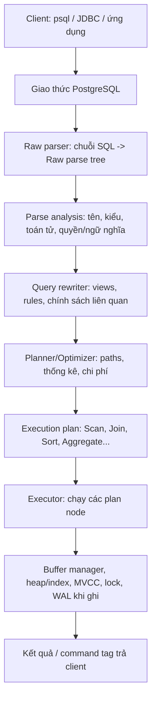
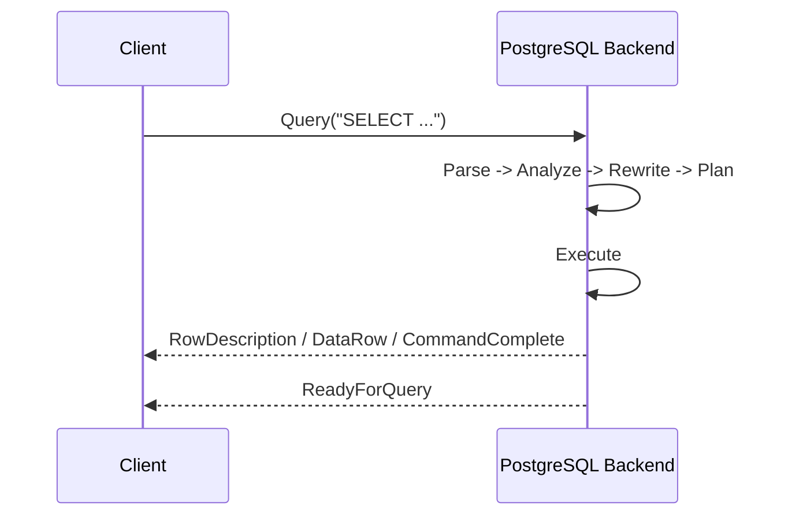
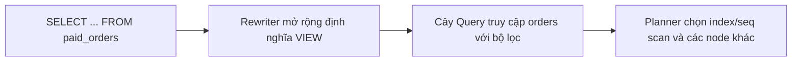
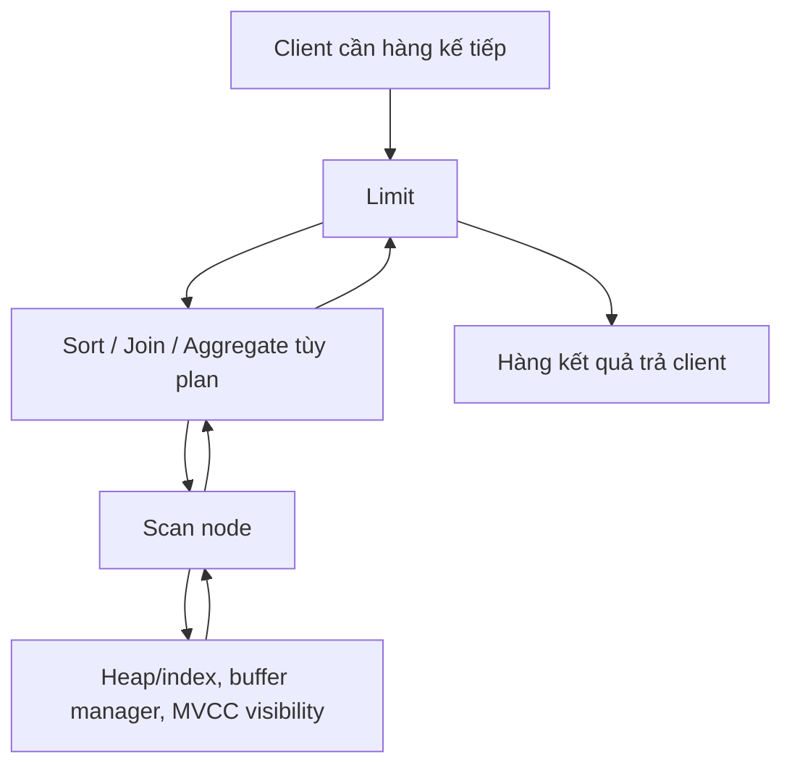

# Vòng đời truy vấn qua phân tích, viết lại, lập kế hoạch và thực thi trong PostgreSQL

Khi ứng dụng gửi một câu lệnh như `SELECT ... FROM orders WHERE ...` tới PostgreSQL, máy chủ không đơn giản đọc từng dòng SQL rồi thực thi tuần tự. PostgreSQL phải **hiểu câu lệnh**, xác định những bảng/cột/kiểu dữ liệu mà nó tham chiếu, áp dụng các quy tắc biến đổi cần thiết, **chọn cách lấy dữ liệu với chi phí dự kiến hợp lý**, rồi mới sử dụng các cơ chế lưu trữ và giao dịch để thực hiện.

Vòng đời thường được mô tả bằng năm bước:

1. **Phân tích cú pháp (parsing):** biến chuỗi SQL thành cây cú pháp thô.
2. **Phân tích ngữ nghĩa (parse analysis):** giải quyết tên đối tượng, kiểu dữ liệu và ngữ nghĩa SQL để tạo một cây truy vấn đã được phân tích.
3. **Viết lại truy vấn (query rewriting):** biến đổi cây truy vấn theo rule/view và những cơ chế liên quan.
4. **Lập kế hoạch/tối ưu hóa (planning/optimization):** cân nhắc những phương án truy cập dữ liệu, phép nối, bộ lọc, sắp xếp; tạo execution plan.
5. **Thực thi (execution):** chạy các nút trong plan, làm việc với buffer/cache, các bảng và chỉ mục, trả kết quả hoặc ghi dữ liệu.

Việc tách các giai đoạn này giúp giải thích vì sao một câu SQL đúng cú pháp vẫn có thể báo lỗi, vì sao truy vấn lên view có thể trở thành một phép nối giữa các bảng gốc, vì sao optimizer chọn quét bảng thay vì chỉ mục, và vì sao `EXPLAIN` với `EXPLAIN ANALYZE` phản ánh hai loại thông tin khác nhau.

## 1. Sơ đồ tổng thể của vòng đời truy vấn



Sơ đồ là mô hình khái quát của các câu truy vấn SQL thông thường. Các lệnh quản trị như `VACUUM`, `CREATE TABLE`, `SHOW` hoặc lệnh tiện ích khác có đường xử lý riêng; không phải câu lệnh SQL nào cũng phải đi qua một optimizer của `SELECT` với các nút `Seq Scan` và `Hash Join`.

| Giai đoạn | Đầu vào | Kết quả chính | Điều cần nhớ |
| --- | --- | --- | --- |
| Raw parsing | Văn bản SQL | Cây cú pháp thô | Chủ yếu kiểm tra cấu trúc/cú pháp |
| Parse analysis | Cây cú pháp thô + catalog | Cây `Query` đã phân tích | Xác định quan hệ, cột, kiểu, toán tử và tính hợp lệ |
| Rewriting | Cây `Query` | Một hoặc nhiều cây truy vấn đã biến đổi | Áp dụng rule/view, không chỉ đổi text |
| Planning | Cây truy vấn + thống kê/metadata | Cây plan khả thi theo mô hình chi phí | Chọn phương pháp thực hiện, không cam kết nhanh nhất trong mọi hoàn cảnh |
| Execution | Plan + tham số + trạng thái transaction | Các hàng kết quả hoặc thay đổi dữ liệu | Số hàng/thời gian thực tế chỉ có khi chạy |

**Phân biệt cây truy vấn và cây kế hoạch:** cây truy vấn mô tả *cần làm gì* theo ngữ nghĩa SQL; cây kế hoạch mô tả *PostgreSQL sẽ cố làm bằng cách nào* trong một lần thực thi.

## 2. Từ ứng dụng đến máy chủ: Simple Query và Extended Query Protocol

Phía client có thể dùng `psql`, JDBC, framework ORM hoặc một dịch vụ khác. Mọi câu lệnh đều được gửi theo giao thức PostgreSQL, nhưng **thời điểm phân tích/lập kế hoạch** có thể khác theo đường giao thức.

### 2.1. Simple Query Protocol

Trong đường đơn giản, client gửi một thông điệp **Query** có văn bản SQL. PostgreSQL xử lý những câu lệnh trong thông điệp đó theo quy tắc giao thức và transaction, rồi trả phản hồi tương ứng.



Đây là sơ đồ khái niệm; thứ tự chính xác của các thông điệp phản hồi còn phụ thuộc loại lệnh và có hay không lỗi.

### 2.2. Extended Query Protocol

Nhiều client, trong đó có driver dùng prepared statements, sử dụng nhóm thông điệp **Parse → Bind → Execute → Sync**:

| Thông điệp | Mục đích khái quát |
| --- | --- |
| `Parse` | Khai báo statement và phân tích chuỗi SQL; có thể cung cấp kiểu tham số |
| `Bind` | Gắn giá trị tham số, tạo portal và chuẩn bị plan thích hợp |
| `Describe` | Hỏi metadata về tham số hoặc cột kết quả khi cần |
| `Execute` | Chạy portal, có thể giới hạn số hàng trả trong một lượt |
| `Sync` | Kết thúc chuỗi thông điệp và đồng bộ trạng thái giao thức |

Điều này có nghĩa là trong một ứng dụng chuẩn bị statement nhiều lần, **parse, bind và execute không nhất thiết nằm trong một bước nguyên khối duy nhất**. Tùy cách dùng plan cache và tham số, PostgreSQL có thể tái sử dụng một phần công việc hoặc tạo kế hoạch mới.

Không nên đồng nhất extended protocol với SQL `PREPARE` trong mọi trường hợp. Cả hai liên quan prepared statements, nhưng một bên là **giao thức client-server**, một bên là **câu lệnh SQL** dùng để chuẩn bị truy vấn trong session.

## 3. Raw parsing: biến chuỗi SQL thành cây cú pháp

Ví dụ:

```sql
SELECT order_id, total_amount
FROM orders
WHERE customer_id = 42;
```

Raw parser dùng lexer và grammar để nhận diện các thành phần như `SELECT`, danh sách cột, `FROM`, `WHERE`, toán tử `=` và hằng số. Đầu ra là một **raw parse tree** biểu diễn cấu trúc cú pháp.

Minh họa đơn giản hóa, **không phải bản dump cấu trúc nội bộ thực tế**:

```text
SelectStmt
  targetList:
    ColumnRef(order_id)
    ColumnRef(total_amount)
  fromClause:
    RangeVar(orders)
  whereClause:
    A_Expr("=")
      left:  ColumnRef(customer_id)
      right: Integer(42)
```

Ở bước này, PostgreSQL hiểu rằng câu SQL có cấu trúc một `SELECT` với biểu thức lọc. Tuy nhiên, raw parser **chưa nhất thiết xác nhận** bảng `orders` có thật, cột `customer_id` tồn tại hoặc toán tử `=` áp dụng được cho các kiểu dữ liệu tương ứng.

### 3.1. Lỗi cú pháp xuất hiện ở đâu?

Ví dụ sai cú pháp:

```sql
SELECT FROM WHERE;
```

PostgreSQL có thể trả lỗi cú pháp (SQLSTATE `42601`) trong giai đoạn parsing vì chuỗi token không khớp grammar SQL.

Một câu khác:

```sql
SELECT nonexistent_column
FROM orders;
```

có thể **đúng cú pháp** nhưng sai ở giai đoạn phân tích ngữ nghĩa nếu bảng tồn tại mà cột không có. Không nên gọi tất cả lỗi truy vấn là “syntax error”.

### 3.2. Vì sao không ghép chuỗi SQL từ đầu vào người dùng?

Raw parser sẽ phân tích *toàn bộ chuỗi SQL* mà client gửi. Nếu ứng dụng ghép dữ liệu người dùng trực tiếp vào câu lệnh, ký tự đặc biệt có thể làm thay đổi cấu trúc SQL và dẫn đến SQL injection.

Không an toàn:

```text
sql = "SELECT * FROM customers WHERE email = '" + userInput + "'"
```

Phương án phù hợp hơn là **parameterized query** với driver:

```sql
SELECT customer_id, full_name
FROM customers
WHERE email = $1;
```

`$1` biểu diễn parameter ở mức PostgreSQL/statement, còn JDBC dùng placeholder `?` trong API của driver. Tham số được truyền và phân tích thành **giá trị**, không được dùng như mảnh text SQL để nối trực tiếp. Tên bảng/cột động cần được kiểm soát bằng allowlist hoặc công cụ quote identifier phù hợp, vì tham số giá trị không thay thế được identifier.

## 4. Parse analysis: hiểu đối tượng và kiểm tra ngữ nghĩa

Sau parsing, PostgreSQL thực hiện **phân tích ngữ nghĩa** (*parse analysis*, thường gọi tắt là analysis hoặc transformation). Đây là lúc máy chủ tra cứu các đối tượng đã được khai báo và quyết định nhiều chi tiết về kiểu dữ liệu.

Các nhiệm vụ tiêu biểu:

1. Giải quyết tên bảng, schema, cột và alias bằng catalog và `search_path`.
2. Phân biệt các tham chiếu cột khi câu truy vấn có nhiều bảng.
3. Suy luận hoặc ép kiểu dữ liệu theo quy tắc, chọn toán tử/hàm phù hợp.
4. Xác nhận vị trí sử dụng aggregate, grouping, window function và biểu thức có hợp lệ.
5. Chuẩn hóa nhiều cấu trúc cú pháp thành biểu diễn truy vấn nội bộ.
6. Gắn các thông tin cần thiết để các giai đoạn sau kiểm tra quyền và xây dựng plan.

Ví dụ:

```sql
SELECT o.order_id, c.full_name
FROM orders AS o
JOIN customers AS c
  ON c.customer_id = o.customer_id
WHERE o.status = 'PAID';
```

Ở giai đoạn này, máy chủ phải biết:

- `orders AS o` và `customers AS c` chỉ tới những quan hệ nào.
- `o.customer_id`, `c.customer_id` là cột nào, kiểu gì.
- `=` giữa hai cột dùng toán tử thích hợp nào.
- Hằng chuỗi `'PAID'` cần được hiểu theo kiểu của `orders.status`.
- `full_name` có bị trùng tên hoặc tham chiếu mơ hồ hay không.

### 4.1. Các lỗi phân tích ngữ nghĩa hay gặp

| SQL minh họa | Vấn đề | Loại lỗi thường gặp |
| --- | --- | --- |
| `SELECT * FROM missing_table;` | Bảng không tồn tại hoặc không nằm trong search path | `undefined_table`, SQLSTATE `42P01` |
| `SELECT unknown_col FROM orders;` | Cột không tồn tại | `undefined_column`, `42703` |
| `SELECT customer_id FROM customers JOIN orders USING (customer_id);` | Bản này hợp lệ vì `USING` hợp nhất tên cột đầu ra; không phải ví dụ cột mơ hồ | Không có lỗi mơ hồ do riêng cột `USING` |
| `SELECT customer_id FROM customers c JOIN orders o ON c.customer_id=o.customer_id;` | `customer_id` không có qualifier và tồn tại ở hai bảng | `ambiguous_column`, `42702` |
| `SELECT customer_id, count(*) FROM orders;` | Cột không aggregate chưa được `GROUP BY` trong ví dụ này | `grouping_error`, `42803` |

Cột `customer_id` không kèm prefix không phải lúc nào cũng sai: lỗi chỉ xuất hiện khi có nhiều nguồn không hợp nhất tên và trình phân tích không quyết định được tham chiếu.

### 4.2. search_path có thể đổi ý nghĩa một câu SQL

```sql
SHOW search_path;
```

Giả sử có hai bảng `sales.orders` và `archive.orders`. Câu:

```sql
SELECT count(*) FROM orders;
```

sẽ được giải quyết theo quy tắc `search_path`. Để tránh nhầm lẫn ở truy vấn quan trọng:

```sql
SELECT count(*) FROM sales.orders;
```

Trước khi tối ưu hiệu năng, phải chắc rằng truy vấn đang chỉ tới **đúng đối tượng**. Đây cũng là một lý do không cấp quyền `CREATE` bừa bãi trên schema được đưa vào `search_path` của các routine đặc quyền.

## 5. Query rewriting: thay đổi cây truy vấn theo rule/view

Sau khi đã có cây truy vấn được phân tích, PostgreSQL có giai đoạn **query rewriting**. Nó làm việc với **cây truy vấn nội bộ**, không chỉ là thay chuỗi SQL bằng cách tìm/đổi từ khóa.

PostgreSQL có hệ thống **rules**: một số quy tắc có thể biến đổi một lệnh thành một hoặc nhiều lệnh khác. Một trường hợp đặc biệt quan trọng là **view**: query rewriter có thể mở rộng view thành định nghĩa truy vấn nền của nó.

### 5.1. Ví dụ view được mở rộng

Giả sử:

```sql
CREATE VIEW paid_orders AS
SELECT order_id, customer_id, total_amount, placed_at
FROM orders
WHERE status = 'PAID';
```

Ứng dụng truy vấn:

```sql
SELECT order_id, total_amount
FROM paid_orders
WHERE customer_id = 42;
```

Về mặt ngữ nghĩa, PostgreSQL cần kết hợp:

- Điều kiện định nghĩa view: `status = 'PAID'`.
- Điều kiện của caller: `customer_id = 42`.

Một cách **hình dung** truy vấn nền tương đương:

```sql
SELECT order_id, total_amount
FROM orders
WHERE status = 'PAID'
  AND customer_id = 42;
```

Đây **không phải cam kết** rằng PostgreSQL tạo đúng văn bản SQL bên trên. Rewriter và planner thao tác trên cây nội bộ; tùy loại view, `security_barrier`, rule và phép biến đổi, các biểu thức có thể được tổ chức khác nhau trong plan.



### 5.2. Rules khác triggers và planner optimization

Ba khái niệm thường bị nhầm:

| Cơ chế | Thời điểm/bản chất | Ví dụ |
| --- | --- | --- |
| Query rewrite rule | Biến đổi cây truy vấn theo quy tắc | View, `CREATE RULE ... ON ... DO ...` |
| Planner transformation | Đổi phương án thực hiện nhưng giữ ngữ nghĩa | Chọn thứ tự join, đẩy filter, chọn hash join |
| Trigger | Chạy trong quá trình thực thi thao tác trên bảng/view | `BEFORE INSERT`, `AFTER UPDATE` |

**Rewriter không phải nơi trigger được gọi.** Trigger thực thi khi câu lệnh đi tới giai đoạn executor và những điều kiện kích hoạt tương ứng được đáp ứng.

Không nên dùng rewrite rules phức tạp thay cho logic nghiệp vụ nhiều bước chỉ vì rules có thể biến đổi câu SQL. Với thao tác ghi có side effect, trigger, constraint, transaction hoặc quy trình ứng dụng có thể dễ giải thích và kiểm soát hơn, tùy trường hợp.

### 5.3. Row-Level Security và security barrier

PostgreSQL hỗ trợ **Row-Level Security (RLS)**. Khi RLS được bật trên bảng và áp dụng cho role hiện tại, các policy có thể thêm **điều kiện bảo vệ hàng** vào truy vấn trong quá trình rewrite/xử lý liên quan. Điều này ảnh hưởng đến những hàng mà người dùng được phép đọc hoặc thay đổi.

Ví dụ minh họa ý tưởng:

```text
Truy vấn người dùng:
  SELECT * FROM orders WHERE status = 'PAID';

Chính sách RLS giả định:
  role hiện tại chỉ được thấy orders.customer_id = 42

Hành vi logic:
  chỉ trả các hàng vừa status='PAID', vừa được policy cho phép
```

**Không được coi RLS chỉ là một điều kiện tự nguyện mà ứng dụng muốn bỏ là bỏ.** Nó là chính sách bảo vệ của server, áp dụng theo quyền, vai trò và cấu hình bảng. Tuy nhiên, table owner và các role có quyền đặc biệt có thể có ngoại lệ/bypass tùy cài đặt; cần hiểu chính xác role thực thi. View có `security_barrier` còn ảnh hưởng khả năng đưa biểu thức qua ranh giới bảo mật.

## 6. Planner/Optimizer: chọn cách thực thi

Sau rewriting, một câu truy vấn đã biết **phải trả những gì** nhưng chưa biết **truy cập dữ liệu bằng cách nào**. PostgreSQL planner/optimizer xét những lựa chọn có thể và dựa trên **mô hình chi phí (cost-based optimization)** để chọn kế hoạch.

Ví dụ cùng câu SQL có thể được thực hiện bằng các lựa chọn khác nhau:

```sql
SELECT order_id, total_amount
FROM orders
WHERE customer_id = 42
  AND placed_at >= DATE '2026-05-01';
```

Một số lựa chọn khả dĩ:

- Quét toàn bộ `orders` rồi lọc: **Sequential Scan**.
- Dùng B-tree index trên `(customer_id, placed_at)` để tìm các hàng: **Index Scan**.
- Tạo bitmap từ các mục chỉ mục phù hợp rồi đọc các block heap: **Bitmap Index Scan + Bitmap Heap Scan**.
- Nếu truy vấn chỉ dùng cột có trong index và điều kiện visibility cho phép, **Index Only Scan** có thể giảm việc đọc heap.
- Nếu bảng được partition, chỉ truy cập các partition cần thiết khi **partition pruning** áp dụng được.

Planner không chọn “có index thì luôn dùng index”. Nó đánh giá **ước lượng số hàng, phân bố dữ liệu, chi phí I/O/CPU, khả năng cache, sắp xếp, phép nối và những giới hạn truy vấn**.

### 6.1. Các loại scan thường thấy

| Plan node | Công việc chính | Khi nào có thể hợp lý |
| --- | --- | --- |
| `Seq Scan` | Đọc các trang heap của bảng theo chiến lược quét | Bảng nhỏ hoặc cần đọc tỷ lệ lớn dữ liệu |
| `Index Scan` | Dò index để tìm vị trí hàng, thường đọc heap tương ứng | Điều kiện chọn lọc, cần trả cột ngoài index |
| `Index Only Scan` | Đọc phần dữ liệu có trong index; kiểm tra visibility khi cần | Cột cần lấy nằm trong index và visibility map thuận lợi |
| `Bitmap Index Scan` | Thu thập vị trí bản ghi phù hợp vào bitmap | Nhiều hàng trải trên nhiều block, điều kiện kết hợp |
| `Bitmap Heap Scan` | Truy cập heap theo bitmap, kiểm tra điều kiện/recheck khi cần | Theo sau bitmap index scan |
| `Tid Scan` | Truy cập bằng tuple identifier trong tình huống thích hợp | Truy vấn đặc biệt với `ctid` |

**Index Only Scan không đồng nghĩa “không bao giờ đọc heap”.** PostgreSQL cần xét tính hiển thị tuple theo MVCC; khi visibility map chưa cho phép suy ra an toàn, nó vẫn có thể phải đọc heap.

### 6.2. Các chiến lược JOIN

Một phép `JOIN` có thể dùng nhiều thuật toán:

| Node | Ý tưởng | Điểm cần chú ý |
| --- | --- | --- |
| `Nested Loop` | Với các hàng từ phía ngoài, tìm hàng khớp ở phía trong | Tốt khi đầu vào ngoài nhỏ và phía trong có index lookup tốt |
| `Hash Join` | Tạo bảng băm ở một phía, dò bằng khóa nối phía còn lại | Hợp với equijoin và tập dữ liệu phù hợp bộ nhớ |
| `Merge Join` | Ghép hai luồng đã sắp theo khóa nối | Có lợi khi nguồn đã có thứ tự, hoặc chi phí sort hợp lý |

Ví dụ:

```sql
SELECT c.full_name, o.order_id
FROM customers AS c
JOIN orders AS o
  ON o.customer_id = c.customer_id
WHERE c.customer_id = 42;
```

Planner có thể chọn lookup từ một khách sang đơn qua index; với báo cáo nối hàng triệu hàng, nó có thể ưu tiên `Hash Join`. **Thứ tự bảng xuất hiện trong `FROM` không nhất thiết là thứ tự thực thi** của inner join sau tối ưu.

### 6.3. GROUP BY, ORDER BY, LIMIT và CTE

Các toán tử khác có thể xuất hiện:

- `Sort`: sắp xếp đầu vào khi cần.
- `Aggregate`, `HashAggregate`, `GroupAggregate`: tổng hợp dữ liệu.
- `Limit`: giới hạn số hàng đầu ra.
- `Materialize` hoặc `CTE Scan`: một số chiến lược lưu/đọc kết quả trung gian.
- `Append` / `Merge Append`: kết hợp dữ liệu từ nhiều nguồn/partition.
- `Gather` / `Gather Merge`: phối hợp thực thi song song.

Trong PostgreSQL hiện đại, một CTE không tự động luôn là **optimization fence**. Với một số CTE không đệ quy, chỉ đọc và tham chiếu phù hợp, planner có thể **inline** nó; `MATERIALIZED` hoặc `NOT MATERIALIZED` có thể ảnh hưởng lựa chọn theo quy tắc PostgreSQL. Không suy luận mọi `WITH ...` đều ghi kết quả ra bảng tạm.

## 7. Chi phí và thống kê: planner biết điều gì?

PostgreSQL ước lượng số hàng và chi phí dựa vào các nguồn như:

- Số trang, số tuple ước lượng của quan hệ.
- Histogram và tần suất những giá trị phổ biến trong thống kê cột.
- Tỷ lệ `NULL`, số giá trị phân biệt và một số độ tương quan.
- **Extended statistics** khi được tạo để mô tả tương quan hoặc số lượng nhóm giữa nhiều cột.
- Đặc điểm index, biểu thức lọc, điều kiện join, thứ tự và giới hạn kết quả.
- Các tham số chi phí như `seq_page_cost`, `random_page_cost`, `cpu_tuple_cost`.

Ví dụ nếu 99% đơn hàng có `status = 'PAID'`, chỉ mục trên `status` có thể không hấp dẫn cho truy vấn lấy tất cả đơn `PAID`. Ngược lại, nếu chỉ 0,1% đơn phù hợp một `customer_id`, index theo khách hàng có thể có lợi.

### 7.1. Cập nhật thống kê với ANALYZE

```sql
ANALYZE orders;
```

`ANALYZE` thu thập/cập nhật thống kê để hỗ trợ optimizer; nó **không tự tạo index**, không sắp xếp lại tất cả hàng theo filter và không phải một công cụ bảo đảm kế hoạch đã tối ưu. Autovacuum thường có thể kích hoạt autoanalyze khi dữ liệu thay đổi đủ nhiều, nhưng cách cập nhật phụ thuộc cấu hình.

Với môi trường production, `ANALYZE` có chi phí I/O/CPU và sử dụng tài nguyên; nên chạy theo chiến lược vận hành phù hợp. Không ép chạy liên tục chỉ vì một `EXPLAIN` có số ước lượng lạ.

### 7.2. Cost không phải thời gian mili giây

Ví dụ một phần kế hoạch minh họa:

```text
Index Scan using idx_orders_customer_time on orders
  (cost=0.29..18.42 rows=8 width=24)
```

Đọc như sau:

| Phần | Ý nghĩa |
| --- | --- |
| `cost=0.29..18.42` | Chi phí ước lượng từ startup tới tổng, theo **đơn vị cost tương đối** của planner |
| `rows=8` | Số hàng planner dự kiến node tạo ra |
| `width=24` | Kích thước trung bình ước lượng của một hàng đầu ra node, theo byte |

Giá trị `18.42` **không phải 18,42 ms**, còn `rows=8` không phải số hàng được đo ở runtime. Khi cần thời gian và số hàng thực, xem `EXPLAIN ANALYZE`.

## 8. Chuẩn bị schema thực hành để quan sát planner

Chạy trên **database thử nghiệm**, với role có quyền tạo schema và bảng. Ví dụ dùng schema riêng để tránh đụng dữ liệu khác:

```sql
CREATE SCHEMA IF NOT EXISTS query_lifecycle_lab;

CREATE TABLE query_lifecycle_lab.customers (
    customer_id INTEGER PRIMARY KEY,
    full_name   TEXT NOT NULL,
    email       TEXT NOT NULL UNIQUE
);

CREATE TABLE query_lifecycle_lab.orders (
    order_id      BIGINT GENERATED ALWAYS AS IDENTITY PRIMARY KEY,
    customer_id   INTEGER NOT NULL
        REFERENCES query_lifecycle_lab.customers (customer_id),
    status        TEXT NOT NULL
        CHECK (status IN ('PAID', 'PENDING', 'CANCELLED')),
    placed_at     TIMESTAMP NOT NULL,
    total_amount  NUMERIC(12, 2) NOT NULL
        CHECK (total_amount >= 0)
);

CREATE INDEX idx_orders_customer_time
ON query_lifecycle_lab.orders (customer_id, placed_at);

CREATE INDEX idx_orders_status
ON query_lifecycle_lab.orders (status);
```

Nạp một tập dữ liệu đại diện nhỏ để quan sát. `generate_series` là **set-returning function** của PostgreSQL:

```sql
INSERT INTO query_lifecycle_lab.customers
    (customer_id, full_name, email)
SELECT
    n,
    'Khach hang ' || n::text,
    'customer' || n::text || '@example.test'
FROM generate_series(1, 100) AS gs(n);

INSERT INTO query_lifecycle_lab.orders
    (customer_id, status, placed_at, total_amount)
SELECT
    (n % 100) + 1,
    CASE
        WHEN n % 10 < 7 THEN 'PAID'
        WHEN n % 10 < 9 THEN 'PENDING'
        ELSE 'CANCELLED'
    END,
    TIMESTAMP '2026-01-01'
        + (n % 300) * INTERVAL '1 day'
        + (n % 24) * INTERVAL '1 hour',
    ((n % 19) + 1) * 25000.00
FROM generate_series(1, 10000) AS gs(n);

ANALYZE query_lifecycle_lab.customers;
ANALYZE query_lifecycle_lab.orders;
```

Đây là script dành cho schema **mới, chưa có dữ liệu**. Nếu chạy lại các câu `INSERT` trên bảng cũ, dữ liệu sẽ bị trùng hoặc tăng số hàng. Kế hoạch cụ thể còn thay đổi theo phiên bản, bộ nhớ, thống kê và kích thước bảng; những lời giải thích bên dưới không giả định mọi máy chọn cùng một node.

### 8.1. Truy vấn mẫu cần phân tích

```sql
SELECT
    c.full_name,
    o.order_id,
    o.total_amount,
    o.placed_at
FROM query_lifecycle_lab.customers AS c
JOIN query_lifecycle_lab.orders AS o
  ON o.customer_id = c.customer_id
WHERE c.customer_id = 42
  AND o.status = 'PAID'
  AND o.placed_at >= TIMESTAMP '2026-05-01'
ORDER BY o.placed_at DESC
LIMIT 5;
```

Theo các giai đoạn:

1. **Parse:** nhận dạng `SELECT`, `JOIN`, `WHERE`, `ORDER BY`, `LIMIT`.
2. **Analyze:** giải quyết alias `c`/`o`, các cột, kiểu `TIMESTAMP` và toán tử so sánh.
3. **Rewrite:** áp dụng rules/policies tương ứng nếu có; ở truy vấn bảng cơ sở thông thường bước này có thể không tạo thay đổi quan sát được.
4. **Plan:** xét index, lọc `status`, thứ tự join, sort và giới hạn 5 hàng.
5. **Execute:** đọc tuple theo plan, áp dụng điều kiện, chọn tối đa năm dòng phù hợp với thứ tự yêu cầu và trả về client.

## 9. EXPLAIN: xem kế hoạch *trước* thực thi

`EXPLAIN` cho biết planner định sử dụng những nút nào:

```sql
EXPLAIN
SELECT
    c.full_name,
    o.order_id,
    o.total_amount,
    o.placed_at
FROM query_lifecycle_lab.customers AS c
JOIN query_lifecycle_lab.orders AS o
  ON o.customer_id = c.customer_id
WHERE c.customer_id = 42
  AND o.status = 'PAID'
  AND o.placed_at >= TIMESTAMP '2026-05-01'
ORDER BY o.placed_at DESC
LIMIT 5;
```

Một cây **minh họa các node có thể gặp** (không phải kết quả đo từ PostgreSQL server cụ thể):

```text
Limit
  -> Nested Loop
       -> Index Scan using idx_orders_customer_time on orders o
            Index Cond: ((customer_id = 42) AND (placed_at >= ...))
            Filter: (status = 'PAID')
       -> Index Scan using customers_pkey on customers c
            Index Cond: (customer_id = 42)
```

Khi có `ORDER BY ... DESC`, planner cũng có thể thêm `Sort`, dùng một index scan theo hướng phù hợp hoặc chọn cấu trúc khác. **Đừng chép cây trên rồi kỳ vọng kết quả `EXPLAIN` thực của bạn trùng khớp**.

Các node được diễn giải như sau:

- `Limit`: đầu ra tối đa năm hàng.
- `Nested Loop`: một phương pháp join theo từng hàng của phía ngoài.
- `Index Scan`: đọc qua index đã chọn.
- `Index Cond`: điều kiện được dùng để xác định phạm vi/lookup qua index.
- `Filter`: điều kiện được đánh giá bổ sung trên những hàng đi qua bước truy cập.

Thứ tự trình bày cây không phải thứ tự từng câu SQL trong văn bản. Planner có quyền đổi thứ tự truy cập các bảng trong phạm vi phép biến đổi giữ đúng ngữ nghĩa.

### 9.1. Vì sao PostgreSQL có thể chọn Seq Scan?

Nếu bảng chỉ có vài hàng, filter trả phần lớn dữ liệu, hoặc index không phù hợp, `Seq Scan` có thể rẻ hơn. Điều đó không tự động là lỗi tối ưu.

Ví dụ:

```sql
EXPLAIN
SELECT *
FROM query_lifecycle_lab.orders
WHERE status = 'PAID';
```

Do dữ liệu mẫu có tỷ lệ `PAID` cao, planner có thể thấy quét bảng hợp lý hơn truy cập nhiều hàng qua index. Cần xem **ước lượng hàng, phân bố giá trị và chi phí đọc heap**, không chỉ phán xét bằng sự có mặt của `Seq Scan`.

### 9.2. Các tùy chọn EXPLAIN hữu ích

```sql
EXPLAIN (VERBOSE, COSTS, SETTINGS)
SELECT count(*)
FROM query_lifecycle_lab.orders
WHERE status = 'PAID';
```

| Tùy chọn | Tác dụng chính |
| --- | --- |
| `VERBOSE` | Thêm thông tin như tên output/expression |
| `COSTS` | Hiển thị cost, rows, width ước lượng |
| `SETTINGS` | Hiển thị những thiết lập liên quan đến kế hoạch khác giá trị mặc định và được báo bởi EXPLAIN |
| `FORMAT JSON` | Xuất plan ở dạng cấu trúc JSON |
| `ANALYZE` | **Thực thi câu lệnh** và cung cấp số liệu runtime |
| `BUFFERS` | Báo số liệu buffer trong phạm vi hỗ trợ, đặc biệt hữu ích khi dùng cùng `ANALYZE` |

PostgreSQL hỗ trợ thêm các tùy chọn như `TIMING`, `SUMMARY`, `WAL`, `MEMORY` tùy phiên bản và loại câu lệnh. Không nên giả định tất cả tùy chọn xuất hiện giống nhau trên mọi major version.

## 10. EXPLAIN ANALYZE: quan sát kế hoạch *khi chạy thật*

`EXPLAIN ANALYZE` thực thi câu lệnh và báo thêm số liệu runtime:

```sql
EXPLAIN (ANALYZE, BUFFERS)
SELECT
    c.full_name,
    o.order_id,
    o.total_amount,
    o.placed_at
FROM query_lifecycle_lab.customers AS c
JOIN query_lifecycle_lab.orders AS o
  ON o.customer_id = c.customer_id
WHERE c.customer_id = 42
  AND o.status = 'PAID'
  AND o.placed_at >= TIMESTAMP '2026-05-01'
ORDER BY o.placed_at DESC
LIMIT 5;
```

Vì đây là `SELECT` thuần trên bảng mẫu, nó là một cách thử thuận tiện. Một plan thực tế có thể chứa:

```text
(cost=... rows=... width=...)
(actual time=... rows=... loops=...)
Buffers: shared hit=..., read=...
Planning Time: ...
Execution Time: ...
```

Ý nghĩa:

| Trường | Loại số liệu | Diễn giải |
| --- | --- | --- |
| `cost` | Ước lượng | Đơn vị chi phí của planner, không phải ms |
| `rows` trước actual | Ước lượng | Số hàng node dự định tạo |
| `actual time` | Thực đo | Thời gian node mất khi chạy, thường báo theo ms |
| `actual rows` | Thực đo | Số hàng node tạo ra; với nhiều loops thường là trung bình mỗi lần |
| `loops` | Thực đo | Số lần node được thực thi |
| `Buffers: shared hit` | Runtime buffer | Số lượt truy cập buffer page đã có trong shared buffers |
| `Buffers: shared read` | Runtime buffer | Số lượt đọc buffer page không có sẵn trong shared buffers, không phải luôn số lần đọc vật lý từ đĩa |
| `Planning Time` | Thực đo | Thời gian lập kế hoạch trong phạm vi đo |
| `Execution Time` | Thực đo | Thời gian thực thi được EXPLAIN báo |

**Actual rows khác estimated rows** là dấu hiệu thống kê/ước lượng có thể không phù hợp, đặc biệt nếu chênh lệch nhiều bậc độ lớn ở nút gây công việc lớn. Tuy nhiên, thời gian đo cũng chịu ảnh hưởng cache, tải đồng thời, hệ điều hành và việc instrument thêm trong `EXPLAIN ANALYZE`.

### 10.1. Cảnh báo khi EXPLAIN ANALYZE với DML

Khác `EXPLAIN` thuần, `EXPLAIN ANALYZE INSERT/UPDATE/DELETE` **thực sự chạy các thay đổi dữ liệu**, cùng với các trigger phù hợp. Trong môi trường thử nghiệm, có thể dùng transaction rồi rollback:

```sql
BEGIN;

EXPLAIN (ANALYZE, BUFFERS)
UPDATE query_lifecycle_lab.orders
SET total_amount = total_amount + 1000
WHERE order_id = 1;

ROLLBACK;
```

Lệnh `ROLLBACK` hoàn tác thay đổi có tính giao dịch trong PostgreSQL, nhưng **không bảo đảm đảo ngược mọi tác dụng bên ngoài** của một trigger/function (ví dụ gọi dịch vụ ngoài), và sequence thường không rollback giá trị đã được cấp. Vì vậy không thực thi `EXPLAIN ANALYZE` cho câu DML có tác dụng phụ nguy hiểm trên production chỉ vì định rollback sau đó.

## 11. Executor: các nút kế hoạch thực sự làm gì?

Executor chạy execution plan do planner tạo. Một cách mô hình hóa quen thuộc là **cây toán tử hoạt động theo kiểu iterator/pull**: nút cha cần một hàng, yêu cầu nút con cung cấp hàng tiếp theo, xử lý và trả về phía trên. Trong mã nguồn PostgreSQL, executor có các bước khởi tạo, chạy và kết thúc cho những plan node tương ứng.



Trong thực tế còn có các node **blocking** (ví dụ một số `Sort` hoặc `HashAggregate` cần thu thập đầu vào trước khi trả kết quả), và **parallel execution**, nên không phải mọi node trả một hàng ngay sau một lời gọi đơn giản. Tuy vậy mô hình cây toán tử giúp đọc plan từ **nút gốc xuống lá**.

### 11.1. Buffer manager và I/O

Khi `Seq Scan` hay `Index Scan` cần dữ liệu, PostgreSQL đọc thông qua hệ thống buffer/cache và storage manager. Một số trang đã có trong **shared buffers**, số khác cần được lấy từ hệ thống lưu trữ, có thể hưởng lợi từ OS page cache.

Do đó:

- `shared hit` cho biết lần truy cập được phục vụ từ shared buffers.
- `shared read` là số lượt trang được nạp qua đường đọc buffer, **không thể suy ra trực tiếp số lệnh I/O vật lý** vì hệ điều hành có thể cache.
- Chi phí CPU, lọc tuple, giải mã và chuyển kết quả sang client vẫn tồn tại ngay cả khi phần lớn trang đã ở cache.

Muốn cải thiện truy vấn cần biết nút nào làm nhiều việc, không chỉ số lượng truy vấn SQL mà ứng dụng gửi.

### 11.2. MVCC và snapshot

PostgreSQL dùng **Multi-Version Concurrency Control (MVCC)** để quản lý phiên bản hàng và việc đọc/ghi đồng thời. Executor phải kiểm tra hàng nào **hiển thị được** theo snapshot của câu lệnh hoặc transaction, thay vì cứ thấy tuple trên trang là trả về client.

Ví dụ:

```text
Transaction A: UPDATE orders SET status='PAID' WHERE order_id=1
               (chưa COMMIT)
Transaction B: SELECT status FROM orders WHERE order_id=1
```

Trong mức cô lập `READ COMMITTED` thông dụng, B không nhìn thấy giá trị chưa commit của A. B đọc phiên bản đã commit phù hợp với snapshot của câu lệnh. Khi A commit, một câu `SELECT` mới của B có thể thấy thay đổi theo quy tắc isolation đang dùng.

Ở `REPEATABLE READ`, snapshot ổn định trong transaction làm các lần đọc về sau có thể tiếp tục thấy trạng thái cũ ngay cả sau khi A commit. Đây là **ngữ nghĩa transaction**, không phải planner bị lỗi.

### 11.3. Ghi dữ liệu, WAL, constraint và trigger

Với câu lệnh:

```sql
UPDATE query_lifecycle_lab.orders
SET status = 'PAID'
WHERE order_id = 1;
```

Plan có thể chứa nút `ModifyTable` phía trên đường truy cập tới hàng cần sửa. Trong quá trình thực thi, PostgreSQL phải làm việc với:

- Kiểm tra hàng/phiên bản và các xung đột cập nhật.
- Lock và điều kiện truy cập cần thiết.
- Các constraint như `CHECK`, `FOREIGN KEY` và `UNIQUE` trong phạm vi áp dụng.
- Trigger thích hợp nếu được định nghĩa.
- **WAL (Write-Ahead Log)** để hỗ trợ khôi phục dữ liệu và độ bền theo cấu hình.

Giai đoạn **rewrite** có thể đã biến đổi câu lệnh theo rule, nhưng **việc thực sự thay đổi bản ghi** diễn ra trong executor cùng storage engine. Kết quả thành công của một statement bên trong transaction chưa đồng nghĩa transaction đó đã `COMMIT`.

## 12. Prepared statements: khi nào parser/planner được tái sử dụng?

PostgreSQL hỗ trợ chuẩn bị câu lệnh để tái sử dụng với các tham số khác nhau:

```sql
PREPARE find_orders(integer) AS
SELECT order_id, customer_id, status, placed_at
FROM query_lifecycle_lab.orders
WHERE customer_id = $1
ORDER BY placed_at DESC
LIMIT 10;

EXECUTE find_orders(42);
EXECUTE find_orders(7);
```

Ý nghĩa:

- `PREPARE` phân tích/chuẩn bị câu truy vấn với placeholder `$1` có kiểu `integer`.
- `EXECUTE` cung cấp giá trị tham số cụ thể và chạy statement được chuẩn bị.
- PostgreSQL có thể lựa chọn **custom plan** dựa trên giá trị tham số hoặc **generic plan** được dùng cho nhiều lần thực thi, theo quy tắc plan cache và chi phí.

Không phải lúc nào prepared statement cũng chỉ lập kế hoạch **một lần**. Với phân bố dữ liệu lệch, custom plan có thể tốt hơn cho một giá trị cụ thể; generic plan có thể giảm chi phí lập kế hoạch khi dùng lại.

### 12.1. Xem kế hoạch của EXECUTE

```sql
EXPLAIN EXECUTE find_orders(42);

EXPLAIN (ANALYZE, BUFFERS)
EXECUTE find_orders(42);
```

Bạn có thể so kế hoạch và số hàng giữa các tham số. Tuy nhiên, bảng demo phân bố khá đều theo khách, nên không nhất thiết thấy khác biệt lớn.

Có thiết lập `plan_cache_mode` để điều khiển cách PostgreSQL chọn generic/custom plan trong những tình huống thích hợp:

```sql
SHOW plan_cache_mode;
```

**Không đổi thiết lập này toàn hệ thống chỉ để “ép dùng cache”.** Khi cần chẩn đoán, có thể thử trong session test với dữ liệu đại diện rồi đo chi phí thực tế.

### 12.2. Plan không phải bất biến mãi mãi

PostgreSQL có cơ chế **plan invalidation/replanning** khi metadata liên quan thay đổi và trong các bối cảnh khác theo quy tắc prepared statement. Việc thêm index, thay đổi schema hoặc cập nhật thống kê có thể khiến plan đã lưu cần được xem lại. Không suy luận rằng `PREPARE` sẽ mãi giữ nguyên đường truy cập bất kể database thay đổi.

Nếu không cần prepared statement nữa:

```sql
DEALLOCATE find_orders;
```

Đây là lệnh của PostgreSQL trong session hiện tại, không phải thao tác xóa bảng hay dữ liệu.

## 13. Phân tích một truy vấn qua VIEW

Tạo view từ schema đã chuẩn bị:

```sql
CREATE OR REPLACE VIEW query_lifecycle_lab.paid_order_report AS
SELECT
    o.order_id,
    o.customer_id,
    c.full_name,
    o.total_amount,
    o.placed_at
FROM query_lifecycle_lab.orders AS o
JOIN query_lifecycle_lab.customers AS c
  ON c.customer_id = o.customer_id
WHERE o.status = 'PAID';
```

Truy vấn qua view:

```sql
EXPLAIN (VERBOSE)
SELECT order_id, full_name, total_amount
FROM query_lifecycle_lab.paid_order_report
WHERE customer_id = 42
ORDER BY placed_at DESC
LIMIT 5;
```

Trong `EXPLAIN`, bạn có thể nhìn thấy **bảng gốc `orders` và `customers`** thay vì một node vật lý tên view. Đây là hệ quả của view thường được mở rộng trong rewrite/planning, không phải PostgreSQL âm thầm tạo bảng dữ liệu vật lý riêng cho view.

### 13.1. View thường khác materialized view

| Loại | Đặc điểm |
| --- | --- |
| `VIEW` thường | Chủ yếu lưu **định nghĩa truy vấn**; khi đọc, hệ thống áp dụng định nghĩa và thực thi kế hoạch phù hợp |
| `MATERIALIZED VIEW` | Có **dữ liệu đã tính và lưu**; cần cơ chế refresh để cập nhật |

Một materialized view có thể được scan như quan hệ lưu trữ vật lý, trong khi ordinary view thường được mở rộng theo rule. Vì vậy nếu người dùng thấy view “đọc chậm” thì không nên mặc định “cần tạo index trực tiếp trên view thường”; phải xem các bảng gốc, điều kiện và plan, hoặc cân nhắc materialized view nếu nghiệp vụ chấp nhận dữ liệu cần refresh.

## 14. Vị trí của giao dịch và kiểm soát quyền trong vòng đời

SQL được xử lý trong một **phiên kết nối** và gắn với transaction. Trong chế độ autocommit mặc định của nhiều client, mỗi statement độc lập có thể nằm trong một transaction ngầm. Khi dùng:

```sql
BEGIN;

SELECT count(*)
FROM query_lifecycle_lab.orders;

UPDATE query_lifecycle_lab.orders
SET total_amount = total_amount + 1000
WHERE order_id = 1;

COMMIT;
```

hai statement SQL là những yêu cầu riêng nhưng thuộc **cùng transaction** theo phạm vi đã mở.

Các bước parse/analyze/rewrite/plan/execution của từng statement phải hoạt động cùng thông tin phiên, snapshot, quyền và trạng thái transaction phù hợp. **Planner không quyết định thời điểm commit theo ý nó**; việc kết thúc transaction được điều khiển bởi giao thức và các lệnh transaction của client theo semantics của PostgreSQL.

### 14.1. Quyền truy cập được kiểm tra như thế nào?

Khi một câu truy vấn tham chiếu bảng/view, PostgreSQL ghi nhận quyền cần thiết và kiểm tra trong quy trình thực thi có liên quan. Ngoài quyền `SELECT` trên bảng, còn có thể cần:

- Quyền `CONNECT` vào database.
- Quyền `USAGE` trên schema chứa đối tượng.
- Quyền trên bảng/cột, sequence hoặc function.
- Quy tắc row-level security nếu được bật.
- Điều kiện ngữ cảnh `SECURITY INVOKER`/`SECURITY DEFINER` khi truy cập qua đối tượng được cấu hình tương ứng.

Không nên phát biểu “mọi quyền được kiểm tra xong ngay tại parser” hoặc “mọi quyền chỉ được kiểm tra cuối executor” như một quy tắc tuyệt đối. Việc ghi nhận quyền, xác thực đối tượng và enforcement có thể tham gia ở nhiều vị trí trong pipeline, tùy loại đối tượng và lệnh.

### 14.2. Tại sao lỗi có thể xuất hiện ở nhiều giai đoạn?

| Giai đoạn liên quan | Ví dụ | Nhận định |
| --- | --- | --- |
| Parsing | Thiếu `FROM`/ngoặc, token sai | Không tạo được cú pháp hợp lệ |
| Analysis | Không có cột/bảng, kiểu dữ liệu không phù hợp | Câu có thể đúng cú pháp nhưng sai ngữ nghĩa |
| Rewriting / permissions | View/rule/policy dẫn đến truy vấn không được phép | Liên quan đối tượng hoặc chính sách |
| Planning | Không tìm được plan hợp lệ trong tình huống đặc biệt, hoặc lỗi biểu thức được đánh giá sớm | Hiếm hơn lỗi semantic, nhưng có thể xuất hiện |
| Execution | Chia cho 0, `UNIQUE` vi phạm, deadlock, hết tài nguyên | Lỗi khi thực sự đọc/ghi/đánh giá dữ liệu |
| Commit | Xung đột hoặc ràng buộc được hoãn, lỗi khi commit | Statement có thể đã chạy nhưng transaction không commit thành công |

Ví dụ, một biểu thức hằng có phép chia cho 0 đôi khi được PostgreSQL đánh giá sớm trong planning; không thể phân loại tuyệt đối mọi lỗi chia cho 0 chỉ xuất hiện khi executor đang lấy hàng.

## 15. Một câu SQL có thể thay đổi hình dạng qua các giai đoạn

Lấy câu truy vấn:

```sql
SELECT
    c.full_name,
    SUM(o.total_amount) AS paid_total
FROM query_lifecycle_lab.customers AS c
JOIN query_lifecycle_lab.orders AS o
  ON o.customer_id = c.customer_id
WHERE o.status = 'PAID'
GROUP BY c.customer_id, c.full_name
HAVING SUM(o.total_amount) >= 1000000
ORDER BY paid_total DESC
LIMIT 10;
```

Từ góc nhìn từng giai đoạn:

**Raw parser:** ghi nhận cấu trúc `SELECT`, `JOIN`, `WHERE`, `GROUP BY`, `HAVING`, `ORDER BY`, `LIMIT` và lời gọi `SUM`.

**Parse analysis:** kiểm tra `SUM` có kiểu đầu vào hợp lệ, các cột ngoài aggregate xuất hiện phù hợp trong `GROUP BY`, tên alias `paid_total` trong `ORDER BY` được giải quyết theo quy tắc SQL của PostgreSQL.

**Rewrite:** áp dụng rule/view/RLS nếu liên quan; nếu chỉ các bảng cơ sở và không có rule đáng kể, cây truy vấn có thể gần như giữ nguyên ý nghĩa.

**Planner:** cân nhắc quét `orders` theo `status` hay quét bảng, join với `customers` bằng thuật toán nào, nhóm bằng hash aggregate hay sort/group aggregate, sắp xếp cuối thế nào, rồi lấy mười hàng.

**Executor:** đọc các tuple được phép thấy, lọc `status='PAID'`, join, tính `SUM` theo nhóm, áp dụng `HAVING`, sắp xếp và trả kết quả. Các phép toán có thể được thực hiện theo plan **khác thứ tự các mệnh đề được viết**, nhưng phải giữ ngữ nghĩa truy vấn.

### 15.1. SQL mô tả kết quả, không phải kịch bản từng bước

Đừng suy luận rằng vì `SELECT` đứng đầu văn bản nên executor “tính SELECT trước WHERE”, hoặc vì bảng `customers` đứng trước trong `FROM` nên nó luôn được quét trước. SQL là ngôn ngữ khai báo; optimizer có thể biến đổi thứ tự thao tác miễn giữ nguyên tính đúng đắn.

Điều này cũng giải thích vì sao viết một câu SQL “ngắn hơn” không chắc chạy nhanh hơn. Truy vấn ngắn có thể có plan tệ, còn câu truy vấn nhiều dòng với index/điều kiện phù hợp có thể tối ưu tốt.

## 16. Đọc EXPLAIN để nối các giai đoạn lại với nhau

Khi điều tra một truy vấn chậm, áp dụng trình tự:

1. **Xác nhận câu SQL đúng nghĩa**: database, schema, tên cột, điều kiện `WHERE`/`JOIN`, số hàng cần trả.
2. **Xem `EXPLAIN` trước** để biết planner đã chọn node nào, dự kiến đọc bao nhiêu hàng, dùng index nào.
3. **Xem thống kê** và phân bố dữ liệu trên các cột lọc/join; cân nhắc `ANALYZE` nếu thống kê không đại diện.
4. **Dùng `EXPLAIN (ANALYZE, BUFFERS)` khi an toàn** để so estimated với actual rows, loops, thời gian và buffer.
5. **Xác định node tốn công**, ví dụ `Seq Scan` đọc nhiều hàng không chọn lọc, `Nested Loop` bên trong chạy quá nhiều lần, `Sort` tràn bộ nhớ, hoặc hash join tạo bảng băm lớn.
6. **Thay đổi có mục đích**, ví dụ thêm index thích hợp, sửa predicate, giảm số cột kéo về, cập nhật thống kê hoặc xem lại cấu trúc join/partition.
7. **Đo lại** trên dữ liệu và workload đại diện; tính thêm chi phí ghi dữ liệu và duy trì chỉ mục.

Vòng đời truy vấn hữu ích cho việc chẩn đoán theo lớp: câu SQL không có kết quả đúng không đồng nghĩa engine chậm; cú pháp đúng không đồng nghĩa ngữ nghĩa đúng; plan hợp lý trên dữ liệu thử nghiệm chưa chắc phù hợp dữ liệu production.

## 17. Những nhầm lẫn thường gặp

| Nhận định dễ nhầm | Cách hiểu đúng |
| --- | --- |
| “Parser kiểm tra tất cả tên bảng/cột và quyền.” | Raw parser chủ yếu kiểm tra cú pháp; parse analysis và các cơ chế sau xử lý tên, kiểu, quyền/chính sách trong ngữ cảnh tương ứng. |
| “Query rewrite là format lại SQL cho đẹp.” | Rewriter biến đổi **cây truy vấn** theo rules/view và chính sách liên quan. |
| “View luôn là một bảng có dữ liệu được lưu sẵn.” | View thường lưu định nghĩa truy vấn; materialized view mới có dữ liệu được lưu và refresh. |
| “Rule và trigger đều chạy trong rewrite.” | Rules thuộc rewrite; triggers chạy trong giai đoạn thực thi thao tác. |
| “Có index thì PostgreSQL bắt buộc chọn Index Scan.” | Planner dùng ước lượng chi phí; Seq Scan có thể rẻ hơn. |
| “cost=100 là mất 100 ms.” | Cost dùng đơn vị tương đối, không phải thời gian đo. |
| “EXPLAIN đã chạy truy vấn để đo thực tế.” | `EXPLAIN` thuần chủ yếu hiển thị kế hoạch ước lượng; `EXPLAIN ANALYZE` mới thực thi. |
| “EXPLAIN ANALYZE UPDATE không làm thay đổi dữ liệu.” | Nó thực thi UPDATE; cần cẩn trọng với transaction và tác dụng phụ. |
| “Index Only Scan không bao giờ truy cập heap.” | Có thể vẫn phải đọc heap để kiểm tra visibility. |
| “SELECT theo thứ tự hàng vật lý nếu không có ORDER BY.” | Không có bảo đảm thứ tự SQL khi thiếu `ORDER BY`. |
| “JOIN luôn theo thứ tự bảng viết trong FROM.” | Planner có thể đổi thứ tự để tối ưu khi ngữ nghĩa cho phép. |
| “PREPARE luôn sinh đúng một plan cố định.” | PostgreSQL có thể chọn generic/custom plan và replan khi cần. |
| “MVCC thuộc planner.” | Planner chọn đường truy cập; executor/storage kiểm tra tuple visibility theo snapshot. |
| “Statement chạy xong nghĩa là transaction đã commit.” | Trong transaction tường minh, thay đổi chỉ hoàn tất theo `COMMIT` thành công. |
| “CTE luôn materialize.” | Một số CTE có thể inline theo điều kiện và cấu hình. |

## 18. Bài tập thực hành

1. Vẽ sơ đồ đầy đủ của một câu `SELECT` từ client → raw parser → parse analysis → rewriter → planner → executor → storage. Ghi rõ đầu vào/đầu ra của mỗi giai đoạn.
2. Phân loại hai câu SQL: một câu sai token và một câu đúng cú pháp nhưng tham chiếu cột không tồn tại. Chỉ ra giai đoạn phát hiện lỗi tương ứng.
3. Tạo schema `query_lifecycle_lab`, hai bảng và chỉ mục theo mục 8. Chạy truy vấn mẫu rồi xem `EXPLAIN` thực tế trên phiên bản PostgreSQL của bạn.
4. So `EXPLAIN` truy vấn lọc `customer_id = 42` và truy vấn `status = 'PAID'`. Giải thích vì sao việc có index không bảo đảm plan chọn index.
5. Chạy `EXPLAIN (ANALYZE, BUFFERS)` cho một `SELECT` thuần. Ghi lại estimated rows, actual rows, loops, Planning Time và Execution Time; phân biệt các loại số liệu.
6. Viết một câu `SELECT` từ view `paid_order_report` rồi chạy `EXPLAIN (VERBOSE)`. Xác định những bảng gốc xuất hiện trong kế hoạch và giải thích vai trò của query rewriter.
7. So sánh ordinary view với materialized view. Khi nào cần refresh dữ liệu? Trường hợp nào đọc view thường không có nghĩa có bảng vật lý riêng?
8. Dùng `PREPARE find_orders(integer)` và `EXECUTE` với hai customer ID. Giải thích generic plan/custom plan và lý do prepared statement không nhất thiết giữ nguyên plan mãi mãi.
9. Tạo ví dụ `GROUP BY` + `HAVING` + `ORDER BY`; dùng `EXPLAIN` tìm node `Aggregate`/`HashAggregate`/`Sort` tương ứng, nếu xuất hiện. Giải thích vì sao node có thể khác thứ tự viết SQL.
10. Mô tả vì sao một `SELECT` trên InnoDB hoặc PostgreSQL có MVCC không nhìn thấy một `UPDATE` chưa commit từ phiên khác. Trong PostgreSQL, xác định executor/storage kiểm tra snapshot ở đâu trong mô hình khái quát.
11. Đề xuất quy trình điều tra một truy vấn có estimated rows = 100 nhưng actual rows = 1.000.000. Bạn sẽ xem thống kê, biểu thức lọc và thiết kế chỉ mục theo thứ tự nào?
12. Tạo một transaction test có `BEGIN; EXPLAIN (ANALYZE, BUFFERS) UPDATE ...; ROLLBACK;` trên bảng an toàn. Giải thích lý do không dùng mẫu này với trigger gọi dịch vụ bên ngoài hoặc production dữ liệu nhạy cảm.
13. Giải thích sự khác nhau giữa Simple Query Protocol và Extended Query Protocol; thông điệp `Parse`, `Bind`, `Execute` giúp tái sử dụng statement như thế nào?
14. Thiết kế một ghi chú kiến trúc cho API báo cáo chậm: mỗi triệu chứng (lỗi cú pháp, cột không tồn tại, scan quá nhiều, lock wait, transaction rollback) nằm gần giai đoạn nào của pipeline?

## 19. Tổng kết

Vòng đời một truy vấn PostgreSQL có thể ghi nhớ bằng chuỗi:

```text
SQL text
  -> Raw parsing
  -> Parse analysis
  -> Query rewriting
  -> Planning / optimization
  -> Execution
  -> Tuple/row result hoặc thay đổi dữ liệu
```

**Parsing** giúp nhận biết cú pháp; **analysis** xác định đối tượng và ngữ nghĩa; **rewriting** áp dụng rule/view và cơ chế liên quan; **planner** chọn các bước truy cập/ghép dữ liệu theo mô hình chi phí; **executor** chạy kế hoạch trong bối cảnh transaction, MVCC, lock và storage. Khi cần hiểu vì sao một câu SQL chậm hoặc có hành vi bất ngờ, hãy xác định đúng giai đoạn, đọc `EXPLAIN` để thấy **ước lượng**, rồi dùng `EXPLAIN ANALYZE` thận trọng để kiểm chứng **thực tế**. Đây là nền tảng để hiểu kiến trúc PostgreSQL và tối ưu truy vấn trên bằng chứng thay vì suy đoán.
