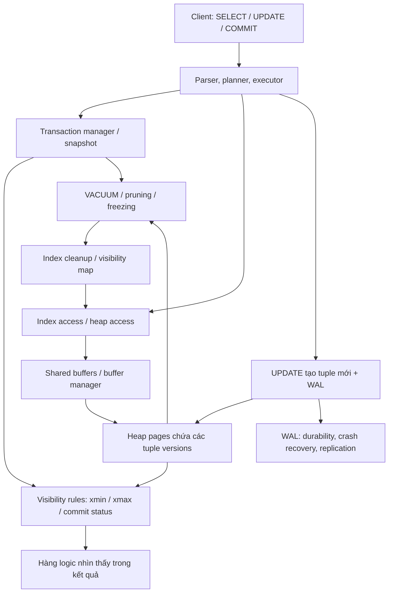
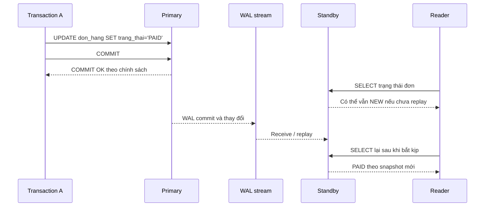

# MVCC, phiên bản hàng và snapshot trong bức tranh tổng thể

Hai giao dịch cùng truy cập một đơn hàng trong PostgreSQL: giao dịch A đang đọc trạng thái `NEW`, giao dịch B đổi trạng thái thành `PAID` rồi `COMMIT`. Vì sao A có thể tiếp tục đọc `NEW` trong khi một truy vấn khác đã thấy `PAID`? Tại sao một câu `UPDATE` có thể làm bảng phình to dù chỉ sửa vài ký tự? Vì sao `VACUUM`, chỉ mục, transaction ID, WAL và sao chép đều có quan hệ với cùng một cơ chế?

Câu trả lời bắt đầu từ **Multi-Version Concurrency Control (MVCC)**: thay vì bắt mọi người đọc và ghi cùng tranh giành một bản hàng duy nhất, PostgreSQL duy trì các **phiên bản tuple** cùng với thông tin giao dịch để quyết định phiên bản nào được phép xuất hiện trong kết quả của từng câu SQL.

Bài này đặt **MVCC, phiên bản hàng và snapshot** vào kiến trúc tổng thể của PostgreSQL, sau đó lần theo các tình huống đọc đồng thời, cập nhật, khóa, chỉ mục, dọn dẹp dữ liệu, truy vấn dài và replica. Các ví dụ hướng tới bảng heap thông thường trên PostgreSQL hiện đại, sử dụng hai hoặc ba kết nối độc lập để quan sát. Mục tiêu không phải nhớ mọi bit trong cấu trúc tuple, mà là xây dựng một mô hình đúng để giải thích cách PostgreSQL giữ tính nhất quán khi có nhiều phiên làm việc.

## 1. Tại sao PostgreSQL cần MVCC?

Nếu một database chỉ có một bản hàng và cho một tiến trình sửa trực tiếp ngay khi chạy `UPDATE`, các tiến trình đọc phải có cơ chế tránh thấy dữ liệu đang sửa dở. Một cách tiếp cận là khóa hàng để người khác không đọc được trong lúc ghi. Nhưng nếu một truy vấn báo cáo mất vài phút đọc nhiều bảng, việc khóa đọc và khóa ghi chồng lên nhau có thể làm khả năng phục vụ suy giảm mạnh.

PostgreSQL dùng MVCC để tách **trạng thái vật lý của các phiên bản** khỏi **trạng thái logic mà từng giao dịch được nhìn thấy**.

- Một phiên có thể đọc phiên bản cũ phù hợp với snapshot của nó.
- Một phiên khác có thể tạo và commit phiên bản mới.
- Kết quả của hai phiên có thể khác nhau mà không nhất thiết có ai đọc dữ liệu chưa commit.
- Khi phiên bản cũ không còn cần cho snapshot hợp lệ nào, PostgreSQL có thể dọn dẹp để tái sử dụng không gian.
- Các giao dịch cùng muốn ghi một hàng vẫn phải giải quyết xung đột bằng khóa và quy tắc isolation; MVCC **không loại bỏ mọi loại khóa**.

Nguyên tắc dễ nhớ là:

> **Một hàng nghiệp vụ có thể có nhiều phiên bản vật lý; snapshot và trạng thái transaction quyết định phiên bản nào được hiển thị cho mỗi lần đọc.**

### 1.1. Bốn khái niệm không được nhầm lẫn

| Khái niệm | Mô tả | Ví dụ |
|---|---|---|
| **Hàng logic** | Thực thể mà ứng dụng định danh bằng khóa nghiệp vụ/khóa chính | Đơn hàng `id = 101` |
| **Tuple version** | Một phiên bản vật lý của hàng trong heap | Trạng thái `NEW` hoặc `PAID` |
| **Transaction** | Đơn vị công việc có `BEGIN`, `COMMIT`/`ROLLBACK` và quy tắc isolation | Chuyển trạng thái đơn hàng |
| **Snapshot / read view** | Mô tả các transaction nào đã hoàn tất hoặc còn hoạt động tại một mốc quan sát | “Không thấy thay đổi của transaction B vì B chưa commit tại snapshot này” |

**Snapshot không phải bản sao toàn bộ bảng được chụp ra một vùng RAM riêng.** Nó chủ yếu là thông tin về trạng thái transaction để PostgreSQL đánh giá visibility trên các tuple đang nằm trong heap/index. Vì vậy, PostgreSQL không phải nhân đôi mọi trang dữ liệu mỗi khi một giao dịch bắt đầu đọc.

### 1.2. Bức tranh kiến trúc



Sơ đồ thể hiện **quan hệ trách nhiệm**, không phải đường thực thi cố định của mọi câu lệnh. Một `SELECT` thuần đọc không nhất thiết tạo WAL cho thay đổi nghiệp vụ, còn `UPDATE` có thể chạm cả heap, index, buffer và WAL trong cùng quá trình.

## 2. Hàng được lưu ở đâu: heap page và tuple

Bảng thông thường trong PostgreSQL được lưu dưới dạng **heap**. Heap gồm nhiều trang dữ liệu; kích thước page phổ biến là 8 KiB trên bản build mặc định. Mỗi trang có header, các item pointers và phần dữ liệu chứa tuple.

Một bảng có ba hàng logic có thể trông đơn giản khi dùng `SELECT`, nhưng dữ liệu vật lý không phải một mảng ba object Java:

```text
Heap relation: don_hang
 ├── Page 0
 │    ├── Item pointer 1 → tuple (id=101, status=NEW)
 │    ├── Item pointer 2 → tuple (id=102, status=PAID)
 │    └── ...
 ├── Page 1
 │    └── ...
 └── ...

B-tree index trên PRIMARY KEY:
    key 101 → vị trí tuple (TID)
    key 102 → vị trí tuple (TID)
```

Với MVCC, cùng hàng `id = 101` có thể từng tồn tại ở nhiều tuple khác nhau. Index trỏ tới vị trí tuple, nhưng executor còn cần **kiểm tra phiên bản được trỏ tới có visible đối với snapshot hiện tại hay không**.

### 2.1. Khóa chính khác địa chỉ vật lý

- `id` là định danh logic do lược đồ quy định.
- `ctid` là cột hệ thống thường biểu diễn vị trí tuple trong heap: số block và item pointer.
- `ctid` có thể thay đổi sau `UPDATE` hoặc thao tác tổ chức lại bảng; không nên dùng làm ID bền vững của đối tượng nghiệp vụ.
- Một `UPDATE` không được hiểu là sửa byte của tuple cũ tại đúng vị trí hiện tại trong mọi trường hợp.

Dùng `PRIMARY KEY` hay một khóa nghiệp vụ thích hợp để xác định hàng. `ctid` chủ yếu phù hợp với chẩn đoán nội bộ trong phạm vi được kiểm soát.

## 3. Một tuple version có những thông tin gì?

Để quyết định visibility, PostgreSQL gắn metadata với tuple, trong đó những trường thường được nhắc tới là **`xmin`**, **`xmax`** và **`ctid`**.

| Trường | Vai trò khái quát |
|---|---|
| `xmin` | Transaction ID (XID) tạo ra phiên bản tuple này, hoặc giá trị liên quan khi tuple đã được xử lý freezing |
| `xmax` | Thông tin transaction/khóa liên quan đến việc phiên bản bị xóa/thay thế hoặc bị khóa; **không đơn giản cứ khác 0 là đã xóa** |
| `ctid` | Vị trí vật lý của tuple và có thể tham gia liên kết phiên bản trong một số cơ chế update |
| Header flags | Các bit trạng thái hỗ trợ việc diễn giải `xmin`/`xmax`, hint bits, MultiXact và các đặc điểm khác |

Có thể nhìn thấy một phần cột hệ thống của **những tuple đang visible cho truy vấn**:

```sql
SELECT
    ctid,
    xmin,
    xmax,
    id,
    trang_thai
FROM demo_mvcc.don_hang
ORDER BY id;
```

Truy vấn này cần tạo bảng `demo_mvcc.don_hang` ở phần thực hành tiếp theo. Khi chạy, nó chỉ hiển thị những hàng mà câu `SELECT` được phép thấy; nó không phải công cụ liệt kê tất cả phiên bản chết đang nằm vật lý trong heap.

### 3.1. Vì sao không thể suy luận từ xmax một cách máy móc?

Một tuple có `xmax` không bằng 0 **vẫn có thể visible**. `xmax` có thể ghi dấu một transaction đã abort, hoặc thông tin liên quan đến khóa hàng/MultiXact, chứ không nhất thiết là một lệnh `DELETE` đã commit.

PostgreSQL cần kết hợp:

- Giá trị các trường XID/MultiXact trong tuple.
- Các bit trạng thái trong header, bao gồm những thông tin đã biết về commit/abort.
- Trạng thái transaction lưu bởi hệ thống.
- Snapshot hiện tại.
- Những quy tắc riêng cho tuple do chính transaction đang chạy tạo/sửa.

Do đó, **không dùng công thức `xmax <> 0` để xác định hàng đã bị xóa**. Ở cấp SQL, điều đúng là dựa vào kết quả `SELECT` theo isolation được chọn.

### 3.2. XID và transaction status

PostgreSQL quản lý transaction ID để xác định thứ tự và trạng thái giao dịch. Những transaction ghi dữ liệu thường cần XID. Một transaction chỉ đọc có thể chưa phải được cấp XID ngay khi `BEGIN`; việc cấp XID và việc snapshot được xác lập là các khái niệm khác nhau.

Trạng thái commit/abort của transaction được PostgreSQL ghi nhận trong các cấu trúc như `pg_xact` cùng metadata cần thiết. Khi kiểm tra tuple, executor dựa trên thông tin đó và các cơ chế cache/hint để tránh phải đọc lại dữ liệu trạng thái không cần thiết cho mọi lần truy cập.

**Không xem XID như timestamp.** XID là cơ chế nhận dạng thứ tự giao dịch với quy tắc wraparound và freezing riêng; nó không biểu diễn chính xác thời gian thực mà giao dịch đã bắt đầu hoặc commit.

## 4. Snapshot là gì nếu không phải bản sao dữ liệu?

Một snapshot MVCC của PostgreSQL có thể được hiểu theo ba thành phần logic:

- **`xmin` của snapshot:** ranh giới transaction cũ nhất còn liên quan đến trạng thái đang hoạt động trong phạm vi snapshot.
- **`xmax` của snapshot:** ranh giới trên; các XID chưa được cấp tới mốc snapshot hoặc bằng/lớn hơn ranh giới này không được coi là đã visible ở mốc đó.
- **Tập XID còn hoạt động tại snapshot:** các transaction có XID nằm trong một vùng nhưng **chưa commit tại thời điểm snapshot được lấy**.

Đây là mô hình để hiểu visibility; định dạng và cơ chế nội bộ cụ thể còn có những xử lý về subtransaction, combo command IDs, transaction status và các trường hợp đặc biệt.

### 4.1. Mô hình thời gian

Giả sử có các transaction:

| Transaction | Trạng thái tại lúc snapshot S được lấy |
|---|---|
| T10 | Đã commit |
| T11 | Đang thực thi, chưa commit |
| T12 | Đã commit |
| T13 | Chưa bắt đầu |
| T14 | Chưa bắt đầu |

Khi một câu `SELECT` dùng snapshot S:

- Thay đổi của T10/T12 có thể visible nếu tuple thỏa những điều kiện visibility khác.
- Thay đổi **chưa commit của T11** không visible; T11 commit sau khi S được tạo cũng không tự làm snapshot S thay đổi.
- Thay đổi của T13/T14 chưa thuộc trạng thái đã commit ở mốc S, nên không visible cho S.
- Những gì chính transaction đọc đã ghi trước đó có quy tắc visibility riêng, không đơn giản bị ẩn chỉ vì XID của nó đang hoạt động.

```text
Thời gian  ───────────────────────────────────────────────→

T10: [BEGIN ─── COMMIT]
T11:      [BEGIN ───────────────── COMMIT]
T12:         [BEGIN ─ COMMIT]
                            ▲
                            S: tạo snapshot
T13:                            [BEGIN ─── COMMIT]

Snapshot S:
  T10, T12 có thể được xem là đã hoàn tất
  T11 chưa commit tại S → không thấy thay đổi của T11
  T13 bắt đầu sau S → không thấy thay đổi của T13
```

Mục đích của snapshot là cho một truy vấn biết **trạng thái nào hợp lệ để đọc**, kể cả khi các giao dịch khác đang tiến triển.

### 4.2. Snapshot không đồng nhất với transaction

Một transaction có thể dùng **nhiều snapshot theo từng statement** hoặc **giữ một snapshot nhất quán xuyên các statement**, tùy isolation level.

Điều này dẫn tới hai hành vi rất khác nhau:

- `READ COMMITTED`: một `SELECT` mới có thể thấy thay đổi đã được transaction khác commit kể từ câu `SELECT` trước.
- `REPEATABLE READ`: những truy vấn phù hợp trong cùng transaction thường đọc từ một snapshot nhất quán, nên không tự thấy commit mới của transaction khác.

Bài toán “vì sao SELECT lúc thấy cũ, lúc thấy mới” nhiều khi chính là khác biệt snapshot ở đây, không phải do PostgreSQL cache sai.

## 5. Dựng bộ dữ liệu thử MVCC

Chạy một lần trong database thử nghiệm:

```sql
CREATE SCHEMA IF NOT EXISTS demo_mvcc;

CREATE TABLE demo_mvcc.don_hang (
    id INTEGER PRIMARY KEY,
    trang_thai TEXT NOT NULL,
    tong_tien NUMERIC(12, 2) NOT NULL,
    cap_nhat_luc TIMESTAMPTZ NOT NULL DEFAULT clock_timestamp()
);

INSERT INTO demo_mvcc.don_hang (id, trang_thai, tong_tien)
VALUES
    (101, 'NEW', 120000.00),
    (102, 'PAID', 230000.00);

CREATE TABLE demo_mvcc.tai_khoan (
    id INTEGER PRIMARY KEY,
    ten TEXT NOT NULL,
    so_du NUMERIC(14, 2) NOT NULL
);

INSERT INTO demo_mvcc.tai_khoan (id, ten, so_du)
VALUES
    (1, 'Lan', 1000.00),
    (2, 'Minh', 500.00);
```

Chọn bảng và snapshot hiện tại:

```sql
SELECT id, trang_thai, ctid, xmin, xmax
FROM demo_mvcc.don_hang
ORDER BY id;

SHOW default_transaction_isolation;
```

Trên nhiều cài đặt PostgreSQL, giá trị mặc định là `read committed`. Người quản trị có thể thay mặc định, nên hãy luôn kiểm tra thay vì dựa vào giả định.

**Cảnh báo thực hành:** các thí nghiệm nhiều session ở dưới sử dụng cùng hàng `id = 101`. Để lặp thí nghiệm, đưa dữ liệu về trạng thái mong muốn trên môi trường học trước khi mở transaction và lấy snapshot mới; không chạy lệnh reset dữ liệu trong lúc một phiên khác đang giữ transaction thử nghiệm.

## 6. Thí nghiệm 1: UPDATE tạo phiên bản mới

Quan sát một hàng trước khi thay đổi:

```sql
SELECT id, trang_thai, ctid, xmin, xmax
FROM demo_mvcc.don_hang
WHERE id = 101;
```

Sau đó cập nhật:

```sql
BEGIN;

UPDATE demo_mvcc.don_hang
SET trang_thai = 'PAID',
    cap_nhat_luc = clock_timestamp()
WHERE id = 101
RETURNING id, trang_thai, ctid, xmin, xmax;

COMMIT;
```

Đọc lại:

```sql
SELECT id, trang_thai, ctid, xmin, xmax
FROM demo_mvcc.don_hang
WHERE id = 101;
```

Những điều cần hiểu:

1. `UPDATE` trong heap thường tạo **tuple version mới** cho cùng hàng logic.
2. `xmin` của tuple mới thường liên quan tới XID của transaction thực hiện cập nhật.
3. `ctid` của tuple visible có thể khác trước, vì phiên bản mới có địa chỉ vật lý khác.
4. Tuple cũ không biến mất tức thì chỉ vì `COMMIT`. Nó có thể còn cần cho những snapshot cũ.
5. `SELECT` thông thường chỉ trả phiên bản visible, nên ta không thể dùng truy vấn này để đếm toàn bộ tuple versions còn trên trang.

Khi thực hành trên bảng nhỏ, các giá trị XID, `ctid` cụ thể khác nhau tùy cách dữ liệu được ghi và hoạt động VACUUM. **Không viết assertion cố định rằng `ctid` phải là `(0,3)`** hay XID phải tăng chính xác một đơn vị giữa mọi bước.

### 6.1. UPDATE không sửa trực tiếp “hàng logic” trên mọi snapshot

Đối với ứng dụng, `id = 101` vẫn là cùng đơn hàng. Đối với MVCC, PostgreSQL phải bảo đảm có thể trả:

- `NEW` cho một snapshot cũ đủ điều kiện.
- `PAID` cho một snapshot mới sau commit.
- Phiên bản do chính transaction vừa cập nhật cho các statement tiếp theo trong transaction đó theo quy tắc command visibility.

Khả năng tồn tại đồng thời các phiên bản đó là nền tảng để đọc và ghi giảm chặn nhau.

## 7. Thí nghiệm 2: READ COMMITTED dùng snapshot theo statement

Mở **hai kết nối** PostgreSQL độc lập, gọi là session A và session B. Đảm bảo bảng thử có đơn `101` ở trạng thái `NEW` trước khi bắt đầu:

```sql
UPDATE demo_mvcc.don_hang
SET trang_thai = 'NEW'
WHERE id = 101;
```

Ở **session A**:

```sql
BEGIN ISOLATION LEVEL READ COMMITTED;

SELECT id, trang_thai
FROM demo_mvcc.don_hang
WHERE id = 101;
-- Kỳ vọng: NEW.
```

Giữ transaction A mở. Ở **session B**:

```sql
BEGIN;

UPDATE demo_mvcc.don_hang
SET trang_thai = 'PAID'
WHERE id = 101;

COMMIT;
```

Trở lại **session A**:

```sql
SELECT id, trang_thai
FROM demo_mvcc.don_hang
WHERE id = 101;
-- Ở READ COMMITTED, câu SELECT mới thường thấy PAID.

COMMIT;
```

Hai câu `SELECT` thuộc **cùng transaction A** nhưng có thể thấy hai trạng thái khác nhau. Đó là hành vi dự kiến tại `READ COMMITTED`: mỗi statement nhìn một snapshot mới của dữ liệu đã commit tại thời điểm phù hợp.

### 7.1. Có phải READ COMMITTED cho phép dirty read?

**Không.** Nếu B mới `UPDATE` nhưng chưa `COMMIT`, SELECT bình thường của A không được thấy giá trị chưa commit từ B.

`READ COMMITTED` cho phép thấy những commit mới **giữa các statement**, không cho phép đọc dữ liệu “đang sửa dở” của transaction khác. Thuật ngữ đúng là **nonrepeatable read có thể xảy ra**, chứ không phải dirty read.

### 7.2. Với UPDATE, có những quy tắc bổ sung

Nếu A thay vì `SELECT` lại `UPDATE` một hàng đang bị B sửa, A có thể phải **đợi row lock**. Sau khi B kết thúc, PostgreSQL kiểm tra lại điều kiện trên phiên bản phù hợp theo quy tắc của `READ COMMITTED`. Hành vi này không thể diễn giải chỉ bằng cách “UPDATE lúc nào cũng dùng ảnh chụp đầu statement rồi bỏ qua mọi thay đổi sau đó”.

Đây là một lý do cần hiểu cả **MVCC visibility** lẫn **khóa và kiểm tra lại điều kiện của câu ghi**.

## 8. Thí nghiệm 3: REPEATABLE READ giữ snapshot xuyên transaction

Reset bảng thử ở một transaction riêng để bắt đầu với `NEW`, rồi mở hai session mới hoặc đảm bảo transaction cũ đã kết thúc.

```sql
UPDATE demo_mvcc.don_hang
SET trang_thai = 'NEW'
WHERE id = 101;
```

Ở **session A**:

```sql
BEGIN ISOLATION LEVEL REPEATABLE READ;

SELECT id, trang_thai
FROM demo_mvcc.don_hang
WHERE id = 101;
-- Kỳ vọng: NEW; snapshot nhất quán được xác lập.
```

Ở **session B**:

```sql
UPDATE demo_mvcc.don_hang
SET trang_thai = 'PAID'
WHERE id = 101;
-- Trong autocommit, câu UPDATE thành công sẽ commit khi statement kết thúc.
```

Ở **session A**, trước khi kết thúc transaction:

```sql
SELECT id, trang_thai
FROM demo_mvcc.don_hang
WHERE id = 101;
-- Vẫn NEW theo snapshot đã được xác lập.

COMMIT;

SELECT id, trang_thai
FROM demo_mvcc.don_hang
WHERE id = 101;
-- Truy vấn mới sau COMMIT thường thấy PAID.
```

**Điểm khác biệt:** ở `REPEATABLE READ`, transaction A không tự đổi sang snapshot mới khi B commit. Snapshot cũ có thể tiếp tục thấy một tuple version cũ dù phiên bản mới đã commit và visible cho các transaction mới.

### 8.1. Snapshot hình thành khi nào?

Không nên mặc định mốc snapshot chính xác luôn là thời điểm dòng `BEGIN` xuất hiện trên terminal. Với transaction `REPEATABLE READ` thông thường, snapshot được xác lập khi transaction chạy câu lệnh đầu tiên cần snapshot (và được giữ cho những lệnh sau). Trong thí nghiệm, câu `SELECT` đầu tiên là điểm quan trọng.

Trong giao dịch thật, nếu có lệnh cấu hình transaction trước `SELECT`, cần hiểu thứ tự áp dụng isolation và thời điểm snapshot được lấy. Không đổi isolation sau khi đã thực thi truy vấn thuộc transaction theo cách trái quy tắc PostgreSQL.

### 8.2. Transaction thấy thay đổi của chính nó

`REPEATABLE READ` không có nghĩa transaction không bao giờ thấy dữ liệu mới. Nếu A tự `INSERT` hoặc `UPDATE` sau khi snapshot đã xác lập, các statement tiếp theo của **chính A** vẫn thấy thay đổi phù hợp với thứ tự lệnh của nó.

Đó là lý do không thể diễn giải snapshot chỉ bằng một mốc “đóng băng mọi thứ tuyệt đối”. PostgreSQL còn xét command IDs và các quy tắc visibility của những thay đổi do transaction hiện tại tạo.

## 9. MVCC và các mức isolation

PostgreSQL hỗ trợ các mức isolation theo cú pháp SQL, với những đặc điểm cụ thể sau:

| Isolation | Snapshot đọc thông thường | Hành vi cần nhớ |
|---|---|---|
| `READ UNCOMMITTED` | PostgreSQL xử lý như `READ COMMITTED` | Không cung cấp dirty read của transaction khác |
| `READ COMMITTED` | Snapshot mới theo statement | Một truy vấn sau có thể thấy commit mới |
| `REPEATABLE READ` | Snapshot ổn định xuyên transaction | Tránh nhiều hiện tượng đọc không lặp lại; vẫn có thể phát sinh serialization failure trong xung đột ghi |
| `SERIALIZABLE` | Snapshot + cơ chế kiểm soát tương đương thực thi tuần tự | Có thể abort transaction với SQLSTATE `40001` để bảo vệ tính serializable |

`REPEATABLE READ` của PostgreSQL có bảo đảm mạnh hơn mức tối thiểu của chuẩn SQL ở một số điểm, chẳng hạn tránh phantom read đối với các truy vấn đọc snapshot thông thường. Nhưng **REPEATABLE READ không đồng nghĩa SERIALIZABLE**.

### 9.1. Vì sao REPEATABLE READ chưa đủ cho mọi bất biến?

Một bất biến nghiệp vụ có thể liên quan tới **nhiều hàng**. Giả sử bệnh viện cần luôn có ít nhất một bác sĩ đang trực. Hai transaction cùng đọc “còn 2 bác sĩ”, rồi mỗi transaction chuyển **một bác sĩ khác nhau** sang nghỉ.

Nếu hai transaction cập nhật hai hàng khác nhau dưới snapshot isolation, chúng có thể không xung đột row lock trực tiếp; cả hai commit có thể làm số bác sĩ trực thành 0. Đây là dạng **write skew**.

Không phải mọi bất biến đa hàng đều được bảo vệ chỉ bằng snapshot ổn định. Có thể cần:

- Constraint/schema biểu diễn được bất biến.
- Khóa phối hợp thích hợp ở transaction.
- `SERIALIZABLE` với cơ chế retry.
- Một thiết kế nghiệp vụ gom quyết định vào một điểm cập nhật nguyên tử.

### 9.2. SERIALIZABLE và SSI

PostgreSQL triển khai serializable isolation bằng cơ chế thường được gọi là **Serializable Snapshot Isolation (SSI)**. Nó theo dõi các mối phụ thuộc đọc/ghi có nguy cơ tạo lịch thực thi không serializable, rồi có thể làm một transaction thất bại với lỗi:

```text
ERROR: could not serialize access due to read/write dependencies among transactions
SQLSTATE: 40001
```

Cách xử lý đúng trong ứng dụng thường là **rollback và retry toàn bộ transaction**, có giới hạn số lần và thiết kế tránh lặp tác dụng phụ bên ngoài.

Không dùng `SERIALIZABLE` như một công tắc “bật lên là không bao giờ phải retry”: tính đúng đắn được bảo vệ một phần bằng việc từ chối những transaction không thể commit an toàn.

## 10. MVCC không thay thế row lock

Các consistent reads thông thường không cần chặn mọi câu `UPDATE`. Nhưng hai transaction muốn ghi lên **cùng một hàng** vẫn phải phối hợp để tránh ghi đè tùy tiện.

### 10.1. Thí nghiệm khóa hàng

Ở session A:

```sql
BEGIN;

UPDATE demo_mvcc.tai_khoan
SET so_du = so_du - 100
WHERE id = 1;

-- Giữ transaction mở, chưa COMMIT.
```

Ở session B:

```sql
BEGIN;

UPDATE demo_mvcc.tai_khoan
SET so_du = so_du + 50
WHERE id = 1;
-- Có thể phải đợi transaction A kết thúc.
```

Trong một session C, vẫn có thể chạy:

```sql
SELECT id, so_du
FROM demo_mvcc.tai_khoan
WHERE id = 1;
```

Ở isolation thông thường, câu `SELECT` không dùng `FOR UPDATE` có thể đọc phiên bản đã commit trước thay đổi của A, thay vì phải chờ A nhả khóa ghi.

Sau khi quan sát, ở A thực hiện `COMMIT` hoặc `ROLLBACK` theo mục đích thí nghiệm; ở B phải xử lý kết quả statement và kết thúc transaction phù hợp. Không để các session học tập treo transaction lâu.

### 10.2. SELECT FOR UPDATE là thao tác khác

```sql
BEGIN;

SELECT id, so_du
FROM demo_mvcc.tai_khoan
WHERE id = 1
FOR UPDATE;

-- Xử lý nghiệp vụ yêu cầu giữ khóa hàng.

COMMIT;
```

`SELECT ... FOR UPDATE` yêu cầu khóa hàng và có thể chờ những transaction đang giữ khóa không tương thích. Nó phù hợp khi cần phối hợp read-modify-write trong một giao dịch, nhưng cũng làm giảm khả năng đồng thời nếu sử dụng quá rộng hoặc giữ khóa lâu.

**Không suy ra mọi `SELECT` đều hoàn toàn không khóa.** PostgreSQL vẫn dùng các relation-level locks để bảo vệ thực thi và metadata. Ý chính là các `SELECT` MVCC thông thường không cần lấy row-level locks gây xung đột với mọi writer chỉ để đọc phiên bản đã commit.

### 10.3. REPEATABLE READ và concurrent update

Giả sử A ở `REPEATABLE READ` đã lấy snapshot, B cập nhật và commit một hàng, rồi A cố cập nhật chính hàng đó. PostgreSQL có thể từ chối A với lỗi `could not serialize access due to concurrent update` (SQLSTATE `40001`) thay vì lặng lẽ cập nhật một phiên bản không còn phù hợp với snapshot.

Điều này khác với hành vi thường gặp ở `READ COMMITTED`, nơi statement ghi có thể đợi và kiểm tra lại hàng theo những quy tắc của mức isolation đó.

## 11. UPDATE, DELETE và các phiên bản tuple cũ

### 11.1. UPDATE không phải sửa đè một tuple duy nhất

Ở mức heap thông thường, `UPDATE` tạo phiên bản tuple mới. Tuple cũ có trạng thái bị thay thế và chỉ có thể được thu hồi khi không còn cần cho các snapshot hợp lệ.

```text
Trước UPDATE:
  tuple A → id=101, trang_thai=NEW

Transaction T20 UPDATE:
  tuple A → phiên bản cũ, có metadata kết thúc/thay thế
  tuple B → id=101, trang_thai=PAID, xmin=T20

Trước COMMIT T20:
  snapshot của transaction khác → vẫn thấy A

Sau COMMIT T20:
  snapshot mới → thấy B
  snapshot cũ còn hoạt động → có thể vẫn thấy A

Sau khi A không còn cần:
  VACUUM / pruning có thể dọn phần không cần thiết
```

Không nên xem sơ đồ trên như tuyên bố rằng mọi tuple versions luôn được giữ nguyên cho đến khi VACUUM chạy lần sau: PostgreSQL có cơ chế pruning và dọn dẹp khác nhau tùy trang, trạng thái transaction và hoạt động truy cập.

### 11.2. DELETE đánh dấu khả năng nhìn thấy, không phải luôn xóa byte ngay

```sql
BEGIN;

DELETE FROM demo_mvcc.don_hang
WHERE id = 102;

-- Nếu SELECT trong transaction này, hàng đã xóa không còn visible cho
-- chính transaction theo ngữ nghĩa các statement đã thực thi.

ROLLBACK;
```

`DELETE` không cần xóa ngay toàn bộ byte vật lý khỏi heap để một snapshot mới sau commit không thấy hàng. PostgreSQL đánh dấu trạng thái transaction/xóa tương ứng; sau đó VACUUM có thể dọn phiên bản không còn cần thiết.

Nếu `ROLLBACK` như ví dụ, transaction xóa không commit, nên hàng có thể vẫn visible với những snapshot phù hợp. Đây cũng là lý do không thể lấy `xmax <> 0` làm dấu chắc chắn rằng một hàng đã biến mất.

### 11.3. INSERT, UPDATE, DELETE đều có quan hệ với WAL

Những thay đổi heap/index cần phục hồi được ghi thông tin vào **Write-Ahead Log (WAL)**. WAL phục vụ crash recovery và cũng là nền cho các hình thức replication.

Các tuple version do MVCC quản lý nằm trong heap; WAL không phải một bảng lịch sử query dành cho người dùng đọc lại bằng `SELECT`. Không nên đồng nhất MVCC với WAL:

- **MVCC:** ai được thấy tuple version nào theo transaction/snapshot?
- **WAL:** làm sao khôi phục các thay đổi cần thiết khi crash và truyền thay đổi theo cơ chế replica?
- **VACUUM:** khi nào tuple version cũ và không gian lưu trữ được dọn/tái sử dụng?

Ba lớp phối hợp nhưng giải quyết những câu hỏi khác nhau.

## 12. Chỉ mục ảnh hưởng thế nào tới các phiên bản hàng?

PostgreSQL sử dụng index như B-tree để tìm vị trí tuple trong heap. Một index entry có thể trỏ tới tuple version hoặc tới điểm bắt đầu của một chuỗi phiên bản phù hợp với cơ chế HOT.

Một query có điều kiện:

```sql
SELECT id, trang_thai, tong_tien
FROM demo_mvcc.don_hang
WHERE id = 101;
```

có thể dùng index khóa chính để định vị nhanh. Nhưng **tìm ra TID không đồng nghĩa phiên bản đó visible**. Executor phải áp dụng quy tắc MVCC khi truy cập heap.

### 12.1. Vì sao UPDATE có thể làm index phình thêm?

Nếu `UPDATE` tạo tuple mới ở vị trí khác và không thỏa điều kiện tối ưu đặc biệt, PostgreSQL có thể phải tạo các index entries mới để dẫn tới phiên bản mới, ngay cả khi một số giá trị index không đổi.

Do đó, nhiều index làm tăng:

- Dung lượng lưu trữ index.
- Chi phí chèn và duy trì index entries.
- WAL được sinh trong quá trình ghi.
- Công việc dọn index entries trỏ tới tuple versions không còn cần.
- Áp lực I/O và checkpoint trong workload ghi lớn.

**Index là công cụ tối ưu đường đọc, nhưng cũng tạo gánh nặng cho đường ghi của MVCC.**

### 12.2. HOT update giảm công việc index trong một số trường hợp

**Heap-Only Tuple (HOT)** là tối ưu giúp một `UPDATE` tránh tạo index entries mới nếu các điều kiện cần thỏa, trong đó quan trọng là:

1. Những cột mà index liên quan/phụ thuộc không bị thay đổi theo cách ngăn HOT.
2. Có đủ không gian trên **cùng heap page** để đặt phiên bản tuple mới.
3. Các điều kiện triển khai liên quan đến index và tuple đều phù hợp.

Ví dụ:

```sql
CREATE TABLE demo_mvcc.ghi_chu (
    id INTEGER PRIMARY KEY,
    noi_dung TEXT NOT NULL,
    so_lan_sua INTEGER NOT NULL DEFAULT 0
);

INSERT INTO demo_mvcc.ghi_chu (id, noi_dung)
VALUES (1, 'Ban dau');

UPDATE demo_mvcc.ghi_chu
SET noi_dung = 'Da sua lan 1',
    so_lan_sua = so_lan_sua + 1
WHERE id = 1;
```

Nếu bảng chỉ có index khóa chính trên `id` và còn đủ chỗ trên page, việc cập nhật các cột không được index **có thể** tận dụng HOT. Nhưng HOT không được bảo đảm cho mọi lần `UPDATE`; nó phụ thuộc không gian trang và những điều kiện nội bộ.

Để xem số liệu ở mức bảng:

```sql
SELECT
    relname,
    n_tup_upd,
    n_tup_hot_upd
FROM pg_stat_user_tables
WHERE schemaname = 'demo_mvcc'
  AND relname = 'ghi_chu';
```

Đây là các bộ đếm thống kê tích lũy, không phải bằng chứng tuyệt đối rằng một statement duy nhất đã dùng HOT bao nhiêu lần nếu hệ thống có hoạt động khác hoặc dữ liệu thống kê chưa được cập nhật tức thì.

### 12.3. Covering index và cơ hội HOT

Nếu thêm index chứa một cột thường xuyên sửa:

```sql
CREATE INDEX idx_ghi_chu_so_lan
ON demo_mvcc.ghi_chu(id) INCLUDE (so_lan_sua);
```

thì những cập nhật `so_lan_sua` có thể không còn đủ điều kiện HOT như trước, vì index mới phải phản ánh giá trị có liên quan. Tối ưu một query `SELECT` có thể tạo chi phí cho hàng nghìn `UPDATE` sau đó.

Bài học thiết kế: **đánh giá cả workload ghi và tỷ lệ cập nhật HOT trước khi thêm nhiều index chứa các cột thay đổi thường xuyên**.

## 13. MVCC và Index Only Scan: vì sao vẫn cần visibility map?

Một `Index Only Scan` có thể trả kết quả từ index nếu các cột cần thiết được lưu trong index. Tuy nhiên, PostgreSQL còn phải biết tuple version được tham chiếu **có visible với snapshot hay không**.

Index không lưu đầy đủ mọi trạng thái transaction để tự quyết định visibility của từng tuple mà không cần hỗ trợ từ heap. PostgreSQL dùng **visibility map (VM)**, trong đó bit **all-visible** cho biết mọi tuple trên một heap page đủ điều kiện visible theo tiêu chí của VM.

Khi page được đánh dấu all-visible, Index Only Scan có thể tránh việc đọc heap cho các entry tương ứng. Nếu page chưa all-visible, executor có thể phải vào heap để kiểm tra visibility.

```sql
CREATE INDEX idx_don_hang_trang_thai_cover
ON demo_mvcc.don_hang(trang_thai) INCLUDE (tong_tien);

EXPLAIN (ANALYZE, BUFFERS)
SELECT trang_thai, tong_tien
FROM demo_mvcc.don_hang
WHERE trang_thai = 'PAID';
```

Với bảng cực nhỏ, planner vẫn có thể chọn `Seq Scan`. Nếu có Index Only Scan, hãy xem **Heap Fetches** để biết executor thực sự phải truy cập heap bao nhiêu lần.

Mối quan hệ:

```text
Index giúp xác định tuple hoặc cung cấp giá trị cột
              │
              ▼
Snapshot yêu cầu kiểm tra visibility
              │
       ┌──────┴────────┐
       │               │
       ▼               ▼
Heap page          Heap page
all-visible        chưa all-visible
       │               │
       ▼               ▼
Ít cần heap fetch  Có thể cần heap fetch
       │               │
       └──────┬────────┘
              ▼
          Kết quả SELECT
```

Vì vậy hiệu quả Index Only Scan phụ thuộc không chỉ vào **cấu trúc index** mà còn vào **chu kỳ cập nhật/VACUUM và trạng thái VM**.

## 14. VACUUM là phần tiếp theo tất yếu của MVCC

Nếu PostgreSQL tạo phiên bản mới cho các hàng được cập nhật, các phiên bản cũ sẽ cần được dọn đúng lúc. Nếu không, bảng và index có thể tăng kích thước vật lý dù số hàng logic không đổi.

### 14.1. Dead tuple là gì?

Một phiên bản tuple trở thành **dead** theo nghĩa có thể được dọn khi hệ thống xác định không còn transaction/snapshot hợp lệ nào cần nhìn thấy nó. Khái niệm “phiên bản cũ” và “đã đủ điều kiện dọn” không phải luôn là một.

Ví dụ:

1. Session A đang giữ snapshot cũ.
2. Session B cập nhật một hàng và commit.
3. Phiên bản cũ có thể vẫn cần cho A, nên không được thu hồi theo cách làm A mất khả năng đọc.
4. Khi A kết thúc và không còn snapshot/giới hạn khác cần phiên bản đó, VACUUM hoặc cơ chế dọn thích hợp có thể thu hồi không gian.

### 14.2. VACUUM thực hiện những công việc gì?

**VACUUM** trong PostgreSQL có các trách nhiệm quan trọng:

- Nhận diện và dọn các tuple versions đã dead khi an toàn.
- Giúp tái sử dụng không gian trong heap.
- Dọn những index entries không còn cần ở các điều kiện phù hợp.
- Cập nhật thông tin phục vụ visibility map và việc duy trì dữ liệu.
- Thực hiện công việc liên quan đến **freezing** để bảo vệ hệ thống khỏi transaction ID wraparound.
- Hỗ trợ hệ thống giữ hiệu năng ổn định trong workload cập nhật/xóa nhiều.

**Autovacuum** giúp tự động thực hiện các công việc bảo trì phù hợp. Không nên tắt autovacuum vì thấy nó tiêu thụ CPU/I/O mà chưa hiểu hậu quả: điều đó có thể khiến bloat tăng và tạo rủi ro nghiêm trọng liên quan XID wraparound.

### 14.3. VACUUM không nhất thiết làm file nhỏ đi ngay

```sql
VACUUM (ANALYZE) demo_mvcc.don_hang;
```

VACUUM thông thường chủ yếu đánh dấu không gian có thể tái sử dụng cho các tuple về sau. Nó có thể thu hồi một phần không gian ở cuối relation khi đủ điều kiện, nhưng không có lời hứa mọi trang trống giữa file sẽ được trả ngay cho hệ điều hành.

`VACUUM FULL` viết lại bảng và cần khóa mạnh, có chi phí và ảnh hưởng vận hành đáng kể:

```sql
-- Không chạy tùy tiện trên production:
VACUUM FULL demo_mvcc.don_hang;
```

Do đó, không dùng `VACUUM FULL` làm “lệnh dọn mặc định sau mỗi UPDATE”. Muốn điều tra bloat, cần số liệu thực và kế hoạch bảo trì phù hợp.

### 14.4. Quan sát các chỉ số MVCC/VACUUM

```sql
SELECT
    schemaname,
    relname,
    n_live_tup,
    n_dead_tup,
    n_tup_ins,
    n_tup_upd,
    n_tup_del,
    n_tup_hot_upd,
    last_vacuum,
    last_autovacuum,
    last_analyze,
    last_autoanalyze
FROM pg_stat_user_tables
WHERE schemaname = 'demo_mvcc'
ORDER BY relname;
```

Các cột `n_live_tup` và `n_dead_tup` thường là **ước lượng**, không phải kết quả `COUNT(*)` chính xác tới từng hàng. Bộ đếm tích lũy có thể cần đọc theo chênh lệch thời gian. Không xác định một bảng “bị hỏng” chỉ vì `n_dead_tup > 0`: có tuple chết là trạng thái bình thường của bảng có ghi.

## 15. Snapshot dài và “oldest xmin horizon”

VACUUM không được dọn phiên bản mà **một snapshot hợp lệ còn cần**. Vì thế, khả năng dọn dẹp còn phụ thuộc vào **mốc transaction/snapshot cũ nhất mà hệ thống phải bảo vệ** — thường được gọi nôm na là horizon hoặc global xmin trong các mô tả kiến trúc.

Hãy hình dung:

```text
09:00  Transaction A mở và lấy snapshot
09:05  Nhiều transaction khác UPDATE/DELETE
09:10  Các transaction ghi đã COMMIT
09:15  Autovacuum muốn dọn tuple versions cũ
09:20  A vẫn chưa kết thúc và có thể cần bản cũ
09:30  A COMMIT / ROLLBACK
09:35  Không còn snapshot khác cần bản cũ
       → nhiều tuple có thể được dọn ở lần bảo trì phù hợp
```

Nếu có hàng nghìn lần cập nhật trong khi A giữ snapshot quá lâu, các phiên bản cũ có thể tích tụ. Hệ quả bao gồm:

- Dung lượng heap/index tăng.
- VACUUM không thu hồi được phần không gian như mong đợi.
- Các truy vấn phải đi qua nhiều tuple/page hơn.
- Áp lực I/O, bộ nhớ đệm và WAL tăng.
- Quá trình quản lý XID/freezing trở nên khó khăn nếu tình trạng kéo dài.

Đây là lý do một transaction **chỉ đọc** nhưng giữ snapshot hàng giờ vẫn có thể gây tác động vận hành, dù nó không sửa dữ liệu.

### 15.1. Session idle in transaction

Một ứng dụng Java có thể gọi `setAutoCommit(false)`, thực hiện một `SELECT` rồi bỏ kết nối trong pool mà chưa `COMMIT`/`ROLLBACK`. Ở phía PostgreSQL, session có thể chuyển thành `idle in transaction`.

```sql
SELECT
    pid,
    usename,
    application_name,
    state,
    xact_start,
    backend_xmin,
    now() - xact_start AS transaction_age,
    left(query, 180) AS last_query
FROM pg_stat_activity
WHERE datname = current_database()
ORDER BY xact_start NULLS LAST;
```

Chú ý:

- `xact_start` thể hiện thời điểm transaction bắt đầu, khi có.
- `backend_xmin` liên quan tới horizon mà snapshot của backend cần bảo vệ; có thể `NULL`.
- `state = 'idle in transaction'` là dấu hiệu đáng kiểm tra, nhưng không đủ để kết luận chính session này chắc chắn đang chặn VACUUM của một bảng cụ thể.
- `query` có thể là câu cuối cùng, không phải SQL đang chạy.

Trong ứng dụng, cách khắc phục thường là đảm bảo transaction ngắn và được đóng trong mọi nhánh thành công/lỗi, không giữ transaction mở trong lúc chờ HTTP, thao tác người dùng hoặc tác vụ nền kéo dài.

### 15.2. Những nguyên nhân khác cũng có thể giữ horizon

Ngoài transaction đang chạy, một số cơ chế như **replication slots**, logical decoding hoặc cấu hình hot standby feedback có thể khiến PostgreSQL phải giữ WAL hoặc thông tin phiên bản cũ lâu hơn. Các cơ chế này có mục đích khác nhau; không nên gộp mọi trường hợp vào “một SELECT quên COMMIT”.

Quan sát các slot trên server khi có quyền:

```sql
SELECT
    slot_name,
    slot_type,
    active,
    xmin,
    catalog_xmin,
    restart_lsn,
    confirmed_flush_lsn
FROM pg_replication_slots;
```

- `xmin` và `catalog_xmin`, khi có, liên quan tới các giới hạn giữ lại tuple tương ứng.
- `restart_lsn` liên quan đến vị trí WAL còn phải giữ cho consumer.
- `confirmed_flush_lsn` có ý nghĩa với logical decoding slot.
- Không phải mọi slot đều có giá trị ở tất cả các cột.

**Không tự xóa replication slot** chỉ để giảm bloat/WAL mà chưa biết subscriber còn cần gì. Xóa slot có thể làm replication không tiếp tục được và buộc phải tái thiết lập.

## 16. Transaction ID wraparound và freezing

Transaction ID dùng cho các tuple trong PostgreSQL có giới hạn phạm vi số và cơ chế wraparound. PostgreSQL sử dụng kỹ thuật xác định thứ tự XID và **freezing** để bảo đảm các tuple rất cũ vẫn được hiểu là visible phù hợp, đồng thời tránh sự cố do XID quay vòng.

Cần phân biệt:

- **Dead tuple cleanup:** dọn những phiên bản đã không còn cần.
- **Freezing:** xử lý thông tin tuổi XID của tuple đủ cũ để duy trì tính đúng đắn qua các vòng đời XID.

Một bảng có ít `UPDATE` vẫn cần được quản lý tuổi XID ở mức phù hợp, không chỉ những bảng có nhiều dead tuples.

### 16.1. Vì sao không nên tắt autovacuum?

Khi tuổi transaction tiến quá xa mà không thể freezing đúng hạn, PostgreSQL có cơ chế cảnh báo và bảo vệ trước nguy cơ XID wraparound. Hệ thống có thể phải hạn chế một số thao tác ghi để tránh đọc nhầm transaction cũ theo thứ tự mới.

Đây là vấn đề **tính đúng đắn dữ liệu**, không chỉ là “thêm vài GB dung lượng”. Vì thế:

- Theo dõi tuổi database/table khi hệ thống có nhiều transaction.
- Không giữ transaction hoặc replication slot không cần thiết trong thời gian rất dài.
- Đảm bảo autovacuum có đủ tài nguyên để chạy.
- Tránh đặt ngưỡng chống wraparound tùy tiện nếu không có hiểu biết vận hành.

Ví dụ quan sát tuổi XID của database:

```sql
SELECT
    datname,
    age(datfrozenxid) AS xid_age
FROM pg_database
ORDER BY age(datfrozenxid) DESC;
```

`age(datfrozenxid)` là một tín hiệu vận hành, không phải tuổi dữ liệu theo ngày. Để đưa ra cảnh báo/điều chỉnh, còn phải xét phiên bản, tốc độ sinh XID, cấu hình vacuum và các hệ thống phụ thuộc.

## 17. Snapshot và chỉ mục trong kế hoạch truy vấn

Bộ tối ưu PostgreSQL dùng thống kê để chọn `Seq Scan`, `Index Scan`, `Bitmap Heap Scan` hoặc `Index Only Scan`. MVCC tác động đến chi phí thực tế vì một index có thể dẫn tới các tuple versions phải kiểm tra visibility; một heap có nhiều phiên bản chết có thể phải đọc thêm trang.

Ví dụ:

```sql
EXPLAIN (ANALYZE, BUFFERS)
SELECT id, trang_thai
FROM demo_mvcc.don_hang
WHERE id = 101;
```

Khi diễn giải kết quả:

1. **Planner** quyết định đường truy cập dựa trên thống kê, chi phí và điều kiện.
2. **Executor** đi theo đường đó và kiểm tra visibility tương ứng snapshot.
3. Nếu một bước index-only phải đọc heap nhiều, xem trạng thái all-visible, tần suất cập nhật và VACUUM.
4. Nếu bảng/index bị bloat, số page phải đọc có thể cao hơn dự kiến.
5. Một bảng nhỏ có thể được Seq Scan hoàn toàn hợp lý, dù có PRIMARY KEY.

**MVCC không trực tiếp làm mọi Index Scan chậm.** Nó chỉ là một thành phần trong mô hình truy cập dữ liệu. Chi phí còn phụ thuộc selectivity, cache, trang dữ liệu, join, sắp xếp và workload.

### 17.1. ANALYZE khác VACUUM

```sql
ANALYZE demo_mvcc.don_hang;
VACUUM (ANALYZE) demo_mvcc.don_hang;
```

- `ANALYZE` thu thập thống kê phục vụ planner.
- `VACUUM` dọn các tuple versions/duy trì cấu trúc storage và freezing theo quy tắc.
- `VACUUM (ANALYZE)` yêu cầu cả hai nhóm công việc.

Bảng có thống kê mới vẫn có thể chứa nhiều dead tuples; bảng đã được vacuum vẫn có thể cần cập nhật thống kê về phân phối dữ liệu khi workload thay đổi. Không nhầm hai mục tiêu.

## 18. MVCC và tính bền vững: WAL, commit, checkpoint

MVCC giải quyết **visibility theo transaction**, nhưng dữ liệu cũng phải tồn tại qua crash. PostgreSQL dùng **Write-Ahead Logging (WAL)** để bảo vệ những thay đổi cần phục hồi.

Luồng cập nhật giản lược:

```text
BEGIN
  │
  ▼
UPDATE hàng
  ├── Tìm tuple phiên bản hiện tại
  ├── Lấy khóa phù hợp
  ├── Tạo tuple mới trong heap
  ├── Duy trì index nếu cần
  └── Sinh WAL records
          │
          ▼
       COMMIT
          │
          ├── Thông tin commit / WAL được xử lý theo durability policy
          └── Trả kết quả tới client khi đủ điều kiện
          │
          ▼
Dirty heap/index pages có thể flush về sau
          │
          ▼
Checkpoint + crash recovery nếu cần
```

Tại thời điểm client nhận `COMMIT` thành công với cấu hình bảo đảm độ bền phù hợp, những trang heap/index đã sửa **không nhất thiết đều được flush xuống data files**. WAL đủ bền vững có thể giúp crash recovery dựng lại thay đổi còn thiếu.

Các tham số đáng biết:

```sql
SHOW synchronous_commit;
SHOW fsync;
SHOW full_page_writes;
SHOW checkpoint_timeout;
SHOW max_wal_size;
```

Không dùng tên tham số để suy ra một giao dịch đã visible cho từng replica: độ bền trên primary, visibility của snapshot và tiến độ replication là những yếu tố riêng.

### 18.1. WAL không “chạy lại câu SQL” sau crash

Crash recovery đọc WAL ở cấp storage/transaction, không phải gọi lại request HTTP hay chạy lại toàn bộ logic ứng dụng. Những transaction đã commit có thể được phục hồi; transaction chưa commit không được biến thành transaction đã commit chỉ vì một vài trang hoặc WAL record của nó đã được ghi.

Nếu client mất kết nối đúng quanh thời điểm commit, phía ứng dụng có thể không biết chắc transaction đã commit hay chưa. Cần thiết kế **idempotency key** hoặc xác minh trạng thái nghiệp vụ thay vì tự động lặp một lệnh tạo đơn/thu tiền không có kiểm soát.

## 19. MVCC và replication: ai thấy phiên bản mới lúc nào?

Primary có MVCC và WAL. Khi dùng physical streaming replication, WAL được gửi sang standby và replay để duy trì trạng thái lưu trữ tương ứng.

Điều này dẫn tới **hai trục thời gian**:

1. Snapshot của mỗi truy vấn trên **primary**.
2. Tiến độ WAL đã **replay** và snapshot trên **standby**.



Với replication **bất đồng bộ**, primary có thể xác nhận commit trước khi standby nhận và replay WAL. Đọc từ standby ngay sau khi ghi primary có thể thấy trạng thái cũ dù transaction tại primary đã commit đúng.

### 19.1. MVCC trên standby không mất đi

Hot standby hỗ trợ các truy vấn đọc với snapshot phù hợp trạng thái replay của standby. Nó không đơn thuần là một tập tệp “đóng băng” không có transaction visibility. Tuy nhiên, các truy vấn đọc dài trên standby có thể xung đột với hoạt động recovery cần dọn phiên bản cũ.

PostgreSQL có các chính sách xử lý **recovery conflicts** và các tham số như `max_standby_streaming_delay`, `hot_standby_feedback`. Tùy cấu hình, query trên standby có thể bị hủy hoặc việc giữ các phiên bản cũ ở primary có thể kéo dài, làm tăng bloat. Đây là sự đánh đổi giữa **độ trễ replica, khả năng phục vụ truy vấn dài và sức khỏe VACUUM trên primary**.

### 19.2. Logical replication cũng dùng thông tin từ WAL

Logical replication giải mã các thay đổi đã commit để truyền những sự kiện ở mức bảng/hàng sang subscriber. Nó khác physical replication ở phạm vi đối tượng và cách subscriber áp dụng thay đổi.

Dù dùng hình thức nào, không được xem replication là một backup chống thao tác xóa nhầm: một `DELETE` đã commit hợp lệ có thể được truyền sang replica. Muốn khôi phục về một thời điểm trước thao tác sai cần backup và WAL archive/PITR phù hợp.

## 20. Có nên dùng transaction snapshot để tạo báo cáo nhất quán?

Một báo cáo thường đọc nhiều bảng: khách hàng, đơn hàng, thanh toán. Nếu lần đọc thứ nhất và lần đọc thứ hai nhìn các trạng thái commit khác nhau, tổng hợp có thể không phản ánh đúng **một thời điểm logic duy nhất**.

Một cách tiếp cận trong phạm vi một PostgreSQL database là chạy báo cáo đọc trong transaction `REPEATABLE READ`:

```sql
BEGIN TRANSACTION
    ISOLATION LEVEL REPEATABLE READ
    READ ONLY;

SELECT COUNT(*) AS so_don
FROM demo_mvcc.don_hang;

SELECT SUM(tong_tien) AS tong_tien
FROM demo_mvcc.don_hang;

COMMIT;
```

Hai câu SELECT trong cùng transaction đọc có thể sử dụng cùng snapshot và tránh việc một giao dịch khác commit giữa hai phép đo làm tổng không đồng nhất theo thời gian.

Nhưng có những giới hạn:

- Transaction đọc dài có thể làm VACUUM giữ tuple versions cũ lâu hơn.
- Snapshot chỉ bao phủ dữ liệu theo quy tắc của PostgreSQL database/transaction, không bao phủ một API ngoài hoặc hệ thống khác.
- Một snapshot nhất quán không chứng minh **logic báo cáo đúng** nếu phép `JOIN` làm nhân hàng hoặc bộ lọc sai.
- Với workload nhiều xung đột cần độ chính xác serializable, cần cân nhắc isolation/bất biến sâu hơn.

**Không mở một transaction REPEATABLE READ hàng giờ chỉ để làm báo cáo nếu có thể thiết kế báo cáo theo batch, snapshot/replica hoặc phương án khác đáp ứng nhu cầu.**

## 21. Chia sẻ snapshot giữa các transaction: trường hợp nâng cao

PostgreSQL cung cấp cơ chế xuất và nhập snapshot để một số session có thể dùng một góc nhìn nhất quán. Những hàm/lệnh liên quan gồm `pg_export_snapshot()` và `SET TRANSACTION SNAPSHOT`.

Ví dụ khái niệm trên **session A**:

```sql
BEGIN ISOLATION LEVEL REPEATABLE READ READ ONLY;

SELECT pg_export_snapshot();
-- Kết quả trả về một snapshot identifier, ví dụ dạng 00000003-0000001B-1.

-- Giữ A mở cho đến khi session cần nhập đã nhập snapshot.
```

Trên **session B**, dùng giá trị identifier thực tế nhận từ A:

```sql
BEGIN ISOLATION LEVEL REPEATABLE READ READ ONLY;

SET TRANSACTION SNAPSHOT '00000003-0000001B-1';

SELECT COUNT(*)
FROM demo_mvcc.don_hang;

COMMIT;
```

Giá trị identifier trong ví dụ **chỉ là minh họa**, không dùng nguyên văn trong hệ thống thật. Cơ chế yêu cầu điều kiện cụ thể: phiên nhập phải đặt isolation phù hợp và nhập snapshot **trước khi thực hiện truy vấn lấy snapshot của riêng nó**; transaction xuất snapshot phải còn mở tới khi cần thiết để việc nhập được phép.

Cách này có thể hỗ trợ một số công việc dùng nhiều kết nối như sao lưu song song. Nhưng nó không biến nhiều transaction thành **một transaction có commit nguyên tử chung**; nó chỉ giúp chia sẻ một góc nhìn đọc theo những quy tắc được hỗ trợ.

## 22. Tại sao pg_dump có thể đọc nhất quán mà ứng dụng vẫn ghi?

`pg_dump` dùng cơ chế transaction snapshot phù hợp để tạo bản sao logic nhất quán của nội dung PostgreSQL trong phạm vi được hỗ trợ. Với tính năng dump song song, các worker có thể phối hợp dùng những snapshot được đồng bộ để không xuất các bảng theo những mốc dữ liệu khác nhau.

Điều này dựa trên chính những nguyên tắc MVCC đã học:

- Backup reader không cần khóa chặn mọi DML thông thường trên toàn bộ database.
- Reader dùng snapshot để lấy đúng phiên bản tuple theo mốc nhất quán.
- Các transaction ghi tiếp tục tạo phiên bản mới.
- VACUUM có thể phải giữ những phiên bản cũ còn cần cho snapshot dump cho tới khi các transaction đọc kết thúc.
- DDL đồng thời và thay đổi schema vẫn cần được xem xét vì metadata/locks có những quy tắc riêng.

**MVCC giúp backup ít chặn ghi hơn**, nhưng không tạo ra một bản backup “miễn phí” về I/O, CPU, dung lượng hoặc thời gian. Một dump rất dài có thể ảnh hưởng VACUUM và độ trễ hệ thống.

## 23. MVCC không giống optimistic locking của ứng dụng

Một ứng dụng đôi khi dùng cột `version` để tránh ghi đè thay đổi của người khác:

```sql
CREATE TABLE demo_mvcc.tai_lieu (
    id INTEGER PRIMARY KEY,
    noi_dung TEXT NOT NULL,
    version INTEGER NOT NULL DEFAULT 1
);

INSERT INTO demo_mvcc.tai_lieu (id, noi_dung, version)
VALUES (1, 'Noi dung ban dau', 1);
```

Khi client đọc `version = 1` rồi muốn cập nhật, có thể dùng điều kiện so sánh:

```sql
UPDATE demo_mvcc.tai_lieu
SET noi_dung = 'Noi dung moi',
    version = version + 1
WHERE id = 1
  AND version = 1
RETURNING id, version;
```

Nếu transaction khác đã đổi `version`, câu `UPDATE` có thể trả **0 hàng**, cho ứng dụng biết dữ liệu đã thay đổi và cần xử lý xung đột.

Cơ chế này gọi là **optimistic concurrency control ở tầng ứng dụng**; nó khác MVCC của PostgreSQL:

| MVCC của PostgreSQL | Optimistic version column |
|---|---|
| Tồn tại ở storage/transaction engine | Do schema và logic ứng dụng thiết kế |
| Dựa vào tuple versions, XID, snapshot | Dựa vào điều kiện so sánh một cột version |
| Quy định khả năng nhìn thấy dữ liệu | Giúp ứng dụng phát hiện người khác đã cập nhật kể từ lần đọc |
| Có thể hoạt động mà ứng dụng không tạo cột version | Cần cột/version token và kiểm tra số hàng được cập nhật |

Hai cơ chế có thể **dùng cùng nhau**. Không nên lấy `xmin` như một replacement không điều kiện cho version field nghiệp vụ, vì XID chịu quy tắc wraparound/freeze và không phải một API version bền vững cho dữ liệu dài hạn.

## 24. Những hiểu nhầm thường gặp

**“MVCC tạo một bản sao nguyên database cho mỗi transaction.”** Không đúng. Snapshot chủ yếu chứa trạng thái transaction để xác định visibility; các tuple versions tồn tại trong heap theo quá trình ghi.

**“Một hàng logic chỉ có một tuple vật lý.”** Không đúng sau những cập nhật phù hợp. Nhiều tuple versions có thể tồn tại trong một khoảng thời gian.

**“Có `xmin`/`xmax` là có thể tự xác định hàng visible bằng một phép so sánh đơn giản.”** Không đúng. Cần transaction status, tuple header flags, snapshot, command IDs và những trường hợp như locking/MultiXact.

**“Nếu `xmax != 0` thì hàng đã bị DELETE.”** Không đúng. `xmax` có thể ghi nhận locking hoặc transaction abort và không tự khẳng định xóa đã commit.

**“PostgreSQL không bao giờ cần lock vì có MVCC.”** Không đúng. Các writer trên cùng hàng, `SELECT FOR UPDATE`, DDL và ràng buộc vẫn cần khóa.

**“READ COMMITTED cho phép đọc uncommitted.”** Không đúng. Ở PostgreSQL, `READ COMMITTED` không dirty read; nó cho phép snapshot mới giữa các statement.

**“REPEATABLE READ bảo đảm mọi bất biến đa hàng đều serializable.”** Không đúng. Snapshot isolation có thể còn write skew; `SERIALIZABLE` và quy tắc retry bảo vệ những tình huống cần thiết.

**“Thêm covering index là Index Only Scan không bao giờ đọc heap.”** Không đúng. Nó còn phụ thuộc all-visible bit và kế hoạch được chọn.

**“VACUUM xóa những dữ liệu mà transaction đang dùng.”** Không đúng. VACUUM phải tuân theo horizon/visibility; phiên bản còn cần không được thu hồi bừa bãi.

**“VACUUM luôn làm tệp bảng nhỏ lại.”** Không đúng. Vacuum thông thường chủ yếu tạo không gian tái sử dụng; việc thu nhỏ tệp phụ thuộc điều kiện và phương thức bảo trì.

**“Đã commit thì heap page phải được flush rồi.”** Không đúng. WAL bảo vệ durability theo chính sách; data pages có thể được ghi sau.

**“Replica bất đồng bộ phải thấy ngay giá trị vừa commit trên primary.”** Không đúng. Tiến độ nhận/replay WAL và snapshot đọc trên replica có thể chậm hơn primary.

## 25. Quy trình điều tra vấn đề MVCC trên production

Khi gặp hiện tượng “đọc dữ liệu cũ”, “bảng phình to” hoặc “UPDATE bị chặn”, hãy phân loại đúng nguyên nhân trước khi hành động.

### 25.1. Dữ liệu hiển thị cũ

1. Đang đọc **primary hay standby**? Có replication lag không?
2. Connection có đang ở `REPEATABLE READ` hoặc transaction lâu chưa kết thúc không?
3. Câu `SELECT` thuộc snapshot nào theo thời điểm phù hợp?
4. Dữ liệu người dùng đọc có chịu cache ngoài database không?
5. Có DML chưa commit ở phiên khác không?

Cần phân biệt **stale snapshot trong cùng transaction** và **stale replica** — cả hai đều có thể trả giá trị cũ nhưng cơ chế khác nhau.

### 25.2. Bảng/index tăng dung lượng

1. Có workload `UPDATE`/`DELETE` nhiều không?
2. `n_dead_tup` và lịch autovacuum thay đổi thế nào?
3. Có session `idle in transaction` hoặc snapshot lâu không?
4. Replication slot/standby feedback có giữ horizon không?
5. Autovacuum có đủ năng lực theo kịp tốc độ ghi không?
6. Index mới có làm giảm HOT update không?

Không dùng `VACUUM FULL` ngay mà chưa biết root cause; hành động đó có thể cần khóa mạnh và chỉ xử lý triệu chứng tạm thời nếu application vẫn giữ snapshot quá lâu.

### 25.3. UPDATE bị chờ khóa

Kiểm tra sessions và blockers:

```sql
SELECT
    pid,
    state,
    wait_event_type,
    wait_event,
    xact_start,
    now() - xact_start AS transaction_age,
    pg_blocking_pids(pid) AS blocking_pids,
    left(query, 200) AS sql_preview
FROM pg_stat_activity
WHERE datname = current_database()
ORDER BY xact_start NULLS LAST;
```

Nếu `pg_blocking_pids(pid)` trả danh sách PID, cần xem transaction blocker đang làm gì trước khi hủy. Một phiên `idle in transaction` có thể giữ khóa dù không còn câu SQL hiện tại.

**Không dùng `pg_terminate_backend` hoặc `pg_cancel_backend` một cách mù quáng.** Hủy một session đang có giao dịch lớn có thể kéo theo rollback tốn tài nguyên hoặc ảnh hưởng nghiệp vụ.

## 26. Bài tập củng cố

### Bài 1. Cùng transaction nhưng đọc ra hai kết quả khác nhau

Session A chạy `BEGIN ISOLATION LEVEL READ COMMITTED`, đọc đơn `101` có trạng thái `NEW`. B cập nhật thành `PAID` và commit. A đọc lại.

**Kết quả mong đợi:** A có thể thấy `PAID` ở câu SELECT thứ hai vì `READ COMMITTED` dùng snapshot mới theo statement. Không có dirty read vì B đã commit trước khi A đọc lại.

### Bài 2. Vì sao REPEATABLE READ vẫn thấy NEW?

A bắt đầu transaction `REPEATABLE READ` và lấy snapshot lúc đơn là `NEW`. B cập nhật rồi commit `PAID`. A SELECT lại trước khi kết thúc transaction.

**Đáp án:** snapshot của A không tự chuyển sang mốc mới, và tuple version `NEW` vẫn có thể visible cho A. Sau khi A kết thúc rồi thực hiện một transaction mới, nó thường thấy `PAID`.

### Bài 3. Vì sao UPDATE làm tăng dung lượng bảng?

Bảng chứa 1 triệu hàng, ứng dụng cập nhật 10.000 hàng mỗi phút nhưng số hàng logic không đổi.

**Đáp án:** PostgreSQL thường tạo tuple versions mới; những phiên bản cũ chưa được dọn có thể tích tụ. Nếu VACUUM không theo kịp hoặc có snapshot dài giữ phiên bản cũ, heap/index bloat có thể tăng.

### Bài 4. Một index giúp SELECT nhưng làm UPDATE chậm

Bảng có `id` là PRIMARY KEY và cột `so_lan_sua` cập nhật liên tục. Thêm index `INCLUDE (so_lan_sua)` để giảm heap fetch trong báo cáo.

**Giải thích:** index mới có thể làm chi phí duy trì index tăng và ảnh hưởng điều kiện HOT của các cập nhật `so_lan_sua`. Cần đo tỷ lệ HOT, lượng WAL, latency ghi và lợi ích đọc trước/sau.

### Bài 5. SELECT trên standby thấy dữ liệu cũ

Primary đã trả `COMMIT` thành công, nhưng standby bất đồng bộ chưa thấy hàng mới.

**Đáp án:** replica có thể chưa replay WAL liên quan. MVCC trên primary không buộc một standby async nhìn cùng trạng thái tức thời. Với read-your-writes, dùng primary hoặc cơ chế chờ tiến độ replica phù hợp.

### Bài 6. Có thể gọi tất cả tuple có xmax khác 0 là dead không?

**Không.** `xmax` có thể phản ánh row locking, transaction abort hay thông tin MultiXact. Visibility còn phụ thuộc trạng thái transaction, snapshot và header flags.

### Bài 7. SNAPSHOT vs backup

Báo cáo dùng một transaction REPEATABLE READ có snapshot nhất quán. Điều đó đã tạo backup phục hồi sau mất ổ đĩa chưa?

**Chưa.** Snapshot MVCC là quy tắc đọc dữ liệu trong transaction, không phải một bản sao được lưu độc lập. Muốn khôi phục dữ liệu cần công cụ backup/WAL/PITR phù hợp và quy trình kiểm chứng restore.

### Bài 8. VACUUM đang chạy, tại sao n_dead_tup vẫn cao?

Các khả năng gồm có snapshot dài, workload ghi liên tục, VACUUM chưa đủ năng lực, hoặc thống kê chỉ là ước lượng chưa cập nhật. Cần kiểm tra transaction horizon, hoạt động autovacuum, replication slots và xu hướng nhiều lần đo thay vì kết luận từ một con số.

## 27. Sơ đồ tổng kết: MVCC trong bức tranh PostgreSQL

```text
                      ỨNG DỤNG / SQL
                             │
                 ┌───────────┴────────────┐
                 │                        │
                 ▼                        ▼
             SELECT                    UPDATE / DELETE
                 │                        │
            Planner chọn             Xác định tuple
            Seq/Index Scan           và khóa cần thiết
                 │                        │
                 ▼                        ▼
              Heap tuple            Tuple version mới
                 │                        │
                 ├──────┐                 ├── Index maintenance / HOT
                 │      │                 ├── WAL records
                 ▼      ▼                 └── Commit / rollback
           Snapshot   Transaction               │
           visibility   status                  ▼
                 │                         WAL/dirty pages
                 ▼                             │
       Hàng logic nhìn thấy                Checkpoint / recovery
                 │                             │
                 └─────────┬───────────────────┘
                           │
                           ▼
                    VACUUM / PRUNING
                ┌──────────┼───────────┐
                ▼          ▼           ▼
           Dead tuples   Visibility   Freeze XID
            cleanup       map         / wraparound
                │          │           │
                └──────────┴───────────┘
                           │
                           ▼
                  Hiệu năng và không gian
                  của heap + chỉ mục

WAL của primary ──→ streaming / logical replication
                              │
                              ▼
                    Standby/subscriber
                              │
                              ▼
                  Dữ liệu có thể trễ theo
                  tiến độ replay/apply
```

Năm mối liên hệ cốt lõi:

1. **Tuple versions + snapshot = MVCC visibility.** PostgreSQL có thể để nhiều phiên đọc các thời điểm logic khác nhau mà không biến mọi SELECT thành row lock.
2. **Transaction state + isolation = ý nghĩa của mỗi lần đọc.** `READ COMMITTED` thường dùng snapshot mới mỗi statement; `REPEATABLE READ` giữ snapshot; `SERIALIZABLE` thêm kiểm soát để bảo vệ lịch thực thi.
3. **MVCC + index = tìm đúng phiên bản, không chỉ đúng khóa.** Index định vị tuple, còn visibility quyết định tuple có hiện ra; HOT và visibility map nối hiệu năng đọc với chi phí ghi.
4. **MVCC + VACUUM = vòng đời của phiên bản cũ.** Các phiên bản chết cần dọn, nhưng snapshot dài hoặc giới hạn replication có thể buộc hệ thống giữ lại chúng.
5. **MVCC + WAL + replica = ba tầng nhất quán khác nhau.** Snapshot quyết định dữ liệu một transaction được đọc; WAL bảo vệ/ghi lại thay đổi; replication đưa trạng thái đó tới server khác theo tiến độ áp dụng.

Khi gặp một biểu hiện bất thường của PostgreSQL, hãy đặt câu hỏi: **đây là vấn đề về phiên bản tuple, snapshot đang dùng, transaction/lock, chỉ mục và VACUUM, hay độ trễ WAL/replica?** Chọn đúng tầng nguyên nhân giúp tránh sửa sai bằng cách tăng timeout, thêm index hoặc VACUUM cưỡng bức khi gốc vấn đề nằm ở một transaction giữ snapshot quá lâu.
