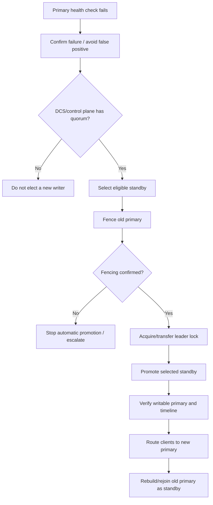

# Quorum, fencing và ngăn split-brain trong PostgreSQL

Một cụm PostgreSQL có primary và nhiều standby có thể tiếp tục phục vụ khi một máy chủ gặp sự cố. Nhưng khi mạng bị chia cắt, một node mất liên lạc với control plane hoặc hệ thống failover nhận định sai rằng primary đã chết, nguy cơ lớn nhất không chỉ là downtime: **hai node có thể cùng nhận ghi như primary**. Tình trạng đó gọi là *split-brain*.

Nếu hai primary cùng nhận writes, mỗi bên tạo WAL và thay đổi dữ liệu theo một timeline riêng. PostgreSQL không có cơ chế tự hợp nhất hai lịch sử ghi phân kỳ. Khi kết nối trở lại, việc chọn một lịch sử để giữ có thể làm mất các transaction đã được xác nhận ở phía còn lại. Vì vậy, HA cần bảo đảm một node duy nhất có quyền ghi tại một thời điểm, kể cả khi các node không thể liên lạc với nhau.

Ba khái niệm thường được dùng để xây dựng bảo đảm này là **quorum**, **fencing** và **leader coordination**. Quorum giúp một nhóm thành viên đạt được quyết định theo đa số; fencing ngăn node cũ tiếp tục hoạt động như writer; leader coordination quản lý quyền sở hữu vai trò primary. Chúng bổ sung cho nhau. Quorum của control plane không tự dừng PostgreSQL cũ, còn fencing đơn lẻ không tự chọn node mới có dữ liệu phù hợp.

Bài học thuộc chương **Tính sẵn sàng cao** của module *Database Engine Relational PostgreSQL*. Chúng ta sẽ tìm hiểu quorum trong distributed control plane, witness, failure domains, fencing bằng STONITH/watchdog/storage/network, cách HA manager phối hợp failover, mối liên hệ với synchronous replication, các kịch bản split-brain, kiểm tra và diễn tập recovery.

> **Nguyên tắc:** Trước khi cho standby nhận writes, phải có bằng chứng primary cũ đã mất quyền ghi hoặc đã bị fence. Không promote chỉ vì một node không ping được primary, không chỉ dựa vào DNS/VIP, và không nhầm quorum xác nhận WAL với quorum bầu leader.

## 1. Mục tiêu học tập

Sau bài này, bạn có thể:

1. Giải thích split-brain trong PostgreSQL HA và hậu quả của hai writable primaries.
2. Phân biệt high availability, replication, leader election và fencing.
3. Giải thích quorum majority và vì sao nhóm có số voter lẻ thường thuận tiện.
4. Tính số lỗi voter mà một nhóm quorum có thể chịu được.
5. Phân biệt data nodes, control-plane voters và witness.
6. Hiểu vì sao quorum chỉ có ý nghĩa khi membership và failure domains được thiết kế đúng.
7. Phân biệt DCS quorum với synchronous replication quorum.
8. Giải thích vì sao PostgreSQL streaming replication không tự bầu primary.
9. Nhận diện network partition, asymmetric partition và false failure detection.
10. Dùng fencing để ngăn primary cũ tiếp tục ghi.
11. So sánh STONITH, power fencing, storage fencing, network fencing và watchdog.
12. Hiểu giới hạn của lease/leader lock khi node bị cô lập.
13. Mô tả thứ tự failover an toàn.
14. Hiểu cách HA manager như Patroni dùng distributed configuration store.
15. Đánh giá synchronous commit và synchronous_standby_names trong thiết kế HA.
16. Chọn candidate promotion dựa trên replication state, WAL và timeline.
17. Rejoin old primary bằng pg_rewind hoặc base backup.
18. Theo dõi leader, quorum, replication lag và fencing status.
19. Xây dựng runbook cho failover, failback và sự cố DCS.
20. Diễn tập network partition và fencing trong môi trường lab.

## 2. Split-brain là gì?

Split-brain xảy ra khi hai hoặc nhiều node cùng tin rằng mình là primary/leader và cùng chấp nhận các thao tác ghi trong một cụm vốn chỉ được phép có một writer.

```text
             Network partition
       +----------------+----------------+
       |                                 |
       v                                 v
+--------------+                  +--------------+
| Node A       |                  | Node B       |
| believes     |                  | believes     |
| PRIMARY      |                  | PRIMARY      |
| accepts      |                  | accepts      |
| writes       |                  | writes       |
+--------------+                  +--------------+
       |                                 |
       v                                 v
  WAL timeline A                    WAL timeline B
       |                                 |
       +----------- diverged ------------+
```

### 2.1. Vì sao split-brain nguy hiểm?

Mỗi primary có thể:
- Commit các transaction khác nhau.
- Cấp sequence values khác nhau.
- Cập nhật cùng một row theo hai kết quả khác nhau.
- Nhận DDL không giống nhau.
- Gửi WAL tới các standby khác nhau.
- Trả kết quả thành công cho hai nhóm ứng dụng.

Khi hai phía kết nối lại, PostgreSQL không thể tự merge hai timeline như merge hai nhánh source code. Thường phải chọn một history làm chuẩn và xử lý dữ liệu ghi ở history còn lại bằng reconciliation/business recovery.

### 2.2. Primary cũ vẫn chạy không đồng nghĩa split-brain

Một primary có thể còn process PostgreSQL sau khi HA manager quyết định failover. Điều quan trọng là node cũ có còn nhận writes hay không. Nếu node cũ đã bị fence chắc chắn và không thể phục vụ ghi, process còn chạy không nhất thiết tạo split-brain.

### 2.3. Standby chưa được promote không phải writer thứ hai

Standby ở recovery mode chỉ replay WAL và phục vụ read-only queries nếu hot standby được bật. Nguy cơ xuất hiện khi standby được promote trong khi primary cũ vẫn có thể ghi.

### 2.4. Split-brain có thể xảy ra sau failover thủ công

Một operator có thể chạy lệnh promote trên standby vì primary không phản hồi qua mạng. Nếu primary chỉ bị cô lập khỏi operator nhưng vẫn nhận được writes từ ứng dụng khác, cả hai node có thể trở thành writable.

## 3. Phân biệt replication, quorum, leader election và fencing

Các thành phần giải quyết những vấn đề khác nhau:

| Thành phần | Câu hỏi nó trả lời | Ví dụ |
|---|---|---|
| Replication | Dữ liệu được chuyển sang node khác thế nào? | PostgreSQL physical streaming |
| Quorum | Nhóm nào có đủ thành viên để quyết định? | Majority của DCS voters |
| Leader election/lock | Node nào đang được công nhận là leader? | Patroni và DCS |
| Fencing | Làm sao ngăn leader cũ tiếp tục ghi? | STONITH, watchdog, storage fence |
| Routing | Client được gửi tới writer nào? | Proxy, VIP, service discovery |
| Backup/PITR | Khôi phục lịch sử dữ liệu ra sao? | Base backup và WAL archive |

### 3.1. Replication không phải election

PostgreSQL streaming replication gửi WAL một chiều từ primary tới standby. Nó không có thuật toán consensus để tất cả nodes tự thống nhất một primary duy nhất.

### 3.2. Quorum không phải fencing

Một DCS có thể xác nhận node B giữ leader lock. Điều đó không tự tắt process PostgreSQL trên node A nếu A bị mất kết nối tới DCS nhưng vẫn nhận traffic ứng dụng.

### 3.3. Fencing không chọn dữ liệu đúng

Tắt node cũ giúp ngăn nó tiếp tục ghi, nhưng không xác định standby nào có WAL mới nhất hoặc có đủ acknowledged transactions. Candidate selection vẫn cần replication metadata và recovery policy.

### 3.4. Routing không phải fencing

Chuyển VIP/DNS/proxy sang node mới chỉ điều hướng một phần traffic. Client cũ có thể kết nối trực tiếp IP primary cũ, giữ connection pool cũ hoặc dùng một endpoint khác. Routing không ngăn node cũ ghi vào data directory của nó.

## 4. Quorum majority

Quorum là số lượng thành viên tối thiểu cần đồng ý để một quyết định được chấp nhận. Trong các hệ thống consensus dùng majority, quorum thường là:

\[
Q = \left\lfloor \frac{N}{2} \right\rfloor + 1
\]

Trong đó:
- \(N\): số voting members.
- \(Q\): số phiếu cần có.

Ví dụ:

| Voting members (N) | Majority quorum (Q) | Số voter có thể mất mà vẫn còn quorum |
|---:|---:|---:|
| 1 | 1 | 0 |
| 2 | 2 | 0 |
| 3 | 2 | 1 |
| 4 | 3 | 1 |
| 5 | 3 | 2 |
| 6 | 4 | 2 |
| 7 | 4 | 3 |

Với nhóm có majority quorum, số lỗi voter có thể chịu được là:

\[
f = \left\lfloor \frac{N-1}{2} \right\rfloor
\]

### 4.1. Vì sao cần majority?

Hai majority trong cùng một nhóm voter luôn giao nhau ít nhất một thành viên. Thuộc tính giao nhau là nền tảng để các thuật toán consensus như Raft duy trì một lịch sử quyết định nhất quán khi leader thay đổi.

Điều này không có nghĩa bất kỳ nhóm server PostgreSQL nào tự động có consistency chỉ vì có số node lẻ. Các node phải tham gia một giao thức consensus được triển khai đúng, với membership và persistent state phù hợp.

### 4.2. Ba voter thường là cấu hình nhỏ thực tế

Với ba voters, hệ thống có thể tiếp tục quyết định khi một voter lỗi. Nếu một voter còn lại mất liên lạc, hai voter không đủ majority và control plane phải từ chối quyết định mới cần quorum.

### 4.3. Hai voter không chịu được một lỗi

Hai voters cần cả hai phiếu để có majority. Mất một voter làm mất quorum. Vì vậy, cấu hình hai máy DCS không tự tạo khả năng chịu lỗi như cấu hình ba voters.

### 4.4. Bốn voters thường không tăng fault tolerance so với ba

Bốn voters cần ba phiếu, chỉ chịu được một lỗi. Năm voters cần ba phiếu và chịu được hai lỗi. Thêm voter có chi phí mạng/coordination và cần cân nhắc topology.

### 4.5. Không phải mọi hệ thống đều dùng đúng majority formula này

Một số hệ thống có witness, weighted voting hoặc membership protocol riêng. Luôn dùng quorum semantics của control plane cụ thể. Không tự tính theo majority rồi áp dụng vào một sản phẩm có thuật toán khác.

## 5. Quorum và network partition

Giả sử ba voters A, B, C. Mạng bị chia thành hai phía: A đứng riêng; B và C vẫn liên lạc.

```text
Partition 1                  Partition 2

+---------+                 +---------+---------+
| A       |                 | B       | C       |
| 1 vote  |                 | 1 vote  | 1 vote  |
+---------+                 +---------+---------+

No majority                 Majority = 2
Cannot commit               Can retain quorum
new consensus decisions     and elect/retain leader
```

### 5.1. Phía có majority có thể tiếp tục

Nếu giao thức consensus và policy cho phép, B/C có thể duy trì leader và commit các quyết định mới.

### 5.2. Phía minority phải dừng quyết định

A không thể tự bầu một leader mới bằng một phiếu. Đây là điều ngăn hai nhóm độc lập cùng công nhận hai leaders trong control plane.

### 5.3. Mất quorum ảnh hưởng availability

Nếu không có majority, hệ thống điều phối phải từ chối cấp/đổi leader lock hoặc commit consensus log. Điều này có thể làm failover và một số thao tác quản trị dừng lại. Đây là trade-off giữa consistency và availability trong partition.

### 5.4. Majority không đồng nghĩa node dữ liệu tốt nhất

Control plane majority quyết định leader/lock theo giao thức. Nó không tự bảo đảm PostgreSQL node đang giữ lock có WAL mới nhất. HA manager phải kết hợp election với replication state và failover policy.

## 6. Data nodes và control-plane voters là hai nhóm khác nhau

Một PostgreSQL HA deployment thường có:
- PostgreSQL primary.
- PostgreSQL standbys.
- Distributed Configuration Store (DCS) hoặc control plane.
- HA agents trên database nodes.
- Client routing/proxy.
- Monitoring/backup services.

Ví dụ:

```text
Database data plane:
  PostgreSQL primary
       | WAL
       +---- standby A
       +---- standby B

Control plane:
  DCS voter 1
  DCS voter 2
  DCS voter 3

HA agents:
  Agent trên primary và mỗi standby
  đọc/ghi leader state qua DCS
```

### 6.1. DCS voters lưu trạng thái điều phối

DCS có thể lưu leader lock, cluster membership, configuration và metadata phục vụ failover. Nó không phải bản sao PostgreSQL data directory.

### 6.2. Standbys giữ dữ liệu PostgreSQL

Standby là database replicas. DCS witness không thay thế một standby có heap, indexes và WAL.

### 6.3. Hai quorum có thể tồn tại độc lập

Một deployment có thể có:
- Quorum election của DCS.
- Quorum acknowledgement của synchronous replication.
- Quorum/majority riêng của storage cluster hoặc orchestrator.

Phải vẽ riêng từng nhóm. Không cộng voters của DCS với số PostgreSQL standbys để tính một quorum chung.

## 7. Witness node

Witness là thành viên hỗ trợ quyết định/quorum nhưng có thể không giữ bản sao đầy đủ của dữ liệu PostgreSQL.

### 7.1. Witness giúp giải quyết tie

Ví dụ có hai data nodes ở hai sites. Một witness ở site thứ ba có thể tham gia control-plane voting để một phía có majority khi network partition.

### 7.2. Witness không phải database replica

Witness không thể được promote thành PostgreSQL primary nếu nó không có data directory/standby state cần thiết.

### 7.3. Witness cần độc lập failure domain

Nếu witness đặt cùng host, rack, power hoặc network failure domain với một data node, một sự cố có thể làm mất cả hai phiếu cùng lúc.

### 7.4. Witness không biến hai database copies thành ba

Nó tăng khả năng quyết định leader, không tự tạo thêm bản sao dữ liệu. Durability vẫn phụ thuộc primary, standbys, synchronous policy và backup.

### 7.5. Kiểm tra vai trò của witness trong sản phẩm

Một số sản phẩm dùng witness chỉ để vote; một số có arbitrator service; một số không cho witness làm voting member theo cùng semantics. Đọc đúng tài liệu của DCS/HA manager.

## 8. Failure domains và placement

Quorum chỉ hữu ích nếu voters không cùng chết vì một sự cố chung.

Các failure domains có thể gồm:
- Process/host.
- Virtual machine/hypervisor.
- Rack/power circuit.
- Availability zone.
- Region.
- Cloud account/project.
- Network provider.
- Storage array/control plane.

### 8.1. Ba voters trên cùng host không chịu được host failure

Số lượng logical processes không thay thế tính độc lập vật lý.

### 8.2. Ba zones có thể giảm correlated failures

Đặt mỗi voter ở một availability zone riêng giúp giảm rủi ro zone outage, nhưng vẫn phải xem network connectivity và provider control plane.

### 8.3. Network latency ảnh hưởng consensus

Voters ở xa nhau có thể tăng election/commit latency. Chọn topology cân bằng giữa failure isolation và latency.

### 8.4. Data replicas cũng cần placement riêng

DCS quorum có thể khỏe trong khi mọi PostgreSQL standbys nằm ở cùng một storage failure domain. Thiết kế data plane và control plane cùng nhau.

## 9. DCS và consensus

Distributed Configuration Store (DCS) cung cấp một nơi phối hợp trạng thái giữa HA agents. Các lựa chọn phổ biến trong hệ sinh thái PostgreSQL gồm etcd, Consul và ZooKeeper, thường được tích hợp thông qua HA manager.

### 9.1. Consensus log

Một DCS dựa trên consensus cần các thành viên thống nhất thứ tự các thay đổi được commit. Trong Raft, leader và majority phối hợp để commit log entries.

### 9.2. Leader lock

HA manager có thể dùng lock/lease trong DCS để xác định node được phép giữ vai trò leader trong một khoảng thời gian hoặc cho đến khi lock được chuyển giao.

### 9.3. Lease expiry không tự tắt process cũ

Nếu node A mất kết nối tới DCS, lease của A có thể hết hạn. DCS có thể cấp lock cho B. Nhưng A có thể vẫn chạy PostgreSQL và không biết lock đã hết hạn. Cần fencing/self-fencing để A không tiếp tục phục vụ writes.

### 9.4. DCS mất quorum

Khi DCS không có quorum, HA agents không nên tự tạo một leader mới chỉ dựa trên local belief. Primary hiện tại có thể tiếp tục theo policy hiện hành, nhưng không được tạo thêm writer. Hành vi cụ thể phụ thuộc HA manager và watchdog/fencing setup.

### 9.5. Không tự dựng consensus bằng bảng SQL

Một bảng leader=true trên PostgreSQL primary không phải DCS độc lập. Nếu chính database gặp lỗi hoặc network partition, cơ chế bầu leader phụ thuộc vào node đang được bầu và có thể không giải quyết được split-brain.

## 10. Lease, TTL và leader lock

Lease/TTL thường giới hạn thời gian một node được công nhận giữ lock nếu nó không gia hạn được.

Ví dụ khái niệm:

```text
Node A acquires leader lease
       |
       v
A periodically renews lease
       |
       +---- renewal succeeds ----> A remains leader
       |
       +---- renewal fails -------> lease expires
                                      |
                                      v
                              DCS may elect B
```

### 10.1. TTL là thời hạn của lock

TTL không phải timeout của PostgreSQL transaction và cũng không phải cơ chế tự động dừng database process.

### 10.2. Clock và network

Các hệ thống lease cần xử lý clock, scheduling pauses, network partitions và process stalls theo giao thức cụ thể. Không tự xây lease dựa trên wall-clock timestamps mà không có cơ chế đồng bộ và fencing phù hợp.

### 10.3. Process pause

Một host có thể bị pause lâu do hypervisor, kernel stall hoặc process scheduling. Khi hoạt động lại, process cũ có thể chưa biết lease đã hết hạn và tiếp tục chạy code cũ.

### 10.4. Safety margin

HA manager thường dùng các timeout và watchdog margin để node tự fence trước khi lease hết hiệu lực hoặc trước khi node khác được phép phục vụ. Cấu hình phải theo tài liệu của manager/version.

### 10.5. Lease không phải chứng minh node cũ đã ngừng ghi

Muốn chứng minh điều đó cần fencing hoặc một cơ chế self-fencing có bảo đảm tương ứng. Đây là điểm cốt lõi khi thiết kế split-brain prevention.

## 11. Fencing là gì?

Fencing là hành động loại một node khỏi khả năng tiếp tục làm writer trước khi cấp quyền writer cho node khác.

Mục tiêu:
- Ngăn node cũ nhận application writes.
- Ngăn node cũ tiếp tục ghi vào shared storage.
- Ngăn node cũ tự promote/rejoin sai timeline.
- Bảo đảm chỉ một primary có quyền ghi trong topology.

### 11.1. Fencing khác failover

Failover chuyển vai trò primary sang node mới. Fencing bảo đảm primary cũ không còn quyền hoạt động. Một quy trình failover an toàn phải phối hợp hai việc.

### 11.2. Fencing phải có bằng chứng

Không coi ping failure, SSH timeout hoặc DNS change là bằng chứng fencing. Ghi lại kết quả từ power controller, cloud API, storage reservation hoặc watchdog mechanism.

### 11.3. Fencing cần nằm ngoài failure mode của node bị fence

Nếu muốn tắt VM qua cloud API, control path/API credentials phải hoạt động độc lập với guest OS/network đã lỗi. Nếu lệnh fence phụ thuộc chính host cũ đang bị cô lập, nó có thể không thực hiện được.

### 11.4. Fencing phải kiểm thử

Một lệnh STONITH tồn tại trong config chưa chứng minh nó thực sự tắt đúng máy. Test identity, target mapping, permission, timeout, retry và kết quả power state.

## 12. STONITH và power fencing

STONITH là viết tắt của “Shoot The Other Node In The Head”, cách gọi truyền thống cho việc tắt cứng node nghi ngờ để bảo đảm node đó không còn hoạt động.

### 12.1. Power fencing

Có thể dùng:
- IPMI/BMC.
- Redfish.
- PDU power control.
- Hypervisor/VM management API.
- Cloud provider instance stop/terminate API.
- Cluster power controller.

### 12.2. Ưu điểm

Nếu xác nhận node đã tắt, PostgreSQL trên node đó không thể tiếp tục nhận writes. Đây là một dạng fencing mạnh và dễ hiểu về mặt vận hành.

### 12.3. Rủi ro

- Fencing nhầm node.
- Fencing controller không truy cập được.
- API báo request accepted nhưng power state chưa đổi.
- Node reboot tự động sau khi bị tắt.
- Operator dùng sai mapping IP/instance ID.
- Fencing mất quá lâu trong khi failover timeout ngắn.

### 12.4. Verify power state

Runbook cần xác minh trạng thái power-off từ nguồn độc lập. Nếu chỉ gửi lệnh shutdown mà không xác nhận, chưa đủ bằng chứng.

### 12.5. Reboot và rejoin

Sau khi node cũ được bật lại, nó không được tự nhận writes. Phải start như standby theo timeline mới hoặc rebuild/rejoin trước khi đưa vào routing.

## 13. Storage fencing

Storage fencing ngăn node cũ tiếp tục ghi vào storage dùng chung hoặc volume có thể được attach sang node mới.

### 13.1. SCSI persistent reservations

Một số shared-storage systems hỗ trợ reservation để một initiator giữ quyền ghi và có thể loại initiator cũ khỏi quyền truy cập.

### 13.2. Cloud volume detach

Một số nền tảng cho phép detach volume khỏi VM cũ rồi attach sang VM mới, với semantics bảo đảm attachment độc quyền. Cần chờ provider xác nhận detach thực sự hoàn tất.

### 13.3. Shared storage và PostgreSQL physical replication khác nhau

PostgreSQL streaming replication thường dùng data directory riêng cho từng node. Shared storage fencing thường xuất hiện trong kiến trúc shared-disk hoặc trong các storage systems được dùng bởi cluster stack. Không attach cùng PGDATA read-write vào hai PostgreSQL servers.

### 13.4. Filesystem lock không thay fencing

File lock hoặc process lock trên host không bảo vệ trước host khác nếu storage/filesystem không cung cấp semantics cluster-wide phù hợp.

### 13.5. Không dùng force detach tùy tiện

Detach volume khi database đang ghi có thể gây corruption hoặc mất dữ liệu. Dùng fencing workflow của provider/storage, xác nhận old writer đã dừng và follow hướng dẫn filesystem.

## 14. Network fencing

Network fencing cô lập node khỏi một số hoặc toàn bộ đường giao tiếp.

Có thể chặn:
- Client application traffic.
- Replication traffic.
- DCS/control-plane traffic.
- Inter-node traffic.
- Storage network.

### 14.1. Chặn client traffic có thể chưa đủ

Nếu node cũ vẫn có thể ghi local và sau đó được đưa lại vào cluster như primary, divergence vẫn xảy ra. Cần ngăn nó quay lại writable path.

### 14.2. Chặn replication không phải fencing hoàn chỉnh

Nếu chỉ cắt replication connection, primary cũ vẫn có thể nhận application writes. Điều đó còn làm standby lag hơn.

### 14.3. Firewall rules có thể bị lệch

Một số clients có thể dùng direct IP, alternate network hoặc persistent connections. Fencing policy phải cover mọi đường write có thể xảy ra.

### 14.4. Network fencing và control plane

Có thể dùng network isolation để fence node khỏi DCS hoặc application network, nhưng phải hiểu chiều nào bị chặn. Cắt node khỏi DCS mà vẫn để client writes có thể làm nó mất lease nhưng tiếp tục phục vụ.

### 14.5. Ưu tiên cơ chế có xác nhận

Network fencing cần xác nhận rule đã áp dụng ở hạ tầng độc lập, đúng interface/subnet và không thể bị node cũ tự gỡ.

## 15. Watchdog và self-fencing

Watchdog là cơ chế node tự reset/tắt nếu không thể duy trì điều kiện an toàn trong khoảng thời gian cho phép.

### 15.1. Vì sao cần self-fencing?

Một node có thể mất kết nối tới DCS nhưng process PostgreSQL vẫn chạy. HA agent có thể yêu cầu watchdog reset host nếu không thể gia hạn quyền leader trước deadline.

### 15.2. Watchdog không phải monitoring health check

Watchdog được dùng để cưỡng chế node dừng khi software không còn bảo đảm an toàn. Nó cần hardware/kernel support và cấu hình timeout đúng.

### 15.3. Watchdog phải được test khi mất DCS

Kiểm tra:
- Agent có nhận biết mất lock không?
- Watchdog có được arm đúng không?
- Nếu agent bị pause, watchdog có reset host?
- Timeout có đủ margin trước khi leader lease có thể được cấp cho node khác?
- Sau reboot, node có khởi động ở trạng thái standby/fenced không?

### 15.4. Watchdog không thay DCS quorum

Watchdog giúp node cũ tự dừng. Nó không tự quyết định node mới nào có đủ dữ liệu để promote.

### 15.5. Không bật watchdog mà chưa hiểu recovery

Một watchdog có thể reset cả node khi gặp điều kiện không mong muốn. Có thể tạo downtime hoặc reboot loop nếu config sai. Thử trên staging và có console/recovery access.

## 16. Fencing bằng lease và watchdog trong HA manager

Một số HA managers tích hợp DCS leader lock với watchdog/self-fencing. Cơ chế điển hình:

1. Node giữ leader lock trong DCS.
2. Agent gia hạn lock định kỳ.
3. Nếu không thể gia hạn, agent phải ngừng nhận vai trò leader.
4. Watchdog đảm bảo host tự reset nếu agent không thể thực hiện shutdown đúng hạn.
5. DCS cấp lock cho node khác sau khi lease cũ hết.
6. Candidate mới được promote theo failover policy.

Đây là mô tả khái niệm. Thứ tự chính xác, timeout và watchdog integration phụ thuộc HA manager/version. Đọc tài liệu chính thức và kiểm tra timing inequalities của sản phẩm trước khi cấu hình.

### 16.1. Lock timeout và watchdog timeout phải phối hợp

Nếu watchdog reset quá muộn, DCS có thể cấp lock mới trước khi node cũ dừng. Nếu reset quá sớm, transient DCS outage có thể làm primary reboot không cần thiết.

### 16.2. Agent chết nhưng PostgreSQL còn chạy

Đây là failure case quan trọng. Nếu watchdog không được arm hoặc không thể hoạt động khi agent chết, node có thể tiếp tục nhận writes dù không còn renew leader lock.

### 16.3. Fencing status cần quan sát được

Monitoring nên hiển thị leader lock holder, lease state, watchdog armed state, last successful renewal và fencing action result theo khả năng của HA manager.

## 17. Failover an toàn theo thứ tự

Một state machine khái quát:



### 17.1. Detect

Health checks phát hiện primary không phản hồi. Một lỗi TCP đơn lẻ chưa chứng minh database đã chết.

### 17.2. Confirm

Dùng nhiều tín hiệu: PostgreSQL health, host health, DCS state, network paths, replication state và fencing provider.

### 17.3. Quorum

Control plane phải có quorum để đưa ra quyết định leader theo consensus protocol. Nếu không có quorum, không tạo một leader độc lập ở phía minority.

### 17.4. Candidate selection

Chọn standby phù hợp với timeline, WAL progress, synchronous policy, lag limit và business RPO.

### 17.5. Fence

Ngăn primary cũ tiếp tục writes. Xác nhận action thành công từ control path độc lập.

### 17.6. Promote

Sau khi có quyền leader và fencing đã hoàn tất, promote standby theo HA manager/runbook. Không chạy promote song song trên nhiều candidates.

### 17.7. Route

Cập nhật proxy/VIP/service discovery sau khi node mới thực sự writable và được xác nhận là leader.

### 17.8. Rejoin

Old primary cần rewind/rebuild và gia nhập dưới dạng standby của timeline mới. Không cho node cũ tự mở lại application traffic trước bước này.

## 18. Vì sao không promote ngay khi primary timeout?

Một primary có thể không trả lời vì:
- Host thật sự tắt.
- PostgreSQL process crash.
- Disk I/O hang.
- Network path từ observer bị lỗi.
- DCS path bị partition nhưng application path vẫn hoạt động.
- CPU scheduling hoặc VM pause.
- Firewall thay đổi.
- Load balancer/monitoring lỗi.

### 18.1. Asymmetric partition

Operator/HA agent có thể không liên lạc được primary nhưng một số application clients vẫn liên lạc được. Node cũ tiếp tục nhận writes.

### 18.2. False positive

Health check quá nhạy có thể tuyên bố primary chết khi nó chỉ đang chậm. Nếu failover không có fencing, một false positive có thể tạo split-brain.

### 18.3. Timeout không tạo safety

Tăng timeout có thể giảm failover giả nhưng không bảo đảm node cũ dừng. Giảm timeout có thể cải thiện detection nhưng tăng false positives. Safety đến từ coordination và fencing.

### 18.4. Failure detector không thể biết chắc node chết trong asynchronous network

Trong hệ thống phân tán, một node im lặng có thể đã chết hoặc chỉ bị network delay/partition. Vì vậy, không thể chỉ dựa trên timeout để bảo đảm một writer duy nhất.

## 19. PostgreSQL streaming replication không tự ngăn split-brain

PostgreSQL có cơ chế recovery/standby và WAL replay, nhưng không tự triển khai toàn bộ HA control plane.

### 19.1. pg_promote là hành động promotion

```sql
SELECT pg_promote();
```

Lệnh này yêu cầu standby promote thành primary. Nó không kiểm tra DCS quorum, không fence primary cũ và không điều phối application routing.

### 19.2. pg_ctl promote

```bash
pg_ctl -D /path/to/standby promote
```

Cũng là hành động promotion, không phải quy trình election an toàn độc lập.

### 19.3. pg_is_in_recovery

```sql
SELECT pg_is_in_recovery();
```

Kết quả false cho biết instance không còn ở recovery mode. Nó không chứng minh node đó là leader duy nhất trong hệ thống.

### 19.4. Hai nodes cùng trả false là cảnh báo nghiêm trọng

Nếu hai PostgreSQL nodes thuộc cùng cluster lineage cùng ở writable mode, cần ngăn writes ngay và xác định timeline/history. Không tự merge.

## 20. Synchronous replication và quorum: hai ý nghĩa khác nhau

PostgreSQL có synchronous_standby_names hỗ trợ priority-based hoặc quorum-based synchronous replication.

Ví dụ:

```conf
synchronous_standby_names = 'ANY 2 (standby_a, standby_b, standby_c)'
```

Đây là yêu cầu acknowledgement WAL từ bất kỳ hai standbys trong danh sách cho các transactions dùng remote synchronous commit level.

### 20.1. Đây là WAL acknowledgement quorum

Mục đích là xác định transaction commit có phải chờ đủ acknowledgements từ standbys hay không.

### 20.2. Đây không phải DCS election quorum

ANY 2 không tự:
- Bầu một PostgreSQL primary mới.
- Cấp leader lease.
- Fence old primary.
- Chọn candidate promotion sau partition.
- Ngăn operator promote node thứ ba.
- Bảo đảm HA manager có quorum.

### 20.3. FIRST không phải quorum majority

FIRST 1 (a,b,c) chọn theo priority. Nó không có semantics majority voting như DCS consensus.

### 20.4. Synchronous replication không tự failover

Nếu synchronous standby mất kết nối, commit có thể chờ theo policy. PostgreSQL không tự quyết định promote standby khác hoặc chuyển VIP.

### 20.5. Cần thiết kế cả hai lớp

Một hệ thống có thể dùng:
- DCS quorum để bầu/giữ leader.
- Synchronous replication để xác nhận WAL trên một hoặc nhiều standbys.
- Fencing để loại primary cũ.
- HA manager để phối hợp.
- Proxy để route client.

Không thành phần nào thay thế hoàn toàn các thành phần còn lại.

## 21. synchronous_commit trong thiết kế durability

Các mức chính:
- off: có thể trả commit trước local WAL flush.
- local: chờ local WAL flush, không đợi standby.
- remote_write: chờ standby write WAL tới OS.
- on: chờ standby flush WAL.
- remote_apply: chờ standby replay WAL.

### 21.1. Chọn mức theo requirement

Nếu mục tiêu là transaction đã được ghi durable ở một standby, remote flush thường là mức được cân nhắc. Nếu cần đọc ngay trên standby đã xác nhận, remote_apply có thể hữu ích.

### 21.2. Sync mode không có standby đủ điều kiện

Khi không có synchronous standby, transaction yêu cầu remote acknowledgement có thể chờ. Nếu HA policy cho phép hạ quorum, durability contract thay đổi và phải được audit.

### 21.3. Session override

Một transaction có thể dùng SET LOCAL synchronous_commit = 'local' hoặc 'off'. Kiểm tra role/database/session defaults và code paths có override.

### 21.4. Quorum acknowledgements không có nghĩa tất cả replicas có WAL

Với ANY 2 trong ba candidates, hai standbys có thể đáp ứng transaction trong khi node còn lại lag. Promotion candidate phải xét acknowledgement set và WAL positions; không giả định mọi node đều có cùng commit.

## 22. Candidate selection và WAL freshness

Khi primary mất, HA manager cần chọn standby đủ điều kiện. Các yếu tố:
- Có còn trong đúng cluster/timeline lineage không?
- Có đang streaming hoặc có WAL archive cần thiết không?
- Receive/write/flush/replay LSN ở đâu?
- Standby có được synchronous acknowledgement cho các commits cần giữ không?
- Lag có nằm trong policy cho phép không?
- Có đủ WAL để replay tới điểm cần thiết không?
- Có thể promote an toàn sau khi old primary bị fence không?

### 22.1. LSN cao hơn không phải toàn bộ quyết định

So sánh LSN có ý nghĩa khi các nodes cùng lịch sử/timeline và vị trí được hiểu đúng. Cần xét timeline history, acknowledged commits, archive và HA manager metadata.

### 22.2. Async failover có thể mất dữ liệu

Nếu standby chưa nhận WAL cuối cùng, promotion có thể bỏ các commits đã được client xác nhận trên primary cũ. Chấp nhận hay không là business RPO decision.

### 22.3. Synchronous failover cần promote node phù hợp

Các transactions đã được acknowledged theo sync policy có thể được bảo toàn nếu promote một standby thực sự có WAL đó và storage assumptions được giữ. Không promote node chỉ vì nó có tên trong candidate list.

### 22.4. Không promote node đang ở trạng thái không rõ

Nếu LSN/timeline/receiver state không xác định, dừng automatic promotion và escalate. Một quyết định chậm hơn có thể an toàn hơn việc tạo hai histories không thể merge.

## 23. HA manager và Patroni

Patroni là một HA solution phổ biến trong hệ sinh thái PostgreSQL. Nó phối hợp PostgreSQL instances qua DCS như etcd, Consul hoặc ZooKeeper.

### 23.1. Patroni agent

Mỗi database node chạy Patroni agent để theo dõi PostgreSQL, health, replication state và leader lock.

### 23.2. DCS

DCS giữ cluster state và leader lock. Các Patroni agents dùng DCS để phối hợp node nào có thể giữ vai trò primary.

### 23.3. Leader lock

Node giữ lock có thể duy trì primary role khi thỏa điều kiện của Patroni configuration. Nếu không gia hạn được, agent phải chuyển sang hành vi an toàn theo cấu hình, bao gồm self-fencing nếu watchdog được dùng.

### 23.4. Candidate selection

Patroni có policy cho maximum lag on failover, synchronous mode và các tiêu chí khác. Các policy cần được hiểu theo version và topology.

### 23.5. Patroni không loại bỏ nhu cầu thiết kế

DCS quorum, watchdog, fencing, network, replication slots, sync mode, routing và backup vẫn cần cấu hình/monitor đúng. Cài Patroni đơn thuần không bảo đảm split-brain impossible.

## 24. Patroni timing và watchdog

Patroni có các tham số như:
- ttl: thời gian leader lock có hiệu lực.
- loop_wait: chu kỳ HA loop.
- retry_timeout: thời gian retry các thao tác DCS.
- Watchdog configuration: self-fencing behavior.
- maximum_lag_on_failover: giới hạn lag cho candidate theo policy.

### 24.1. Timeout relationship

Các timeout phải thỏa các ràng buộc của Patroni version. Tài liệu Patroni thường yêu cầu phối hợp loop_wait, retry_timeout và ttl để đủ thời gian renew lock và thực hiện failover an toàn. Không tự chọn các giá trị độc lập.

### 24.2. Watchdog mode

Patroni hỗ trợ watchdog integration trên các môi trường phù hợp. Chọn mode theo yêu cầu safety của deployment và xác minh device/driver thực tế hoạt động.

### 24.3. Required mode

Nếu deployment dựa vào watchdog để bảo đảm self-fencing, cần cấu hình mode yêu cầu watchdog và xác minh agent không thể tiếp tục primary role khi watchdog không sẵn sàng. Behavior chính xác tùy Patroni version.

### 24.4. Test mất DCS

Thử network partition giữa một primary và DCS trong staging. Xác nhận:
- Node mất lock có ngừng phục vụ ghi hoặc self-fence đúng deadline.
- Node phía majority có thể nhận lock theo policy.
- Không có hai writable primaries.
- Watchdog event được log/monitor.
- Client routing không quay về node cũ.

### 24.5. Không copy config mẫu nguyên xi

Các tham số và YAML schema thay đổi theo version. Dùng tài liệu Patroni đang cài, kiểm tra effective configuration và thực hiện test failure có kiểm soát.

## 25. Ví dụ DCS với ba voters

Một control plane có ba voting members:

```text
          +------------------+
          | Voter 1          |
          | DCS node         |
          +------------------+
                    |
          +---------+---------+
          |                   |
+------------------+  +------------------+
| Voter 2          |  | Voter 3          |
| DCS node         |  | DCS node         |
+------------------+  +------------------+

Majority = 2 of 3
Tolerates one voter failure
```

### 25.1. Một voter lỗi

Hai voters còn lại có majority. DCS có thể tiếp tục consensus operations theo trạng thái cluster.

### 25.2. Hai voters lỗi

Chỉ còn một voter, không có majority. Không được tự coi node PostgreSQL bất kỳ là leader mới chỉ vì nó vẫn chạy.

### 25.3. Thay voter membership

Thay đổi cluster membership của DCS cần theo đúng joint-consensus/configuration procedure của sản phẩm. Không xóa node khỏi danh sách thủ công trong lúc partition nếu không hiểu tác động.

### 25.4. Snapshot và backup DCS

DCS lưu metadata điều phối quan trọng. Backup/restore DCS cần theo hướng dẫn sản phẩm và không nên khôi phục snapshot cũ một cách tùy tiện vào cluster đang chạy, vì có thể làm leader/lease state lùi lại.

## 26. Witness topology cho hai database nodes

Giả sử hai PostgreSQL nodes ở hai sites và một witness ở site thứ ba:

```text
Site A                  Site B                Site C
+-----------+           +-----------+         +-----------+
| Primary A |           | Standby B |         | Witness   |
| PostgreSQL|           | PostgreSQL|         | DCS voter |
| DCS voter |           | DCS voter |         |           |
+-----------+           +-----------+         +-----------+
```

### 26.1. Witness giúp xác định majority

Nếu site A mất liên lạc với B nhưng vẫn kết nối C, A+C có thể có majority; B đơn độc không có quorum. Tuy nhiên, chính sách HA phải xác định ai được giữ leader lock và cách fence node không có quorum.

### 26.2. Witness không có WAL

Nếu primary A mất hoàn toàn, witness không thể thay standby B làm database. B vẫn phải có base data và WAL đủ để promote.

### 26.3. Đặt witness độc lập

Witness ở cùng site A có thể mất cùng A. Đặt tại failure domain thứ ba giúp tăng tính độc lập, nhưng network paths và power/identity cần được xem xét.

### 26.4. Không thiết kế dựa trên ping witness

Witness vote trong DCS protocol, không phải một máy chỉ ping để phá tie. Dùng cơ chế chính thức của HA manager/DCS.

## 27. Split-brain scenarios thường gặp

### 27.1. Network partition giữa primary và DCS

Primary không renew được leader lock nhưng vẫn nhận application traffic. Nếu DCS cấp lock cho standby mà primary không self-fence, split-brain có thể xảy ra.

### 27.2. Primary bị pause rồi resume

Node A bị pause lâu; lease hết hạn và B được promote. A resume và tiếp tục chạy process cũ nếu không có watchdog/fencing.

### 27.3. Manual promotion song song

Hai operator cùng promote hai standbys khi primary không phản hồi. Mỗi node tạo một timeline mới.

### 27.4. DNS/VIP chuyển nhưng old primary vẫn writable

Một số clients dùng endpoint mới, clients khác giữ direct connection cũ. Cả hai nodes nhận writes.

### 27.5. DCS restore từ snapshot cũ

Control plane có thể quên leader/lease state mới nhất và cấp quyền không đúng nếu restore không theo quy trình consensus.

### 27.6. Watchdog không hoạt động

HA config nghĩ node sẽ self-fence nhưng watchdog device không được mở/arm, driver lỗi hoặc timeout không đúng.

### 27.7. Fencing nhầm hoặc chưa hoàn tất

Lệnh fence nhầm instance hoặc chỉ gửi request mà chưa xác minh power-off. HA manager promote node mới quá sớm.

### 27.8. Synchronous quorum bị hiểu nhầm là election quorum

Operator nghĩ ANY 2 đã ngăn hai primary, nhưng thực tế nó chỉ điều khiển WAL acknowledgements. Promotion vẫn cần DCS/election/fencing.

## 28. Client routing sau failover

Sau promotion, clients cần chuyển sang primary mới.

Các cơ chế:
- HAProxy/proxy tương đương cho PostgreSQL routing.
- PgBouncer kết hợp service discovery.
- Virtual IP.
- DNS/service records.
- Kubernetes Services/operator endpoints.
- Application connection strings.

### 28.1. Routing phải nhận biết role

Không route writes chỉ dựa trên process còn sống. Kiểm tra pg_is_in_recovery() hoặc HA manager primary endpoint/role labels.

### 28.2. Existing connections

Connections tới primary cũ có thể còn mở hoặc treo. Cần drain/terminate/close theo policy sau failover; pooler phải phát hiện node role change.

### 28.3. Direct IP access

Nếu applications có thể bỏ qua proxy và kết nối direct IP, routing layer không đủ ngăn old primary writes. Fencing phải chặn ở tầng node/storage hoặc network đủ mạnh.

### 28.4. DNS TTL không phải safety mechanism

DNS cache và resolver behavior có thể giữ IP cũ lâu hơn TTL. Dùng DNS cho discovery, không dùng nó làm fencing.

### 28.5. Unknown commit outcome

Nếu connection mất trong lúc COMMIT response đang truyền, client có thể không biết transaction đã commit hay chưa. Ứng dụng nên dùng idempotency keys/business transaction identifiers để xử lý retry an toàn.

## 29. Old primary sau promotion

Sau khi standby mới được promote, old primary có thể:
- Đã tắt do power fencing.
- Tự reset qua watchdog.
- Vẫn chạy nhưng bị network/storage fenced.
- Đang partition và chưa biết failover đã xảy ra.

Không cho old primary tự reconnect vào application path.

### 29.1. Rejoin bằng pg_rewind

pg_rewind có thể đồng bộ một data directory phân kỳ trở lại timeline mới khi đáp ứng prerequisites như data checksums hoặc wal_log_hints, full_page_writes và WAL cần thiết. Kiểm tra manual đúng version.

### 29.2. Rebuild bằng base backup

Nếu rewind không khả dụng, không có đủ WAL hoặc node không đáng tin, tạo lại standby từ base backup của primary mới.

### 29.3. Không chỉ xóa standby.signal rồi start

Old primary có thể chứa timeline phân kỳ. Bỏ standby.signal hoặc start bình thường có thể làm node nhận writes độc lập. Dùng rewind/rebuild procedure.

### 29.4. Kiểm tra timeline history

Xác nhận node cũ follow timeline mới và pg_is_in_recovery() true trước khi cho nó tham gia standby routing/replication.

## 30. Synchronous mode và failover policy

Một deployment có thể bật synchronous replication để giảm RPO. HA manager cần hiểu synchronous state khi chọn candidate.

### 30.1. Synchronous mode strict/non-strict

Một số HA managers cung cấp chế độ đồng bộ strict hoặc policy điều chỉnh quorum khi standby thiếu. Các semantics và cấu hình phụ thuộc sản phẩm/version.

### 30.2. Strict mode

Có thể dừng writes khi không đủ synchronous standbys để duy trì durability policy. Đây là availability trade-off có chủ đích.

### 30.3. Non-strict mode

Có thể cho phép tiếp tục writes với synchronous requirements suy giảm theo policy. Cần hiểu rõ khi nào transaction không còn được xác nhận trên remote standby.

### 30.4. Candidate eligibility

HA manager có thể loại candidate quá lag hoặc không đáp ứng synchronous policy. Kiểm tra policy và metadata trước khi promote.

### 30.5. Đừng giả định sync state luôn được giữ qua failover

Sau promotion, synchronous standby configuration có thể thay đổi theo topology mới. Kiểm tra và khôi phục quorum/standby selection sau khi cluster ổn định.

## 31. Monitoring quorum và fencing

Một dashboard HA nên có các lớp:

**Control plane**
- DCS member health.
- DCS leader/term/lease.
- Quorum availability.
- Last successful renew.
- Membership changes.
- DCS latency/leader changes.

**Database data plane**
- Current primary identity.
- pg_is_in_recovery() per node.
- pg_stat_replication.
- Standby receive/write/flush/replay LSN.
- Sync state/quorum status.
- WAL sender/slot health.
- Replication lag and WAL retention.

**Fencing**
- Watchdog armed/healthy.
- Last fencing action and result.
- Power state from independent controller.
- Storage reservation/attachment owner.
- Network isolation rule state.

**Client path**
- Writer endpoint.
- Proxy health.
- Existing connections to old primary.
- Application write errors/unknown commit outcomes.

### 31.1. Alert on two writable nodes

Nếu monitoring phát hiện hai nodes cùng pg_is_in_recovery() = false trong cùng cluster lineage, đó là critical alert. Ngăn writes ở một phía theo incident runbook và xác định timeline.

### 31.2. Alert on lost DCS quorum

Mất quorum là sự cố control plane. Không chỉ alert “DCS down”; cần xác định node nào còn majority và database writer đang ở trạng thái nào.

### 31.3. Alert on missing fencing capability

Nếu watchdog không armed hoặc power fencing API lỗi, failover automation có thể không đạt safety assumptions. Đừng chỉ đợi đến lúc failover mới phát hiện.

### 31.4. Metrics phải có identity

Ghi node name, PostgreSQL system identifier/cluster identity, timeline, role, DCS member ID và timestamp. Tránh gộp metrics hai clusters có cùng hostname labels.

## 32. Các truy vấn kiểm tra PostgreSQL

### 32.1. Xác định instance đang ở recovery

```sql
SELECT
    pg_is_in_recovery() AS is_standby,
    pg_postmaster_start_time() AS server_started_at;
```

Trên primary, lấy WAL position hiện tại bằng pg_current_wal_lsn(). Trên standby, dùng các recovery/receive/replay functions tương ứng.

### 32.2. Kiểm tra replication connections trên primary

```sql
SELECT
    application_name,
    client_addr,
    state,
    sync_state,
    sync_priority,
    sent_lsn,
    write_lsn,
    flush_lsn,
    replay_lsn
FROM pg_stat_replication
ORDER BY application_name;
```

### 32.3. Kiểm tra WAL receiver trên standby

```sql
SELECT
    status,
    sender_host,
    sender_port,
    slot_name,
    written_lsn,
    flushed_lsn,
    latest_end_lsn,
    latest_end_time
FROM pg_stat_wal_receiver;
```

### 32.4. Kiểm tra replication slots

```sql
SELECT
    slot_name,
    slot_type,
    active,
    restart_lsn,
    wal_status
FROM pg_replication_slots
ORDER BY slot_name;
```

Một số columns có thể khác theo PostgreSQL major version.

### 32.5. Tính replay lag theo bytes

```sql
SELECT
    application_name,
    pg_wal_lsn_diff(sent_lsn, replay_lsn) AS sent_to_replay_bytes
FROM pg_stat_replication
WHERE replay_lsn IS NOT NULL;
```

Đây là chênh lệch LSN, không phải thời gian lag tuyệt đối. Kết hợp WAL generation rate và trạng thái receiver.

## 33. Kiểm tra DCS và HA manager

Các lệnh cụ thể phụ thuộc sản phẩm. Với Patroni, thao tác thường dùng gồm:

```bash
patronictl -c /etc/patroni/patroni.yml list
```

Lệnh này hiển thị thành viên và trạng thái cluster theo cấu hình Patroni.

DCS tooling cũng có thể cung cấp health/status commands, ví dụ etcd client commands. Cú pháp, authentication và endpoint phụ thuộc phiên bản/deployment.

### 33.1. Không chỉ kiểm tra HTTP health endpoint

Một Patroni REST API trả lời không có nghĩa DCS quorum tốt hoặc node đang giữ leader lock. Xem cluster state và DCS state.

### 33.2. Xác nhận leader lock

Kiểm tra lock holder, lease expiry/renewal và cluster scope bằng công cụ HA manager. Không tự sửa key trong DCS để ép promotion.

### 33.3. DCS latency

DCS request latency tăng có thể làm renew lock trễ, gây leader churn hoặc self-fencing. Monitor latency, disk fsync và network giữa voters.

### 33.4. DCS backup/restore

Theo hướng dẫn của DCS vendor. Snapshot cũ có thể chứa state đã hết hạn; không restore vào production cluster đang hoạt động mà chưa có recovery plan.

## 34. Quy trình xử lý khi mất quorum DCS

Khi control plane mất majority:

1. Xác định voter nào còn sống và network partition topology.
2. Xác định PostgreSQL primary hiện tại có còn nhận writes không.
3. Kiểm tra leader lock/lease state từ phía có quorum (nếu có).
4. Không tạo leader mới từ minority partition.
5. Kiểm tra watchdog/self-fencing behavior của node mất DCS.
6. Xác nhận có hay không node khác đã được cấp leader lock.
7. Khôi phục DCS voters hoặc network theo quy trình sản phẩm.
8. Chỉ sau khi quorum ổn định mới thực hiện failover/leader transfer.
9. Xác nhận một writable primary duy nhất.
10. Kiểm tra standbys, timeline, client routing và backup.

### 34.1. Primary có thể tiếp tục hoạt động theo policy

Một số HA managers cho phép current primary tiếp tục trong thời gian ngắn khi DCS không sẵn sàng, tùy lease/watchdog policy. Điều đó không có nghĩa có thể cấp một leader thứ hai.

### 34.2. Không khôi phục bằng cách xóa lock key

Xóa key có thể làm mất thông tin ownership và kích hoạt race giữa các agents. Dùng lệnh/repair procedure được vendor hỗ trợ.

### 34.3. Nếu không thể chứng minh fencing

Dừng automatic promotion và escalate. Một hệ thống không có bằng chứng old primary đã bị fence chưa an toàn để cấp writer mới.

## 35. Quy trình manual failover an toàn

Manual failover cần một runbook rõ ràng. Trước khi thực hiện:
- Xác định cluster identity và current primary.
- Xác nhận primary thực sự không phục vụ được hoặc cần switchover có kế hoạch.
- Xác định DCS quorum/leader state.
- Chọn candidate standby.
- Kiểm tra replication lag và WAL state.
- Xác định synchronous acknowledgements policy.
- Có quyền fencing độc lập.
- Có người chịu trách nhiệm và ghi nhận timeline.

Một trình tự khái quát:

1. Dừng hoặc fence old primary.
2. Xác minh old primary không thể nhận writes.
3. Xác nhận control-plane leader lock có thể chuyển giao.
4. Xác định standby candidate tốt nhất theo policy.
5. Promote duy nhất candidate được chọn.
6. Xác minh node mới writable và có timeline mới.
7. Cập nhật writer endpoint/proxy.
8. Xác nhận application connections và writes.
9. Rebuild/rejoin old primary.
10. Khôi phục desired replication/synchronous policy.

### 35.1. Planned switchover khác emergency failover

Planned switchover có thể drain writes, đồng bộ WAL và chuyển role có kiểm soát. Emergency failover xảy ra khi primary có thể không phản hồi; cần fencing và đánh giá data loss.

### 35.2. Không chạy promote trước fencing chỉ để tiết kiệm thời gian

Nếu old primary còn writable, việc promote trước có thể tạo hai timelines. Không có cách tự động merge an toàn sau đó.

### 35.3. Ghi nhận commit uncertainty

Các clients mất kết nối trong thời điểm failover có thể không biết transaction commit thành công hay chưa. Application reconciliation cần dựa trên business keys/idempotency.

## 36. Fencing và shared-nothing architecture

PostgreSQL physical streaming thường dùng shared-nothing nodes: mỗi instance có data directory riêng. Điều này giảm một số shared-disk hazards nhưng không loại bỏ split-brain.

### 36.1. Hai data directories riêng vẫn có thể cùng nhận writes

Network partition không tự ngăn primary cũ nhận clients. Cả hai node có thể diverge độc lập.

### 36.2. Storage fence có thể không áp dụng

Nếu mỗi node có local storage, fencing có thể dùng power/watchdog/network/HA agent thay vì shared storage reservation.

### 36.3. Local disk cũ phải được giữ như evidence

Sau incident, không xóa old data directory ngay. Giữ snapshot/logs và đánh giá có cần forensic/data reconciliation hay không theo policy.

## 37. Fencing và shared storage

Nếu một cluster stack dùng shared storage, nguy cơ khác: hai PostgreSQL processes có thể cùng truy cập cùng files.

### 37.1. Không chạy hai PostgreSQL servers trên cùng PGDATA

PostgreSQL data directory không được mở read-write đồng thời bởi hai postmasters. Shared filesystem không biến PostgreSQL thành multi-writer database.

### 37.2. Exclusive ownership

Storage layer phải bảo đảm chỉ một host có quyền ghi. Fencing cần thu hồi access của old host trước khi new host mount/activate volume.

### 37.3. Mount status không đủ

Một filesystem mount trên host mới không chứng minh host cũ đã unmount hoặc bị fence. Xác nhận reservation/attachment ownership từ storage control plane.

### 37.4. Recovery sau power failure

Sau khi storage ownership chuyển, PostgreSQL cần recovery đúng từ WAL. Kiểm tra logs, filesystem và backup theo runbook.

## 38. DCS quorum và backup của control plane

DCS state có thể ảnh hưởng khả năng vận hành cluster. Bảo vệ:
- DCS data directory.
- Member identity/configuration.
- TLS certificates/credentials.
- Cluster membership.
- Snapshot/restore procedures.
- Monitoring và audit logs.

### 38.1. Backup DCS không thay backup PostgreSQL

DCS snapshot không chứa heap/indexes/WAL data của PostgreSQL. Database backup vẫn cần riêng.

### 38.2. PostgreSQL backup không thay DCS recovery

Sau khi restore PostgreSQL, cần dựng lại HA membership, leader state, slots, routing và fencing configuration.

### 38.3. Không restore stale leader state

DCS snapshot cũ có thể ghi node leader trước sự cố. Sau failover, state đó có thể lỗi thời. Fencing và cluster reconciliation phải đi trước việc mở lại automation.

## 39. RPO/RTO và quorum design

Quorum và fencing chủ yếu giúp safety; chúng cũng ảnh hưởng availability và recovery time.

### 39.1. RPO

RPO phụ thuộc:
- Async hay synchronous replication.
- Commit acknowledgement level.
- Synchronous standby count/quorum.
- Candidate WAL freshness.
- Failure mode và storage durability.
- Có promote đúng acknowledged standby hay không.

### 39.2. RTO

RTO phụ thuộc:
- Failure detection timeout.
- DCS election/lock transition.
- Fencing duration.
- Candidate promotion/recovery time.
- Proxy/DNS/connection pool convergence.
- Application retry and warm-up.

### 39.3. Fencing có thể là phần lâu nhất

Power fencing hoặc cloud API có thể mất thời gian. Đặt timeout failover theo thời gian fencing thực tế, không chỉ thời gian promote.

### 39.4. Không hy sinh safety để đạt RTO giả

Promote nhanh khi chưa fence có thể tạo split-brain và kéo dài outage nhiều giờ/ngày vì phải reconcile divergent histories. RTO phải bao gồm recovery consequences.

## 40. HA manager và external orchestrator

Có nhiều cách triển khai PostgreSQL HA:
- Patroni + etcd/Consul.
- Repmgr kết hợp witness/monitoring và fencing policy.
- Pacemaker/Corosync với resource agents và STONITH.
- Kubernetes operator với control plane/leases và storage/network policy.
- Cloud-managed PostgreSQL với failover do provider điều phối.

### 40.1. Đọc failure semantics của sản phẩm

Tên automatic failover không cho biết:
- Nó dùng DCS nào.
- Có quorum không.
- Có fencing không.
- Khi mất DCS, primary cũ làm gì.
- Candidate chọn theo LSN hay sync state.
- Nó quản lý routing ra sao.
- Cách rejoin old primary.

### 40.2. Không chạy hai HA managers độc lập

Hai managers có thể đưa ra quyết định không phối hợp nếu cùng điều khiển một PostgreSQL cluster. Chỉ dùng một authority cho leader election/failover hoặc thiết kế integration chính thức.

### 40.3. Manual commands cần qua HA manager

Nếu Patroni quản lý node, không tùy tiện dùng pg_ctl promote hoặc thay role ngoài manager. Điều đó có thể làm DCS state và PostgreSQL role lệch nhau.

### 40.4. Kubernetes Lease không tự fence PostgreSQL

Lease/endpoint control có thể chọn leader trong control plane, nhưng cần biết operator có ngăn old pod/VM tiếp tục ghi và routing có thực sự chặn nó không. Storage/network semantics vẫn quan trọng.

## 41. Phân biệt fencing, switchover và failback

| Hành động | Ý nghĩa |
|---|---|
| Switchover | Chuyển primary có kế hoạch khi old primary còn hoạt động và có thể đồng bộ |
| Failover | Chuyển primary sau sự cố/không thể dùng primary cũ |
| Fencing | Ngăn node cũ tiếp tục hoạt động như writer |
| Promotion | Chuyển standby thành primary |
| Failback/rejoin | Đưa node cũ trở lại cluster như standby |
| Rebuild | Tạo lại standby từ base backup |

### 41.1. Switchover vẫn cần single-writer guarantee

Dù có kế hoạch, cần đảm bảo old primary dừng writes trước khi new primary mở writes.

### 41.2. Failback không phải promote ngược

Old primary sau failover cần theo timeline mới. Không chuyển nó thành primary chỉ vì host cũ đã sửa xong.

### 41.3. Rejoin có thể mất thời gian

pg_rewind hoặc base backup có thể cần I/O/WAL lớn. Đưa node trở lại replication topology trước khi đánh giá capacity và lag.

## 42. Incident response khi phát hiện hai writable primaries

Nếu có bằng chứng hai nodes cùng writable:

1. Kích hoạt incident process và thông báo DBA/HA owner.
2. Ngăn thêm writes theo kế hoạch fencing đã phê duyệt.
3. Xác định primary được control plane công nhận và node cần giữ.
4. Fence node còn lại bằng power/storage/network/watchdog phù hợp.
5. Giữ logs, snapshots, WAL và timeline metadata của cả hai phía.
6. Không tự chạy pg_rewind giữa hai histories chưa được đánh giá.
7. Chọn canonical history theo HA state và business recovery policy.
8. Khôi phục các writes chỉ tồn tại ở nhánh bị bỏ qua bằng reconciliation có kiểm soát nếu khả thi.
9. Rebuild/rejoin node bị loại.
10. Kiểm tra nguyên nhân: DCS, lease, watchdog, fencing, routing, operator actions.
11. Diễn tập lại failure scenario sau khi sửa.

### 42.1. Đừng tự động bỏ node có LSN thấp

Node có LSN thấp hơn có thể chứa một transaction đã được business xác nhận nhưng chưa được node kia nhận. So sánh timeline, acknowledgements và application records trước khi quyết định.

### 42.2. Giữ evidence

Không xóa data directory hoặc WAL cũ trước khi xác định recovery path. Có thể cần đối chiếu transaction IDs, application audit logs hoặc logical exports.

### 42.3. Reconciliation không phải merge WAL

Có thể xuất/import business records hoặc replay application events ở mức logic sau khi quyết định canonical database. Không ghép hai WAL streams độc lập vào một timeline bằng tay.

## 43. Lab: mô phỏng quorum majority

Dùng ba control-plane test nodes hoặc một DCS lab riêng. Không dùng production DCS.

### 43.1. Kiểm tra trạng thái bình thường

Xác nhận ba voters đều healthy, có leader/consensus state ổn định và có quorum.

### 43.2. Dừng một voter

Dừng một node theo cách được DCS hỗ trợ. Xác nhận hai nodes còn lại duy trì quorum.

### 43.3. Dừng thêm một voter

Chỉ còn một voter. Xác nhận DCS không commit membership/leader decisions mới cần majority.

### 43.4. Khôi phục voter

Khởi động node đã dừng, xác nhận nó bắt kịp consensus log và trở lại membership. Không thêm lại bằng cách copy data directory tùy tiện.

### 43.5. Ghi kết quả

Ghi election time, quorum state, leader changes, log errors và behavior của HA agents.

## 44. Lab: network partition và fencing

Dùng hai PostgreSQL nodes, một DCS có quorum và một môi trường network simulation riêng.

### 44.1. Chuẩn bị

- Primary A và standby B.
- DCS voters đặt trên các nodes/failure domains riêng.
- HA manager quản lý leader lock.
- Watchdog hoặc fencing integration đã test.
- Monitoring hiển thị role, lock và fencing state.

### 44.2. Partition primary khỏi DCS

Cắt đường từ A tới DCS nhưng để đường application path có thể hoạt động, nhằm mô phỏng asymmetric partition.

### 44.3. Quan sát self-fencing

Xác nhận A mất leader lock và bị self-fence/fence trước khi B được phép nhận writes.

### 44.4. Promote B

Chỉ để HA manager thực hiện khi quorum và fencing policy cho phép. Xác nhận B writable và A không thể nhận writes.

### 44.5. Rejoin A

Khôi phục network, xác nhận A không tự mở writer role. Rewind/rebuild để A follow timeline B.

### 44.6. Không chỉ chặn ping

Một test chỉ chặn ICMP không mô phỏng đầy đủ partition. Kiểm tra riêng DCS, replication, client, storage và fencing paths.

## 45. Lab: kiểm tra old primary sau failover

Sau khi B được promote:
- Trên B, xác nhận pg_is_in_recovery() false.
- Trên A, xác nhận đã fence hoặc không còn nhận writes.
- Kiểm tra HA manager chỉ có một leader.
- Thử kết nối writer endpoint.
- Thử direct old-primary endpoint trong lab và xác nhận bị chặn.
- Xem timeline/recovery state.
- Rejoin A như standby.

Không cố tình tạo hai writable primaries trên hệ thống có dữ liệu cần giữ. Nếu cần test split-brain detection, dùng disposable clusters và synthetic data.

## 46. Lab: phân biệt DCS quorum với PostgreSQL sync quorum

Tạo một PostgreSQL primary, hai standbys và DCS ba voters trong lab.

### 46.1. Kiểm tra DCS quorum

Tắt một DCS voter. Control plane vẫn có majority hai trên ba.

### 46.2. Kiểm tra sync quorum

Cấu hình primary:

```conf
synchronous_standby_names = 'ANY 1 (standby_a, standby_b)'
synchronous_commit = on
```

Dừng standby_a, giữ standby_b streaming. Commit vẫn có thể được standby_b acknowledge theo quorum policy.

### 46.3. Tách riêng hai lớp

Sau đó mô phỏng DCS mất quorum trong khi standby vẫn stream. PostgreSQL sync acknowledgements không thay DCS election. HA manager phải thực hiện policy leader/fencing riêng.

### 46.4. Quan sát wait

Dừng cả hai synchronous standbys và xem transaction chờ SyncRep. Điều này minh họa commit quorum, không phải DCS election state.

## 47. Lab: manual failover có fencing

Chỉ trên cluster disposable:
1. Ghi một transaction marker trên primary.
2. Xác nhận standby replay marker.
3. Fence primary bằng cơ chế test.
4. Xác minh primary không còn nhận writes.
5. Promote standby duy nhất.
6. Đọc marker trên node mới.
7. Xác nhận writer endpoint chuyển sang node mới.
8. Rebuild old primary làm standby.
9. Test replication trở lại.

### 47.1. Thử failover khi fencing thất bại

Trong test harness, làm fencing command fail và xác nhận HA manager dừng promotion/escalate. Đây là một kiểm tra quan trọng của safety behavior.

### 47.2. Không bỏ qua failure để lab tiếp tục

Nếu fence không thành công, không promote chỉ để hoàn thành bài lab. Kết quả mong đợi là automation từ chối hành động unsafe.

## 48. Troubleshooting: hai node cùng báo primary

Kiểm tra:
- pg_is_in_recovery() trên mọi node.
- HA manager cluster state và leader lock.
- DCS membership/quorum.
- Watchdog/fencing logs.
- PostgreSQL timelines.
- Client routing và active connections.
- Node nào thực sự nhận writes.
- Replication connections/slots.

Hành động:
1. Ngăn writes bằng fencing.
2. Xác định canonical history.
3. Bảo toàn evidence.
4. Không tự merge timelines.
5. Rebuild/rejoin node bị loại.

## 49. Troubleshooting: DCS mất quorum nhưng primary vẫn writable

Đây có thể là behavior được thiết kế tùy HA manager/lease policy, nhưng cần xác định:
- Primary có còn giữ lock hợp lệ không?
- Watchdog có được arm không?
- Khi lease hết, node sẽ tự fence không?
- Một standby có thể lấy lock mới không?
- Control plane có majority ở phía khác không?
- Client path có còn đến old primary không?

Không kết luận an toàn chỉ từ việc primary đang trả query. Kiểm tra leader lease và fencing guarantees.

## 50. Troubleshooting: fencing command timeout

Kiểm tra:
- Target instance ID mapping.
- Cloud/BMC credentials.
- API endpoint/network độc lập.
- Controller health.
- Permission policy.
- Action result và actual power state.
- Retry/backoff.
- Watchdog fallback.

Nếu không xác minh được fencing, dừng promotion tự động theo safety policy.

## 51. Troubleshooting: watchdog reset không xảy ra

Kiểm tra:
- Device path/driver.
- Kernel watchdog support.
- Permission/capabilities.
- Watchdog timeout.
- HA agent arm/disarm logs.
- Host pause/suspend behavior.
- Reboot event logs.

Không giả định watchdog đã hoạt động chỉ vì config file có một section watchdog.

## 52. Troubleshooting: failover lặp lại

Nguyên nhân:
- DCS latency hoặc quorum instability.
- Network flapping.
- Timeout quá chặt.
- Primary overload.
- Storage stall.
- Watchdog timeout không phù hợp.
- Health check sai.
- Routing chưa hội tụ.
- Standby lag vượt policy.

Đo timeline của từng leader change, DCS latency, PostgreSQL health, replication lag và fencing actions. Tránh tăng TTL hoặc timeout một cách mù quáng.

## 53. Troubleshooting: old primary không rejoin

Kiểm tra:
- Timeline mới và timeline cũ.
- pg_rewind prerequisites.
- WAL cần thiết còn trong pg_wal/archive không.
- Data checksums hoặc wal_log_hints đã bật phù hợp chưa.
- full_page_writes.
- System identifier và base backup lineage.
- Replication slot/connection configuration.

Nếu không đủ điều kiện rewind, tạo lại standby từ base backup của primary mới.

## 54. Những sai lầm cần tránh

| Sai lầm | Hậu quả |
|---|---|
| Promote chỉ vì ping primary thất bại | Primary cũ có thể vẫn nhận writes |
| Dùng DNS làm fencing | Clients có thể tiếp tục kết nối direct IP/cached address |
| Nghĩ DCS lock tự dừng PostgreSQL | Old primary có thể tiếp tục chạy |
| Dùng hai DCS voters rồi kỳ vọng chịu một lỗi | Mất một voter là mất majority |
| Đặt mọi voters cùng rack/zone | Một lỗi chung có thể mất quorum |
| Coi witness là standby | Witness không có PostgreSQL data/WAL |
| Nhầm ANY 2 với election majority | WAL ack quorum không bầu leader |
| Chạy pg_promote thủ công trong partition | Có thể tạo writer thứ hai |
| Promote trước khi fence | Split-brain |
| Không xác minh power-off | Fencing có thể chưa hoàn tất |
| Chỉ chuyển VIP | Old primary vẫn có thể nhận direct writes |
| Restore DCS snapshot cũ tùy tiện | Leader/lease state có thể lùi |
| Start old primary bình thường sau failover | Tạo timeline divergence |
| Dùng pg_rewind khi thiếu prerequisites | Rejoin thất bại hoặc dữ liệu không đáng tin |
| Xóa WAL thủ công | Làm hỏng recovery/replication |
| Dựa trên replay timestamp khi workload idle | Đánh giá sai lag |
| Chỉ test bằng ping | Bỏ sót asymmetric partition |
| Không test fencing failure | Không biết automation có dừng unsafe promotion không |

## 55. Thiết kế failure matrix

Trước khi triển khai, liệt kê hành vi mong đợi:

| Failure | DCS quorum | Primary cũ | Hành động an toàn mong đợi |
|---|---|---|---|
| Một PostgreSQL standby down | Còn | Healthy | Giữ primary, cảnh báo replication |
| Primary process crash | Còn | Down | Chọn candidate, fence/confirm old node, promote |
| Primary mất DCS path, còn client path | Majority ở phía khác | Có thể writable | Self-fence/fence trước khi cấp writer mới |
| DCS mất một voter | Còn majority | Healthy | Giữ leader, khôi phục voter |
| DCS mất majority | Không | Có thể healthy | Không bầu leader mới ở minority |
| Network chia hai phía 1/2 | Có ở phía 2 | Có thể reachable một phần | Majority giữ control; fence phía mất lock |
| Fencing API unavailable | Có thể còn | Chưa xác định | Không promote nếu chưa chứng minh old writer bị loại |
| Old primary reboot sau failover | Còn | Node quay lại | Giữ node ở trạng thái standby/fenced, rewind/rebuild |
| Storage failure ở primary | Còn | I/O lỗi | Fence/stop writer, promote candidate đủ WAL |
| Toàn bộ region lỗi | Có thể mất | Down | DR recovery theo RPO/RTO và backup |

### 55.1. Mỗi hàng cần một test

Một failure matrix chỉ hữu ích khi từng scenario có:
- Trigger rõ.
- Expected leader.
- Expected fencing action.
- Expected client routing.
- Expected data-loss boundary.
- Rollback/recovery path.
- Evidence/metrics cần thu.

### 55.2. Test cả failure của fencing

Nếu fencing API hỏng, automation phải biết từ chối promotion khi safety không được bảo đảm. Đây là test quan trọng hơn một failover happy path.

## 56. Quản lý quyền và audit cho fencing

Fencing credentials có quyền cao: tắt VM, power-cycle host, detach volume hoặc thay firewall. Bảo vệ chúng như production infrastructure secrets.

### 56.1. Least privilege

Cấp quyền chỉ trên đúng instances/nodes/volumes mà HA manager cần quản lý. Tránh cloud account administrator credentials nếu có policy hẹp hơn.

### 56.2. Independent control path

Fencing agent cần truy cập control plane ngay cả khi guest network của node lỗi. Kiểm tra IAM, API endpoint và route.

### 56.3. Audit log

Ghi actor, target ID, reason, request ID, timestamp, result và verification. Cần truy lại được ai/agent đã fence node nào.

### 56.4. Credential rotation

Có kế hoạch rotate credentials mà không làm fencing mất khả năng hoạt động trong incident. Test credential mới trước khi thu hồi credential cũ.

### 56.5. Không lưu secrets trong script công khai

Dùng secret store/credential provider và bảo vệ HA config. Redact passwords/tokens khỏi logs.

## 57. Switchover có kế hoạch

Switchover thường an toàn và ít data loss hơn emergency failover nếu primary còn hoạt động.

Một quy trình khái quát:
1. Chọn standby mục tiêu.
2. Xác nhận standby streaming và lag gần 0.
3. Đảm bảo synchronous policy nếu cần.
4. Drain/stop application writes hoặc dùng HA manager switchover.
5. Chờ WAL catch-up và commit state phù hợp.
6. Chuyển leader lock.
7. Promote standby theo manager.
8. Route clients sang primary mới.
9. Xác nhận old primary ở recovery/standby mode.
10. Kiểm tra synchronous standbys và routing.

### 57.1. Switchover không được tạo khoảng hai writers

Old primary phải chuyển sang standby/shutdown trước khi new primary nhận writes theo quy trình manager.

### 57.2. Test application reconnect

Connection pools cần nhận biết role change và reconnect. Một switchover database thành công nhưng application vẫn ghi vào endpoint cũ là chưa hoàn tất.

### 57.3. Ghi lại role transition

Lưu thời gian, node cũ/mới, timeline, LSN, DCS lock state và application endpoint change.

## 58. Khôi phục sau khi DCS bị hỏng hoàn toàn

Nếu mất toàn bộ DCS:
- Không tự tạo DCS mới với cùng cluster identity trong khi PostgreSQL nodes vẫn có thể hoạt động độc lập.
- Xác định database primary hiện tại và fencing state.
- Bảo toàn DCS snapshots/logs.
- Chọn một nguồn cluster state có thẩm quyền.
- Khôi phục DCS theo vendor procedure.
- Reconcile leader/member state với PostgreSQL reality.
- Chỉ mở HA automation sau khi xác định một writer duy nhất.

### 58.1. DCS recovery và database recovery độc lập

DCS có thể cần restore trong khi PostgreSQL data vẫn còn. Ngược lại, PostgreSQL có thể cần restore trong khi DCS còn healthy. Runbook cần hai nhánh rõ.

### 58.2. Không khôi phục lock state cũ như chân lý

Một snapshot có thể ghi node leader trước sự cố. Sau failover, state đó có thể lỗi thời. Fencing và cluster reconciliation phải đi trước việc mở lại automation.

## 59. HA security và operational boundaries

Split-brain có thể xuất phát từ lỗi cấu hình hoặc quyền:
- Một operator chạy promote thủ công.
- Application có quyền truy cập trực tiếp mọi node.
- Fencing credentials hết hạn.
- DCS credentials bị revoke.
- Firewall rules được thay đổi không đồng bộ.
- HA agent chạy dưới role/permission không đủ.
- Watchdog device bị mất quyền truy cập.

### 59.1. Hạn chế manual promotion

Quy định ai được phép promote và qua công cụ nào. Audit các lệnh promote và role transitions.

### 59.2. Tách application write path

Ứng dụng nên dùng writer endpoint do HA manager điều khiển, nhưng vẫn cần fencing để bảo vệ khỏi direct access và stale endpoints.

### 59.3. Bảo vệ DCS

DCS phải có authentication/TLS, network isolation, backups và monitoring. Người không có thẩm quyền không được sửa leader keys/membership.

### 59.4. Quy trình break-glass

Nếu cần manual intervention, yêu cầu xác nhận current writer, fencing evidence, candidate, RPO và người chịu trách nhiệm. Ghi lại mọi thay đổi.

## 60. Checklist thiết kế production

1. Có đúng một HA manager/control authority cho cluster?
2. DCS có consensus/quorum semantics được hiểu rõ?
3. Số voting members và failure tolerance đã được tính?
4. Voters được đặt trên failure domains độc lập?
5. Witness có được phân biệt với PostgreSQL standby?
6. DCS membership change có runbook?
7. DCS latency/health/quorum có monitoring?
8. Lease/TTL/loop intervals phối hợp theo tài liệu?
9. Primary mất DCS path có self-fence/fencing behavior rõ?
10. Watchdog có được test trên host thật?
11. STONITH/power/storage/network fencing có xác nhận độc lập?
12. Fencing failure có chặn promotion tự động?
13. Failover ordering có fence trước promotion?
14. Candidate selection xét WAL, timeline, lag và sync policy?
15. Synchronous replication quorum có được phân biệt với DCS quorum?
16. synchronous_commit overrides có được kiểm soát?
17. Client routing có nhận biết role và stale connections?
18. Direct IP access có thể bypass writer endpoint không?
19. Old primary rejoin bằng rewind/rebuild đã test?
20. DCS backup/restore có quy trình vendor-supported?
21. PostgreSQL backup/WAL archive/PITR độc lập với replicas?
22. Application có idempotency/reconciliation cho unknown commit outcome?
23. Failure matrix bao gồm asymmetric partition?
24. Fencing credentials được least-privilege/audit?
25. Có planned switchover và emergency failover runbooks?
26. Có diễn tập fencing API failure và DCS quorum loss?
27. Có cảnh báo hai writable nodes?
28. Có log/metric cho watchdog armed, lock renewal và fencing result?
29. Có RPO/RTO cho từng failure domain?
30. Có người chịu trách nhiệm và escalation path 24/7?

## 61. Checklist khi failover

- [ ] Xác định đúng cluster identity và old primary.
- [ ] Xác nhận failure bằng nhiều tín hiệu.
- [ ] Kiểm tra DCS quorum và leader state.
- [ ] Chọn candidate theo WAL/timeline/sync policy.
- [ ] Fencing old primary bằng cơ chế đã test.
- [ ] Xác minh fencing hoàn tất từ control path độc lập.
- [ ] Chỉ một node được cấp leader lock.
- [ ] Promote đúng candidate qua HA manager.
- [ ] Xác nhận node mới writable và đúng timeline.
- [ ] Chuyển writer endpoint và xử lý connection pools.
- [ ] Kiểm tra application writes/unknown commits.
- [ ] Rebuild/rejoin old primary như standby.
- [ ] Khôi phục desired sync quorum.
- [ ] Kiểm tra backup, WAL archive và monitoring.
- [ ] Ghi lại incident timeline và data-loss assessment.

## 62. Tài liệu chính thức tham khảo

- [PostgreSQL 18 — High Availability, Load Balancing, and Replication](https://www.postgresql.org/docs/18/high-availability.html): kiến trúc HA và replication.
- [PostgreSQL 18 — Warm Standby](https://www.postgresql.org/docs/18/warm-standby.html): standby servers và streaming replication.
- [PostgreSQL 18 — Synchronous Replication](https://www.postgresql.org/docs/18/warm-standby.html#SYNCHRONOUS-REPLICATION): synchronous acknowledgements và quorum commit.
- [PostgreSQL 18 — Administration Functions](https://www.postgresql.org/docs/18/functions-admin.html): promotion functions.
- [PostgreSQL 18 — pg_rewind](https://www.postgresql.org/docs/18/app-pgrewind.html): đưa old primary theo timeline mới.
- [PostgreSQL 18 — Replication Configuration](https://www.postgresql.org/docs/18/runtime-config-replication.html): WAL senders, slots và synchronous standby configuration.
- [Patroni Documentation](https://patroni.readthedocs.io/): DCS, leader locks, failover, watchdog và cluster configuration.
- [etcd Documentation](https://etcd.io/docs/): Raft consensus, membership, quorum và operations.
- [Consul Documentation](https://developer.hashicorp.com/consul/docs): consensus, servers, quorum và failure handling.
- [Pacemaker Documentation](https://clusterlabs.org/projects/pacemaker/doc/): resource management và fencing integration.

Quorum, lease, watchdog và fencing behavior phụ thuộc sản phẩm/phiên bản/hạ tầng. Đối chiếu tài liệu đúng phiên bản và thử failure scenarios trên staging trước khi thay đổi production.

## 63. Tổng kết

Quorum giúp control plane thống nhất quyết định khi có node lỗi hoặc network partition. Fencing ngăn primary cũ tiếp tục ghi. HA manager kết hợp hai cơ chế này với replication state, candidate selection, promotion và client routing để duy trì một writer duy nhất.

1. **Split-brain:** hai PostgreSQL primaries cùng nhận writes sẽ tạo hai histories phân kỳ và không thể tự merge WAL.
2. **Quorum:** majority giúp một nhóm consensus tiếp tục quyết định khi còn đủ voters; minority phải dừng các quyết định cần quorum. Số voter lẻ thường giúp tăng fault tolerance theo chi phí hợp lý.
3. **Witness:** hỗ trợ control-plane voting nhưng không chứa database data và không thay thế standby.
4. **Fencing:** STONITH, storage/network fencing hoặc watchdog phải ngăn old primary tiếp tục ghi. Lease hết hạn không tự dừng PostgreSQL process.
5. **Hai quorum khác nhau:** DCS quorum bầu/giữ leader; synchronous_standby_names = ANY n xác nhận WAL từ standbys. Cái này không thay cái kia.
6. **Failover:** phát hiện, xác nhận quorum, chọn candidate, fence old primary, cấp leader lock, promote, route clients và rejoin old primary theo thứ tự có kiểm soát.
7. **Recovery:** old primary phải rewind/rebuild theo timeline mới; không start lại như writer. Backup/PITR vẫn cần để xử lý lỗi logic và data loss.
8. **Vận hành:** test asymmetric network partition, fencing failure, DCS quorum loss, watchdog behavior, manual failover và failback; monitor cả control plane lẫn PostgreSQL data plane.

Một hệ thống HA chỉ an toàn khi có thể trả lời được hai câu hỏi trong mọi tình huống: **node nào có quyền ghi ngay lúc này, và bằng chứng nào cho thấy mọi node còn lại không thể ghi?** Quorum trả lời câu hỏi về quyết định chung; fencing cung cấp bằng chứng loại writer cũ. Thiếu một trong hai, automatic promotion có thể biến một outage thành split-brain.
