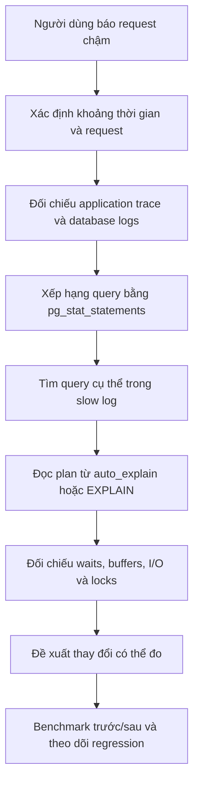

# auto_explain, slow query log và chi phí quan sát PostgreSQL

Hiệu năng PostgreSQL cần được quan sát bằng nhiều lớp dữ liệu: log câu lệnh chậm để biết truy vấn nào vượt ngưỡng, execution plan để hiểu PostgreSQL đã thực thi truy vấn ra sao, và thống kê tổng hợp để tìm workload tiêu tốn tài nguyên theo thời gian. Ba nguồn dữ liệu thường được kết hợp là **slow query log**, **auto_explain** và **pg_stat_statements**.

Mỗi nguồn trả lời một câu hỏi khác nhau:

- Slow query log cho biết câu lệnh nào mất nhiều thời gian và mất bao lâu.
- auto_explain ghi execution plan của câu lệnh đạt điều kiện cấu hình, có thể kèm actual rows, buffers, WAL và thông tin runtime.
- pg_stat_statements tổng hợp thống kê theo query fingerprint để tìm truy vấn có tổng thời gian, số lần gọi, I/O hoặc temporary blocks cao.

Bật quan sát không miễn phí. Logging có thể tăng CPU, I/O, dung lượng đĩa, network traffic, chi phí ingest và rủi ro lộ dữ liệu nhạy cảm. Mục tiêu là thu đủ bằng chứng để chẩn đoán với mức overhead, retention và exposure có thể kiểm soát.

Bài học thuộc chương **Giám sát**, tập trung vào:

- Hiểu slow query logging và các ngưỡng ghi log.
- Cấu hình auto_explain để thu execution plans.
- Phân biệt estimated plan với actual execution statistics.
- Dùng pg_stat_statements để xếp hạng workload.
- Kết hợp logs, plans, waits, buffers, WAL và I/O metrics.
- Đo chi phí quan sát và kiểm soát log volume.
- Bảo vệ query text, bind parameters và thông tin người dùng.
- Thiết kế sampling, retention, rotation, alerting và runbook.

> **Nguyên tắc vận hành:** bắt đầu với câu hỏi quan sát cụ thể, chọn nguồn dữ liệu nhỏ nhất có thể trả lời câu hỏi, đo overhead trên workload đại diện và chỉ mở rộng mức thu thập khi cần. Logging toàn bộ truy vấn hoặc bật actual plan cho mọi câu lệnh có thể làm thay đổi chính workload mà bạn đang cố quan sát.

## 1. Các lớp quan sát truy vấn PostgreSQL

Một hệ thống production thường cần cả số liệu tổng hợp và bằng chứng ở từng lần thực thi. Không có một công cụ duy nhất cung cấp toàn bộ bức tranh.

| Nguồn | Cung cấp | Câu hỏi chính | Chi phí/giới hạn |
| --- | --- | --- | --- |
| Slow query log | Query text và duration theo ngưỡng | Câu lệnh nào vượt thời gian cho phép? | Log volume, parse/ingest, dữ liệu nhạy cảm |
| auto_explain | Execution plan, có thể kèm actual runtime | Vì sao truy vấn chậm? | Instrumentation, plan output lớn, log volume |
| pg_stat_statements | Thống kê tổng hợp theo query fingerprint | Query family nào tiêu tốn nhiều tài nguyên? | Shared memory, tracking overhead, query text/normalization limits |
| pg_stat_activity | Trạng thái session và query đang chạy | Backend nào đang chạy/chờ/bị block? | Snapshot tức thời, query text có thể bị truncate |
| pg_stat_database / pg_stat_io | Counters I/O và hoạt động | Database hoặc loại I/O nào đang tăng? | Counters cần baseline và khoảng thời gian |
| Application tracing | Request, endpoint, correlation ID | Query chậm ảnh hưởng request nào? | Instrumentation và trace storage |
| OS/storage metrics | CPU, memory, disk latency, filesystem | Database chậm do tài nguyên nào? | Cần ghép với database evidence |

### 1.1. Luồng chẩn đoán



Bắt đầu bằng thời gian, database, role, application name và request context. Nếu chỉ có một dòng “query chậm”, rất khó phân biệt plan regression, lock wait, I/O saturation, connection pool queue hoặc một request đặc biệt có dữ liệu lớn.

### 1.2. Estimated plan và actual plan

`EXPLAIN` thông thường hiển thị kế hoạch planner ước lượng. `EXPLAIN ANALYZE` thực thi câu lệnh và bổ sung số liệu thực tế như actual rows, loops và execution time.

Hai loại bằng chứng này trả lời các câu hỏi khác nhau:

- Estimated rows khác actual rows: statistics hoặc cardinality estimation có thể chưa phù hợp.
- Actual time lớn ở một node: node đó tiêu tốn thời gian thực thi, nhưng cần đọc cả loops và dữ liệu đầu vào.
- Buffers read tăng: truy vấn phải đọc pages không nằm sẵn trong shared buffers; điều này không đồng nghĩa tất cả là physical disk reads vì OS cache cũng có vai trò.
- Lock wait dài: thời gian request có thể bị chi phối bởi blocking transaction thay vì plan.
- Temporary blocks tăng: sort/hash có thể spill ra temporary files.

## 2. Slow query log là gì?

Slow query log là cách ghi các câu lệnh đạt ngưỡng thời gian đã cấu hình vào server log. PostgreSQL không có một file riêng mang tên “slow query log”; đây là cách dùng logging settings để ghi các statement chậm.

### 2.1. log_min_duration_statement

Tham số `log_min_duration_statement` xác định thời gian thực thi tối thiểu để một statement được ghi log, đơn vị milliseconds.

| Giá trị | Ý nghĩa |
| --- | --- |
| `-1` | Tắt việc ghi log theo ngưỡng này |
| `0` | Ghi mọi statement hoàn tất |
| `250` | Ghi statement mất ít nhất 250 ms |
| `1000` | Ghi statement mất ít nhất 1 giây |

Ví dụ cấu hình:

```conf
# Ghi các statement mất ít nhất 500 ms
log_min_duration_statement = 500
```

Ngưỡng phải phù hợp với latency target và workload. Với API có mục tiêu p95 200 ms, ngưỡng 5 giây có thể bỏ sót phần lớn truy vấn gây trải nghiệm chậm. Ngược lại, ngưỡng 10 ms trên workload hàng chục nghìn query/giây có thể tạo log volume rất lớn.

### 2.2. Ghi tất cả duration

`log_duration = on` ghi duration của mọi completed statement mà không cần statement vượt ngưỡng. Kết hợp `log_statement` có thể tạo rất nhiều log.

```conf
log_duration = on
```

Dùng khi cần một cửa sổ đo có giới hạn và đã tính log volume. Với workload bình thường, slow threshold hoặc sampling thường dễ vận hành hơn.

### 2.3. log_statement

`log_statement` quyết định loại statement được ghi:

| Giá trị | Ý nghĩa |
| --- | --- |
| `none` | Không ghi statement theo setting này |
| `ddl` | Ghi các DDL statements |
| `mod` | Ghi DDL và các statements sửa dữ liệu |
| `all` | Ghi tất cả statements |

Ví dụ:

```conf
log_statement = 'ddl'
```

`log_statement` ghi câu lệnh theo thời điểm PostgreSQL xử lý statement, trong khi `log_min_duration_statement` ghi duration sau khi statement hoàn tất. Chúng bổ sung nhau. Không nên bật `all` lâu dài chỉ để tìm một query chậm nếu slow logging đã đủ.

### 2.4. log_min_duration_sample và sampling

Các PostgreSQL versions hỗ trợ sampling có thể dùng:

- `log_min_duration_sample`: ngưỡng duration tối thiểu cho các statement được chọn mẫu.
- `log_statement_sample_rate`: xác suất một statement phù hợp được chọn để ghi.

Ví dụ:

```conf
log_min_duration_sample = 200
log_statement_sample_rate = 0.05
```

Cấu hình trên minh họa lấy mẫu 5% các statement đạt ít nhất 200 ms. Kiểm tra sự có mặt và semantics của các tham số trên major version đang chạy.

Sampling hữu ích với workload có tần suất cao. Tuy nhiên, một query hiếm nhưng rất đắt có thể không được lấy mẫu. Có thể kết hợp slow threshold thấp hơn cho query cực chậm với sampling cho nhóm query chậm vừa.

### 2.5. Duration và statement text

Slow log thường hữu ích nhất khi có cả duration và query text. Tuy nhiên, prepared statements và extended query protocol có thể được ghi theo các pha Parse/Bind/Execute với cách biểu diễn khác nhau tùy protocol và version. Khi đối chiếu logs, tránh giả định mỗi log line luôn tương ứng một request HTTP hoặc một lần gọi hàm ứng dụng.

### 2.6. Những gì slow log không giải thích

Một dòng log duration cao chưa cho biết nguyên nhân. Nó không tự nói rõ:

- Node nào trong execution plan tiêu tốn thời gian.
- Query bị chờ lock bao lâu nếu không có thêm lock diagnostics.
- Bao nhiêu shared buffers được hit/read.
- Có sort/hash spill hay không.
- Ước lượng row của planner sai ở đâu.
- Request nào của ứng dụng gọi query.
- Query có thường xuyên chạy hay chỉ xuất hiện một lần.

Dùng slow log để tìm statement cụ thể, sau đó kết hợp auto_explain, pg_stat_statements, pg_stat_activity và tracing.

## 3. Cấu hình slow query logging

Các logging parameters thường được đặt trong `postgresql.conf` hoặc cấu hình managed service. Một số thay đổi có thể reload; một số khác cần restart. Luôn kiểm tra `context`, `pending_restart` và giá trị runtime.

### 3.1. Cấu hình ngưỡng cơ bản

Ví dụ cấu hình thận trọng để bắt đầu:

```conf
log_min_duration_statement = 500
log_statement = 'none'
log_duration = off
log_line_prefix = '%m [%p] db=%d,user=%u,app=%a,client=%r '
```

Trong ví dụ:

- Statement từ 500 ms trở lên được ghi.
- Không ghi mọi statement bằng `log_statement`.
- Không ghi duration của tất cả statements.
- Log prefix thêm timestamp, PID, database, role, application name và client.

Ngưỡng 500 ms chỉ là giá trị lab. Hãy chọn theo SLO, traffic và khả năng ingest của môi trường.

### 3.2. Xem effective settings

```sql
SELECT
    name,
    setting,
    unit,
    source,
    context,
    pending_restart
FROM pg_settings
WHERE name IN (
    'log_min_duration_statement',
    'log_min_duration_sample',
    'log_statement_sample_rate',
    'log_statement',
    'log_duration',
    'log_line_prefix'
)
ORDER BY name;
```

`pg_settings.source` cho biết nguồn của giá trị hiện tại. `pending_restart` giúp phát hiện setting đã được chỉnh nhưng chưa có hiệu lực do cần restart.

### 3.3. Reload configuration

Các logging settings có context reload thường có thể được áp dụng bằng:

```sql
SELECT pg_reload_conf();
```

Lệnh trả về việc gửi yêu cầu reload; hãy kiểm tra PostgreSQL logs và `pg_settings` để xác nhận cấu hình thực sự được nạp. Không giả định mọi setting đều có thể reload.

### 3.4. Cấu hình theo role/database

Một số settings có thể được đặt theo role hoặc database bằng `ALTER ROLE ... SET` hay `ALTER DATABASE ... SET`. Tuy nhiên, logging settings có thể có giới hạn quyền và context riêng; nhiều tham số chỉ được thay đổi bởi superuser hoặc role có quyền phù hợp.

Không dùng role-level settings như một cách mặc định để thu slow logs riêng cho một ứng dụng nếu setting là instance-wide. Có thể lọc downstream bằng `application_name`, role, database hoặc log pipeline.

### 3.5. Đặt application_name

Ứng dụng nên gửi `application_name` có ý nghĩa qua connection string hoặc startup parameters. Ví dụ:

```text
application_name=orders-api
```

Khi đó log prefix `%a` giúp phân biệt `orders-api`, `billing-worker`, migration tool và dashboard session. Tránh đưa user ID, request ID hoặc giá trị có cardinality cao vào application_name; dùng tracing context cho request-level correlation.

## 4. Log prefix và định dạng log

Log prefix quyết định metadata có trong mỗi dòng. Prefix tốt giúp nhóm và điều tra logs mà không cần parse query text.

### 4.1. Các placeholder hữu ích

Một số placeholder thường dùng trong `log_line_prefix`:

| Placeholder | Nội dung |
| --- | --- |
| `%m` | Timestamp có milliseconds |
| `%t` | Timestamp không có milliseconds |
| `%p` | Backend process ID |
| `%c` | Session ID |
| `%l` | Số thứ tự dòng log trong session |
| `%u` | Database user |
| `%d` | Database name |
| `%r` | Remote host và port |
| `%h` | Remote host |
| `%a` | Application name |
| `%e` | SQLSTATE |
| `%x` | Transaction ID |
| `%v` | Virtual transaction ID |
| `%Q` | Query ID nếu được tính và version hỗ trợ |

Ví dụ:

```conf
log_line_prefix = '%m [%p] session=%c line=%l user=%u db=%d app=%a client=%r sqlstate=%e '
```

Placeholder không hỗ trợ hoặc không có giá trị ở một số ngữ cảnh có thể xuất hiện dưới dạng rỗng. Kiểm tra tài liệu PostgreSQL đúng version.

### 4.2. Query ID

Query ID giúp nhóm các query có cùng cấu trúc sau normalization. Trên các phiên bản hỗ trợ, cấu hình `compute_query_id` có thể điều khiển việc tính query identifier:

```conf
compute_query_id = auto
```

Query ID không phải ID nghiệp vụ, không nhất thiết ổn định qua các major versions, thay đổi cấu trúc query hoặc các môi trường khác nhau. Dùng nó như một fingerprint trong phạm vi thống kê/quan sát phù hợp, không dùng làm khóa lưu trữ lâu dài.

### 4.3. log_destination

PostgreSQL hỗ trợ nhiều destinations tùy platform/version, thường gồm:

- `stderr`: ghi ra standard error.
- `csvlog`: log dạng CSV.
- `jsonlog`: log JSON trên các phiên bản hỗ trợ.
- `syslog`: gửi tới syslog trên hệ điều hành hỗ trợ.
- `eventlog`: Windows Event Log trên Windows.

Ví dụ:

```conf
logging_collector = on
log_destination = 'stderr,csvlog'
```

`logging_collector` cần restart khi thay đổi. `csvlog` và `jsonlog` có yêu cầu về collector theo tài liệu version. Managed PostgreSQL có thể chuyển logs qua service logging riêng; kiểm tra chính sách và giao diện của nhà cung cấp.

### 4.4. Structured logs

CSV/JSON logs dễ ingest hơn text khi cần phân tích theo trường. Các trường hữu ích:

- Timestamp và timezone.
- PID/session ID.
- Database, role, application name.
- Client address.
- SQLSTATE và severity.
- Duration.
- Query ID.
- Query text và bind parameters nếu policy cho phép.

Structured logging giảm nhu cầu regex parsing nhưng có thể làm tăng kích thước mỗi record. Chọn fields theo mục tiêu điều tra.

### 4.5. Tránh mất correlation

Dùng timestamp đồng bộ giữa PostgreSQL, application, broker và observability platform. Giữ timezone nhất quán hoặc lưu UTC. Khi cần nối một slow statement với request, kết hợp application trace ID và database session metadata; PostgreSQL không tự biết mọi HTTP request ID.

## 5. auto_explain là gì?

`auto_explain` là PostgreSQL contrib module tự động ghi execution plan của những statement thỏa điều kiện cấu hình. Nó đặc biệt hữu ích khi truy vấn chậm chỉ xảy ra trong production và khó tái hiện thủ công.

Thay vì phải chạy lại query sau khi sự cố đã qua, auto_explain có thể ghi plan ngay tại thời điểm statement được thực thi.

### 5.1. auto_explain ghi gì?

Tùy options, log có thể chứa:

- Plan tree và node types.
- Estimated cost và estimated rows.
- Actual time, rows và loops.
- Shared/local/temp buffer statistics.
- WAL records/bytes/FPI nếu hỗ trợ và được bật.
- Trigger statistics.
- Settings ảnh hưởng plan.
- Verbose output và nested statements.

### 5.2. auto_explain không phải slow log thay thế

Slow log ghi duration statement. auto_explain ghi plan theo điều kiện. Hai nguồn thường được dùng cùng nhau:

- Slow log giúp tìm query và duration.
- auto_explain giúp hiểu plan và actual execution behavior.
- pg_stat_statements cho biết query family có tác động tổng thể ra sao.

Nếu auto_explain không được load hoặc ngưỡng của nó cao hơn query duration, bạn sẽ không có plan cho query đó.

### 5.3. Module có thể load theo session hoặc instance

Trong lab, có thể thử load module trong session nếu file module có sẵn:

```sql
LOAD 'auto_explain';
```

Để load tự động cho các sessions mới, có thể cấu hình `shared_preload_libraries`:

```conf
shared_preload_libraries = 'auto_explain,pg_stat_statements'
```

`shared_preload_libraries` cần restart PostgreSQL. Nếu đã có danh sách thư viện, hãy thêm module vào danh sách hiện tại, không ghi đè các modules đang dùng.

Trên managed service, bật extension/module có thể cần parameter group hoặc thao tác riêng của provider.

## 6. Các tham số auto_explain quan trọng

Các GUC của auto_explain thường có prefix `auto_explain.`. Kiểm tra giá trị và availability trên đúng PostgreSQL version.

### 6.1. auto_explain.log_min_duration

Đây là ngưỡng duration để ghi plan, đơn vị milliseconds.

| Giá trị | Ý nghĩa |
| --- | --- |
| `-1` | Không tự động log plans |
| `0` | Log plan cho mọi statement được xét |
| `500` | Log plan khi statement đạt ít nhất 500 ms |

Ví dụ:

```conf
auto_explain.log_min_duration = '500ms'
```

Có thể dùng `500` theo đơn vị milliseconds hoặc dạng unit string rõ ràng. Bắt đầu với ngưỡng đủ cao để kiểm soát log volume, sau đó điều chỉnh theo SLO.

### 6.2. auto_explain.log_analyze

Khi bật, plan có actual execution statistics:

```conf
auto_explain.log_analyze = on
```

Actual rows, loops và timing giúp tìm sai lệch giữa planner estimate và runtime. Tuy nhiên, instrumentation có thể gây overhead cho statements được theo dõi, kể cả statements cuối cùng không đạt ngưỡng log tùy cách module instrument. Không bật trên toàn workload mà chưa đo.

### 6.3. auto_explain.log_timing

Khi `log_analyze` bật, `log_timing` điều khiển thu thời gian cho từng plan node:

```conf
auto_explain.log_timing = off
```

Tắt timing per-node có thể giảm overhead đo clock trên workload nhiều node/statement. Actual rows và loops vẫn có thể hữu ích, nhưng sẽ không có thời gian chi tiết cho từng node.

### 6.4. auto_explain.log_buffers

Bật buffer statistics:

```conf
auto_explain.log_buffers = on
```

Thông tin buffers cho biết node sử dụng shared/local/temp buffers. Setting này cần actual plan instrumentation theo version; kiểm tra tài liệu và GUC dependencies.

### 6.5. auto_explain.log_wal

Trên các phiên bản hỗ trợ, có thể ghi WAL statistics:

```conf
auto_explain.log_wal = on
```

WAL metrics giúp phát hiện statement ghi lượng WAL lớn. Điều này hữu ích với bulk updates, deletes, inserts và operations tạo index. WAL stats không phải tổng chi phí storage cuối cùng và cần được đọc cùng workload.

### 6.6. auto_explain.log_triggers

Bật ghi thống kê trigger khi có actual execution data:

```conf
auto_explain.log_triggers = on
```

Trigger có thể là phần chi phí đáng kể của một DML statement. Khi bật, log có thể dài hơn.

### 6.7. auto_explain.log_verbose và log_settings

- `auto_explain.log_verbose = on` bổ sung thông tin verbose trong plan.
- `auto_explain.log_settings = on` ghi các planner-related settings khác mặc định có thể ảnh hưởng plan trên các version hỗ trợ.

Verbose/settings có thể giúp giải thích khác biệt giữa môi trường, nhưng tăng log payload. Bật có mục tiêu và kiểm tra output trước khi triển khai rộng.

### 6.8. auto_explain.log_format

Các phiên bản hỗ trợ có thể cho phép các format như `text`, `xml`, `json` hoặc `yaml`:

```conf
auto_explain.log_format = 'json'
```

JSON dễ xử lý tự động, nhưng plan output có thể lớn. Hệ thống ingest cần giữ được cấu trúc lồng nhau, arrays và numeric values. Không giả định mọi version hỗ trợ cùng format.

### 6.9. auto_explain.log_nested_statements

Nếu bật:

```conf
auto_explain.log_nested_statements = on
```

Module có thể ghi plans cho statements được thực thi bên trong functions/procedures hoặc nested execution contexts theo semantics của version. Điều này giúp tìm query ẩn bên trong PL/pgSQL nhưng có thể tăng mạnh log volume.

### 6.10. auto_explain.sample_rate

Sampling plan output:

```conf
auto_explain.sample_rate = 0.1
```

Ví dụ 0.1 tương đương 10% statements được chọn mẫu. Sampling giúp kiểm soát output volume; không bảo đảm bắt được mọi query hiếm hoặc spike ngắn.

### 6.11. auto_explain.log_level

`auto_explain.log_level` điều khiển severity của plan log, thường dùng mức LOG hoặc DEBUG phù hợp với logging pipeline. Không hạ severity quá thấp nếu hệ thống log filter bỏ qua các mức đó.

## 7. Một cấu hình auto_explain thận trọng

Cấu hình dưới đây là ví dụ khởi đầu cho môi trường cần quan sát query chậm, không phải một preset áp dụng cho mọi production:

```conf
# Cần thêm module vào shared_preload_libraries và restart
shared_preload_libraries = 'auto_explain,pg_stat_statements'

# Chỉ log plan của statement chậm
auto_explain.log_min_duration = '750ms'

# Actual rows và loops hữu ích khi tìm cardinality error
auto_explain.log_analyze = on

# Giảm overhead per-node timing
auto_explain.log_timing = off

# Thêm buffer evidence
auto_explain.log_buffers = on

# Không bật WAL/trigger/verbose/nested cho đến khi có nhu cầu
auto_explain.log_wal = off
auto_explain.log_triggers = off
auto_explain.log_verbose = off
auto_explain.log_nested_statements = off

# Giới hạn số plans được ghi
auto_explain.sample_rate = 0.25
```

Trước khi dùng cấu hình này, xác nhận GUC có trên major version đang chạy và các option dependencies. Bật `log_analyze` cần được benchmark trên workload đại diện; nếu overhead vẫn cao, tắt actual analysis hoặc tăng threshold/sample rate.

### 7.1. Kiểm tra GUC auto_explain

Sau khi module được load:

```sql
SELECT
    name,
    setting,
    unit,
    source,
    context,
    pending_restart
FROM pg_settings
WHERE name LIKE 'auto_explain.%'
ORDER BY name;
```

Nếu query không trả rows, module có thể chưa được load hoặc GUC không có trên version hiện tại. Kiểm tra server startup logs và module installation.

### 7.2. Bật module trong lab

```sql
LOAD 'auto_explain';

SET auto_explain.log_min_duration = 0;
SET auto_explain.log_analyze = on;
SET auto_explain.log_timing = off;
SET auto_explain.log_buffers = on;
```

`SET` trong session lab chỉ áp dụng session đó và cần module đã load. Không dùng threshold 0 trong workload production vì nó có thể tạo plan cho mọi statement.

## 8. Đọc execution plan từ auto_explain

Execution plan là cây các operations mà PostgreSQL chọn để thực thi statement. Đọc plan từ trên xuống và liên hệ từng node với rows, loops, buffers và thời gian.

### 8.1. Ví dụ plan

Một plan minh họa:

```text
Limit  (cost=0.42..18.10 rows=20 width=48)
       (actual rows=20 loops=1)
  ->  Index Scan using orders_customer_created_idx on orders
        (cost=0.42..1800.00 rows=2000 width=48)
        (actual rows=20 loops=1)
        Index Cond: (customer_id = 42)
        Buffers: shared hit=15 read=3
Planning Time: 0.250 ms
Execution Time: 1.800 ms
```

Plan cho thấy PostgreSQL dùng index scan, trả 20 rows và có một số shared buffers hit/read. Đây chỉ là ví dụ minh họa, không phải output cố định của mọi version.

### 8.2. Estimated rows và actual rows

So sánh:

- `rows` trong cost estimate là số rows planner dự kiến node trả về.
- `actual rows` là số rows thực tế trung bình mỗi loop theo cách EXPLAIN hiển thị.
- Sai lệch lớn có thể làm planner chọn join order hoặc scan type không phù hợp.

Ví dụ estimate 10 rows nhưng actual 100.000 rows có thể cho thấy statistics thiếu, correlation không được mô hình hóa hoặc predicate khó ước lượng.

### 8.3. loops

`loops` là số lần node được thực thi. Một node chỉ mất 0.2 ms mỗi lần nhưng chạy 100.000 lần có thể là bottleneck.

Khi đọc `actual time` và `actual rows`, cần hiểu giá trị trong ngữ cảnh loops. Tổng work không chỉ là một con số per-loop.

### 8.4. Cost không phải milliseconds

`cost=...` là đơn vị cost tương đối của planner, không phải thời gian thực. Cost dùng để so sánh plan alternatives dưới các cost parameters hiện tại.

Không kết luận query mất 18 ms chỉ vì plan có `cost=18.10`.

### 8.5. Planning Time và Execution Time

- Planning Time là thời gian lập kế hoạch.
- Execution Time là thời gian thực thi được báo bởi EXPLAIN ANALYZE.
- Slow log duration có thể bao gồm các phần xử lý protocol/statement khác nhau theo context; không luôn bằng Execution Time trong plan.

Nếu Planning Time lớn, xem query complexity, partition count, join count, prepared statement behavior và planning statistics.

## 9. EXPLAIN ANALYZE và những lưu ý an toàn

Có thể tái hiện query chậm trong lab hoặc môi trường được kiểm soát bằng:

```sql
EXPLAIN (ANALYZE, BUFFERS, VERBOSE)
SELECT order_id, created_at, total_amount
FROM app.orders
WHERE customer_id = 42
ORDER BY created_at DESC
LIMIT 50;
```

### 9.1. EXPLAIN ANALYZE thực thi query

Đây là khác biệt quan trọng: `EXPLAIN ANALYZE` chạy statement thật. Với SELECT, nó thực thi truy vấn và đo runtime. Với INSERT/UPDATE/DELETE, dữ liệu có thể bị thay đổi.

Một transaction rollback có thể giúp thử DML:

```sql
BEGIN;
EXPLAIN (ANALYZE, BUFFERS)
UPDATE app.orders
SET status = 'review'
WHERE order_id = 1001;
ROLLBACK;
```

Nhưng rollback không đảo ngược mọi side effects. Sequence advancement, external effects từ functions, notifications, calls tới hệ thống ngoài hoặc side effects không transactional có thể vẫn xảy ra. Chỉ chạy khi đã hiểu statement và môi trường.

### 9.2. BUFFERS

`BUFFERS` cung cấp page counters như:

- `shared hit`: page đã có trong shared buffers.
- `shared read`: page được đọc vào shared buffers.
- `shared dirtied`: page bị thay đổi.
- `shared written`: page được ghi từ shared buffers.
- `temp read/written`: temporary blocks được đọc/ghi.
- `local`: buffers của temporary tables khi áp dụng.

`shared read` không nhất thiết đồng nghĩa physical disk read vì OS cache có thể phục vụ. Đọc buffer counters cùng OS/storage metrics.

### 9.3. WAL

Trên các versions hỗ trợ, `EXPLAIN (ANALYZE, WAL)` bổ sung WAL records, full-page images và bytes. Hữu ích cho DML nặng hoặc index creation.

```sql
EXPLAIN (ANALYZE, BUFFERS, WAL)
UPDATE app.orders
SET status = 'archived'
WHERE created_at < timestamptz '2024-01-01 00:00:00+00';
```

Câu lệnh này thực thi UPDATE thật. Chỉ dùng trong lab hoặc test environment có dữ liệu có thể thay đổi.

### 9.4. SETTINGS

Trên các versions hỗ trợ, `EXPLAIN (SETTINGS)` hiển thị các planner settings khác giá trị mặc định có thể ảnh hưởng plan. Đây là bằng chứng hữu ích khi môi trường source/target có cấu hình khác nhau.

### 9.5. TIMING

`TIMING` điều khiển đo thời gian cho từng node. Nếu cần giảm overhead, có thể tắt timing chi tiết trong khi vẫn lấy actual row counts:

```sql
EXPLAIN (ANALYZE, BUFFERS, TIMING OFF)
SELECT count(*)
FROM app.orders
WHERE status = 'pending';
```

Tắt timing không loại bỏ mọi overhead của ANALYZE; statement vẫn được thực thi và instrumented.

## 10. pg_stat_statements: nhìn workload tổng thể

`pg_stat_statements` thu thập thống kê planning/execution của các normalized query statements. Nó giúp tìm query family có tổng thời gian lớn, gọi quá thường xuyên hoặc tạo I/O/temp activity đáng kể.

### 10.1. Cài đặt extension

Module cần được preload:

```conf
shared_preload_libraries = 'pg_stat_statements'
```

Nếu đã có `auto_explain` hoặc modules khác, giữ danh sách đầy đủ. Thay đổi cần restart PostgreSQL.

Sau khi module được load, tạo extension trong từng database cần truy vấn view:

```sql
CREATE EXTENSION IF NOT EXISTS pg_stat_statements;
```

### 10.2. Tham số chính

| Setting | Vai trò |
| --- | --- |
| `pg_stat_statements.max` | Số query entries tối đa được giữ |
| `pg_stat_statements.track` | Phạm vi statement được theo dõi |
| `pg_stat_statements.track_utility` | Có theo dõi utility commands hay không |
| `pg_stat_statements.track_planning` | Có thu planning statistics hay không |
| `pg_stat_statements.save` | Lưu thống kê qua shutdown/restart theo behavior của version |

`pg_stat_statements.track` thường có các giá trị `top`, `all` hoặc `none`. Một số tham số và semantics thay đổi theo version.

`track_planning` có thể tăng overhead khi planning diễn ra thường xuyên. Chỉ bật nếu câu hỏi cần planning time/calls.

### 10.3. Top queries theo tổng execution time

Ví dụ trên các versions có cột `total_exec_time`:

```sql
SELECT
    queryid,
    calls,
    round(total_exec_time::numeric, 2) AS total_exec_ms,
    round(mean_exec_time::numeric, 2) AS mean_exec_ms,
    rows,
    shared_blks_hit,
    shared_blks_read,
    temp_blks_read,
    temp_blks_written,
    left(query, 500) AS query_sample
FROM pg_stat_statements
ORDER BY total_exec_time DESC
LIMIT 20;
```

Đây là cách tìm query có tổng thời gian cao. Một query chạy 1 ms nhưng 10 triệu lần có thể tiêu tốn nhiều CPU hơn query 10 giây chỉ chạy một lần.

### 10.4. Top queries theo mean time

```sql
SELECT
    queryid,
    calls,
    round(mean_exec_time::numeric, 2) AS mean_exec_ms,
    round(max_exec_time::numeric, 2) AS max_exec_ms,
    rows,
    left(query, 500) AS query_sample
FROM pg_stat_statements
WHERE calls > 0
ORDER BY mean_exec_time DESC
LIMIT 20;
```

Mean có thể bị chi phối bởi một số outliers và không cho biết percentile. Kết hợp histogram/tracing hoặc slow log để tìm tail latency.

### 10.5. Query gọi quá thường xuyên

```sql
SELECT
    queryid,
    calls,
    round(total_exec_time::numeric, 2) AS total_exec_ms,
    round(mean_exec_time::numeric, 3) AS mean_exec_ms,
    rows,
    left(query, 400) AS query_sample
FROM pg_stat_statements
ORDER BY calls DESC
LIMIT 20;
```

Nhiều lần gọi query nhỏ có thể phản ánh N+1 query pattern hoặc chatty application. Giảm round trips có thể cải thiện latency và connection utilization ngay cả khi từng query rất nhanh.

### 10.6. Temporary blocks

```sql
SELECT
    queryid,
    calls,
    temp_blks_read,
    temp_blks_written,
    round(total_exec_time::numeric, 2) AS total_exec_ms,
    left(query, 400) AS query_sample
FROM pg_stat_statements
ORDER BY temp_blks_written DESC
LIMIT 20;
```

Temporary blocks có thể chỉ ra sort/hash spill, materialization hoặc query xử lý lượng dữ liệu lớn. Xem execution plan và `work_mem` theo workload; không tăng `work_mem` toàn instance một cách máy móc vì mỗi operation/connection có thể tiêu thụ memory riêng.

### 10.7. I/O time và buffers

Trên các versions cung cấp các cột tương ứng:

```sql
SELECT
    queryid,
    calls,
    shared_blks_hit,
    shared_blks_read,
    blk_read_time,
    blk_write_time,
    round(total_exec_time::numeric, 2) AS total_exec_ms,
    left(query, 400) AS query_sample
FROM pg_stat_statements
ORDER BY shared_blks_read DESC
LIMIT 20;
```

`blk_read_time`/`blk_write_time` chỉ có ý nghĩa khi I/O timing được thu thập. Cần kiểm tra `track_io_timing` và version. Counters là tích lũy kể từ lần reset hoặc entry lifecycle, không phải rate tức thời.

### 10.8. Query fingerprint và query text

`pg_stat_statements` nhóm các câu lệnh tương tự sau normalization. Literals thường được thay bằng parameters trong normalized representation. Điều này giảm số entries nhưng có thể che mất sự khác biệt giữa một giá trị hiếm và một giá trị phổ biến.

Một query ID có thể thay đổi theo version, schema, object identity hoặc cấu hình. Không dùng queryid như stable identifier xuyên nhiều cluster/major upgrades.

### 10.9. Reset statistics

Có thể reset bằng function:

```sql
SELECT pg_stat_statements_reset();
```

Reset làm mất baseline tích lũy. Trước khi reset, export/capture số liệu và ghi thời điểm. Chỉ reset khi có mục đích rõ ràng, ví dụ bắt đầu một measurement window sau deploy; không reset để làm dashboard “đẹp hơn”.

## 11. Kết hợp slow log, auto_explain và pg_stat_statements

Ba nguồn bổ trợ nhau. Một quy trình điều tra có thể như sau:

1. Dùng dashboard pg_stat_statements tìm queryid có total time hoặc calls tăng bất thường.
2. Lọc slow logs theo thời gian, database, role, app và query text.
3. Tìm auto_explain plan tương ứng, chú ý query fingerprint và parameter values nếu được ghi.
4. Kiểm tra estimated rows/actual rows, loops, buffers, temp blocks và WAL.
5. Đối chiếu pg_stat_activity hoặc lock logs nếu query chậm do waiting.
6. Dùng application trace để nối query với endpoint/request.
7. Đề xuất thay đổi và đo lại trên workload tương đương.

### 11.1. Ví dụ tình huống

Một endpoint /orders có p95 tăng từ 150 ms lên 2 giây. Dashboard cho thấy query lấy orders theo customer có total execution time tăng. Slow log ghi một số lần chạy mất hơn 1 giây. auto_explain cho thấy:

- Planner ước lượng 20 rows.
- Actual result có 80.000 rows.
- Nested Loop lặp nhiều lần.
- Buffers read cao.
- Một predicate filter xuất hiện sau join.

Điều tra tiếp statistics, index, predicate và data distribution. Có thể cần ANALYZE, index phù hợp hoặc rewrite query. Không thêm index chỉ dựa trên một plan; kiểm tra write overhead và các query khác dùng cùng table.

### 11.2. Query plan và parameters

Một prepared query có thể có plan khác nhau tùy generic/custom plan behavior và parameter distribution. Nếu log chỉ cho query text normalized, có thể thiếu giá trị parameter gây chậm.

Có thể dùng controlled reproduction với parameter đại diện, nhưng không bật bind-parameter logging toàn hệ thống nếu có dữ liệu nhạy cảm. Cân nhắc tracing ở application hoặc một test session được kiểm soát.

## 12. Quan sát waits và blocking

Query chậm có thể đang chờ lock, I/O hoặc một resource khác. Execution plan một mình không giải thích toàn bộ wall-clock time.

### 12.1. Xem active sessions

```sql
SELECT
    pid,
    usename,
    datname,
    application_name,
    client_addr,
    state,
    wait_event_type,
    wait_event,
    clock_timestamp() - query_start AS query_age,
    left(query, 500) AS query_sample
FROM pg_stat_activity
WHERE state <> 'idle'
ORDER BY query_start NULLS LAST;
```

`query_age` tính từ query_start, không nhất thiết bằng thời gian CPU. Nếu backend đang chờ lock, wall time có thể tăng mà CPU không tăng tương ứng.

### 12.2. Tìm blockers

```sql
SELECT
    a.pid AS blocked_pid,
    a.usename AS blocked_user,
    a.wait_event_type,
    a.wait_event,
    pg_blocking_pids(a.pid) AS blocking_pids,
    left(a.query, 300) AS blocked_query
FROM pg_stat_activity AS a
WHERE cardinality(pg_blocking_pids(a.pid)) > 0
ORDER BY a.query_start;
```

Sau đó truy vấn các PIDs trong `blocking_pids` để xem transaction và session gây block. Không terminate backend chỉ dựa trên một dòng monitoring; xác định transaction owner và tác động trước.

### 12.3. log_lock_waits

Có thể bật:

```conf
log_lock_waits = on
deadlock_timeout = '1s'
```

Khi lock wait vượt `deadlock_timeout`, PostgreSQL ghi thông tin lock wait theo semantics của setting. `deadlock_timeout` cũng liên quan thời điểm kiểm tra deadlock; thay đổi có thể ảnh hưởng overhead. Chọn ngưỡng dựa trên latency target và workload.

### 12.4. Wait events

`wait_event_type` và `wait_event` giúp phân loại session đang chờ. Một backend có `state = active` vẫn có thể đang chờ một resource. Không đồng nhất “active” với “đang dùng CPU”.

## 13. Các logging settings bổ sung để chẩn đoán

Ngoài slow query log và auto_explain, một số settings giúp tìm nguyên nhân phụ trợ.

### 13.1. Temporary files

```conf
log_temp_files = 0
```

Giá trị 0 ghi mọi temporary file bị xóa; giá trị dương ghi files từ ngưỡng bytes; -1 tắt. Logging tất cả temp files có thể tạo volume cao, nên bắt đầu với ngưỡng phù hợp.

### 13.2. I/O timing

```conf
track_io_timing = on
```

Setting này cho phép thu timing I/O trong các thống kê hỗ trợ. Nó có thể có chi phí đo clock tùy platform. Benchmark trước khi bật toàn instance.

### 13.3. Checkpoints và WAL

Các checkpoint/WAL logs giúp hiểu write pressure và checkpoint behavior. Một số settings có thể ghi checkpoint statistics theo version, ví dụ `log_checkpoints`.

Không quy mọi query chậm cho query plan nếu hệ thống đồng thời có checkpoint bursts, WAL pressure hoặc storage latency.

### 13.4. Deadlocks

Deadlock được PostgreSQL phát hiện và log. Kết hợp SQLSTATE, lock wait logs và application retry metrics để xác định deadlock frequency và affected transactions.

### 13.5. Error verbosity

`log_error_verbosity` điều khiển mức detail của error logs (`terse`, `default`, `verbose`). Mức verbose có thể hữu ích khi debug nhưng làm log dài hơn và có thể chứa thông tin nội bộ.

## 14. Chi phí quan sát: CPU và latency

Observability có thể tác động tới workload theo nhiều đường.

### 14.1. Slow logging overhead

Mỗi statement được chọn cần format log record và gửi qua logging pipeline. Khi query rate cao, logging có thể tăng CPU, memory copy, context switching và I/O.

Nếu collector hoặc sink không theo kịp, logging có thể ảnh hưởng latency. Không giả định log output luôn miễn phí vì nó chạy ở background.

### 14.2. auto_explain instrumentation

`log_analyze` cần thu actual execution information. Instrumentation ở từng plan node có thể tạo overhead, nhất là với query rất ngắn nhưng có nhiều nodes/loops.

`log_timing = off` giảm phần chi phí đo thời gian per-node, nhưng vẫn còn overhead thu actual rows/loops. Sampling và threshold có thể giảm số plan được ghi; hãy đo trên workload tương tự production.

### 14.3. pg_stat_statements tracking

`pg_stat_statements` cập nhật shared statistics cho các statements được theo dõi. Chi phí phụ thuộc số query entries, concurrency, tracking scope và planning tracking. Một workload nhiều câu lệnh độc nhất có thể làm tăng churn trong hash table.

### 14.4. I/O timing

`track_io_timing` đo thời gian I/O bằng cơ chế clock của hệ điều hành. Tác động khác nhau theo platform và clock implementation. Kiểm tra CPU cost trước/sau.

### 14.5. Tracing và instrumentation trùng lặp

Nếu application tracing đã ghi mọi SQL span, database slow logs và external query monitoring cùng thu toàn bộ statements, hệ thống có thể trả chi phí ingest nhiều lần cho cùng một dữ liệu.

Định nghĩa rõ nguồn nào là source of truth cho latency request, query fingerprint và database execution evidence.

## 15. Chi phí log volume, storage và ingest

Log volume có thể trở thành vấn đề vận hành trước khi CPU overhead trở nên rõ ràng.

### 15.1. Công thức ước tính

Một ước tính đơn giản:

```text
daily_bytes ≈ logged_statements_per_second
             × average_record_bytes
             × 86,400
```

Ví dụ: 10 statements/giây, trung bình 1.200 bytes/record:

```text
10 × 1,200 × 86,400
= 1,036,800,000 bytes/day
≈ 0.97 GiB/day
```

Đây mới là query log. Plan logs có thể lớn hơn nhiều vì chứa nhiều nodes và buffer lines. Compression có thể giảm storage nhưng không loại bỏ network/CPU ingest cost.

### 15.2. Log volume theo query rate

| Query rate | Sampling/log rate | Average record | Volume gần đúng/ngày |
| --- | --- | --- | --- |
| 100/s | 1% = 1/s | 1 KB | 84 MB |
| 1.000/s | 1% = 10/s | 1 KB | 0.8 GiB |
| 5.000/s | 1% = 50/s | 1 KB | 4.0 GiB |
| 1.000/s | 100% = 1.000/s | 1 KB | 80.5 GiB |

Các con số chỉ để ước tính, dùng đơn vị gần đúng và chưa tính metadata, compression, replicas, indexes hoặc retention overhead. Thay bằng traffic thực tế và kích thước record đo được.

### 15.3. Plan logs

Plan output có thể từ vài KB đến hàng trăm KB tùy query complexity, nested statements, verbose output và số relation. Bật `auto_explain.log_analyze` cho mọi statement có thể khiến plan logs vượt xa slow log volume.

Đo average/p95 plan size trong lab trước khi chọn sample rate.

### 15.4. Retention cost

Tổng dung lượng phụ thuộc:

```text
retained_storage ≈ daily_ingested_bytes × retention_days
```

Cần tính thêm replication factor, index storage, object storage versions, compression ratio và backup policy của log platform.

### 15.5. Ingestion cost

Một số observability services tính phí theo GB ingest, indexed data, retention hoặc query volume. Log statement quá rộng có thể làm chi phí tăng tuyến tính với query rate.

Theo dõi ingest bytes/day, indexed bytes/day, dropped events, parser errors và retention consumption như các metrics vận hành.

## 16. Chi phí và rủi ro dữ liệu nhạy cảm

Query logs và execution plans có thể chứa thông tin nhạy cảm.

### 16.1. Query text

SQL literal có thể chứa:

- Email, số điện thoại, địa chỉ.
- Customer identifiers.
- Payment references.
- Token hoặc secret bị ứng dụng đưa nhầm vào SQL.
- Nội dung tìm kiếm hoặc thông tin cá nhân.

Không giả định mọi query text đều vô hại.

### 16.2. Bind parameters

Bind parameters có thể chứa dữ liệu không xuất hiện trong normalized query text. PostgreSQL có các settings liên quan đến log bind parameters trên các versions hỗ trợ, ví dụ `log_parameter_max_length` và `log_parameter_max_length_on_error`.

Kiểm tra giá trị mặc định và semantics của version trước khi thay đổi. Để giữ dữ liệu an toàn, tránh bật full bind-parameter logging toàn instance trừ khi đã có data classification, access control và retention policy rõ ràng.

### 16.3. Execution plan cũng có thể tiết lộ metadata

Plan có thể lộ schema/table names, predicates, partition names, function names và object structure. Đây là thông tin nội bộ cần giới hạn quyền truy cập.

### 16.4. Redaction

Có thể redact tại application, proxy hoặc log pipeline, nhưng regex redaction không bảo đảm hiểu mọi SQL syntax. Ưu tiên không ghi secrets vào SQL literals, giới hạn bind parameter logging và áp dụng access controls.

### 16.5. Access control

Chỉ nhóm vận hành/DBA và người cần điều tra mới nên đọc raw SQL logs. Tách quyền dashboard tổng hợp khỏi quyền xem raw query text. Audit truy cập logs theo policy.

## 17. Log rotation, retention và vận chuyển

Ghi log mà không có retention plan có thể làm đầy disk hoặc làm mất dữ liệu quan sát quan trọng.

### 17.1. Logging collector

Nếu dùng logging collector:

```conf
logging_collector = on
log_directory = 'log'
log_filename = 'postgresql-%Y-%m-%d_%H%M%S.log'
log_rotation_age = '1d'
log_rotation_size = '100MB'
log_truncate_on_rotation = off
```

`logging_collector` cần restart để bật. Rotation age/size chỉ tạo file mới; không tự xóa mọi file cũ theo retention policy.

### 17.2. log_truncate_on_rotation

Khi bật, PostgreSQL có thể truncate file khi mở lại tên file đã tồn tại theo điều kiện rotation. Cần hiểu naming pattern và nguy cơ overwrite. Thông thường dùng timestamp trong filename và để retention manager xử lý file cũ.

### 17.3. External log shipping

Có thể ship logs tới centralized logging platform, syslog, sidecar hoặc managed service. Đảm bảo:

- Có buffering và retry.
- Không làm block database do sink chậm ngoài dự kiến.
- Có disk buffer capacity.
- Có alert khi shipper dừng.
- Có kiểm soát duplicate và ordering.
- Có encryption và access control.

### 17.4. Retention

Retention phụ thuộc compliance, incident investigation window và storage budget. Tách retention raw logs với aggregate metrics. Query fingerprints/percentiles có thể cần giữ lâu hơn raw SQL text.

### 17.5. Disk alerts

Theo dõi filesystem chứa logs và `pg_wal` riêng. Log volume và WAL retention là hai nguồn tăng disk khác nhau; đừng để chúng dùng chung một budget không có cảnh báo.

## 18. Sampling strategy

Sampling giảm chi phí nhưng có thể bỏ sót sự kiện. Thiết kế sampling theo mục tiêu.

### 18.1. Threshold trước, sampling sau

Một chiến lược phổ biến:

- Ghi mọi query cực chậm trên một threshold cao.
- Lấy mẫu các query chậm vừa.
- Dùng pg_stat_statements cho thống kê tổng hợp.
- Chỉ bật actual plans khi cần chẩn đoán.

Ví dụ minh họa:

```conf
log_min_duration_statement = 2000
log_min_duration_sample = 300
log_statement_sample_rate = 0.05

auto_explain.log_min_duration = '1500ms'
auto_explain.sample_rate = 0.1
```

Giá trị thực tế cần dựa trên SLO, query rate và log budget.

### 18.2. Tail latency

Query hiếm nhưng rất chậm có thể bị sampling bỏ qua. Với các câu lệnh vượt ngưỡng blocker, cân nhắc ghi 100% slow events trong một khoảng hẹp nếu volume vẫn kiểm soát được.

### 18.3. Stratified sampling

Nếu workload có nhiều applications/databases, sampling toàn cục có thể khiến workload lớn lấn át workload nhỏ. Có thể phân loại ở log pipeline theo app/database/role và đặt budget riêng.

### 18.4. Adaptive sampling

Một số observability pipelines có thể tăng sampling khi latency/errors vượt ngưỡng và giảm khi ổn định. Nếu áp dụng, cần bảo đảm policy không tạo feedback loop làm ingest tăng đúng lúc hệ thống quá tải.

## 19. Correlate query logs với application tracing

Database logs cho biết statement. Application tracing cho biết statement đó ảnh hưởng request nào.

### 19.1. Application name

Đặt `application_name` theo service/component:

```text
orders-api
billing-worker
reporting-job
migration-runner
```

Tránh dùng mỗi request ID làm application_name vì giá trị này thay đổi liên tục và tạo cardinality cao.

### 19.2. Trace ID

Dùng tracing framework để lưu trace/span IDs ở application logs. Có thể đặt metadata session-level qua `SET`/`set_config` nếu có thiết kế và quyền phù hợp, nhưng phải tránh connection pool rò rỉ session context giữa requests.

### 19.3. Connection pooling

Với transaction pooling, session state không tồn tại ổn định giữa transactions. Nếu đặt application_name, custom GUC hoặc tracing context bằng session-level SET, cần hiểu pooler reset behavior. Dùng transaction-local context khi phù hợp.

### 19.4. Query fingerprint

Kết hợp queryid/normalized SQL với span name để tìm query family. Đừng dùng raw SQL hoặc literal parameter làm metric label vì cardinality và data exposure.

## 20. Phân tích plan regression

Một query có thể chậm đột ngột dù SQL không đổi vì statistics, data distribution, index state hoặc configuration thay đổi.

### 20.1. Những nguyên nhân thường gặp

- `ANALYZE` chưa cập nhật statistics.
- Data distribution hoặc skew thay đổi.
- Index bị drop, invalid hoặc không còn phù hợp.
- Partition pruning không xảy ra.
- Parameter values khác nhau làm plan không phù hợp.
- `work_mem` gây spill.
- Join cardinality estimates sai.
- Table bloat hoặc cache state thay đổi.
- Lock contention hoặc I/O saturation.
- PostgreSQL upgrade thay đổi planner behavior.

### 20.2. So sánh plan theo cùng điều kiện

Khi so source/before với target/after:

- Dùng cùng parameter values đại diện.
- Cố gắng dùng cùng dataset hoặc data distribution.
- Ghi server version và relevant settings.
- Ghi statistics state.
- So buffers, rows, loops và execution time.
- Tách warm-cache và cold-cache measurements.
- Chạy đủ lần để tránh kết luận từ một outlier.

### 20.3. Estimated rows lệch nhiều

Nếu actual rows khác estimate lớn, kiểm tra:

```sql
ANALYZE app.orders;
```

Nếu predicate liên quan nhiều columns có correlation, cân nhắc extended statistics:

```sql
CREATE STATISTICS orders_customer_status_stats
    (dependencies, mcv, ndistinct)
ON customer_id, status
FROM app.orders;

ANALYZE app.orders;
```

Đây là ví dụ cần đánh giá bằng query plan và workload. Không tạo extended statistics cho mọi cặp columns mà không có bằng chứng.

### 20.4. Index không phải luôn là đáp án

Index có thể giảm reads nhưng tăng write amplification, WAL, storage, vacuum work và cache pressure. Xem query workload tổng thể bằng pg_stat_statements trước khi thêm index.

## 21. Query logging trong môi trường nhiều tenants

Trong hệ thống multi-tenant, query logs có thể chứa tenant IDs và tạo cardinality lớn.

### 21.1. Tránh tenant ID làm metric label

Không đưa mỗi tenant ID vào metric label hoặc dashboard series. Dùng aggregation, top-k reports hoặc controlled log fields.

### 21.2. Tenant-specific diagnostics

Nếu cần điều tra tenant cụ thể, dùng access-controlled query/log search trong một incident window. Có thể kết hợp application tracing và audit logs.

### 21.3. Fairness và workload isolation

Một tenant có thể tạo nhiều slow queries và chiếm log budget. Đặt quota, workload classes hoặc app-level throttling nếu cần. Quan sát query volume theo tenant ở tầng application nơi có identity rõ ràng.

## 22. Managed PostgreSQL và khác biệt cấu hình

Trên managed database, một số tham số có thể được cấu hình qua parameter groups hoặc console thay vì trực tiếp sửa file.

### 22.1. Kiểm tra extension/module allowlist

Provider có thể giới hạn `shared_preload_libraries` hoặc chỉ cho phép một tập module nhất định. Xác minh module availability trước khi thiết kế monitoring.

### 22.2. Log export

Managed service thường cung cấp log export tới provider logging service hoặc object storage. Kiểm tra:

- Log types được hỗ trợ.
- Export delay.
- Retention.
- Pricing.
- Encryption.
- Access control.
- Có xuất auto_explain/CSV/JSON logs hay không.

### 22.3. Parameter groups

Một thay đổi có thể pending reboot hoặc apply immediately. Đọc trạng thái rollout và xác nhận `pg_settings` sau khi apply.

### 22.4. Không giả định filesystem access

Không phải managed PostgreSQL nào cũng cho phép đọc trực tiếp `log_directory` hoặc shell vào host. Dùng provider log interface và metrics được hỗ trợ.

## 23. Thiết kế dashboard và alert

Dashboard cần hỗ trợ phát hiện xu hướng và điều tra, không chỉ hiển thị thật nhiều charts.

### 23.1. Dashboard query performance

Các panel hữu ích:

- Top query families theo total execution time.
- Top queries theo mean/max time.
- Calls/second và rows/call.
- Shared blocks read/hit.
- Temporary blocks written.
- Planning vs execution time.
- Slow query count theo threshold.
- p50/p95/p99 từ tracing nếu có.
- Lock wait duration/count.
- Query errors và cancellations.

### 23.2. Dashboard logging cost

Theo dõi:

- Log bytes/second và bytes/day.
- Plan log count và average size.
- Collector/shipper queue depth.
- Log ingestion bytes.
- Parser errors/dropped events.
- Disk free cho log filesystem.
- Retention usage và estimated monthly cost.

### 23.3. Alert có hành động rõ ràng

| Alert | Trigger minh họa | Hành động |
| --- | --- | --- |
| Slow query spike | Count vượt baseline trong 5 phút | Xem query fingerprints và deploy timeline |
| Query total time tăng | Top query tăng mạnh so với baseline | Mở plan và buffers |
| Temp spill tăng | Temp blocks/files vượt ngưỡng | Kiểm tra sort/hash và memory |
| Lock wait spike | Lock waits vượt latency budget | Tìm blocker và transaction owner |
| Log disk low | Free space dưới safety threshold | Giảm log volume/ship/rotate theo runbook |
| Log shipper lag | Queue age tăng | Kiểm tra collector và sink |
| Plan log burst | Plan records tăng đột ngột | Kiểm tra threshold/sample/config change |

Ngưỡng phải được hiệu chỉnh theo baseline và business SLO. Tránh alert chỉ dựa trên một query chậm duy nhất nếu không có impact rõ ràng.

## 24. Rollout an toàn cho auto_explain và slow logging

Không bật tất cả settings cùng lúc trên toàn cluster. Triển khai theo giai đoạn để biết phần nào tạo overhead.

### 24.1. Giai đoạn 1 — Baseline

Ghi nhận trước thay đổi:

- QPS và transaction rate.
- CPU, memory và disk latency.
- p95/p99 request latency.
- Query counts và pg_stat_statements totals.
- Log bytes/day hiện tại.
- WAL generation rate.
- Connection count và wait events.

### 24.2. Giai đoạn 2 — Slow threshold

Bật `log_min_duration_statement` ở ngưỡng đủ cao. Đo log bytes/day, CPU và latency. Kiểm tra query text exposure.

### 24.3. Giai đoạn 3 — pg_stat_statements

Preload module, restart theo kế hoạch và tạo extension. Thu baseline thống kê, xác định top query families. Theo dõi shared memory và tracking overhead.

### 24.4. Giai đoạn 4 — auto_explain có sampling

Bật plan logging ở threshold cao, sample rate thấp và `log_timing = off` khi actual analysis cần thiết. Quan sát plan volume và database latency.

### 24.5. Giai đoạn 5 — Mở rộng có mục tiêu

Nếu cần, bật buffers/WAL/triggers/nested statements trong một cửa sổ hoặc trên workload cụ thể. Đánh giá lại overhead và bảo mật trước khi giữ lâu dài.

### 24.6. Rollback cấu hình

Ghi lại giá trị cũ, cách reload/restart và người chịu trách nhiệm. Nếu latency hoặc log volume tăng quá budget, tắt instrumentation nặng trước, giữ lại các nguồn tổng hợp ít tốn kém hơn.

## 25. Ví dụ cấu hình lab đầy đủ

Cấu hình minh họa dưới đây cần được điều chỉnh theo major version:

```conf
# Logging
log_min_duration_statement = 500
log_statement = 'none'
log_duration = off
log_line_prefix = '%m [%p] db=%d,user=%u,app=%a,client=%r '

# Slow statement sampling (nếu version hỗ trợ)
log_min_duration_sample = 200
log_statement_sample_rate = 0.05

# Modules; thay đổi cần restart
shared_preload_libraries = 'pg_stat_statements,auto_explain'

# pg_stat_statements
compute_query_id = auto
pg_stat_statements.max = 10000
pg_stat_statements.track = top
pg_stat_statements.track_utility = off
pg_stat_statements.track_planning = off

# auto_explain
auto_explain.log_min_duration = '750ms'
auto_explain.log_analyze = on
auto_explain.log_timing = off
auto_explain.log_buffers = on
auto_explain.log_wal = off
auto_explain.log_triggers = off
auto_explain.log_verbose = off
auto_explain.log_nested_statements = off
auto_explain.sample_rate = 0.1

# Storage/log rotation
logging_collector = on
log_destination = 'stderr,csvlog'
log_directory = 'log'
log_filename = 'postgresql-%Y-%m-%d_%H%M%S.log'
log_rotation_age = '1d'
log_rotation_size = '100MB'
```

Không copy toàn bộ cấu hình này vào production mà chưa kiểm tra parameter availability, context, `shared_preload_libraries` hiện tại, logging collector và storage capacity. Cấu hình mẫu có thể cần bỏ các settings không được hỗ trợ trên version hoặc provider.

## 26. Các truy vấn kiểm tra hữu ích

### 26.1. Kiểm tra settings liên quan logging

```sql
SELECT
    name,
    setting,
    unit,
    source,
    pending_restart
FROM pg_settings
WHERE name LIKE 'log_%'
   OR name LIKE 'auto_explain.%'
   OR name LIKE 'pg_stat_statements.%'
ORDER BY name;
```

### 26.2. Xem top query theo tổng thời gian

```sql
SELECT
    queryid,
    calls,
    total_exec_time,
    mean_exec_time,
    rows,
    shared_blks_read,
    temp_blks_written,
    left(query, 300) AS query
FROM pg_stat_statements
ORDER BY total_exec_time DESC
LIMIT 15;
```

### 26.3. Xem query đang chạy lâu

```sql
SELECT
    pid,
    application_name,
    usename,
    datname,
    state,
    wait_event_type,
    wait_event,
    now() - query_start AS elapsed,
    left(query, 500) AS query
FROM pg_stat_activity
WHERE state = 'active'
  AND query_start IS NOT NULL
ORDER BY query_start;
```

### 26.4. Xem query đang bị block

```sql
SELECT
    pid,
    pg_blocking_pids(pid) AS blockers,
    wait_event_type,
    wait_event,
    left(query, 300) AS query
FROM pg_stat_activity
WHERE cardinality(pg_blocking_pids(pid)) > 0;
```

### 26.5. Xem I/O timing setting

```sql
SHOW track_io_timing;
```

Nếu tắt, các I/O timing counters có thể bằng 0 hoặc không phản ánh thời gian thực tế tùy view/version.

## 27. Các anti-pattern cần tránh

| Anti-pattern | Vì sao có hại | Cách làm tốt hơn |
| --- | --- | --- |
| `log_min_duration_statement = 0` lâu dài | Log mọi statement, volume lớn | Dùng threshold và sampling |
| `log_statement = 'all'` trên production | Log volume và exposure cao | Dùng slow threshold, DDL logging khi cần |
| `auto_explain.log_analyze = on` không đo overhead | Instrumentation có thể ảnh hưởng latency | Benchmark, threshold, sampling và timing off |
| `auto_explain.log_min_duration = 0` | Plan output cho mọi statement | Bắt đầu với query chậm |
| Bật nested statements không giới hạn | Log bùng nổ trong functions | Chỉ bật khi điều tra có mục tiêu |
| Bật bind parameter logging toàn instance | Có thể lộ PII/secrets | Giới hạn/ẩn dữ liệu, dùng controlled reproduction |
| Đọc cost như milliseconds | Cost là đơn vị planner | Dùng actual time và wall-clock metrics |
| Chỉ xem mean query time | Bỏ sót tail latency | Kết hợp max/percentile/tracing |
| Reset pg_stat_statements tùy tiện | Mất baseline | Export trước, ghi reset timestamp |
| Dùng queryid làm ID vĩnh viễn | Fingerprint có thể thay đổi | Lưu query text/version/source context |
| Tăng work_mem toàn cục để hết spill | Memory concurrency có thể tăng mạnh | Phân tích plan và cấu hình theo workload |
| Không rotate/retention logs | Có thể đầy filesystem | Rotation, shipping, retention và disk alerts |
| Log tất cả application request IDs thành labels | Cardinality cao | Dùng trace backend, không dùng metric labels |
| Tối ưu theo một query riêng lẻ | Có thể làm workload khác chậm hơn | Đo tổng workload trước/sau |
| Bật nhiều collectors cùng lúc | Khó quy chi phí cho từng nguồn | Rollout theo từng giai đoạn |

## 28. Runbook điều tra một query chậm

**Bước 1 — Xác định impact.** Ghi endpoint, user impact, khoảng thời gian, environment, database và severity.

**Bước 2 — Xác định query family.** Dùng pg_stat_statements, slow logs hoặc application tracing để tìm normalized query và số lần gọi.

**Bước 3 — Kiểm tra wait state.** Dùng pg_stat_activity, pg_blocking_pids và lock logs để xác định query đang chạy hay đang chờ.

**Bước 4 — Lấy plan.** Tìm auto_explain output phù hợp; nếu tái hiện được, chạy EXPLAIN có kiểm soát với parameters đại diện.

**Bước 5 — Đọc plan.** So estimated/actual rows, loops, join strategy, scan type, buffers, temp blocks, WAL và planning/execution time.

**Bước 6 — Đối chiếu tài nguyên.** Kiểm tra CPU, memory, disk latency, checkpoints, WAL generation, connection pool và cache behavior.

**Bước 7 — Hình thành giả thuyết.** Ví dụ statistics stale, index thiếu, query N+1, lock contention, spill hoặc parameter-sensitive plan.

**Bước 8 — Thử thay đổi trong lab/staging.** Chạy workload đại diện và đo cả query mục tiêu lẫn các query bị ảnh hưởng.

**Bước 9 — Triển khai có theo dõi.** Ghi baseline trước/sau, có rollback plan và kiểm tra SLO.

**Bước 10 — Điều chỉnh observability.** Sau incident, giảm/tắt instrumentation tạm thời nếu không còn cần và cập nhật thresholds/retention.

## 29. Bài thực hành

Thực hiện trên PostgreSQL lab riêng. Không bật logging toàn bộ, không thu bind parameters nhạy cảm và không chạy EXPLAIN ANALYZE DML trên production để thử.

### Bài 1 — Slow query threshold

Đặt `log_min_duration_statement` ở 200 ms trong lab. Chạy query nhanh và query chậm; xác định câu lệnh nào xuất hiện trong log.

### Bài 2 — So sánh log_duration

Bật `log_duration` trong một cửa sổ ngắn. So output với slow threshold và giải thích khác biệt volume.

### Bài 3 — log_statement

Thử `ddl`, `mod` và `all` trong lab. So số dòng log và nội dung được ghi.

### Bài 4 — Log prefix

Cấu hình prefix có timestamp, PID, database, user và application name. Tạo hai sessions với application_name khác nhau và phân biệt log lines.

### Bài 5 — Structured logs

Nếu môi trường hỗ trợ CSV/JSON log, bật format trong lab và parse các fields duration, database, role và query text.

### Bài 6 — auto_explain load

Load module trong session lab. Kiểm tra GUC auto_explain trong pg_settings.

### Bài 7 — auto_explain threshold

Đặt threshold 0 trong lab, chạy query đơn giản và tìm plan trong server log. Sau đó tăng threshold và quan sát sự khác biệt.

### Bài 8 — Actual plan

Bật `auto_explain.log_analyze`. Chạy SELECT có scan và join; đọc estimated rows, actual rows và loops.

### Bài 9 — Timing overhead

So sánh `log_timing=on` và `off` bằng workload lặp lại. Ghi median và p95 runtime, đồng thời lưu ý noise của benchmark.

### Bài 10 — Buffer statistics

Bật `log_buffers`. Chạy query hai lần để quan sát khác biệt giữa shared hit/read trong warm-cache scenario.

### Bài 11 — WAL statistics

Nếu version hỗ trợ, bật `log_wal` và thực hiện DML trong lab. Đọc records, full-page images và bytes.

### Bài 12 — Trigger statistics

Tạo trigger lab thực hiện công việc bổ sung. Bật `log_triggers` và quan sát phần thời gian liên quan.

### Bài 13 — Nested statements

Tạo function gọi SELECT lồng nhau. Thử `log_nested_statements` và ghi lại log volume tăng thêm.

### Bài 14 — Sampling

Đặt `auto_explain.sample_rate` thấp, chạy nhiều query tương tự và quan sát tỷ lệ plans được log gần với xác suất cấu hình qua số lượng đủ lớn.

### Bài 15 — pg_stat_statements setup

Preload module, restart lab và tạo extension. Kiểm tra view tồn tại và query statistics được cập nhật.

### Bài 16 — Top total time

Tạo workload gồm query nhanh gọi nhiều lần và query chậm gọi ít lần. Xếp hạng theo total execution time.

### Bài 17 — Top mean time

Dùng cùng workload và xếp hạng theo mean execution time. Giải thích vì sao thứ tự khác.

### Bài 18 — Calls và N+1

Tạo một application pattern gọi query theo từng row. Dùng `calls` để phát hiện số lần gọi bất thường và đề xuất batching/join.

### Bài 19 — Temporary blocks

Tạo sort/hash workload đủ lớn để spill trong lab. Xem temp blocks và thử điều chỉnh query/work_mem có kiểm soát.

### Bài 20 — I/O timing

Bật `track_io_timing`, chạy workload đọc dữ liệu và xem các I/O timing counters. So sánh overhead trước/sau.

### Bài 21 — Query fingerprint

Chạy cùng một prepared query với nhiều literal values. Quan sát cách pg_stat_statements nhóm query và giới hạn của queryid.

### Bài 22 — Reset statistics

Export số liệu, gọi `pg_stat_statements_reset()` trong lab và ghi nhận ảnh hưởng tới baseline.

### Bài 23 — Wait events

Mở một transaction giữ lock, chạy query session khác và xem wait_event_type/wait_event cùng pg_blocking_pids.

### Bài 24 — Lock logging

Bật `log_lock_waits` với `deadlock_timeout` phù hợp trong lab. Tạo lock wait và tìm log record tương ứng.

### Bài 25 — Temporary file logging

Bật `log_temp_files` với threshold. Tạo sort spill và đối chiếu temporary file logs với plan.

### Bài 26 — Log volume estimate

Đo query logs trong một phút. Ước tính bytes/day và retention cost theo traffic dự kiến.

### Bài 27 — Plan log size

Thu ít nhất 20 plan logs. Tính average/p95 record size và ước tính dung lượng nếu threshold/sample thay đổi.

### Bài 28 — Parameter privacy

Dùng query có bind parameters đại diện cho dữ liệu nhạy cảm. Kiểm tra logging settings hiện tại và viết policy ngăn lộ parameter values.

### Bài 29 — Query plan regression

Tạo data distribution thay đổi, chạy ANALYZE và so estimated/actual rows. Giải thích tác động lên join/scan choices.

### Bài 30 — Application correlation

Đặt application_name cho hai services, kết hợp slow log với application trace và xác định query nào gây latency cho endpoint.

### Bài 31 — Sampling trade-off

So slow query capture ở threshold cao với sampled threshold thấp. Đánh giá khả năng bắt rare slow queries và log volume.

### Bài 32 — Rotation và retention

Cấu hình log rotation trong lab. Xác nhận file được tạo và thiết kế cleanup policy theo retention window.

### Bài 33 — Log shipping failure

Mô phỏng shipper/sink unavailable trong môi trường test. Xác định queue, disk buffer và alert cần có.

### Bài 34 — Rollout plan

Viết rollout plan bật slow log, pg_stat_statements và auto_explain theo từng giai đoạn, gồm baseline, threshold, sampling, overhead budget và rollback.

### Bài 35 — Query incident report

Tạo báo cáo điều tra query chậm gồm request impact, query fingerprint, log duration, execution plan, waits, buffers, temp/WAL, giả thuyết, thay đổi và kết quả benchmark.

## 30. Tổng kết

Những điểm cốt lõi khi sử dụng **auto_explain, slow query log và chi phí quan sát**:

1. Slow query logging ghi statement vượt ngưỡng duration; nó giúp tìm query nhưng không tự giải thích nguyên nhân.
2. auto_explain ghi execution plan cho statements đạt điều kiện cấu hình.
3. `log_analyze` cung cấp actual rows/loops và có thể tạo instrumentation overhead.
4. `log_timing=off` có thể giảm chi phí đo timing per-node.
5. `log_buffers`, `log_wal` và `log_triggers` bổ sung evidence nhưng làm plan log lớn hơn.
6. `pg_stat_statements` xếp hạng workload theo calls, total/mean time, rows, buffers và temp activity.
7. Query cost là đơn vị planner, không phải milliseconds; dùng actual time để đánh giá runtime.
8. `EXPLAIN ANALYZE` thực thi statement thật; đặc biệt cẩn thận với DML và functions có side effects.
9. Query có thể chậm vì lock waits, I/O, spill hoặc connection pool, không chỉ vì execution plan.
10. Sampling và thresholds giúp kiểm soát overhead nhưng có thể bỏ sót query hiếm.
11. Log volume ảnh hưởng CPU, disk, network, ingest và retention cost.
12. Query text, bind parameters và plans có thể chứa thông tin nhạy cảm.
13. Dùng application_name, query fingerprint và tracing để nối database evidence với request.
14. Rollout từng giai đoạn, đo baseline và có rollback plan.
15. Observability hiệu quả cần dashboard, alert, retention và runbook rõ ràng.

Slow query log giúp phát hiện, auto_explain giúp giải thích, còn pg_stat_statements cho thấy tác động tổng thể của workload. Kết hợp đúng ba nguồn này với wait events và application tracing sẽ giúp điều tra PostgreSQL có bằng chứng, đồng thời giữ chi phí quan sát trong giới hạn vận hành.

## 31. Tài liệu PostgreSQL chính thức

- [Error Reporting and Logging](https://www.postgresql.org/docs/current/runtime-config-logging.html)
- [auto_explain](https://www.postgresql.org/docs/current/auto-explain.html)
- [EXPLAIN](https://www.postgresql.org/docs/current/sql-explain.html)
- [Using EXPLAIN](https://www.postgresql.org/docs/current/using-explain.html)
- [pg_stat_statements](https://www.postgresql.org/docs/current/pgstatstatements.html)
- [Monitoring Database Activity](https://www.postgresql.org/docs/current/monitoring-stats.html)
- [Statistics Collector and Statistics Views](https://www.postgresql.org/docs/current/monitoring-stats.html)
- [Runtime Configuration: Query Planning](https://www.postgresql.org/docs/current/runtime-config-query.html)
- [Runtime Configuration: Resource Consumption](https://www.postgresql.org/docs/current/runtime-config-resource.html)
- [Logging Collector](https://www.postgresql.org/docs/current/runtime-config-logging.html#RUNTIME-CONFIG-LOGGING-WHERE)
- [System Information Functions](https://www.postgresql.org/docs/current/functions-info.html)
- [pg_stat_activity](https://www.postgresql.org/docs/current/monitoring-stats.html#MONITORING-PG-STAT-ACTIVITY-VIEW)
- [pg_stat_io](https://www.postgresql.org/docs/current/monitoring-stats.html#MONITORING-PG-STAT-IO-VIEW)

Các liên kết `current` trỏ tới tài liệu PostgreSQL hiện hành. Tên/cột của statistics views, các sampling GUC, log formats và auto_explain options có thể khác theo major version. Trước khi triển khai, kiểm tra `SHOW server_version`, `pg_settings`, extension version và tài liệu đúng phiên bản.
