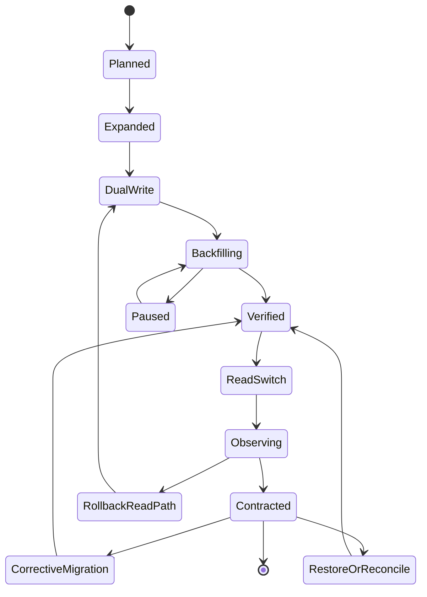

# Đánh giá phương án quay lui so với sửa tiếp khi dữ liệu đã đổi trong PostgreSQL

Sau một lần thay đổi schema hoặc migration dữ liệu, hệ thống có thể đã ở trạng thái khác đáng kể so với thời điểm bắt đầu triển khai. Ứng dụng mới có thể đã ghi dữ liệu theo format mới, backfill có thể đã chạy một phần, consumer có thể đã xử lý events, và nhiều transactions có thể đã commit. Khi phát hiện lỗi, quyết định **quay lui (rollback)** hay **sửa tiếp theo hướng tiến (roll-forward)** cần dựa trên trạng thái dữ liệu thực tế, khả năng đảo ngược, tác động tới writes phát sinh sau migration và thời gian khôi phục.

Rollback thường có nghĩa là đưa ứng dụng, schema hoặc dữ liệu về trạng thái trước thay đổi. Roll-forward có nghĩa là giữ trạng thái hiện tại và triển khai một thay đổi mới để sửa lỗi hoặc hoàn tất chuyển đổi. Hai phương án đều có thể đúng; lựa chọn sai có thể làm mất writes hợp lệ, tạo thêm downtime hoặc khiến các phiên bản ứng dụng không tương thích với schema.

Bài học thuộc chương **Thay đổi lược đồ**, tập trung vào:

- Phân biệt rollback ứng dụng, rollback schema, rollback dữ liệu và phục hồi từ backup.
- Xác định thay đổi nào còn nằm trong transaction và thay đổi nào đã commit.
- Đánh giá tính đảo ngược của data transformation sau khi dữ liệu mới đã được ghi.
- Nhận diện các trạng thái migration: chưa chạy, đã chạy một phần, đã backfill, đã switch reads và đã contract.
- So sánh rollback với roll-forward theo data loss, compatibility, blast radius, RTO và RPO.
- Dùng expand-contract, dual-write, shadow columns và batch backfill để giữ đường quay lui.
- Thiết kế migration có checkpoint, idempotency và reconciliation.
- Chọn giữa corrective migration, compensating action, PITR và restore từ backup.
- Xử lý side effects ngoài database như messages, payments, emails và cache invalidation.
- Xây dựng decision record, recovery runbook và bài thực hành.

> **Nguyên tắc:** một migration đã commit không thể được “undo” chỉ bằng cách chạy lại transaction rollback. Khi dữ liệu đã đổi và traffic tiếp tục ghi, hãy xác định chính xác dữ liệu nào còn được bảo toàn, dữ liệu nào đã mất thông tin, và những writes nào phát sinh sau thay đổi. Nếu không có phép biến đổi ngược đáng tin cậy, một migration sửa tiếp thường an toàn hơn một down migration giả định.

## 1. Bốn khái niệm thường bị gọi chung là rollback

Trong incident, từ “rollback” có thể được dùng cho nhiều hành động khác nhau. Trước khi quyết định, cần gọi đúng việc sẽ làm.

### 1.1. Application rollback

Đưa application binary/container/configuration về release trước. Database có thể vẫn giữ schema mới.

Ví dụ:

- Release mới bắt đầu đọc column mới.
- Release mới có bug.
- Deploy lại release cũ.
- Schema mới vẫn tồn tại để release cũ tiếp tục chạy.

Application rollback chỉ an toàn nếu release cũ tương thích với schema hiện tại và không gặp dữ liệu mà nó không hiểu.

### 1.2. Schema rollback

Chạy DDL để đưa schema về hình dạng trước đó: drop column mới, đổi tên column lại, bỏ constraint hoặc khôi phục definition cũ.

Schema rollback không tự khôi phục dữ liệu đã bị transform hoặc xóa. Nếu column cũ đã bị drop, đổi tên column mới về tên cũ không tái tạo được giá trị cũ đã mất.

### 1.3. Data rollback

Dùng một phép biến đổi ngược để đưa values về trạng thái trước đó. Điều này chỉ đáng tin khi dữ liệu gốc còn được lưu hoặc phép biến đổi là reversible và không có writes mới làm mất tính một-một.

Ví dụ phép đổi chữ hoa thành chữ thường không thể phục hồi chính xác chữ hoa/thường ban đầu nếu không lưu source value.

### 1.4. Restore hoặc point-in-time recovery

Khôi phục database từ backup và WAL về một thời điểm trước sự cố. Đây là recovery ở cấp database/cluster, có thể làm mất mọi transactions hợp lệ sau recovery target.

PITR không phải thao tác rollback một table đơn lẻ. Thường cần restore sang một instance riêng rồi trích xuất/reconcile dữ liệu cần thiết nếu muốn giữ các writes hợp lệ sau mốc đó.

### 1.5. Compensating action

Một số hành động không thể undo trực tiếp. Hệ thống tạo một hành động nghiệp vụ bù để sửa kết quả:

- Ghi một transaction refund thay vì xóa payment đã capture.
- Gửi một event correction thay vì thu hồi event đã được consumer xử lý.
- Tạo adjustment entry thay vì sửa ledger history.
- Đánh dấu order canceled thay vì xóa order đã được downstream system nhận.

Compensation sửa trạng thái nghiệp vụ bằng một hành động mới, có audit trail riêng.

## 2. Migration state quyết định đường recovery

Không nên chọn rollback/roll-forward chỉ dựa vào tên migration hoặc việc migration tool đã đánh dấu thành công. Cần quan sát database, application release và data pipeline.

### 2.1. Các giai đoạn thường gặp

| Giai đoạn | Database state | Khả năng quay lui |
| --- | --- | --- |
| Chưa chạy DDL | Schema cũ | Thường chỉ cần dừng deployment |
| DDL đã chạy trong transaction chưa commit | Thay đổi còn trong transaction | Có thể ROLLBACK nếu operation transactional |
| Expand đã commit | Schema mới, data cũ còn nguyên | Thường dễ giữ schema và rollback app |
| Dual-write đang chạy | Cả cũ và mới được ghi | Có thể rollback nếu hai representations còn đồng bộ |
| Backfill đang chạy | Một phần rows đã chuyển đổi | Cần checkpoint/reconciliation; không giả định toàn bộ hoặc chưa row nào đổi |
| Backfill hoàn tất | Dữ liệu mới đã được điền | Có thể switch về cũ nếu old source còn được bảo toàn |
| Reads đã switch | Ứng dụng đọc format mới | Cần đánh giá data compatibility và writes mới |
| Contract đã chạy | Cột/table cũ đã bị drop | Rollback trực tiếp có thể không còn khả thi |
| External consumers đã nhận dữ liệu | Side effects đã xảy ra ngoài DB | Cần compensation hoặc coordinated recovery |

### 2.2. Migration ledger chỉ là một nguồn evidence

Migration framework thường ghi migration version và trạng thái. Ledger có thể không phản ánh đầy đủ:

- DDL đã commit nhưng client mất kết nối trước khi ghi ledger.
- Script non-transactional đã chạy một phần.
- Backfill chạy bởi worker riêng.
- Manual hotfix ngoài migration tool.
- Một batch đã commit nhưng checkpoint chưa được lưu.
- Một migration đã chạy trên primary nhưng logical subscriber chưa được cập nhật.

Khi trạng thái không rõ, kiểm tra cả migration ledger, catalogs, data invariants, application version và worker checkpoints.

### 2.3. Không retry mù quáng khi kết quả commit chưa rõ

Nếu client timeout sau khi gửi COMMIT, server có thể đã commit nhưng response không tới client. Trước khi chạy lại:

1. Kiểm tra migration ledger.
2. Kiểm tra schema/catalog state.
3. Kiểm tra dữ liệu đã thay đổi.
4. Xác định statement có idempotent không.
5. Chỉ retry sau khi đã xác nhận trạng thái.

Lặp một UPDATE không idempotent hoặc một thao tác tăng counter có thể làm dữ liệu sai thêm.

## 3. Transaction rollback và giới hạn của nó

PostgreSQL hỗ trợ transactional DDL cho nhiều lệnh schema. Nếu lỗi xảy ra trước COMMIT và mọi thao tác nằm trong cùng transaction, ROLLBACK có thể đưa các thay đổi transactional về trạng thái trước đó.

### 3.1. Ví dụ DDL và DML cùng transaction

```sql
BEGIN;

ALTER TABLE app.orders
    ADD COLUMN source_code text;

UPDATE app.orders
SET source_code = 'legacy'
WHERE source_code IS NULL;

-- Kiểm tra kết quả trước khi commit.
SELECT count(*)
FROM app.orders
WHERE source_code IS NULL;

ROLLBACK;
```

Trong ví dụ lab này, nếu transaction rollback, cả ALTER TABLE và UPDATE transactional đều bị hủy. Trong production, transaction có thể giữ locks trong suốt quá trình và rollback một lượng lớn WAL/data work có thể tốn thời gian.

### 3.2. Sau COMMIT, ROLLBACK không còn áp dụng

Sau khi COMMIT thành công, transaction kết thúc. Lệnh ROLLBACK ở session sau không thể undo transaction trước.

Cách sửa là:

- Chạy một transaction mới với corrective SQL.
- Chạy một migration mới.
- Chạy compensating business action.
- Restore từ backup/PITR nếu phạm vi hỏng và recovery objectives yêu cầu.

### 3.3. DDL transactional không có nghĩa mọi DDL đều transactional

Một số lệnh không thể chạy trong transaction block, ví dụ:

- CREATE INDEX CONCURRENTLY.
- DROP INDEX CONCURRENTLY.
- VACUUM.
- CREATE DATABASE.
- Một số dạng REINDEX CONCURRENTLY.

Danh sách phụ thuộc command và PostgreSQL version. Migration framework phải hỗ trợ non-transactional migrations và xử lý trạng thái khi command bị gián đoạn.

### 3.4. Rollback một transaction dài có chi phí

Một transaction đã cập nhật hàng triệu rows có thể tạo lượng WAL lớn. Nếu rollback:

- Database phải xử lý transaction abort và visibility.
- Locks được giữ trong lúc transaction đang chạy và chỉ giải phóng khi kết thúc.
- WAL đã phát sinh không biến mất ngay.
- Replica vẫn cần replay WAL theo cơ chế physical replication.
- Cleanup/vacuum có thể cần thời gian để xử lý dead row versions.

Không dùng một transaction khổng lồ như cơ chế recovery mặc định cho mọi backfill.

### 3.5. Savepoint không phải recovery strategy cho release đã commit

SAVEPOINT giúp rollback một phần công việc bên trong cùng transaction chưa commit. Nó không phục hồi dữ liệu đã commit trong transaction trước và không thay thế checkpoint cho batch jobs.

## 4. Data transformation có reversible không?

Một phép chuyển đổi chỉ reversible nếu có thể khôi phục đúng giá trị đầu vào từ dữ liệu đầu ra và các thông tin còn lưu.

### 4.1. Reversible transformation

Ví dụ đổi một string sang cùng encoding/representation mà không mất thông tin, hoặc thêm một column mới trong khi vẫn giữ column gốc.

Ngay cả khi phép chuyển đổi toán học là reversible, cần kiểm tra:

- Có rows nào bị truncate?
- Có rounding hoặc normalization?
- Có giá trị NULL được thay bằng default?
- Có collation/timezone assumptions?
- Có concurrent writes trong lúc chuyển đổi?
- Có application code đã ghi values theo format mới?

### 4.2. Lossy transformation

Các thao tác thường làm mất thông tin:

- Chuyển numeric có scale lớn sang integer/scale nhỏ bằng rounding.
- Lowercase/trim/normalize text mà không lưu source.
- Gộp nhiều enum/status values thành một value chung.
- Cắt chuỗi theo maximum length.
- Chuyển timezone-local timestamp mà không giữ timezone gốc.
- Hash/encrypt bằng cách không lưu key hoặc original value.
- Xóa rows hoặc columns.
- Gộp nhiều records thành một record.
- Deduplicate bằng cách bỏ các bản ghi trùng.
- Aggregate detail rows thành summary.

Không thể khôi phục chính xác original values chỉ từ kết quả đã mất thông tin.

### 4.3. Ví dụ rounding không thể đảo ngược

Giả sử amount có bốn chữ số thập phân:

```sql
SELECT round(12.3456::numeric, 2);
-- 12.35
```

Từ 12.35 không thể biết giá trị gốc là 12.3456, 12.346, 12.35 hay một giá trị khác được làm tròn thành cùng kết quả.

Nếu cần rollback, phải giữ original value hoặc transformation ledger.

### 4.4. Null và default có thể che mất trạng thái ban đầu

Ví dụ:

```sql
UPDATE app.customers
SET region = 'unknown'
WHERE region IS NULL;
```

Sau UPDATE, không thể phân biệt row nào vốn có region = 'unknown' với row nào trước đó NULL nếu không lưu provenance. Nếu rollback bằng cách đổi mọi 'unknown' về NULL, sẽ làm hỏng dữ liệu hợp lệ đã có từ trước.

### 4.5. Ghi lại source và transformation version

Khi transformation có thể cần đảo ngược, lưu:

- Original value hoặc source table.
- New value.
- Transformation version.
- Timestamp và migration/job ID.
- Row primary key.
- Batch/checkpoint ID.
- Reason hoặc mapping rule.

Không phải mọi cột đều cần lưu cả hai phiên bản vĩnh viễn; retention phải được thiết kế theo thời gian rollback thực tế và chính sách dữ liệu.

## 5. Dữ liệu đã được ghi mới sau migration

Một yếu tố quan trọng là writes tiếp tục diễn ra sau khi schema/data đã đổi.

### 5.1. Rollback có thể ghi đè writes hợp lệ

Ví dụ release mới đã ghi status mới vào column v2. Nếu rollback schema bằng cách restore old column từ snapshot cũ, mọi changes sau snapshot có thể bị mất.

Trước khi rollback, xác định:

- Có bao nhiêu writes kể từ migration?
- Những writes đó đã được commit chưa?
- Có thể chuyển chúng về representation cũ không?
- Có dữ liệu nào được tạo chỉ trong schema mới?
- Có event/consumer nào đã xử lý các writes này không?

### 5.2. Dual-write giữ hai representations đồng bộ

Trong expand phase, application có thể ghi cả old và new columns trong cùng transaction:

```sql
BEGIN;

UPDATE app.orders
SET
    status = 'approved',
    status_v2 = 'approved'
WHERE id = 1001;

COMMIT;
```

Nếu release mới có bug, có thể chuyển reads về old column khi old column vẫn được duy trì chính xác.

Dual-write cần bảo đảm mọi writers đều được cập nhật: web services, background workers, admin scripts, ETL, triggers và integrations. Một writer bị bỏ sót sẽ làm hai columns drift.

### 5.3. Không dual-write bằng hai requests độc lập

Nếu ghi old và new representations trong hai transactions khác nhau, một lần ghi có thể thành công còn lần kia thất bại. Hãy giữ writes trong cùng transaction hoặc dùng một cơ chế consistency/outbox có khả năng reconcile.

### 5.4. Trigger có thể giúp nhưng có trade-offs

Database trigger có thể đồng bộ old/new columns cho nhiều clients. Tuy nhiên:

- Trigger làm behavior ghi dữ liệu ít hiển thị trong application code.
- Trigger có thể ảnh hưởng bulk loads và replication semantics.
- Thứ tự rollout giữa trigger và application cần rõ ràng.
- Trigger có thể gây recursion hoặc double transformation nếu không thiết kế đúng.
- Cần theo dõi lỗi trigger và latency.

Không thêm trigger đồng bộ trong incident nếu chưa hiểu mọi write paths.

## 6. Backfill đã chạy một phần

Backfill theo batches thường được dùng để tránh một transaction lớn. Khi lỗi xảy ra, dữ liệu có thể ở trạng thái mixed.

### 6.1. Vì sao partial backfill cần checkpoint?

Giả sử worker xử lý 10.000 rows mỗi batch. Sau batch 12, worker crash. Có thể:

- Batch 12 đã commit nhưng checkpoint chưa được ghi.
- Checkpoint đã ghi nhưng transaction dữ liệu chưa commit nếu hai nơi không cùng transaction.
- Một số rows bị skip do concurrent lock.
- Application writers tạo rows mới trong khi backfill chạy.

Do đó, checkpoint cần có semantics rõ ràng và job phải có khả năng chạy lại an toàn.

### 6.2. Idempotent batch

Một batch idempotent có thể chạy lại mà không làm sai kết quả:

```sql
UPDATE app.customers
SET normalized_email = lower(trim(email))
WHERE id >= 10001
  AND id < 20001
  AND normalized_email IS NULL;
```

Predicate IS NULL giúp tránh ghi lại rows đã chuyển đổi, miễn là NULL không phải một giá trị đích hợp lệ có ý nghĩa riêng. Nếu NULL hợp lệ, cần cột trạng thái hoặc migration marker riêng.

### 6.3. Upsert và version checks

Nếu nhiều workers hoặc application writers cùng thay đổi row, dùng điều kiện kiểm soát phiên bản:

```sql
UPDATE app.customers
SET
    normalized_email = lower(trim(email)),
    normalization_version = 2
WHERE id = 1001
  AND normalization_version < 2;
```

Cần xác định version marker có thực sự biểu diễn trạng thái đầy đủ không. Một marker cập nhật trước khi data transformation hoàn tất có thể khiến worker bỏ qua row chưa đúng.

### 6.4. Keyset batches thay vì OFFSET lớn

Dùng primary key hoặc stable cursor:

```sql
SELECT id
FROM app.customers
WHERE id > 500000
ORDER BY id
LIMIT 2000;
```

OFFSET lớn có thể phải đi qua nhiều rows và chậm dần. Keyset pagination thường dễ checkpoint và có performance ổn định hơn nếu key phù hợp.

### 6.5. Checkpoint phải commit cùng batch khi có thể

Nếu checkpoint lưu trong cùng database, có thể update checkpoint trong cùng transaction với batch data:

```sql
BEGIN;

WITH batch AS (
    SELECT id
    FROM app.customers
    WHERE id > 500000
      AND id <= 502000
    ORDER BY id
    FOR UPDATE
)
UPDATE app.customers AS c
SET normalized_email = lower(trim(c.email))
FROM batch
WHERE c.id = batch.id;

UPDATE ops.migration_checkpoint
SET last_id = 502000,
    updated_at = clock_timestamp()
WHERE migration_name = 'normalize_customer_email';

COMMIT;
```

Ví dụ này giả định range được chọn đầy đủ và checkpoint row tồn tại. Với nhiều workers, cần checkpoint partitioned theo worker/range hoặc dùng queue semantics thích hợp.

### 6.6. Reconciliation sau partial failure

Sau khi worker dừng:

1. Xác định last committed checkpoint.
2. Đếm rows theo migration marker.
3. Tìm rows có source nhưng thiếu target.
4. Tìm target không khớp source theo transformation rule.
5. Kiểm tra concurrent writes.
6. Chạy lại batch idempotent hoặc corrective batch.
7. Chỉ đánh dấu complete khi invariant đã đạt.

Không suy ra completion chỉ từ số batches đã log.

## 7. So sánh rollback và roll-forward

| Tiêu chí | Rollback | Roll-forward |
| --- | --- | --- |
| Mục tiêu | Trở lại behavior/state trước | Sửa state hiện tại bằng thay đổi mới |
| Phù hợp khi | Inverse đáng tin và old version tương thích | Dữ liệu đã đổi hoặc inverse không an toàn |
| Data loss risk | Có thể mất writes sau mốc rollback | Thường giữ writes hiện tại, nhưng cần repair |
| Schema | Có thể cần DDL ngược | Thường giữ schema và thêm corrective migration |
| Complexity | Có thể cao nếu đã contract | Có thể cao nếu cần reconcile nhiều states |
| Downtime | Có thể cần stop traffic/restore | Có thể triển khai online theo phases |
| Auditability | Phụ thuộc rollback script | Forward fix tạo migration/event mới |
| External side effects | Không tự undo | Thường cần compensation |
| RTO/RPO | Restore có thể lâu và mất writes | Có thể nhanh hơn nếu lỗi cục bộ |
| Rủi ro chính | Xóa dữ liệu mới hoặc không đảo ngược được | Tích lũy thêm migration/complexity |

Không có lựa chọn mặc định luôn đúng. Quyết định dựa trên evidence và blast radius.

## 8. Khi nào nên rollback?

Rollback thường phù hợp khi các điều kiện sau được đáp ứng:

- Thay đổi gây lỗi có phạm vi rõ.
- Old application version vẫn tương thích với schema/data hiện tại.
- Có source values để khôi phục.
- Inverse migration đã được thử nghiệm trên data shape tương tự.
- Không có writes mới chỉ tồn tại trong format mới hoặc chúng có thể được chuyển đổi an toàn.
- Rollback không phá các external consumers đã nhận data.
- Thời gian rollback đáp ứng recovery objective.
- Rollback có blast radius nhỏ hơn corrective migration.

### 8.1. Ví dụ rollback application

Schema đã expand bằng cách thêm column mới, old column vẫn tồn tại và dual-write đang hoạt động. Release mới có lỗi trong read path.

Có thể deploy lại application release cũ, giữ schema mở rộng và tiếp tục ghi đồng bộ hai columns cho đến khi sửa release mới.

### 8.2. Ví dụ rollback data có source preserved

Một transformation tạo target column mới từ source column cũ. Source chưa bị sửa/xóa. Nếu target calculation sai, có thể bỏ target và chạy lại transformation đúng.

### 8.3. Rollback khi migration chưa commit

Nếu DDL/DML vẫn nằm trong transaction và không có non-transactional side effects, ROLLBACK có thể là phương án đơn giản nhất. Xác nhận session/transaction còn tồn tại và chưa commit.

## 9. Khi nào nên roll-forward?

Roll-forward thường phù hợp khi:

- Migration đã commit và dữ liệu mới đã được ghi.
- Transformation làm mất thông tin gốc.
- Old application không thể đọc format hiện tại.
- Rollback sẽ làm mất writes hợp lệ sau migration.
- Có nhiều external systems đã nhận side effects.
- Schema đã contract hoặc old columns đã bị drop.
- Corrective change có thể sửa dữ liệu tại chỗ một cách có kiểm soát.
- Restore toàn database sẽ gây mất dữ liệu hoặc downtime lớn hơn.

### 9.1. Corrective migration

Một migration mới sửa logic sai:

```sql
UPDATE app.orders
SET status = 'pending'
WHERE status = 'pendng'
  AND created_at >= timestamp '2026-11-01';
```

Đây chỉ là ví dụ. Điều kiện WHERE phải giới hạn đúng tập rows bị ảnh hưởng; cần xác định source of truth và tránh sửa nhầm rows hợp lệ có cùng value.

### 9.2. Roll-forward bằng mapping table

Nếu một transformation đã map nhiều values về một value chung, dùng audit/mapping data hoặc business source để xác định từng row cần khôi phục. Nếu không có mapping, có thể không thể khôi phục chính xác.

### 9.3. Corrective migration phải là migration mới

Không sửa nội dung migration đã chạy trên một số environments rồi chạy lại cùng version. Giữ migration history bất biến; tạo migration mới mô tả correction. Việc chỉnh migration cũ có thể làm các environments khác nhau hiểu cùng version theo hai cách.

### 9.4. Không che lỗi bằng migration marker

Không chỉnh ledger thành “not applied” để ép chạy lại khi DDL/data đã commit. Trước tiên reconcile actual state, rồi tạo forward migration phù hợp.

## 10. Decision matrix theo trạng thái triển khai

| Tình trạng | Hướng xử lý thường phù hợp | Điều cần xác minh |
| --- | --- | --- |
| DDL transactional chưa commit | ROLLBACK transaction | Không có external side effects; lock được giải phóng |
| Expand đã commit, chưa có new writes | Rollback app hoặc giữ schema mở | Old code tương thích schema mới |
| Dual-write đã chạy, source còn đồng bộ | Có thể rollback app/read path | Tất cả writers duy trì old representation |
| Backfill một phần | Dừng worker, reconcile rồi tiếp tục hoặc đảo batch | Checkpoint, idempotency, source preservation |
| Backfill hoàn tất, old source còn | Có thể switch reads về old hoặc sửa target | Source có còn chính xác sau writes mới |
| Backfill hoàn tất, source đã bị xóa | Thường roll-forward hoặc restore | Backup/PITR, external copies |
| Transformation lossy | Roll-forward/compensation hoặc restore | Có original values/audit mapping không |
| Old column đã contract | Forward migration hoặc restore/reconcile | Consumer nào còn phụ thuộc |
| External events/payments đã phát sinh | Compensation và roll-forward | Idempotency, downstream state |
| Corruption diện rộng, không có inverse | Đánh giá PITR/restore | RPO/RTO và writes sau target time |

Đây là hướng dẫn ra quyết định, không phải lệnh tự động. Mỗi production incident cần một decision record với facts, assumptions và người chịu trách nhiệm.

## 11. Expand-contract tạo đường quay lui

Expand-contract là chiến lược thay đổi schema theo nhiều release để old/new application versions có thể cùng hoạt động trong một khoảng thời gian.

### 11.1. Expand

Thêm cấu trúc mới mà code cũ vẫn hoạt động:

```sql
ALTER TABLE app.customers
    ADD COLUMN display_name_v2 text;
```

Giữ column cũ và constraints cũ trong thời gian chuyển đổi.

### 11.2. Deploy compatibility code

Application mới:

- Có thể đọc old hoặc new column theo feature flag.
- Ghi đồng bộ cả hai representations.
- Có metric phát hiện drift.
- Không yêu cầu old column bị xóa ngay.

### 11.3. Backfill

Backfill dữ liệu cũ sang target theo batches, checkpoint và retry an toàn. Không chạy một UPDATE lớn nếu table size/traffic khiến transaction, WAL và vacuum impact quá cao.

### 11.4. Verify và switch

Kiểm tra số rows, null counts, mismatches và application behavior. Sau khi target đủ tin cậy, switch reads sang new column.

### 11.5. Observe

Giữ old column và compatibility path qua một khoảng thời gian phù hợp với business cycle. Trong giai đoạn này có thể rollback application read path mà không cần reconstruct old data.

### 11.6. Contract

Chỉ drop old column sau khi:

- Old application release không còn chạy.
- Old writers đã bị loại bỏ.
- Downstream consumers đã chuyển.
- Data consistency đã xác nhận.
- Rollback window đã kết thúc.
- Recovery plan đã được chấp thuận.

Contract là điểm mà chi phí quay lui thường tăng mạnh. Hãy xem nó như một quyết định riêng.

## 12. Ví dụ: chuyển trạng thái order sang representation mới

Giả sử status hiện tại là text và muốn chuẩn hóa các trạng thái sang values mới.

### 12.1. Expand

```sql
ALTER TABLE app.orders
    ADD COLUMN status_v2 text;
```

Không drop status cũ.

### 12.2. Mapping rõ ràng

Tạo mapping có version:

```sql
CREATE TABLE ops.order_status_mapping (
    old_status text PRIMARY KEY,
    new_status text NOT NULL,
    mapping_version integer NOT NULL
);

INSERT INTO ops.order_status_mapping
    (old_status, new_status, mapping_version)
VALUES
    ('awaiting_payment', 'pending', 1),
    ('paid', 'confirmed', 1),
    ('shipped', 'fulfilled', 1);
```

Mapping phải bao phủ mọi trạng thái hiện có và xác định rõ values không biết. Không tự gán default cho unknown states nếu chưa có business rule.

### 12.3. Dual-write

Application ghi old/new values trong cùng transaction. Nếu chưa thể deploy toàn bộ writers, có thể dùng compatibility layer hoặc trigger đã được thử nghiệm.

### 12.4. Backfill

```sql
UPDATE app.orders AS o
SET status_v2 = m.new_status
FROM ops.order_status_mapping AS m
WHERE o.status = m.old_status
  AND o.status_v2 IS NULL;
```

Với table lớn, thêm primary-key range hoặc SKIP LOCKED batching. Đếm rows chưa map được:

```sql
SELECT status, count(*)
FROM app.orders
WHERE status_v2 IS NULL
GROUP BY status
ORDER BY count(*) DESC;
```

### 12.5. Kiểm tra consistency

```sql
SELECT count(*) AS mismatches
FROM app.orders AS o
JOIN ops.order_status_mapping AS m
  ON m.old_status = o.status
WHERE o.status_v2 IS DISTINCT FROM m.new_status;
```

Nếu có states mới không có trong mapping, xử lý riêng thay vì coi mismatch count bằng zero là bằng chứng đầy đủ.

### 12.6. Rollback trước contract

Nếu read path mới lỗi, chuyển reads về status cũ. Vì old column vẫn được dual-write, dữ liệu mới vẫn có thể được đọc bằng representation cũ.

### 12.7. Roll-forward sau contract

Sau khi old column đã drop, nếu phát hiện mapping sai, cần corrective mapping/migration hoặc restore dữ liệu từ audit/backup. Không thể chỉ rename status_v2 thành status để khôi phục old values nếu mapping đã gộp states.

## 13. Thiết kế down migration trung thực

Nhiều migration frameworks hỗ trợ up/down migrations. Down migration chỉ an toàn nếu nó thực sự có thể khôi phục trạng thái cũ.

### 13.1. Reversible DDL

Ví dụ ADD COLUMN nullable có thể có down migration DROP COLUMN nếu column chưa nhận dữ liệu quan trọng và không có consumers/dependencies.

### 13.2. Irreversible data migration

Ví dụ:

```sql
UPDATE app.users
SET display_name = lower(display_name);
```

Down migration không thể tái tạo chính xác original capitalization. Ghi down migration giả định sẽ làm người vận hành tin rằng rollback an toàn trong khi không đúng.

### 13.3. Mark migration irreversible

Nếu framework hỗ trợ, đánh dấu migration không thể đảo ngược hoặc cung cấp down migration có chủ đích fail với thông báo rõ ràng. Ghi rõ recovery strategy là roll-forward hoặc restore.

### 13.4. Down migration có thể mất writes mới

Ngay cả khi phép chuyển đổi ban đầu có inverse, down migration có thể phá values được tạo sau đó. Ví dụ enum mới được thêm vào application và đã xuất hiện trong rows; code cũ không hiểu enum mới.

Kiểm tra domain values, constraints và callers trước khi chuyển ngược.

### 13.5. Migration history bất biến

Không chỉnh sửa một migration đã áp dụng ở bất kỳ environment nào. Tạo migration mới để sửa. Nếu cần thay đổi migration chưa chạy ở đâu, phối hợp theo release policy và xác nhận mọi environments.

## 14. Data correction an toàn sau khi đã commit

Khi cần sửa rows sai, trước tiên tạo phạm vi chính xác và giữ evidence.

### 14.1. Preview affected rows

Chạy SELECT dùng cùng predicate với UPDATE:

```sql
SELECT
    id,
    status,
    updated_at
FROM app.orders
WHERE status = 'pendng'
  AND updated_at >= timestamp '2026-11-01'
ORDER BY id
LIMIT 100;
```

Đếm tổng rows và so sánh với expected population. Không chạy UPDATE dựa trên predicate chỉ được suy ra từ vài sample rows.

### 14.2. Lưu before-image

Với dữ liệu cần khôi phục, có thể lưu affected rows vào audit table:

```sql
CREATE TABLE ops.order_status_repair_backup AS
SELECT
    id,
    status AS old_status,
    updated_at AS old_updated_at,
    clock_timestamp() AS captured_at,
    'repair_2026_11_14'::text AS repair_id
FROM app.orders
WHERE status = 'pendng';
```

Ví dụ này cần được bổ sung primary key/unique constraint và retention policy nếu dùng thật. Bảo đảm snapshot capture nhất quán và table không chứa dữ liệu nhạy cảm ngoài quyền truy cập phù hợp.

### 14.3. Update có điều kiện

```sql
UPDATE app.orders
SET status = 'pending'
WHERE status = 'pendng'
  AND updated_at >= timestamp '2026-11-01';
```

Predicate phải giới hạn đúng cohort và có thể kiểm chứng. Nếu các writers vẫn có thể tạo value sai, sửa writer trước hoặc đồng thời để tránh tái phát.

### 14.4. Verify sau update

```sql
SELECT status, count(*)
FROM app.orders
GROUP BY status
ORDER BY status;
```

Đối chiếu counts với expected business totals, event logs và application metrics. Một query không còn trả rows sai không chứng minh các side effects downstream đã được sửa.

### 14.5. Batch repair

Với lượng rows lớn:

- Chọn key ranges hoặc bounded batches.
- Commit mỗi batch.
- Ghi checkpoint.
- Có thể resume sau lỗi.
- Theo dõi WAL, replication lag và autovacuum.
- Có stop condition và maximum runtime.
- Giữ predicate để không ghi đè changes hợp lệ.

## 15. Khi nào cần PITR hoặc restore từ backup?

PITR phù hợp khi database đã bị corruption hoặc data loss nghiêm trọng, không có inverse đáng tin và corrective SQL không thể khôi phục đúng state.

### 15.1. Chọn recovery target

Chọn thời điểm ngay trước khi dữ liệu bị hỏng, dựa trên:

- Timestamp của migration.
- Transaction commit time nếu có logs.
- Application deployment timeline.
- Audit/event records.
- WAL/archive availability.
- Clock synchronization và timezone.

Không chọn target time chỉ dựa vào thời gian người dùng báo lỗi nếu corruption bắt đầu sớm hơn.

### 15.2. RPO

Recovery Point Objective (RPO) là lượng dữ liệu có thể chấp nhận mất. Restore về thời điểm trước lỗi sẽ bỏ các transactions sau target time khỏi restored database.

Nếu database tiếp tục nhận writes hợp lệ sau lỗi, cần một kế hoạch trích xuất/replay/reconcile các writes đó.

### 15.3. RTO

Recovery Time Objective (RTO) là thời gian hệ thống có thể chấp nhận bị gián đoạn. PITR có thể mất nhiều thời gian để provision, replay WAL, validate và chuyển traffic.

Đánh giá restore duration trên hệ thống tương tự trước khi chọn restore trong incident.

### 15.4. PITR thường khôi phục cả database/cluster

PITR thường phục hồi một PostgreSQL instance/cluster tới thời điểm xác định. Không thể chỉ nói “rollback một table” rồi giả định mọi table khác giữ nguyên.

Một quy trình an toàn thường:

1. Restore sang một instance riêng.
2. Xác minh restored state.
3. Trích xuất rows/objects cần phục hồi.
4. So sánh với production hiện tại.
5. Reconcile transactions hợp lệ phát sinh sau target.
6. Chỉ cut over hoặc thay thế instance sau quyết định rõ ràng.

### 15.5. Backup phải được kiểm thử restore

Có backup file không đồng nghĩa có thể khôi phục trong RTO. Kiểm tra:

- Base backup integrity.
- WAL archive continuity.
- Encryption keys/credentials.
- Tablespaces và extensions.
- PostgreSQL major version compatibility.
- Restore permissions và infrastructure capacity.
- Application connection/routing cutover.
- Restore drills định kỳ.

## 16. Phục hồi một phần dữ liệu từ restored instance

Nếu chỉ một bảng hoặc một nhóm rows bị lỗi, có thể restore sang instance phụ và trích xuất dữ liệu cần thiết thay vì thay thế toàn bộ production.

### 16.1. Lợi ích

- Giữ lại các transactions hợp lệ đã phát sinh sau recovery target.
- So sánh before/after theo primary keys.
- Có thể chọn rows/columns cần khôi phục.
- Giảm blast radius so với full cutover.

### 16.2. Rủi ro

- Foreign keys và dependencies có thể khiến import không đơn giản.
- Rows đã được cập nhật hợp lệ sau target có thể bị ghi đè.
- Sequences có thể cần đồng bộ.
- Large objects, partitions, triggers và generated columns cần được xử lý.
- Dữ liệu liên quan nhiều tables cần snapshot/reconciliation nhất quán.
- External side effects không được restore từ database backup.

### 16.3. Reconcile theo business keys

Không copy nguyên table nếu production tiếp tục nhận writes. So sánh theo stable primary/business keys và xác định mỗi row thuộc một nhóm:

- Chưa tồn tại trước lỗi.
- Tồn tại và chưa bị ảnh hưởng.
- Bị migration làm sai.
- Được cập nhật hợp lệ sau migration.
- Có conflict giữa restored và current versions.

Dùng source of truth và version/timestamp/audit records để chọn kết quả.

### 16.4. Sequences và identity

Khi import rows từ restored instance, sequence current value có thể thấp hơn max primary key. Kiểm tra sequence ownership và setval cẩn thận sau khi writes được quiesce hoặc dùng locking/coordination phù hợp.

## 17. Side effects ngoài PostgreSQL

Database rollback không tự đảo ngược hệ thống phân tán.

### 17.1. Message queues

Một transaction có thể ghi row và publish message. Nếu message đã được broker nhận và consumer xử lý, rollback row không thu hồi side effect đó.

Dùng transactional outbox/inbox, idempotency keys và compensating events để quản lý trạng thái.

### 17.2. Payments và financial operations

Không xóa payment capture để “rollback”. Dùng refund/void/adjustment theo API và ledger rules của payment provider. Lưu provider transaction IDs và đảm bảo compensation idempotent.

### 17.3. Emails, notifications và webhooks

Email đã gửi không thể thu hồi. Có thể gửi correction hoặc suppress future sends. Webhook consumer có thể đã ghi dữ liệu; cần correction event hoặc replay protocol.

### 17.4. Cache và search indexes

Schema/data rollback có thể làm cache hoặc search index stale. Xác định invalidation/rebuild strategy. Một cache flush toàn bộ có thể tạo cache stampede; rebuild có thể cần throttling.

### 17.5. Object storage và files

Database row có thể trỏ tới object storage. Restore DB không khôi phục file đã bị overwrite/delete. Cần versioning, retention và restore plan riêng cho external storage.

### 17.6. Audit trail

Không xóa lịch sử để làm cho hệ thống trông như chưa có sự cố. Ghi compensation/correction với timestamp, actor, reason và reference tới incident/migration.

## 18. Logical replication và nhiều database consumers

Schema migration có thể ảnh hưởng publisher, subscriber, CDC pipeline và downstream warehouses.

### 18.1. Logical replication không tự replicate DDL

Schema changes cần được triển khai riêng trên publisher và subscriber theo thứ tự tương thích. Nếu publisher bắt đầu gửi new column trước khi subscriber sẵn sàng, apply worker có thể lỗi.

### 18.2. Rollback schema có thể phá consumer mới

Nếu subscriber hoặc CDC consumer đã được cập nhật để yêu cầu field mới, quay publisher về schema cũ có thể làm downstream pipeline thất bại.

### 18.3. Roll-forward coordinated

Có thể giữ cả old/new fields trong thời gian chuyển đổi, cập nhật subscribers, kiểm tra replication lag và chỉ contract khi mọi consumers đã chuyển.

### 18.4. CDC event schemas

Nếu event schema đã thay đổi và consumer đã lưu offsets, rollback publisher không làm consumer quên event đã xử lý. Cần schema registry compatibility và event versioning.

## 19. Data versioning và auditability

Khả năng recovery tốt hơn khi biết row đã được biến đổi bởi ai, khi nào và theo rule nào.

### 19.1. Row version

Có thể thêm version column:

```sql
ALTER TABLE app.customers
    ADD COLUMN data_version integer NOT NULL DEFAULT 1;
```

Khi application cập nhật representation mới, tăng version trong cùng transaction. Backfill chỉ cập nhật rows có version cũ và ghi version mới.

### 19.2. Transformation ledger

Một bảng ledger có thể lưu:

```sql
CREATE TABLE ops.data_migration_ledger (
    migration_id text NOT NULL,
    entity_id bigint NOT NULL,
    source_version integer NOT NULL,
    target_version integer NOT NULL,
    processed_at timestamptz NOT NULL DEFAULT clock_timestamp(),
    batch_id bigint,
    PRIMARY KEY (migration_id, entity_id)
);
```

Ledger giúp biết rows đã xử lý, nhưng không tự lưu original values. Nếu cần inverse, phải lưu source data hoặc có thể tái tạo nó.

### 19.3. Audit table

Audit table có thể lưu before/after values hoặc JSON snapshots. Chọn columns cụ thể khi có thể; JSON snapshot tiện nhưng cần quản lý schema, storage và privacy.

### 19.4. Retention

Giữ before-images trong suốt rollback window và theo retention/compliance policy. Xóa dữ liệu audit quá sớm làm mất recovery option; giữ quá lâu có thể tăng privacy/security risk.

### 19.5. Provenance

Gắn migration ID, code release, transformation version và batch ID giúp truy nguyên rows được thay đổi bởi một rollout cụ thể.

## 20. Idempotency và exactly-once assumptions

Distributed systems thường retry khi timeout hoặc mất kết nối. Migration/recovery scripts cần thiết kế để chịu retry.

### 20.1. Idempotent operation

Một operation idempotent chạy một lần hay nhiều lần cho cùng kết quả:

```sql
UPDATE app.orders
SET normalized_status = lower(status)
WHERE normalized_status IS DISTINCT FROM lower(status);
```

Câu lệnh này idempotent theo transformation hiện tại, nhưng có thể ghi đè một giá trị normalized_status được người dùng sửa thủ công. Xác định ownership của target column trước.

### 20.2. Non-idempotent operation

Ví dụ:

```sql
UPDATE app.accounts
SET balance = balance + 100
WHERE id = 42;
```

Retry cùng statement có thể cộng thêm lần nữa. Dùng unique operation ID, ledger row hoặc transaction idempotency key để ngăn apply lặp.

### 20.3. At-least-once delivery

Worker/job có thể nhận cùng message nhiều lần. Đảm bảo data migration idempotent hoặc ghi processed marker trong cùng transaction với data update.

### 20.4. Exactly-once không tự xuất hiện từ transaction

Một PostgreSQL transaction bảo đảm atomicity bên trong database. Nó không tự bảo đảm exactly-once across database, broker, HTTP API và external systems. Dùng outbox/inbox và idempotent consumers.

## 21. Dừng writes hay tiếp tục traffic trong lúc recovery?

Quyết định này phụ thuộc vào mức độ sai lệch và khả năng giữ consistency.

### 21.1. Khi nên tạm dừng writes

- Source of truth đang không rõ.
- Mỗi write mới làm khó việc reconcile.
- Có nguy cơ tiếp tục tạo dữ liệu sai.
- Cần chụp snapshot nhất quán.
- Recovery cần cutover đồng bộ.

Có thể chỉ pause một endpoint/worker hoặc bật read-only mode cho một business domain thay vì dừng toàn bộ database.

### 21.2. Khi có thể giữ traffic

- Corrective migration có predicate rõ và idempotent.
- Old/new representations vẫn đồng bộ.
- Repair có thể chạy theo batches.
- Có conflict detection.
- Writers đã được sửa để không tái tạo lỗi.

### 21.3. Quiesce có kiểm soát

Nếu cần ngừng writes:

1. Dừng hoặc pause producers.
2. Chờ transactions đang chạy kết thúc hoặc xử lý blockers theo owner.
3. Dừng background workers.
4. Xác nhận không còn writes qua alternate paths.
5. Chụp snapshot/backup nếu phù hợp.
6. Thực hiện recovery.
7. Verify invariants.
8. Resume producers theo thứ tự.

Không giả định dừng web traffic đồng nghĩa mọi writes đã dừng; cron, admin scripts và integrations có thể vẫn hoạt động.

## 22. Rủi ro khi chạy corrective UPDATE lớn

Roll-forward không tự động ít rủi ro. Một sửa chữa dữ liệu lớn có thể tạo impact tương tự migration ban đầu.

### 22.1. WAL và replication

UPDATE nhiều rows tạo row versions mới và WAL. Theo dõi replication lag, WAL archive và retained slots.

### 22.2. Dead tuples và vacuum

Các versions cũ trở thành dead tuples khi không còn visible với transactions. Autovacuum cần thời gian và I/O để reclaim reusable space. Không giả định UPDATE xong là disk giảm.

### 22.3. Lock và contention

UPDATE lấy row locks. Batch lớn có thể giữ locks lâu, gây deadlocks hoặc chặn application writes cùng rows.

### 22.4. Batch size

Bắt đầu với batch nhỏ trong staging, đo:

- Rows/second.
- Transaction duration.
- WAL bytes.
- Replica lag.
- Lock wait.
- CPU/I/O.
- Application latency.

Điều chỉnh batch size và pause interval theo resource budget.

### 22.5. Abort thresholds

Định nghĩa trước điều kiện dừng: disk free dưới ngưỡng, replica lag vượt budget, API latency/error rate vượt SLO, lock wait tăng hoặc batch runtime bất thường.

## 23. Migration state machine

Một state machine giúp worker/operator biết bước tiếp theo sau restart hoặc failure.



State transitions phải được ghi lại với migration ID và timestamps. State machine là operational record; database invariants vẫn là bằng chứng về trạng thái dữ liệu.

### 23.1. Planned

Preflight hoàn tất, chưa thay đổi production. Có rollback/roll-forward plan.

### 23.2. Expanded

Schema mới tồn tại nhưng application vẫn tương thích với schema cũ.

### 23.3. DualWrite

Các writers giữ old/new representations đồng bộ.

### 23.4. Backfilling

Worker đang chuyển dữ liệu cũ theo batches. Có checkpoint và metrics.

### 23.5. Verified

Data invariants đã đạt; target đủ điều kiện để switch reads.

### 23.6. ReadSwitch và Observing

Application đọc representation mới. Old representation vẫn được duy trì trong rollback window.

### 23.7. Contracted

Old columns/objects đã bị drop. Rollback path trực tiếp có thể đã đóng; forward repair/restore là lựa chọn chính.

## 24. Decision record cho incident

Mỗi quyết định rollback/roll-forward cần có facts và rationale để người tiếp quản hiểu.

### 24.1. Nội dung tối thiểu

- Incident ID và thời điểm phát hiện.
- Migration ID và application release.
- Database/cluster và affected objects.
- Actual schema state.
- Data transformation progress/checkpoint.
- Số rows bị ảnh hưởng và cách xác định.
- Writes phát sinh sau migration.
- External side effects đã xảy ra.
- Backup/PITR availability và recovery point.
- Rollback option và data-loss estimate.
- Roll-forward option và estimated repair time.
- RPO/RTO/SLO impact.
- Người quyết định và người thực hiện.
- Verification criteria và rollback/abort threshold.

### 24.2. Ghi rõ giả định

Ví dụ:

- “Tất cả API writers đã dual-write từ release 2026.11.14.2.”
- “ETL nightly job vẫn dùng column cũ.”
- “Backfill checkpoint đã commit tới ID 500000.”
- “Không có source copy cho rows sau ID 500000.”
- “Logical subscriber đã nhận schema version 2.”

Giả định cần được kiểm tra, không được coi là fact chỉ vì nằm trong runbook.

## 25. Recovery runbook: từ phát hiện tới quyết định

**Bước 1 — Contain.** Dừng rollout hoặc pause job đang tạo lỗi. Nếu cần, disable feature flag hoặc giới hạn writes của domain bị ảnh hưởng.

**Bước 2 — Establish state.** Ghi release, migration ledger, schema state, transaction state, backfill checkpoint và replication status.

**Bước 3 — Preserve evidence.** Chụp snapshot/export/audit data phù hợp trước khi sửa. Ghi timestamps và query predicates.

**Bước 4 — Quantify impact.** Đếm affected rows, writes mới, failed requests và external side effects. Xác định data loss đã xảy ra hay chỉ là behavior sai.

**Bước 5 — Evaluate reversibility.** Xác định source values còn không, inverse có chính xác không và có writers mới tạo format khác không.

**Bước 6 — Compare options.** Ước tính rollback, corrective migration và PITR theo RPO/RTO, downtime, blast radius và validation effort.

**Bước 7 — Choose and record.** Ghi decision record, owner và abort conditions. Truyền đạt rõ data nào sẽ bị mất/giữ.

**Bước 8 — Execute in controlled scope.** Pause affected writers nếu cần; chạy transaction ngắn hoặc batches; không chạy DDL/data repair không giới hạn.

**Bước 9 — Verify invariants.** Kiểm tra row counts, checksums/aggregates, foreign keys, application behavior, downstream consumers và replication.

**Bước 10 — Resume safely.** Bật producers/workers theo thứ tự, theo dõi errors/latency và giữ recovery window.

**Bước 11 — Close the loop.** Cập nhật migration history, audit trail, documentation và prevention actions.

## 26. Verification sau rollback hoặc roll-forward

SQL statement thành công chưa đủ để xác nhận recovery hoàn tất.

### 26.1. Schema invariants

- Column names/types/defaults/nullability đúng.
- Constraints validated và enabled.
- Indexes valid/ready.
- Views/functions/triggers tương thích.
- Partition hierarchy đúng.
- Migration ledger phản ánh trạng thái thực tế.

### 26.2. Data invariants

- Không còn rows vi phạm business rule.
- Source/target representations khớp theo mapping.
- Row counts nằm trong expected range.
- Referential integrity đúng.
- No unexpected NULL/duplicate values.
- Sequence values lớn hơn các generated IDs hiện tại khi cần.
- Audit/ledger ghi đủ repair operations.

### 26.3. Application invariants

- Old/new application releases tương thích.
- Error rate và latency trở lại baseline.
- Background jobs tiếp tục.
- No pool saturation hoặc retry storm.
- Feature flags đúng.
- Cache/search indexes đã được đồng bộ.

### 26.4. Downstream invariants

- Replication apply healthy.
- CDC consumers đã xử lý schema version.
- Warehouse/reporting jobs thành công.
- Message consumers không bị duplicate/skip.
- External systems đã nhận compensation/correction nếu cần.

### 26.5. Không dùng row count đơn lẻ

Hai datasets có thể cùng row count nhưng values khác. Kết hợp aggregates, checksums theo key ranges, targeted comparisons và business reconciliation.

## 27. Anti-patterns cần tránh

| Anti-pattern | Rủi ro | Cách làm tốt hơn |
| --- | --- | --- |
| Chạy down migration ngay khi incident | Có thể mất writes mới hoặc không đảo ngược data | Kiểm tra actual state và reversibility |
| Sửa migration cũ đã chạy | Environments cùng version nhưng khác behavior | Tạo corrective migration mới |
| Reset migration ledger để chạy lại | Che giấu state thật, DDL chạy lặp | Reconcile catalogs/data rồi forward-fix |
| Restore production ngay lập tức | Mất mọi transactions sau target time | Restore riêng, diff và reconcile trước |
| UPDATE toàn bảng trong một transaction | WAL/locks/replica lag lớn | Batch, checkpoint và bounded runtime |
| Dùng default để thay mọi NULL | Mất distinction giữa missing và legitimate default | Lưu provenance hoặc mapping |
| Drop old column ngay sau switch | Đóng đường rollback | Giữ qua observation window |
| Dual-write hai transactions độc lập | Một representation có thể cập nhật, representation kia thất bại | Same transaction hoặc outbox/reconciliation |
| Retry non-idempotent script | Double apply | Operation ID, ledger và idempotent predicate |
| Chỉ kiểm tra migration version | Ledger có thể lệch actual state | Kiểm tra catalogs và data invariants |
| Giả định DB rollback undo external effects | Payments/messages/emails vẫn tồn tại | Compensating actions |
| Xem backup file là đủ | Backup có thể không restore được trong RTO | Restore drills và PITR tests |
| Không pause faulty writers | Corrective repair liên tục bị ghi sai trở lại | Fix writer hoặc contain trước |
| Chỉ so row counts | Không phát hiện value corruption | Checksums, predicates và business reconciliation |

## 28. Thiết kế migration để recovery dễ hơn

Recovery tốt nhất bắt đầu từ thiết kế migration.

### 28.1. Tách schema và data phases

Không gộp expand, backfill, read switch và contract vào một release duy nhất nếu thay đổi có blast radius lớn.

### 28.2. Giữ source values

Trong rollback window, giữ old column hoặc before-image đủ để tái tạo. Xác định retention window trước khi triển khai.

### 28.3. Version transformations

Mỗi transformation có version rõ ràng. Khi mapping rule thay đổi, worker biết rows nào cần reprocess và không áp dụng logic mới nhầm lên rows đã hoàn tất.

### 28.4. Idempotent scripts

Thiết kế retry an toàn, có predicate và migration markers. Không dựa vào “script chỉ chạy một lần” trong distributed job systems.

### 28.5. Checkpoints có consistency

Checkpoint và data update nên commit cùng transaction nếu ở cùng database. Nếu ở hệ thống khác, cần protocol reconcile khi một phía commit còn phía kia timeout.

### 28.6. Observability

Metrics tối thiểu:

- Rows processed/remaining.
- Batch duration và failures.
- Source-target mismatch.
- Dual-write drift.
- Writes per version.
- Migration state.
- WAL generation và replica lag.
- Application errors/latency.
- External consumer schema versions.

### 28.7. Recovery drill

Thực hành rollback app, corrective migration, partial backfill resume và PITR trên staging/restore environment. Ghi lại thời gian thực tế và những assumptions không đúng.

## 29. Ví dụ: quyết định khi migration đã đổi dữ liệu sai

Giả sử migration chuẩn hóa phone numbers đã bỏ dấu cách và ký tự định dạng. Sau deploy, phát hiện một nhóm số quốc tế bị mất dấu “+”.

### 29.1. Contain

Dừng worker chuẩn hóa và tạm tắt code path tiếp tục ghi format sai. Giữ traffic khác nếu không bị ảnh hưởng.

### 29.2. Establish scope

Tìm migration ID, batch checkpoints, timestamp và release version. Xác định rows đã xử lý trước/sau mốc lỗi.

### 29.3. Check original values

Nếu old_phone column vẫn được giữ và dual-write đúng, có thể rebuild normalized_phone từ old_phone bằng corrected transformation.

Nếu old_phone đã bị overwrite và không có audit/source copy, dữ liệu gốc có thể không còn đầy đủ.

### 29.4. Compare options

- Rollback application: chỉ hữu ích nếu release cũ hiểu dữ liệu hiện tại và writer không tiếp tục phá format.
- Data rollback: chỉ khả thi nếu original values được bảo toàn.
- Roll-forward: viết corrected transformation dựa trên country metadata/source records.
- PITR: có thể phục hồi original values tới một thời điểm, nhưng phải reconcile writes hợp lệ sau đó.

### 29.5. Repair có kiểm soát

Tạo affected-row set từ migration ID hoặc predicate có thể chứng minh. Lưu before-image hiện tại, chạy correction theo batches và verify format/business invariants.

### 29.6. Không reverse bằng cách thêm “+” cho mọi số

Một heuristic có thể làm hỏng số nội địa, extensions hoặc numbers đã có prefix. Dùng country/source metadata và validation rules rõ ràng.

## 30. Bài thực hành

Thực hiện trên PostgreSQL lab riêng. Không chạy recovery, destructive DDL hoặc PITR trên production để luyện tập.

### Bài 1 — Transactional DDL

Tạo table, ALTER TABLE và UPDATE trong một transaction rồi ROLLBACK. Xác nhận schema/data quay về trạng thái cũ.

### Bài 2 — Sau COMMIT

Commit một thay đổi, mở transaction mới và thử ROLLBACK. Giải thích vì sao transaction trước không bị undo.

### Bài 3 — Non-transactional command

Thử CREATE INDEX CONCURRENTLY trong transaction block và ngoài transaction. Ghi lại giới hạn của migration runner.

### Bài 4 — Migration ledger mismatch

Mô phỏng DDL commit nhưng migration runner không ghi được ledger. Xây quy trình kiểm tra catalogs trước khi retry.

### Bài 5 — Reversible transformation

Chuyển integer sang text giữ nguyên digits. Viết inverse và chứng minh round-trip trên dataset lab.

### Bài 6 — Lossy transformation

Lowercase một column và thử khôi phục original values. Xác định thông tin đã mất và cách lưu source trước transformation.

### Bài 7 — Rounding

Chuyển numeric scale 4 sang scale 2. Tạo nhiều values cùng rounded result và chứng minh inverse không duy nhất.

### Bài 8 — Null/default ambiguity

Thay NULL bằng default. Viết query cho thấy không thể phân biệt original NULL với rows vốn có default value nếu không lưu marker.

### Bài 9 — Dual-write

Tạo old/new columns và cập nhật trong cùng transaction. Kiểm tra mismatch query sau nhiều writes.

### Bài 10 — Dual-write failure

Mô phỏng một writer chỉ cập nhật old column. Phát hiện drift và thiết kế cách reconcile.

### Bài 11 — Partial backfill

Chạy backfill theo key ranges rồi dừng giữa chừng. Resume từ checkpoint và xác nhận không bỏ sót rows.

### Bài 12 — Idempotency

Chạy lại batch UPDATE nhiều lần. Xác định vì sao predicate hiện tại idempotent và điều kiện nào làm nó không còn an toàn.

### Bài 13 — Non-idempotent increment

Tạo UPDATE tăng counter. Mô phỏng retry sau timeout và thiết kế operation ledger để tránh double apply.

### Bài 14 — Checkpoint atomicity

Lưu batch data và checkpoint trong cùng transaction. Mô phỏng failure trước COMMIT và sau COMMIT.

### Bài 15 — Before-image

Tạo audit table chứa old/new values và migration ID. Viết query khôi phục một cohort rows trong lab.

### Bài 16 — Expand-contract

Thêm column mới, dual-write, backfill, switch reads và giữ old column qua rollback window.

### Bài 17 — Application rollback

Deploy app release mới đọc column v2, sau đó rollback app trong khi schema v2 vẫn tồn tại. Kiểm tra compatibility.

### Bài 18 — Rollback sau new writes

Ghi dữ liệu mới theo format v2 rồi thử chuyển về v1. Xác định values nào cần mapping/compensation.

### Bài 19 — Contract boundary

Drop old column trong lab. Thử xây down migration và ghi rõ vì sao old data không tự xuất hiện lại.

### Bài 20 — Corrective migration

Tạo một tập rows sai có predicate rõ. Preview, backup before-image, update và verify.

### Bài 21 — Batch repair

Sửa hàng trăm nghìn rows theo batches. Đo WAL, locks, replica lag và transaction duration.

### Bài 22 — PITR restore lab

Restore backup/WAL sang instance riêng tới một recovery target. Ghi thời gian restore và xác định transactions bị mất.

### Bài 23 — Partial data recovery

So sánh table trên restored instance với current instance. Chọn một cohort rows cần phục hồi theo primary key.

### Bài 24 — Sequence reconciliation

Import rows từ restored table vào lab current database. Xác định và điều chỉnh sequence an toàn.

### Bài 25 — External side effect

Mô phỏng database row và outbox event. Cho consumer xử lý event rồi rollback database transaction khác; thiết kế compensating event.

### Bài 26 — Idempotent consumer

Gửi cùng event hai lần. Dùng inbox table/unique event ID để tránh xử lý side effect hai lần.

### Bài 27 — Logical replication compatibility

Thay đổi schema trên publisher và subscriber theo nhiều phases. Mô phỏng subscriber chưa sẵn sàng và xây rollout order.

### Bài 28 — Migration state machine

Viết state transitions và checkpoint record cho expand, dual-write, backfill, verify, switch và contract.

### Bài 29 — Decision matrix

Tạo ba scenarios: chưa có new writes, dual-write đang hoạt động và old column đã drop. Chọn rollback/roll-forward/PITR cho từng case.

### Bài 30 — RPO/RTO

Đặt RPO/RTO giả định cho một database lab. So thời gian corrective migration với PITR restore.

### Bài 31 — Recovery decision record

Viết incident record gồm facts, assumptions, options, data-loss estimate, owner và verification criteria.

### Bài 32 — Fault injection

Dừng worker sau batch commit nhưng trước checkpoint update. Quan sát trạng thái và sửa thiết kế atomicity.

### Bài 33 — Fault injection sau contract

Mô phỏng lỗi sau khi old column bị drop. Xây forward migration khôi phục behavior mà không giả định source values còn.

### Bài 34 — Recovery drill

Thực hiện application rollback, forward correction và restore-to-new-instance trên staging. Đo RTO thực tế.

### Bài 35 — Production runbook

Viết runbook quyết định rollback hay roll-forward cho một migration dữ liệu lớn, gồm containment, evidence, reversibility, RPO/RTO, execution, validation và communication.

## 31. Tổng kết

Những điểm cốt lõi khi **đánh giá phương án quay lui so với sửa tiếp khi dữ liệu đã đổi**:

1. Phân biệt application rollback, schema rollback, data rollback, PITR và compensating action.
2. Transaction rollback chỉ undo công việc chưa commit trong transaction đó.
3. Nhiều DDL PostgreSQL transactional, nhưng một số commands như CREATE INDEX CONCURRENTLY không chạy trong transaction block.
4. Sau COMMIT, cần migration/correction mới hoặc recovery từ backup.
5. Một transformation lossy không có inverse đáng tin nếu original values không được giữ.
6. Writes phát sinh sau migration có thể khiến rollback làm mất dữ liệu hợp lệ.
7. Partial backfill cần checkpoint, idempotency và reconciliation.
8. Dual-write và expand-contract giữ old/new representations tương thích trong rollback window.
9. Contract là điểm đóng đường quay lui trực tiếp và cần quyết định riêng.
10. Down migration phải trung thực về khả năng đảo ngược; không chỉnh migration đã áp dụng để che trạng thái.
11. PITR có thể phục hồi database tới một thời điểm nhưng thường bỏ transactions sau target và không tự phục hồi side effects bên ngoài.
12. Restore riêng rồi diff/reconcile có thể giữ được writes hợp lệ trên production hiện tại.
13. Messages, payments, emails và external APIs cần compensating actions.
14. Corrective migration cũng cần kiểm soát locks, WAL, batches, replication lag và application SLO.
15. Recovery hoàn tất khi schema, data, application và downstream invariants đều được xác nhận.

Quyết định tốt dựa trên trạng thái dữ liệu hiện tại và mức độ có thể khôi phục thông tin gốc. Nếu old representation còn chính xác và writers đã đồng bộ, rollback có thể nhanh và ít rủi ro. Nếu dữ liệu đã mất thông tin, có writes mới hoặc external systems đã xử lý kết quả, roll-forward/compensation thường giữ được nhiều dữ liệu hợp lệ hơn. PITR là lựa chọn recovery khi mức độ hỏng vượt quá khả năng sửa có kiểm soát và RPO/RTO cho phép.

## 32. Tài liệu tham khảo PostgreSQL và recovery

- [Transactions](https://www.postgresql.org/docs/current/tutorial-transactions.html)
- [Transaction Isolation](https://www.postgresql.org/docs/current/transaction-iso.html)
- [ALTER TABLE](https://www.postgresql.org/docs/current/sql-altertable.html)
- [CREATE INDEX](https://www.postgresql.org/docs/current/sql-createindex.html)
- [Explicit Locking](https://www.postgresql.org/docs/current/explicit-locking.html)
- [MVCC Caveats](https://www.postgresql.org/docs/current/mvcc-caveats.html)
- [Write-Ahead Logging](https://www.postgresql.org/docs/current/wal-intro.html)
- [Continuous Archiving and Point-in-Time Recovery](https://www.postgresql.org/docs/current/continuous-archiving.html)
- [Backup and Restore](https://www.postgresql.org/docs/current/backup.html)
- [pg_stat_activity](https://www.postgresql.org/docs/current/monitoring-stats.html#MONITORING-PG-STAT-ACTIVITY-VIEW)
- [Progress Reporting](https://www.postgresql.org/docs/current/progress-reporting.html)
- [Logical Replication](https://www.postgresql.org/docs/current/logical-replication.html)
- [Logical Replication Restrictions](https://www.postgresql.org/docs/current/logical-replication-restrictions.html)
- [pg_dump](https://www.postgresql.org/docs/current/app-pgdump.html)
- [pg_restore](https://www.postgresql.org/docs/current/app-pgrestore.html)

Các liên kết current trỏ tới tài liệu PostgreSQL hiện hành. Transactional DDL, non-transactional commands, logical replication behavior và backup/PITR procedures phụ thuộc PostgreSQL version, backup tooling và topology. Trước incident, xác nhận server version, WAL archive continuity, restore procedures và recovery objectives của môi trường thực tế.
