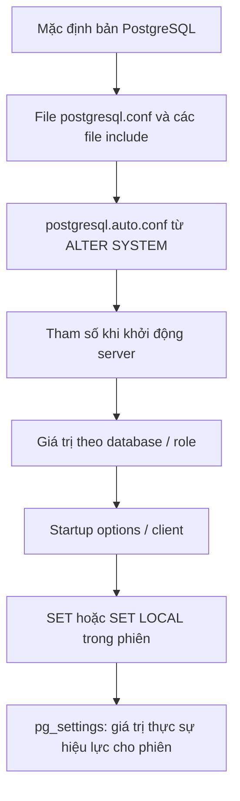
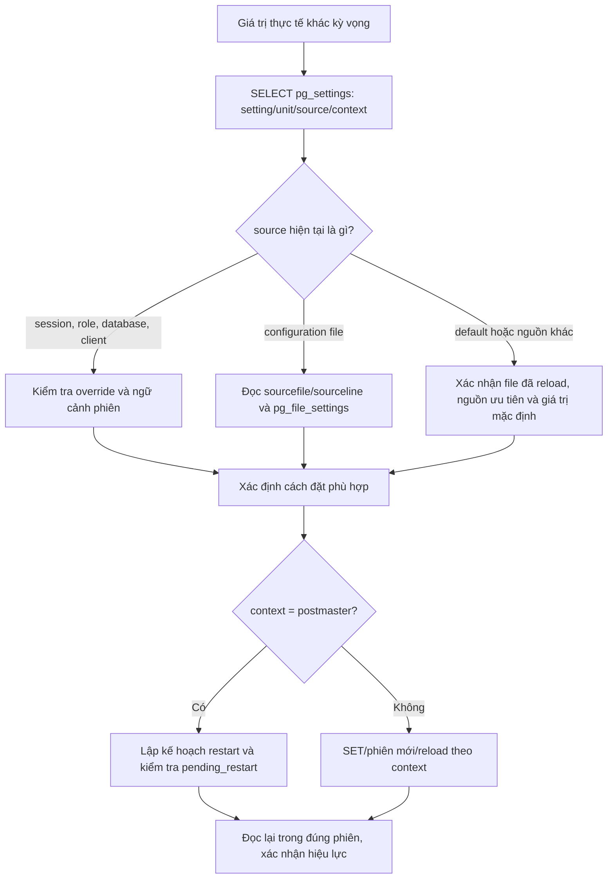

# Tra cứu giá trị, nguồn cấu hình và đơn vị qua pg_settings trong PostgreSQL

Một máy chủ PostgreSQL có hàng trăm tham số cấu hình: giới hạn kết nối, bộ nhớ cho truy vấn, bộ đệm dùng chung, mức ghi log, thời gian chờ, cơ chế WAL và nhiều tùy chọn khác. Khi một truy vấn chậm hoặc cấu hình dường như không có hiệu lực, câu hỏi không chỉ là **“tham số được đặt thành bao nhiêu?”**, mà còn là:

- **Phiên kết nối hiện tại** thực sự đang sử dụng giá trị nào?
- Giá trị đó đến từ **mặc định, file cấu hình, dòng lệnh, database, role hay lệnh `SET`**?
- Con số trong kết quả tính bằng **byte, kB, khối 8 kB, mili giây** hay không có đơn vị?
- Tham số có thể thay đổi **ngay trong phiên, sau reload hay chỉ sau restart**?
- Người quản trị đã sửa file nhưng giá trị đang chạy chưa đổi: **có đang chờ restart không**?

PostgreSQL cung cấp system view **`pg_settings`** để trả lời những câu hỏi đó. Đây là công cụ trung tâm khi kiểm tra cấu hình thực tế thay vì chỉ đọc một dòng trong `postgresql.conf` rồi giả định máy chủ đã dùng nó.

Bài học thuộc phần **Cấu hình** của module *Database Engine Relational PostgreSQL*, sử dụng SQL chạy trên PostgreSQL hiện đại. Nội dung bao gồm cấu trúc `pg_settings`, cách diễn giải `setting` và `unit`, nhận diện `source` và `sourcefile`, ý nghĩa `context`, phát hiện `pending_restart`, kết hợp `pg_file_settings` và thực hành chẩn đoán cấu hình theo từng phiên.

> **Nguyên tắc an toàn:** Những truy vấn `SELECT` và `SHOW` trong bài chỉ đọc thông tin. Ví dụ `SET` chỉ thay đổi phiên hoặc transaction thực hành. Các lệnh quản trị như `ALTER SYSTEM`, sửa file hoặc restart chỉ được mô tả để hiểu cơ chế; không thực hiện trên production khi chưa có quyền, kế hoạch thay đổi và phương án khôi phục.

## 1. pg_settings là gì?

`pg_settings` là một **system view** trong PostgreSQL, cho phép truy vấn thông tin về các tham số cấu hình còn gọi là **GUC** (*Grand Unified Configuration*).

Thay vì chỉ hiển thị một giá trị, view cung cấp cả metadata:

| Thông tin | Cột tiêu biểu |
|---|---|
| Tên tham số | `name` |
| Giá trị hiệu lực của phiên hiện tại | `setting` |
| Đơn vị của giá trị dạng số | `unit` |
| Nhóm cấu hình | `category` |
| Mô tả ngắn, mô tả bổ sung | `short_desc`, `extra_desc` |
| Thời điểm/phạm vi được phép thay đổi | `context` |
| Kiểu tham số | `vartype` |
| Nguồn giá trị hiệu lực | `source` |
| Giá trị nhỏ nhất, lớn nhất hoặc tập enum | `min_val`, `max_val`, `enumvals` |
| Giá trị mặc định khi xây dựng server | `boot_val` |
| Giá trị nếu thực hiện RESET trong phiên | `reset_val` |
| File/dòng cung cấp giá trị từ file | `sourcefile`, `sourceline` |
| Cấu hình mới đang cần restart | `pending_restart` |

Truy vấn đơn giản nhất:

```sql
SELECT name, setting, unit, source
FROM pg_settings
ORDER BY name;
```

Kết quả có thể có hàng trăm dòng tùy phiên bản PostgreSQL và extension đã nạp. Không cần ghi nhớ mọi tham số; điều quan trọng là biết **lọc đúng tham số và đọc đúng metadata của nó**.

### 1.1. pg_settings là góc nhìn của phiên kết nối

Điểm rất dễ nhầm: kết quả `pg_settings.setting` thể hiện **giá trị đang hiệu lực trong phiên hiện tại** đối với tham số được kiểm tra. Nếu một kết nối đã chạy `SET work_mem = '32MB'`, phiên đó có thể thấy giá trị khác với kết nối khác dùng cấu hình mặc định.

```text
                      PostgreSQL instance
                              |
              +---------------+---------------+
              |                               |
       Phiên A: work_mem=4MB            Phiên B: SET work_mem=32MB
              |                               |
      pg_settings của A                  pg_settings của B
      phản ánh 4MB                       phản ánh 32MB
```

Vì vậy, **không** dùng một truy vấn `SELECT * FROM pg_settings` trong phiên A rồi kết luận mọi kết nối đang hoạt động có cùng giá trị, đặc biệt với tham số có thể thay đổi theo role, database, client hoặc session.

### 1.2. pg_settings khác việc đọc postgresql.conf

Một tham số có thể có nhiều nguồn khai báo và nhiều tầng ưu tiên. Chỉ thấy:

```conf
work_mem = '16MB'
```

trong một file không chứng minh phiên hiện tại đang dùng 16 MB. Một role có thể có cấu hình riêng, lệnh `SET` có thể ghi đè, file chưa reload, hoặc một file được đọc sau có giá trị khác. `pg_settings` cho biết **giá trị đang được dùng và nguồn hiệu lực** của phiên đang truy vấn.

## 2. Ba cách tra nhanh: SHOW, current_setting và pg_settings

### 2.1. SHOW: đọc một giá trị

```sql
SHOW work_mem;
SHOW shared_buffers;
SHOW statement_timeout;
SHOW max_connections;
```

`SHOW` rất thuận tiện khi chỉ cần một giá trị hiển thị dễ đọc. Ví dụ:

```text
 work_mem
----------
 4MB
```

Giá trị cụ thể là ví dụ, không phải mặc định bắt buộc của mọi cài đặt.

### 2.2. current_setting(): đưa kết quả vào biểu thức SQL

```sql
SELECT current_setting('work_mem') AS work_mem_hien_tai;

SELECT
    current_setting('statement_timeout') AS gioi_han_lenh,
    current_setting('TimeZone') AS mui_gio;
```

Hàm `current_setting` thích hợp khi cần đưa giá trị vào biểu thức, kết hợp nhiều tham số hoặc kiểm tra trong code SQL.

Nếu kiểm tra một tham số tùy chọn có thể chưa được định nghĩa, PostgreSQL hỗ trợ tham số thứ hai:

```sql
SELECT current_setting('myapp.feature_flag', true)
    AS custom_setting_neu_co;
```

Giá trị `true` của `missing_ok` giúp trả `NULL` thay vì báo lỗi khi tham số không tồn tại trong ngữ cảnh phù hợp. Cần lưu ý cơ chế custom GUC và phạm vi tồn tại của tham số có thể phụ thuộc extension hoặc phiên.

### 2.3. pg_settings: đọc cả giá trị, nguồn và đơn vị

```sql
SELECT
    name,
    setting,
    unit,
    source,
    context
FROM pg_settings
WHERE name IN (
    'work_mem',
    'shared_buffers',
    'statement_timeout',
    'max_connections'
)
ORDER BY name;
```

Đây là lựa chọn tốt nhất khi mục tiêu không chỉ là xem một con số mà còn **giải thích vì sao giá trị đó đang có hiệu lực**.

| Công cụ | Trả về | Khi nên dùng |
|---|---|---|
| `SHOW work_mem` | Một giá trị được định dạng để đọc | Kiểm tra nhanh |
| `current_setting('work_mem')` | Giá trị ở dạng văn bản của thiết lập hiện hành | Dùng trong biểu thức SQL |
| `pg_settings` | Giá trị cùng unit, source, context, giới hạn và metadata | Điều tra cấu hình, tạo báo cáo kiểm tra |
| `pg_file_settings` | Những khai báo trong file cấu hình và tình trạng áp dụng/parse | Tìm dòng cấu hình sai hoặc bị ghi đè trong file |

## 3. Đọc đúng name, setting và unit

Một trong những bẫy lớn nhất là hiểu nhầm `pg_settings.setting` luôn mang đơn vị mà người quản trị đã gõ trong file cấu hình.

### 3.1. Cột setting là text; unit quyết định cách diễn giải

`setting` là **giá trị hiện hành dạng văn bản**, nhưng với nhiều tham số dạng số, `unit` biểu thị đơn vị nội bộ của con số đó. Ví dụ minh họa trên một hệ thống có kích thước block PostgreSQL 8 kB thông dụng:

| Tham số | Giá trị có thể thấy từ `SHOW` | `pg_settings.setting` | `unit` | Ý nghĩa |
|---|---|---|---|---|
| `work_mem` | `4MB` | `4096` | `kB` | 4096 kB = 4 MiB theo cách quy đổi sử dụng |
| `shared_buffers` | `128MB` | `16384` | `8kB` | 16384 khối × 8 kB |
| `statement_timeout` | `5s` | `5000` | `ms` | 5000 mili giây |
| `max_connections` | `100` | `100` | `NULL` | Số kết nối, không phải byte hay thời gian |

Đây là **giá trị giả định để minh họa**. Kết quả thật thay đổi theo version, cách build và cấu hình từng máy.

Đặc biệt:

- `unit = 'kB'`: không nhân thêm 1024 rồi gọi đó là số kB; `setting` đã ở đơn vị kB.
- `unit = '8kB'`: `setting` là **số khối** kích thước 8 kB, không phải trực tiếp 16.384 byte hoặc 16.384 kB.
- `unit = 'ms'`: `setting` là số mili giây, không phải giây.
- `unit IS NULL`: tham số không công bố đơn vị vật lý theo cột này, ví dụ số lượng kết nối, boolean hoặc một chuỗi.

Với `shared_buffers`, kích thước khối phụ thuộc tham số kích thước block của bản PostgreSQL. Không hardcode 8 kB nếu phần mềm được build với kích thước block khác.

### 3.2. Tự xem cả dạng hiển thị và dạng nội bộ

```sql
SHOW work_mem;

SELECT
    name,
    setting,
    unit,
    vartype
FROM pg_settings
WHERE name = 'work_mem';
```

Với giá trị 4 MB, hai cách hiển thị có thể khác dạng chữ nhưng tương đương ngữ nghĩa: `SHOW` là `4MB`, `setting` là `4096` và `unit` là `kB`.

### 3.3. Quy đổi một tham số theo đúng đơn vị

Nếu `unit = 'kB'`, ví dụ với `work_mem`:

```sql
SELECT
    name,
    setting,
    unit,
    setting::numeric / 1024 AS gia_tri_mib
FROM pg_settings
WHERE name = 'work_mem'
  AND unit = 'kB';
```

Nếu `unit = '8kB'`, ví dụ với bản PostgreSQL dùng block 8192 byte:

```sql
SELECT
    name,
    setting,
    unit,
    setting::numeric * 8 / 1024 AS gia_tri_mib
FROM pg_settings
WHERE name = 'shared_buffers'
  AND unit = '8kB';
```

Nếu server được build với kích thước block khác, điều kiện `unit = '8kB'` sẽ không khớp; phải kiểm tra thông số thật:

```sql
SHOW block_size;

SELECT name, setting, unit
FROM pg_settings
WHERE name IN ('block_size', 'shared_buffers');
```

Công thức nên **đi từ metadata quan sát được**. Không tạo một câu SQL tổng quát “mọi `setting` nhân 1024 đều là byte”: các tham số có đơn vị thời gian, khối hoặc không có unit.

### 3.4. Đổi thời gian từ mili giây sang giây

```sql
SELECT
    name,
    setting,
    unit,
    setting::numeric / 1000 AS gia_tri_giay
FROM pg_settings
WHERE name = 'statement_timeout'
  AND unit = 'ms';
```

Khi `statement_timeout = 0`, nhiều tham số thời gian dùng 0 với ý nghĩa **vô hiệu hóa giới hạn** thay vì đơn giản “0 giây là hết hạn ngay”. Luôn đọc mô tả của chính tham số; không áp dụng cùng một diễn giải cho mọi setting.

## 4. Tra mô tả, nhóm, kiểu và miền giá trị

`pg_settings` còn giúp người học tìm hiểu tham số mà không phải nhớ trước chức năng của nó.

### 4.1. Tìm tham số theo tên hoặc mô tả

```sql
SELECT
    name,
    category,
    short_desc
FROM pg_settings
WHERE name ILIKE '%timeout%'
ORDER BY name;
```

Tìm theo mô tả:

```sql
SELECT
    name,
    category,
    short_desc,
    extra_desc
FROM pg_settings
WHERE short_desc ILIKE '%memory%'
   OR extra_desc ILIKE '%memory%'
ORDER BY category, name;
```

`ILIKE` so sánh không phân biệt chữ hoa/thường theo quy tắc áp dụng. Nội dung mô tả và tên tham số có thể thay đổi theo phiên bản PostgreSQL; truy vấn giúp tự khám phá trên server thực tế.

### 4.2. Kiểu tham số trong vartype

```sql
SELECT name, setting, vartype, unit
FROM pg_settings
WHERE name IN (
    'enable_seqscan',
    'work_mem',
    'application_name',
    'default_transaction_isolation'
)
ORDER BY name;
```

`vartype` mô tả kiểu giá trị, chẳng hạn:

| Kiểu | Ý nghĩa | Ví dụ tham số |
|---|---|---|
| `bool` | Bật/tắt | `enable_seqscan` |
| `integer` | Số nguyên | `max_connections` |
| `real` | Số thực | Một số tham số chi phí của optimizer |
| `string` | Chuỗi | `application_name` |
| `enum` | Một giá trị trong danh sách | `default_transaction_isolation` |

Tham số kiểu boolean có thể hiện thành `on`/`off` trong cấu hình. Đừng ép kiểu `setting::integer` cho tham số `string` hoặc `enum`.

### 4.3. min_val, max_val và enumvals

```sql
SELECT
    name,
    vartype,
    unit,
    min_val,
    max_val,
    enumvals
FROM pg_settings
WHERE name IN (
    'work_mem',
    'max_connections',
    'default_transaction_isolation'
)
ORDER BY name;
```

Các trường:

- `min_val` và `max_val` mô tả giới hạn hợp lệ cho tham số số, thường cũng biểu diễn dưới dạng text.
- `enumvals` là danh sách các giá trị được hỗ trợ với tham số kiểu enum.
- Các cột không áp dụng có thể là `NULL`.

Giới hạn hợp lệ **không phải giá trị khuyến nghị**. Một giá trị được server chấp nhận có thể quá tốn RAM hoặc gây ảnh hưởng workload khi đặt ở production.

## 5. Nguồn cấu hình: cột source

Để biết giá trị hiện tại được lấy từ đâu:

```sql
SELECT
    name,
    setting,
    unit,
    source
FROM pg_settings
WHERE name IN (
    'work_mem',
    'statement_timeout',
    'log_min_duration_statement',
    'max_connections'
)
ORDER BY name;
```

`source` là một mô tả về **nguồn giá trị hiệu lực**, không phải đường dẫn file. Các giá trị thường gặp:

| Nguồn (`source`) | Cách hiểu |
|---|---|
| `default` | Giá trị mặc định được sử dụng |
| `configuration file` | Giá trị lấy từ file cấu hình đã được áp dụng |
| `command line` | Giá trị truyền cho tiến trình PostgreSQL lúc khởi chạy |
| `environment variable` | Giá trị có nguồn từ biến môi trường trong những trường hợp được PostgreSQL hỗ trợ |
| `database` | Cấu hình mặc định cho database, ví dụ `ALTER DATABASE ... SET` |
| `user` | Cấu hình mặc định cho role, ví dụ `ALTER ROLE ... SET` |
| `database user` | Cấu hình cho một role trong một database cụ thể |
| `client` | Tham số nhận khi khởi tạo kết nối |
| `session` hoặc nguồn tương ứng phiên | Giá trị được thay đổi trong phiên |
| `override` và các nguồn nội bộ khác | Giá trị do cơ chế nội bộ/ưu tiên đặc biệt áp dụng |

Không cần học thuộc mọi chuỗi: nên truy vấn `source` ngay trên server đang điều tra. Một tham số có thể báo `default` vì chưa bị ghi đè dù bạn nhìn thấy một dòng có cùng giá trị trong file khác chưa được áp dụng.

### 5.1. Chuỗi nguồn cấu hình điển hình



Sơ đồ thể hiện **các lớp có thể ảnh hưởng giá trị**, không phải một thứ tự áp dụng cứng phù hợp cho mọi tham số. Tham số có `context` khác nhau sẽ được phép nhận giá trị ở các lớp khác nhau; một số tham số không thể đổi bằng `SET` hay `ALTER ROLE`.

### 5.2. source không phải lịch sử thay đổi

Nếu `source = 'configuration file'`, điều đó nói **giá trị hiệu lực hiện tại có nguồn từ file**; nó không cung cấp lịch sử tất cả lần sửa, không xác nhận ai sửa, và cũng không chứng minh file vừa được reload lần cuối đúng thời điểm dự kiến.

Nếu cần truy vết người thay đổi tham số, phải có hệ thống quản lý cấu hình, version control, audit log hoặc quy trình vận hành tương ứng. `pg_settings` phục vụ **quan sát trạng thái**, không phải hệ thống audit lịch sử.

## 6. Phân biệt boot_val, reset_val và setting

Ba cột này giải quyết ba câu hỏi khác nhau:

| Cột | Câu hỏi |
|---|---|
| `boot_val` | Giá trị mặc định ban đầu khi PostgreSQL được xây dựng là gì? |
| `reset_val` | Nếu dùng `RESET` trong phiên này, giá trị sẽ quay về đâu? |
| `setting` | Ngay lúc truy vấn, phiên hiện tại thực sự đang dùng gì? |

Ví dụ:

```sql
SELECT
    name,
    setting,
    reset_val,
    boot_val,
    unit,
    source
FROM pg_settings
WHERE name = 'work_mem';
```

Giả sử cấu hình chung đặt `work_mem = 8MB`, nhưng kết nối hiện tại chạy `SET work_mem = '64MB'`:

```text
setting   : giá trị trong phiên hiện tại, tương ứng 64MB
reset_val : giá trị mà RESET đưa phiên về, có thể tương ứng 8MB
boot_val  : mặc định của bản build, có thể tương ứng 4MB
```

Đây là ví dụ. `boot_val` không phải “giá trị ngay trước khi SET”, và `reset_val` không nhất thiết giống `boot_val`, vì còn có cấu hình file, database, role hoặc nguồn khởi tạo phiên.

### 6.1. Thực hành SET và RESET an toàn

Trong một kết nối thử nghiệm, trước hết xem:

```sql
SHOW work_mem;

SELECT name, setting, unit, source, reset_val
FROM pg_settings
WHERE name = 'work_mem';
```

Thay đổi **chỉ trong phiên hiện tại**:

```sql
SET work_mem = '32MB';

SHOW work_mem;

SELECT name, setting, unit, source, reset_val
FROM pg_settings
WHERE name = 'work_mem';
```

Sau đó:

```sql
RESET work_mem;

SHOW work_mem;
```

Giá trị có thể quay về cấu hình theo file/database/role của phiên đó chứ không phải mặc định hardcoded. Lệnh `SET` và `RESET` ở ví dụ không sửa `postgresql.conf` và không tự áp dụng cho mọi kết nối khác.

### 6.2. SET LOCAL chỉ sống trong transaction

```sql
BEGIN;

SET LOCAL statement_timeout = '3s';

SHOW statement_timeout;

SELECT
    name, setting, unit, source
FROM pg_settings
WHERE name = 'statement_timeout';

COMMIT;

SHOW statement_timeout;
```

`SET LOCAL` đặt giá trị trong phạm vi transaction hiện tại; sau khi transaction kết thúc, giá trị cũ của phiên được khôi phục theo quy tắc của PostgreSQL. Không chạy `SET LOCAL` ngoài transaction rồi cho rằng nó sẽ áp dụng cho toàn bộ phiên.

**Lưu ý:** `SET` thông thường trong một transaction cũng chịu ngữ nghĩa commit/rollback; nếu transaction bị rollback, những thay đổi `SET` thực hiện trong transaction có thể bị hoàn tác. Ở connection pool, phải thiết kế việc khôi phục tham số phiên để không rò giá trị từ một request sang request sau.

## 7. context cho biết cần SET, RELOAD hay RESTART

Không phải tham số nào cũng được thay đổi ở mọi thời điểm. Cột **`context`** mô tả **điều kiện áp dụng** của mỗi setting.

```sql
SELECT
    name,
    setting,
    context,
    source,
    pending_restart
FROM pg_settings
WHERE name IN (
    'max_connections',
    'shared_buffers',
    'log_min_duration_statement',
    'work_mem',
    'statement_timeout'
)
ORDER BY name;
```

Các giá trị `context` thường gặp:

| context | Ý nghĩa khái quát |
|---|---|
| `internal` | Thông tin nội bộ, thường không thể thay đổi bằng cấu hình thông thường |
| `postmaster` | Tham số áp dụng khi khởi động server; thay đổi cần **restart** |
| `sighup` | Có thể thay đổi qua file cấu hình rồi **reload** để áp dụng |
| `superuser-backend` | Cần được thiết lập trước/ở đầu kết nối theo quyền phù hợp, không tùy ý đổi giữa phiên |
| `backend` | Thường chỉ có thể thay ở lúc bắt đầu backend/connection, không bằng SET giữa phiên |
| `superuser` | Có thể thay đổi trong phiên nếu người thực hiện có quyền cấu hình phù hợp |
| `user` | Có thể thiết lập trong phiên với quyền thông thường, theo các quy tắc áp dụng |

Giới hạn quyền thực tế còn phụ thuộc quyền `SET` trên tham số, phiên bản PostgreSQL và chính sách hệ thống. `context` không phải bảng phân quyền hoàn chỉnh.

### 7.1. Ví dụ tham số cần restart

`max_connections` và `shared_buffers` là các ví dụ điển hình của `context = 'postmaster'`. Khi giá trị trong cấu hình được thay đổi, reload có thể **đọc được giá trị mới nhưng không áp dụng nó vào tiến trình đang chạy**; server cần restart để giá trị mới có hiệu lực.

### 7.2. Ví dụ tham số có thể đổi trong phiên

`work_mem` và `statement_timeout` thường thuộc nhóm `context = 'user'`. Một role có quyền phù hợp có thể dùng:

```sql
SET work_mem = '16MB';
SET statement_timeout = '5s';
```

Những thay đổi này chỉ áp dụng cho phiên đang chạy hoặc phạm vi được chỉ định, không phải thay toàn hệ thống.

### 7.3. Ví dụ tham số thuộc nhóm reload

Một tham số như `log_checkpoints` thường được cấu hình ở mức server và có thể áp dụng sau khi reload cấu hình, tùy phiên bản và quy tắc chính xác của tham số.

Để chắc chắn, hãy xem:

```sql
SELECT name, context, source
FROM pg_settings
WHERE name = 'log_checkpoints';
```

Không suy từ tên tham số rằng nó chắc chắn có thể thay ngay. **Tra `context` thực tế** là cách nhất quán hơn.

## 8. sourcefile, sourceline và quyền quan sát

Khi giá trị đang hiệu lực đến từ file, PostgreSQL có thể cung cấp đường dẫn file và số dòng.

```sql
SELECT
    name,
    setting,
    unit,
    source,
    sourcefile,
    sourceline
FROM pg_settings
WHERE name IN (
    'work_mem',
    'shared_buffers',
    'log_min_duration_statement'
)
ORDER BY name;
```

Ví dụ kết quả minh họa:

| name | source | sourcefile | sourceline |
|---|---|---|---:|
| `work_mem` | `configuration file` | `/etc/postgresql/.../postgresql.conf` | 145 |
| `shared_buffers` | `configuration file` | `/var/lib/postgresql/.../postgresql.auto.conf` | 3 |
| `statement_timeout` | `default` | `NULL` | `NULL` |

**Không coi những đường dẫn trên là đường dẫn chuẩn cho mọi máy.** Hệ điều hành, package và cách triển khai quyết định vị trí thực tế.

### 8.1. Vì sao sourcefile có thể NULL?

`sourcefile` hoặc `sourceline` có thể `NULL` khi:

- Giá trị hiệu lực không đến từ file cấu hình, ví dụ `default`, `SET` hoặc một nguồn khác.
- User truy vấn **không đủ quyền xem thông tin nguồn file**.
- Tham số hiện tại đang bị một nguồn ưu tiên cao hơn ghi đè, nên nguồn hiệu lực không phải file.

Vì đường dẫn cấu hình có thể lộ thông tin nhạy cảm về hạ tầng, PostgreSQL hạn chế những cột này: thông thường người dùng cần là superuser hoặc có quyền đọc toàn bộ setting phù hợp, ví dụ qua role được cấp **`pg_read_all_settings`**, để xem thông tin đầy đủ.

**Không diễn giải `sourcefile IS NULL` thành “không có file cấu hình”.** Hãy xem `source`, quyền hiện tại và nguồn override.

### 8.2. Kiểm tra vị trí cấu hình hiện hành

Với quyền phù hợp:

```sql
SHOW config_file;
SHOW data_directory;
SHOW hba_file;
```

Những kết quả này giúp biết PostgreSQL đang dùng cấu hình ở đâu. Một số tham số có thể bị hạn chế hiển thị theo phân quyền của môi trường. Tránh suy luận đường dẫn dựa vào một hướng dẫn khác bản phân phối.

### 8.3. include, include_if_exists và include_dir

`postgresql.conf` có thể bao gồm file khác:

```conf
# Ví dụ minh họa cú pháp include.
include = 'memory.conf'
include_if_exists = 'local-overrides.conf'
include_dir = 'conf.d'
```

Do đó, dòng cấu hình thực sự hiệu lực có thể nằm trong **file được include**, không phải file chính. `sourcefile` và `sourceline` giúp tìm đúng nơi khai báo hiện hành khi có quyền.

Ngoài ra, `ALTER SYSTEM` thường ghi vào **`postgresql.auto.conf`**, một file cấu hình được PostgreSQL quản lý, có thể ghi đè giá trị ở `postgresql.conf` theo quy tắc thứ tự đọc. Không nên chỉnh `postgresql.auto.conf` thủ công khi dùng quy trình quản trị được hỗ trợ.

## 9. pending_restart: đã đọc cấu hình nhưng chưa thể áp dụng

Cột **`pending_restart`** đặc biệt hữu ích khi ai đó đã sửa tham số cần restart nhưng server chưa khởi động lại.

```sql
SELECT
    name,
    setting,
    unit,
    context,
    source,
    pending_restart
FROM pg_settings
WHERE pending_restart
ORDER BY name;
```

Ý nghĩa:

- `pending_restart = false`: đối với tham số được trả về, PostgreSQL không đang báo có một thay đổi từ cấu hình file cần restart để áp dụng.
- `pending_restart = true`: có thay đổi cấu hình đã được nhận biết nhưng **chưa thể áp dụng đầy đủ nếu chưa restart**.

`pending_restart` không phải phép kiểm chứng duy nhất rằng mọi sửa đổi file đều hợp lệ hoặc được áp dụng. Một file còn lỗi cú pháp, chưa reload, hoặc có dòng bị override có thể cần được chẩn đoán bằng `pg_file_settings` và log.

### 9.1. Tình huống max_connections

Giả sử source cấu hình đang chạy:

```text
max_connections = 100
```

Người quản trị hợp lệ thay đổi file thành:

```conf
max_connections = 200
```

Sau khi reload, vì `max_connections` thuộc ngữ cảnh yêu cầu restart, PostgreSQL có thể tiếp tục dùng **100** nhưng báo `pending_restart = true`.

```sql
SELECT
    name,
    setting,
    context,
    pending_restart
FROM pg_settings
WHERE name = 'max_connections';
```

Không nên chẩn đoán “reload hỏng” chỉ vì `setting` chưa thành 200. Trong tình huống này, **restart có kiểm soát** là bước cần thiết để thay đổi hiệu lực, miễn cấu hình mới hợp lệ và hạ tầng đủ tài nguyên.

### 9.2. Vì sao không restart ngay theo phản xạ?

Restart sẽ ảnh hưởng các kết nối, giao dịch và thời gian dịch vụ. Người vận hành phải:

- Xác nhận chính xác tham số đang pending.
- Đánh giá tài nguyên khi đặt giá trị mới.
- Chuẩn bị bảo trì hoặc quy trình HA/failover phù hợp.
- Kiểm tra file cấu hình không có lỗi khác.
- Có phương án khôi phục nếu server không thể khởi động với cấu hình mới.

Một câu truy vấn `pg_settings` là bước điều tra, **không phải giấy phép dừng server ngay lập tức**.

## 10. pg_file_settings: đối chiếu những dòng khai báo trong file

`pg_settings` cho biết **giá trị hiệu lực của phiên**. Khi cần xem **những dòng thực sự được parse từ file cấu hình**, PostgreSQL còn cung cấp view **`pg_file_settings`**.

```sql
SELECT
    sourcefile,
    sourceline,
    seqno,
    name,
    setting,
    applied,
    error
FROM pg_file_settings
ORDER BY seqno;
```

Các cột:

| Cột | Vai trò |
|---|---|
| `sourcefile` | File chứa khai báo |
| `sourceline` | Dòng trong file |
| `seqno` | Thứ tự xử lý các khai báo |
| `name` | Tên tham số được khai báo |
| `setting` | Giá trị khai báo ở file |
| `applied` | Trạng thái áp dụng/ưu tiên của bản ghi cấu hình |
| `error` | Thông tin lỗi parse hoặc lý do không thể áp dụng nếu có |

`pg_file_settings` có thể chứa các dòng **không phải giá trị cuối cùng được áp dụng**, chẳng hạn một tham số được khai báo nhiều lần hoặc một dòng có lỗi. Nếu có nhiều nơi đặt cùng setting, cần đọc `seqno`, `applied`, `error` và so sánh `pg_settings`.

### 10.1. Kiểm tra chỉ một tham số

```sql
SELECT
    sourcefile,
    sourceline,
    seqno,
    name,
    setting,
    applied,
    error
FROM pg_file_settings
WHERE name = 'work_mem'
ORDER BY seqno;
```

Ví dụ có hai khai báo `work_mem`:

```conf
# postgresql.conf
work_mem = '8MB'

# conf.d/reporting.conf
work_mem = '16MB'
```

Nếu file sau được đọc theo thứ tự ghi đè file trước, giá trị hiệu lực từ file có thể là **16MB**. Không đủ để kết luận chỉ bằng tên file: phải xem **thứ tự xử lý và nguồn thực tế**.

### 10.2. Lọc dòng có lỗi

```sql
SELECT
    sourcefile,
    sourceline,
    name,
    setting,
    error
FROM pg_file_settings
WHERE error IS NOT NULL
ORDER BY seqno;
```

Đây là truy vấn tốt khi reload thất bại, một tham số đặt sai kiểu, không đúng ngữ cảnh hoặc có vấn đề trong file. Tuy vậy, view phản ánh thông tin đọc/parse file theo cơ chế của server, và để thấy đầy đủ tình trạng áp dụng thực tế vẫn cần `pg_settings` cùng server log.

### 10.3. Quyền xem pg_file_settings

`pg_file_settings` có thể tiết lộ đường dẫn và nội dung cấu hình. Theo thiết lập quyền mặc định, việc đọc thường bị hạn chế cho tài khoản quản trị có đặc quyền; quản trị viên có thể cấp quyền đọc cụ thể trong chính sách thích hợp. Không dùng yêu cầu “chỉ muốn xem config” làm lý do cấp superuser cho ứng dụng.

## 11. Reload cấu hình so với restart server

Sau khi sửa file PostgreSQL, có hai loại thay đổi:

- **Tham số có thể reload:** yêu cầu PostgreSQL đọc lại file cấu hình mà không dừng toàn bộ instance.
- **Tham số postmaster:** cần restart để có hiệu lực.

Với quyền phù hợp, có thể yêu cầu gửi tín hiệu reload:

```sql
SELECT pg_reload_conf();
```

Hàm trả về giá trị phản ánh việc gửi tín hiệu yêu cầu reload, **không phải lời bảo đảm rằng mọi tham số trong file đều hợp lệ hoặc đã có hiệu lực**. Sau đó vẫn phải kiểm tra `pg_settings`, `pending_restart`, `pg_file_settings` và log nếu nghi ngờ lỗi.

Một công cụ quản trị dòng lệnh cũng có thao tác reload, ví dụ:

```bash
# Chỉ minh họa cú pháp khi đã xác định đúng PGDATA và account quản trị.
pg_ctl -D /path/to/actual/PGDATA reload
```

Không chạy `pg_ctl` với đường dẫn đoán mò và không thao tác restart/reload trên server người khác chỉ để thử câu lệnh.

### 11.1. Bảng quyết định

| Hiện tượng | Điều nên kiểm tra | Cách xử lý thường gặp |
|---|---|---|
| Sửa `work_mem` trong file nhưng giá trị cũ | File nào được đọc, reload, source, override | Reload, kiểm tra nguồn ưu tiên và kết nối mới nếu cần |
| Sửa `max_connections` nhưng không đổi | `context = postmaster`, `pending_restart` | Lập kế hoạch restart |
| `pg_reload_conf()` trả true nhưng setting không đổi | File sai, tham số cần restart, nguồn ưu tiên khác | Xem `pg_file_settings`, `pg_settings` và log |
| `pg_settings.sourcefile` là NULL | Source không từ file hoặc thiếu quyền | Xem `source`, quyền `pg_read_all_settings` |
| Session A thấy khác B | Có `SET`, role/db defaults hoặc timing khác | Kiểm tra nguồn từng phiên, ngữ cảnh và lúc tạo kết nối |

## 12. SET, ALTER ROLE, ALTER DATABASE và ALTER SYSTEM khác nhau

Một tham số có thể được thiết lập ở nhiều phạm vi. Phải hiểu **nơi thay đổi có hiệu lực** mới có thể đọc đúng `source`.

### 12.1. SET và SET LOCAL

```sql
-- Ảnh hưởng phiên hiện tại.
SET statement_timeout = '5s';

-- Ảnh hưởng transaction hiện tại.
BEGIN;
SET LOCAL work_mem = '16MB';
SELECT current_setting('work_mem');
COMMIT;

-- Khôi phục thiết lập phiên.
RESET statement_timeout;
```

Những thao tác này không sửa cấu hình chung cho mọi phiên. Sau khi SET, `pg_settings` có thể cho biết nguồn hiệu lực theo phiên; sau `RESET`, giá trị quay về cơ sở cấu hình của phiên đó.

### 12.2. ALTER DATABASE: cấu hình mặc định cho kết nối vào database

Với quyền phù hợp:

```sql
-- Ví dụ quản trị, không chạy trên production khi chưa được duyệt.
ALTER DATABASE appdb SET statement_timeout = '10s';
```

Thiết lập này thường ảnh hưởng **các kết nối mới** vào `appdb`; các kết nối đang mở không tự đổi toàn bộ thiết lập chỉ vì lệnh đã chạy. Khi kết nối mới vào `appdb`, `pg_settings.source` có thể cho biết nguồn `database` nếu không có giá trị ưu tiên cao hơn.

### 12.3. ALTER ROLE: mặc định cho một role

```sql
ALTER ROLE report_user SET work_mem = '32MB';
```

Đây cũng là thao tác quản trị áp dụng cho các **phiên mới của role**, không phải ép toàn bộ phiên đã kết nối thay đổi ngay.

### 12.4. ALTER ROLE IN DATABASE: phạm vi giao của role và database

```sql
ALTER ROLE report_user IN DATABASE appdb
    SET statement_timeout = '20s';
```

Trong trường hợp này, nguồn hiệu lực có thể thể hiện dạng `database user`. Khi cần điều tra một tham số chỉ có giá trị khác trong một database cho một role, đây là lớp cần kiểm tra.

### 12.5. ALTER SYSTEM: ghi file cấu hình cấp server

```sql
-- Lệnh quản trị có thể ảnh hưởng toàn instance.
-- Không chạy trên môi trường thật nếu chưa có kế hoạch.
ALTER SYSTEM SET work_mem = '16MB';
```

`ALTER SYSTEM` ghi cấu hình vào `postgresql.auto.conf` dưới thư mục dữ liệu. Với tham số phù hợp, phải **reload** cấu hình; với tham số cần restart, phải **restart** mới áp dụng. `ALTER SYSTEM` yêu cầu đặc quyền thích hợp và không được chạy trong transaction block.

Không dùng `ALTER SYSTEM` như phương án mặc định để sửa một tham số chỉ cần thay trong phiên chạy báo cáo. Cấu hình toàn instance có thể ảnh hưởng mọi dịch vụ và làm tăng rủi ro tài nguyên.

### 12.6. Bảng so sánh phạm vi

| Cách đặt | Phạm vi | Khi thường có hiệu lực |
|---|---|---|
| `SET name = value` | Phiên hiện tại | Ngay trong phiên, nếu context/quyền cho phép |
| `SET LOCAL name = value` | Transaction hiện tại | Trong transaction, khôi phục sau khi kết thúc |
| `ALTER DATABASE ... SET` | Các kết nối mới vào database | Khi phiên mới bắt đầu |
| `ALTER ROLE ... SET` | Các kết nối mới của role | Khi phiên mới bắt đầu |
| `ALTER ROLE ... IN DATABASE ... SET` | Các kết nối mới của role trong DB cụ thể | Khi phiên mới bắt đầu |
| `postgresql.conf` và file include | Server/instance, tùy context | Sau reload hoặc restart |
| `ALTER SYSTEM SET` | Cấu hình chung qua `postgresql.auto.conf` | Sau reload hoặc restart |
| Tham số dòng lệnh khi khởi động | Tiến trình PostgreSQL | Theo cách khởi động, với mức ưu tiên phù hợp |

**Không mặc định mọi tham số có thể dùng mọi cách đặt.** Cột `context` và chính sách quyền quyết định điều gì hợp lệ.

## 13. Một phiên A và một phiên B nhìn thấy giá trị khác nhau

Mở hai kết nối `psql` độc lập cùng server và database.

**Phiên A:**

```sql
SELECT
    name, setting, unit, source
FROM pg_settings
WHERE name = 'work_mem';

SET work_mem = '32MB';

SELECT
    name, setting, unit, source
FROM pg_settings
WHERE name = 'work_mem';
```

**Phiên B:**

```sql
SELECT
    name, setting, unit, source
FROM pg_settings
WHERE name = 'work_mem';
```

Phiên A có thể thấy 32 MB, trong khi B vẫn dùng giá trị khởi tạo của B. Điều này bình thường: `SET` thường là thay đổi **cấp phiên**.

Trở lại A:

```sql
RESET work_mem;
```

Kết quả trong A sẽ về `reset_val` thích hợp. Nếu ứng dụng dùng connection pool, hãy cân nhắc việc trả connection về pool khi nó còn mang một `SET` từ request trước; nên bảo đảm cơ chế reset trạng thái connection.

## 14. Cách lập báo cáo cấu hình gọn và dễ đọc

### 14.1. Báo cáo các tham số tài nguyên cơ bản

```sql
SELECT
    name,
    setting,
    unit,
    vartype,
    source,
    context,
    pending_restart
FROM pg_settings
WHERE name IN (
    'shared_buffers',
    'work_mem',
    'maintenance_work_mem',
    'max_connections',
    'effective_cache_size',
    'wal_level'
)
ORDER BY name;
```

Với báo cáo nhiều máy, nên kèm **server_version** và thời điểm thu thập vì các mặc định/đơn vị/tính năng có thể khác giữa các bản:

```sql
SELECT
    current_setting('server_version') AS phien_ban,
    now() AS thoi_diem_truy_van;
```

Lưu ý `now()` là thời điểm bắt đầu transaction hiện tại. Nếu cần timestamp theo đồng hồ tại lúc truy vấn thực tế, có thể dùng `clock_timestamp()` thay vì coi `now()` luôn cập nhật mỗi câu lệnh trong một transaction dài.

### 14.2. Tìm những tham số không dùng default

```sql
SELECT
    name,
    setting,
    unit,
    source,
    context
FROM pg_settings
WHERE source <> 'default'
ORDER BY source, name;
```

Truy vấn này giúp khoanh vùng cấu hình đang chịu override. Nhưng **`source <> 'default'` không đồng nghĩa “tham số đã bị ai đó cấu hình sai”**: môi trường hoặc tiến trình PostgreSQL có thể có override hợp lệ.

### 14.3. Tìm tham số đang chờ restart

```sql
SELECT
    name,
    setting,
    context,
    source,
    sourcefile,
    sourceline
FROM pg_settings
WHERE pending_restart
ORDER BY name;
```

Kết quả trống chỉ có nghĩa **phiên đang truy vấn không báo tham số nào trong view có pending_restart tại lúc đó**; vẫn có thể còn file chưa reload hoặc lỗi cấu hình cần kiểm tra riêng.

### 14.4. Tìm cấu hình theo nhóm

```sql
SELECT
    category,
    name,
    setting,
    unit,
    short_desc
FROM pg_settings
WHERE category ILIKE '%Resource Usage%'
ORDER BY category, name;
```

`category` giúp tìm hiểu các tham số liên quan mà không cần biết trước mọi tên. Tên category/mô tả có thể thay đổi giữa các phiên bản.

## 15. Điều tra một cấu hình “đã sửa nhưng không có hiệu lực”

Xét ca trực vận hành: một người cho biết đã đổi `work_mem` thành 64 MB nhưng ứng dụng vẫn dùng 4 MB.

Quy trình điều tra:

### Bước 1 — Đo giá trị hiệu lực trong đúng phiên

```sql
SHOW work_mem;

SELECT
    name,
    setting,
    unit,
    source,
    context,
    reset_val,
    pending_restart
FROM pg_settings
WHERE name = 'work_mem';
```

Nếu chỉ dùng `SHOW` trong connection quản trị, vẫn chưa chứng minh ứng dụng có cùng giá trị. Nên thu thông tin trong connection ứng dụng hoặc một phiên mới cùng role/database và cơ chế startup tương đương.

### Bước 2 — Xác định nguồn ưu tiên

Nếu `source` là `user` hay `database user`, kiểm tra `ALTER ROLE`/`ALTER DATABASE` và session defaults. Nếu nguồn là `session` hoặc dạng tương đương, tìm lệnh `SET` hoặc connection pool thiết lập tham số khi mở.

Nếu `source = 'configuration file'`, kiểm tra `sourcefile`/`sourceline` khi có quyền.

### Bước 3 — Kiểm tra file thực sự được parse

```sql
SELECT
    sourcefile,
    sourceline,
    seqno,
    name,
    setting,
    applied,
    error
FROM pg_file_settings
WHERE name = 'work_mem'
ORDER BY seqno;
```

Nếu có hai dòng cấu hình hoặc một file bị override bởi `postgresql.auto.conf`, hãy xử lý ở lớp nguồn đúng. Nếu file chưa reload hoặc có lỗi, tiến hành theo quy trình thay đổi cấu hình.

### Bước 4 — Kiểm tra context và pending_restart

```sql
SELECT name, context, pending_restart
FROM pg_settings
WHERE name = 'work_mem';
```

`work_mem` là tham số thay đổi được trong phiên, nên nếu giá trị không đổi nguyên nhân thường không phải nó thuộc nhóm `postmaster`. Nhưng đừng áp dụng kết luận đó cho `shared_buffers` hay `max_connections`.

### Bước 5 — Xem log và xác nhận lại

`pg_reload_conf()` thành công ở mức gửi tín hiệu không có nghĩa tất cả file đều đúng. Xem server log, `pg_file_settings`, `pg_settings` và đọc lại trong **đúng phiên** sau khi xác định cơ chế có hiệu lực.

### 15.1. Sơ đồ quyết định



## 16. Các nhầm lẫn cần tránh

**1. “setting = 4096 nghĩa là 4096 byte.”** Không đúng nếu `unit = 'kB'`; với `work_mem`, đó là 4096 kB.

**2. “shared_buffers = 16384 nghĩa là 16 MB.”** Không nhất thiết. Nếu `unit = '8kB'` thì 16.384 × 8 kB = 128 MB.

**3. “SHOW và pg_settings.setting phải cùng chuỗi.”** Không bắt buộc. `SHOW` định dạng giá trị dễ đọc, còn `setting` thường là số ở đơn vị nội bộ.

**4. “sourcefile NULL nghĩa là không đọc postgresql.conf.”** Không. Có thể do giá trị đến từ nguồn khác hoặc thiếu quyền xem đường dẫn.

**5. “source = configuration file nghĩa là giá trị nằm trong postgresql.conf chính.”** Không chắc. Nó có thể từ file include hoặc `postgresql.auto.conf`.

**6. “Đã sửa file thì ngay lập tức có hiệu lực.”** Sai. Có tham số cần reload, có tham số cần restart.

**7. “pg_reload_conf() trả true là mọi tham số đã áp dụng.”** Sai. Cần kiểm tra `pg_settings`, `pg_file_settings`, `pending_restart` và log.

**8. “pending_restart = false chắc chắn không có lỗi config.”** Sai. File có thể chưa reload hoặc có lỗi độc lập; `pending_restart` chỉ báo một loại trạng thái.

**9. “ALTER SYSTEM sửa toàn bộ phiên đang mở ngay lập tức.”** Sai. Còn phụ thuộc context, reload/restart và việc các backend đang dùng override theo phiên.

**10. “SET work_mem trong một connection thay mọi connection.”** Sai. Thay đổi `SET` thường chỉ ảnh hưởng phiên hiện tại.

**11. “reset_val luôn bằng boot_val.”** Sai. `reset_val` có thể phản ánh cấu hình theo file, database hoặc role.

**12. “source khác default là cấu hình sai.”** Sai. Phần lớn hệ thống sản xuất có override cần thiết, phải đánh giá theo workload.

**13. “work_mem 64MB nghĩa là toàn PostgreSQL chỉ dùng tối đa 64MB cho sort/hash.”** Sai. Ngân sách này có thể áp dụng cho nhiều thao tác trong từng truy vấn và nhiều kết nối đồng thời.

**14. “Cứ thấy context superuser thì phải cấp SUPERUSER cho ứng dụng.”** Không. Quyền `SET` trên tham số và vai trò quản trị phải được đánh giá với PostgreSQL version; nguyên tắc là hạn chế quyền.

## 17. Bài tập thực hành có lời giải

### Bài 1 — Tìm đơn vị của một tham số

**Yêu cầu:** kiểm tra `work_mem` và `statement_timeout`, ghi lại setting, unit và source của phiên hiện tại.

**SQL:**

```sql
SELECT name, setting, unit, source
FROM pg_settings
WHERE name IN ('work_mem', 'statement_timeout')
ORDER BY name;
```

**Đáp án:** Không có một cặp số cố định cho mọi máy; đọc giá trị server trả về. `work_mem` thường có unit `kB`, `statement_timeout` thường có unit `ms`. Đừng so sánh hai giá trị bằng số học nếu chưa quy đổi đúng đơn vị.

### Bài 2 — Quy đổi work_mem

Server trả `setting = 8192` và `unit = 'kB'` cho `work_mem`.

**Hỏi:** Tương đương bao nhiêu MiB?

**Đáp án:** 8192 / 1024 = **8 MiB**.

### Bài 3 — Quy đổi shared_buffers

Server trả `setting = 16384` và `unit = '8kB'` cho `shared_buffers`.

**Hỏi:** Tương đương khoảng bao nhiêu MiB?

**Đáp án:** 16384 × 8 / 1024 = **128 MiB**.

### Bài 4 — Hai phiên khác giá trị

Phiên A chạy `SET work_mem = '32MB'`, phiên B không chạy `SET` và tiếp tục dùng `4MB`.

**Hỏi:** Có phải PostgreSQL bị lỗi cấu hình?

**Đáp án:** Không. `pg_settings` thể hiện giá trị hiệu lực **theo phiên**. `SET` của A không mặc nhiên đổi B.

### Bài 5 — Giá trị mới cần restart

Quản trị viên sửa `max_connections` từ 100 sang 200 và reload. `pg_settings` vẫn báo 100, `context='postmaster'` và `pending_restart=true`.

**Đáp án:** Server chưa áp dụng giá trị mới vì tham số cần restart. Cần lập kế hoạch restart có kiểm soát và xác nhận khả năng đáp ứng tài nguyên; không tiếp tục reload liên tục với kỳ vọng tự chuyển thành 200.

### Bài 6 — Không xem được sourcefile

User thường thấy `source = 'configuration file'` nhưng `sourcefile` là `NULL`.

**Đáp án:** Có thể thiếu quyền đọc đường dẫn nguồn cấu hình. Cần nhờ người có quyền phù hợp xem thông tin, không coi NULL là bằng chứng file không tồn tại.

### Bài 7 — RESET về đâu?

`boot_val` tương đương 4 MB, `reset_val` tương đương 8 MB, phiên hiện tại đã `SET work_mem = '64MB'`.

**Hỏi:** `RESET work_mem` về 4 MB hay 8 MB?

**Đáp án:** Theo `reset_val` của phiên, tức **8 MB** trong tình huống giả định.

### Bài 8 — Dòng khai báo bị ghi đè

`postgresql.conf` đặt `work_mem = '8MB'`; file include được xử lý sau đặt `work_mem = '16MB'`. Người quản trị thấy 16 MB đang có hiệu lực.

**Đáp án:** Có thể giải thích bằng thứ tự ưu tiên file. Dùng `pg_file_settings` với `seqno`, `applied`, `error` và `pg_settings.sourcefile/sourceline` để xác nhận vị trí dòng cuối có hiệu lực.

### Bài 9 — Lập truy vấn giám sát

**Yêu cầu:** liệt kê mọi tham số đang đợi restart cùng nguồn.

**Đáp án:**

```sql
SELECT
    name,
    setting,
    unit,
    context,
    source,
    pending_restart
FROM pg_settings
WHERE pending_restart
ORDER BY name;
```

Nếu kết quả trống, không có tham số nào được view đánh dấu pending tại thời điểm đọc; không suy ra mọi file cấu hình chắc chắn đã đúng.

### Bài 10 — Sửa tham số cho riêng báo cáo

Một ứng dụng chỉ cần `work_mem = '64MB'` cho một transaction báo cáo, nhưng không muốn đổi cấu hình toàn hệ thống.

**Đáp án:** Nếu quyền cho phép, dùng `BEGIN; SET LOCAL work_mem = '64MB'; ...; COMMIT;`. Giá trị chỉ hiệu lực trong transaction tương ứng. Tuy nhiên cần đánh giá lượng bộ nhớ mỗi thao tác và số transaction đồng thời để tránh vượt tài nguyên.

## 18. Quy trình kiểm tra cấu hình có thể dùng lại

Khi tiếp nhận một yêu cầu “tham số PostgreSQL không đúng”, hãy đi theo trình tự:

1. **Xác định đúng server và phiên:** dùng `SELECT version()`, `current_database()`, `current_user` nếu cần; đừng kiểm tra nhầm replica hoặc môi trường.
2. **Đọc giá trị hiện hành:** `SHOW` hoặc `current_setting` cho kiểm tra nhanh.
3. **Lấy metadata:** `SELECT name, setting, unit, source, context, reset_val, pending_restart FROM pg_settings`.
4. **Diễn giải đơn vị:** không gán bừa đơn vị byte/giây cho `setting`; căn cứ `unit`.
5. **Tìm nguồn:** nếu từ file và có quyền, đọc `sourcefile`/`sourceline`; nếu từ role/database/session, kiểm tra đúng phạm vi.
6. **Đối chiếu file:** dùng `pg_file_settings`, ưu tiên theo `seqno`, lỗi `error` và `applied` khi cần điều tra override.
7. **Xác định cách áp dụng:** dựa `context` để biết SET, kết nối mới, reload hay restart.
8. **Kiểm tra lại đúng connection:** so kết quả mong đợi với kết quả quan sát sau thay đổi, đồng thời xem log và trạng thái `pending_restart`.

**Kết luận:** `pg_settings` là nơi quan sát đáng tin cậy để trả lời ba câu hỏi trọng tâm: **đang dùng giá trị nào (`setting`), tính theo đơn vị nào (`unit`), và đến từ nguồn nào (`source`)**. Kết hợp thêm `context`, `sourcefile`, `sourceline` và `pending_restart` giúp phân biệt lỗi cấu hình, lỗi phạm vi phiên và trường hợp cần restart; `pg_file_settings` giúp tìm những dòng file bị ghi đè hoặc báo lỗi. Hiểu đúng các trường này sẽ giúp cấu hình PostgreSQL có căn cứ, an toàn và dễ kiểm chứng hơn.
