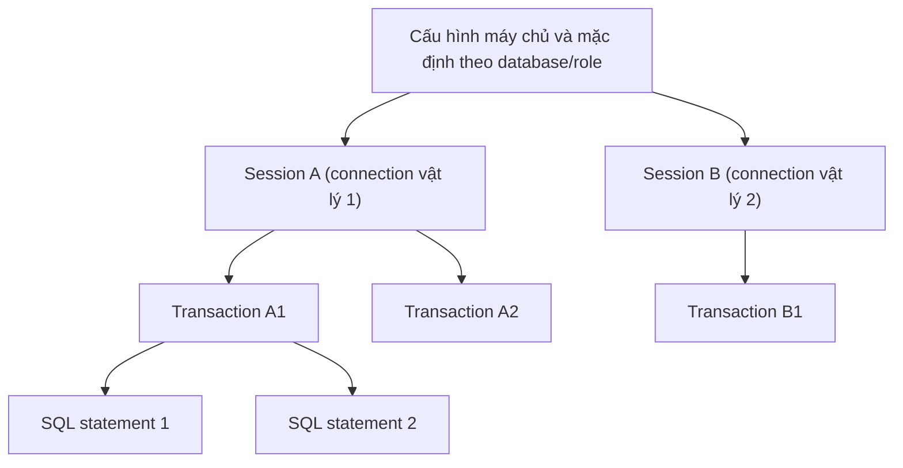
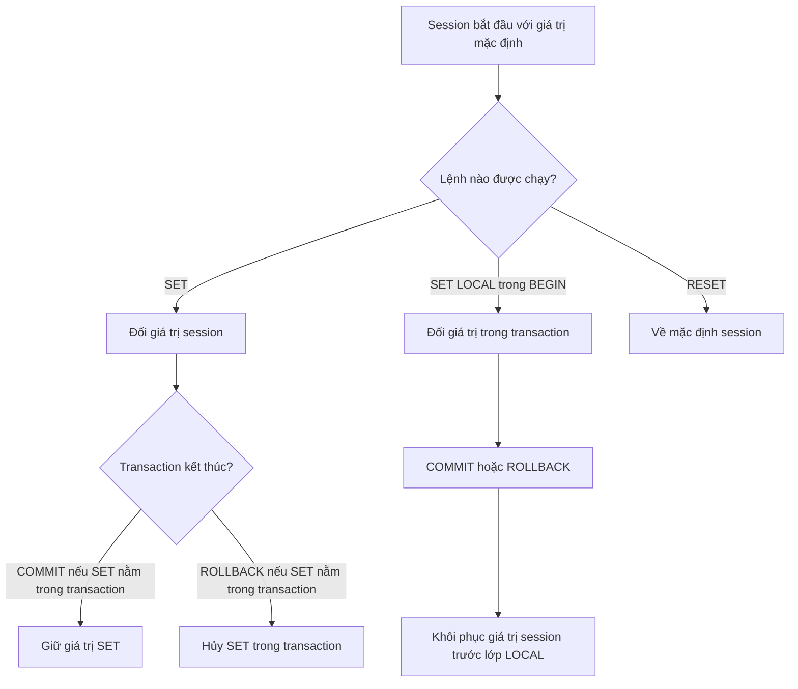

# SET, SET LOCAL, RESET và phạm vi tác dụng trong PostgreSQL

PostgreSQL có nhiều tham số cấu hình điều khiển cách một kết nối, một giao dịch hoặc cả máy chủ xử lý truy vấn: thời gian chờ, bộ nhớ cho thao tác sắp xếp, múi giờ, thứ tự tìm schema, mức cô lập giao dịch, cách ghi log, v.v. Không phải thay đổi cấu hình nào cũng cần sửa `postgresql.conf` rồi khởi động lại server. Với các tham số **cho phép thay đổi lúc chạy**, PostgreSQL cung cấp ba lệnh quan trọng:

- `SET`: thay đổi giá trị trong **phiên kết nối hiện tại**, trừ khi thay đổi bị rollback.
- `SET LOCAL`: thay đổi giá trị **tạm thời trong giao dịch hiện tại**.
- `RESET`: trả tham số về **giá trị mặc định áp dụng cho phiên**, theo các lớp cấu hình đang có.

Hiểu chính xác phạm vi của chúng giúp tránh những lỗi khó phát hiện, nhất là trong ứng dụng Java/Spring Boot sử dụng connection pool: một thay đổi dành cho request A có thể vô tình ảnh hưởng request B nếu vẫn còn lưu trên kết nối vật lý.

## 1. Trước hết cần phân biệt server, session, transaction và statement

Một ứng dụng tạo kết nối tới PostgreSQL và thực hiện nhiều giao dịch trên cùng kết nối. Mỗi kết nối backend có trạng thái phiên riêng.



| Phạm vi | Đặc điểm | Ví dụ cấu hình |
| --- | --- | --- |
| Máy chủ hoặc cụm PostgreSQL | Cấu hình nền được nạp từ file, câu lệnh quản trị hoặc nguồn khác; một số tham số phải restart | `shared_buffers`, `max_connections` |
| Mặc định cho database/role | Được áp dụng khi hình thành session mới, theo quy tắc ưu tiên | `ALTER DATABASE ... SET`, `ALTER ROLE ... SET` |
| Session | Một kết nối vật lý; có thể thực thi nhiều transaction | `SET work_mem = '32MB'` |
| Transaction | Nhóm câu lệnh bắt đầu bằng `BEGIN` và kết thúc bằng `COMMIT`/`ROLLBACK` | `SET LOCAL lock_timeout = '500ms'` |
| Statement | Một câu SQL; có thể bị chi phối bởi cấu hình đang có tại thời điểm chạy | `SELECT ...` chịu ảnh hưởng `statement_timeout` |

**Session không đồng nghĩa với HTTP request.** HikariCP hoặc pool khác thường mượn và trả lại cùng một kết nối vật lý qua nhiều request. Vì vậy, cách thay đổi tham số cần dựa trên vòng đời thực của PostgreSQL connection.

Cần phân biệt thêm hai khái niệm:

- **Phạm vi hiệu lực**: thay đổi có hiệu lực trong session hay chỉ trong transaction.
- **Quyền thay đổi**: tham số có cho phép người dùng hiện tại thay đổi bằng `SET` hay không.

Một tham số có thể được đọc bằng `SHOW` nhưng không cho phép thay đổi lúc chạy, hoặc yêu cầu quyền quản trị riêng.

## 2. Xem cấu hình đang có trước khi thay đổi

Giả sử đã kết nối tới PostgreSQL bằng `psql`. Dùng `SHOW`:

```sql
SHOW work_mem;
SHOW statement_timeout;
SHOW lock_timeout;
SHOW TimeZone;
SHOW search_path;
```

`SHOW ALL` liệt kê các tham số cùng giá trị hiện thời và mô tả. Với SQL cần dùng bên trong ứng dụng:

```sql
SELECT current_setting('work_mem') AS work_mem;
SELECT current_setting('statement_timeout') AS statement_timeout;

-- Trả NULL khi tên tham số không tồn tại.
SELECT current_setting('my_app.unregistered_option', true);
```

Muốn tìm nguồn giá trị, quyền thay đổi và giá trị khôi phục khi `RESET`, tra catalog view `pg_settings`:

```sql
SELECT
    name,
    setting,
    unit,
    context,
    source,
    reset_val,
    pending_restart
FROM pg_settings
WHERE name IN (
    'work_mem',
    'statement_timeout',
    'shared_buffers',
    'search_path'
)
ORDER BY name;
```

Một số cột cần hiểu đúng:

| Cột `pg_settings` | Ý nghĩa |
| --- | --- |
| `setting`, `unit` | Giá trị đang hiệu lực và đơn vị khi có |
| `context` | Ngữ cảnh cho phép thay đổi: ví dụ `user`, `superuser`, `sighup`, `postmaster` |
| `source` | Nguồn của giá trị đang hiệu lực, ví dụ file cấu hình, database, role, client hoặc thay đổi tương tác |
| `reset_val` | Giá trị sẽ nhận sau `RESET` đối với tham số đó trong session |
| `pending_restart` | Tham số đã có thay đổi cấu hình đợi restart mới áp dụng hay chưa |

Với các đơn vị như `kB`, `8kB` hay `ms`, cột `setting` trong `pg_settings` có thể hiển thị theo đơn vị nội bộ thay vì định dạng đã nhập. Dùng `SHOW` hoặc `current_setting` khi muốn nhìn giá trị theo cách PostgreSQL trình bày cho SQL.

## 3. SET: thay đổi cấu hình cấp session

Cú pháp thông thường:

```sql
SET [SESSION] configuration_parameter TO value;
SET [SESSION] configuration_parameter = value;

-- Đưa về giá trị mặc định của session.
SET configuration_parameter TO DEFAULT;
```

`SESSION` là từ khóa tùy chọn; bỏ qua thì `SET` mặc định là `SET SESSION`.

Ví dụ:

```sql
SET work_mem = '32MB';
SHOW work_mem;
-- 32MB

SET statement_timeout TO '5s';
SHOW statement_timeout;
-- 5s

SET TIME ZONE 'Asia/Ho_Chi_Minh';
SHOW TimeZone;
-- Asia/Ho_Chi_Minh
```

`work_mem` là giới hạn bộ nhớ cho **mỗi thao tác** sort/hash thích hợp trong kế hoạch truy vấn, không phải tổng ngân sách bộ nhớ của cả session. Vì một truy vấn có thể có nhiều thao tác và nhiều truy vấn chạy đồng thời, tăng `work_mem` trên toàn hệ thống hoặc toàn bộ kết nối cần cân nhắc kỹ mức dùng RAM.

### 3.1. SET tồn tại bao lâu?

Trong một session đang mở, giá trị đặt bằng `SET` tiếp tục áp dụng cho các statement tiếp theo và các transaction sau, cho đến khi:

- Có `SET` khác đổi giá trị.
- Có `RESET` hoặc thao tác reset tương đương.
- Session kết thúc.
- Một giao dịch chứa `SET` bị rollback, như sẽ xem ở phần tiếp theo.

```sql
-- Session A:
SET work_mem = '32MB';
SELECT current_setting('work_mem');  -- 32MB

-- Bắt đầu và kết thúc giao dịch mới.
BEGIN;
SELECT current_setting('work_mem');  -- 32MB
COMMIT;

SELECT current_setting('work_mem');  -- Vẫn 32MB
```

Lệnh `SET` trên session A **không tự động thay đổi** session B; mỗi connection có trạng thái riêng.

### 3.2. SET bên trong một transaction có tính chất transactional

`SET` không phải ngoại lệ của rollback:

```sql
SET work_mem = '32MB';

BEGIN;
    SET work_mem = '48MB';
    SHOW work_mem;  -- 48MB
ROLLBACK;

SHOW work_mem;      -- 32MB
```

Nếu thay `ROLLBACK` bằng `COMMIT`, giá trị `48MB` được giữ trong session sau khi transaction kết thúc:

```sql
BEGIN;
    SET work_mem = '48MB';
COMMIT;

SHOW work_mem;      -- 48MB
```

Đây là điểm dễ nhầm: một câu `SET` nằm trong `BEGIN ... COMMIT` **vẫn có thể làm thay đổi trạng thái session sau commit**. Muốn giới hạn hiệu lực vào giao dịch, cần `SET LOCAL`.

## 4. SET LOCAL: thay đổi tạm thời trong transaction

`SET LOCAL` có cấu trúc tương tự `SET`:

```sql
BEGIN;
    SET LOCAL work_mem = '64MB';
    SET LOCAL statement_timeout = '3s';

    -- Chạy những truy vấn cần thiết tại đây.
    SELECT current_setting('work_mem');
COMMIT;
```

Giá trị đặt bằng `SET LOCAL` chỉ có hiệu lực đến lúc kết thúc transaction hiện tại, **bất kể COMMIT hay ROLLBACK**.

Ví dụ có giá trị session xác định trước:

```sql
SET work_mem = '32MB';
SHOW work_mem;          -- 32MB

BEGIN;
    SET LOCAL work_mem = '64MB';
    SHOW work_mem;      -- 64MB
COMMIT;

SHOW work_mem;          -- Trở về 32MB
```

Nếu transaction kết thúc bằng `ROLLBACK`, giá trị cũng trở lại `32MB`.

### 4.1. SET LOCAL phải ở trong transaction

Ví dụ sau không tạo cấu hình transaction có ích:

```sql
-- Với psql đang bật autocommit và không có BEGIN:
SET LOCAL statement_timeout = '2s';

-- Đây là statement thuộc transaction khác; giá trị LOCAL không còn.
SELECT pg_sleep(1);
```

Trong ngữ cảnh không có transaction block, PostgreSQL có thể đưa ra cảnh báo rằng `SET LOCAL` chỉ dùng được trong transaction block; thay đổi không lưu lại cho câu SQL tiếp theo.

Muốn một nhóm statement dùng cùng cấu hình tạm thời, hãy dùng `BEGIN ... COMMIT` hoặc cơ chế transaction thực sự của framework:

```sql
BEGIN;
    SET LOCAL lock_timeout = '500ms';
    SET LOCAL statement_timeout = '5s';

    SELECT count(*) FROM pg_catalog.pg_class;
COMMIT;
```

Các giá trị thời gian `500ms` và `5s` chỉ là minh họa; chọn theo độ trễ và yêu cầu ứng dụng. `lock_timeout` giới hạn thời gian chờ để lấy lock, còn `statement_timeout` giới hạn thời gian thực thi một statement. Chúng giải quyết hai loại thời gian chờ khác nhau.

### 4.2. SET và SET LOCAL cùng xuất hiện trong một transaction

Khi cả hai thay đổi cùng tham số, giá trị `LOCAL` có thể tạm che giá trị `SET` trong transaction, nhưng sau `COMMIT` giá trị `SET` vẫn tồn tại:

```sql
SET work_mem = '16MB';

BEGIN;
    SET work_mem = '32MB';
    SET LOCAL work_mem = '64MB';

    SHOW work_mem;        -- 64MB
COMMIT;

SHOW work_mem;            -- 32MB
```

Do vậy, không được nghĩ rằng `SET LOCAL` sẽ tự động hủy thay đổi session được thực hiện bởi `SET` trước đó.

### 4.3. Savepoint cũng ảnh hưởng SET/SET LOCAL

PostgreSQL cho phép quay về một savepoint trước thời điểm đổi tham số:

```sql
SET work_mem = '16MB';

BEGIN;
    SAVEPOINT before_override;

    SET LOCAL work_mem = '64MB';
    SHOW work_mem;             -- 64MB

    ROLLBACK TO SAVEPOINT before_override;
    SHOW work_mem;             -- 16MB
COMMIT;
```

Tương tự, `ROLLBACK TO SAVEPOINT` cũng hủy ảnh hưởng của `SET` được thực hiện sau savepoint đó. Đây là lý do code dùng nested transaction hoặc savepoint nên kiểm tra rõ nơi đặt lệnh cấu hình.

## 5. RESET: khôi phục mặc định của session

`RESET` không nhất thiết trả về giá trị mặc định được biên dịch vào PostgreSQL. Nó trả về **mặc định áp dụng cho session**, có thể đã được thiết lập theo file cấu hình, database, role hoặc tùy chọn kết nối.

```sql
-- Tham số đã được thay đổi trong session.
SET work_mem = '32MB';

-- Trả về mặc định dành cho session hiện tại.
RESET work_mem;

SHOW work_mem;

-- Cú pháp tương đương để trở về mặc định session:
SET work_mem TO DEFAULT;
```

`RESET ALL` đưa các tham số cấu hình runtime về các giá trị mặc định áp dụng cho session:

```sql
RESET ALL;
```

Không nên dùng `RESET ALL` như một giải pháp tổng quát để làm sạch **mọi** trạng thái connection. Nó không tương đương xóa toàn bộ temporary tables, prepared statements, advisory locks, vai trò hiện hành hay các trạng thái phiên khác. Các connection pool có thể có quy trình reset riêng; trong PostgreSQL còn có lệnh `DISCARD ALL` với ngữ nghĩa rộng hơn, nhưng không được chạy trong transaction block.

### 5.1. RESET có tính chất giao dịch

`RESET` thực thi trong transaction cũng tuân theo commit/rollback:

```sql
SET work_mem = '32MB';

BEGIN;
    RESET work_mem;
    SHOW work_mem;      -- Mặc định áp dụng cho session
ROLLBACK;

SHOW work_mem;          -- 32MB
```

Nếu `COMMIT` thay cho `ROLLBACK`, giá trị sau `RESET` được giữ trong session. Vì vậy, đặt `RESET` bên trong transaction rồi rollback **không phải** cách chắc chắn để làm sạch một `SET` session-level trước đó.

## 6. So sánh nhanh qua một kịch bản thực thi

Giả sử giá trị `work_mem` hiện tại được chủ động đặt là `16MB`. Bảng dưới cho thấy kết quả sau mỗi bước:

| Bước | Lệnh / sự kiện | `SHOW work_mem` |
| --- | --- | --- |
| 1 | `SET work_mem = '16MB';` | `16MB` |
| 2 | `BEGIN; SET LOCAL work_mem = '64MB';` | `64MB` |
| 3 | `COMMIT;` | `16MB` |
| 4 | `BEGIN; SET work_mem = '32MB';` | `32MB` |
| 5 | `COMMIT;` | `32MB` |
| 6 | `BEGIN; SET work_mem = '48MB';` | `48MB` |
| 7 | `ROLLBACK;` | `32MB` |
| 8 | `RESET work_mem;` | Mặc định áp dụng cho session |

Một cách ghi nhớ:



## 7. Cấu hình nào có thể SET được?

PostgreSQL chia tham số thành các ngữ cảnh cấu hình. `SET`/`SET LOCAL` không thể vượt qua giới hạn kỹ thuật hoặc quyền của tham số.

| Ngữ cảnh trong `pg_settings.context` | Đặc điểm | Ví dụ |
| --- | --- | --- |
| `user` | Thông thường người dùng được phép thay đổi trong session | `work_mem`, `statement_timeout`, `search_path` |
| `superuser` | Cần superuser hoặc quyền `SET` được cấp phù hợp, tùy phiên bản | Một số tham số ghi log/quản trị |
| `sighup` | Chỉ áp dụng khi server nạp lại cấu hình | Nhiều tham số cấu hình logging |
| `postmaster` | Chỉ thay đổi khi server khởi động lại | `shared_buffers`, `max_connections` |
| `backend` / `superuser-backend` | Thiết lập khi khởi tạo backend, tùy quyền/ngữ cảnh | Một số tùy chọn kết nối và vận hành |
| `internal` | Do PostgreSQL quyết định, không thay đổi tùy ý bằng `SET` | Các thông số nội bộ |

Cần kiểm tra từng tham số trên **server thực tế**, vì tên, quyền và ngữ nghĩa của một số tham số phụ thuộc phiên bản PostgreSQL.

Ví dụ, lệnh:

```sql
SET shared_buffers = '1GB';
```

không thể thay `shared_buffers` tại runtime như `SET work_mem`. `shared_buffers` là tham số cần restart. Việc có thể gán giá trị khi cấu hình file không có nghĩa phiên hiện tại có thể dùng `SET` để thay đổi nó.

Với người không phải superuser, quản trị viên có thể cấp quyền `SET` trên một số tham số được hỗ trợ bằng cơ chế `GRANT SET ON PARAMETER ...` (tùy phiên bản và tham số). Không tự suy luận người dùng đã đủ quyền chỉ vì tham số có thể thay đổi khi chạy.

## 8. Phân biệt SET session với cấu hình mặc định lâu dài

Có nhiều nguồn giá trị cấu hình. Chúng phục vụ những mục đích khác nhau:

```sql
-- Cần quyền quản trị phù hợp.
ALTER DATABASE appdb SET statement_timeout = '5s';

ALTER ROLE app_user SET work_mem = '16MB';

ALTER ROLE app_user IN DATABASE appdb
    SET statement_timeout = '3s';
```

Các lệnh `ALTER DATABASE` và `ALTER ROLE` tạo mặc định cho **các session mới** phù hợp database/role đó; không tự động thay đổi tất cả session đang hoạt động.

Thông thường, giá trị có thể được quyết định từ các lớp sau (ưu tiên tăng dần trong các trường hợp tương ứng):

1. Mặc định PostgreSQL và cấu hình server (`postgresql.conf`, `ALTER SYSTEM`, v.v.).
2. Mặc định theo database từ `ALTER DATABASE ... SET`.
3. Mặc định theo role từ `ALTER ROLE ... SET`; thiết lập role có thể ghi đè thiết lập database khi cùng tham số.
4. Giá trị cụ thể theo cặp role/database bằng `ALTER ROLE ... IN DATABASE ... SET`.
5. Tùy chọn cấu hình do client gửi lúc khởi tạo session, và những thay đổi runtime hợp lệ trong session bằng `SET`.

Đây là mô hình để hiểu phạm vi. Để giải thích **giá trị đang có trên một connection cụ thể**, hãy xem `pg_settings.source` và `pg_settings.reset_val`; không suy diễn chỉ từ tên database.

Ví dụ khi đã có mặc định riêng cho `app_user` trong `appdb`:

```sql
-- Trong session app_user kết nối appdb:
SHOW statement_timeout; -- Có thể là 3s theo ví dụ ALTER ROLE ... IN DATABASE

SET statement_timeout = '1s';
SHOW statement_timeout; -- 1s

RESET statement_timeout;
SHOW statement_timeout; -- Trở lại mặc định session, ví dụ 3s
```

Để **gỡ một mặc định** do `ALTER ROLE` tạo, dùng câu lệnh quản trị tương ứng như `ALTER ROLE app_user IN DATABASE appdb RESET statement_timeout;`. Đây là thao tác với metadata role/database, khác với `RESET statement_timeout` trong một session.

`ALTER SYSTEM` ghi cấu hình cấp cụm vào `postgresql.auto.conf`; các tham số thích hợp cần reload, còn tham số `postmaster` cần restart. Không dùng `ALTER SYSTEM` cho các thay đổi chỉ áp dụng cho một request.

## 9. Dùng đúng trong ứng dụng Java/Spring Boot và connection pool

### 9.1. Lỗi phổ biến: thay đổi session rồi trả connection về pool

Giả sử request A mượn connection số 3:

```sql
SET search_path = tenant_a, public;
SELECT * FROM orders;
```

Sau đó ứng dụng trả connection số 3 về pool mà chưa khôi phục `search_path`. Request B mượn lại cùng connection và thực hiện `SELECT * FROM orders` có thể vô tình truy cập schema `tenant_a`.

Hiện tượng này chỉ cần **connection được tái sử dụng**; đóng logical connection trong ứng dụng không nhất thiết đóng session thật trên PostgreSQL.

Dùng schema có đầy đủ tên (`tenant_a.orders`) khi thích hợp; hạn chế `CREATE` trên schema không đáng tin cậy; nếu cần thay `search_path` theo request, thực hiện trong transaction và dùng `SET LOCAL`.

```sql
BEGIN;
    SET LOCAL search_path = tenant_a, pg_catalog;
    SELECT * FROM orders;
COMMIT;
-- search_path trở lại giá trị session trước BEGIN
```

Tên schema thay đổi động phải đến từ nguồn tin cậy/được kiểm tra hoặc quote định danh đúng chuẩn; tuyệt đối không nối trực tiếp input tùy ý của người dùng vào SQL. Đây cũng không phải là biện pháp phân quyền tenant tự thân: cần kiểm soát quyền truy cập dữ liệu độc lập.

### 9.2. SET LOCAL phải dùng cùng một connection và transaction thật

Với JDBC, ví dụ sau chỉ minh họa việc quản lý kết nối và transaction:

```java
import java.sql.Connection;
import java.sql.PreparedStatement;
import java.sql.ResultSet;
import java.sql.SQLException;
import javax.sql.DataSource;

public class OrderQueryService {
    private final DataSource dataSource;

    public OrderQueryService(DataSource dataSource) {
        this.dataSource = dataSource;
    }

    public long countOrders() throws SQLException {
        try (Connection conn = dataSource.getConnection()) {
            conn.setAutoCommit(false);
            try {
                try (PreparedStatement setTimeout = conn.prepareStatement(
                        "SET LOCAL statement_timeout = '3s'")) {
                    setTimeout.execute();
                }

                long count;
                try (PreparedStatement query = conn.prepareStatement(
                        "SELECT count(*) FROM public.orders");
                     ResultSet rs = query.executeQuery()) {
                    rs.next();
                    count = rs.getLong(1);
                }

                conn.commit();
                return count;
            } catch (SQLException | RuntimeException ex) {
                try {
                    conn.rollback();
                } catch (SQLException rollbackEx) {
                    ex.addSuppressed(rollbackEx);
                }
                throw ex;
            }
        }
    }
}
```

Trong ví dụ này:

- `setAutoCommit(false)` mở phạm vi transaction do JDBC quản lý; `SET LOCAL` và `SELECT` chạy trên **cùng connection**.
- `COMMIT` hoặc `ROLLBACK` kết thúc hiệu lực của `SET LOCAL`.
- `try-with-resources` giải phóng tài nguyên JDBC; tác vụ transaction phải được đóng rõ ràng trước khi trả connection vào pool.
- Tài khoản database và bảng `public.orders` chỉ là ví dụ.

Nếu ứng dụng đã dùng Spring `@Transactional` và transaction manager, hãy để framework quản lý commit/rollback. Cần thực hiện `SET LOCAL` sau khi transaction bắt đầu, trong cùng transaction và trên connection mà ORM/JDBC dùng cho câu truy vấn nghiệp vụ. Gọi `SET LOCAL` bằng một connection khác không giúp thay đổi truy vấn của transaction chính.

Các công cụ pool có thể thiết lập lệnh init khi tạo connection vật lý. Cấu hình như `connectionInitSql` của HikariCP phù hợp với giá trị cơ bản cho connection mới, **không phải** cách đặt tham số thay đổi theo từng request.

### 9.3. SQL function set_config và current_setting

PostgreSQL có hàm SQL để thay đổi cấu hình và lấy giá trị:

```sql
-- Đặt cho session, tương tự SET.
SELECT set_config('work_mem', '32MB', false);

-- Đặt tạm trong transaction hiện tại, tương tự SET LOCAL.
BEGIN;
    SELECT set_config('statement_timeout', '2s', true);
    SELECT current_setting('statement_timeout');
COMMIT;
```

Tham số boolean thứ ba của `set_config(name, value, is_local)` quyết định phạm vi:

- `true`: phạm vi transaction (tương tự `SET LOCAL`).
- `false`: phạm vi session (tương tự `SET`), và cũng tuân theo commit/rollback nếu gọi trong transaction.

Đối với cấu hình tự định nghĩa có tên dạng `app.request_id`, có thể sử dụng:

```sql
BEGIN;
    SELECT set_config('app.request_id', 'req-123', true);
    SELECT current_setting('app.request_id', true);
COMMIT;
```

Những biến tự định nghĩa này hữu ích cho ngữ cảnh ứng dụng hoặc logging theo request. Tuy nhiên, giá trị do application role tự đặt không nên được coi là bằng chứng xác thực hoặc cơ chế phân quyền đáng tin cậy nếu người dùng có cách kiểm soát lệnh SQL.

## 10. Lỗi thường gặp và cách chẩn đoán

| Hiện tượng | Nguyên nhân có thể | Cách xử lý |
| --- | --- | --- |
| `SET LOCAL` rồi statement kế tiếp không thấy thay đổi | Không có `BEGIN`, hoặc hai lệnh chạy trên hai connection khác nhau | Dùng transaction thực sự và cùng physical connection |
| `SET` vẫn còn tác dụng sau commit | `SET` là session-level khi transaction commit | Dùng `SET LOCAL` cho cấu hình chỉ cần trong transaction |
| `SET` thay đổi rồi mất sau rollback | Thay đổi nằm trong transaction bị hủy | Xác định rõ điểm bắt đầu/kết thúc transaction |
| `RESET` không trở về giá trị mong đợi | Có mặc định theo role/database/client | Xem `pg_settings.reset_val` và `source` |
| PostgreSQL báo tham số không thể thay đổi | Tham số yêu cầu reload/restart hoặc quyền cao hơn | Xem `pg_settings.context`, kiểm tra role |
| Lỗi `current transaction is aborted` sau timeout | Một statement thất bại làm transaction rơi vào trạng thái lỗi | `ROLLBACK` rồi mở transaction mới; không tiếp tục query trong transaction đã lỗi |
| Request khác chịu cấu hình request trước | Session SET rò qua connection pool | Đổi sang `SET LOCAL` trong transaction, hoặc reset/session cleanup có kiểm soát |
| `SHOW` khác giữa hai cửa sổ `psql` | Hai session nhận cấu hình hoặc thay đổi riêng | Kiểm tra giá trị trong **chính** connection xảy ra vấn đề |

Ngoài ra, trong `psql` có lệnh `\set` để gán **biến của trình khách psql**, ví dụ `\set report_date '2026-11-14'`. Lệnh này không tương đương SQL `SET` của PostgreSQL server và không được `SHOW` phản ánh như cấu hình server.

Một số tham số có quy tắc ngữ nghĩa riêng; không nên xem mọi `SET` là gán chuỗi thông thường. Chẳng hạn các tùy chọn transaction (isolation level, read only, deferrable) có ràng buộc thời điểm thay đổi, và lệnh `SET TRANSACTION`/`SET SESSION CHARACTERISTICS` có cú pháp, mục tiêu riêng. Hãy tra tài liệu phiên bản tương ứng khi làm việc với những trường hợp này.

## 11. Thực hành từng bước

Mở một session `psql` trên cơ sở dữ liệu thử nghiệm. Chạy từng nhóm lệnh và dự đoán kết quả trước khi xem `SHOW`.

**Bài 1 – Quan sát session-level SET và RESET**

```sql
SHOW work_mem;
SELECT reset_val FROM pg_settings WHERE name = 'work_mem';

SET work_mem = '24MB';
SHOW work_mem;

RESET work_mem;
SHOW work_mem;
```

Câu hỏi: sau `RESET`, giá trị có nhất thiết bằng mặc định được biên dịch của PostgreSQL không? Dùng `reset_val` để giải thích.

**Bài 2 – Quan sát SET LOCAL trong transaction**

```sql
SET work_mem = '16MB';

BEGIN;
    SET LOCAL work_mem = '64MB';
    SHOW work_mem;
COMMIT;

SHOW work_mem;
```

Kết quả quan trọng: bên trong transaction là `64MB`, sau commit là `16MB`.

**Bài 3 – So sánh commit với rollback**

```sql
SET work_mem = '16MB';

BEGIN;
    SET work_mem = '32MB';
COMMIT;
SHOW work_mem;     -- 32MB

BEGIN;
    SET work_mem = '48MB';
ROLLBACK;
SHOW work_mem;     -- 32MB
```

Giải thích tại sao `SET` đầu tiên trong transaction được giữ sau `COMMIT`, còn `SET` thứ hai bị hủy sau `ROLLBACK`.

**Bài 4 – Kiểm tra timeout có giới hạn phạm vi**

```sql
SHOW statement_timeout;

BEGIN;
    SET LOCAL statement_timeout = '200ms';
    SELECT pg_sleep(1);  -- Dự kiến bị hủy bởi statement_timeout.
ROLLBACK;

SHOW statement_timeout;
```

Sau khi `pg_sleep(1)` gặp lỗi timeout, transaction ở trạng thái aborted; `ROLLBACK` là bước cần thiết trước khi chạy tiếp trong session này. Chỉ chạy thử trên môi trường học tập.

**Bài 5 – Tự kiểm tra rò rỉ session**

Dùng connection pool trong môi trường thử nghiệm với kích thước pool nhỏ. So sánh hai phương án: gọi `SET search_path` trước truy vấn, rồi trả connection về pool; và gọi `SET LOCAL search_path` trong một transaction rõ ràng. Theo dõi `SHOW search_path` trên cùng physical connection khi một request tiếp theo mượn lại connection. Không dùng bảng dữ liệu nhạy cảm để kiểm thử.

## 12. Kết luận sử dụng đúng phạm vi

Khi cần áp dụng một giá trị cho nhiều transaction trong cùng connection, `SET` là lựa chọn phù hợp và cần chủ động reset/khôi phục khi xong. Khi cần giới hạn giá trị cho một nhóm truy vấn có `BEGIN ... COMMIT/ROLLBACK`, ưu tiên `SET LOCAL`. Khi cần trở lại mặc định áp dụng cho connection, dùng `RESET`, đồng thời nhớ rằng mặc định này có thể đến từ các chính sách role, database hoặc client.

Ba lệnh này là công cụ vận hành **cấu hình runtime hợp lệ**. Chúng không thay thế thay đổi cấu hình cần restart, không tạo thay đổi vĩnh viễn trên mọi session và không bảo đảm session của connection pool tự được làm sạch. Hiểu đúng vòng đời session và transaction là nền tảng để cấu hình PostgreSQL có thể dự đoán được trong cả phát triển lẫn production.
