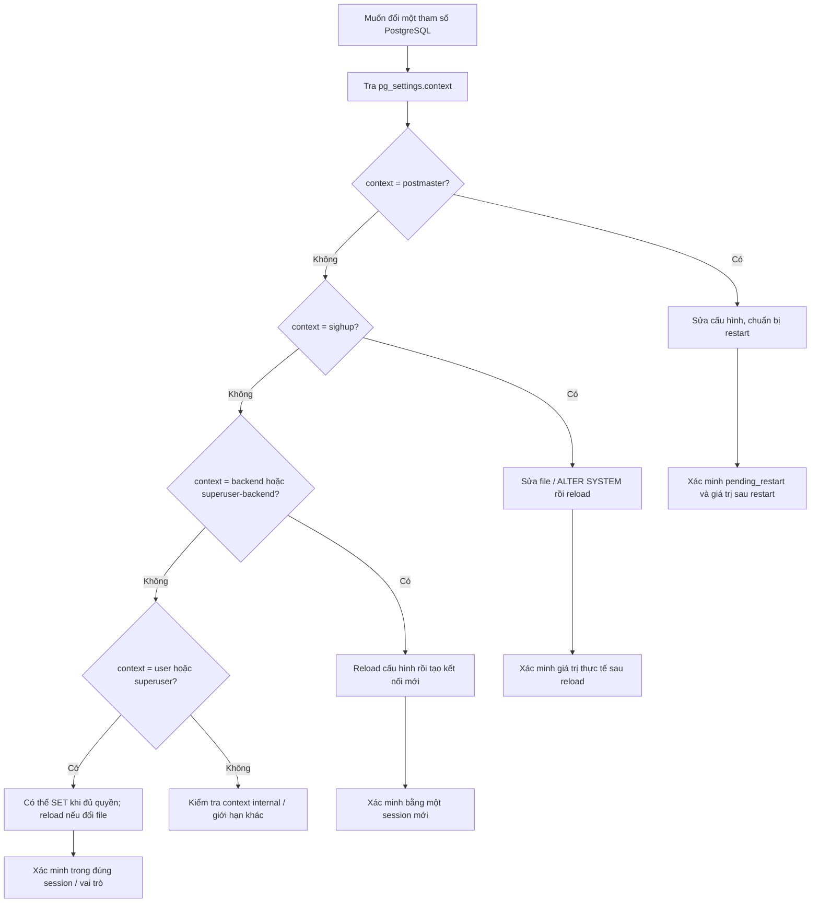
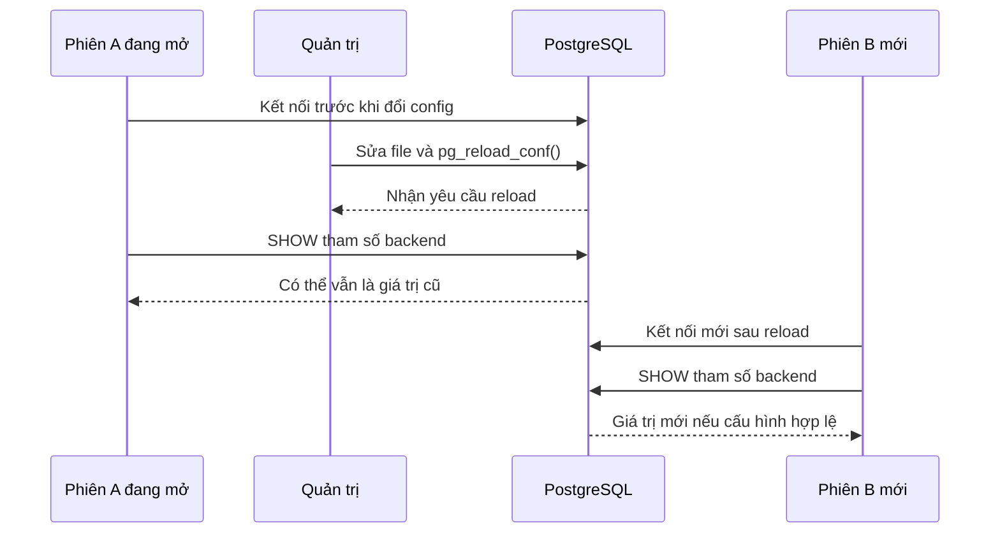

# Phân biệt tham số cần reload và cần restart trong PostgreSQL

PostgreSQL có nhiều tham số cấu hình liên quan tới bộ nhớ, kết nối, logging, lưu trữ, giao dịch và bảo mật. Tuy nhiên, **không phải mọi thay đổi cấu hình đều có hiệu lực theo cùng một cách**. Có tham số cần **khởi động lại toàn bộ PostgreSQL server (restart)**; có tham số chỉ cần **yêu cầu server đọc lại cấu hình (reload)**; có tham số có thể thay đổi bằng `SET` ngay trong một phiên kết nối hoặc chỉ được áp dụng cho **những phiên tạo mới**.

Ví dụ:

- Tăng `shared_buffers` thông thường **cần restart** vì PostgreSQL phải chuẩn bị vùng shared memory khi khởi động.
- Đổi `log_line_prefix` trong cấu hình server thông thường **chỉ cần reload**.
- Điều chỉnh `work_mem` cho một truy vấn có thể dùng `SET LOCAL` trong transaction, **không cần reload hay restart**.
- Một tham số thuộc nhóm `backend` có thể được chỉnh trong cấu hình rồi reload, nhưng giá trị mới chỉ áp dụng khi **client tạo kết nối mới**.

Vì vậy, hỏi “tham số này cần reload hay restart?” là một bước quan trọng khi vận hành PostgreSQL. Trả lời sai có thể dẫn đến hai loại sự cố: ứng dụng tưởng cấu hình mới đã có hiệu lực nhưng thực tế server vẫn dùng giá trị cũ, hoặc quản trị viên restart không cần thiết làm ngắt kết nối và ảnh hưởng dịch vụ.

Bài học tập trung vào **cách xác định chính xác loại tham số trên server đang dùng**, áp dụng thay đổi an toàn và kiểm tra kết quả. Các ví dụ dùng PostgreSQL hiện đại; tên tham số, quyền điều chỉnh và cách quản lý service có thể khác theo phiên bản hoặc cách cài đặt.

## 1. Ba khái niệm dễ nhầm: SET, reload và restart

Trước hết cần tách **nơi khai báo cấu hình** khỏi **cách đưa cấu hình vào hiệu lực**.

| Hành động | Làm gì? | Có ngắt toàn bộ kết nối không? | Ví dụ |
| --- | --- | --- | --- |
| `SET` / `SET LOCAL` | Thay đổi giá trị tham số được phép chỉnh trong phiên hoặc transaction hiện tại | Không | `SET work_mem = '64MB'` |
| **Reload** | Yêu cầu các tiến trình PostgreSQL đọc lại file cấu hình liên quan | Thông thường không restart server hay cắt toàn bộ kết nối | `SELECT pg_reload_conf();` |
| **Restart** | Dừng rồi khởi động lại PostgreSQL instance | **Có thể ngắt tất cả kết nối và giao dịch đang chạy** | Restart service PostgreSQL đúng instance |
| **Reconnect** | Đóng phiên cũ và mở phiên kết nối mới | Chỉ ảnh hưởng phiên được kết nối lại | Tham số context `backend` |

**Reload không phải restart nhẹ.** Reload gửi yêu cầu nạp lại cấu hình cho tiến trình server đang hoạt động, không khởi tạo lại vùng shared memory và không tự thay những lựa chọn chỉ thiết lập lúc server start. Restart tạo một vòng đời server mới, có thể làm rớt connection pool, rollback giao dịch chưa commit và cần thời gian khôi phục kết nối.

### 1.1. Sơ đồ quyết định



Sơ đồ này là mô hình lựa chọn cơ bản. **Quyền** chỉnh tham số, nguồn cấu hình có độ ưu tiên cao hơn, giới hạn giá trị và ngữ nghĩa từng tham số vẫn phải được xem cùng với `context`.

## 2. Nguồn sự thật quan trọng nhất: pg_settings.context

PostgreSQL cung cấp view hệ thống `pg_settings`. Nó cho biết tham số, giá trị, đơn vị, ngữ cảnh được phép thay đổi và trạng thái cần restart.

Kết nối bằng role quản trị hoặc role đủ quyền xem các thông tin cần thiết, rồi chạy:

```sql
SELECT
    name,
    setting,
    unit,
    context,
    source,
    pending_restart
FROM pg_settings
WHERE name IN (
    'shared_buffers',
    'max_connections',
    'listen_addresses',
    'port',
    'log_line_prefix',
    'work_mem',
    'statement_timeout',
    'search_path'
)
ORDER BY name;
```

Các cột quan trọng:

| Cột | Diễn giải |
| --- | --- |
| `name` | Tên tham số PostgreSQL |
| `setting` | Giá trị mà session đang báo qua cơ chế GUC |
| `unit` | Đơn vị quy ước của giá trị số, nếu có |
| `context` | **Ngữ cảnh cho phép thay đổi**: `postmaster`, `sighup`, `backend`, `superuser`, `user`... |
| `source` | Nguồn dẫn đến giá trị hiệu lực, ví dụ default, configuration file, session, database, user |
| `pending_restart` | `true` nếu thay đổi được phát hiện từ cấu hình nhưng cần restart để áp dụng |

Không nên đoán ngữ cảnh chỉ từ tên tham số. Ví dụ cả `shared_buffers` và `work_mem` đều liên quan bộ nhớ, nhưng một tham số ảnh hưởng shared memory của toàn instance còn tham số kia dùng cho các thao tác trong quá trình truy vấn, nên **cách thay đổi khác nhau**.

### 2.1. Xem một tham số cụ thể

```sql
SELECT
    name,
    setting,
    unit,
    context,
    vartype,
    source,
    pending_restart
FROM pg_settings
WHERE name = 'shared_buffers';
```

Với PostgreSQL thông thường, `shared_buffers` có `context = 'postmaster'`. Điều này cho biết thay đổi từ cấu hình sẽ không thể áp dụng hoàn toàn cho server đang chạy chỉ bằng reload.

Thử tham số có thể đổi trong phiên:

```sql
SELECT
    name,
    setting,
    unit,
    context,
    source
FROM pg_settings
WHERE name = 'work_mem';
```

`work_mem` thường có `context = 'user'`, cho phép role thông thường dùng `SET` trong phạm vi được phép.

### 2.2. Đơn vị trong pg_settings và SHOW

Đối với tham số dung lượng, `pg_settings.setting` có thể trả một số cùng đơn vị nền do `unit` chỉ rõ. Đừng coi `setting='16384'` luôn nghĩa là **16.384 byte**; PostgreSQL có những tham số được biểu diễn theo đơn vị block, kB hoặc đơn vị khác.

Để xem giá trị theo định dạng dễ đọc, thường có thể dùng:

```sql
SHOW shared_buffers;
SHOW work_mem;
SHOW max_connections;
```

Hoặc:

```sql
SELECT
    current_setting('shared_buffers') AS shared_buffers,
    current_setting('work_mem') AS work_mem;
```

Kết quả thực tế tùy instance và phiên. Không đưa một giá trị ví dụ vào `postgresql.conf` chỉ vì nó xuất hiện trên một blog khác mà chưa xét RAM và workload.

## 3. Các giá trị context của tham số cấu hình

`context` trong `pg_settings` chính là chìa khóa để biết thay đổi có thể áp dụng vào thời điểm nào.

| Context | Có ý nghĩa gì? | Cách áp dụng thường gặp |
| --- | --- | --- |
| `internal` | Giá trị được quyết định từ nội bộ/bởi cách build hoặc trạng thái server; không phải tham số bình thường để người dùng chỉnh | Không đổi qua `SET` hoặc sửa config như thông số tùy ý |
| `postmaster` | Chỉ được thiết lập khi **khởi động server** | Chỉnh cấu hình rồi **restart** |
| `sighup` | Thay đổi bằng cách yêu cầu server đọc lại cấu hình | Chỉnh file hoặc `ALTER SYSTEM` rồi **reload** |
| `backend` | Giá trị được đọc/áp dụng khi **tiến trình backend mới bắt đầu** | Reload cấu hình rồi **reconnect** để thấy ở phiên mới |
| `superuser-backend` | Tương tự nhóm backend, nhưng việc chỉnh bị giới hạn bởi quyền cao hơn | Role đủ quyền chỉnh config, reload rồi mở phiên mới |
| `superuser` | Có thể thay đổi trong phiên bởi superuser hoặc role có quyền tham số phù hợp; cũng có thể lấy từ cấu hình | `SET` nếu đủ quyền; nếu đổi file thì reload |
| `user` | Có thể thay đổi trong phiên bởi role thường theo cơ chế GUC | `SET` / `SET LOCAL`, hoặc reload nếu chỉnh cấu hình |

Các ký hiệu context có tính kỹ thuật và không hoàn toàn đồng nghĩa với “quyền hiện tại của user đang chạy SQL”. Một tham số `context='superuser'` có thể được cấp quyền `SET` riêng trên những PostgreSQL phiên bản hỗ trợ; ngược lại, một tham số `user` vẫn có thể bị ảnh hưởng bởi cấu hình và cơ chế quản trị của môi trường.

### 3.1. postmaster: chỉ thay khi khởi động server

Một số ví dụ điển hình:

- `shared_buffers`: dung lượng vùng shared buffers.
- `max_connections`: giới hạn số kết nối đồng thời được cấu hình.
- `listen_addresses`: địa chỉ IP/giao diện server lắng nghe.
- `port`: cổng TCP PostgreSQL.
- `wal_level`: mức thông tin ghi vào WAL phục vụ những khả năng nhất định.
- `shared_preload_libraries`: các thư viện được yêu cầu preload khi khởi động.
- `logging_collector`: sử dụng tiến trình thu thập log theo cấu hình.

Có thể xác minh từng tham số trên instance:

```sql
SELECT name, setting, context
FROM pg_settings
WHERE name IN (
    'shared_buffers',
    'max_connections',
    'listen_addresses',
    'port',
    'wal_level',
    'shared_preload_libraries',
    'logging_collector'
)
ORDER BY name;
```

**Tại sao cần restart?** Những thiết lập này tác động tới cấu trúc hoặc tài nguyên được chuẩn bị từ lúc PostgreSQL khởi động, chẳng hạn cấp phát shared memory, mở socket lắng nghe hoặc nạp thư viện. Reload không thể thay thế việc khởi tạo lại các phần đó.

### 3.2. sighup: server nạp lại cấu hình

Một ví dụ thường dùng là:

```sql
SELECT name, setting, context
FROM pg_settings
WHERE name = 'log_line_prefix';
```

`log_line_prefix` thường có `context = 'sighup'`. Khi đổi giá trị trong cấu hình và reload thành công, các tiến trình áp dụng cấu hình log mới theo cơ chế reload, **không cần restart toàn bộ server**.

Tên `sighup` bắt nguồn từ tín hiệu SIGHUP trên Unix, nhưng thao tác reload trong PostgreSQL không bị giới hạn ở Linux: trên Windows và môi trường container vẫn có các cơ chế quản trị để yêu cầu server nạp lại cấu hình.

### 3.3. backend và superuser-backend: cần phiên kết nối mới

Một khác biệt dễ bỏ qua: có tham số mà **reload là cần thiết để server biết giá trị mới**, nhưng **phiên đã mở trước reload có thể không chuyển sang giá trị mới**. Những tham số thuộc context `backend` hoặc `superuser-backend` thường có ý nghĩa ở lúc một backend connection được khởi tạo.

Với connection pool, cần chú ý:

1. Các kết nối đang nằm trong pool có thể tiếp tục dùng giá trị cũ.
2. Reload cấu hình trên server chưa đồng nghĩa mọi session của ứng dụng đã có cấu hình mới.
3. Cần tạo **kết nối vật lý mới** hoặc chủ động tái tạo pool phù hợp khi thay đổi yêu cầu.

Không đóng toàn bộ connection pool một cách thiếu kiểm soát trên production; hãy có kế hoạch drain/recycle connections để hạn chế gián đoạn.

### 3.4. superuser và user: có thể SET theo phạm vi

Ví dụ một role bình thường thường có thể:

```sql
SET work_mem = '32MB';

SHOW work_mem;

RESET work_mem;
```

Thay đổi `work_mem` theo cách này chỉ ảnh hưởng **session hiện tại**, không sửa `postgresql.conf` và không yêu cầu reload/restart.

Ngược lại, role thường không được tùy ý `SET` các tham số `superuser` nếu không được cấp quyền thích hợp. Quyền SQL và context phải được xem đồng thời.

## 4. PostgreSQL lấy cấu hình từ đâu?

Để tránh kết luận “tôi đã sửa file rồi mà SHOW không đổi”, phải biết có thể tồn tại nhiều **nguồn cấu hình**.

Các nguồn thường gặp:

1. **Giá trị mặc định** được PostgreSQL cung cấp.
2. **Tham số lúc khởi động server**, có thể do service manager hoặc cách chạy tiến trình `postgres` cung cấp.
3. **File cấu hình** `postgresql.conf` và những file được include.
4. **`postgresql.auto.conf`**, thường được tạo/cập nhật bởi `ALTER SYSTEM`, có quy tắc ưu tiên trong cấu hình file.
5. **Mặc định ở cấp database/role** được khai báo bằng `ALTER DATABASE ... SET` hoặc `ALTER ROLE ... SET`.
6. **Giá trị của session hoặc transaction** được đặt bằng `SET` và `SET LOCAL`.

Thứ tự ưu tiên chính xác phụ thuộc nguồn và loại tham số. Không nên dùng một câu khẩu quyết đơn giản để suy luận mọi trường hợp khi có giá trị từ command line, file, database, role và session cạnh tranh nhau. PostgreSQL cho phép kiểm tra nguồn hiệu lực bằng `pg_settings.source`.

### 4.1. Xác định đường dẫn file thực tế

Khi đã đăng nhập bằng role đủ quyền:

```sql
SHOW config_file;
SHOW data_directory;
SHOW hba_file;
SHOW ident_file;
```

Đường dẫn có thể khác nhau:

- Ubuntu/Debian thường quản lý cấu hình theo cluster/version bên ngoài thư mục dữ liệu.
- Một bản cài bằng `initdb` thông thường có thể đặt `postgresql.conf` trong data directory.
- Windows, Homebrew, Postgres.app, container và managed database có cấu trúc riêng.

**Không đoán đường dẫn chỉ từ hệ điều hành.** Nếu bạn có nhiều PostgreSQL instance, phải xác minh đang kết nối tới đúng server và đúng thư mục cấu hình trước khi chỉnh.

### 4.2. postgresql.conf và include

Trong `postgresql.conf`, có thể có:

```conf
# Ví dụ giá trị minh họa trong môi trường thực hành
shared_buffers = '256MB'
work_mem = '16MB'
log_line_prefix = '%m [%p] %u@%d '

# Có thể có file cấu hình khác:
include_if_exists = 'custom.conf'
include_dir = 'conf.d'
```

PostgreSQL hỗ trợ cơ chế `include`, `include_if_exists` và `include_dir` để phân tách cấu hình. Khi một tham số được khai báo nhiều lần, thứ tự đọc và nguồn có độ ưu tiên cao hơn có thể khiến giá trị bạn vừa sửa **không phải giá trị được áp dụng**.

Đừng sửa một dòng ngẫu nhiên trong file mà không kiểm tra các file include và giá trị hiệu lực.

### 4.3. postgresql.auto.conf do ALTER SYSTEM quản lý

Lệnh:

```sql
ALTER SYSTEM SET work_mem = '16MB';
```

thường ghi cấu hình vào `postgresql.auto.conf` trong data directory. File này được PostgreSQL dùng để ghi những lựa chọn do `ALTER SYSTEM` tạo và có độ ưu tiên trong hệ thống file cấu hình so với các tham số trùng tên ở `postgresql.conf`.

Vì vậy nếu một tham số đã được đặt qua `ALTER SYSTEM`, sửa cùng tham số trong `postgresql.conf` có thể **không thay đổi giá trị hiệu lực**. Hãy xác minh nguồn rồi quyết định chỉnh bằng công cụ đang sở hữu cấu hình.

Không chỉnh `postgresql.auto.conf` thủ công nếu có thể dùng `ALTER SYSTEM SET/RESET` hoặc phương thức được hệ thống quản trị database quy định. Các môi trường managed PostgreSQL có thể không cho phép `ALTER SYSTEM` hoặc dùng cơ chế cấu hình khác.

## 5. Quy trình đọc trạng thái trước khi sửa

Một bước chuẩn trước khi áp dụng thay đổi là chụp các tham số cần thiết:

```sql
SELECT
    name,
    setting,
    unit,
    context,
    source,
    sourcefile,
    sourceline,
    pending_restart
FROM pg_settings
WHERE name IN (
    'shared_buffers',
    'max_connections',
    'work_mem',
    'log_line_prefix'
)
ORDER BY name;
```

| Trường | Hữu ích khi nào? |
| --- | --- |
| `source` | Giá trị đến từ default, configuration file, session, database hay nguồn khác? |
| `sourcefile` | File nào đang cung cấp giá trị hiệu lực, nếu thông tin có sẵn? |
| `sourceline` | Dòng nào trong file liên quan? |
| `pending_restart` | Server đã nhận thấy thay đổi đòi hỏi restart chưa? |

Một số trường như `sourcefile` và `sourceline` có thể bị che đối với role không đủ quyền. Không cấp quyền quản trị rộng cho application role chỉ để hiện đường dẫn config.

### 5.1. Chọn server đúng trong môi trường nhiều node

```sql
SELECT
    current_database() AS database_name,
    current_user AS current_role,
    inet_server_addr() AS server_ip,
    inet_server_port() AS server_port,
    pg_is_in_recovery() AS is_standby;
```

Kết quả `pg_is_in_recovery() = true` thường cho biết server đang ở chế độ recovery/standby. Với kết nối Unix socket, `inet_server_addr()` có thể là `NULL`. Cần kết hợp với tên service, hostname, port và công cụ điều phối để tránh sửa nhầm instance.

Trong một cụm HA, các node có thể có **file cấu hình và giá trị hiệu lực khác nhau**. Reload trên một node không mặc nhiên áp dụng cấu hình đồng bộ sang mọi node.

## 6. Thay đổi chỉ cần reload: ví dụ log_line_prefix

Ta thử một tham số phục vụ định dạng log: `log_line_prefix`. Nó hữu ích vì giúp ghi lại thời điểm, PID, user và database trong log, nhưng không cần thay cách cấp phát shared memory.

Trước hết kiểm tra context thật:

```sql
SELECT name, setting, context, source, pending_restart
FROM pg_settings
WHERE name = 'log_line_prefix';
```

Nếu server báo `context = 'sighup'`, bước tiếp theo có thể thực hiện trong môi trường thử nghiệm có quyền cấu hình.

### 6.1. Cách A: sửa file cấu hình

Trong `postgresql.conf` (hoặc file được quản lý đúng cách), đặt:

```conf
log_line_prefix = '%m [%p] %u@%d '
```

Các mẫu `%m`, `%p`, `%u`, `%d` lần lượt giúp tạo thông tin thời gian, PID, user và database trong dòng log. Thay đổi định dạng log có thể ảnh hưởng công cụ parse log, nên trên hệ thống có giám sát tập trung phải đánh giá tác động trước.

Sau khi lưu file, yêu cầu PostgreSQL reload:

```sql
SELECT pg_reload_conf();
```

Kết quả `true` thường có nghĩa PostgreSQL **đã gửi thành công yêu cầu reload** tới các tiến trình liên quan. **Nó không chứng nhận rằng mọi giá trị cấu hình đều hợp lệ hoặc đã được áp dụng.** Muốn xác nhận phải xem `pg_settings`, `pg_file_settings` và log khi cần.

Kiểm tra:

```sql
SHOW log_line_prefix;

SELECT name, setting, context, source, pending_restart
FROM pg_settings
WHERE name = 'log_line_prefix';
```

Ở tham số đúng context `sighup` và cấu hình hợp lệ không bị nguồn khác ghi đè, giá trị mới sẽ có hiệu lực sau reload mà **không cần restart**.

### 6.2. Cách B: dùng ALTER SYSTEM

Nếu được phép sử dụng `ALTER SYSTEM`:

```sql
ALTER SYSTEM SET log_line_prefix = '%m [%p] %u@%d ';

SELECT pg_reload_conf();
```

`ALTER SYSTEM` **ghi file cấu hình** thay vì tự đổi toàn bộ các session ngay tại thời điểm lệnh chạy; vì vậy vẫn phải áp dụng reload/restart tùy context.

Khi muốn bỏ override và quay lại cấu hình từ nguồn ưu tiên kế tiếp:

```sql
ALTER SYSTEM RESET log_line_prefix;

SELECT pg_reload_conf();
```

Lưu ý: giá trị sau `RESET` **không nhất thiết trở về mặc định build-time**. Nó có thể được lấy lại từ `postgresql.conf` hoặc file include, vì chỉ override trong `postgresql.auto.conf` bị xóa.

**Không làm cả cách A và B cho cùng một tham số mà không chủ động quản lý độ ưu tiên cấu hình.** Trong môi trường có automation, ưu tiên chỉnh nguồn cấu hình do automation sở hữu để tránh lần triển khai sau ghi đè ngược lại.

## 7. Thay đổi cần restart: ví dụ shared_buffers

`shared_buffers` là ví dụ điển hình cho context `postmaster`.

Kiểm tra:

```sql
SELECT
    name,
    setting,
    unit,
    context,
    pending_restart
FROM pg_settings
WHERE name = 'shared_buffers';
```

Trong môi trường thử nghiệm được phép đổi cấu hình, giả sử muốn đặt thành `256MB`:

```sql
ALTER SYSTEM SET shared_buffers = '256MB';

SELECT pg_reload_conf();
```

**Đừng mong `SHOW shared_buffers;` đổi ngay nếu trước đó là một giá trị khác.** Server đang chạy thường vẫn giữ giá trị đã được cấp phát lúc khởi động. Sau reload, `pg_settings.pending_restart` có thể báo `true`:

```sql
SELECT
    name,
    setting,
    context,
    pending_restart
FROM pg_settings
WHERE name = 'shared_buffers';
```

Một trạng thái **minh họa** sau khi yêu cầu giá trị mới khác giá trị đang dùng:

```text
name            setting    context       pending_restart
--------------  ---------  ------------  ---------------
shared_buffers  <giá trị hiện hành> postmaster true
```

Đây là mô hình kết quả để đọc cờ trạng thái, không phải đầu ra đã đo trên server. Nếu bạn đặt đúng giá trị đang chạy, cờ có thể không chuyển sang `true` vì không có thay đổi cần thực hiện.

Để áp dụng cấu hình mới:

1. Kiểm tra dung lượng RAM và các tham số liên quan.
2. Xác minh cấu hình mới hợp lệ và file đang được server đọc.
3. Sao lưu/đảm bảo khả năng khôi phục cấu hình cũ nếu có sự cố.
4. Chọn cửa sổ bảo trì hoặc cơ chế switchover phù hợp topology.
5. **Restart đúng PostgreSQL instance**.
6. Mở kết nối **mới** và xác nhận lại `SHOW shared_buffers;`, `pending_restart` cùng log khởi động.

Việc đặt `shared_buffers = '256MB'` ở đây chỉ để minh họa cú pháp; **không phải** khuyến nghị chung cho mọi server. Giá trị phù hợp phụ thuộc RAM, workload và đặc điểm hạ tầng.

### 7.1. Tại sao reload không thể tự thay shared_buffers?

PostgreSQL tạo cấu trúc shared memory và các thành phần dùng chung khi server khởi động. Đổi kích thước vùng nhớ đó khi backend đang chạy không phải một phép thay đổi GUC đơn giản. Do đó context `postmaster` báo rằng giá trị phải được đặt khi server được tạo lại.

`max_connections` có lý do tương tự: tăng số connection tối đa có thể thay đổi nhu cầu về cấu trúc/bộ nhớ dùng chung. Thay đổi không chỉ là một biến số mà các phiên đang chạy có thể tự tăng giảm vô điều kiện.

## 8. backend: reload xong vẫn cần kết nối mới

Nhóm `backend` và `superuser-backend` thường gây nhầm lẫn vì đôi khi người quản trị kiểm tra bằng **một session cũ**, không thấy thay đổi rồi cho rằng cần restart.

Mô hình:



Một trình tự kiểm tra phù hợp:

1. Dùng `pg_settings.context` xác nhận tham số là `backend` hoặc `superuser-backend`.
2. Chỉnh cấu hình theo nguồn có thẩm quyền và thực hiện reload.
3. **Đóng phiên test cũ** hoặc mở một connection mới hoàn toàn.
4. Kiểm tra giá trị trên session mới.
5. Nếu ứng dụng dùng connection pool, lập kế hoạch tái tạo kết nối vật lý phù hợp.

Một lệnh `SET role = ...` không thay thế việc tạo backend connection mới khi tham số vốn chỉ được lấy lúc backend startup.

## 9. SET và SET LOCAL: không cần đụng cấu hình toàn server

Với một tham số `user` như `work_mem`, bạn có thể thay đổi riêng cho phiên hoặc transaction.

### 9.1. SET trong một session

```sql
SHOW work_mem;

SET work_mem = '64MB';

SHOW work_mem;

RESET work_mem;
```

`SET` thay đổi GUC trong session hiện tại. Nó không ghi `postgresql.conf` hoặc `postgresql.auto.conf`. Khi bạn mở một session khác, session đó **không tự thừa hưởng** giá trị do `SET` ở session trước tạo ra.

Sau `RESET work_mem`, phiên trở về giá trị mặc định hiệu lực của nó theo nguồn cấu hình và quy tắc GUC hiện hành, có thể là giá trị cấp role/database, file hoặc mặc định server.

### 9.2. SET LOCAL trong transaction

```sql
BEGIN;

SET LOCAL work_mem = '64MB';

SELECT customer_id, COUNT(*) AS order_count
FROM orders
GROUP BY customer_id
ORDER BY order_count DESC;

COMMIT;
```

`SET LOCAL` chỉ áp dụng trong phạm vi transaction hiện tại và hết hiệu lực ở cuối transaction. Nếu chạy `SET LOCAL` ngoài transaction block, nó không có tác dụng duy trì như ví dụ trên và PostgreSQL có thể đưa ra cảnh báo.

Lệnh `SELECT ... FROM orders` giả định bảng `orders` có tồn tại trong database của bạn; nếu không có, dùng bảng thực hành phù hợp. Trọng tâm ví dụ là **phạm vi cấu hình**, không phải nội dung bảng.

### 9.3. Không tăng work_mem tùy tiện

`work_mem` không phải “tổng RAM dành riêng cho cả server”. PostgreSQL có thể dùng bộ nhớ cho **nhiều thao tác sort/hash trong mỗi truy vấn**, nhiều connection hoặc worker song song. Vì vậy nâng `work_mem` trên toàn instance từ một giá trị nhỏ lên mức rất lớn có thể làm mức tiêu thụ bộ nhớ tổng thể tăng mạnh khi có nhiều truy vấn đồng thời.

Nếu chỉ một truy vấn báo cáo cần bộ nhớ nhiều hơn, hãy cân nhắc chỉnh có kiểm soát trong một transaction/session thay vì thay đổi global mà không đo.

## 10. ALTER DATABASE/ALTER ROLE: giá trị cho phiên mới

PostgreSQL còn hỗ trợ đặt giá trị mặc định theo database hoặc role:

```sql
ALTER ROLE reporting_user
SET work_mem = '32MB';

ALTER DATABASE analytics_db
SET statement_timeout = '30s';
```

Các lệnh trên chỉ chạy khi **role `reporting_user` và database `analytics_db` tồn tại**, và caller có quyền chỉnh thuộc tính phù hợp. Chúng là ví dụ thiết kế cấu hình, không phải lời khuyên áp một giá trị timeout cho mọi database.

Điểm quan trọng:

- `ALTER ROLE ... SET` và `ALTER DATABASE ... SET` đặt **mặc định cho những phiên phù hợp được mở về sau**.
- Không cần `pg_reload_conf()` cho chính thao tác chỉnh những mặc định này.
- Các session đã mở từ trước không nhất thiết đổi theo vì chúng đã nhận cấu hình lúc tạo kết nối.
- Trong session, `SET` vẫn có thể ghi đè đối với tham số cho phép theo quyền.
- `ALTER ROLE ... IN DATABASE ... SET` cho phép cấu hình riêng cho một kết hợp role/database ở những phiên bản hỗ trợ.

Ví dụ:

```sql
ALTER ROLE reporting_user IN DATABASE analytics_db
SET work_mem = '48MB';
```

Sau khi thay đổi, cần **reconnect** bằng đúng role/database để xác nhận giá trị, không chỉ gọi `SHOW` từ một session quản trị khác.

Muốn bỏ một thiết lập:

```sql
ALTER ROLE reporting_user RESET work_mem;

ALTER DATABASE analytics_db RESET statement_timeout;
```

Đây là thay đổi mặc định theo role/database, **khác** với `ALTER SYSTEM RESET` sửa override cấp toàn server trong `postgresql.auto.conf`.

## 11. ALTER SYSTEM không đồng nghĩa tham số sẽ áp dụng ngay

`ALTER SYSTEM` là một cơ chế thuận tiện để ghi cấu hình từ SQL, nhưng nó **không bỏ qua context**.

Ví dụ:

```sql
ALTER SYSTEM SET work_mem = '16MB';
ALTER SYSTEM SET log_line_prefix = '%m [%p] ';
ALTER SYSTEM SET shared_buffers = '256MB';
```

Ba lệnh có cùng cú pháp nhưng ý nghĩa áp dụng khác nhau:

| Tham số | Context thông thường | Việc cần làm sau ALTER SYSTEM |
| --- | --- | --- |
| `work_mem` | `user` | Reload để cấu hình từ file được nạp; xác minh session phù hợp |
| `log_line_prefix` | `sighup` | Reload |
| `shared_buffers` | `postmaster` | Reload có thể giúp nhận biết pending change; **restart** để hiệu lực |

`ALTER SYSTEM` thường yêu cầu quyền cao hoặc quyền đặc biệt đối với các tham số cụ thể theo phiên bản. Nó **không được thực hiện trong một transaction block**, vì vậy không viết:

```sql
-- Sai mục đích: ALTER SYSTEM không được chạy trong transaction.
BEGIN;
ALTER SYSTEM SET shared_buffers = '256MB';
COMMIT;
```

Đây là ví dụ **không được thực thi nguyên khối**.

### 11.1. SET, RESET, RESET ALL

```sql
ALTER SYSTEM SET work_mem = '16MB';

-- Xóa riêng override của work_mem khỏi nguồn ALTER SYSTEM.
ALTER SYSTEM RESET work_mem;
```

`ALTER SYSTEM RESET ALL` là thao tác **rất rộng**, xóa các override do ALTER SYSTEM quản lý. Không chạy nó để “trở về mặc định” cho một tham số đơn lẻ, vì có thể ảnh hưởng nhiều thiết lập phục vụ kết nối, logging, WAL và tính sẵn sàng.

Sau `RESET` cũng phải reload hoặc restart tùy context của tham số và nguồn mới có hiệu lực.

### 11.2. Khi môi trường không cho phép ALTER SYSTEM

Managed PostgreSQL, Kubernetes Operator, container hoặc hệ thống IaC thường quản lý cấu hình qua control plane, ConfigMap, manifest hoặc cấu hình được nhà cung cấp hỗ trợ. Ở các môi trường này:

- Có thể không có quyền `ALTER SYSTEM`.
- Tự sửa file trong container có thể mất sau lần tạo pod mới.
- Operator có thể ghi đè thay đổi bằng desired state của cluster.
- Một số tham số được áp dụng qua restart/rolling replacement theo chính sách riêng.

Vì vậy, trước khi thay đổi, cần xác định **hệ thống nào sở hữu cấu hình**. Dù nguồn thay đổi là UI cloud hay file local, `pg_settings.context` vẫn là một nguồn hữu ích để hiểu khả năng áp dụng của PostgreSQL phía dưới.

## 12. pg_reload_conf(): chức năng và giới hạn

Để yêu cầu reload ngay từ một phiên SQL có quyền:

```sql
SELECT pg_reload_conf();
```

Hàm này yêu cầu server nạp lại các file cấu hình cần thiết, tương tự cách gửi signal reload phù hợp cho instance. Nhưng có ba giới hạn:

1. **Gửi được yêu cầu không đảm bảo mọi cấu hình đã áp dụng.** Một giá trị sai cú pháp, vượt phạm vi hoặc không phù hợp có thể bị từ chối và ghi log.
2. **Không làm tham số `postmaster` có hiệu lực.** Cần restart nếu giá trị thực sự đổi.
3. **Không tự làm phiên cũ nhận giá trị `backend` hoặc thay mặc định role/database đã nhận lúc tạo session.** Có thể cần reconnect.

Sau reload, phải **kiểm tra giá trị hiệu lực và log**, nhất là khi thay đổi liên quan cấp quyền, kết nối hoặc hệ thống logging.

### 12.1. Reload từ hệ điều hành

Trên Linux có binary `pg_ctl` và biết đúng data directory:

```bash
pg_ctl -D /path/to/pgdata reload
```

`/path/to/pgdata` là placeholder, không phải đường dẫn có thật. Tài khoản chạy lệnh cần có quyền phù hợp; không thực thi một lệnh `pg_ctl` trỏ nhầm data directory.

Trên hệ Linux có systemd, đơn vị service có thể hỗ trợ:

```bash
sudo systemctl reload postgresql
```

**Không phải mọi bản cài đều sử dụng đúng tên service `postgresql` hoặc hỗ trợ cùng cách reload.** Debian/Ubuntu có mô hình cluster/version; gói PGDG, container và managed database có cách khác. Cần kiểm tra service thực tế trước khi dùng lệnh.

Một cách độc lập hệ điều hành trong nhiều môi trường là dùng `SELECT pg_reload_conf();` qua một phiên SQL quản trị đến **đúng instance**.

## 13. Restart PostgreSQL: hiểu tác động và cách thực hiện

Restart là cần thiết khi đổi context `postmaster`. Tuy nhiên đây là một **thao tác vận hành có ảnh hưởng dịch vụ**, không phải bước gõ thử để xem tham số có hiệu lực.

### 13.1. Trước khi restart

Kiểm tra tối thiểu:

1. **Đúng instance:** server nào, data directory nào, port nào, service nào?
2. **Có ai đang sử dụng?** Connection pool, transaction dài, ứng dụng Java, job ETL hoặc báo cáo?
3. **High availability:** instance là primary, standby, hay node do operator quản lý? Có cần switchover/rolling restart?
4. **Cấu hình hợp lệ:** giá trị mới có nằm trong phạm vi được hỗ trợ và tài nguyên máy đủ không?
5. **Kế hoạch khôi phục:** backup, phương án trả về config cũ và cách đọc log nếu server không start.
6. **Cửa sổ bảo trì:** các dịch vụ liên quan đã được thông báo và chấp nhận gián đoạn chưa?

### 13.2. Ví dụ quản lý service theo môi trường

**Linux với systemd**, khi tên service đã được xác định chính xác:

```bash
sudo systemctl restart postgresql
sudo systemctl status postgresql
```

Trên Debian/Ubuntu, một cluster cụ thể có thể được quản lý bằng `pg_ctlcluster`:

```bash
# Chỉ là ví dụ cho cluster tên main, major version 18.
sudo pg_ctlcluster 18 main restart
```

Với gói PostgreSQL khác, tên đơn vị có thể là `postgresql-18` hoặc tên phiên bản khác. Không chạy lệnh từ tài liệu khi chưa xác minh phiên bản và tên cluster thực.

**Windows:** PostgreSQL installer thường tạo một Windows Service. Có thể liệt kê:

```powershell
Get-Service -Name 'postgresql*'
```

Sau khi xác định đúng service và được phê duyệt thao tác, quản trị viên dùng Windows Services hoặc PowerShell với tên thực tế. Không giả định mọi cài đặt đều dùng tên `postgresql-x64-18`.

**macOS Homebrew:** ví dụ với công thức versioned:

```bash
brew services list

# Khi service đúng tên đã được xác định:
brew services restart postgresql@18
```

**Postgres.app:** thao tác qua ứng dụng tương ứng; không sử dụng `brew services` nếu instance không do Homebrew quản lý.

**Container/Kubernetes:** không nên tự ý restart database như một dịch vụ host bình thường; phải theo cơ chế deployment/operator, persistent volume và runbook của nền tảng. Restart một pod/instance sai có thể gây gián đoạn hoặc thay đổi trạng thái cụm.

### 13.3. Kiểm tra sau restart

Mở **kết nối mới** tới đúng server và kiểm tra:

```sql
SELECT
    name,
    setting,
    context,
    source,
    pending_restart
FROM pg_settings
WHERE name IN (
    'shared_buffers',
    'max_connections',
    'listen_addresses',
    'port'
)
ORDER BY name;
```

Giá trị yêu cầu phải được áp dụng theo cấu hình thực tế và `pending_restart` không còn báo còn thay đổi chưa xử lý. Nếu server không khởi động, ưu tiên đọc **log startup**, kiểm tra giá trị mới và hoàn nguyên cấu hình theo runbook, không liên tục restart mà chưa hiểu lỗi.

## 14. pg_file_settings: file có thực sự hợp lệ và được áp dụng?

`pg_settings` cho biết **giá trị hiệu lực trong server/session**; `pg_file_settings` giúp kiểm tra các mục cấu hình tìm thấy trong file và thông tin xử lý chúng.

```sql
SELECT
    sourcefile,
    sourceline,
    seqno,
    name,
    setting,
    applied,
    error
FROM pg_file_settings
WHERE name IN (
    'shared_buffers',
    'work_mem',
    'log_line_prefix',
    'max_connections'
)
ORDER BY seqno;
```

Các cột:

| Cột | Tác dụng |
| --- | --- |
| `sourcefile` | File chứa dòng cấu hình |
| `sourceline` | Số dòng trong file |
| `seqno` | Thứ tự dòng cấu hình được PostgreSQL xử lý |
| `name` / `setting` | Tên và giá trị đọc từ file |
| `applied` | Thông tin dòng cấu hình có được áp dụng trong quá trình xử lý hay không |
| `error` | Lý do dòng không hợp lệ hoặc không áp dụng được, nếu có |

View này hữu ích khi:

- Sửa `postgresql.conf` nhưng thực tế một file include ghi đè.
- Có override trong `postgresql.auto.conf`.
- Giá trị bị sai kiểu hoặc ngoài phạm vi được phép.
- File được nạp nhưng tham số cần restart.
- Một thay đổi không được áp dụng vì lỗi xử lý cấu hình.

**Không chỉ nhìn `applied=true` rồi kết luận tham số postmaster đã có hiệu lực runtime.** Cần đọc thêm `pg_settings.setting`, `pg_settings.pending_restart` và context. Một số thông tin đọc từ file có thể là trạng thái trên đĩa trong khi giá trị runtime vẫn chờ restart.

Quyền xem thông tin cấu hình/file có thể bị hạn chế. Nếu không đủ quyền, không nên cấp quyền hệ thống rộng cho tài khoản ứng dụng; cần dùng tài khoản quản trị/giám sát phù hợp.

### 14.1. Câu truy vấn chẩn đoán giá trị chưa hiệu lực

```sql
SELECT
    name,
    setting AS active_setting,
    context,
    source,
    pending_restart
FROM pg_settings
WHERE pending_restart
ORDER BY name;
```

Nếu có hàng trả về, server đang báo các thay đổi cấu hình **cần restart** để được áp dụng. Đây là tín hiệu quan trọng khi kiểm tra sau reload.

Tuy nhiên, **không có hàng nào** cũng chưa phải bằng chứng rằng mọi thay đổi cấu hình đều hoàn hảo: có thể có lỗi parse, thay đổi bị nguồn khác ghi đè hoặc bạn đang kiểm tra nhầm instance. Vì vậy cần xem cả `pg_file_settings` và log khi có bất thường.

## 15. Phân biệt reload file HBA/IDENT với restart tham số GUC

Ngoài `postgresql.conf`, PostgreSQL còn có:

- `pg_hba.conf`: các quy tắc chọn phương thức xác thực theo loại kết nối, database, role và nguồn client.
- `pg_ident.conf`: các ánh xạ danh tính bên ngoài sang role database khi cơ chế xác thực tương ứng được dùng.

Các file này **không được mô tả như những tham số GUC `postmaster`/`sighup` bình thường trong `pg_settings`**. Trên nhiều môi trường Unix/Linux, khi chỉnh chúng, PostgreSQL thường nạp lại sau **reload** để dùng cho các lần kết nối mới.

### 15.1. Ví dụ điều chỉnh xác thực host

Một quy tắc minh họa:

```text
# TYPE  DATABASE    USER          ADDRESS        METHOD
host    learning_pg  learning_app  192.0.2.0/24   scram-sha-256
```

Dải `192.0.2.0/24` là dải địa chỉ dành cho tài liệu, **không phải** subnet thực của ứng dụng. Trên môi trường thật phải thay bằng IP/dải mạng đã được phê duyệt, đồng thời kiểm soát firewall/TLS.

Sau khi chỉnh `pg_hba.conf`, có thể kiểm tra việc PostgreSQL đọc và phân tích file:

```sql
SELECT
    line_number,
    type,
    database,
    user_name,
    address,
    auth_method,
    error
FROM pg_hba_file_rules
ORDER BY line_number;
```

Rồi reload theo cơ chế của môi trường:

```sql
SELECT pg_reload_conf();
```

**Lưu ý đặc biệt Windows:** PostgreSQL có hành vi áp dụng thay đổi HBA cho những kết nối mới có thể khác môi trường Unix; tài liệu PostgreSQL nêu các thay đổi trong `pg_hba.conf` có thể được áp dụng ngay cho các kết nối mới trên Windows. Vì vậy phải xem đúng cơ chế của phiên bản/nền tảng, nhưng thực hành kiểm soát và xác nhận cấu hình vẫn là cần thiết.

### 15.2. Thay HBA không làm phiên cũ tự xác thực lại

Khi chỉnh quy tắc xác thực, những client **đã đăng nhập và đang giữ kết nối** thường không tự được yêu cầu đăng nhập lại chỉ vì file HBA thay đổi. Quy tắc mới ảnh hưởng giai đoạn xác thực của các kết nối phù hợp **sau đó**.

Nếu cần thu hồi truy cập ngay lập tức, phải thiết kế quy trình quản trị gồm quyền role, connection management và chính sách ứng dụng; chỉ reload HBA không phải lệnh tự cắt tất cả session cũ.

### 15.3. listen_addresses vẫn cần restart

Đây là cặp dễ nhầm:

- Sửa `pg_hba.conf` để **cho phép/xác thực nguồn kết nối**: thường reload (hoặc cơ chế đặc thù Windows).
- Sửa `listen_addresses` để server **lắng nghe trên giao diện mạng khác**: thường **restart** vì context `postmaster`.

Ngay cả khi `pg_hba.conf` cho phép một IP bên ngoài, client vẫn không thể kết nối nếu server chỉ lắng nghe trên `localhost`. Ngược lại, lắng nghe trên mọi giao diện không có nghĩa một user bất kỳ tự được xác thực và cấp quyền.

## 16. Thứ tự áp dụng thay đổi trong production

Thay đổi cấu hình của một PostgreSQL server đang phục vụ ứng dụng nên theo quy trình rõ ràng thay vì chạy lệnh tức thời.

### 16.1. Thay đổi chỉ cần reload

1. Ghi lại **giá trị hiện hành**, context, source và đường dẫn file từ `pg_settings`.
2. Xác nhận hệ thống sở hữu file: quản trị tay, Ansible/Terraform, Helm/Operator hay cloud provider.
3. Chọn giá trị phù hợp, kiểm tra định dạng và các tác động vận hành.
4. Ghi thay đổi vào đúng nguồn được quản lý.
5. Gửi reload qua phương thức phù hợp.
6. Xác nhận giá trị hiệu lực, file settings, log và chức năng liên quan.
7. Theo dõi metric sau thay đổi và hoàn nguyên bằng **reload** nếu có vấn đề.

Nếu cấu hình có giá trị mới từ file nhưng session cũ vẫn bị override bởi `SET` hoặc role/database setting, phải phân biệt **giá trị server mặc định** với **giá trị phiên hiện hành**.

### 16.2. Thay đổi cần restart

1. Xác định tham số `context='postmaster'` và giải thích mục tiêu thay đổi.
2. Đánh giá bộ nhớ, số kết nối, WAL, extension và quan hệ giữa các tham số.
3. Thử trên môi trường staging tương đương; kiểm tra khả năng khởi động với cấu hình mới.
4. Chuẩn bị backup/runbook rollback và thời gian gián đoạn.
5. Nếu là cụm HA, xem khả năng **rolling restart** hoặc **switchover**, tránh restart primary không có phương án duy trì dịch vụ.
6. Sửa cấu hình đúng nguồn, xác nhận đã được ghi.
7. Restart **đúng node/instance** theo quy trình điều phối.
8. Kết nối mới, xác nhận `SHOW`/`pg_settings`, trạng thái replication, health checks và tải ứng dụng.
9. Giám sát và hoàn nguyên nếu có lỗi; lưu lại thay đổi trong nhật ký vận hành.

Không nên coi “có standby” là mặc định không có downtime: client routing, replication lag, connection draining và cơ chế leader election đều có thể ảnh hưởng tính sẵn sàng.

## 17. Tình huống minh họa: ba thay đổi cùng lúc

Giả sử đội vận hành được yêu cầu:

1. Đổi prefix trong log để có PID và user.
2. Tăng số connection tối đa.
3. Tăng bộ nhớ cho một truy vấn báo cáo chậm.

Trước tiên tra cứu:

```sql
SELECT name, setting, context, pending_restart
FROM pg_settings
WHERE name IN (
    'log_line_prefix',
    'max_connections',
    'work_mem'
)
ORDER BY name;
```

Đánh giá từng yêu cầu:

| Yêu cầu | Tham số | Phạm vi tác động phù hợp | Cách áp dụng |
| --- | --- | --- | --- |
| Bổ sung metadata trong log | `log_line_prefix` | Mặc định server | Sửa file hoặc `ALTER SYSTEM`, **reload** |
| Tăng số kết nối đồng thời | `max_connections` | Toàn instance | Sửa cấu hình, **restart** có kế hoạch |
| Tăng RAM cho một báo cáo | `work_mem` | Ưu tiên session/transaction của job | `SET LOCAL` / `SET` nếu phù hợp, **không restart** |

**Điểm cần lưu ý:** `max_connections` càng cao không có nghĩa PostgreSQL càng xử lý truy vấn nhanh; nhiều backend hơn có thể làm tăng sử dụng RAM và tranh chấp tài nguyên. Với ứng dụng web nhiều request, connection pooling và giới hạn đồng thời phù hợp thường quan trọng không kém con số `max_connections`.

### 17.1. Nếu nhiều thay đổi đụng cùng một file

Không cần restart chỉ để áp dụng tham số `sighup` khi chúng có thể reload riêng. Tuy nhiên nếu bạn đã có kế hoạch restart cho `postmaster`, thay đổi `sighup` hợp lệ trong cùng bộ cấu hình cũng sẽ được nạp khi server start. Điều quan trọng là **không bỏ sót** những tham số đang pending restart sau khi chỉ thực hiện reload.

## 18. Những lỗi thường gặp khi áp dụng cấu hình

### 18.1. pg_reload_conf() trả true nhưng SHOW không đổi

Có thể vì:

- Tham số thuộc `postmaster` và đang `pending_restart=true`.
- Một file include hoặc `postgresql.auto.conf` ghi đè dòng bạn sửa.
- File có giá trị không hợp lệ, bị PostgreSQL từ chối.
- Đang kiểm tra một session có `SET` riêng hoặc có mặc định role/database khác.
- Tham số thuộc `backend` và bạn chưa tạo kết nối mới.
- Bạn đã sửa file của instance A nhưng gửi reload cho instance B.

Điều tra bằng:

```sql
SELECT name, setting, context, source, pending_restart
FROM pg_settings
WHERE name = 'shared_buffers';

SELECT sourcefile, sourceline, name, setting, applied, error
FROM pg_file_settings
WHERE name = 'shared_buffers';
```

Sau đó xem log và đường dẫn `SHOW config_file;` để chắc chắn đã chạm đúng cấu hình.

### 18.2. Server không khởi động sau restart

Nguyên nhân có thể gồm giá trị không được hỗ trợ, thiếu bộ nhớ, xung đột port, đường dẫn sai, module trong `shared_preload_libraries` không tải được hoặc quyền file/directory không hợp lệ.

Hướng xử lý:

1. Đọc log startup của đúng instance.
2. Đối chiếu cấu hình vừa thay đổi với giá trị được hỗ trợ.
3. Hoàn nguyên thay đổi theo runbook và khởi động lại có kiểm soát.
4. Khi server lên, kiểm tra kết nối, trạng thái dữ liệu và replication.

Không xoá data directory, chạy lại `initdb` hoặc sửa WAL thủ công chỉ để vượt qua một lỗi cấu hình.

### 18.3. ALTER SYSTEM thành công nhưng ứng dụng không đổi hành vi

`ALTER SYSTEM` chỉ ghi cấu hình. Có thể còn thiếu reload/restart/reconnect, hoặc ứng dụng đang dùng connection pool đã giữ session cũ, hoặc có `SET` trong startup SQL của driver. Kiểm tra `pg_settings.source` từ **đúng kết nối ứng dụng** nếu có thể.

### 18.4. Lỗi quyền khi xem pg_file_settings hoặc ALTER SYSTEM

Role ứng dụng thường không có quyền quản trị thay đổi toàn server. Đó là ranh giới bảo mật hợp lý. Đừng cấp `SUPERUSER` hoặc quyền file hệ thống quá rộng cho ứng dụng chỉ để đổi tham số; tách vai trò vận hành và dùng người/công cụ có quyền thích hợp.

### 18.5. File có hai dòng cùng tên tham số

Ví dụ:

```conf
work_mem = '8MB'

# Sau đó trong file include/auto.conf:
work_mem = '64MB'
```

PostgreSQL không nhất thiết báo lỗi chỉ vì một tham số xuất hiện nhiều nơi. Giá trị hiệu lực tùy thứ tự và quy tắc ưu tiên, nên có thể khác giá trị bạn vừa sửa. Sử dụng `pg_file_settings.seqno`, `applied`, `sourcefile` và `pg_settings.source` để tìm nguồn thực.

### 18.6. Thấy pending_restart=false nên tưởng mọi thay đổi đã được áp dụng

`pending_restart=false` chỉ cho biết cờ chờ restart không được đặt đối với thông tin tham số mà phiên đang thấy. Nó không chứng minh rằng file không có lỗi, không bị ghi đè hoặc đã kiểm tra đúng server. Với các thay đổi có tác động quan trọng, hãy xác minh **giá trị hiệu lực** và **hành vi hệ thống**.

## 19. Bảng tra nhanh: nên làm gì với từng nhóm?

| Tham số / đối tượng | Nhóm thường gặp | Có cần restart? | Có cần reload? | Ghi chú |
| --- | --- | --- | --- | --- |
| `shared_buffers` | `postmaster` | **Có** nếu giá trị thay đổi | Reload có thể giúp nhận biết thay đổi đang chờ | Cấp phát shared memory |
| `max_connections` | `postmaster` | **Có** | Có thể reload để hiện pending | Cân nhắc memory và connection pool |
| `listen_addresses` | `postmaster` | **Có** | Reload không đủ | Phải xem cả firewall và HBA |
| `port` | `postmaster` | **Có** | Reload không đủ | Client cần biết cổng mới |
| `wal_level` | `postmaster` | **Có** | Reload không đủ | Tác động WAL/replication; cần runbook |
| `shared_preload_libraries` | `postmaster` | **Có** | Reload không đủ | Nạp thư viện khi server start |
| `log_line_prefix` | `sighup` | Không, nếu chỉ đổi tham số này | **Có** nếu đổi file/ALTER SYSTEM | Định dạng log |
| `work_mem` | `user` | Không | **Không** nếu `SET`; **có** nếu đổi file | Có thể thay đổi theo session |
| `statement_timeout` | `user` | Không | Tùy nguồn thay đổi | Có thể chỉnh theo session/role |
| `search_path` | `user` | Không | Tùy nguồn thay đổi | Ảnh hưởng cách giải quyết tên object |
| Tham số context `backend` | `backend` | Thường không | Reload file rồi **reconnect** | Session cũ có thể vẫn giữ giá trị cũ |
| `pg_hba.conf` | File xác thực | Thông thường không | Thông thường có trên Unix | Dùng cho các kết nối mới; Windows có điểm khác |

**Bảng là định hướng**. Khi có bất kỳ khác biệt theo phiên bản hay extension, dùng `pg_settings.context` của **chính PostgreSQL instance** để quyết định, và xem tài liệu của tham số cụ thể nếu nó có điều kiện đặc biệt.

## 20. Bài tập thực hành

Thực hiện trên PostgreSQL thử nghiệm hoặc trong phạm vi bạn được phép quản trị; tránh thay đổi server production chỉ để làm bài.

1. Chạy `SELECT name, setting, context, source, pending_restart FROM pg_settings WHERE name IN (...);` cho `shared_buffers`, `max_connections`, `log_line_prefix`, `work_mem`. Tự phân loại tham số cần restart, reload và SET trong session.
2. Giải thích bằng lời sự khác nhau giữa **reload** và **restart**. Mỗi thao tác có ảnh hưởng gì tới những kết nối đang hoạt động?
3. Tìm đường dẫn `config_file`, `data_directory`, `hba_file`, `ident_file` bằng câu SQL. Giải thích tại sao không nên lấy một đường dẫn Debian/Ubuntu để sửa trên Windows hoặc macOS.
4. Trong một session, chạy `SHOW work_mem; SET work_mem='32MB'; SHOW work_mem; RESET work_mem;`. Mở session thứ hai để xem thay đổi session có lan sang nó không.
5. Trong một transaction, thử `SET LOCAL work_mem='64MB';` rồi `COMMIT;`. Kiểm tra giá trị sau commit và giải thích phạm vi hiệu lực.
6. Với quyền quản trị trên môi trường thử nghiệm, thay `log_line_prefix` qua nguồn cấu hình phù hợp, thực hiện reload và xác minh giá trị. Sau đó hoàn nguyên về cấu hình cũ.
7. Thay `shared_buffers` trên môi trường thử nghiệm thành giá trị **khác** giá trị hiện hành, reload và kiểm tra `pending_restart`. Không tự restart nếu chưa có quyền/phương án bảo trì; mô tả bước cần làm tiếp theo.
8. Dùng `pg_file_settings` tìm các dòng `work_mem` hoặc `shared_buffers` trong những file cấu hình. Giải thích ý nghĩa `sourcefile`, `sourceline`, `seqno`, `applied` và `error`.
9. Nếu `postgresql.conf` đặt `work_mem='8MB'` nhưng `ALTER SYSTEM SET work_mem='16MB'` đã được dùng, giá trị nào có thể được nạp từ file sau reload? Làm thế nào để kiểm chứng thay vì đoán?
10. Một tham số `backend` được thay đổi và reload, nhưng application pool vẫn giữ connection cũ. Bạn sẽ xác minh và chuyển đổi kết nối ra sao?
11. So sánh `ALTER ROLE reporting_user SET work_mem='32MB'` với `ALTER SYSTEM SET work_mem='32MB'` về phạm vi tác động, thời điểm áp dụng và cách hoàn nguyên.
12. Sau khi sửa `pg_hba.conf`, user mới vẫn không thể kết nối. Liệt kê các bước kiểm tra file, reload, nguồn IP, `listen_addresses`, firewall và role/database.
13. Giả sử cần tăng `max_connections` trên một cụm có primary và standby. Lập checklist gồm memory, connection pool, kiểm tra node, phương án rolling restart/switchover, giám sát sau thay đổi.
14. Cho ba triệu chứng: `pg_reload_conf()=true` nhưng `SHOW shared_buffers` chưa đổi; `work_mem` khác nhau giữa hai session; `pending_restart=false` nhưng log báo cấu hình không hợp lệ. Giải thích ít nhất hai nguyên nhân khả dĩ cho mỗi trường hợp.
15. Viết một quy trình audit tối thiểu cho thay đổi cấu hình PostgreSQL gồm thông tin người thay đổi, giá trị cũ/mới, context, nguồn cấu hình, thao tác áp dụng, mốc thời gian, kết quả kiểm tra và cách rollback.

## 21. Tổng kết

Muốn thay đổi cấu hình PostgreSQL đúng cách, hãy nhớ **không phải tham số nào cũng cần restart** và **không phải cứ reload thành công là mọi thay đổi đã hiệu lực**. Cách xác định chính xác nhất là đọc `pg_settings.context`:

```text
postmaster           -> cần RESTART
sighup               -> chỉnh file rồi RELOAD
backend              -> RELOAD rồi kết nối MỚI
superuser-backend    -> quyền phù hợp, RELOAD + kết nối MỚI
superuser / user     -> có thể SET nếu được phép; đổi file thì RELOAD
internal             -> không đổi như tham số cấu hình thông thường
```

Sau mọi thay đổi, kiểm tra **`pg_settings.setting`, `source`, `pending_restart`**, dùng **`pg_file_settings`** để tìm các dòng file không hợp lệ hoặc bị ghi đè, và xác minh từ đúng instance/session. Với tham số cần restart, phải chuẩn bị tác động lên kết nối, giao dịch và tính sẵn sàng trước khi thao tác. Hiểu rõ **reload, restart và reconnect** sẽ giúp thay đổi PostgreSQL an toàn, có thể kiểm chứng và tránh downtime không cần thiết.
