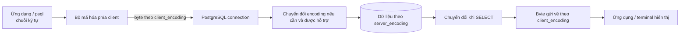
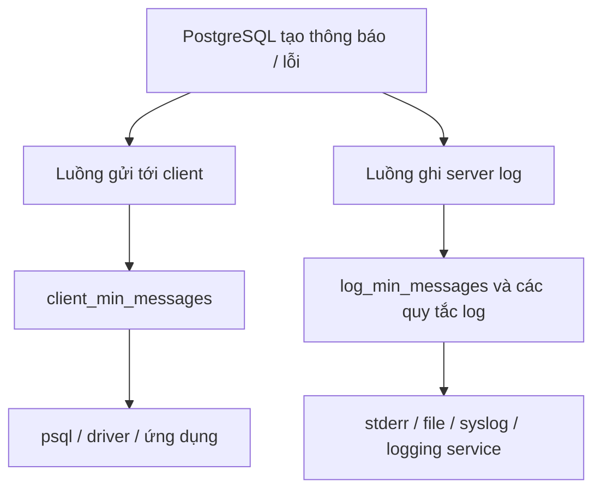

# Thiết lập múi giờ, mã hóa phía máy khách và thông báo trong PostgreSQL

## 1. Vì sao ba nhóm cấu hình này quan trọng?

Một ứng dụng có thể lưu đúng dữ liệu trong PostgreSQL nhưng vẫn hiển thị sai giờ, lỗi dấu tiếng Việt hoặc phát ra quá nhiều thông báo. Những sự cố này thường bắt nguồn từ **thiết lập của phiên kết nối và môi trường**, không nhất thiết từ cấu trúc bảng.

Ví dụ:

- Người dùng ở Việt Nam tạo lịch lúc 09:00, nhưng một dịch vụ khác đọc và hiển thị thành 02:00 mà không giải thích múi giờ.
- Bảng lưu chuỗi Unicode hợp lệ, nhưng terminal hoặc ứng dụng hiện `Tiếng Việt` do mã hóa ở các tầng không khớp nhau.
- Một script migration phát hàng trăm thông báo `NOTICE` và che khuất các lỗi thật sự.
- DBA thay đổi `log_timezone` rồi tưởng đã đổi múi giờ của các cột ngày giờ trả về cho ứng dụng.
- Ứng dụng dùng connection pool, một request đặt `TimeZone` theo khách hàng rồi vô tình để cấu hình đó ảnh hưởng request tiếp theo.

Ba nhóm cấu hình cần học trong bài:

| Nhóm | Thiết lập quan trọng | Điều khiển |
|---|---|---|
| **Múi giờ** | `TimeZone`, `log_timezone`, `DateStyle` | Giải thích/hiển thị thời gian, log timestamp và định dạng ngày |
| **Mã hóa máy khách** | `client_encoding`, `server_encoding`, `\encoding` | Cách chuyển đổi byte văn bản giữa PostgreSQL và client |
| **Thông báo** | `client_min_messages`, `lc_messages`, `log_min_messages` | Mức thông báo gửi tới client, ngôn ngữ thông báo và mức ghi log |

Mục tiêu sau bài học là biết **kiểm tra giá trị đang có**, **thay đổi trong phạm vi phù hợp**, **xác minh tác động** và **chẩn đoán lỗi cấu hình** mà không làm thay đổi dữ liệu ngoài ý muốn.

Bài sử dụng cú pháp PostgreSQL hiện đại, hướng tới PostgreSQL 15–18 và công cụ `psql`. Một số thiết lập yêu cầu quyền quản trị hoặc locale được cài trên hệ điều hành; các ví dụ có ghi rõ phạm vi và điều kiện áp dụng.

## 2. Bản đồ phạm vi cấu hình PostgreSQL

Trước khi đổi múi giờ hay mức thông báo, cần biết thiết lập được áp dụng **cho ai** và **từ khi nào**.

PostgreSQL hỗ trợ nhiều nguồn giá trị cấu hình, trong đó thường gặp:

1. Cấu hình mặc định của PostgreSQL.
2. File cấu hình như `postgresql.conf` và những file được include.
3. Cấu hình lưu bằng `ALTER SYSTEM` trong `postgresql.auto.conf`.
4. Mặc định đặt theo database bằng `ALTER DATABASE ... SET`.
5. Mặc định đặt theo role bằng `ALTER ROLE ... SET`.
6. Mặc định riêng cho một role khi kết nối database cụ thể bằng `ALTER ROLE ... IN DATABASE ... SET`.
7. Tùy chọn khởi tạo phiên kết nối và lệnh `SET` trong session.
8. Thiết lập tạm thời trong transaction bằng `SET LOCAL`.

**Không phải mọi tham số đều cho phép thay đổi ở mọi cấp.** PostgreSQL xác định context của từng tham số; có tham số chỉ thay được khi khởi động instance, có tham số cần reload, có tham số chỉ superuser hoặc vai trò được ủy quyền mới chỉnh được, và có tham số người dùng bình thường được phép đặt trong session.

### 2.1. Xem giá trị đang có

Trong một kết nối SQL:

```sql
SHOW TimeZone;
SHOW DateStyle;
SHOW client_encoding;
SHOW server_encoding;
SHOW client_min_messages;
SHOW lc_messages;
SHOW log_min_messages;
SHOW log_timezone;
```

Hoặc xem đồng thời bằng hàm:

```sql
SELECT
    current_setting('TimeZone') AS session_timezone,
    current_setting('DateStyle') AS date_style,
    current_setting('client_encoding') AS client_encoding,
    current_setting('server_encoding') AS server_encoding,
    current_setting('client_min_messages') AS client_message_level;
```

Mọi kết quả ở đây phản ánh **instance/database/session hiện đang kết nối**, không tự mô tả cấu hình của các connection khác trong hệ thống.

### 2.2. Xem nguồn và ngữ cảnh của tham số

View `pg_settings` giúp chẩn đoán khi một giá trị khác kỳ vọng:

```sql
SELECT
    name,
    setting,
    source,
    context,
    pending_restart
FROM pg_settings
WHERE lower(name) IN (
    'timezone',
    'datestyle',
    'client_encoding',
    'server_encoding',
    'client_min_messages',
    'lc_messages',
    'log_min_messages',
    'log_timezone'
)
ORDER BY lower(name);
```

Các trường chính:

| Trường | Ý nghĩa |
|---|---|
| `name` | Tên tham số PostgreSQL |
| `setting` | Giá trị đang có trong kết nối quan sát |
| `source` | Nguồn thiết lập có hiệu lực, ví dụ default, configuration file, user, database hoặc session |
| `context` | Phạm vi/đặc quyền cần thiết để thay đổi tham số |
| `pending_restart` | Có thay đổi đang chờ restart để có hiệu lực hay không |

Không đoán nguyên nhân từ kết quả `SHOW` đơn lẻ. Nếu cấu hình file là UTC nhưng session hiện `Asia/Ho_Chi_Minh`, kiểm tra liệu role, database, startup option hay `SET` đang ghi đè.

## 3. Thiết lập múi giờ với `TimeZone`

### 3.1. `TimeZone` ảnh hưởng điều gì?

Tham số `TimeZone` là **múi giờ mặc định của session**. Nó ảnh hưởng đặc biệt đến:

- Cách PostgreSQL **hiển thị** giá trị `timestamp with time zone` (viết tắt là `timestamptz`).
- Việc diễn giải một số giá trị ngày giờ khi thiếu múi giờ tường minh.
- Kết quả của một số phép chuyển đổi và hàm theo ngày, ví dụ phần ngày của `CURRENT_DATE`.
- Múi giờ được dùng khi chuyển từ thời điểm tuyệt đối sang giờ địa phương.

Ví dụ kiểm tra:

```sql
SHOW TimeZone;

SELECT now() AS current_instant;
```

Đổi trong session:

```sql
SET TIME ZONE 'UTC';

SHOW TimeZone;

SELECT now() AS shown_in_utc;
```

Đổi sang một múi giờ địa lý:

```sql
SET TIME ZONE 'Asia/Ho_Chi_Minh';

SHOW TimeZone;

SELECT now() AS shown_in_vietnam_time;
```

Các tên như `Asia/Ho_Chi_Minh` và `America/New_York` là **tên vùng múi giờ** theo cơ sở dữ liệu thời gian được PostgreSQL hỗ trợ. Trong dữ liệu ứng dụng, tên vùng thường đáng tin cậy hơn việc chỉ lưu offset cố định `+07:00` hoặc một chữ viết tắt mơ hồ.

**Quan trọng:** đổi `TimeZone` không có nghĩa PostgreSQL viết lại tất cả giá trị `timestamptz` đã lưu. Nó chủ yếu thay cách **diễn giải và trình bày thời điểm** theo múi giờ của session.

### 3.2. Ví dụ cùng thời điểm, hai cách hiển thị

Giả sử ta có một thời điểm được chỉ định rõ ở UTC:

```sql
SET TIME ZONE 'UTC';

SELECT TIMESTAMPTZ '2026-11-14 02:00:00+00'
       AS example_instant;

SET TIME ZONE 'Asia/Ho_Chi_Minh';

SELECT TIMESTAMPTZ '2026-11-14 02:00:00+00'
       AS example_instant;
```

Ở session UTC, kết quả được trình bày tương ứng với 02:00 UTC. Ở session `Asia/Ho_Chi_Minh`, cùng thời điểm ấy được hiển thị tương ứng với **09:00, offset +07**. Đây là **một thời điểm**, không phải hai sự kiện xảy ra cách nhau bảy giờ.

Nếu ứng dụng nhận dạng thời điểm qua API, nên có hợp đồng rõ: dùng UTC hoặc định dạng ISO 8601 có offset để truyền, còn giao diện chuyển sang múi giờ hiển thị mà người dùng yêu cầu.

### 3.3. Khi nào `TimeZone` của session quan trọng?

| Nghiệp vụ | Hành vi cần chú ý |
|---|---|
| Lưu thời điểm thanh toán | Dùng `timestamptz` để thể hiện thời điểm tuyệt đối |
| Hiển thị thời gian cho khách | Chuyển từ thời điểm sang múi giờ người dùng |
| Tính ngày hiện tại | `CURRENT_DATE` phụ thuộc múi giờ session |
| Lọc đơn trong một ngày địa phương | Chuyển **ranh giới ngày địa phương** thành các thời điểm tương ứng |
| Lưu lịch họp 09:00 theo múi giờ thành phố | Cần giữ ngữ nghĩa giờ địa phương và tên vùng múi giờ |
| Ghi log của PostgreSQL | Xem `log_timezone`, **không** suy luận từ `TimeZone` của ứng dụng |

Nên phân biệt ba khái niệm:

- **Instant**: một thời điểm xác định trong dòng thời gian.
- **Local date/time**: ngày và giờ trên đồng hồ tại một địa phương, có thể chưa xác định instant nếu thiếu vùng múi giờ.
- **Time zone / zone identifier**: quy tắc chuyển đổi giữa instant và giờ địa phương, có thể bao gồm DST trong một số vùng.

## 4. `timestamp` và `timestamptz`: cùng tên “timestamp” nhưng khác ngữ nghĩa

Đây là phần rất dễ gây lỗi khi cấu hình `TimeZone`.

| Kiểu PostgreSQL | Tên đầy đủ | Lưu ý |
|---|---|---|
| `timestamp` | `timestamp without time zone` | Lưu các thành phần ngày, giờ; bản thân giá trị không mang instant tuyệt đối |
| `timestamptz` | `timestamp with time zone` | Biểu diễn một thời điểm tuyệt đối; cách xuất dữ liệu phụ thuộc `TimeZone` |
| `date` | `date` | Ngày lịch, không có giờ hay múi giờ |
| `time` | `time without time zone` | Giờ trong ngày, không tự mô tả instant |
| `timetz` | `time with time zone` | Có phần offset nhưng thường không phải lựa chọn ưu tiên cho lịch có quy tắc DST |

PostgreSQL **không lưu nguyên tên múi giờ gốc bên trong `timestamptz`**. Nếu nghiệp vụ cần nhớ người dùng nhập `America/New_York`, hãy lưu tên vùng đó ở một cột riêng cùng thời điểm hoặc mô hình lịch hẹn phù hợp.

### 4.1. Kiểu không có múi giờ

```sql
SELECT
    TIMESTAMP '2026-11-14 09:00:00'
        AS local_wall_clock;
```

Giá trị này thể hiện ngày giờ “2026-11-14 09:00:00” mà **chưa gắn múi giờ cụ thể**. Nó có thể là giờ Hà Nội, New York, hay một lịch chạy theo giờ địa phương. Bản thân kiểu dữ liệu chưa cho biết.

Nếu thay đổi session `TimeZone`, việc hiển thị trực tiếp một giá trị `timestamp without time zone` như trên thường giữ các thành phần ngày và giờ vốn có.

### 4.2. Kiểu có múi giờ

```sql
SELECT
    TIMESTAMPTZ '2026-11-14 09:00:00+07'
        AS absolute_instant;
```

Dấu `+07` giúp PostgreSQL xác định thời điểm tuyệt đối, tương ứng với 02:00 UTC của cùng ngày.

Lưu ý cú pháp literal: kiểu dữ liệu của literal được quyết định bởi `TIMESTAMP` hoặc `TIMESTAMPTZ`, **không phải chỉ vì chuỗi có ký hiệu `+07`**. Ví dụ:

```sql
SELECT
    TIMESTAMP '2026-11-14 09:00:00+07'
        AS timestamp_without_zone;
```

Vì literal đã khai báo `TIMESTAMP` không có múi giờ, phần chỉ báo múi giờ không làm nó tự biến thành `timestamptz`. Khi cần biểu diễn instant, dùng đúng kiểu `TIMESTAMPTZ` và truyền offset/tên múi giờ phù hợp.

### 4.3. Thực hành với một bảng nhỏ

Trong **database lab được phép tạo đối tượng**, có thể dùng:

```sql
CREATE SCHEMA IF NOT EXISTS config_lab;

CREATE TABLE IF NOT EXISTS config_lab.meetings (
    meeting_id bigint GENERATED ALWAYS AS IDENTITY PRIMARY KEY,
    meeting_name text NOT NULL,
    scheduled_at timestamptz NOT NULL,
    local_note_time timestamp without time zone
);
```

Thêm một hàng:

```sql
INSERT INTO config_lab.meetings (
    meeting_name,
    scheduled_at,
    local_note_time
)
VALUES (
    'Hop du an',
    TIMESTAMPTZ '2026-11-14 09:00:00+07',
    TIMESTAMP '2026-11-14 09:00:00'
)
RETURNING meeting_id, scheduled_at, local_note_time;
```

Sau đó so sánh:

```sql
SET TIME ZONE 'UTC';

SELECT meeting_id, scheduled_at, local_note_time
FROM config_lab.meetings
ORDER BY meeting_id;

SET TIME ZONE 'Asia/Ho_Chi_Minh';

SELECT meeting_id, scheduled_at, local_note_time
FROM config_lab.meetings
ORDER BY meeting_id;
```

**Quan sát mong đợi:** cột `scheduled_at` được hiển thị theo session timezone, còn `local_note_time` giữ phần ngày/giờ đã lưu. Nếu chạy ví dụ nhiều lần, bảng sẽ có nhiều hàng; số lượng hàng không ảnh hưởng nguyên lý.

## 5. Chuyển đổi thời gian tường minh bằng `AT TIME ZONE`

Không nên dựa hoàn toàn vào múi giờ ngầm định của session trong những truy vấn cần kết quả nhất quán giữa các dịch vụ.

PostgreSQL có toán tử `AT TIME ZONE` với **hai hướng chuyển đổi**:

| Đầu vào | Biểu thức | Đầu ra | Ý nghĩa |
|---|---|---|---|
| `timestamp without time zone` | `local_time AT TIME ZONE zone` | `timestamptz` | Diễn giải giờ địa phương thuộc một vùng để tạo instant |
| `timestamptz` | `instant AT TIME ZONE zone` | `timestamp without time zone` | Hiển thị instant dưới dạng giờ địa phương của vùng đó |

### 5.1. Từ giờ địa phương sang instant

```sql
SELECT
    TIMESTAMP '2026-11-14 09:00:00'
        AT TIME ZONE 'Asia/Ho_Chi_Minh'
        AS instant_of_local_9am;
```

PostgreSQL hiểu 09:00 thuộc vùng `Asia/Ho_Chi_Minh` và tính thời điểm tương ứng. Nếu session hiển thị UTC, kết quả phản ánh 02:00 UTC; nếu session hiển thị giờ Việt Nam, nó có thể xuất hiện là 09:00+07.

### 5.2. Từ instant sang giờ địa phương

```sql
SELECT
    TIMESTAMPTZ '2026-11-14 02:00:00+00'
        AT TIME ZONE 'Asia/Ho_Chi_Minh'
        AS vietnam_local_time;
```

Kết quả là giá trị `timestamp without time zone` **09:00** của ngày đó. Vùng múi giờ đã dùng để chuyển đổi, nhưng giá trị trả về không tự mang theo tên vùng.

### 5.3. So sánh hai vùng không phụ thuộc session

```sql
SELECT
    TIMESTAMPTZ '2026-11-14 02:00:00+00'
        AT TIME ZONE 'Asia/Ho_Chi_Minh'
        AS hcm_clock,
    TIMESTAMPTZ '2026-11-14 02:00:00+00'
        AT TIME ZONE 'Europe/London'
        AS london_clock;
```

Hai cột là hai cách nhìn theo giờ địa phương của **cùng một instant**. Tên vùng thích hợp giúp PostgreSQL áp dụng các quy tắc lịch sử và daylight saving time (nếu có) thay vì chỉ cộng một offset cố định.

## 6. Daylight Saving Time (DST): vì sao không chỉ cộng trừ vài giờ?

Một số vùng thay đổi offset theo mùa. Ví dụ `America/New_York` có những thời điểm chuyển sang hoặc rời daylight saving time. Điều này dẫn tới:

- Có giờ địa phương **không tồn tại** trong ngày chuyển sang giờ mùa hè.
- Có giờ địa phương **xuất hiện hai lần** trong ngày chuyển về giờ mùa đông.
- Một “ngày địa phương” có thể kéo dài **23, 24 hoặc 25 giờ thực tế**, tùy vùng và ngày.

Ví dụ cần diễn đạt một thời điểm chính xác:

```sql
SELECT
    TIMESTAMPTZ '2026-11-01 01:30:00-04'
        AS first_occurrence,
    TIMESTAMPTZ '2026-11-01 01:30:00-05'
        AS second_occurrence;
```

Đây là hai instant khác nhau, dù đồng hồ địa phương cùng hiển thị 01:30 khi vùng New York đổi giờ mùa thu. Đừng tự gắn offset dựa trên chữ viết tắt `EST`/`EDT` nếu nghiệp vụ yêu cầu giữ đúng một lịch hẹn của vùng theo năm.

### 6.1. Lọc theo ngày địa phương

Giả sử cột `created_at` là `timestamptz` và ứng dụng muốn lấy tất cả đơn hàng trong ngày 14/11/2026 theo **giờ Việt Nam**.

Thay vì viết điều kiện mơ hồ:

```sql
-- Dễ phụ thuộc múi giờ của session:
SELECT *
FROM config_lab.meetings
WHERE scheduled_at::date = DATE '2026-11-14';
```

có thể tính **hai ranh giới ngày địa phương** thành instant:

```sql
SELECT *
FROM config_lab.meetings
WHERE scheduled_at >= (
        TIMESTAMP '2026-11-14 00:00:00'
        AT TIME ZONE 'Asia/Ho_Chi_Minh'
      )
  AND scheduled_at < (
        TIMESTAMP '2026-11-15 00:00:00'
        AT TIME ZONE 'Asia/Ho_Chi_Minh'
      );
```

Cách lọc nửa mở `[đầu ngày, đầu ngày tiếp theo)`:

- Rõ ngữ nghĩa ngày địa phương.
- Không phụ thuộc `TimeZone` của session để diễn giải hai ranh giới.
- Không mất bản ghi có phần giây thập phân gần cuối ngày.
- Thường thuận lợi hơn cho việc dùng index B-tree thông thường trên cột `scheduled_at` so với ép kiểu trên từng giá trị cột.

Với vùng có DST, hãy tính **cả hai** ranh giới từ giờ địa phương và tên vùng; không mặc định ngày nào cũng bằng 24 giờ tính theo UTC.

### 6.2. Thời điểm tuyệt đối và lịch theo giờ địa phương

Nghiệp vụ “gửi báo cáo lúc 09:00 mỗi ngày ở New York” khác “gửi báo cáo mỗi 24 giờ tính từ lần đầu”. Câu thứ nhất cần lưu **múi giờ vùng** để lịch theo DST; câu thứ hai có thể vận hành theo khoảng thời gian tuyệt đối.

Nếu lưu một cuộc hẹn lặp lại, thường cần các thành phần như ngày/giờ địa phương, mã vùng múi giờ và quy tắc lặp. Chỉ một cột `timestamptz` mô tả **một lần xảy ra** chưa đủ để lưu toàn bộ ý nghĩa lặp theo giờ địa phương.

## 7. `DateStyle` và các hàm thời gian liên quan

### 7.1. `DateStyle` không phải `TimeZone`

`DateStyle` điều khiển một số quy tắc định dạng/diễn giải ngày giờ, ví dụ dùng dạng ISO và thứ tự các thành phần ngày/tháng/năm đối với dữ liệu nhập mơ hồ.

```sql
SHOW DateStyle;

SET DateStyle TO 'ISO, DMY';

SHOW DateStyle;

SELECT DATE '2026-11-14' AS explicit_iso_date;
```

Nên truyền ngày theo định dạng ISO `YYYY-MM-DD` hoặc tham số kiểu dữ liệu tương ứng trong driver, thay vì truyền chuỗi nhập như `'01/02/2026'` mà không xác định ngày hay tháng đứng trước.

**Hai câu hỏi khác nhau:**

- “Giá trị 09:00 này thuộc múi giờ nào?” → `TimeZone` / `AT TIME ZONE`.
- “Chuỗi 01/02/2026 sẽ được hiểu theo thứ tự ngày-tháng ra sao?” → `DateStyle` và cách parse ngày.

Đổi `DateStyle` không biến một cột `timestamp` thành `timestamptz`, không làm dữ liệu trở thành UTC và không sửa lỗi múi giờ trong ứng dụng.

### 7.2. Các hàm thời gian thường dùng

```sql
SELECT
    now() AS transaction_time,
    CURRENT_TIMESTAMP AS sql_transaction_time,
    statement_timestamp() AS statement_start,
    clock_timestamp() AS current_wall_clock,
    CURRENT_DATE AS calendar_date_in_session_zone,
    LOCALTIME AS local_time_only,
    LOCALTIMESTAMP AS local_timestamp_without_zone;
```

Diễn giải:

| Biểu thức | Ý nghĩa chính |
|---|---|
| `now()` / `CURRENT_TIMESTAMP` | Thời điểm bắt đầu transaction hiện tại |
| `transaction_timestamp()` | Cùng ngữ nghĩa thời điểm transaction |
| `statement_timestamp()` | Thời điểm bắt đầu câu lệnh hiện tại |
| `clock_timestamp()` | Thời điểm đồng hồ hiện tại, có thể thay đổi ngay trong một câu SQL |
| `CURRENT_DATE` | Ngày lịch theo ngữ nghĩa múi giờ session |
| `LOCALTIMESTAMP` | Giá trị timestamp không có múi giờ theo giờ địa phương session |

Khi đo thời gian thực thi hoặc timestamp của event, không dùng `now()` thay cho `clock_timestamp()` mà không hiểu khác biệt: trong một transaction kéo dài, `now()` vẫn phản ánh thời điểm transaction bắt đầu.

### 7.3. `log_timezone` khác `TimeZone`

`log_timezone` điều khiển múi giờ sử dụng khi PostgreSQL ghi **timestamp trong server log**. Ví dụ một vận hành viên muốn tất cả log của server dùng UTC để dễ đối chiếu giữa các máy.

```sql
SHOW TimeZone;
SHOW log_timezone;
```

Hai giá trị có thể khác nhau mà không phải lỗi:

```text
TimeZone     = Asia/Ho_Chi_Minh  -- cách session hiển thị giờ ứng dụng
log_timezone = UTC               -- timestamp trong server log
```

Đổi `log_timezone` **không đổi thời điểm đang lưu trong `timestamptz`**, và đổi `TimeZone` của app không tự thay timezone của dòng log do server ghi.

`log_timezone` là cấu hình vận hành phía server, thường cần quyền quản trị. Không nên để mọi connection ứng dụng tự thay đổi giá trị này.

## 8. Phạm vi đặt múi giờ: session, transaction, database và role

PostgreSQL cho phép định nghĩa mặc định theo nhiều phạm vi.

### 8.1. Trong một session

```sql
SHOW TimeZone;

SET TimeZone TO 'UTC';

SELECT now();

RESET TimeZone;

SHOW TimeZone;
```

`SET` áp dụng cho **connection hiện tại**, không thay mặc định của mọi user hay mọi database. `RESET` đưa tham số về giá trị có hiệu lực theo các nguồn mặc định phù hợp cho session, không nhất thiết đưa về mặc định biên dịch của PostgreSQL.

Trong `psql`, nếu đang dùng một session riêng để thử, đây là cách ít tác động đến người khác.

### 8.2. Chỉ trong transaction với `SET LOCAL`

```sql
SHOW TimeZone;

BEGIN;

SET LOCAL TimeZone TO 'Asia/Ho_Chi_Minh';

SELECT now() AS shown_in_transaction;

COMMIT;

SHOW TimeZone;
```

`SET LOCAL` có hiệu lực đến khi transaction kết thúc, sau đó cấu hình session trước đó được khôi phục theo quy tắc PostgreSQL. Dùng khi một đơn vị công việc cần chính sách tạm thời mà không muốn làm rò rỉ thiết lập sang thao tác kế tiếp.

Nếu chạy `SET LOCAL` **ngoài transaction phù hợp**, nó không có tác dụng lâu dài mà bạn mong đợi. Trong code có connection pool, mẫu transaction-local thường phù hợp hơn session-level setting kéo dài.

### 8.3. Mặc định của một database

Do người có đủ quyền thực hiện:

```sql
ALTER DATABASE app_db
SET TimeZone TO 'UTC';
```

Câu lệnh này tạo **mặc định cho các session mới** kết nối tới database `app_db`, không tự thay mọi connection đang mở. Database `app_db` chỉ là ví dụ; không chạy trên database đang phục vụ production khi chưa có quy trình thay đổi.

Có thể bỏ cấu hình riêng:

```sql
ALTER DATABASE app_db RESET TimeZone;
```

### 8.4. Mặc định của một role

```sql
ALTER ROLE app_user
SET TimeZone TO 'Asia/Ho_Chi_Minh';
```

Có thể đặt khi một role kết nối database cụ thể:

```sql
ALTER ROLE app_user IN DATABASE app_db
SET TimeZone TO 'UTC';
```

Thiết lập kết hợp **role + database** được dùng cho các phiên đăng nhập phù hợp và thường có mức ưu tiên so với mặc định chỉ theo role hoặc database. Lệnh `SET` trong session vẫn có thể ghi đè khi tham số cho phép.

Một số quy tắc:

- Những mặc định qua `ALTER ROLE`/`ALTER DATABASE` thường có hiệu lực khi **khởi tạo session mới**; test bằng kết nối mới.
- `SET ROLE` giữa một session **không tự áp dụng lại** mọi cấu hình mặc định đã đặt cho role mà bạn vừa chuyển sang.
- Cần đúng quyền để chạy `ALTER ROLE` hoặc `ALTER DATABASE`.
- Với connection pool, thay đổi mặc định sẽ chưa hiển thị trên các connection đã được tạo trước đó cho tới khi tái tạo/recycle phù hợp.

### 8.5. Mặc định ở mức server

Trong file `postgresql.conf`, quản trị viên có thể cấu hình:

```conf
timezone = 'UTC'
log_timezone = 'UTC'
datestyle = 'iso, mdy'
```

File và vị trí thực tế phụ thuộc hệ điều hành, container hoặc dịch vụ cloud. Thay đổi cấu hình có thể yêu cầu reload hoặc restart tùy tham số. Kiểm tra `pg_settings.context` và `pending_restart` thay vì đoán rằng mọi giá trị đều đổi ngay.

Khi có quyền quản trị phù hợp, PostgreSQL hỗ trợ `ALTER SYSTEM` để ghi giá trị vào `postgresql.auto.conf`:

```sql
-- Minh họa tác vụ của DBA; không tự chạy trên production.
ALTER SYSTEM SET TimeZone = 'UTC';

-- Reload khi tham số hỗ trợ và quyền cho phép.
SELECT pg_reload_conf();
```

Chọn **một quy trình quản lý cấu hình nhất quán**: file được quản lý bằng IaC/config management hoặc `ALTER SYSTEM` theo quy định, tránh nhiều lớp thiết lập khó truy dấu.

## 9. Mã hóa: phân biệt ký tự, byte và encoding

Dữ liệu văn bản cần được chuyển giữa hệ thống client và PostgreSQL. Để không bị lỗi tiếng Việt, hãy tách:

- **Ký tự Unicode**: ví dụ chữ `ế`, `ệ`.
- **Byte**: dữ liệu thực tế được truyền qua kết nối hoặc lưu ở tầng mã hóa.
- **Encoding**: quy tắc chuyển chuỗi ký tự thành byte và ngược lại, chẳng hạn UTF-8.

Hai chuỗi có thể chứa cùng chữ nhìn thấy nhưng khác cách biểu diễn Unicode (ký tự dựng sẵn hoặc ký tự cơ sở kèm dấu kết hợp). **UTF-8 hợp lệ không tự chuẩn hóa Unicode** thành một dạng duy nhất; khi cần tìm kiếm/so sánh ổn định, ứng dụng có thể cần quy tắc chuẩn hóa và collation phù hợp.

### 9.1. `server_encoding` và `client_encoding`

| Thiết lập | Cấp độ | Ý nghĩa |
|---|---|---|
| `server_encoding` | Gắn với database đã được tạo | Mã hóa dữ liệu ký tự được lưu trong database |
| `client_encoding` | Thiết lập cho session kết nối | Mã hóa phía client mà PostgreSQL dùng khi nhận/gửi dữ liệu văn bản |
| Encoding của terminal | Thuộc terminal/OS | Cách terminal diễn giải byte để hiển thị |
| Encoding file CSV/SQL | Thuộc file và công cụ tạo file | Cách byte văn bản trong file được mã hóa |

Kiểm tra:

```sql
SHOW server_encoding;
SHOW client_encoding;

SELECT
    current_setting('server_encoding') AS database_encoding,
    current_setting('client_encoding') AS connection_encoding;
```

Một cấu hình phổ biến:

```text
server_encoding = UTF8
client_encoding = UTF8
```

Lúc đó văn bản Unicode được truyền theo UTF-8 giữa PostgreSQL và client phù hợp. Tuy nhiên, terminal vẫn phải dùng encoding/font thích hợp để hiển thị đúng chữ.

### 9.2. Luồng chuyển đổi ký tự



Nếu client khai báo `LATIN1` nhưng thực tế gửi byte UTF-8, PostgreSQL có thể **diễn giải byte sai** hoặc phát sinh lỗi; không thể chữa bằng cách chỉ đổi font hiển thị. Ngược lại, server và client đều UTF-8 nhưng ứng dụng ghi file đầu ra theo encoding khác cũng có thể gây lỗi sau khi dữ liệu đã rời PostgreSQL.

### 9.3. PostgreSQL có tự chuyển mã không?

Trong nhiều trường hợp, PostgreSQL có thể chuyển đổi giữa encoding phía client và encoding của database nếu cặp chuyển đổi được hỗ trợ và các ký tự có thể biểu diễn ở encoding đích.

Nếu một ký tự không thể biểu diễn ở encoding được yêu cầu, thao tác chuyển đổi có thể thất bại với lỗi mã hóa. Không nên khắc phục bằng cách thay ký tự không biểu diễn được thành dấu `?` một cách âm thầm nếu dữ liệu phải giữ nguyên.

### 9.4. Vì sao `SQL_ASCII` không phải giải pháp cho lỗi Unicode?

`SQL_ASCII` không có cơ chế kiểm tra/diễn giải Unicode như UTF-8 và có thể cho phép byte không nhất quán trong dữ liệu. Dùng `SQL_ASCII` để “khỏi báo lỗi encoding” thường làm vấn đề khó sửa hơn: các byte trong cùng một cột có thể bị hiểu theo nhiều encoding khác nhau.

Với ứng dụng mới đa ngôn ngữ, **UTF8** thường là lựa chọn thích hợp cho database và kết nối, trừ khi có yêu cầu tích hợp cụ thể buộc phải sử dụng encoding khác.

## 10. Đặt `client_encoding` trong SQL và `psql`

### 10.1. Đổi encoding của connection

Trong session được phép:

```sql
SHOW client_encoding;

SET client_encoding TO 'UTF8';

SHOW client_encoding;
```

Lệnh này đổi **cách trao đổi dữ liệu văn bản trong connection**, không mã hóa lại tất cả giá trị đã lưu trên server.

Một cách tương đương thường gặp:

```sql
SET NAMES 'UTF8';
```

`SET NAMES` trong PostgreSQL dùng để đặt `client_encoding`. Cần phân biệt với những DBMS có thêm nhiều biến charset/collation riêng cho client, connection hoặc result.

Khôi phục:

```sql
RESET client_encoding;
```

Như các tham số session khác, giá trị sau `RESET` phụ thuộc cấu hình mặc định hiệu lực.

### 10.2. Dùng meta-command của `psql`

Trong `psql`:

```text
\encoding
\encoding UTF8
```

- `\encoding` không có tham số hiển thị client encoding.
- `\encoding UTF8` yêu cầu chuyển client encoding sang UTF8 trong kết nối `psql`.

Đây là **lệnh của psql client**, không phải SQL chuẩn dùng trong JDBC. Chạy `\encoding` bằng JDBC sẽ gây lỗi cú pháp vì driver gửi nó như SQL tới server.

### 10.3. Dùng biến môi trường cho libpq/psql

Với client dựa trên libpq, có thể dùng biến môi trường `PGCLIENTENCODING` để chỉ định client encoding khi khởi tạo kết nối.

Ví dụ shell POSIX:

```sh
PGCLIENTENCODING=UTF8 psql \
  -h 127.0.0.1 -p 5432 \
  -U lab_user -d lab_db
```

Đây là ví dụ với tài khoản và database lab đã tồn tại. Trên PowerShell, cách đặt biến môi trường cho một tiến trình là khác cú pháp shell POSIX. Dù dùng biến môi trường, vẫn nên xác minh bằng `SHOW client_encoding;` sau khi kết nối.

### 10.4. Ứng dụng Java/JDBC

Driver PostgreSQL hiện đại thường quản lý việc truyền dữ liệu chuỗi theo giao thức và encoding phù hợp, phổ biến là UTF-8. Ứng dụng Java làm việc với `String` Unicode, còn driver xử lý chuyển đổi sang byte trên kết nối.

Ví dụ ý tưởng:

```java
String sql = """
    INSERT INTO config_lab.messages(message_text)
    VALUES (?)
    """;

try (PreparedStatement statement = connection.prepareStatement(sql)) {
    statement.setString(1, "Thông báo tiếng Việt: đã lưu thành công");
    statement.executeUpdate();
}
```

Đây là mảnh code minh họa, giả sử đã có JDBC `Connection` và bảng `config_lab.messages` phù hợp. Đừng nối trực tiếp chuỗi người dùng vào SQL chỉ để tránh lỗi encoding; `PreparedStatement` vừa rõ loại dữ liệu vừa tránh một lớp rủi ro SQL injection.

Nếu thấy kết quả khác nhau giữa `psql` và Java, cần kiểm tra **encoding thực tế của từng client**, font/console, API nhận dữ liệu, file nguồn và driver; không tự kết luận dữ liệu PostgreSQL bị hỏng.

## 11. Kiểm tra dữ liệu tiếng Việt bằng PostgreSQL

Tạo bảng riêng trong database lab nếu có quyền:

```sql
CREATE SCHEMA IF NOT EXISTS config_lab;

CREATE TABLE IF NOT EXISTS config_lab.messages (
    message_id bigint GENERATED ALWAYS AS IDENTITY PRIMARY KEY,
    message_text text NOT NULL,
    created_at timestamptz NOT NULL DEFAULT now()
);
```

Đặt client encoding rồi thêm dữ liệu:

```sql
SET client_encoding TO 'UTF8';

INSERT INTO config_lab.messages (message_text)
VALUES
    ('Xin chào'),
    ('Tiếng Việt có dấu'),
    ('Đơn hàng đã được xác nhận'),
    ('Nội dung có ký tự Unicode: ✓')
RETURNING message_id, message_text;
```

Kiểm tra:

```sql
SELECT message_id, message_text
FROM config_lab.messages
ORDER BY message_id;
```

### 11.1. Phân biệt độ dài ký tự và byte

```sql
SELECT
    message_text,
    char_length(message_text) AS character_count,
    octet_length(message_text) AS byte_count
FROM config_lab.messages
ORDER BY message_id;
```

`char_length()` đếm ký tự theo ngữ nghĩa chuỗi; `octet_length()` trả số byte biểu diễn chuỗi theo encoding của database. Với UTF-8, nhiều chữ tiếng Việt có thể chiếm hơn một byte. Vì vậy, **số byte không nhất thiết bằng số ký tự**.

Muốn xem byte mã hóa UTF-8 của một chuỗi trong dạng hex:

```sql
SELECT
    encode(convert_to('Tiếng Việt', 'UTF8'), 'hex')
        AS utf8_hex;
```

`convert_to(text, encoding)` tạo biểu diễn `bytea` theo encoding yêu cầu, còn `encode(..., 'hex')` biểu diễn byte ở dạng dễ kiểm tra. Không nên so sánh trực tiếp biểu diễn hex này với một file CSV nếu chưa biết CSV dùng encoding nào.

### 11.2. Bảng encoding của database không thể đổi bằng `SET`

`server_encoding` gắn với database khi tạo. Lệnh sau **không thể** đổi mã hóa dữ liệu của database hiện có:

```sql
-- Sai ý tưởng; server_encoding không phải session setting tự đổi được:
-- SET server_encoding TO 'UTF8';
```

Trong môi trường lab do admin quản lý, có thể tạo **database mới** với encoding phù hợp, ví dụ:

```sql
-- Minh họa; chỉ chạy khi thật sự cần database lab mới.
CREATE DATABASE unicode_lab
    WITH ENCODING 'UTF8'
         TEMPLATE template0;
```

Câu trên còn phải phù hợp locale/LC_COLLATE/LC_CTYPE và cấu hình thực tế của cluster, nên có thể yêu cầu lựa chọn locale thích hợp hoặc thất bại trên một số môi trường. Không chạy `CREATE DATABASE` bên trong transaction block.

Nếu database cũ đang dùng encoding không mong muốn, việc chuyển đổi thường cần **migrate dữ liệu sang database phù hợp** với công cụ và quy trình kiểm tra; không chỉ đổi một GUC.

## 12. Đọc và ghi CSV/SQL đúng encoding

Một lỗi thường gặp: dữ liệu hiển thị đúng trong `psql` nhưng sai sau khi export hoặc import từ file.

Khi file có encoding UTF-8, có thể khai báo encoding trong lệnh `COPY` nếu phiên bản/cú pháp đang dùng hỗ trợ:

```sql
COPY config_lab.messages (message_text)
TO STDOUT
WITH (FORMAT csv, HEADER true, ENCODING 'UTF8');
```

Khi xuất ra file cục bộ bằng `psql`, có thể dùng `\copy`:

```text
\copy config_lab.messages (message_text) TO 'messages_utf8.csv' WITH (FORMAT csv, HEADER true, ENCODING 'UTF8')
```

`\copy` chạy thông qua **client psql**, vì thế đường dẫn file thuộc **máy chạy psql**. Ngược lại, một câu `COPY ... TO '/path/file'` không dùng `STDOUT` có ngữ nghĩa filesystem phía PostgreSQL server và yêu cầu quyền thích hợp.

Để import file CSV, cần đảm bảo:

1. File thực tế đã được lưu theo encoding nào.
2. Công cụ import đọc file từ phía client hay server.
3. Khai báo `ENCODING` của `COPY` khớp byte file.
4. Cột và kiểu dữ liệu khớp schema.
5. Các trường CSV có dấu phẩy, dấu ngoặc kép hoặc xuống dòng được escape đúng.
6. Dữ liệu được kiểm tra sau import, không chỉ xem số hàng.

Ví dụ cấu trúc import bằng `psql`:

```text
\copy config_lab.messages (message_text) FROM 'messages_utf8.csv' WITH (FORMAT csv, HEADER true, ENCODING 'UTF8')
```

**Đừng thực hiện import này ngay sau export cùng bảng nếu không muốn tạo hàng trùng.** Với dữ liệu kiểm thử, dùng bảng đích mới hoặc transaction có chủ đích rồi rollback.

### 12.1. Lỗi không chỉ nằm ở PostgreSQL

Giả sử file CSV được tạo bằng một chương trình lưu theo Windows code page, nhưng ứng dụng import lại khai báo UTF-8. PostgreSQL có thể báo invalid byte sequence. Nếu nó không báo lỗi mà dữ liệu vẫn sai, có khả năng chuỗi đã bị giải mã sai **trước khi gửi tới database**.

Các tầng cần kiểm tra:

```text
File gốc -> Chương trình đọc file -> Chuỗi Unicode trong app
         -> Driver / client_encoding -> server_encoding
         -> SELECT -> Driver -> Terminal / API / CSV xuất ra
```

Thay `client_encoding` không tự sửa những ký tự đã bị biến thành `?` hoặc chuỗi mojibake trước khi đến PostgreSQL. Khi dữ liệu gốc còn tồn tại, cần sửa từ **nguồn chuyển đổi sai** và nhập lại bằng quy trình được kiểm soát.

## 13. Collation, locale và encoding không phải cùng một khái niệm

Cần phân biệt ba nhóm thường bị gộp làm một:

| Khái niệm | Điều khiển | Ví dụ |
|---|---|---|
| **Encoding** | Ký tự được biểu diễn thành byte ra sao | UTF8, LATIN1 |
| **Collation** | Quy tắc so sánh và sắp xếp chuỗi | Collation dùng libc/ICU tùy database |
| **Locale** | Quy tắc văn hóa/định dạng hay ngôn ngữ của một số nội dung | `lc_messages`, `lc_time`, `lc_numeric` |

Ví dụ, cả hai database đều dùng UTF-8 nhưng collation khác nhau có thể cho thứ tự `ORDER BY name` khác nhau. Điều đó **không** nghĩa dữ liệu bị mã hóa sai.

Trong PostgreSQL, một số tham số locale và collation phụ thuộc hệ điều hành hoặc provider ICU. Thay `client_encoding` không đổi collation của index, và thay `lc_messages` không đổi cách `ORDER BY` trên cột text đang hoạt động.

Nếu thay đổi collation hoặc nâng cấp thư viện so sánh, index dựa trên collation có thể cần quy trình kiểm tra/reindex phù hợp. Đây là vấn đề khác với việc chuyển đổi encoding phía client.

## 14. Thông báo trong PostgreSQL: thông tin nào được gửi tới client?

PostgreSQL có các **mức độ thông báo** (*message severity*) để phân loại sự kiện trong SQL hoặc hệ thống.

Một số mức phổ biến:

| Mức | Ý nghĩa thực tế |
|---|---|
| `DEBUG1` … `DEBUG5` | Chi tiết gỡ lỗi; `DEBUG5` có thể rất nhiều thông tin |
| `INFO` | Thông tin về thao tác đang diễn ra |
| `NOTICE` | Thông tin đáng lưu ý nhưng không phải lỗi; ví dụ lệnh bỏ qua object đã tồn tại |
| `WARNING` | Cảnh báo tình huống có thể cần xem xét |
| `ERROR` | Lỗi làm câu lệnh hiện tại thất bại |
| `LOG` | Thông tin có tính chất ghi log; có quy tắc lọc đặc biệt |
| `FATAL` | Lỗi nghiêm trọng kết thúc session/kết nối |
| `PANIC` | Lỗi cực nghiêm trọng có thể làm PostgreSQL phải dừng/khởi động lại theo cơ chế server |

Không phải tất cả các mức đều do lập trình viên tùy ý phát từ một SQL bình thường. Ví dụ PL/pgSQL `RAISE` hỗ trợ một số mức như `NOTICE`, `WARNING`, `EXCEPTION`; còn `FATAL`/`PANIC` chủ yếu thuộc xử lý lỗi nội bộ server.

Điểm quan trọng: **mức thông báo gửi tới client không đồng nghĩa mức thông báo được lưu vào server log**. Hai luồng có cấu hình riêng.

## 15. `client_min_messages`: lọc thông báo cho session

Tham số `client_min_messages` quyết định ngưỡng thông báo mà server gửi cho client trong phần lớn trường hợp.

Kiểm tra:

```sql
SHOW client_min_messages;
```

Ví dụ chỉ muốn hiển thị cảnh báo và lỗi (không nhận `NOTICE` thông thường):

```sql
SET client_min_messages TO warning;
```

Khi cần xem lại thông báo thông thường:

```sql
SET client_min_messages TO notice;
```

Sau khi thực hành:

```sql
RESET client_min_messages;
```

### 15.1. Ví dụ phát thông báo bằng PL/pgSQL

Dùng khối `DO`:

```sql
DO $$
BEGIN
    RAISE NOTICE 'Thong bao: da bat dau thuc hanh';
    RAISE WARNING 'Canh bao: day chi la vi du';
END
$$;
```

Thử mức `notice`:

```sql
SET client_min_messages TO notice;

DO $$
BEGIN
    RAISE NOTICE 'Muc NOTICE se duoc gui toi client';
    RAISE WARNING 'Muc WARNING cung duoc gui toi client';
END
$$;
```

Thử mức `warning`:

```sql
SET client_min_messages TO warning;

DO $$
BEGIN
    RAISE NOTICE 'Thong bao nay thuong bi loc';
    RAISE WARNING 'Canh bao nay van duoc gui';
END
$$;
```

Thông thường, khi ngưỡng là `warning`, `RAISE NOTICE` không được chuyển đến client còn `RAISE WARNING` vẫn xuất hiện. Cách công cụ hiển thị có thể khác nhau: terminal có thể in ra stderr; driver có thể đưa thông báo vào chuỗi warning/notice hoặc callback chuyên biệt.

**Ngoại lệ cần biết:** PostgreSQL xử lý thông báo mức `INFO` theo quy tắc riêng; thông báo `INFO` được gửi tới client bất kể `client_min_messages` trong ngữ nghĩa PostgreSQL thông thường. Mức `LOG` cũng có xử lý thứ tự riêng. Vì thế, không tự áp dụng một phép so sánh số học đơn giản cho mọi severity.

### 15.2. `client_min_messages` không che lỗi SQL

Ví dụ:

```sql
SET client_min_messages TO error;
```

điều này không làm câu SQL sai trở nên hợp lệ. Lỗi ràng buộc, cú pháp hoặc quyền vẫn làm câu lệnh thất bại và ứng dụng phải xử lý lỗi đúng cách.

**Lưu ý giao dịch:** nếu SQL ném `ERROR` bên trong transaction đang mở, PostgreSQL có thể đưa transaction vào trạng thái aborted cho đến khi rollback. Mức thông báo không thay đổi tính nguyên tử hay cơ chế rollback của transaction.

### 15.3. Khi nào nên giảm `NOTICE`?

Các tình huống thực tế:

- Script triển khai phát rất nhiều `NOTICE` mà người vận hành không cần trong màn hình hiện tại.
- Giao diện command-line muốn chỉ hiển thị warning/error để người dùng dễ theo dõi.
- Một kết nối của worker cần giảm lượng thông báo không quan trọng khi xử lý batch.

Nhưng tránh đặt ngưỡng quá cao một cách máy móc. `NOTICE` có thể chứa thông tin hữu ích khi tạo index, chạy migration hoặc chẩn đoán các đối tượng đã tồn tại. Trong các thao tác quản trị cần dấu vết rõ ràng, nên giữ mức thông báo phù hợp và thu thập log riêng.

## 16. `lc_messages`: chọn ngôn ngữ thông báo

`lc_messages` quyết định **locale/ngôn ngữ** được dùng cho các thông báo do PostgreSQL phát, khi bản dịch và locale cần thiết có sẵn.

Kiểm tra:

```sql
SHOW lc_messages;
```

Trong một số môi trường, giá trị có thể là `C` hoặc một tên locale hệ điều hành như `en_US.UTF-8`. Giá trị chính xác phụ thuộc cách PostgreSQL được xây dựng, hệ điều hành và cấu hình cluster.

Admin có thể thiết lập ví dụ:

```sql
-- Chỉ minh họa cho tài khoản có quyền phù hợp.
SET lc_messages TO 'C';
```

Locale `C` thường cung cấp thông báo theo ngôn ngữ thông dụng mặc định của PostgreSQL, thường là tiếng Anh. Một locale khác chỉ dùng được khi được hỗ trợ/cài đặt và có bộ dịch tương ứng.

**Điểm cần tránh nhầm:**

- `lc_messages` không thay `client_encoding`.
- `lc_messages` không đổi timezone.
- `lc_messages` không thay mức severity của thông báo.
- Một bản dịch khác có thể làm văn bản lỗi khác nhau nhưng **SQLSTATE** vẫn là cách ổn định hơn để ứng dụng phân loại lỗi.

Thay `lc_messages` thường thuộc nhóm cấu hình cần quyền cao hơn người dùng thông thường; không coi nó là tham số mọi application connection đều được phép tự đặt.

### 16.1. Xử lý lỗi theo SQLSTATE, không theo chuỗi ngôn ngữ

Ví dụ một câu SQL vi phạm khóa duy nhất có thể trả SQLSTATE `23505` (*unique_violation*).

Ứng dụng không nên viết:

```text
if error.message contains "duplicate key":
    ...
```

vì chuỗi mô tả có thể thay đổi theo locale, phiên bản, driver và ngữ cảnh.

Thay vào đó, driver thường cung cấp trường **SQLSTATE**. Ví dụ Java:

```java
try {
    // Thực hiện câu lệnh SQL.
} catch (java.sql.SQLException error) {
    String sqlState = error.getSQLState();
    if ("23505".equals(sqlState)) {
        // Xử lý lỗi vi phạm UNIQUE phù hợp nghiệp vụ.
    } else {
        throw error;
    }
}
```

Đoạn code là minh họa cấu trúc xử lý exception, không phải một chương trình Java độc lập. SQLSTATE giúp phân loại lỗi, nhưng ứng dụng vẫn cần xác định chính xác ràng buộc bị vi phạm và ngữ cảnh nghiệp vụ trước khi quyết định retry hay trả kết quả.

## 17. Server logging: khác với thông báo mà client nhìn thấy

Những cấu hình quan trọng ở phía server:

| Thiết lập | Tác dụng |
|---|---|
| `log_min_messages` | Ngưỡng severity được ghi vào server log |
| `log_min_error_statement` | Ngưỡng lỗi khiến câu SQL liên quan được ghi vào log theo cấu hình |
| `log_statement` | Chọn nhóm câu lệnh được log theo chính sách |
| `log_min_duration_statement` | Log câu lệnh có thời gian chạy vượt ngưỡng |
| `logging_collector` | Thành phần thu thập log tới file khi được cấu hình tương ứng |
| `log_destination` | Nơi xuất log, tùy hệ điều hành/cấu hình |
| `log_line_prefix` | Prefix chứa thời gian, PID, user, database, application name… |
| `log_timezone` | Múi giờ hiển thị timestamp trong server log |

Ví dụ kiểm tra:

```sql
SHOW log_min_messages;
SHOW log_min_error_statement;
SHOW log_statement;
SHOW log_min_duration_statement;
SHOW logging_collector;
SHOW log_destination;
SHOW log_timezone;
```

### 17.1. Hai đường thông báo độc lập



Ví dụ, đặt `client_min_messages = warning` sẽ giảm `NOTICE` gửi tới client, **không đồng nghĩa** `NOTICE` phải bị xóa khỏi server log bằng cùng quy tắc. Ngược lại, `log_min_messages = warning` điều khiển đường log server, không tự đổi bộ lọc thông báo của client.

Các level `LOG`/`INFO` có quy tắc riêng trong ngữ nghĩa mức độ nghiêm trọng của PostgreSQL; khi điều tra vận hành, cần xem cấu hình và tài liệu đúng phiên bản thay vì tự viết bộ lọc theo thứ tự từ chuỗi level.

### 17.2. Ví dụ cấu hình file cho DBA

Trong cấu hình do quản trị viên quản lý:

```conf
# Ví dụ, không phải cấu hình mặc định bắt buộc:
log_timezone = 'UTC'
log_min_messages = warning
client_min_messages = notice
```

Nếu muốn điều tra truy vấn chậm, có thể dùng các thông số ghi log theo thời lượng, nhưng phải cân nhắc tải và dữ liệu nhạy cảm. Bật `log_statement = 'all'` một cách tùy tiện có thể tạo log khổng lồ và ghi lại những câu SQL chứa dữ liệu riêng tư.

### 17.3. `lc_messages` khác `log_timezone`

Ví dụ:

```text
lc_messages = C       -- ngôn ngữ thông báo
log_timezone = UTC     -- múi giờ timestamp trong log
```

Hai thiết lập không liên quan trực tiếp:

- `lc_messages` ảnh hưởng văn bản được dịch khi có hỗ trợ.
- `log_timezone` ảnh hưởng cách ghi thời gian của log.
- `client_min_messages` ảnh hưởng thông báo được gửi đến ứng dụng.
- `TimeZone` ảnh hưởng giá trị ngày giờ theo session.

Nếu log có nội dung tiếng Anh nhưng timestamp ở UTC, đó là kết hợp hoàn toàn bình thường.

## 18. Đổi cấu hình ở mức nào trong triển khai thực tế?

Hãy chọn phạm vi theo nhu cầu, đừng mặc định thay `postgresql.conf` mỗi khi một màn hình muốn hiển thị thời gian khác.

| Yêu cầu | Phạm vi nên cân nhắc | Vì sao |
|---|---|---|
| Một truy vấn hiển thị giờ Việt Nam | `AT TIME ZONE 'Asia/Ho_Chi_Minh'` ngay trong query | Minh bạch, không phụ thuộc session |
| Một transaction xử lý theo múi giờ nghiệp vụ | `SET LOCAL TimeZone` | Tự khôi phục khi transaction kết thúc |
| Toàn bộ ứng dụng dùng UTC cho dữ liệu thời điểm | Default của role/database hoặc cấu hình session pool | Nhất quán giữa các request |
| Mọi log máy chủ dùng UTC | `log_timezone` ở cấu hình server | Thuận tiện đối chiếu giữa các máy |
| Một terminal cần hiển thị tiếng Việt | Client encoding UTF8 cùng terminal Unicode | Không phải đổi database encoding |
| File CSV có mã hóa riêng | `COPY ... ENCODING` và kiểm tra file | Đúng byte của nguồn dữ liệu |
| Một script muốn giảm NOTICE | `client_min_messages` trong session | Không ảnh hưởng toàn server |
| Vận hành muốn tăng log lỗi server | `log_min_messages` và thiết lập logging | Phục vụ hệ thống giám sát |
| Muốn đổi ngôn ngữ lỗi | `lc_messages` khi locale và quyền hỗ trợ | Không cần đổi charset dữ liệu |

### 18.1. Kiểm tra cấu hình sau khi thay đổi

Trong một connection mới khi cần test mặc định:

```sql
SELECT
    current_database() AS database_name,
    current_user AS role_name,
    current_setting('TimeZone') AS timezone_setting,
    current_setting('client_encoding') AS client_encoding_setting,
    current_setting('client_min_messages') AS client_messages_setting;
```

Sau đó kiểm tra thêm nguồn:

```sql
SELECT name, setting, source, context
FROM pg_settings
WHERE lower(name) IN (
    'timezone',
    'client_encoding',
    'client_min_messages'
)
ORDER BY lower(name);
```

Điều này giúp xác định application pool có thật sự dùng role và database mà bạn vừa thay mặc định hay không.

### 18.2. Quy tắc với connection pool

Một **connection pool** tái sử dụng connection giữa nhiều request. Nếu request A chạy:

```sql
SET TIME ZONE 'Asia/Ho_Chi_Minh';
```

rồi trả connection vào pool mà không reset, request B có thể tiếp nhận session với timezone do A để lại.

Cách tránh rò rỉ trạng thái:

- Dùng một quy tắc timezone cố định cho mỗi pool khi có thể.
- Dùng `SET LOCAL` trong transaction cho cấu hình chỉ có tác dụng một use case.
- Trả connection về trạng thái chuẩn theo cơ chế pool/driver.
- Không giả định transaction rollback sẽ xóa mọi `SET` session-level đã được thực hiện ngoài transaction.
- Kiểm tra connection mới và connection tái sử dụng trong test tích hợp.

Cùng vấn đề này áp dụng cho `client_min_messages` và nhiều GUC khác. Một request không nên vô tình quyết định ngưỡng thông báo của request kế tiếp.

### 18.3. Tùy chọn khi mở connection

Với công cụ dựa trên libpq, có thể chỉ định một số server setting qua startup options. Ví dụ shell POSIX:

```sh
PGOPTIONS='-c TimeZone=UTC -c client_min_messages=warning' \
psql -h 127.0.0.1 -p 5432 -U lab_user -d lab_db
```

Những ví dụ trên giả sử role/database lab đã có. Các startup option cũng chịu quy tắc đặc quyền và ngữ nghĩa của từng parameter. Khi dùng JDBC, chọn cơ chế cấu hình tương thích driver/framework, không ghép một chuỗi tùy tiện vào URL rồi giả định mọi thành phần đều hiểu.

## 19. Bài thực hành tổng hợp theo hai session

Mục tiêu: kiểm tra múi giờ, UTF-8 và bộ lọc thông báo **không cần quyền superuser**.

### 19.1. Chuẩn bị session A

Trong `psql` kết nối database lab:

```sql
SELECT
    current_database(),
    current_user;

SHOW TimeZone;
SHOW client_encoding;
SHOW client_min_messages;
```

Đặt giá trị cho session A:

```sql
SET TimeZone TO 'Asia/Ho_Chi_Minh';
SET client_encoding TO 'UTF8';
SET client_min_messages TO warning;
```

Kiểm tra:

```sql
SELECT
    current_setting('TimeZone') AS tz,
    current_setting('client_encoding') AS encoding,
    current_setting('client_min_messages') AS messages;
```

### 19.2. Kiểm tra thời gian và ký tự

```sql
SELECT
    TIMESTAMPTZ '2026-11-14 02:00:00+00'
        AS time_displayed_in_session,
    TIMESTAMPTZ '2026-11-14 02:00:00+00'
        AT TIME ZONE 'Asia/Ho_Chi_Minh'
        AS explicitly_local_time,
    char_length('Tiếng Việt') AS number_of_characters,
    octet_length('Tiếng Việt') AS number_of_bytes;
```

Quan sát:

- Hai biểu thức thời gian đang nói về **cùng instant** theo hai cách biểu diễn.
- Số byte của tiếng Việt UTF-8 có thể nhiều hơn số ký tự.
- Tất cả kiểm tra này không cần sửa dữ liệu bảng.

### 19.3. Kiểm tra thông báo

```sql
DO $$
BEGIN
    RAISE NOTICE 'Day la NOTICE';
    RAISE WARNING 'Day la WARNING';
END
$$;
```

Ở mức `warning`, thông báo `NOTICE` thông thường bị lọc khỏi phía client còn `WARNING` vẫn được hiển thị.

Đặt lại:

```sql
SET client_min_messages TO notice;
```

Rồi thực thi lại khối `DO` để so sánh.

### 19.4. Mở session B độc lập

Mở một cửa sổ `psql` khác cùng role/database. Chạy:

```sql
SHOW TimeZone;
SHOW client_encoding;
SHOW client_min_messages;
```

Nếu role/database chưa được cấu hình mặc định đặc biệt, session B **không tự nhận các lệnh `SET` của session A**. Đây là bằng chứng thực hành cho phạm vi session.

### 19.5. Thử `SET LOCAL` và kết thúc

Quay lại session A:

```sql
SHOW TimeZone;

BEGIN;
SET LOCAL TimeZone TO 'UTC';
SELECT now() AS utc_during_transaction;
COMMIT;

SHOW TimeZone;
```

Sau `COMMIT`, giá trị `TimeZone` của session trở lại giá trị có hiệu lực trước `SET LOCAL`.

Cuối buổi thử nghiệm, có thể reset các tham số đã đặt trong **session lab**:

```sql
RESET TimeZone;
RESET client_encoding;
RESET client_min_messages;
RESET DateStyle;
```

Những lệnh `RESET` này áp dụng cho connection hiện tại; chúng không xóa bảng, schema hay cấu hình server của người khác.

## 20. Chẩn đoán lỗi thường gặp

### 20.1. “Cùng một timestamp nhưng hai máy hiển thị khác nhau”

**Khả năng:** session `TimeZone` khác nhau, hoặc ứng dụng đang chuyển đổi múi giờ thêm một lần.

Kiểm tra:

```sql
SHOW TimeZone;

SELECT
    TIMESTAMPTZ '2026-11-14 02:00:00+00'
        AS session_output,
    TIMESTAMPTZ '2026-11-14 02:00:00+00'
        AT TIME ZONE 'UTC'
        AS explicit_utc_clock;
```

Đừng tự thay dữ liệu gốc chỉ vì hai kết quả có phần giờ khác nhau; trước hết hãy xác định chúng có đại diện cùng một instant không.

### 20.2. “Bản ghi lưu 09:00 nhưng hiển thị 02:00”

Nếu cột là `timestamptz`, đây có thể chỉ là 09:00 theo giờ Việt Nam đang hiển thị 02:00 theo UTC. Nếu cột là `timestamp without time zone`, cần biết lúc nhập có được chuyển đổi múi giờ sai hay không.

Điều tra **kiểu cột, tham số session, chuỗi input và tầng ứng dụng** trước khi chạy `UPDATE` hàng loạt.

### 20.3. “Truy vấn theo ngày bỏ sót những đơn cuối ngày”

Thường là do dùng ranh giới cuối ngày với số giây không đủ chính xác, hoặc ngày được tính theo timezone khác.

Ưu tiên lọc:

```sql
WHERE event_time >= lower_boundary
  AND event_time < upper_boundary
```

với hai boundary đã chuyển đổi từ ngày địa phương mong muốn thành instant theo múi giờ vùng, thay vì ép `event_time::date` theo session timezone không kiểm soát.

### 20.4. “Dữ liệu tiếng Việt hiện thành ký tự lạ”

Kiểm tra từng lớp:

```sql
SHOW server_encoding;
SHOW client_encoding;
```

Sau đó xác định:

- File nguồn có UTF-8 thật không?
- Terminal có hiển thị Unicode/UTF-8 đúng không?
- Driver đang gửi/nhận dữ liệu bằng encoding nào?
- Chuỗi đã hỏng trong ứng dụng **trước khi chèn** hay chỉ hỏng lúc xuất?
- Có thao tác đổi `client_encoding` giữa một connection đang dùng hay không?

Đừng vội chuyển cả database sang một encoding khác chỉ vì terminal không hiện đúng font.

### 20.5. “invalid byte sequence for encoding UTF8”

Lỗi này thường chỉ ra rằng byte nhận được không hợp lệ theo UTF-8 ở nơi đang kiểm tra, hoặc file/bytea có nội dung không tương thích. Cần xác định **encoding thật của nguồn** rồi chuyển đổi đúng bằng công cụ thích hợp.

Đừng dùng `SQL_ASCII` hoặc thay ký tự không hợp lệ thành `?` một cách âm thầm trên dữ liệu cần lưu nguyên.

### 20.6. “client_encoding = UTF8 nhưng import CSV vẫn sai”

`client_encoding` mô tả kết nối, còn byte trong file CSV có thể đang được lưu ở encoding khác. Nếu file là UTF-8 thì khai báo UTF8 ở bước đọc; nếu không phải UTF-8, cần khai báo đúng hoặc chuyển đổi file trước import.

### 20.7. “Không thấy NOTICE trong psql”

Kiểm tra:

```sql
SHOW client_min_messages;
```

Nếu ngưỡng đang là `warning`, nhiều `NOTICE` không được gửi tới client. Dùng `SET client_min_messages TO notice;` trong session lab nếu cần quan sát.

Cũng nên phân biệt thông báo do server phát với thông tin do psql tự in, ví dụ `\echo` là hành vi của client.

### 20.8. “Đặt client_min_messages nhưng log file vẫn có thông báo”

Đó có thể là hành vi đúng vì server log có cơ chế riêng: `log_min_messages`, `log_statement`, `log_min_error_statement` và các tham số logging khác. Đừng nhầm đường **client display** với **server logging**.

### 20.9. “Đổi lc_messages nhưng vẫn là tiếng Anh”

Có thể locale hoặc file dịch chưa có sẵn, tài khoản thiếu quyền, cấu hình khác ghi đè, hoặc thông điệp không có bản dịch. Xác nhận `SHOW lc_messages` và môi trường hệ điều hành/phiên bản trước khi sửa.

Ứng dụng nên xử lý lỗi dựa trên SQLSTATE, không dựa vào một từ tiếng Anh hay tiếng Việt trong thông báo.

### 20.10. “ALTER DATABASE SET TimeZone không có tác dụng”

Có thể bạn đang xem **connection cũ**, bị `ALTER ROLE`/startup option/`SET` ghi đè, hoặc đã thay nhầm database. Mở connection mới đúng role/database và xem:

```sql
SELECT current_database(), current_user;
SHOW TimeZone;

SELECT name, setting, source
FROM pg_settings
WHERE lower(name) = 'timezone';
```

Không khởi động lại PostgreSQL một cách tùy tiện khi vấn đề chỉ là session setting hoặc connection pool chưa recycle.

## 21. Lưu ý bảo mật và vận hành khi thay đổi cấu hình

1. **Đổi cấu hình theo phạm vi nhỏ nhất cần thiết.** Một màn hình cần giờ địa phương không nên buộc cả server đổi múi giờ.
2. **Không cấp superuser để ứng dụng thay `lc_messages` hoặc log setting.** Admin và runtime role cần tách trách nhiệm.
3. **Kiểm tra source của parameter.** File, role, database, client startup và session có thể tạo các giá trị khác nhau.
4. **Giữ session state sạch trong connection pool.** Không để timezone hoặc ngưỡng NOTICE của một request lan sang request khác.
5. **Bảo mật server log.** Một số thiết lập có thể ghi SQL, thông tin lỗi hoặc dữ liệu nhạy cảm. Giới hạn quyền truy cập và retention.
6. **Không sửa hàng loạt timestamp khi chưa hiểu kiểu và múi giờ gốc.** Lỗi hiển thị và lỗi dữ liệu lưu là hai loại sự cố khác nhau.
7. **Tránh trộn mã hóa file và mã hóa connection.** Kiểm tra byte nguồn và dùng công cụ chuyển đổi có thể kiểm chứng.
8. **Thử trên database/session lab trước.** Những thiết lập như `log_timezone`, `log_min_messages` hoặc thay file cấu hình thuộc quy trình vận hành có kiểm soát.
9. **Giữ mốc thời gian có offset trong API/log nghiệp vụ.** Khi tích hợp nhiều hệ thống, việc bỏ offset có thể khiến thời điểm bị diễn giải sai.
10. **Ghi lại giá trị trước/sau khi thay đổi.** Điều đó giúp rollback cấu hình và giải thích khác biệt giữa các môi trường.

## 22. Bài tập có lời giải

### Bài 1. Phân biệt hai kiểu thời gian

Cho:

```sql
SELECT
    TIMESTAMP '2026-11-14 09:00:00' AS local_value,
    TIMESTAMPTZ '2026-11-14 09:00:00+07' AS instant_value;
```

**Câu hỏi:** khi đổi session `TimeZone` từ UTC sang `Asia/Ho_Chi_Minh`, hai cột khác nhau như thế nào?

**Lời giải:** giá trị `timestamp without time zone` giữ thành phần ngày giờ 09:00; `timestamptz` đại diện một instant và được hiển thị theo session, nên có thể thấy 02:00+00 hoặc 09:00+07. Không phải dữ liệu đã bị cập nhật hai lần.

### Bài 2. Chọn thiết lập theo phạm vi

Một API có 500 request/giây, trong đó chỉ một endpoint cần hiển thị giờ Tokyo.

**Câu hỏi:** có nên đổi `postgresql.conf` sang Tokyo cho toàn server không?

**Lời giải:** không cần. Ưu tiên chuyển đổi tường minh bằng `AT TIME ZONE 'Asia/Tokyo'` hoặc định dạng tại tầng ứng dụng. Nếu thật sự cần cấu hình transaction-local, có thể dùng `SET LOCAL` trong transaction tương ứng, tránh rò rỉ trạng thái qua connection pool.

### Bài 3. Chẩn đoán lỗi Unicode

Database báo `server_encoding = UTF8` và `client_encoding = UTF8` nhưng terminal hiện chữ có dấu sai.

**Lời giải:** tiếp tục kiểm tra encoding/font terminal, dữ liệu file nguồn, cách ứng dụng decode byte và kết quả ở một client khác. Không vội khẳng định PostgreSQL lưu dữ liệu sai.

### Bài 4. Chọn cách tính ngày địa phương

Ứng dụng cần lấy tất cả đơn trong ngày lịch 14/11 tại một thành phố có DST.

**Lời giải:** tạo hai boundary lần lượt cho 00:00 của ngày 14/11 và 00:00 ngày 15/11 trong **tên vùng múi giờ** của thành phố, chuyển hai giá trị thành `timestamptz` rồi lọc nửa mở. Không lấy một boundary và cộng cố định 24 giờ UTC cho mọi ngày.

### Bài 5. Phân biệt thông báo client và server

Có cấu hình:

```conf
client_min_messages = warning
log_min_messages = notice
```

**Câu hỏi:** một `RAISE NOTICE` có chắc được in trên psql không?

**Lời giải:** không. `client_min_messages = warning` thường lọc NOTICE phía client. Cấu hình `log_min_messages` là quy tắc ghi server log riêng, không buộc NOTICE phải hiện trên psql.

### Bài 6. `lc_messages` có xử lý được SQLSTATE không?

Một ứng dụng tìm chữ “duplicate key” trong chuỗi lỗi. Sau khi hệ thống đổi locale, chức năng phân loại lỗi bị hỏng.

**Lời giải:** chuỗi thông báo có thể được dịch hoặc thay đổi. Với lỗi vi phạm unique constraint, ứng dụng có thể dựa vào SQLSTATE `23505` và xác định constraint/ngữ cảnh nghiệp vụ, thay vì tìm text tiếng Anh.

### Bài 7. Encoding khi nhập file

Một file CSV chứa chữ tiếng Việt ở mã hóa khác UTF-8, nhưng công cụ import mặc định đọc thành UTF-8.

**Lời giải:** cần phát hiện encoding thật của file rồi chuyển sang UTF-8 hoặc khai báo đúng encoding cho thao tác `COPY`. `SET client_encoding = UTF8` không biến byte file sai thành UTF-8 hợp lệ.

### Bài 8. Vì sao mở session mới lại thấy TimeZone khác?

DBA đã chạy:

```sql
ALTER DATABASE app_db SET TimeZone TO 'UTC';
```

nhưng một kết nối của `app_user` vẫn hiển thị `Asia/Ho_Chi_Minh`.

**Lời giải:** có thể connection được tạo trước thay đổi, có mặc định role/role-in-database, startup option hoặc session `SET` ghi đè. Kiểm tra đúng role/database, mở connection mới và đọc `pg_settings.source`.

### Bài 9. Chọn cách hiển thị log nhất quán

Một hệ thống có server ở nhiều quốc gia; DBA muốn timestamp trong log đều ở UTC.

**Lời giải:** cấu hình `log_timezone = 'UTC'` trong chính sách logging server. Điều đó độc lập với việc người dùng cuối nhìn giờ địa phương qua `TimeZone`/`AT TIME ZONE`.

### Bài 10. So sánh thời gian transaction và đồng hồ thật

Trong một transaction chạy nhiều giây, lập trình viên gọi `now()` hai lần và thấy cùng thời điểm.

**Lời giải:** `now()`/`transaction_timestamp()` phản ánh thời điểm bắt đầu transaction, không liên tục tăng theo thời gian đồng hồ. Nếu cần thời điểm thực tế tại từng lần gọi, dùng `clock_timestamp()` khi phù hợp.

## 23. Bảng tra cứu nhanh

| Việc cần làm | SQL / công cụ |
|---|---|
| Xem timezone session | `SHOW TimeZone;` |
| Đặt timezone trong session | `SET TIME ZONE 'UTC';` |
| Đặt timezone chỉ trong transaction | `BEGIN; SET LOCAL TimeZone TO 'UTC'; ... COMMIT;` |
| Chuyển giờ địa phương sang instant | `timestamp_value AT TIME ZONE 'Area/City'` |
| Chuyển instant sang giờ địa phương | `timestamptz_value AT TIME ZONE 'Area/City'` |
| Xem định dạng ngày | `SHOW DateStyle;` |
| Xem timezone server log | `SHOW log_timezone;` |
| Xem mã hóa của database | `SHOW server_encoding;` |
| Xem mã hóa client | `SHOW client_encoding;` |
| Đặt mã hóa client UTF8 | `SET client_encoding TO 'UTF8';` |
| Kiểm tra encoding trong psql | `\encoding` |
| Đặt encoding trong psql | `\encoding UTF8` |
| Đếm ký tự và byte | `char_length(text)`, `octet_length(text)` |
| Xem ngưỡng thông báo client | `SHOW client_min_messages;` |
| Lọc NOTICE trong session | `SET client_min_messages TO warning;` |
| Xem ngôn ngữ thông báo | `SHOW lc_messages;` |
| Xem ngưỡng ghi server log | `SHOW log_min_messages;` |
| Xem nguồn, context và restart | `SELECT ... FROM pg_settings;` |
| Đặt mặc định timezone theo DB | `ALTER DATABASE db SET TimeZone TO 'UTC';` |
| Đặt mặc định theo role | `ALTER ROLE role SET TimeZone TO 'UTC';` |
| Hoàn tác SET session | `RESET TimeZone;`, `RESET client_encoding;`, `RESET client_min_messages;` |

### Tổng kết

Thiết lập **múi giờ**, **mã hóa client** và **thông báo** nằm ở ba lớp trách nhiệm khác nhau:

1. **`TimeZone`** cho biết PostgreSQL diễn giải và hiển thị thời gian theo vùng múi giờ nào trong session. `timestamptz` biểu diễn instant; `timestamp` không có múi giờ; `log_timezone` là cấu hình riêng cho timestamp của server log.
2. **`client_encoding`** xác định mã hóa của dữ liệu văn bản trao đổi với client, còn **`server_encoding`** gắn với database. Encoding của file và terminal vẫn cần được kiểm tra độc lập; UTF8 không tự sửa dữ liệu vốn đã bị decode sai.
3. **`client_min_messages`** lọc những thông báo gửi tới client; **`log_min_messages`** áp dụng cho server log; **`lc_messages`** chọn ngôn ngữ thông báo khi có hỗ trợ. Ứng dụng nên xử lý lỗi bằng SQLSTATE thay vì so khớp chuỗi thông điệp.

Khi cấu hình PostgreSQL, hãy **đổi ở phạm vi nhỏ nhất đủ đáp ứng yêu cầu**, kiểm tra giá trị thực tế bằng `SHOW`/`pg_settings`, xác nhận với connection mới khi đổi mặc định, và thử nghiệm với dữ liệu/timezone/Unicode cụ thể. Cách làm này tránh được nhiều lỗi âm thầm về ngày giờ, tiếng Việt và chẩn đoán sự cố trong ứng dụng.

