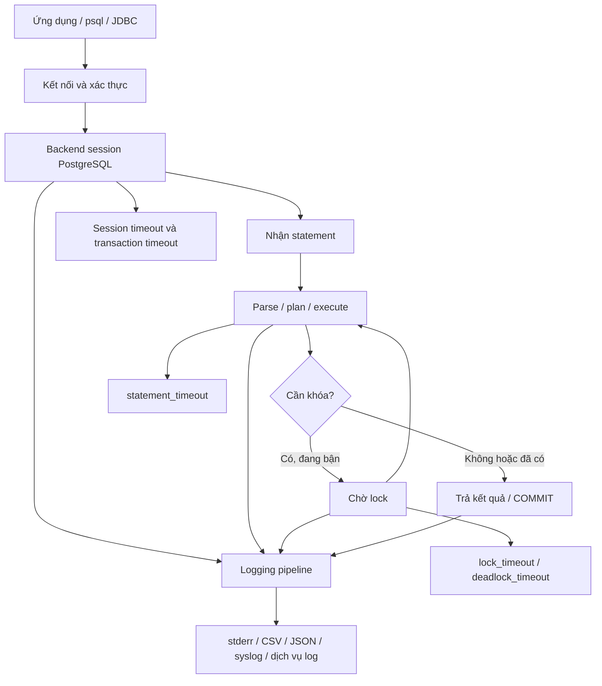
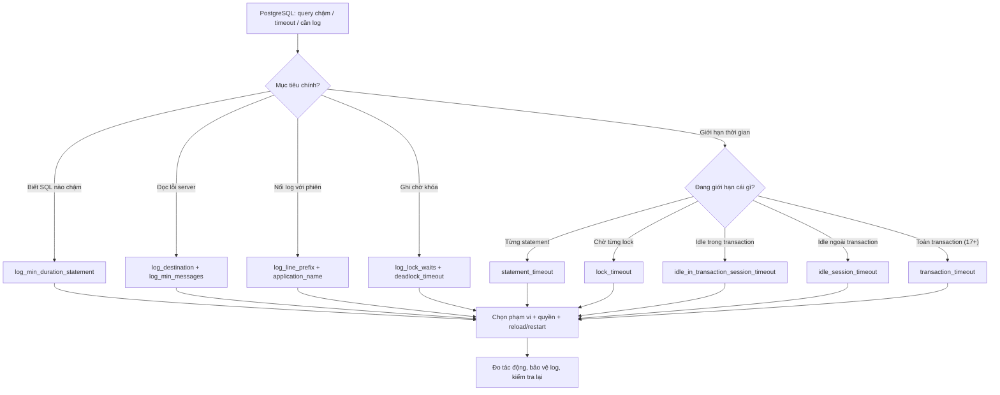

# Cấu hình ghi nhật ký và thời gian chờ cơ bản

Khi ứng dụng kết nối PostgreSQL bị chậm, nhận lỗi timeout hoặc một câu `ALTER TABLE` đứng chờ, hai nhóm cấu hình thường giúp kiểm soát và chẩn đoán sự cố là **ghi nhật ký (logging)** và **thời gian chờ (timeouts)**. Ghi nhật ký trả lời câu hỏi “đã xảy ra chuyện gì, ở kết nối nào, vào lúc nào?”, còn timeout trả lời “PostgreSQL nên cho một statement, một lần đợi khóa hoặc một phiên nhàn rỗi tồn tại bao lâu trước khi can thiệp?”.

Hai nhóm tham số này có tác dụng khác nhau và không thay thế nhau:

- Bật `log_min_duration_statement` giúp nhận biết các câu SQL chạy lâu, **không làm chúng tự chạy nhanh hơn**.
- Đặt `statement_timeout` có thể ngừng một câu lệnh vượt ngưỡng, nhưng **không làm câu SQL đó trở nên tối ưu**.
- Bật `log_lock_waits` có thể ghi những lần chờ khóa đủ lâu; `lock_timeout` lại là giới hạn thời gian một statement được chờ khóa.
- Bật `logging_collector` giúp quản lý một số đích log dạng file; nó không tự tạo cơ chế lưu log vĩnh viễn hay hệ thống cảnh báo.
- `idle_in_transaction_session_timeout` xử lý phiên nhàn rỗi nhưng vẫn giữ transaction mở, khác với `idle_session_timeout` dành cho session nhàn rỗi ngoài transaction.

Bài này hướng dẫn cách đọc và thay đổi cấu hình, chọn mức logging vừa đủ, hiểu từng timeout, tạo tình huống thử nghiệm, liên hệ log với `pg_stat_activity` và xử lý sự cố an toàn. Phạm vi là PostgreSQL hiện đại; **một số tham số chỉ tồn tại ở phiên bản mới**, đặc biệt `transaction_timeout` từ PostgreSQL 17 trở lên. Mọi thay đổi trên production phải dựa vào phiên bản, quyền quản trị, hạ tầng ghi log và yêu cầu nghiệp vụ thực tế.

## 1. Phân biệt ba lớp thời gian và quan sát

Một lệnh SQL đi qua các lớp khác nhau:



Các mốc thời gian khác nhau gồm:

1. **Thời gian xử lý một statement:** bao gồm cả phần chờ cần thiết trong quá trình thực thi. `statement_timeout` đặt một giới hạn cho statement.
2. **Thời gian chờ một lock:** một phần cụ thể trong quá trình thực thi. `lock_timeout` giới hạn thời gian đợi từng lần lấy khóa.
3. **Thời gian session không nhận lệnh mới hoặc transaction tồn tại:** `idle_in_transaction_session_timeout`, `idle_session_timeout` và trong phiên bản hỗ trợ, `transaction_timeout` quản lý những trường hợp khác nhau.

Ghi log lại có những ngưỡng riêng như “ghi truy vấn mất từ 500 ms” và “ghi trường hợp đợi khóa hơn 1 giây”. **Ngưỡng để ghi nhận** không nhất thiết là **ngưỡng để hủy công việc**.

## 2. Bắt đầu từ phiên bản và cấu hình hiện tại

Trước khi chỉnh tham số, phải xác định chính xác PostgreSQL Server đang điều tra. Với hệ thống có nhiều instance, primary/standby, container hoặc managed database, một câu `ALTER SYSTEM` trên sai máy có thể vừa vô ích vừa gây rủi ro.

```sql
SELECT
    current_database() AS database_name,
    current_user AS user_name,
    inet_server_addr() AS server_address,
    inet_server_port() AS server_port,
    version() AS server_version;

SELECT pg_is_in_recovery() AS is_standby;
```

`inet_server_addr()` có thể trả `NULL` khi kết nối qua Unix-domain socket; điều này không có nghĩa máy chủ không hoạt động. `pg_is_in_recovery()` giúp phân biệt một standby đang phục hồi/replay với primary thông thường.

Kiểm tra nhanh:

```sql
SHOW log_destination;
SHOW logging_collector;
SHOW log_min_duration_statement;
SHOW log_statement;
SHOW statement_timeout;
SHOW lock_timeout;
SHOW idle_in_transaction_session_timeout;
```

Một tham số không tồn tại sẽ gây lỗi ở phiên bản không hỗ trợ nó. Điều đó khác với tham số tồn tại nhưng đang được đặt về giá trị mặc định.

### 2.1. pg_settings: không chỉ xem giá trị

View `pg_settings` hiển thị thông tin cấu hình cùng nguồn và ngữ cảnh áp dụng:

```sql
SELECT
    name,
    setting,
    unit,
    context,
    source,
    pending_restart
FROM pg_settings
WHERE name IN (
    'log_destination',
    'logging_collector',
    'log_min_duration_statement',
    'log_statement',
    'log_lock_waits',
    'statement_timeout',
    'lock_timeout',
    'idle_in_transaction_session_timeout',
    'idle_session_timeout',
    'deadlock_timeout',
    'transaction_timeout'
)
ORDER BY name;
```

Nếu server cũ không có `transaction_timeout`, truy vấn lọc `name IN (...)` đơn giản không trả hàng tương ứng. Đây là cách xem hỗ trợ phiên bản mà không phải gọi trực tiếp `SHOW transaction_timeout` trên server cũ.

Những trường đáng chú ý:

| Trường | Cách hiểu |
|---|---|
| `name` | Tên tham số |
| `setting` | Giá trị đang có hiệu lực theo ngữ cảnh session đang truy vấn |
| `unit` | Đơn vị gốc như `ms`, `s`, `kB` hoặc `8kB`, nếu áp dụng |
| `context` | Điều kiện được phép thay đổi tham số, ví dụ cần restart hay có thể SET |
| `source` | Nguồn giá trị như mặc định, file cấu hình, database, role hay session |
| `pending_restart` | Cấu hình đã thay đổi nhưng phải restart mới có hiệu lực, nếu áp dụng |

**`source = 'session'` không nhất thiết nói giá trị chung của mọi kết nối**. Những lệnh `SET` trong một session chỉ thay đổi ngữ cảnh của session đó. Một tài khoản khác, database khác hoặc backend đã mở trước đó có thể có thiết lập khác.

### 2.2. Nơi đặt cấu hình

```sql
SHOW config_file;
SHOW data_directory;
SHOW hba_file;
```

- `postgresql.conf` và những file được `include` thường chứa cấu hình server.
- `postgresql.auto.conf` thường chứa các giá trị được quản lý bởi `ALTER SYSTEM`.
- Cấu hình có thể được cấp qua command line lúc khởi động hoặc cơ chế của công cụ quản trị.
- Role/database có thể có các mặc định riêng cho session mới.
- `pg_hba.conf` quản lý **quy tắc xác thực/kết nối**, không phải nơi đặt `statement_timeout` hoặc cấu hình định dạng log.

Đường dẫn có thể bị giới hạn hiển thị theo quyền. Trong Kubernetes hoặc managed PostgreSQL, file có thể do bộ điều khiển bên ngoài quản lý; sửa trực tiếp có thể bị ghi đè bởi cơ chế triển khai.

## 3. PostgreSQL ghi log ở đâu?

PostgreSQL phát sinh thông điệp từ backend và các tiến trình liên quan. Cách log đi tới file, syslog, event log hoặc nền tảng logging phụ thuộc **`log_destination`**, **`logging_collector`** và cách server được khởi động.

### 3.1. log_destination

```sql
SHOW log_destination;
```

Các đích thông dụng:

| Giá trị | Ý nghĩa khái quát | Lưu ý |
|---|---|---|
| `stderr` | Ghi thông điệp đến luồng lỗi tiêu chuẩn | Thường dùng với systemd, container hoặc logging collector |
| `csvlog` | Ghi thông điệp dạng CSV có cấu trúc | Cần `logging_collector` trong cấu hình hỗ trợ |
| `jsonlog` | Ghi thông điệp dạng JSON có cấu trúc | Có trên PostgreSQL 15 trở lên; cần cấu hình collector phù hợp |
| `syslog` | Gửi sang hệ thống syslog trên nền tảng hỗ trợ | Cần quản lý file/retention ở tầng syslog |
| `eventlog` | Windows Event Log | Dùng khi vận hành trên Windows với thiết lập liên quan |

Có thể kết hợp nhiều đích bằng danh sách:

```conf
# Ví dụ trong postgresql.conf; không phải câu SQL:
log_destination = 'stderr,csvlog'
```

Khi dùng nhiều đích, tổng khối lượng log và dữ liệu nhạy cảm cũng được nhân sang nhiều nơi lưu trữ. Trước khi tăng logging, xác định hệ thống tập trung đang thu thập từ **nguồn nào** để tránh mất log hoặc ghi trùng.

### 3.2. logging_collector

```sql
SHOW logging_collector;
```

Khi bật `logging_collector`, tiến trình collector có thể thu thập thông điệp từ stderr và ghi vào các file log do PostgreSQL quản lý; đây cũng là thành phần cần thiết cho một số định dạng file có cấu trúc như `csvlog` và `jsonlog`.

Ví dụ cấu hình:

```conf
logging_collector = on
log_destination = 'stderr'
log_directory = 'log'
log_filename = 'postgresql-%Y-%m-%d_%H%M%S.log'
```

**`logging_collector` là tham số cần restart PostgreSQL để thay đổi.** Chỉ chạy `SELECT pg_reload_conf();` không đủ để bật collector đang tắt. Đồng thời, bật collector không tự tạo chính sách xóa log cũ hoặc chuyển log sang lưu trữ độc lập.

Khi collector tắt và server chạy dưới systemd hoặc trong container, stderr có thể được chuyển đến journal/stdout của nền tảng. Khi đó, nơi xem log chính có thể **không phải file trong `log_directory`**.

### 3.3. Xác định file đang ghi

```sql
SELECT pg_current_logfile();
```

Hàm `pg_current_logfile()` thường trả đường dẫn file log hiện tại khi logging collector đang hoạt động với loại log phù hợp. Nếu trả `NULL`, có thể hệ thống dùng syslog/journal, collector đang tắt hoặc chưa có file phù hợp với cách gọi.

Trên server hỗ trợ, có thể yêu cầu đường dẫn theo định dạng:

```sql
SELECT pg_current_logfile('stderr');
```

Hàm này hỗ trợ điều tra đường dẫn, **không phải API để đọc toàn bộ file log bất chấp quyền**. Đối với file tại hệ điều hành, quyền đọc và vị trí thực tế còn tùy người quản trị, container và hệ thống giám sát.

## 4. Quản lý tên file, kích thước và vòng đời log

Khi PostgreSQL tự quản lý file log, các tham số liên quan thường gồm:

```sql
SHOW log_directory;
SHOW log_filename;
SHOW log_rotation_age;
SHOW log_rotation_size;
SHOW log_truncate_on_rotation;
SHOW log_file_mode;
```

| Tham số | Vai trò |
|---|---|
| `log_directory` | Thư mục file log khi collector được sử dụng; có thể là đường dẫn tương đối tới data directory hoặc tuyệt đối |
| `log_filename` | Mẫu tên file, hỗ trợ một số ký hiệu thời gian kiểu `strftime` |
| `log_rotation_age` | Mốc thời gian để xoay file log, ví dụ `1d` |
| `log_rotation_size` | Ngưỡng dung lượng để xoay file, ví dụ `100MB` |
| `log_truncate_on_rotation` | Quy định một số trường hợp ghi đè file khi rotation theo thời gian |
| `log_file_mode` | Quyền file log tạo mới trên nền tảng hỗ trợ |

Ví dụ:

```conf
log_directory = 'log'
log_filename = 'postgresql-%Y-%m-%d_%H%M%S.log'
log_rotation_age = '1d'
log_rotation_size = '100MB'
log_truncate_on_rotation = off
```

Dùng tên file có phần thời gian đủ phân biệt giúp hạn chế va chạm khi rotation. Đặc biệt, `log_truncate_on_rotation` chỉ có hành vi ghi đè trong những trường hợp rotation theo thời gian thỏa điều kiện; **không nên hiểu rằng cứ xoay theo kích thước thì toàn bộ log cũ tự bị xóa**.

### 4.1. Rotation không phải retention

**Log rotation**: kết thúc file hiện tại và bắt đầu file khác.

**Log retention**: giữ log bao lâu, lúc nào nén, chuyển, xóa hoặc lưu vào hệ thống tập trung.

Một cấu hình xoay file mỗi ngày có thể vẫn tạo ra hàng trăm file tồn tại mãi nếu không có quy trình retention. Vì vậy, khi bật logging chi tiết cần quản lý:

- Dung lượng ổ đĩa và cảnh báo đầy filesystem.
- Chính sách retention phù hợp yêu cầu vận hành và bảo mật.
- Nén/lưu trữ lâu dài nếu thật sự cần.
- Quyền đọc file, mã hóa, luồng chuyển log.
- Quy trình xóa/ẩn dữ liệu nhạy cảm theo chính sách tổ chức.

**Không xóa file log hoặc sửa quyền ở production bằng một lệnh shell không kiểm soát**. Hãy xác nhận PostgreSQL đang ghi file nào và hệ thống logging đang nắm giữ các file đó ra sao.

## 5. log_line_prefix: đặt ngữ cảnh để đọc log dễ hơn

Một dòng log “duration: 800 ms” sẽ khó điều tra nếu không biết nó thuộc backend nào, user nào, database nào và thời điểm nào. `log_line_prefix` giúp chèn metadata vào đầu log dạng văn bản.

Ví dụ:

```conf
log_line_prefix = '%m [%p] user=%u db=%d app=%a client=%r session=%c line=%l '
```

Những ký hiệu thường dùng:

| Ký hiệu | Nội dung |
|---|---|
| `%m` | Timestamp kèm độ chính xác phần nghìn giây |
| `%p` | Process ID của backend |
| `%u` | User name của session |
| `%d` | Database name |
| `%a` | Giá trị `application_name` |
| `%r` | Địa chỉ và cổng client, nếu có |
| `%c` | Session ID |
| `%l` | Số thứ tự dòng log trong session |
| `%e` | SQLSTATE của thông điệp |
| `%x` | Transaction ID, khi có |

`log_line_prefix` chủ yếu áp dụng cho các dòng log văn bản như stderr. CSV/JSON log đã có cấu trúc trường riêng; không nên giả định chúng sẽ có đúng tiền tố văn bản giống stderr.

Ví dụ minh họa:

```text
2026-11-14 09:20:30.125 +07 [17231] user=app db=shop app=checkout client=10.0.0.5(55002) session=...
LOG:  duration: 843.210 ms  statement: SELECT ...;
```

Đây là log giả định, **không phải dữ liệu thực thu được từ server**.

### 5.1. application_name kết nối log với ứng dụng

`application_name` là tham số có thể được client đặt khi kết nối hoặc trong session:

```sql
SET application_name = 'order-service';
SHOW application_name;
```

Khi log prefix và `pg_stat_activity` đều hiển thị application name, nhóm vận hành có thể nối một vấn đề tới service tương ứng nhanh hơn.

Nhưng `application_name` do phía client cung cấp, không phải một cơ chế chứng thực danh tính ứng dụng. Không dùng nó thay cho phân quyền database hoặc kết luận một kết nối chắc chắn thuộc dịch vụ được ghi trong tên.

### 5.2. Múi giờ của log

```sql
SHOW log_timezone;
SHOW TimeZone;
```

`log_timezone` điều khiển cách biểu diễn timestamp cho log liên quan; `TimeZone` là thiết lập phiên phục vụ hiển thị/diễn giải các giá trị timestamp theo ngữ cảnh SQL. Hai tham số không nhất thiết giống nhau.

Khi điều tra vấn đề xuyên server, ứng dụng và hệ thống log tập trung, nên chuẩn hóa mốc thời gian (ví dụ UTC) và giữ thông tin timezone rõ ràng. Nếu không, một transaction lúc “09:00” trên application có thể bị ghép nhầm với log “02:00” của server.

## 6. Mức nghiêm trọng: log_min_messages và client_min_messages

Không phải mọi thông điệp PostgreSQL đều cần được ghi vào file hoặc gửi tới client. Các nhóm mức độ thường gặp bao gồm `DEBUG`, `INFO`, `NOTICE`, `WARNING`, `ERROR`, `LOG`, `FATAL` và `PANIC`.

Hai tham số dễ bị nhầm:

```sql
SHOW log_min_messages;
SHOW client_min_messages;
```

| Tham số | Tác động chính |
|---|---|
| `log_min_messages` | Lọc các mức thông điệp được gửi tới server log theo quy tắc severity |
| `client_min_messages` | Lọc các mức thông điệp được gửi về client/session |

Ví dụ:

```sql
SET client_min_messages = warning;
```

Thiết lập này làm thay đổi loại thông báo mà **session hiện tại nhận**, không có nghĩa server sẽ ngừng ghi lỗi vào log. Không nên tăng mức lọc thông báo client để “sửa lỗi” hoặc che đi cảnh báo quan trọng; cần giải quyết nguyên nhân gốc.

Mức `LOG` có những quy tắc so sánh mức độ riêng trong PostgreSQL, nên không coi toàn bộ các severity là một thứ tự số đơn giản áp dụng đồng nhất cho client và server log.

### 6.1. log_min_error_statement: ghi câu lệnh gây lỗi

```sql
SHOW log_min_error_statement;
```

Tham số này điều khiển việc ghi **câu SQL liên quan tới lỗi** từ một mức nghiêm trọng trở lên theo quy tắc PostgreSQL. Một giá trị thường được dùng là `error`.

Ví dụ:

```conf
log_min_error_statement = error
```

Nếu client gửi câu SQL sai, log có thể chứa nội dung statement gây lỗi, hỗ trợ xác định root cause. Nhưng cần nhớ:

- Dữ liệu trong SQL có thể chứa literal nhạy cảm.
- Không phải tất cả lỗi đều được ghi cùng một kiểu hoặc với toàn bộ text trong mọi giao thức.
- Error log không thay thế việc ứng dụng ghi SQLSTATE, request ID và trạng thái nghiệp vụ.
- Nếu câu lệnh dùng tham số bind, mức chi tiết parameter logging có thể phụ thuộc phiên bản và các thiết lập khác.

## 7. Ghi chậm: log_min_duration_statement

Đây là tham số cốt lõi để nhận biết những statement mất nhiều thời gian:

```sql
SHOW log_min_duration_statement;
```

Ngữ nghĩa điển hình:

| Giá trị | Ý nghĩa |
|---|---|
| `-1` | Không bật ghi statement theo ngưỡng duration này |
| `0` | Ghi thời gian của mọi statement hoàn tất theo cơ chế này |
| `500ms` | Ghi những statement có thời gian từ ngưỡng khoảng 500 ms trở lên |
| `1s` | Ghi những statement từ khoảng 1 giây trở lên |

Một cấu hình mẫu:

```conf
log_min_duration_statement = '500ms'
```

Ví dụ kết quả log giả định:

```text
2026-11-14 09:20:31.500 UTC [17231] app=reporting
LOG:  duration: 1253.110 ms  statement: SELECT ... FROM don_hang ...;
```

Lợi ích chính:

- Phát hiện các câu lệnh dài bất thường.
- Có text SQL hoặc thông tin có thể liên hệ với statement.
- Tìm vấn đề sau một deployment hoặc một đợt tăng tải.
- Xây dựng tín hiệu để phân tích bằng `EXPLAIN`, thống kê hệ thống và log ứng dụng.

**Cần phân biệt duration với thời gian CPU.** Một statement 2 giây có thể mất 1,8 giây để **đợi row lock**, không nhất thiết dùng CPU liên tục trong 2 giây. Cần kết hợp `pg_stat_activity`, `pg_blocking_pids` hoặc cơ chế quan sát khác để tìm nguyên nhân.

### 7.1. Vì sao không luôn chọn 0?

Đặt `log_min_duration_statement = 0` có thể khiến rất nhiều statement ngắn được ghi, làm tăng chi phí định dạng log, I/O, dung lượng, lưu trữ tập trung và nguy cơ lộ dữ liệu.

Trên production nhiều truy vấn mỗi giây, nên bắt đầu từ ngưỡng có ý nghĩa với SLO/latency nghiệp vụ, ví dụ vài trăm mili giây, sau đó điều chỉnh theo khả năng xử lý log và tần suất truy vấn.

### 7.2. log_duration khác log_min_duration_statement

```sql
SHOW log_duration;
```

`log_duration = on` yêu cầu ghi duration của statement theo cơ chế này, nhưng không nhất thiết ghi toàn bộ text SQL của tất cả statement theo cùng cách `log_min_duration_statement`. Kết hợp với các log statement khác có thể cho ngữ cảnh, nhưng vẫn phải đọc cấu hình cụ thể.

Đừng bật cả `log_duration = on` và `log_min_duration_statement = 0` vô thời hạn chỉ vì nghĩ “càng nhiều log càng tốt”. Khối lượng và tính nhạy cảm của log có thể tăng rất mạnh.

### 7.3. Lấy mẫu câu chậm

Những bản PostgreSQL hỗ trợ các tham số như `log_min_duration_sample` và `log_statement_sample_rate` cho phép lấy mẫu một phần statement đủ ngưỡng, giảm chi phí khi lượng statement lớn.

```sql
SELECT name, setting, unit
FROM pg_settings
WHERE name IN (
    'log_min_duration_sample',
    'log_statement_sample_rate'
)
ORDER BY name;
```

Các lựa chọn lấy mẫu cần phù hợp với mục tiêu quan sát. Một sampled log không phải bản ghi đầy đủ tất cả truy vấn chậm, và vì thế không nên dùng nó làm bằng chứng audit tuyệt đối.

## 8. log_statement: ghi statement theo loại

`log_statement` không phải ngưỡng thời gian. Nó chọn loại statement để ghi theo chính sách:

```sql
SHOW log_statement;
```

| Giá trị | Ý nghĩa khái quát |
|---|---|
| `none` | Không ghi statement dựa vào riêng cơ chế `log_statement` |
| `ddl` | Ghi các câu DDL thuộc nhóm được hỗ trợ, chẳng hạn thay đổi schema |
| `mod` | Ghi các câu thay đổi dữ liệu và DDL phù hợp; không gồm mọi SELECT |
| `all` | Ghi rất rộng các statement thuộc cơ chế này |

Ví dụ khi muốn theo dõi migration DDL:

```conf
log_statement = 'ddl'
```

Khi muốn chẩn đoán một tình huống hẹp, quản trị viên có thể tăng mức logging trong một thời gian ngắn rồi đưa về cấu hình hợp lý. Nhưng không có nghĩa `all` là chế độ production mặc định nên dùng ở mọi hệ thống.

### 8.1. log_statement không bao phủ mọi lỗi cú pháp

Không nên coi `log_statement = all` là một bộ bắt tất cả text SQL bất kể server parse được hay không. Những lỗi xảy ra trước giai đoạn ghi statement theo cơ chế này có thể không được ghi như mong đợi; `log_min_error_statement` có mục tiêu bổ sung là ghi câu lệnh gây lỗi.

Để phục vụ audit quan trọng cần yêu cầu rõ về tính đầy đủ, tính toàn vẹn và phạm vi hành động; PostgreSQL core logging không tự thay thế một hệ thống audit chuyên dụng. Một extension như pgAudit có thể được đánh giá riêng theo nhu cầu nhưng không phải thành phần mặc định bắt buộc của bài này.

### 8.2. Bảo mật nội dung câu lệnh

Log có thể chứa câu SQL với:

- Email, số điện thoại hoặc mã định danh khách hàng.
- Token hoặc session ID lưu trong cột.
- Điều kiện lọc nhạy cảm.
- Payload JSON.
- Thông tin truy cập được in nguyên văn trong câu lệnh.

Một tình huống nguy hiểm là tạo role bằng câu SQL chứa mật khẩu thật rồi bật logging chi tiết. **Không đưa secrets vào câu lệnh hoặc ví dụ thực tế nếu có cơ chế cấp phát an toàn hơn**.

Trên những phiên bản hỗ trợ, các tham số như `log_parameter_max_length` và `log_parameter_max_length_on_error` ảnh hưởng mức độ ghi giá trị tham số bind. Tuy nhiên, **giới hạn log parameter không xóa literal nhạy cảm đã được viết trực tiếp trong SQL text**. Cần kết hợp thiết kế ứng dụng, phân quyền đọc log và chính sách dữ liệu.

## 9. Ghi kết nối, ngắt kết nối, chờ khóa và hoạt động nền

PostgreSQL có những loại log bổ trợ dùng khi điều tra sự cố:

```sql
SELECT name, setting, unit
FROM pg_settings
WHERE name IN (
    'log_connections',
    'log_disconnections',
    'log_lock_waits',
    'deadlock_timeout',
    'log_checkpoints',
    'log_temp_files',
    'log_autovacuum_min_duration'
)
ORDER BY name;
```

### 9.1. log_connections và log_disconnections

- **`log_connections`:** ghi thông tin liên quan đến các lần thiết lập kết nối theo khả năng của phiên bản.
- **`log_disconnections`:** ghi thông tin về ngắt kết nối, thời gian phiên và một số thống kê liên quan.

Chúng giúp tìm đợt **connection storm**, pool mở/đóng kết nối liên tục hoặc những lần kết nối bất thường. Nhưng bật quá nhiều log kết nối trên hệ thống có lượng session ngắn rất lớn có thể tạo volume đáng kể.

Ví dụ:

```conf
log_connections = on
log_disconnections = on
```

Một số phiên bản mới cho phép lựa chọn chi tiết hơn về những giai đoạn kết nối được ghi; vì thế cần đối chiếu tài liệu và giá trị hiện tại của server trước khi áp dụng mẫu cấu hình.

### 9.2. log_lock_waits và deadlock_timeout

```conf
log_lock_waits = on
deadlock_timeout = '1s'
```

- `log_lock_waits` bật việc ghi nhận các lần chờ khóa đủ lâu theo cơ chế PostgreSQL.
- `deadlock_timeout` là khoảng thời gian PostgreSQL thường chờ trước khi thực hiện kiểm tra deadlock cho một lần đợi khóa; **không phải thời hạn tối đa được chờ khóa**.
- Khi `log_lock_waits` bật, ngưỡng `deadlock_timeout` còn tác động tới mốc phát sinh thông điệp chờ khóa.

Ví dụ, nếu một statement đợi lock 1,5 giây với `deadlock_timeout = 1s`, PostgreSQL có thể ghi log về việc chờ dù statement cuối cùng vẫn lấy được khóa và thành công.

**Đừng nhầm `deadlock_timeout = 1s` với `lock_timeout = 1s`.** Tham số đầu chủ yếu điều khiển thời điểm kiểm tra deadlock/log wait; tham số thứ hai có thể **hủy statement** nếu không lấy được khóa trước ngưỡng.

### 9.3. log_temp_files

`log_temp_files` có thể ghi thông tin về file tạm được PostgreSQL tạo trong những tình huống xử lý cần spill ra đĩa, chẳng hạn một số sort/hash lớn.

Giá trị thường gặp:

- `-1`: không log file tạm theo cơ chế này.
- `0`: log mọi file tạm phù hợp.
- Một kích thước dương: chỉ log file tạm từ ngưỡng kích thước tương ứng.

Ví dụ:

```conf
log_temp_files = '100MB'
```

Nó giúp phát hiện truy vấn gây I/O tạm lớn, nhưng không thay thế `EXPLAIN (ANALYZE, BUFFERS)` và việc phân tích cấu hình `work_mem`. Không tăng `work_mem` trên toàn server chỉ vì thấy một file tạm mà chưa tính số kết nối và số operation đồng thời.

### 9.4. log_checkpoints và log_autovacuum_min_duration

- `log_checkpoints`, trên những phiên bản cung cấp, giúp quan sát hoạt động checkpoint và chi phí ghi dữ liệu.
- `log_autovacuum_min_duration` giúp ghi những lần autovacuum vượt ngưỡng hoặc hoạt động phù hợp, hữu ích khi điều tra bloat/VACUUM trễ.

Các tham số và mặc định có thể thay đổi giữa các đời PostgreSQL. Chúng hỗ trợ chẩn đoán, không phải lệnh tự động sửa tình trạng checkpoint hoặc autovacuum đang quá tải.

## 10. Nhóm timeout cần nắm vững

Các tham số timeout phổ biến không cùng mục tiêu.

| Tham số | Giới hạn cái gì? | Hành động khi hết thời gian | Phạm vi điển hình |
|---|---|---|---|
| `statement_timeout` | Thời gian thực hiện một statement | Hủy statement | Session, role, database hoặc cấu hình server |
| `lock_timeout` | Thời gian chờ **một lần lấy khóa** | Hủy statement đang đợi | Thường đặt cho session/job/DDL |
| `idle_in_transaction_session_timeout` | Session nhàn rỗi trong khi transaction vẫn mở | Chấm dứt session, rollback transaction đang mở | Bảo vệ khỏi transaction treo |
| `idle_session_timeout` | Session nhàn rỗi ngoài transaction | Chấm dứt session | Cần cẩn thận với connection pool |
| `deadlock_timeout` | Thời gian chờ trước khi kiểm tra deadlock; dùng làm mốc log lock wait khi bật | Kiểm tra/phát hiện deadlock, không phải hủy mọi lock wait | Phục vụ khóa và quan sát |
| `transaction_timeout` | Tổng thời gian transaction tồn tại, kể cả nhàn rỗi, ở phiên bản hỗ trợ | Chấm dứt session khi vượt ngưỡng | PostgreSQL 17 trở lên |

Mặc định nhiều timeout ứng dụng như `statement_timeout` và `lock_timeout` thường là `0`, nghĩa là **không áp dụng giới hạn** theo cơ chế đó. Điều này không có nghĩa statement không thể bị hủy vì lỗi, deadlock, client ngắt hoặc các điều kiện server khác.

### 10.1. Đơn vị thời gian

Các giá trị dạng chuỗi giúp tránh hiểu nhầm:

```sql
SHOW statement_timeout;

SET statement_timeout = '5s';
SET lock_timeout = '1500ms';
SET idle_in_transaction_session_timeout = '2min';
```

PostgreSQL cũng nhận một số giá trị số không ghi đơn vị, nhưng khi đó **đơn vị phụ thuộc tham số**. Với nhiều timeout tính theo mili giây, `5000` có thể là 5000 ms, không phải 5000 giây. Vì vậy ưu tiên viết rõ `'5s'`, `'1500ms'` hoặc `'2min'` khi cấu hình.

## 11. statement_timeout: giới hạn một statement

`statement_timeout` hữu ích để ngăn một statement chạy không kiểm soát quá lâu.

Ví dụ:

```sql
SET statement_timeout = '1s';

SELECT pg_sleep(3);
-- Dự kiến statement bị hủy vì quá ngưỡng thời gian.

RESET statement_timeout;
```

`pg_sleep` là hàm thực hành chờ chủ động; đừng dùng nó để benchmark khả năng xử lý dữ liệu thật.

Một thông báo lỗi thường thấy:

```text
ERROR:  canceling statement due to statement timeout
```

### 11.1. Timeout có tính cả thời gian chờ không?

Có. Một statement đang đợi lock hoặc chịu các trì hoãn khác trong quá trình xử lý vẫn có thể đạt `statement_timeout`. Do đó, nhìn thấy một câu `UPDATE` timeout không đủ để kết luận nó đang tiêu tốn CPU hoặc thiếu index; nó có thể đang chờ transaction khác.

### 11.2. Thời điểm bắt đầu và kết thúc phụ thuộc giao thức

PostgreSQL đo timeout ở mức xử lý statement, với chi tiết tùy giao thức truy vấn. Trong giao thức simple query, những bản PostgreSQL hiện đại áp dụng ngưỡng cho từng statement trong chuỗi nhiều statement theo quy tắc của phiên bản, thay vì luôn hiểu một client request là một khối duy nhất cho mọi bản cũ.

Điểm thực hành cần nhớ là: **`statement_timeout` không phải timeout cho toàn bộ request HTTP hoặc cả workflow nhiều câu SQL của ứng dụng**. Nếu request chạy năm statement mỗi statement dưới ngưỡng, tổng thời gian request vẫn có thể vượt ngưỡng đó.

Muốn giới hạn tổng thời gian của một nghiệp vụ, cần thêm cơ chế deadline ở ứng dụng hoặc transaction timeout phù hợp với phiên bản và chính sách dữ liệu.

### 11.3. Hành vi trong transaction

```sql
BEGIN;

SET LOCAL statement_timeout = '1s';

SELECT pg_sleep(3);
-- Statement timeout: transaction sẽ ở trạng thái lỗi.

ROLLBACK;
```

Khi một statement báo lỗi trong transaction PostgreSQL thông thường, transaction thường chuyển sang **aborted state** và các câu SQL tiếp theo (trừ các lệnh xử lý transaction phù hợp) bị từ chối tới khi `ROLLBACK`. Vì vậy ứng dụng phải xử lý lỗi và rollback, không thể cứ tiếp tục gửi `COMMIT` như chưa có gì xảy ra.

Với savepoint, có thể thiết kế cách rollback một phần phù hợp, nhưng không nên mặc định driver sẽ tự làm điều đó.

### 11.4. Tránh statement_timeout quá ngắn trên toàn cụm

Nếu áp `statement_timeout = '100ms'` cho toàn hệ thống, các tác vụ hợp lệ như migration, báo cáo, batch, VACUUM/maintenance phù hợp hoặc truy vấn khởi động có thể bị hủy. Trong nhiều hệ thống, **timeout theo role, database hoặc session của ứng dụng** hợp lý hơn ngưỡng toàn cụm.

Đặt timeout dựa trên SLO, mức tải và phân loại tác vụ: giao dịch tương tác, batch, báo cáo, migration thường có yêu cầu khác nhau.

## 12. lock_timeout: chỉ giới hạn lúc chờ khóa

`lock_timeout` được áp dụng khi một statement đang **đợi lấy một khóa** trong PostgreSQL. Nó không giới hạn tổng thời gian statement thực thi sau khi đã lấy được khóa.

```sql
SET lock_timeout = '2s';
SET statement_timeout = '10s';
```

Ý nghĩa:

- Nếu một câu `ALTER TABLE` hoặc `UPDATE` phải đợi khóa hơn 2 giây, `lock_timeout` có thể hủy statement.
- Nếu statement đã lấy được khóa và xử lý dữ liệu trong 8 giây, `lock_timeout` không phải nguyên nhân tự hủy nó; `statement_timeout` vẫn có thể áp dụng.
- `lock_timeout` được áp dụng cho các lần chờ lấy khóa trong một statement, không đơn thuần là một đồng hồ cộng tổng thời gian tất cả lần đợi.

### 12.1. Vì sao thường đặt lock_timeout thấp hơn statement_timeout?

Nếu `statement_timeout` đã hủy statement trước hoặc cùng mốc mà `lock_timeout` dự kiến hủy, ngưỡng chờ khóa có thể không mang thêm giá trị trong tình huống đó. Vì vậy một chính sách thường thấy là `lock_timeout` ngắn hơn `statement_timeout` với các tác vụ cần fail fast khi tranh chấp khóa.

Ví dụ:

```sql
BEGIN;

SET LOCAL lock_timeout = '3s';
SET LOCAL statement_timeout = '30s';

ALTER TABLE demo_pg_config.jobs
ADD COLUMN IF NOT EXISTS ghi_chu TEXT;

COMMIT;
```

Đây là **ví dụ trên bảng thực hành**. Trong production, lệnh DDL cần được lập kế hoạch vì nó có thể lấy khóa mạnh, tương tác với transaction dài và làm các câu SQL khác xếp hàng. Với `lock_timeout` ngắn, migration có thể **bỏ cuộc sớm** thay vì giữ một yêu cầu khóa đang chờ gây tác động dây chuyền.

Nếu câu DDL nhận lỗi timeout trong một transaction, cần `ROLLBACK` theo quy trình ứng dụng/deploy, không giả định các lệnh tiếp theo trong transaction vẫn chạy bình thường.

### 12.2. lock_timeout không giải quyết deadlock bằng cách riêng của nó

PostgreSQL có cơ chế **phát hiện deadlock**, thường báo SQLSTATE `40P01`. Nó có thể từ chối transaction trong một vòng chờ trước khi hết `lock_timeout` nếu nhận diện được deadlock theo cơ chế engine.

`lock_timeout` chủ yếu là chính sách để một statement không chờ mãi khi có tranh chấp; nó không thay thế việc thiết kế transaction ngắn, thứ tự khóa nhất quán và chiến lược retry an toàn.

## 13. idle_in_transaction_session_timeout: bảo vệ khỏi transaction bỏ quên

Một session có thể không chạy câu SQL nào nhưng vẫn giữ transaction mở:

```text
Ứng dụng mở transaction
    │
    ▼
UPDATE jobs SET ...
    │
    ▼
Client ngừng gửi SQL, chưa COMMIT/ROLLBACK
    │
    ▼
PostgreSQL: idle in transaction
    │
    ├── Có thể vẫn giữ khóa
    ├── Có thể giữ snapshot/horizon ảnh hưởng VACUUM
    └── Occupy connection trong pool
```

Tham số `idle_in_transaction_session_timeout` giới hạn thời gian một session được **nhàn rỗi trong transaction đang mở**:

```sql
SHOW idle_in_transaction_session_timeout;
```

Ví dụ session thử nghiệm:

```sql
SET idle_in_transaction_session_timeout = '10s';

BEGIN;

SELECT *
FROM demo_pg_config.jobs
WHERE id = 1
FOR UPDATE;

-- Ngừng gửi lệnh trên session này hơn 10 giây.
-- PostgreSQL có thể chấm dứt session và rollback transaction.
```

**Chỉ chạy ví dụ trên kết nối thử nghiệm riêng**; session sẽ bị đóng khi timeout có hiệu lực, làm công cụ hoặc connection pool nhận lỗi kết nối. Nếu đang dùng `psql`, bạn có thể cần kết nối lại.

### 13.1. Thời gian “idle” khác thời gian “transaction age”

Một transaction có thể chạy SQL liên tục trong 30 giây nhưng không có khoảng nhàn rỗi đủ ngưỡng; `idle_in_transaction_session_timeout` không được thiết kế để hủy riêng tình huống đó chỉ vì tổng tuổi transaction lớn.

Ngược lại, một transaction vừa mở, chạy một câu `SELECT FOR UPDATE` 10 ms rồi ngồi chờ client 2 phút có thể rất nguy hiểm vì giữ khóa/horizon. Đây là tình huống tham số này nhắm tới.

### 13.2. Hậu quả lên ứng dụng

Khi PostgreSQL chấm dứt session có transaction mở:

- Transaction chưa commit bị rollback theo quy tắc.
- Client/JDBC nhận lỗi kết nối và phải xử lý.
- Connection pool không được trả connection chết như một kết nối dùng được.
- Nghiệp vụ có thể phải retry **toàn bộ transaction** có kiểm soát.
- Nếu transaction đã gọi API ngoài, rollback database không tự hoàn tác tác dụng phụ đó.

Nên áp timeout đủ để phát hiện transaction bỏ quên, nhưng không thấp đến mức phá vỡ những công việc tương tác/batch được thiết kế hợp lệ.

## 14. idle_session_timeout: session nhàn rỗi ngoài transaction

`idle_session_timeout` nhắm tới session không có transaction đang mở và không có công việc mới trong một khoảng thời gian.

```sql
SHOW idle_session_timeout;
```

Ví dụ:

```sql
SET idle_session_timeout = '15min';
```

Điều này có thể giúp giải phóng session thực sự bỏ không trong một số môi trường. Nhưng trong hệ thống có **connection pool** (HikariCP, PgBouncer hoặc pool khác), việc server tự đóng một connection nhàn rỗi có thể gây churn hoặc lỗi khi pool chưa nhận ra connection đã chết.

Vì vậy, trước khi bật timeout này rộng rãi:

1. Xem ứng dụng có connection pool hay không.
2. So sánh tuổi sống connection, keepalive, idle timeout và validation policy của pool.
3. Kiểm tra hành vi reconnect.
4. Đánh giá log kết nối và tài nguyên khi pool tạo connection thay thế.
5. Đặt ngưỡng theo role/application nếu cần thay vì toàn server.

**Đừng nhầm `idle_session_timeout` với `idle_in_transaction_session_timeout`:** đối tượng của hai tham số khác nhau và rủi ro nghiệp vụ cũng khác nhau.

## 15. transaction_timeout: giới hạn cả vòng đời transaction (PostgreSQL 17+)

Từ PostgreSQL 17, tham số `transaction_timeout` cho phép giới hạn thời gian tồn tại của một transaction theo chính sách server. Nó khác với `statement_timeout` vốn đo từng statement, và khác `idle_in_transaction_session_timeout` vốn đo khoảng idle khi transaction mở.

Kiểm tra trước khi dùng:

```sql
SELECT name, setting, unit
FROM pg_settings
WHERE name = 'transaction_timeout';
```

Nếu không có dòng trả về trên bản PostgreSQL cũ, không dùng `SET transaction_timeout` vì tham số chưa được hỗ trợ.

Ví dụ **chỉ trên bản PostgreSQL 17+**:

```sql
SET transaction_timeout = '2min';
```

Tác động khái quát: transaction quá thời hạn có thể khiến session bị chấm dứt theo cơ chế timeout này, dù transaction dành thời gian chạy SQL hay nằm idle.

Khi kết hợp với `idle_in_transaction_session_timeout` hoặc `idle_session_timeout`, PostgreSQL có các quy tắc ưu tiên nếu `transaction_timeout` nhỏ hơn hoặc bằng những ngưỡng kia. Cần đối chiếu hành vi thực tế theo phiên bản, tránh đặt nhiều timeout chồng chéo rồi giả định cả ba sẽ luôn lần lượt phát sinh.

**Không thiết lập một transaction timeout rất ngắn cho mọi role** nếu hệ thống có batch, maintenance hoặc báo cáo hợp lệ chạy giao dịch dài; nên chọn mức theo workload, ứng dụng và chính sách rollback.

## 16. deadlock_timeout: thời điểm kiểm tra, không phải hạn chót câu SQL

`deadlock_timeout` thường có giá trị mặc định khoảng 1 giây, điều khiển khoảng đợi trước khi PostgreSQL chủ động kiểm tra khả năng deadlock trong một tình huống lock wait.

```sql
SHOW deadlock_timeout;
SHOW log_lock_waits;
```

Xét hai transaction:

- A giữ khóa hàng 1 rồi muốn hàng 2.
- B giữ khóa hàng 2 rồi muốn hàng 1.

Đây là một vòng chờ deadlock. PostgreSQL sẽ kiểm tra và có thể hủy một transaction nạn nhân với lỗi deadlock. Nếu không có deadlock mà chỉ A đang xử lý chậm, việc tới `deadlock_timeout` **không đồng nghĩa PostgreSQL sẽ hủy A/B**.

Khi `log_lock_waits` được bật, mốc này có thể quyết định lúc một lần chờ khóa đủ lâu để ghi log. Điều chỉnh quá thấp có thể tăng CPU kiểm tra deadlock và khối lượng log trong hệ thống nhiều tranh chấp; điều chỉnh quá cao có thể khiến việc phát hiện deadlock/log wait chậm.

Đây thường là tham số vận hành do DBA quản lý, không phải lựa chọn đầu tiên để sửa mọi lỗi `lock timeout` của ứng dụng.

## 17. Timeout kết nối, xác thực và mạng: đừng nhầm với SQL timeout

Ngoài các timeout ở cấp SQL/session, đường kết nối còn có những ngưỡng riêng.

| Tham số/cơ chế | Phía áp dụng | Mục đích |
|---|---|---|
| `connect_timeout` trong libpq connection parameters | Client/libpq | Giới hạn thời gian kết nối tới server |
| `authentication_timeout` | PostgreSQL Server | Giới hạn thời gian hoàn tất quá trình xác thực kết nối |
| `tcp_keepalives_idle` và các tham số TCP keepalive liên quan | Kết nối mạng theo OS và PostgreSQL | Giúp phát hiện một số kết nối bị chết qua TCP keepalive |
| `tcp_user_timeout` khi được hỗ trợ | TCP/network stack | Giới hạn một số thời gian dữ liệu TCP không được xác nhận |
| JDBC socket/read timeout của driver | Client/driver | Điều khiển chờ phản hồi hoặc hoạt động network theo cách của driver |

Ví dụ tham số kết nối ở client:

```bash
psql "host=127.0.0.1 port=5432 dbname=postgres user=app_user connect_timeout=5"
```

`connect_timeout` trong ví dụ là tùy chọn **libpq client**, không phải một tham số server để đặt bằng `ALTER SYSTEM SET connect_timeout`.

Trong ứng dụng Java/JDBC, còn có các giới hạn do driver, framework, request deadline và connection pool. **Một lỗi timeout ở HTTP không chứng minh PostgreSQL đã áp `statement_timeout`.** Cần xem SQLSTATE, log server và các mốc thời gian từ client.

Với replication, cũng có các tham số timeout riêng như `wal_sender_timeout` và `wal_receiver_timeout`; đây là chính sách kết nối sao chép, không phải ngưỡng timeout mặc định cho mọi câu `SELECT`.

## 18. Thay đổi cấu hình ở cấp nào?

PostgreSQL cho phép thay đổi tham số ở nhiều phạm vi. Cần biết **tham số có cho phép thay đổi ở phạm vi đó không** và giá trị nào có hiệu lực sau khi kết nối được tạo.

### 18.1. SET và RESET trong session hiện tại

```sql
SHOW statement_timeout;

SET statement_timeout = '8s';
SHOW statement_timeout;

RESET statement_timeout;
SHOW statement_timeout;
```

- `SET` thay đổi giá trị trong session hiện tại với tham số cho phép.
- `RESET` đưa tham số về giá trị có hiệu lực mặc định của session, không nhất thiết là giá trị mặc định biên dịch của PostgreSQL.
- `RESET ALL` trả nhiều biến session về mặc định tương ứng, nhưng có thể ảnh hưởng các thiết lập ứng dụng đang dựa vào, nên không dùng tùy tiện trong connection pool.

Nếu một connection pool sử dụng lại connection, `SET statement_timeout` có thể **tiếp tục tồn tại trên connection đó** sau khi request hiện tại hoàn tất, trừ khi pool/framework reset đúng cách. Đây là nguyên nhân khiến các request khác có timeout bất ngờ.

### 18.2. SET LOCAL chỉ trong transaction

```sql
BEGIN;

SET LOCAL statement_timeout = '15s';
SET LOCAL lock_timeout = '3s';

SELECT *
FROM demo_pg_config.jobs
WHERE id = 1;

COMMIT;
```

`SET LOCAL` chỉ áp dụng trong transaction hiện tại và tự hết hiệu lực sau `COMMIT` hoặc `ROLLBACK`. Nó rất hữu ích cho một tác vụ cần timeout riêng mà không làm rò rỉ thiết lập qua những request kế tiếp trong cùng connection.

Nếu dùng `SET LOCAL` ngoài transaction block hợp lệ, PostgreSQL không coi đó là chính sách lưu cho các statement tương lai. Trong code ứng dụng, hãy bảo đảm thứ tự **mở transaction → SET LOCAL → các statement → COMMIT/ROLLBACK**.

### 18.3. ALTER ROLE và ALTER DATABASE

Khi một ứng dụng dùng role chuyên biệt, có thể cấu hình mặc định cho những session **mới**:

```sql
-- Ví dụ minh họa; chỉ chạy khi role app_user tồn tại
-- và người thực hiện có quyền thay đổi cấu hình role.
ALTER ROLE app_user
SET statement_timeout = '10s';

-- Mặc định cho các session mới kết nối database shopdb:
ALTER DATABASE shopdb
SET idle_in_transaction_session_timeout = '2min';

-- Riêng role app_user khi kết nối vào shopdb:
ALTER ROLE app_user IN DATABASE shopdb
SET lock_timeout = '3s';
```

Các lệnh trên dùng tên giả định `app_user` và `shopdb`. Không copy nguyên vào production. Cấu hình role/database thường có hiệu lực khi phiên kết nối **mới** được tạo; không nên giả định thay đổi sẽ đi vào mọi connection đã mở trong pool.

Thứ tự ưu tiên giữa các nguồn cấu hình có quy tắc của PostgreSQL, và một `SET` hợp lệ trong session có thể ghi đè default role/database. Hãy kiểm tra `pg_settings.source` trong session thực sự bị ảnh hưởng.

### 18.4. ALTER SYSTEM và reload

Dành cho một số thiết lập cấp server:

```sql
-- Ví dụ DBA thực hiện trên instance được phép:
ALTER SYSTEM SET log_min_duration_statement = '750ms';

SELECT pg_reload_conf();
```

`ALTER SYSTEM` ghi cấu hình quản lý vào `postgresql.auto.conf`, và các tham số reloadable cần nạp lại để có hiệu lực. `pg_reload_conf()` yêu cầu server đọc lại cấu hình; kết quả thành công thể hiện việc gửi yêu cầu reload, **không chứng minh mọi tham số đã được áp dụng**.

Xác minh:

```sql
SELECT
    name,
    setting,
    source,
    pending_restart
FROM pg_settings
WHERE name = 'log_min_duration_statement';
```

Nếu thay đổi tham số chỉ áp dụng lúc startup (như `logging_collector`), phải restart PostgreSQL theo quy trình vận hành phù hợp. Một giá trị có `pending_restart = true` là tín hiệu không nên bỏ qua.

Không sửa `postgresql.auto.conf` bằng tay khi đang sử dụng cơ chế `ALTER SYSTEM` nếu chưa có quy trình quản lý cấu hình nhất quán; công cụ điều phối có thể áp lại một giá trị khác.

### 18.5. Đọc lỗi file cấu hình

Quản trị viên có quyền phù hợp có thể xem thông tin trong `pg_file_settings`:

```sql
SELECT
    sourcefile,
    sourceline,
    name,
    setting,
    applied,
    error
FROM pg_file_settings
WHERE error IS NOT NULL
ORDER BY sourcefile, sourceline;
```

View này giúp thấy những dòng cấu hình có vấn đề khi PostgreSQL phân tích file. Việc có quyền xem đường dẫn/nội dung thông tin file cấu hình có thể bị giới hạn; một user thường không nên được cấp toàn quyền đọc mọi thông tin cấu hình nhạy cảm chỉ để chạy dashboard.

## 19. Bảng tổng hợp phạm vi và thời điểm hiệu lực

| Cách đặt | Phạm vi dự kiến | Khi nào thấy hiệu lực? | Rủi ro cần chú ý |
|---|---|---|---|
| `SET name = value` | Session hiện tại | Ngay với tham số cho phép | Rò rỉ qua connection pool nếu không RESET |
| `SET LOCAL name = value` | Transaction hiện tại | Trong transaction đang mở | Không có hiệu lực bền vững ngoài transaction |
| `ALTER ROLE ... SET` | Mặc định cho role | Session mới theo quy tắc | Không tác động retroactive lên pool đang mở |
| `ALTER DATABASE ... SET` | Mặc định cho database | Session mới theo quy tắc | Có thể ảnh hưởng nhiều ứng dụng khác nhau |
| `ALTER ROLE ... IN DATABASE ... SET` | Role trong database cụ thể | Session mới theo quy tắc | Phải theo dõi ưu tiên cấu hình |
| `ALTER SYSTEM SET` | Cấu hình server | Reload hoặc restart tùy `context` | Ảnh hưởng rộng, cần quyền và quy trình |
| `postgresql.conf` | Cấu hình cluster | Reload hoặc restart tùy tham số | Có thể bị automation ghi đè |
| Command line khi khởi động server | Instance được khởi động | Khi tạo tiến trình | Nguồn ưu tiên cần kiểm tra |

Một quy tắc thực hành: **đặt timeout nghiệp vụ gần ứng dụng nhất có thể**, trong khi cấu hình log nền tảng và collector thường cần đội vận hành quản lý tập trung.

## 20. Bộ cấu hình logging cơ sở để tham khảo

Đây là ví dụ có định hướng cho môi trường tự quản lý, **không phải mẫu dùng nguyên xi cho mọi production**:

```conf
# postgresql.conf -- ví dụ tham khảo

# Đích và vòng đời file log, nếu chọn logging collector:
log_destination = 'stderr'
logging_collector = on
log_directory = 'log'
log_filename = 'postgresql-%Y-%m-%d_%H%M%S.log'
log_rotation_age = '1d'
log_rotation_size = '100MB'

# Metadata giúp liên hệ log với các phiên và dịch vụ:
log_line_prefix = '%m [%p] user=%u db=%d app=%a client=%r session=%c '

# Ghi lỗi và những câu SQL mất thời gian:
log_min_messages = warning
log_min_error_statement = error
log_min_duration_statement = '500ms'
log_statement = 'ddl'

# Ghi những lần chờ lock đáng chú ý:
log_lock_waits = on
deadlock_timeout = '1s'

# Các nguồn tín hiệu bổ trợ:
log_temp_files = '100MB'
```

Cấu hình này có những giả định:

- Server quản lý file log thay vì chỉ dùng journal/container stdout.
- Tốc độ SQL và ngân sách logging chấp nhận được ngưỡng chậm 500 ms.
- Đội vận hành cần xem DDL trong log.
- Có cơ chế retention/giới hạn dung lượng độc lập.
- Đã đánh giá nguy cơ SQL literal nhạy cảm xuất hiện trong log.
- `logging_collector` được bật qua restart có kế hoạch.

Với managed PostgreSQL, nhà cung cấp có thể chỉ cho chỉnh một số tham số qua parameter group, đồng thời cung cấp nơi xem log riêng. Khi đó không nhất thiết sửa trực tiếp `postgresql.conf` như trên.

### 20.1. Chính sách timeout ví dụ theo workload

Thay vì áp một ngưỡng cho mọi kết nối, có thể thiết kế:

| Nhóm workload | Hướng cấu hình hợp lý | Điều cần kiểm tra |
|---|---|---|
| API tương tác | `statement_timeout` theo SLO và `idle_in_transaction_session_timeout` để tránh transaction treo | Deadline tổng request, retry, pool |
| Migration/DDL | `lock_timeout` tương đối ngắn để không chờ khóa quá lâu | Kế hoạch khóa DDL, rollback/retry deploy |
| Báo cáo/batch | `statement_timeout` rộng hơn nhưng có giới hạn | Tải I/O, thời gian job, replica |
| Connection pool | Hạn chế timeout idle ngoài transaction nếu xung đột pool | Max lifetime, health check, reconnect |
| DBA chẩn đoán | `SET LOCAL` hoặc cấu hình session riêng cho thử nghiệm | Không làm thay đổi default của ứng dụng |

Các ngưỡng cụ thể phải được thử trên workload thật. Một request có SLO 1 giây không nhất thiết nên áp statement timeout đúng 1 giây nếu còn mạng, serialization, ứng dụng và retry chiếm thời gian.

## 21. Tạo dữ liệu thử nghiệm cho timeout và logging

Mở một database thử nghiệm trên PostgreSQL và tạo bảng đơn giản. Đây là bước chuẩn bị để kiểm tra timeout mà không đụng dữ liệu sản xuất.

```sql
CREATE SCHEMA IF NOT EXISTS demo_pg_config;

CREATE TABLE demo_pg_config.jobs (
    id INTEGER PRIMARY KEY,
    trang_thai TEXT NOT NULL,
    so_lan INTEGER NOT NULL DEFAULT 0,
    cap_nhat_luc TIMESTAMPTZ NOT NULL DEFAULT now()
);

INSERT INTO demo_pg_config.jobs
    (id, trang_thai, so_lan)
VALUES
    (1, 'READY', 0),
    (2, 'READY', 0);
```

Ví dụ giả định bảng vừa được tạo và dữ liệu chèn một lần. Nếu chạy lại `INSERT` trên cùng ID, sẽ lỗi khóa chính; điều này giúp tránh vô ý tạo bản ghi trùng, không phải do timeout.

### 21.1. Thử statement_timeout trên một connection

```sql
SHOW statement_timeout;

SET statement_timeout = '1s';

SELECT pg_sleep(2);

-- Sau lỗi trong chế độ autocommit thông thường,
-- session vẫn có thể nhận câu lệnh mới.
RESET statement_timeout;
```

Điểm cần học: một statement bị hủy không nhất thiết đóng connection. Nếu lệnh nằm trong transaction explicit, cần `ROLLBACK` như phần 11 đã giải thích.

### 21.2. Thử log statement chậm (khi có quyền)

Một session bình thường có thể không đủ quyền `SET` những tham số logging thuộc context quản trị. **Không cố vượt quyền**; chỉ thực hiện dưới tài khoản và môi trường được phép:

```sql
-- Ví dụ chỉ ở môi trường lab và khi được cấp quyền:
SET log_min_duration_statement = '100ms';

SELECT pg_sleep(0.25);
```

Nếu lệnh `SET` báo lỗi thiếu quyền, đó là dấu hiệu cấu hình bảo vệ hoạt động đúng. Yêu cầu DBA thực hiện hoặc dùng môi trường lab có quyền phù hợp. Kiểm tra log theo đúng đích đã cấu hình, không mặc định câu `SELECT` phải hiện trong terminal.

## 22. Thí nghiệm hai session: log_lock_waits và lock_timeout

Mở hai kết nối PostgreSQL độc lập: **session A** và **session B**. Có thể mở thêm session C để quan sát.

### 22.1. Session A giữ khóa

```sql
BEGIN;

UPDATE demo_pg_config.jobs
SET so_lan = so_lan + 1,
    cap_nhat_luc = clock_timestamp()
WHERE id = 1;

-- CHƯA COMMIT / ROLLBACK.
-- Giữ session A mở để B phải chờ cùng hàng.
```

### 22.2. Session B đặt lock_timeout ngắn

```sql
BEGIN;

SET LOCAL lock_timeout = '2s';
SET LOCAL statement_timeout = '10s';

UPDATE demo_pg_config.jobs
SET so_lan = so_lan + 1
WHERE id = 1;

-- Nếu A vẫn giữ khóa, B sẽ nhận lock timeout.
-- Transaction B bị lỗi, cần ROLLBACK.
ROLLBACK;
```

Một lỗi thường gặp:

```text
ERROR:  canceling statement due to lock timeout
```

Nếu A giải phóng khóa trước 2 giây, B có thể thành công; đây là kết quả bình thường của tranh chấp thời gian thực. Nếu muốn tái hiện lỗi trong lab, giữ session A chưa commit cho đến khi câu UPDATE của B kết thúc.

### 22.3. Session C xem ai chặn ai

```sql
SELECT
    pid,
    usename,
    application_name,
    state,
    wait_event_type,
    wait_event,
    now() - xact_start AS transaction_age,
    pg_blocking_pids(pid) AS blockers,
    left(query, 150) AS query_preview
FROM pg_stat_activity
WHERE datname = current_database()
ORDER BY xact_start NULLS LAST;
```

Để thấy trực tiếp lần chờ khóa, phải chạy lúc B còn đang chờ; với `lock_timeout = 2s`, khoảng quan sát khá ngắn. Có thể dùng ngưỡng dài hơn trên lab nếu cần tìm hiểu.

Khi `log_lock_waits = on` và mốc `deadlock_timeout` được vượt, PostgreSQL có thể ghi log chờ lock. Nếu mốc log chưa đến trước khi B hủy, không nên kết luận ngay rằng logging bị hỏng.

### 22.4. Dọn dẹp session

Ở **session A**:

```sql
ROLLBACK;
```

Ở **session B**, nếu trước đó vẫn trong transaction bị lỗi:

```sql
ROLLBACK;
```

Không để session A mở transaction qua nhiều giờ sau thí nghiệm. Transaction đang idle có thể giữ lock, ảnh hưởng những bài thử sau và hành vi VACUUM.

## 23. Vì sao log báo chậm mà EXPLAIN lại nhanh?

Một thông điệp log cho biết statement chạy 5 giây. Nhưng bạn copy SQL ra môi trường test rồi thấy `EXPLAIN ANALYZE` chỉ mất 50 ms. Có nhiều khả năng:

1. **Lần thực thi thật phải chờ khóa**, trong khi lần đo lại không có blocker.
2. **Dữ liệu hoặc thống kê đã đổi**, dẫn đến kế hoạch khác.
3. **Cache/I/O khác nhau** giữa hai lần chạy.
4. **Tham số truy vấn khác nhau**, khiến số hàng thỏa điều kiện khác.
5. **Tải đồng thời khác nhau**, ví dụ checkpoint hoặc autovacuum.
6. **Đo lường ở các lớp khác nhau**, ví dụ client network timeout so với server execution.
7. **Mốc timestamp/log bị ghép nhầm**, vì session hoặc request ID không khớp.

Vì vậy, điều tra chậm cần kết hợp:

```sql
EXPLAIN (ANALYZE, BUFFERS)
SELECT *
FROM demo_pg_config.jobs
WHERE id = 1;
```

với ảnh chụp `pg_stat_activity`, `pg_blocking_pids`, thời gian ứng dụng và log server tại lúc xảy ra sự cố.

**`EXPLAIN ANALYZE` thực sự thực thi câu SQL.** Với `UPDATE`/`DELETE`, dùng transaction thử nghiệm và `ROLLBACK` khi phù hợp, không thực thi tùy tiện trên production.

## 24. Đọc mã lỗi để biết timeout phát sinh từ đâu

Không phải mọi timeout đều báo cùng mã. Một số trường hợp thường gặp:

| Tình huống | Dấu hiệu server/driver thường thấy | Cần kiểm tra |
|---|---|---|
| Statement bị hủy do `statement_timeout` | Thông báo `canceling statement due to statement timeout`, thường SQLSTATE `57014` | Tham số phiên, query, lock/I/O |
| Chờ khóa quá `lock_timeout` | `canceling statement due to lock timeout`, thường SQLSTATE `55P03` | Blockers, transaction đang giữ khóa |
| Deadlock | `deadlock detected`, SQLSTATE `40P01` | Thứ tự khóa, retry transaction |
| Idle trong transaction quá ngưỡng | Server chấm dứt session, log có thông điệp liên quan | Session lifecycle, pool, transaction chưa đóng |
| Idle ngoài transaction bị đóng | Connection bị server chấm dứt khi nhàn rỗi | `idle_session_timeout` và pool |
| Client connect timeout | Client báo không thể kết nối trong thời gian giới hạn | Mạng, DNS, firewall, server, libpq timeout |
| Client socket timeout | Client đợi kết quả/network quá lâu | Driver, đường truyền, server query status |

Một số SQLSTATE có thể được driver bọc trong ngoại lệ khác, và khi kết nối bị đóng đột ngột client có thể chỉ nhận lỗi network. Cần đối chiếu **thông điệp thực tế, mã lỗi, timestamp và session ID**, không suy ra nguyên nhân chỉ từ từ “timeout” trong một dòng log ứng dụng.

### 24.1. Java/JDBC nên ghi những gì?

Khi ứng dụng Java bắt `SQLException`, thông tin như `getSQLState()` và `getErrorCode()` cùng request ID có thể giúp phân biệt lỗi khóa, statement canceled và lỗi kết nối. Nhưng không nên ghi toàn bộ bind parameters nhạy cảm hay mật khẩu vào application logs.

Ví dụ đơn giản:

```java
import java.sql.SQLException;

public final class PgErrorSummary {
    public static void report(SQLException error) {
        System.err.println("SQLSTATE=" + error.getSQLState());
        System.err.println("MESSAGE=" + error.getMessage());
    }
}
```

Đây chỉ là ví dụ học cách đọc lỗi. Trong môi trường thực tế, dùng logging framework, correlation ID và cơ chế che dữ liệu nhạy cảm. Với transaction đã gặp lỗi, phải xử lý `ROLLBACK`/retry theo quy tắc, không chỉ in log rồi tiếp tục `COMMIT`.

## 25. Chẩn đoán khi phiên đang chờ khóa

`pg_stat_activity` và `pg_blocking_pids` là cách quan sát trực tiếp trạng thái các backend.

```sql
SELECT
    pid,
    application_name,
    usename,
    state,
    wait_event_type,
    wait_event,
    now() - query_start AS query_age,
    now() - xact_start AS transaction_age,
    pg_blocking_pids(pid) AS blocking_pids,
    left(query, 200) AS sql_preview
FROM pg_stat_activity
WHERE datname = current_database()
ORDER BY xact_start NULLS LAST, query_start NULLS LAST;
```

Diễn giải:

- `wait_event_type = 'Lock'` gợi ý backend đang chờ khóa theo instrumentation.
- `pg_blocking_pids(pid)` trả PID những backend đang ngăn yêu cầu khóa của PID được hỏi ở thời điểm quan sát.
- `state = 'idle in transaction'` là dấu hiệu có transaction mở nhưng không đang thực thi statement.
- `xact_start` và `query_start` có ý nghĩa khác nhau; thời gian transaction dài không nhất thiết là thời gian statement đang chạy.
- Trường `query` có thể là SQL hiện tại hoặc câu cuối cùng, tùy trạng thái; không mặc định nó là câu gây khóa trước đó.

Đây là ảnh chụp nhất thời. Một blocker có thể commit trước khi bạn mở truy vấn giám sát; nếu không thấy dòng chờ, không có nghĩa sự cố timeout trước đó chưa từng tồn tại.

### 25.1. Hủy statement hay chấm dứt session?

PostgreSQL có các hàm quản trị như:

```sql
-- Ví dụ cú pháp, KHÔNG thực thi vô điều kiện:
SELECT pg_cancel_backend(12345);
SELECT pg_terminate_backend(12345);
```

- `pg_cancel_backend` yêu cầu hủy query đang chạy.
- `pg_terminate_backend` yêu cầu chấm dứt session.
- Chấm dứt session có transaction chưa commit có thể dẫn tới rollback và ảnh hưởng ứng dụng.

**Không dùng hàm chấm dứt backend chỉ vì thấy query age cao.** Phải xác nhận PID, chủ sở hữu, transaction, tác động nghiệp vụ và quyền thao tác. Một phiên `idle in transaction` có thể vẫn giữ khóa sau khi `pg_cancel_backend` vì query đã dừng nhưng transaction chưa kết thúc.

## 26. Những lỗi cấu hình thường gặp

| Hiện tượng | Nguyên nhân khả dĩ | Cách kiểm tra/xử lý |
|---|---|---|
| Đã bật log chậm nhưng không thấy file | Log đi tới journal/syslog hoặc collector tắt | `SHOW log_destination`, `SHOW logging_collector`, `pg_current_logfile()` |
| Đã sửa `logging_collector` và reload nhưng không có tác dụng | Tham số yêu cầu restart | `pg_settings.pending_restart`, kế hoạch restart |
| File log tăng quá nhanh | `log_statement = all`, ngưỡng log duration quá thấp, log kết nối quá nhiều | Xem volume và chính sách lấy mẫu/retention |
| Log thiếu thông tin service | `log_line_prefix` chưa có `%a`, ứng dụng chưa set `application_name` | Bổ sung metadata phù hợp |
| Không thấy SQL từ lỗi đã xảy ra | Giới hạn logging, thiếu ngữ cảnh client hoặc lỗi trước giai đoạn log statement | Xem `log_min_error_statement` và app log |
| `statement_timeout` bị đặt trong pool rồi ảnh hưởng request khác | `SET` tồn tại trong session sau request | Dùng `SET LOCAL` hoặc reset pool |
| `lock_timeout` không hủy query tốn CPU lâu | Query không đang đợi khóa | Dùng `statement_timeout`, phân tích EXPLAIN/I/O |
| `deadlock_timeout = 1s` nhưng query vẫn chờ 10s | Đây không phải giới hạn thời gian chờ tổng | Xem `lock_timeout`, blockers và deadlock |
| Connection pool bị lỗi lặp lại | `idle_session_timeout` đóng connection pool giữ nhàn rỗi | Điều chỉnh pool và chính sách session |
| Long transaction tiếp tục tồn tại | Chỉ dùng `statement_timeout` nhưng nhiều statement đều nhanh, hoặc session idle | Xem idle transaction/transaction timeout |
| `ALTER SYSTEM` trả thành công nhưng giá trị không đổi | Chưa reload/restart hoặc bị nguồn khác ưu tiên | `pg_settings.source`, `pending_restart` |
| Script thử timeout không chạy như dự kiến | Dùng tham số không hỗ trợ ở bản cũ | Xem `pg_settings`/phiên bản trước |

## 27. Quy trình áp dụng thay đổi cấu hình an toàn

### Bước 1 — nêu rõ mục tiêu

Chọn một vấn đề cụ thể: “ghi những câu truy vấn trên 500 ms để phân tích”, “migration không được chờ khóa hơn 3 giây” hoặc “session idle trong transaction quá 2 phút phải bị đóng”. **Đừng đổi nhiều tham số không liên quan cùng lúc** rồi mất khả năng biết thay đổi nào tạo tác động.

### Bước 2 — ghi nhận trạng thái trước

```sql
SELECT
    name,
    setting,
    unit,
    source,
    context,
    pending_restart
FROM pg_settings
WHERE name IN (
    'log_min_duration_statement',
    'log_statement',
    'log_lock_waits',
    'deadlock_timeout',
    'statement_timeout',
    'lock_timeout',
    'idle_in_transaction_session_timeout'
)
ORDER BY name;
```

Đồng thời ghi tình trạng latency ứng dụng, số kết nối, log volume và đích log. Lấy thời gian trước/sau theo timezone rõ ràng.

### Bước 3 — chọn phạm vi ít ảnh hưởng nhất

- Điều chỉnh thử một statement/transaction: `SET LOCAL`.
- Điều chỉnh một service: role hoặc role-in-database default, kết hợp pool reset.
- Điều chỉnh một database: `ALTER DATABASE` theo nhu cầu.
- Điều chỉnh log/server: dùng cấu hình cấp instance qua quy trình DBA.

Không thay default toàn cụm chỉ vì một câu query trong một ứng dụng duy nhất cần thời hạn riêng.

### Bước 4 — triển khai đúng cơ chế reload/restart

Đọc `pg_settings.context` và `pending_restart`. Nếu cần restart, lên kế hoạch availability/failover và rollback. Không restart production giữa lúc xử lý sự cố chỉ để bật một tùy chọn logging nếu chưa đánh giá tác động.

### Bước 5 — xác minh hiệu lực trên đúng session

```sql
SHOW statement_timeout;
SHOW lock_timeout;
SHOW log_min_duration_statement;

SELECT
    name,
    setting,
    source,
    pending_restart
FROM pg_settings
WHERE name IN (
    'statement_timeout',
    'lock_timeout',
    'log_min_duration_statement'
)
ORDER BY name;
```

Nếu giá trị đặt qua `ALTER ROLE`, hãy mở **connection mới** của đúng role/database để xác nhận. Một connection cũ trong pool có thể không phản ánh thay đổi default.

### Bước 6 — theo dõi tác động

- Log volume/giây và dung lượng file đang tăng hay không.
- Tỷ lệ statement timeout, lock timeout và lỗi transaction.
- Số kết nối bị đóng, retry và reconnect.
- Query latency trung bình và tail latency.
- Tình trạng lock waits và long transactions.
- Có mất log hoặc thông tin nhạy cảm bị ghi ra ngoài không.

Nếu thay đổi gây regression, quay về cấu hình đã ghi nhận trước bằng quy trình tương ứng.

## 28. Bài tập và câu hỏi tự kiểm tra

### Bài 1 — ghi slow query mà không hủy nó

**Tình huống:** muốn ghi log statement trên 750 ms nhưng không muốn áp thời hạn thực thi lên mọi query.

**Hướng giải:** với quyền phù hợp, đặt `log_min_duration_statement = '750ms'` và không suy ra phải bật `statement_timeout`. Hai tham số phục vụ hai mục tiêu khác nhau.

### Bài 2 — hủy DDL chờ khóa nhưng không chặn migration dài hợp lệ

**Tình huống:** một migration có thể mất 2 phút sau khi lấy được khóa, nhưng không được xếp hàng đợi khóa quá 5 giây.

**Hướng giải:** đặt `lock_timeout = '5s'` trong transaction/session migration, còn `statement_timeout` phải đủ lớn cho công việc hợp lệ hoặc được xử lý theo deadline riêng. Không đặt `statement_timeout = '5s'` nếu migration dự kiến chạy 2 phút.

### Bài 3 — nhận biết timeout theo lớp

Một client báo “Read timed out” sau 3 giây, nhưng PostgreSQL không có thông điệp `canceling statement due to statement timeout`. Điều đó có chứng minh server không hề chạy câu truy vấn quá 3 giây không?

**Không.** Client socket timeout có thể phát sinh ngoài cơ chế `statement_timeout`. Cần đối chiếu driver, network, log server, `pg_stat_activity` và trạng thái connection.

### Bài 4 — vì sao logging_collector reload không hoạt động?

Quản trị viên đặt `logging_collector = on` rồi chạy `SELECT pg_reload_conf();`, nhưng log vẫn xuất ra journal.

**Giải thích:** `logging_collector` là tham số yêu cầu restart. Phải theo dõi `pending_restart` và tiến hành restart có kế hoạch; một lệnh reload không đủ.

### Bài 5 — tại sao vừa đặt lock_timeout thì session vẫn bị hủy vì statement_timeout?

Session có `lock_timeout = '10s'` nhưng `statement_timeout = '2s'`. Statement đợi lock hơn 2 giây.

**Giải thích:** statement có thể bị hủy bởi `statement_timeout` trước khi ngưỡng chờ khóa 10 giây xảy ra. Chọn thứ tự ngưỡng phù hợp với mục đích chẩn đoán và nghiệp vụ.

### Bài 6 — session idle trong transaction làm VACUUM chậm

Ứng dụng có connection `idle in transaction` 30 phút. Câu SQL cuối chỉ mất 5 ms, nhưng bảng cập nhật nhiều bị tích tụ dead tuples.

**Giải thích:** transaction dài có thể giữ snapshot/horizon hoặc khóa, làm cản trở hoạt động dọn một số phiên bản cũ. `statement_timeout` không tự xử lý thời gian idle giữa các statement. Cân nhắc `idle_in_transaction_session_timeout` và sửa code đóng transaction.

### Bài 7 — lịch sử log và bảo mật

Một đội vận hành muốn đặt `log_statement = all` trong nhiều tuần để điều tra thỉnh thoảng có lỗi thanh toán.

**Gợi ý:** xác định lại nhu cầu, chỉ bật phạm vi/thời gian cần thiết, cân nhắc slow query log và SQLSTATE/application correlation, bảo vệ literal/bind parameters, rotation/retention và quyền đọc log. Log đầy đủ không tự đồng nghĩa audit an toàn hoặc điều tra hiệu quả.

### Bài 8 — phân biệt ngắt session với hủy statement

Một connection pool đang giữ session đã nhận `SET statement_timeout = '2s'` từ request trước. Request mới chạy một báo cáo 8 giây và bị hủy.

**Hướng giải:** nguyên nhân có thể là session setting bị giữ lại. Dùng `SET LOCAL` trong transaction khi cần hoặc bảo đảm pool/framework reset tham số về default phù hợp trước khi tái sử dụng connection.

## 29. Mẫu tra cứu nhanh tại terminal

Các lệnh dưới đây là **chỉ đọc**; dùng khi cần ghi nhận cấu hình cùng triệu chứng trước khi xử lý:

```sql
-- Định danh instance:
SELECT version(), current_database(), current_user, pg_is_in_recovery();

-- Đích log và cách quản lý file:
SHOW log_destination;
SHOW logging_collector;
SHOW log_line_prefix;
SHOW log_min_duration_statement;
SHOW log_statement;

-- Timeout:
SHOW statement_timeout;
SHOW lock_timeout;
SHOW idle_in_transaction_session_timeout;
SHOW idle_session_timeout;
SHOW deadlock_timeout;

-- Các parameter có thể khác phiên bản:
SELECT name, setting, unit, context, source, pending_restart
FROM pg_settings
WHERE name IN (
    'transaction_timeout',
    'log_min_duration_sample',
    'log_statement_sample_rate',
    'log_checkpoints'
)
ORDER BY name;

-- File log hiện tại nếu logging collector hỗ trợ:
SELECT pg_current_logfile();

-- Các connection và blockers đang quan sát được:
SELECT
    pid,
    application_name,
    state,
    wait_event_type,
    wait_event,
    pg_blocking_pids(pid) AS blockers,
    now() - xact_start AS transaction_age,
    left(query, 100) AS query_preview
FROM pg_stat_activity
WHERE datname = current_database();
```

Một truy vấn giám sát có thể trả ít dữ liệu nếu role không được quyền xem phiên khác. Không kết luận “không có blocker” chỉ vì tài khoản hiện tại thiếu quyền quan sát phù hợp.

## 30. Tóm tắt bằng một sơ đồ quyết định



Năm nguyên tắc quan trọng nhất:

1. **Logging là quan sát, timeout là giới hạn.** Một ngưỡng slow query không hủy câu SQL; một timeout không tự cung cấp đủ dữ liệu để biết nguyên nhân.
2. **Chọn đúng lớp timeout.** `statement_timeout` dành cho statement, `lock_timeout` cho lần chờ khóa, hai idle timeout cho trạng thái session, còn `deadlock_timeout` chủ yếu cho việc kiểm tra deadlock và ghi log chờ khóa.
3. **Chọn đúng phạm vi cấu hình.** `SET LOCAL` thích hợp cho một transaction; role/database cho những session mới thuộc workload cụ thể; cấu hình server cho chính sách chung và có thể cần reload/restart.
4. **Log phải vừa đủ và được bảo vệ.** SQL text, literal, parameter và địa chỉ kết nối có thể nhạy cảm. Ghi nhiều làm tăng I/O, chi phí và trách nhiệm retention.
5. **Xác minh bằng dữ liệu thật.** Đọc `pg_settings`, `pg_stat_activity`, error log, đường kết nối và thời gian ứng dụng sau thay đổi. Tránh sửa đồng loạt khi chưa biết tác nhân gây chậm hay timeout.

Một cấu hình tốt không phải cấu hình có **nhiều log nhất hoặc timeout ngắn nhất**. Đó là cấu hình giúp nhóm vận hành **quan sát đủ để xác định nguyên nhân**, đặt giới hạn hợp lý cho từng loại công việc và duy trì an toàn dữ liệu, hiệu năng cùng khả năng phục hồi của PostgreSQL.
