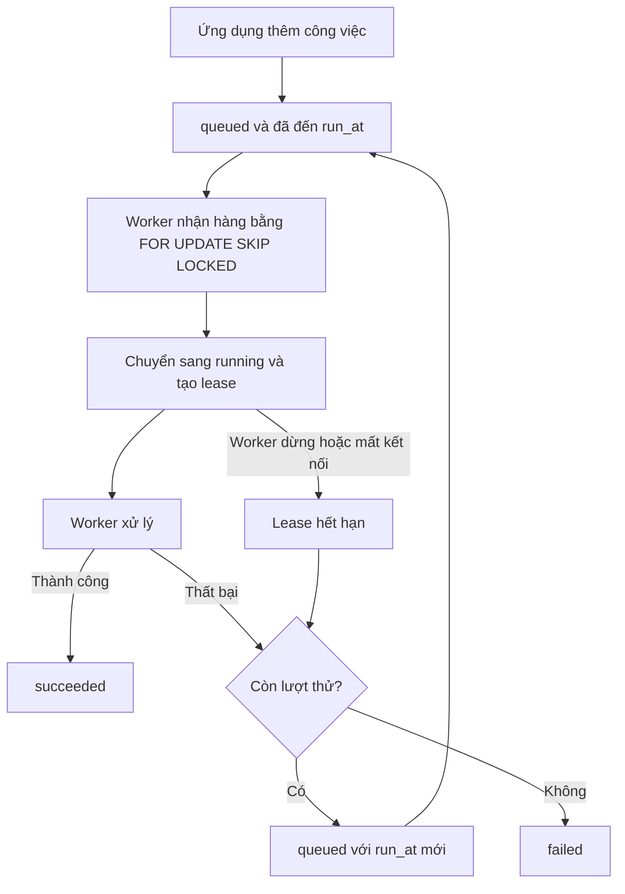

# Xây hàng đợi công việc với `SKIP LOCKED` và cơ chế thử lại

PostgreSQL có thể đảm nhiệm vai trò lưu trữ và phân phối công việc cho nhiều worker cùng xử lý. Mỗi công việc được lưu thành một hàng trong bảng. Worker lấy một nhóm hàng đang chờ, đánh dấu chúng là đang chạy rồi xử lý. Khi nhiều worker cùng lấy việc, `FOR UPDATE SKIP LOCKED` giúp mỗi worker bỏ qua những hàng đã bị worker khác khóa và tiếp tục lấy hàng khả dụng.

Để hàng đợi hoạt động ổn định khi worker lỗi hoặc dừng đột ngột, cần kết hợp khóa hàng với trạng thái công việc, số lần thử, thời điểm thử lại và thời hạn sở hữu công việc (lease). Thiết kế này cung cấp cách xử lý theo kiểu *at least once*: một công việc có thể được giao lại sau sự cố, vì vậy phần xử lý nghiệp vụ cần có tính idempotent.

## 1. Cách hàng đợi hoạt động

Giả sử một ứng dụng có nhiều worker cần gửi email, tạo báo cáo hoặc xử lý đơn hàng. Nếu tất cả worker cùng chạy một câu `SELECT` thông thường để tìm công việc mới, chúng có thể đọc cùng một hàng trước khi bất kỳ worker nào cập nhật trạng thái. Kết quả là một công việc bị xử lý đồng thời nhiều lần.

Một hàng đợi trong PostgreSQL thường có vòng đời như sau:

1. Ứng dụng thêm công việc với trạng thái `queued` và thời điểm có thể chạy `run_at`.
2. Worker chọn các công việc đến hạn, khóa hàng và chuyển trạng thái sang `running` trong cùng một câu lệnh.
3. Worker commit giao dịch nhận việc, sau đó xử lý công việc bên ngoài giao dịch đó.
4. Nếu xử lý thành công, worker chuyển trạng thái sang `succeeded`.
5. Nếu xử lý thất bại, worker lên lịch thử lại hoặc chuyển công việc sang `failed` khi đã hết số lần thử.
6. Nếu worker biến mất mà không cập nhật trạng thái, một tiến trình thu hồi sẽ phát hiện lease hết hạn và đưa công việc trở lại hàng đợi hoặc đánh dấu thất bại.

`SKIP LOCKED` giải quyết việc phân phối đồng thời ở bước nhận việc. Các trạng thái và cơ chế lease giải quyết việc theo dõi công việc sau khi giao dịch nhận việc đã commit.



## 2. Thiết kế bảng công việc

Một bảng cơ bản có thể lưu payload, trạng thái, độ ưu tiên, số lần thử và thông tin worker đang giữ công việc:

```sql
CREATE TABLE jobs (
    id                bigint GENERATED ALWAYS AS IDENTITY PRIMARY KEY,
    queue_name        text        NOT NULL DEFAULT 'default',
    payload           jsonb       NOT NULL,
    status            text        NOT NULL DEFAULT 'queued'
        CHECK (status IN ('queued', 'running', 'succeeded', 'failed')),
    priority          integer     NOT NULL DEFAULT 0,
    run_at            timestamptz NOT NULL DEFAULT clock_timestamp(),
    attempts          integer     NOT NULL DEFAULT 0 CHECK (attempts >= 0),
    max_attempts      integer     NOT NULL DEFAULT 5 CHECK (max_attempts > 0),
    locked_by         text,
    locked_at         timestamptz,
    lease_expires_at  timestamptz,
    last_error        text,
    idempotency_key   text UNIQUE,
    created_at        timestamptz NOT NULL DEFAULT clock_timestamp(),
    updated_at        timestamptz NOT NULL DEFAULT clock_timestamp(),
    completed_at      timestamptz,
    CHECK (
        (status = 'running'
            AND locked_by IS NOT NULL
            AND locked_at IS NOT NULL
            AND lease_expires_at IS NOT NULL)
        OR
        (status <> 'running'
            AND locked_by IS NULL
            AND locked_at IS NULL
            AND lease_expires_at IS NULL)
    )
);
```

Ý nghĩa của các cột chính:

| Cột | Vai trò |
|---|---|
| `queue_name` | Phân chia công việc theo hàng đợi, chẳng hạn `email` hoặc `reports`. |
| `payload` | Dữ liệu đầu vào của worker, thường được lưu dưới dạng JSON. |
| `status` | Trạng thái hiện tại của công việc. |
| `priority` | Độ ưu tiên; giá trị lớn hơn được lấy trước trong ví dụ bên dưới. |
| `run_at` | Thời điểm sớm nhất công việc được phép chạy, cũng là nơi lưu lịch thử lại. |
| `attempts` | Số lần worker đã nhận công việc. Một lần nhận được tính là một lần thử, kể cả khi worker dừng giữa chừng. |
| `max_attempts` | Số lần nhận tối đa trước khi công việc chuyển sang `failed`. |
| `locked_by` | Định danh worker đang giữ công việc. |
| `locked_at` | Thời điểm worker nhận công việc. |
| `lease_expires_at` | Thời điểm quyền xử lý hiện tại hết hạn nếu worker không gia hạn. |
| `last_error` | Thông tin lỗi gần nhất để chẩn đoán. |
| `idempotency_key` | Khóa chống tạo trùng công việc khi ứng dụng gửi lại yêu cầu. |

Ràng buộc `CHECK` cuối cùng bảo đảm hàng ở trạng thái `running` phải có đủ thông tin lease; các trạng thái còn lại phải giải phóng những cột này. Nhờ đó, một cập nhật thiếu bước khó để lại hàng ở trạng thái không nhất quán.

Tạo chỉ mục cho hai truy vấn thường xuyên: tìm công việc đang chờ và tìm lease đã hết hạn.

```sql
CREATE INDEX jobs_ready_idx
    ON jobs (queue_name, priority DESC, run_at, id)
    WHERE status = 'queued';

CREATE INDEX jobs_expired_lease_idx
    ON jobs (lease_expires_at)
    WHERE status = 'running';
```

Đây là chỉ mục từng phần (*partial index*): PostgreSQL chỉ lưu các hàng thỏa mãn điều kiện `WHERE` của chỉ mục. Vì vậy, chỉ mục tìm việc không phải mang theo các công việc đã hoàn tất. Thứ tự cột trong chỉ mục cần phù hợp với bộ lọc và `ORDER BY` thực tế; hãy kiểm tra bằng `EXPLAIN (ANALYZE, BUFFERS)` khi dữ liệu đủ lớn.

## 3. Thêm công việc vào hàng đợi

Ứng dụng có thể thêm công việc bằng `INSERT`:

```sql
INSERT INTO jobs (
    queue_name,
    payload,
    priority,
    run_at,
    idempotency_key
)
VALUES (
    'email',
    '{"recipient":"user@example.com","template":"welcome"}'::jsonb,
    10,
    clock_timestamp(),
    'welcome-email:customer-1042'
)
ON CONFLICT (idempotency_key) DO NOTHING
RETURNING id, status, run_at;
```

Nếu ứng dụng gửi lại cùng yêu cầu với cùng `idempotency_key`, ràng buộc `UNIQUE` ngăn tạo thêm hàng trùng. Khi `RETURNING` không trả hàng nào, ứng dụng có thể đọc công việc đã tồn tại theo khóa đó nếu cần lấy lại ID. Cách này đặc biệt hữu ích khi client không biết lần gửi trước đã được database commit hay chưa.

`run_at` cho phép lập lịch ngay từ đầu hoặc trì hoãn công việc. Worker chỉ nhận hàng có `run_at` nhỏ hơn hoặc bằng thời điểm hiện tại.

## 4. Nhận việc đồng thời bằng `FOR UPDATE SKIP LOCKED`

Phần cốt lõi của hàng đợi là chọn và cập nhật công việc trong cùng một câu lệnh:

```sql
WITH picked AS (
    SELECT id
    FROM jobs
    WHERE queue_name = $1
      AND status = 'queued'
      AND run_at <= clock_timestamp()
    ORDER BY priority DESC, run_at, id
    LIMIT $2
    FOR UPDATE SKIP LOCKED
)
UPDATE jobs AS j
SET status = 'running',
    attempts = j.attempts + 1,
    locked_by = $3,
    locked_at = clock_timestamp(),
    lease_expires_at = clock_timestamp() + $4::interval,
    updated_at = clock_timestamp()
FROM picked
WHERE j.id = picked.id
RETURNING
    j.id,
    j.payload,
    j.attempts,
    j.max_attempts,
    j.lease_expires_at;
```

Các tham số trong ví dụ:

- `$1`: tên hàng đợi, ví dụ `email`.
- `$2`: số công việc muốn nhận trong một lượt, ví dụ `10`.
- `$3`: mã worker, ví dụ `worker-03`.
- `$4`: thời hạn lease, ví dụ `5 minutes`.

CTE `picked` chọn các hàng đang chờ và đã đến hạn. `FOR UPDATE` khóa những hàng được chọn cho đến khi giao dịch kết thúc. `SKIP LOCKED` yêu cầu PostgreSQL bỏ qua hàng đang bị giao dịch khác khóa thay vì đợi hàng đó được mở khóa. Phần `UPDATE` chuyển chính các hàng đã chọn sang `running`, tăng bộ đếm lần thử và ghi thông tin lease. `RETURNING` trả payload cùng thông tin cần thiết cho worker.

Giả sử worker A khóa hàng có ID 101 nhưng chưa commit. Khi worker B chạy cùng truy vấn, B bỏ qua hàng 101 và có thể nhận hàng 102. Hai worker vì vậy không cùng nhận một hàng đang được khóa trong thời gian chọn việc.

Điểm quan trọng là thao tác chọn và chuyển trạng thái phải nằm trong cùng một câu lệnh có tính nguyên tử. Nếu ứng dụng chỉ `SELECT` danh sách ID rồi thực hiện `UPDATE` ở một câu lệnh riêng, hai worker có thể cùng đọc một ID trước khi một trong hai cập nhật trạng thái.

### Vì sao cần cập nhật trạng thái trước khi commit?

Khóa hàng chỉ tồn tại trong thời gian giao dịch. Khi giao dịch commit, khóa được giải phóng. Nếu worker chỉ chọn hàng bằng `FOR UPDATE SKIP LOCKED` rồi commit mà không đổi trạng thái, hàng đó lập tức trở thành ứng viên cho worker tiếp theo. Việc đặt `status = 'running'` trong cùng câu lệnh giúp các worker sau không còn xem hàng đó là công việc đang chờ.

Trong ứng dụng, một lượt nhận việc nên có ranh giới giao dịch ngắn:

```sql
BEGIN;

-- Chạy câu WITH picked ... UPDATE jobs ... RETURNING ở trên.

COMMIT;
```

Sau khi commit, worker xử lý payload bên ngoài giao dịch nhận việc. Không giữ giao dịch mở trong lúc gọi API, gửi email hoặc chạy một tác vụ kéo dài. Nếu giữ khóa quá lâu, các giao dịch khác có thể bị chặn, kết nối database bị chiếm dụng và quá trình phục hồi trở nên khó dự đoán.

## 5. Đánh dấu công việc hoàn tất

Sau khi xử lý thành công, worker cập nhật trạng thái. Điều kiện `locked_by` và `attempts` giúp xác nhận worker vẫn đang sở hữu đúng lượt nhận việc đó:

```sql
UPDATE jobs
SET status = 'succeeded',
    completed_at = clock_timestamp(),
    locked_by = NULL,
    locked_at = NULL,
    lease_expires_at = NULL,
    updated_at = clock_timestamp()
WHERE id = $1
  AND status = 'running'
  AND locked_by = $2
  AND attempts = $3
  AND lease_expires_at > clock_timestamp()
RETURNING id, status, completed_at;
```

`$1` là ID công việc, `$2` là mã worker và `$3` là giá trị `attempts` mà worker nhận được trong câu lệnh claim. Nếu câu lệnh không trả hàng nào, worker không còn sở hữu lượt xử lý hiện tại. Có thể lease đã hết hạn, công việc đã được thu hồi hoặc một worker khác đã nhận lại nó. Worker cần coi kết quả này là mất quyền sở hữu, không tự giả định rằng trạng thái đã được cập nhật thành công.

Trong ví dụ này, `attempts` tăng đơn điệu mỗi lần claim và đóng vai trò mã phiên bản của lượt nhận. Nếu hệ thống cho phép đặt lại bộ đếm hoặc tái sử dụng giá trị, hãy dùng một `lease_token` ngẫu nhiên riêng cho mỗi lượt claim và kiểm tra token đó khi gia hạn, hoàn tất hoặc báo lỗi.

## 6. Thử lại khi xử lý thất bại

Không phải lỗi nào cũng cần thử lại. Lỗi mạng tạm thời, dịch vụ bên ngoài quá tải hoặc timeout có thể hồi phục. Lỗi dữ liệu không hợp lệ hoặc vi phạm quy tắc nghiệp vụ thường cần được điều tra thay vì lặp vô hạn. Ứng dụng nên phân loại lỗi trước khi quyết định cập nhật hàng đợi.

Với lỗi có thể thử lại, có thể dùng *exponential backoff*: thời gian chờ tăng theo số lần thất bại. Thêm một lượng ngẫu nhiên (*jitter*) giúp nhiều worker không đồng loạt gọi lại một dịch vụ vừa phục hồi.

```sql
UPDATE jobs
SET status = CASE
        WHEN attempts >= max_attempts THEN 'failed'
        ELSE 'queued'
    END,
    run_at = CASE
        WHEN attempts >= max_attempts THEN run_at
        ELSE clock_timestamp() + make_interval(
            secs => LEAST(
                3600,
                (
                    5 * power(2, LEAST(attempts - 1, 10))
                    + random() * 5
                )::integer
            )
        )
    END,
    last_error = left($4, 4000),
    locked_by = NULL,
    locked_at = NULL,
    lease_expires_at = NULL,
    updated_at = clock_timestamp()
WHERE id = $1
  AND status = 'running'
  AND locked_by = $2
  AND attempts = $3
  AND lease_expires_at > clock_timestamp()
RETURNING id, status, attempts, max_attempts, run_at;
```

Trong câu lệnh trên, thời gian chờ cơ bản bắt đầu ở khoảng 5 giây, tăng gần gấp đôi qua mỗi lần thử và được giới hạn tối đa 3.600 giây. `random() * 5` thêm tối đa khoảng 5 giây ngẫu nhiên. Có thể điều chỉnh các con số theo đặc tính dịch vụ mà worker gọi.

Nếu `attempts` đã bằng `max_attempts`, công việc chuyển sang `failed`. Nếu vẫn còn lượt, công việc trở lại `queued` với `run_at` ở tương lai. Việc xóa các cột lease diễn ra cùng cập nhật trạng thái, vì vậy hàng không còn bị coi là thuộc worker cũ.

Nếu lỗi được xác định là không thể khắc phục, worker có thể chuyển thẳng sang `failed`, lưu `last_error` và giải phóng lease mà không lên lịch thử lại. Một quy trình vận hành có thể cho phép người quản trị xem lỗi, sửa dữ liệu rồi đưa công việc về `queued` theo chính sách riêng.

## 7. Thu hồi công việc khi worker dừng đột ngột

Worker có thể bị kill, mất kết nối hoặc gặp lỗi máy chủ sau khi đã commit lượt nhận. Khi đó, hàng vẫn ở trạng thái `running`. Lease cung cấp giới hạn thời gian cho quyền sở hữu: nếu worker không gia hạn trước `lease_expires_at`, một tiến trình thu hồi có thể đưa công việc trở lại hàng đợi.

Tiến trình thu hồi nên xử lý theo lô nhỏ để không giữ quá nhiều khóa cùng lúc:

```sql
WITH expired AS (
    SELECT id
    FROM jobs
    WHERE status = 'running'
      AND lease_expires_at <= clock_timestamp()
    ORDER BY lease_expires_at
    LIMIT 100
    FOR UPDATE SKIP LOCKED
)
UPDATE jobs AS j
SET status = CASE
        WHEN j.attempts >= j.max_attempts THEN 'failed'
        ELSE 'queued'
    END,
    run_at = CASE
        WHEN j.attempts >= j.max_attempts THEN j.run_at
        ELSE clock_timestamp() + make_interval(
            secs => LEAST(
                3600,
                (
                    5 * power(2, LEAST(j.attempts - 1, 10))
                    + random() * 5
                )::integer
            )
        )
    END,
    last_error = 'Worker lease expired',
    locked_by = NULL,
    locked_at = NULL,
    lease_expires_at = NULL,
    updated_at = clock_timestamp()
FROM expired
WHERE j.id = expired.id
RETURNING j.id, j.status, j.attempts, j.run_at;
```

Ở đây `SKIP LOCKED` cũng hữu ích cho chính tiến trình thu hồi. Nếu worker đang gia hạn hoặc hoàn tất một hàng, tiến trình thu hồi bỏ qua hàng đang bị khóa và xử lý hàng khác. Lần chạy sau có thể kiểm tra lại hàng đó. Công việc được thu hồi cũng dùng backoff theo số lần nhận để tránh một worker liên tục dừng làm hàng đợi thử lại quá dồn dập.

Ví dụ đặt lease là 5 phút. Nếu worker không gửi heartbeat trong khoảng thời gian này, hàng có thể được thu hồi sau khi hết hạn. Lease quá ngắn có thể khiến một tác vụ hợp lệ bị giao lại khi hệ thống chậm; lease quá dài khiến công việc bị treo lâu mới được phục hồi. Hãy chọn thời hạn dựa trên thời gian xử lý, độ trễ và tần suất heartbeat thực tế.

## 8. Gia hạn lease cho công việc chạy lâu

Với công việc có thời gian xử lý dài hơn lease ban đầu, worker cần định kỳ gia hạn. Chỉ worker đang giữ đúng lượt claim mới được gia hạn:

```sql
UPDATE jobs
SET lease_expires_at = clock_timestamp() + interval '5 minutes',
    updated_at = clock_timestamp()
WHERE id = $1
  AND status = 'running'
  AND locked_by = $2
  AND attempts = $3
  AND lease_expires_at > clock_timestamp()
RETURNING lease_expires_at;
```

Nếu không có hàng nào được trả về, worker đã mất lease hoặc lease đã hết hạn. Worker nên dừng xử lý nếu có thể và tránh ghi kết quả bằng quyền sở hữu cũ. Điều kiện `lease_expires_at > clock_timestamp()` trong câu gia hạn, hoàn tất và báo lỗi ngăn worker tiếp tục cập nhật hàng bằng một lease đã hết hạn.

Đối với hệ thống có thể để worker cũ tiếp tục chạy sau khi lease hết hạn, việc kiểm tra quyền sở hữu ở câu lệnh cập nhật trạng thái là rất quan trọng. Với tác động bên ngoài database, cần thêm cơ chế idempotency hoặc fencing ở hệ thống đích; chỉ kiểm tra hàng đợi không thể thu hồi một request đã được gửi ra ngoài.

## 9. Bảo đảm tính idempotent và hiểu đúng mức giao nhận

`SKIP LOCKED` ngăn hai giao dịch cùng khóa một hàng trong lúc claim. Tuy nhiên, nó không tạo ra bảo đảm *exactly once* cho toàn bộ tác vụ.

Hãy xét tình huống worker gửi email thành công, sau đó tiến trình bị dừng trước khi cập nhật `status = 'succeeded'`. Khi lease hết hạn, công việc được giao lại và email có thể được gửi lần thứ hai. Database không thể biết chắc dịch vụ email đã thực hiện tác động trước khi kết nối bị mất.

Một số cách giảm tác động của việc giao lại:

- Thiết kế handler idempotent: xử lý cùng một `job_id` nhiều lần vẫn cho cùng kết quả nghiệp vụ.
- Dùng khóa idempotency khi gọi API bên ngoài nếu dịch vụ đó hỗ trợ.
- Với dữ liệu nằm trong cùng PostgreSQL, thực hiện thay đổi nghiệp vụ và đánh dấu công việc thành công trong cùng một giao dịch khi phù hợp.
- Dùng unique constraint hoặc bảng ghi nhận sự kiện đã xử lý để chặn tác động trùng.
- Với luồng phát sự kiện, cân nhắc transactional outbox để ghi thay đổi nghiệp vụ và sự kiện cần gửi trong cùng giao dịch, rồi một worker riêng gửi sự kiện.

Vì vậy, nên hiểu mô hình này là giao nhận *at least once*: hệ thống ưu tiên không làm mất công việc và có thể giao lại khi không nhận được xác nhận hoàn tất. Tính idempotent của handler giúp việc giao lại an toàn.

## 10. Những đặc điểm cần lưu ý khi vận hành

**Không bảo đảm thứ tự FIFO tuyệt đối.** `ORDER BY priority DESC, run_at, id` sắp xếp các hàng mà truy vấn có thể lấy. Khi một hàng đầu danh sách đang bị khóa, `SKIP LOCKED` bỏ qua nó để lấy hàng khác. Một công việc có thể được xử lý sau công việc được thêm muộn hơn. Độ ưu tiên cao liên tục cũng có thể khiến công việc ưu tiên thấp bị chờ lâu; có thể dùng cơ chế tăng ưu tiên theo thời gian hoặc tách hàng đợi nếu cần.

**Chọn kích thước lô hợp lý.** Worker nhận quá nhiều hàng sẽ giữ trách nhiệm xử lý dài và có thể làm các worker khác thiếu việc. Lô nhỏ giúp phân phối linh hoạt hơn; lô lớn giảm số lần truy vấn nhưng có thể làm tăng thời gian chờ và số lease phải theo dõi.

**Giữ giao dịch claim ngắn.** Khóa hàng được giữ đến khi giao dịch kết thúc. Chỉ claim, cập nhật trạng thái và commit; xử lý nghiệp vụ sau đó. Không giữ giao dịch trong lúc chờ mạng hoặc chờ người dùng.

**Theo dõi các chỉ số vận hành.** Nên đo số hàng `queued`, số hàng `running`, tuổi của hàng chờ lâu nhất, số lần thử trung bình, số hàng `failed`, số lease hết hạn và thời gian xử lý theo loại công việc. Các chỉ số này giúp phát hiện worker chết, dịch vụ phụ thuộc chậm hoặc hàng đợi tăng nhanh hơn năng lực xử lý.

**Dọn dữ liệu có chính sách.** Hàng đã hoàn tất có thể làm bảng và chỉ mục tăng nhanh. Có thể lưu trữ hoặc xóa dữ liệu cũ theo thời hạn nghiệp vụ, nhưng cần giữ đủ thông tin phục vụ kiểm toán và điều tra. Với hàng đợi có lưu lượng lớn, cập nhật trạng thái liên tục cũng tạo dead tuple; cần theo dõi autovacuum, kích thước bảng và chỉ mục.

**Không dùng `SKIP LOCKED` như một truy vấn đọc nhất quán thông thường.** Tùy chọn này cố ý trả về một tập hàng không đầy đủ vì bỏ qua hàng đang khóa. Đây là hành vi phù hợp để phân phối việc, nhưng không phù hợp khi ứng dụng cần đọc toàn bộ dữ liệu theo một ảnh chụp nhất quán.

**Hiểu phạm vi của `SKIP LOCKED`.** Tùy chọn này bỏ qua xung đột khóa ở cấp hàng. Truy vấn vẫn cần lấy các khóa ở cấp bảng theo quy tắc của PostgreSQL và có thể phải chờ nếu gặp khóa bảng xung đột. Vì vậy, `SKIP LOCKED` không có nghĩa là truy vấn sẽ bỏ qua mọi loại khóa trong database.

## 11. Quan sát hành vi với hai worker

Có thể tự kiểm tra cơ chế khóa bằng hai phiên `psql`. Chuẩn bị ít nhất hai hàng `queued` trong cùng một queue.

Trong phiên A, bắt đầu giao dịch và khóa một hàng:

```sql
BEGIN;

SELECT id
FROM jobs
WHERE queue_name = 'email'
  AND status = 'queued'
ORDER BY priority DESC, run_at, id
LIMIT 1
FOR UPDATE;
```

Giữ giao dịch A mở. Trong phiên B, chạy truy vấn tương tự nhưng thêm `SKIP LOCKED`:

```sql
SELECT id
FROM jobs
WHERE queue_name = 'email'
  AND status = 'queued'
ORDER BY priority DESC, run_at, id
LIMIT 1
FOR UPDATE SKIP LOCKED;
```

Nếu có hàng khả dụng khác, phiên B nhận hàng đó thay vì đợi hàng đang bị phiên A khóa. Sau khi chạy xong, kết thúc phiên A bằng `COMMIT` hoặc `ROLLBACK` để giải phóng khóa. Trong ứng dụng thực tế, câu claim hoàn chỉnh ở phần 4 còn cập nhật `status` sang `running`, nhờ đó hàng không quay lại danh sách chờ sau khi commit.

## 12. Quy trình triển khai tham khảo

Khi đưa hàng đợi vào ứng dụng, có thể triển khai theo thứ tự sau:

1. Tạo bảng `jobs`, các ràng buộc và partial index phù hợp với bộ lọc của worker.
2. Viết thao tác enqueue có `idempotency_key` để chống tạo trùng khi client gửi lại yêu cầu.
3. Viết câu claim dùng `FOR UPDATE SKIP LOCKED`, cập nhật `running`, tăng `attempts` và đặt lease trong một câu lệnh.
4. Commit ngay sau khi nhận việc; xử lý payload bên ngoài giao dịch claim.
5. Viết các thao tác hoàn tất, báo lỗi và gia hạn lease với điều kiện xác nhận đúng worker và đúng lượt claim.
6. Chạy tiến trình thu hồi lease hết hạn theo lô, đồng thời áp dụng giới hạn số lần thử và backoff.
7. Làm handler idempotent, đặc biệt khi công việc gọi dịch vụ bên ngoài hoặc tạo tác động không thể rollback.
8. Theo dõi backlog, thời gian chờ, lỗi, số lượt thử và lease hết hạn để điều chỉnh số worker, kích thước lô và thời hạn lease.

Thiết kế này tận dụng khóa hàng của PostgreSQL để phân phối công việc giữa nhiều worker mà không cần một thao tác khóa toàn bảng. `SKIP LOCKED` giúp worker tiến tới hàng khả dụng, còn trạng thái, lease và retry policy giúp hàng đợi phục hồi khi xử lý không thành công.
