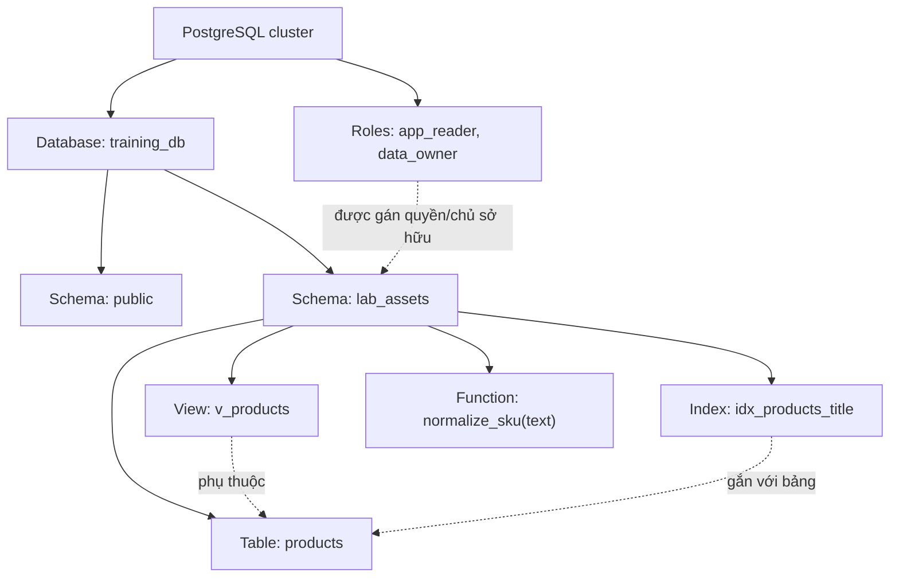
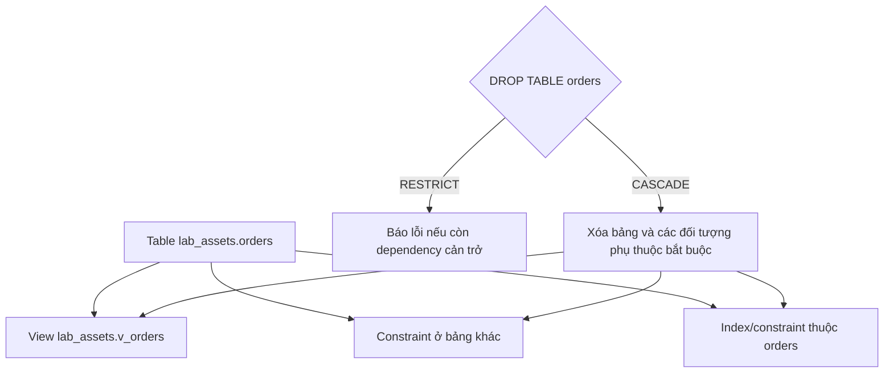

# Tạo, đổi tên, đổi chủ sở hữu và xóa đối tượng trong PostgreSQL

Trong PostgreSQL, dữ liệu được tổ chức dưới nhiều **đối tượng cơ sở dữ liệu (database objects)**: database, schema, table, view, materialized view, sequence, index, function, type, role, v.v. Mỗi đối tượng có tên, thuộc một không gian tên phù hợp, có chủ sở hữu khi loại đối tượng đó hỗ trợ ownership, và có thể phụ thuộc vào các đối tượng khác. Việc tạo hoặc thay đổi một đối tượng là thay đổi **cấu trúc/cấu hình của cơ sở dữ liệu** qua SQL DDL (Data Definition Language).

Bài học này tập trung vào bốn nhóm thao tác:

- **Tạo** đối tượng bằng `CREATE`.
- **Đổi tên** bằng các dạng `ALTER ... RENAME`.
- **Đổi chủ sở hữu** bằng `ALTER ... OWNER TO` khi loại đối tượng hỗ trợ.
- **Xóa** bằng `DROP`, đặc biệt là cách PostgreSQL xử lý các quan hệ phụ thuộc.

Ví dụ sử dụng cơ sở dữ liệu học tập và schema `lab_assets`. Chỉ chạy các lệnh có khả năng thay đổi hoặc xóa đối tượng trong **môi trường thực hành** mà bạn được phép quản lý, không chạy nguyên khối trên production.

## 1. Hiểu mô hình đối tượng và tên đầy đủ

Một kết nối PostgreSQL truy cập một database tại một thời điểm. Trong database có các schema; bên trong schema có bảng, view, sequence, function và nhiều loại đối tượng khác. Role là đối tượng cấp cụm PostgreSQL, được dùng làm người đăng nhập, nhóm quyền và chủ sở hữu.



Một bảng nên được gọi bằng **tên đầy đủ** `schema_name.table_name` khi câu lệnh quản trị cần rõ ràng:

```sql
SELECT * FROM lab_assets.products;
```

Nếu viết `SELECT * FROM products`, PostgreSQL sẽ dựa vào `search_path` để tìm bảng, dẫn đến kết quả khác nhau giữa các kết nối. Với thay đổi DDL, việc ghi rõ schema giúp hạn chế thao tác nhầm đối tượng.

PostgreSQL tự chuyển tên định danh **không đặt trong dấu nháy kép** thành chữ thường: `Products` không có dấu nháy được hiểu là `products`. Tên `"Products"` là một định danh khác, phân biệt chữ hoa/chữ thường. Nên nhất quán dùng tên chữ thường với dấu gạch dưới, ví dụ `catalog_items`, để giảm nhu cầu quote identifier.

### Các đối tượng có cùng thao tác quản trị nhưng cú pháp khác nhau

| Đối tượng | Tạo | Đổi tên | Đổi chủ sở hữu | Xóa |
| --- | --- | --- | --- | --- |
| Database | `CREATE DATABASE` | `ALTER DATABASE ... RENAME TO` | `ALTER DATABASE ... OWNER TO` | `DROP DATABASE` |
| Schema | `CREATE SCHEMA` | `ALTER SCHEMA ... RENAME TO` | `ALTER SCHEMA ... OWNER TO` | `DROP SCHEMA` |
| Table | `CREATE TABLE` | `ALTER TABLE ... RENAME TO` | `ALTER TABLE ... OWNER TO` | `DROP TABLE` |
| View | `CREATE VIEW` | `ALTER VIEW ... RENAME TO` | `ALTER VIEW ... OWNER TO` | `DROP VIEW` |
| Materialized view | `CREATE MATERIALIZED VIEW` | `ALTER MATERIALIZED VIEW ... RENAME TO` | `ALTER MATERIALIZED VIEW ... OWNER TO` | `DROP MATERIALIZED VIEW` |
| Sequence | `CREATE SEQUENCE` | `ALTER SEQUENCE ... RENAME TO` | `ALTER SEQUENCE ... OWNER TO` | `DROP SEQUENCE` |
| Index | `CREATE INDEX` | `ALTER INDEX ... RENAME TO` | Theo ownership của bảng liên quan | `DROP INDEX` |
| Function | `CREATE FUNCTION` | `ALTER FUNCTION ... RENAME TO` | `ALTER FUNCTION ... OWNER TO` | `DROP FUNCTION` |
| Role | `CREATE ROLE` | `ALTER ROLE ... RENAME TO` | Không có cú pháp `ALTER ROLE ... OWNER TO` | `DROP ROLE` |

Có nhiều loại đối tượng khác như type, domain, trigger, constraint, extension. Với mỗi loại, tra đúng biến thể `ALTER`/`DROP`; không giả định mọi đối tượng hỗ trợ cùng tùy chọn.

## 2. Chuẩn bị schema thực hành và xem metadata

Giả sử đã kết nối tới database **`training_db`** bằng role có quyền tạo schema. Chạy:

```sql
CREATE SCHEMA lab_assets;

CREATE TABLE lab_assets.products (
    product_id bigint GENERATED BY DEFAULT AS IDENTITY PRIMARY KEY,
    sku text NOT NULL UNIQUE,
    title text NOT NULL,
    unit_price numeric(12, 2) NOT NULL CHECK (unit_price >= 0)
);

INSERT INTO lab_assets.products (sku, title, unit_price)
VALUES
    ('BK-001', 'PostgreSQL Handbook', 250000.00),
    ('BK-002', 'SQL Exercises', 180000.00);

CREATE INDEX idx_products_title
    ON lab_assets.products (title);

CREATE VIEW lab_assets.v_products AS
SELECT product_id, sku, title, unit_price
FROM lab_assets.products;
```

Trong `psql`, kiểm tra đối tượng đã tạo:

```text
\dn+ lab_assets
\dt+ lab_assets.*
\dv+ lab_assets.*
\di+ lab_assets.*
\d+ lab_assets.products
```

Các lệnh bắt đầu bằng dấu gạch chéo ngược là **lệnh riêng của client `psql`**, không phải câu SQL gửi thẳng qua JDBC.

Có thể truy vấn catalog để biết tên, loại và chủ sở hữu của table, index, view, sequence trong schema:

```sql
SELECT
    n.nspname AS schema_name,
    c.relname AS object_name,
    c.relkind AS object_kind,
    pg_get_userbyid(c.relowner) AS owner_name
FROM pg_class AS c
JOIN pg_namespace AS n ON n.oid = c.relnamespace
WHERE n.nspname = 'lab_assets'
ORDER BY c.relkind, c.relname;
```

`pg_class.relkind` dùng các ký hiệu như `r` (ordinary table), `p` (partitioned table), `v` (view), `m` (materialized view), `S` (sequence), `i` (index). Không phải mọi đối tượng đều nằm trong `pg_class`; ví dụ function nằm trong `pg_proc`, schema nằm trong `pg_namespace`, role nằm trong `pg_roles`.

## 3. CREATE: tạo các đối tượng với cấu trúc phù hợp

### 3.1. Tạo database và schema

```sql
-- Chạy khi kết nối tới một database khác, có quyền CREATEDB.
CREATE DATABASE training_db
    WITH ENCODING 'UTF8'
    TEMPLATE template0;

-- Sau đó kết nối vào training_db:
CREATE SCHEMA lab_assets;
```

`CREATE DATABASE` chỉ được thực hiện khi kết nối tới một database có sẵn, và **không thể chạy bên trong transaction block**. Việc tạo database mới đòi hỏi superuser hoặc quyền `CREATEDB` phù hợp. Những dòng trên mô tả cách thiết lập từ đầu, không cần chạy lại nếu `training_db` và `lab_assets` đã tồn tại.

`CREATE SCHEMA` tạo không gian tên để gom đối tượng theo chức năng, nhóm nghiệp vụ hoặc ranh giới quản trị:

```sql
CREATE SCHEMA analytics;
CREATE TABLE analytics.daily_metrics (
    metric_date date PRIMARY KEY,
    total_orders bigint NOT NULL DEFAULT 0
);
```

Một database có thể chứa nhiều schema. **Schema không phải database khác**: bảng trong các schema của cùng database có thể được truy vấn chung nếu quyền cho phép.

### 3.2. Tạo table, sequence, index và view

Ví dụ độc lập:

```sql
CREATE SEQUENCE lab_assets.invoice_number_seq
    START WITH 1000
    INCREMENT BY 1;

CREATE TABLE lab_assets.invoices (
    invoice_number bigint PRIMARY KEY
        DEFAULT nextval('lab_assets.invoice_number_seq'::regclass),
    customer_name text NOT NULL,
    issued_at timestamptz NOT NULL DEFAULT now()
);

CREATE INDEX idx_invoices_issued_at
    ON lab_assets.invoices (issued_at DESC);

CREATE VIEW lab_assets.v_recent_invoices AS
SELECT invoice_number, customer_name, issued_at
FROM lab_assets.invoices
WHERE issued_at >= now() - interval '30 days';
```

Chú ý sự khác nhau:

- **Sequence** phát sinh số theo yêu cầu và có trạng thái riêng; `nextval` không đảo ngược chỉ vì một giao dịch bị rollback. Không dùng dãy số để suy ra mọi giao dịch đã thành công hoặc không có khoảng trống.
- **Index** tăng khả năng tìm kiếm theo một số kế hoạch truy vấn, nhưng tốn dung lượng và chi phí duy trì khi ghi.
- **View** lưu một định nghĩa truy vấn. Query của view đọc dữ liệu từ bảng nguồn khi được thực thi; view thông thường không lưu bản dữ liệu vật lý riêng.
- **Materialized view** lưu kết quả đã vật chất hóa và cần `REFRESH MATERIALIZED VIEW` để cập nhật từ dữ liệu nguồn.

Với sequence được tạo riêng như ví dụ, câu `DEFAULT nextval(...)` tạo quan hệ phụ thuộc từ biểu thức mặc định tới sequence, nhưng bản thân sequence **không mặc nhiên được khai báo `OWNED BY`** cho cột. Có thể quản lý vòng đời sequence gắn với cột bằng:

```sql
ALTER SEQUENCE lab_assets.invoice_number_seq
    OWNED BY lab_assets.invoices.invoice_number;
```

Cần quyền phù hợp và sequence phải cùng schema/chủ sở hữu với bảng theo yêu cầu của PostgreSQL. `OWNED BY` khiến sequence gắn vào vòng đời cột: xóa cột/bảng có thể kéo theo sequence. Do đó, chỉ cấu hình khi sequence thực sự dành riêng cho cột ấy.

### 3.3. Function và chữ ký hàm

Các function trùng tên có thể khác danh sách kiểu tham số (function overloading). Ví dụ:

```sql
CREATE FUNCTION lab_assets.discount_price(
    amount numeric,
    discount_percent numeric
)
RETURNS numeric
LANGUAGE sql
IMMUTABLE
AS $fn$
    SELECT amount * (1 - discount_percent / 100);
$fn$;

SELECT lab_assets.discount_price(200.00, 10.00);
```

Khi đổi tên, đổi chủ sở hữu hoặc xóa một function cụ thể, hãy chỉ rõ **chữ ký kiểu tham số** để PostgreSQL phân biệt được function cần thao tác.

### 3.4. IF NOT EXISTS: tiện lợi nhưng không phải migration

Một số lệnh CREATE hỗ trợ `IF NOT EXISTS`:

```sql
CREATE SCHEMA IF NOT EXISTS lab_assets;

CREATE TABLE IF NOT EXISTS lab_assets.import_jobs (
    job_id bigint GENERATED ALWAYS AS IDENTITY PRIMARY KEY,
    created_at timestamptz NOT NULL DEFAULT now()
);

CREATE INDEX IF NOT EXISTS idx_import_jobs_created_at
    ON lab_assets.import_jobs (created_at);
```

`IF NOT EXISTS` giúp không báo lỗi chỉ vì đối tượng mang tên đó đã tồn tại, nhưng **không xác thực cấu trúc hiện có có đúng như kỳ vọng**. Đặc biệt, index mang tên đã tồn tại có thể khác định nghĩa index bạn mong muốn. Việc phát triển schema ứng dụng thường nên dùng công cụ migration có phiên bản, ví dụ Flyway hoặc Liquibase, cùng quy trình kiểm tra khác biệt cấu trúc.

## 4. RENAME: đổi tên đối tượng mà không tạo lại dữ liệu

### 4.1. Đổi tên table và column

Sau khi có bảng `lab_assets.products`:

```sql
ALTER TABLE lab_assets.products
    RENAME TO catalog_items;

ALTER TABLE lab_assets.catalog_items
    RENAME COLUMN sku TO product_code;

SELECT product_id, product_code, title
FROM lab_assets.catalog_items;
```

`RENAME TO` chỉ nhận **tên mới của đối tượng**, không nhận `schema.name`. Đổi tên bảng từ `lab_assets.products` sang `lab_assets.catalog_items` giữ bảng trong cùng schema. Muốn chuyển schema, đó là một thao tác khác (`SET SCHEMA`).

Đổi tên table không đồng nghĩa với việc đổi tên mọi index và constraint mà table sở hữu. Nếu muốn chuẩn hóa tên index được tạo riêng ở ví dụ trước:

```sql
ALTER INDEX lab_assets.idx_products_title
    RENAME TO idx_catalog_items_title;
```

Với constraint, cú pháp tương ứng là:

```sql
ALTER TABLE lab_assets.catalog_items
    RENAME CONSTRAINT products_sku_key TO catalog_items_product_code_key;
```

Tên `products_sku_key` là tên constraint mặc định **thường được tạo** cho `sku UNIQUE` trong bảng ví dụ. Trong hệ thống thực, phải đọc `\d lab_assets.catalog_items` hoặc catalog trước khi sử dụng tên này.

Đổi tên index gắn với constraint có thể kéo theo đổi tên constraint, và đổi tên constraint có index tương ứng có thể kéo theo đổi tên index theo cơ chế PostgreSQL. Không cần tự thao tác hai lần nếu hệ thống đã đồng bộ tên như mong muốn.

### 4.2. Đổi tên schema và chuyển đối tượng sang schema khác

```sql
ALTER SCHEMA lab_assets
    RENAME TO training_assets;

-- Ví dụ riêng: chuyển bảng sang schema đích đã tồn tại.
CREATE SCHEMA archived_assets;

ALTER TABLE training_assets.catalog_items
    SET SCHEMA archived_assets;
```

Sau khi đổi tên schema, cần dùng `training_assets.catalog_items`. Sau `SET SCHEMA`, tên đầy đủ trở thành `archived_assets.catalog_items`.

Các đối tượng phụ thuộc bên trong PostgreSQL thường liên kết qua định danh nội bộ thay vì văn bản tên đơn giản; vì thế một số định nghĩa view/index/constraint được cập nhật để tiếp tục tham chiếu đúng. Tuy nhiên, **SQL trong mã nguồn ứng dụng, chuỗi SQL động, cấu hình kết nối, báo cáo hoặc công cụ ngoài database có thể vẫn chứa tên cũ** và cần sửa đồng bộ.

### 4.3. Đổi tên view, sequence, function và database

Ví dụ cú pháp cho các đối tượng đã được tạo:

```sql
ALTER VIEW lab_assets.v_recent_invoices
    RENAME TO v_invoices_recent;

ALTER SEQUENCE lab_assets.invoice_number_seq
    RENAME TO seq_invoice_numbers;

ALTER FUNCTION lab_assets.discount_price(numeric, numeric)
    RENAME TO apply_discount;
```

Đường dẫn đối tượng trong ví dụ này giả sử schema vẫn là `lab_assets`. Nếu đã thực hiện phần đổi tên schema trước đó, hãy dùng **tên schema mới**; các ví dụ trong bài học thể hiện từng thao tác độc lập để làm rõ cú pháp.

Đổi tên database:

```sql
-- Kết nối qua database khác và bảo đảm đủ quyền.
ALTER DATABASE training_db RENAME TO training_archive;
```

Không thể đổi tên **database mà phiên hiện tại đang kết nối tới**. Những session khác đang dùng database có thể cản trở việc đổi tên; cần lên kế hoạch bảo trì, cập nhật connection string và tránh thay đổi trên môi trường đang phục vụ ứng dụng.

### 4.4. Có thể coi RENAME là an toàn tuyệt đối?

Không. Dữ liệu bên trong bảng có thể giữ nguyên, nhưng rename là một thay đổi **hợp đồng tên**. Các caller dùng tên cũ sẽ lỗi hoặc truy vấn sai đối tượng. PostgreSQL cũng cần lấy lock khi thực hiện nhiều lệnh `ALTER`; trong hệ thống bận, DDL có thể đợi lock hoặc chặn giao dịch khác.

Khi đổi tên object của ứng dụng đang chạy, nên thực hiện theo migration được kiểm soát, có tương thích chuyển tiếp khi cần và quan sát lưu lượng truy vấn sau thay đổi.

## 5. OWNER: đổi chủ sở hữu đối tượng

### 5.1. Chủ sở hữu khác với người được GRANT quyền

Một table có **chủ sở hữu (owner)**, thường là role tạo table hoặc role được chỉ định khi tạo. Owner có quyền thay đổi định nghĩa/xóa đối tượng theo quy tắc PostgreSQL, đồng thời kiểm soát việc cấp quyền trên đối tượng đó.

Ví dụ, một role chỉ được cấp `SELECT` không trở thành owner:

```sql
GRANT SELECT ON TABLE lab_assets.products TO app_reader;
```

Lệnh trên yêu cầu table và role tương ứng tồn tại; quyền `SELECT` cho phép đọc dữ liệu theo chính sách hiện hành, **không** cho phép tự ý `ALTER TABLE` hay `DROP TABLE`. Chuyển ownership là một thao tác khác:

```sql
ALTER TABLE lab_assets.products OWNER TO data_owner;
```

Các ví dụ trên được trình bày độc lập, giả sử bảng vẫn giữ tên `products`. Trong thực hành chạy liên tục, sử dụng tên thực tế sau các bước rename.

### 5.2. Điều kiện để chuyển OWNER

Trong những tình huống thông thường với object trong schema, người thực hiện cần:

- Là chủ sở hữu hiện tại (hoặc được xem là có quyền owner thông qua role membership theo quy tắc PostgreSQL; superuser có đặc quyền riêng).
- Có thể trở thành role chủ sở hữu mới theo quan hệ role/`SET ROLE` thích hợp.
- Role chủ sở hữu mới có quyền `CREATE` trên schema chứa object nếu loại object yêu cầu.

Cần thực hiện chuyển owner dưới role quản trị được cấp đúng quyền. Cách thay owner không mặc nhiên trao quyền kết nối database hay quyền sử dụng các schema liên quan cho mọi thành viên của role mới.

Ví dụ quản trị viên chuẩn bị role chỉ dùng để sở hữu đối tượng:

```sql
-- Cần quyền quản trị role tương ứng.
CREATE ROLE data_owner NOLOGIN;

-- Trong ví dụ này, quyền trên schema được cấp bởi role có thẩm quyền.
GRANT USAGE, CREATE ON SCHEMA lab_assets TO data_owner;

-- Người chạy ALTER phải đáp ứng điều kiện ownership/role membership.
ALTER TABLE lab_assets.products OWNER TO data_owner;
```

`NOLOGIN` ngăn role đăng nhập trực tiếp nhưng role vẫn có thể sở hữu object và được dùng làm nhóm quyền. Tài khoản triển khai/migration có thể được cấp membership phù hợp theo chính sách quyền của tổ chức.

### 5.3. Đổi OWNER cho những loại đối tượng khác

```sql
ALTER SCHEMA lab_assets OWNER TO data_owner;

ALTER VIEW lab_assets.v_products OWNER TO data_owner;

ALTER SEQUENCE lab_assets.invoice_number_seq
    OWNER TO data_owner;

ALTER FUNCTION lab_assets.discount_price(numeric, numeric)
    OWNER TO data_owner;

ALTER DATABASE training_db OWNER TO data_owner;
```

Mỗi câu trên giả sử object và role đã tồn tại, đủ điều kiện quyền và chưa bị rename trước đó. `ALTER DATABASE ... OWNER TO` có các điều kiện quyền riêng, trong đó thường cần quyền `CREATEDB` và quan hệ role phù hợp đối với người thực hiện, trừ trường hợp superuser.

**Điểm dễ nhầm:** đổi chủ sở hữu của **schema** không tự động đổi chủ sở hữu của mọi table/view/function bên trong schema. Tương tự, đổi owner của database không tự động chuyển owner của mọi object trong database. Cần quản lý các đối tượng con riêng hoặc sử dụng cơ chế chuyển ownership có phạm vi xác định.

Index thông thường gắn với table và không có cú pháp độc lập `ALTER INDEX ... OWNER TO`; ownership của index theo ownership của relation liên quan. Với sequence gắn chặt vào một cột qua `OWNED BY` hoặc identity, việc thay ownership có các ràng buộc/cập nhật liên quan; cần xem metadata thay vì suy luận từ tên sequence.

### 5.4. REASSIGN OWNED: chuyển hàng loạt có kiểm soát

Khi ngừng sử dụng một role đang sở hữu nhiều object, PostgreSQL có lệnh:

```sql
REASSIGN OWNED BY old_owner TO new_owner;
```

Lệnh này chuyển các đối tượng mà `old_owner` sở hữu trong **database hiện tại**, và cả những đối tượng chia sẻ ở cấp cụm mà lệnh hỗ trợ như database/tablespace. Nó cần quyền membership phù hợp trên các role nguồn và đích. Tác động có thể vượt ngoài một schema và thậm chí ảnh hưởng đối tượng chia sẻ giữa các database. Không dùng `REASSIGN OWNED` như phiên bản tiện lợi của `ALTER TABLE OWNER` khi chỉ muốn đổi một bảng.

Muốn loại bỏ một role, trước hết phải xử lý những đối tượng và quyền vẫn phụ thuộc vào role đó ở các database liên quan. `DROP OWNED BY role_name` có thể **xóa đối tượng** do role sở hữu trong database hiện tại và thu hồi quyền, nên phải được xem là thao tác có khả năng gây mất dữ liệu, không phải biến thể an toàn của `REASSIGN OWNED`.

## 6. DROP: xóa đúng loại đối tượng

Cú pháp phổ biến:

```sql
DROP TABLE lab_assets.products;

DROP VIEW lab_assets.v_products;

DROP SEQUENCE lab_assets.invoice_number_seq;

DROP FUNCTION lab_assets.discount_price(numeric, numeric);

DROP SCHEMA lab_assets;
```

`DROP TABLE` xóa định nghĩa table và dữ liệu trong table; `DROP VIEW` xóa view nhưng không trực tiếp xóa dữ liệu của table nguồn. `DROP INDEX` xóa một index thông thường mà không xóa table nguồn, nhưng có thể làm giảm hiệu năng truy vấn. `DROP FUNCTION` loại bỏ một phiên bản function xác định theo chữ ký, có thể ảnh hưởng các object hoặc ứng dụng gọi nó.

Các đối tượng có phụ thuộc phải được xử lý theo thứ tự hoặc theo chính sách `RESTRICT`/`CASCADE` ở phần tiếp theo.

### 6.1. IF EXISTS và tên đối tượng

```sql
DROP TABLE IF EXISTS lab_assets.import_jobs;
DROP VIEW IF EXISTS lab_assets.v_recent_invoices;
DROP SCHEMA IF EXISTS archived_assets;
```

`IF EXISTS` tránh lỗi khi **đối tượng được nhắc đến không tồn tại** và thường đưa ra notice. Tuy nhiên, nó không làm cho thao tác xóa trở thành vô hại: nếu một đối tượng quan trọng tồn tại dưới tên đó, nó vẫn bị xóa. Hơn nữa, `IF EXISTS` không xử lý tự động các đối tượng đang phụ thuộc.

### 6.2. Xóa database và role có giới hạn riêng

```sql
-- Chỉ minh họa, áp dụng với database học tập cần xóa.
DROP DATABASE training_archive;

-- Chỉ khi role không còn sở hữu đối tượng/quyền phụ thuộc.
DROP ROLE data_owner;
```

`DROP DATABASE` không được chạy trong transaction block và không được thực thi khi đang kết nối tới chính database cần xóa. Các session đang kết nối tới database đích thông thường khiến `DROP DATABASE` thất bại; phiên bản PostgreSQL hỗ trợ tùy chọn `WITH (FORCE)` nhưng tùy chọn này có giới hạn và có thể ngắt kết nối người dùng, chỉ cân nhắc trong quy trình vận hành rõ ràng.

`DROP ROLE` xóa role cấp cụm. Nếu role còn sở hữu object hoặc vẫn tham gia các dependency, PostgreSQL sẽ từ chối; cần xử lý ownership/grant ở các database thích hợp trước khi xóa role.

## 7. RESTRICT và CASCADE: phụ thuộc quyết định hậu quả DROP

Giả sử đã có:

```sql
CREATE TABLE lab_assets.orders (
    order_id bigint PRIMARY KEY,
    created_at timestamptz NOT NULL DEFAULT now()
);

CREATE VIEW lab_assets.v_orders AS
SELECT order_id, created_at
FROM lab_assets.orders;
```

View `v_orders` phụ thuộc vào table `orders`. Nếu chạy:

```sql
DROP TABLE lab_assets.orders;
```

PostgreSQL sẽ từ chối khi còn dependency cần giữ lại. `RESTRICT` là hành vi mặc định ở những lệnh `DROP` hỗ trợ nó:

```sql
DROP TABLE lab_assets.orders RESTRICT;
```

Còn:

```sql
DROP TABLE lab_assets.orders CASCADE;
```

sẽ cho phép PostgreSQL xóa **các đối tượng phụ thuộc cần bị xóa**, ví dụ `v_orders`. Một quan hệ phụ thuộc có thể vượt ra ngoài schema hiện tại: view ở schema khác hoặc constraint liên quan cũng có thể chịu tác động. Với foreign key từ bảng khác tới bảng đích, `CASCADE` có thể xóa constraint tham chiếu thay vì xóa cả bảng tham chiếu; cần đọc thông báo thực tế để biết chính xác đã bị loại bỏ những gì.



Cần phân biệt:

- **Dependency** là ràng buộc cấu trúc PostgreSQL biết được (view definition, constraint, index, sequence ownership, v.v.).
- **Ứng dụng bên ngoài** có thể gọi bảng qua chuỗi SQL, nhưng PostgreSQL không biết mọi query nằm trong mã Java hay hệ thống báo cáo. `DROP ... CASCADE` không giúp kiểm tra được các caller này.
- Xóa một object có thể gây mất dữ liệu hoặc làm ứng dụng ngừng hoạt động ngay cả khi PostgreSQL cho phép lệnh.

### 7.1. Xóa từng bước khi muốn giữ kiểm soát

Thay vì dùng `CASCADE` ngay, có thể chọn thứ tự rõ ràng:

```sql
DROP VIEW lab_assets.v_orders;
DROP TABLE lab_assets.orders;
```

Với một schema không còn dùng, lệnh sau sẽ từ chối nếu trong schema còn object:

```sql
DROP SCHEMA lab_assets RESTRICT;
```

Nếu chủ động muốn xóa toàn bộ các object trong schema và đối tượng phụ thuộc liên quan:

```sql
DROP SCHEMA lab_assets CASCADE;
```

Đây là thao tác **phá hủy nhiều đối tượng**, cần xem danh sách trước, có backup/khôi phục phù hợp và được phép thực hiện. `CASCADE` có thể tác động object nằm ngoài schema nếu chúng phụ thuộc vào object bị xóa; không nên suy đoán phạm vi xóa chỉ từ tên schema.

### 7.2. Truy vết phụ thuộc trước khi DROP

Các tiện ích `psql` giúp thấy cấu trúc:

```text
\d+ lab_assets.orders
\dv+ lab_assets.*
\di+ lab_assets.*
```

Để tìm view nào sử dụng một bảng xác định, có thể kiểm tra định nghĩa view trong môi trường nhỏ:

```sql
SELECT schemaname, viewname, definition
FROM pg_views
WHERE schemaname = 'lab_assets'
ORDER BY viewname;
```

Cách tìm theo nội dung view chỉ là phương pháp quan sát, **không phải** thuật toán liệt kê đầy đủ dependency. PostgreSQL lưu dependency cấu trúc trong các catalog như `pg_depend`, `pg_rewrite`, `pg_constraint`; truy vấn chính xác các catalog này cần hiểu loại dependency và đối tượng nội bộ. Khi chuẩn bị xóa object quan trọng, kết hợp metadata, migration plan, kiểm thử trên bản sao và truy vết caller bên ngoài.

## 8. Thay đổi DDL trong transaction: khả năng rollback và ngoại lệ

PostgreSQL hỗ trợ transaction cho **nhiều** lệnh DDL:

```sql
BEGIN;

CREATE TABLE lab_assets.temp_experiment (
    id bigint PRIMARY KEY,
    note text
);

ALTER TABLE lab_assets.temp_experiment
    RENAME TO temp_experiment_v2;

-- Kiểm tra trước khi quyết định:
SELECT to_regclass('lab_assets.temp_experiment_v2');

ROLLBACK;

-- Sau rollback, bảng thử nghiệm không còn.
SELECT to_regclass('lab_assets.temp_experiment_v2');
```

Trong ví dụ này, cả CREATE và RENAME đều bị hủy bởi `ROLLBACK`. Điều này hữu ích khi kiểm tra migration trên môi trường thực hành và khi nhóm thay đổi cho phép chạy nguyên tử.

Tuy nhiên, **không phải toàn bộ DDL đều chạy được trong transaction block**. Những ví dụ điển hình gồm:

- `CREATE DATABASE` và `DROP DATABASE`.
- `CREATE INDEX CONCURRENTLY` và `DROP INDEX CONCURRENTLY`.
- Một số lệnh đặc thù khác theo phiên bản PostgreSQL.

Không thể tự suy luận một script nhiều DDL chắc chắn rollback toàn bộ. Đồng thời, ngay cả DDL có thể rollback vẫn có thể lấy khóa mạnh và ảnh hưởng các session khác trong lúc transaction chưa kết thúc.

### 8.1. Lock khi ALTER hoặc DROP

Nhiều biến thể `ALTER TABLE`, đổi tên và `DROP TABLE` cần khóa mạnh trên relation. Nếu giao dịch ứng dụng đang giữ lock xung đột, DDL có thể bị chờ; nếu DDL đang giữ khóa, truy vấn ứng dụng có thể phải chờ.

Có thể đặt thời gian chờ trong một transaction thực hành để tránh đợi vô hạn:

```sql
BEGIN;
    SET LOCAL lock_timeout = '2s';

    ALTER TABLE lab_assets.products
        RENAME COLUMN title TO product_title;

COMMIT;
```

Đây là ví dụ độc lập giả định bảng `lab_assets.products` còn tồn tại và chưa bị rename. Nếu lệnh `ALTER` bị `lock_timeout` hủy, transaction thông thường sẽ ở trạng thái lỗi và cần `ROLLBACK`; không cứ tiếp tục đến `COMMIT` rồi mặc định đã thay đổi thành công.

Trong sản xuất, có thể cần triển khai kỹ thuật **expand–migrate–contract**: thêm cấu trúc mới tương thích, chuyển dần code và dữ liệu, xác nhận rồi mới loại bỏ đối tượng cũ. Đây thường là lựa chọn phù hợp hơn việc đổi tên hoặc xóa ngay một cột mà ứng dụng cũ vẫn sử dụng.

## 9. Đổi tên và đổi owner ảnh hưởng quyền truy cập ra sao?

### 9.1. Tên thay đổi, dependency và quyền không đồng nghĩa bị tạo lại

Khi `ALTER TABLE ... RENAME TO`, PostgreSQL đổi tên của cùng một đối tượng. Với nhiều đối tượng, ACL/quyền đã cấp và các tham chiếu dựa trên identity nội bộ tiếp tục gắn với đối tượng đó. Nhưng **SQL bên ngoài vẫn cần tên đúng**.

Ví dụ ứng dụng có câu:

```sql
SELECT sku FROM lab_assets.products;
```

Sau khi đổi thành `lab_assets.catalog_items` và cột `product_code`, truy vấn phải được sửa thành:

```sql
SELECT product_code FROM lab_assets.catalog_items;
```

Không thể chỉ dựa vào việc PostgreSQL tự xử lý dependency nội bộ để đảm bảo toàn bộ ứng dụng vẫn chạy.

### 9.2. Chuyển owner có thể thay đổi ai có quyền quản trị

Khi chuyển owner sang `data_owner`, quyền quản trị trực tiếp gắn với ownership theo role mới. Các quyền `GRANT` đang có không nhất thiết bị xóa, nhưng cần xem lại:

- Role mới có đủ quyền cần thiết trong schema/database hay không.
- Những role ứng dụng đang dùng quyền `SELECT/INSERT/UPDATE/DELETE/EXECUTE` nào.
- Các chính sách mặc định cho **object được tạo trong tương lai** có đáp ứng mong muốn hay không.

`ALTER DEFAULT PRIVILEGES` điều khiển quyền mặc định của **đối tượng tạo sau này** bởi một role được chỉ định, không retroactively thay mọi object đang có. Chuyển owner của object hiện có không tự động điều chỉnh toàn bộ chiến lược cấp quyền tương lai.

Kiểm tra quyền truy cập trên table qua `psql`:

```text
\dp lab_assets.products
```

Hoặc đọc thông tin owner trong catalog như phần trước. Khi chạy câu lệnh quản trị bằng role ứng dụng chỉ có quyền đọc, việc `SELECT` thành công không chứng minh role đó có quyền đổi owner, đổi tên hay xóa bảng.

## 10. Quy trình thay đổi object có thể kiểm soát

Đối với một thay đổi DDL có khả năng ảnh hưởng ứng dụng, quy trình hợp lý là:

1. **Xác định object và phạm vi**: kết nối đúng database, xác nhận schema, tên đầy đủ, owner, object type và định nghĩa hiện tại.
2. **Xác định dependency**: view, function, foreign key, sequence, index, mã ứng dụng hoặc báo cáo đang dùng.
3. **Kiểm tra quyền**: role thực thi có quyền cần thiết; role mới có quyền membership/schema thích hợp nếu đổi owner.
4. **Lập migration và khả năng quay lại**: phân loại thao tác có thể rollback trong transaction, cần tạo bản sao lưu hay cần khôi phục dữ liệu.
5. **Kiểm tra trên môi trường thử nghiệm**: chạy migration, kiểm tra metadata và các truy vấn ứng dụng quan trọng.
6. **Thực thi có giám sát**: quan sát lock, thời gian chạy, lỗi của ứng dụng, mã thoát của công cụ migration và kết quả sau thay đổi.
7. **Cập nhật hợp đồng gọi**: code Java/JPA, tên bảng/cột trong SQL, cấu hình, tài liệu, dashboard và migration tiếp theo.

Ví dụ thay đổi tên có thể chạy trong transaction, nếu bảng và view phụ thuộc đã được kiểm tra:

```sql
BEGIN;
    SET LOCAL lock_timeout = '3s';

    ALTER TABLE lab_assets.products
        RENAME TO catalog_items;

    ALTER TABLE lab_assets.catalog_items
        RENAME COLUMN sku TO product_code;

COMMIT;
```

Nên kiểm tra thay đổi này trong bản sao môi trường thật, kể cả khi PostgreSQL xử lý rename thành công. Nếu cần làm việc với hệ thống có nhiều phiên ứng dụng đang chạy, kế hoạch tương thích và thời điểm triển khai quan trọng không kém việc câu SQL đúng cú pháp.

## 11. Bài thực hành tổng hợp

Dùng database học tập riêng và chọn một schema mới để không ảnh hưởng dữ liệu sẵn có.

**Bước 1 — Tạo object và xác nhận metadata**

```sql
CREATE SCHEMA ddl_practice;

CREATE TABLE ddl_practice.departments (
    department_id bigint GENERATED ALWAYS AS IDENTITY PRIMARY KEY,
    department_name text NOT NULL UNIQUE
);

CREATE VIEW ddl_practice.v_departments AS
SELECT department_id, department_name
FROM ddl_practice.departments;

INSERT INTO ddl_practice.departments (department_name)
VALUES ('Engineering'), ('Sales');
```

Dùng `\dt`, `\dv` và `pg_class` để kiểm tra đã có table và view.

**Bước 2 — Đổi tên object và chạy truy vấn theo tên mới**

```sql
ALTER TABLE ddl_practice.departments
    RENAME TO teams;

ALTER TABLE ddl_practice.teams
    RENAME COLUMN department_name TO team_name;

SELECT department_id, team_name
FROM ddl_practice.teams;
```

Sau đổi tên cột nguồn, một view đã tồn tại có thể vẫn giữ tên **cột kết quả** cũ (ví dụ `department_name`), do tên cột đầu ra của view là giao diện riêng. Dùng `\d+ ddl_practice.v_departments` để quan sát, rồi chủ động thay đổi giao diện view khi cần bằng migration phù hợp. Không giả định rename cột table tự động rename cả cột được expose bởi view.

**Bước 3 — Quan sát RESTRICT và lựa chọn thứ tự xóa**

```sql
-- Dự kiến PostgreSQL từ chối do view còn phụ thuộc.
DROP TABLE ddl_practice.teams RESTRICT;
```

Sau khi quan sát lỗi dependency, hãy dọn thủ công từng object:

```sql
DROP VIEW ddl_practice.v_departments;
DROP TABLE ddl_practice.teams;
DROP SCHEMA ddl_practice;
```

Ở đây tránh dùng `CASCADE` để thấy rõ những gì bị xóa và thứ tự phụ thuộc.

**Bước 4 — Thử rollback DDL**

```sql
BEGIN;
    CREATE TABLE ddl_practice_rollback (id integer PRIMARY KEY);
    ALTER TABLE ddl_practice_rollback RENAME TO ddl_practice_rollback_new;
ROLLBACK;

SELECT to_regclass('public.ddl_practice_rollback_new');
```

Câu cuối trả về `NULL` nếu đang dùng schema `public` trong `search_path` và object không tồn tại; để chắc chắn hãy chạy với tên schema phù hợp môi trường. Bài tập giúp thấy một số DDL có thể được rollback như DML.

**Bước 5 — Tìm hiểu owner mà không cần quyền quản trị role**

```sql
SELECT
    c.relname,
    pg_get_userbyid(c.relowner) AS owner_name
FROM pg_class AS c
JOIN pg_namespace AS n ON n.oid = c.relnamespace
WHERE n.nspname = 'public'
  AND c.relname LIKE 'ddl_practice%';
```

Với role được DBA cấp và môi trường thực hành riêng, thử `ALTER TABLE ... OWNER TO ...` rồi xác nhận `owner_name` đã thay đổi. Nếu role hiện tại không có quyền, hãy giải thích thông báo lỗi thay vì tự cấp quyền cao hơn cho role ứng dụng.

## 12. Các điểm cần nhớ

- `CREATE` tạo object mới; với object đã tồn tại, `IF NOT EXISTS` chỉ tránh lỗi tồn tại theo tên, không xác minh định nghĩa.
- `RENAME` thay đổi tên object và có thể làm hỏng SQL bên ngoài đang gọi tên cũ; `SET SCHEMA` là thao tác đổi vị trí namespace.
- `ALTER ... OWNER TO` thay role sở hữu, khác với `GRANT` cấp quyền sử dụng; không phải mọi object có cú pháp đổi owner độc lập.
- `DROP` loại bỏ object; `RESTRICT` bảo vệ khi còn dependency gây cản trở, trong khi `CASCADE` xóa thêm những đối tượng phụ thuộc cần thiết.
- Nhiều DDL là transactional, nhưng `CREATE/DROP DATABASE` và các thao tác index concurrent có ngoại lệ; lock có thể gây ảnh hưởng đáng kể dù DDL được rollback.
- Đối với hệ thống có ứng dụng Java/Spring Boot, xem object name và quyền như một phần hợp đồng với mã nguồn, công cụ migration và các dịch vụ tích hợp.

Hiểu vòng đời object cùng quan hệ phụ thuộc giúp việc tổ chức dữ liệu PostgreSQL có thể bảo trì, triển khai và phục hồi có kiểm soát thay vì chỉ dựa vào một lệnh DDL chạy thành công.
