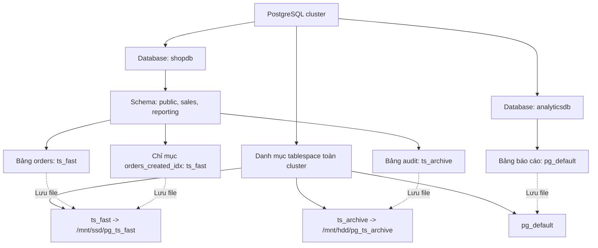

# Tablespace và tổ chức vị trí lưu trữ trong PostgreSQL

Một cơ sở dữ liệu PostgreSQL có thể bắt đầu trên một ổ đĩa rồi lớn dần đến mức cần chia dữ liệu sang các volume khác nhau. Ví dụ, hệ thống bán hàng muốn đặt bảng giao dịch được truy cập thường xuyên trên SSD tốc độ cao, một số chỉ mục lớn trên volume riêng, và các đối tượng ít dùng trên lưu trữ có chi phí thấp hơn. **Tablespace** là cơ chế PostgreSQL cung cấp để điều khiển **vị trí lưu trữ vật lý của nhiều loại đối tượng database** mà không phải thay đổi cách ứng dụng truy vấn chúng bằng SQL.

Tuy nhiên, tablespace không phải database, schema, phân vùng, ổ đĩa ảo hay phương án sao lưu. Một tablespace chỉ ánh xạ tên logic trong PostgreSQL tới **một thư mục trên filesystem mà tiến trình PostgreSQL truy cập được**. Thư mục nằm trên thiết bị nào, có bao nhiêu dung lượng, có mã hóa hay được nhân bản hay không đều phụ thuộc vào hệ điều hành và hạ tầng lưu trữ.

Bài học trong chương *Tổ chức dữ liệu* sẽ giải thích:

- Quan hệ giữa **cluster, database, schema, tablespace, bảng, chỉ mục và file vật lý**.
- Vai trò của `PGDATA`, `pg_default`, `pg_global` và thư mục `pg_tblspc`.
- Chuẩn bị thư mục, tạo tablespace, cấp quyền `CREATE` rồi đặt bảng/chỉ mục tại vị trí mong muốn.
- Đổi tablespace cho đối tượng đang tồn tại, cấu hình `default_tablespace` và `temp_tablespaces`.
- Tra cứu vị trí và dung lượng bằng `pg_tablespace`, `pg_class`, `pg_relation_filepath()` và các hàm kích thước.
- Ảnh hưởng của tablespace đến hiệu năng, khóa khi di chuyển, backup, replication, failover và vận hành.

Ví dụ dành cho PostgreSQL hiện đại với cú pháp SQL phổ biến và hệ điều hành Linux. Những lệnh tạo/xóa tablespace chỉ dùng trong **môi trường thực hành được phép thay đổi**; không thực hiện trên production nếu chưa có kế hoạch bảo trì.

## 1. Hiểu vị trí của tablespace trong hệ thống PostgreSQL

Trước hết, phân biệt các cấp tổ chức:

| Khái niệm | Vai trò | Có phải vị trí lưu trữ vật lý? |
|---|---|---|
| **PostgreSQL cluster/instance** | Một tập dữ liệu được quản lý bởi một hệ thống PostgreSQL, chứa nhiều database | Có thư mục dữ liệu gốc, thường gọi `PGDATA` |
| **Database** | Không gian kết nối, catalog và các đối tượng của một database | Có tablespace mặc định và các đối tượng có thể nằm ở tablespace khác |
| **Schema** | Không gian tên cho bảng, view, function, v.v. trong database | **Không**: schema không quy định ổ đĩa |
| **Tablespace** | Tên logic ánh xạ tới một vùng thư mục lưu trữ | **Có**: một vị trí filesystem |
| **Table** | Lưu các bản ghi; có thể chỉ định tablespace cho dữ liệu của bảng | Có các file quan hệ khi là bảng lưu trữ thực |
| **Index** | Cấu trúc truy cập dữ liệu, có thể đặt trong tablespace riêng | Có file vật lý độc lập với bảng |
| **WAL** | Nhật ký ghi trước để phục hồi và phục vụ một số cơ chế sao chép | Thường nằm trong `PGDATA/pg_wal`, không được đặt bằng `TABLESPACE` của bảng |

### 1.1. Sơ đồ tổ chức logic và vật lý



**Một tablespace có thể chứa đối tượng của nhiều database** trong cùng cluster. Ngược lại, **một database có thể dùng nhiều tablespace** cho các bảng và chỉ mục khác nhau. Tablespace không đồng nghĩa với việc “mỗi database được gắn cố định vào đúng một ổ”.

### 1.2. Ví dụ lý do sử dụng

Giả sử một máy PostgreSQL có hai vùng lưu trữ:

```text
/var/lib/postgresql/.../main/      -> Volume hệ thống, chứa PGDATA
/mnt/ssd/pg_ts_fast/               -> SSD hiệu năng cao
/mnt/archive/pg_ts_archive/        -> Volume lưu trữ ít truy cập
```

Người quản trị muốn:

- Đặt bảng đơn hàng thường xuyên đọc/ghi tại `ts_fast`.
- Đặt bảng lịch sử ít truy cập tại `ts_archive` nếu có yêu cầu phân tầng lưu trữ.
- Giữ một số bảng khác tại tablespace mặc định của database.

Các tên đường dẫn trên chỉ là **ví dụ**. PostgreSQL không tự tạo ổ SSD hoặc HDD khi bạn chạy `CREATE TABLESPACE`; volume đã phải được tạo/mount đúng trước.

## 2. PostgreSQL lưu dữ liệu ở đâu khi không tạo tablespace riêng?

Khi tạo cluster, PostgreSQL có thư mục dữ liệu gốc `PGDATA`. Trong bố cục PostgreSQL thông thường:

```text
PGDATA/
  base/                    # Dữ liệu từng database ở pg_default
    <database_oid>/
      <relation_filenode>  # File của bảng/chỉ mục và các fork liên quan
  global/                  # Catalog dùng chung toàn cluster
  pg_tblspc/               # Liên kết đến thư mục tablespace do người dùng tạo
  pg_wal/                  # Write-Ahead Log
  pg_xact/
  postgresql.conf          # Có thể nằm ngoài PGDATA tùy cách cài đặt
  ...
```

Đây là sơ đồ **khái niệm**, không phải danh sách bắt buộc giống hệt cho mọi gói cài. Trên một số hệ Linux, các file cấu hình như `postgresql.conf` có thể nằm ngoài `PGDATA`; vị trí thực tế cần được tra cứu từ server.

**Không tự ý di chuyển, sửa, xóa hoặc chỉnh sửa file bên trong `PGDATA`.** PostgreSQL quản lý tên file và cấu trúc nội bộ. Mọi thao tác thay đổi vị trí đối tượng nên được thực hiện qua lệnh SQL/tiện ích được hỗ trợ.

### 2.1. Hai tablespace dựng sẵn: pg_default và pg_global

PostgreSQL có hai tablespace hệ thống:

| Tablespace | Dùng cho | Đặc điểm |
|---|---|---|
| `pg_default` | Vị trí mặc định thông thường của dữ liệu database khi không chọn tablespace khác | Tương ứng bố cục mặc định dưới `PGDATA/base` |
| `pg_global` | Các catalog hệ thống dùng chung cho cluster | Nằm dưới `PGDATA/global`; không dùng như tablespace tự do cho bảng ứng dụng |

Một database mới thường có tablespace mặc định là `pg_default`, **trừ khi** nó được tạo hoặc chuyển sang một tablespace khác. Khi ấy, các đối tượng không có lựa chọn riêng có thể dùng tablespace mặc định của **database đó**, không nhất thiết luôn là `pg_default`.

Không được xóa hoặc đổi vị trí hai tablespace hệ thống bằng thao tác quản trị tablespace thông thường. Cũng không chọn `pg_global` để chứa bảng ứng dụng.

### 2.2. pg_tblspc là liên kết, không phải nơi chứa mọi file dữ liệu

Khi tạo tablespace riêng, PostgreSQL ghi nhận một liên kết trong `PGDATA/pg_tblspc` dẫn tới thư mục ở filesystem được khai báo. Trên các hệ Unix, các mục này thường là **symbolic link** được đặt tên theo OID của tablespace.

Ví dụ mô hình:

```text
PGDATA/pg_tblspc/24576  ---> /mnt/ssd/pg_ts_fast
                                    |
                                    +-- PG_<version>_<catalog-version>/
                                          +-- <database_oid>/
                                                +-- <relation_filenode>
```

Các phần tên thư mục liên quan phiên bản PostgreSQL và định dạng catalog là **chi tiết nội bộ**; không được hardcode chúng trong chương trình ứng dụng. Trên Windows, cơ chế biểu diễn liên kết có thể khác với Unix.

Nếu thư mục đích bị mất do volume không mount, file bị sửa ngoài PostgreSQL hoặc quyền truy cập bị thay đổi, database có thể không đọc/ghi được đối tượng đang nằm trong tablespace ấy.

## 3. Kiểm tra tablespace đang tồn tại

### 3.1. Dùng lệnh psql

Trong công cụ `psql`, nhập:

```text
\db
```

Lệnh meta `\db` hiển thị danh sách tablespace và một số thông tin về chúng. Có thể dùng:

```text
\db+
```

để xem thêm thông tin nếu phiên bản và quyền truy cập cho phép.

**Chú ý:** `\db` là lệnh meta **chỉ dành cho psql**, không phải SQL. Trong JDBC hoặc trình chạy SQL thông thường, hãy dùng truy vấn ở mục kế tiếp.

### 3.2. Truy vấn catalog pg_tablespace

```sql
SELECT
    oid,
    spcname,
    pg_get_userbyid(spcowner) AS owner_name,
    pg_tablespace_location(oid) AS location
FROM pg_tablespace
ORDER BY spcname;
```

Các cột và hàm:

- `oid`: định danh nội bộ của tablespace.
- `spcname`: tên tablespace để dùng trong SQL.
- `spcowner`: OID role sở hữu tablespace; `pg_get_userbyid` chuyển thành tên dễ đọc.
- `pg_tablespace_location(oid)`: đường dẫn filesystem của tablespace do người dùng định nghĩa.

Với `pg_default` và `pg_global`, `pg_tablespace_location` thường trả chuỗi rỗng vì chúng dùng vị trí có quy tắc nội bộ, không phải một thư mục ngoài khai báo bởi `CREATE TABLESPACE`.

Ví dụ kết quả minh họa:

| oid | spcname | owner_name | location |
|---:|---|---|---|
| 1663 | pg_default | postgres | *(chuỗi rỗng)* |
| 1664 | pg_global | postgres | *(chuỗi rỗng)* |
| 24576 | ts_fast | postgres | /mnt/ssd/pg_ts_fast |

OID như `24576` chỉ để minh họa; mỗi cluster có thể cấp OID khác.

### 3.3. Xác định thư mục dữ liệu và database hiện tại

```sql
SHOW data_directory;
SHOW default_tablespace;
SHOW temp_tablespaces;
SELECT current_database();
```

`SHOW data_directory` phản ánh vị trí `PGDATA` của server. Nó không trả đường dẫn tablespace riêng của một bảng.

Để xem tablespace mặc định **của database** đang kết nối:

```sql
SELECT
    d.datname,
    t.spcname AS database_tablespace
FROM pg_database AS d
JOIN pg_tablespace AS t
    ON t.oid = d.dattablespace
WHERE d.datname = current_database();
```

Hai khái niệm cần phân biệt:

- `pg_database.dattablespace`: tablespace mặc định **được gắn với database**.
- `SHOW default_tablespace`: tham số cấu hình mặc định cho việc **tạo đối tượng mới** trong session; có thể để trống hoặc đặt tên một tablespace.

Chúng có thể khác nhau. Không nhìn `SHOW default_tablespace` rồi suy ra vị trí vật lý hiện tại của mọi bảng.

## 4. Chuẩn bị thư mục vật lý trước khi CREATE TABLESPACE

Để tạo tablespace, PostgreSQL yêu cầu một **thư mục tuyệt đối trên filesystem**, được chuẩn bị đúng cho tài khoản hệ điều hành chạy server.

Các điều kiện cơ bản:

1. **Đường dẫn tồn tại trước** khi chạy `CREATE TABLESPACE`.
2. Thư mục đích phải **trống** tại thời điểm tạo tablespace.
3. Tiến trình PostgreSQL có thể đọc/ghi thư mục, thường bằng quyền sở hữu của user OS chạy dịch vụ.
4. Đường dẫn không đặt **bên trong `PGDATA`**; cấu trúc tablespace phải tách biệt, không dùng symlink thủ công để “chuyển file”.
5. Volume cần đủ dung lượng và I/O, mount ổn định, có chính sách backup và giám sát.
6. Nếu dùng nhiều máy PostgreSQL/standby, đường dẫn vật lý của tablespace trên các máy phải được bố trí tương thích với phương án sao lưu và phục hồi.

### 4.1. Ví dụ chuẩn bị trên Linux

Giả sử volume hiệu năng cao đã mount tại `/mnt/ssd` và user chạy server là `postgres`:

```bash
# Quan sát mount trước khi thay đổi.
findmnt -T /mnt/ssd
df -hT /mnt/ssd

# Tạo thư mục mới, trống, thuộc user PostgreSQL.
# Chỉ chạy nếu đây là đúng đường dẫn đã được phê duyệt.
sudo install -d \
    -o postgres -g postgres -m 700 \
    /mnt/ssd/pg_ts_fast

# Kiểm tra ownership, mode và dung lượng.
stat -c '%U %G %a %n' /mnt/ssd/pg_ts_fast
df -hT /mnt/ssd/pg_ts_fast
```

Trên Linux, `install -d` là một cách tạo thư mục và thiết lập owner/mode. Nếu PostgreSQL chạy dưới **user OS khác** hoặc hệ thống dùng SELinux/AppArmor, phải điều chỉnh theo package và chính sách thật. Đừng giả định mọi bản cài đều dùng UID/GID cùng tên `postgres`.

**Không tự tạo bảng hoặc chép file PostgreSQL vào thư mục tablespace**. Thư mục phải trống để PostgreSQL tự tạo bố cục bên trong.

### 4.2. Trên Windows hoặc storage khác

Ví dụ đường dẫn Windows có thể được viết bằng dạng:

```sql
-- Minh họa cú pháp đường dẫn trên Windows:
-- CREATE TABLESPACE ts_fast LOCATION 'D:/PostgreSQL/tablespaces/ts_fast';
```

Trong thực tế, phải cấp **NTFS ACL** cho account chạy Windows Service PostgreSQL. Cùng tên thư mục nhưng đặt sai ổ hoặc quyền không đủ vẫn khiến lệnh thất bại. Đường dẫn trong lệnh phải được máy **PostgreSQL server** nhìn thấy, không phải đường dẫn chỉ tồn tại trên laptop chạy `psql`.

### 4.3. Những đường dẫn không nên dùng

- Thư mục con bên trong `PGDATA` để tạo “tablespace mới” mà không thực sự đổi volume.
- Một thư mục đã chứa file của tablespace/cluster khác.
- Volume tạm có thể mất dữ liệu sau reboot hoặc thay instance.
- Filesystem không hỗ trợ đầy đủ thao tác đồng bộ ghi mà PostgreSQL yêu cầu.
- Thư mục writable cho mọi user trên máy, tạo nguy cơ file bị thay đổi ngoài PostgreSQL.
- Một network filesystem không được nhà cung cấp/hạ tầng xác nhận phù hợp về tính nhất quán và độ bền cho PostgreSQL.

Tablespace không tự kiểm tra mọi bảo đảm của thiết bị. Các vấn đề về durability của storage có thể gây mất dữ liệu dù câu `CREATE TABLESPACE` chạy thành công.

## 5. Tạo tablespace và phân quyền

### 5.1. CREATE TABLESPACE

Sau khi chuẩn bị đúng thư mục, kết nối với role quản trị có **quyền superuser** và chạy:

```sql
CREATE TABLESPACE ts_fast
    LOCATION '/mnt/ssd/pg_ts_fast';
```

Giải thích:

- `ts_fast` là tên logic duy nhất trong **cluster**, không phải tên schema hay database.
- `LOCATION` là đường dẫn tuyệt đối trên filesystem của **máy chủ PostgreSQL**.
- Lệnh đăng ký vị trí và cho PostgreSQL tạo cấu trúc cần thiết; không phải thao tác copy toàn bộ bảng đang tồn tại sang ổ mới.

`CREATE TABLESPACE` là thao tác quản trị cấp cluster, yêu cầu đặc quyền cao, và **không thực hiện trong transaction block**. Do đó, không đặt nó bên trong `BEGIN ... COMMIT` thông thường.

Nếu PostgreSQL báo thư mục không tồn tại, không trống hoặc không đủ quyền, cần sửa **điều kiện OS/filesystem**; không thể cấp quyền database `GRANT` để chữa ownership sai ở thư mục.

### 5.2. Phân biệt hai lớp quyền

| Lớp quyền | Điều khiển điều gì? |
|---|---|
| **OS ownership và filesystem ACL** | Tiến trình PostgreSQL có thể truy cập thư mục/tệp vật lý không |
| **SQL ownership và `GRANT CREATE ON TABLESPACE`** | Role database nào được phép tạo đối tượng trong tablespace |

Một role SQL có `CREATE` trên tablespace **không trực tiếp ghi file qua hệ điều hành**. PostgreSQL server ghi file thay role đó, dưới tài khoản OS chạy tiến trình, sau khi kiểm tra quyền SQL.

Khi đã có role `lab_writer` phù hợp, quản trị viên có thể cấp:

```sql
GRANT CREATE ON TABLESPACE ts_fast TO lab_writer;
```

Quyền `CREATE` trên tablespace cho phép role sử dụng nó khi tạo các đối tượng thích hợp, nhưng **không thay thế** quyền tạo bảng trong schema hoặc quyền thao tác với database.

Ví dụ, để tạo bảng trong `public`, role còn cần `CREATE` trên schema `public`. Các quyền đó phải được thiết kế và cấp riêng.

### 5.3. Kiểm tra đặc quyền

```sql
SELECT
    spcname,
    spcacl
FROM pg_tablespace
WHERE spcname = 'ts_fast';
```

Hoặc dùng hàm kiểm tra:

```sql
SELECT
    has_tablespace_privilege(
        'lab_writer',
        'ts_fast',
        'CREATE'
    ) AS co_quyen_tao;
```

Các ví dụ giả định role `lab_writer` đã tồn tại. Trong thực tế không cấp quyền `CREATE` rộng rãi chỉ để “cho phép mọi người dùng hết lỗi”, vì một role có quyền ghi nhiều dữ liệu vào tablespace có thể làm đầy volume.

### 5.4. Đổi owner, đổi tên hoặc thu hồi quyền

Tùy quyền quản trị, PostgreSQL hỗ trợ những thao tác:

```sql
-- Chỉ minh họa; yêu cầu role đích tồn tại và đủ quyền.
-- ALTER TABLESPACE ts_fast OWNER TO storage_admin;

-- Đổi tên logic, không đổi đường dẫn vật lý.
-- ALTER TABLESPACE ts_fast RENAME TO ts_fast_new;

-- Thu hồi quyền tạo đối tượng.
-- REVOKE CREATE ON TABLESPACE ts_fast FROM lab_writer;
```

Những lệnh quản trị này **không có nghĩa** thay đổi owner Unix của thư mục hay tự dịch chuyển dữ liệu. Đổi tên tablespace không đổi volume; muốn chuyển dữ liệu sang volume mới phải có kế hoạch di chuyển đối tượng hoặc phương án phục hồi thích hợp.

## 6. Đặt bảng và chỉ mục vào tablespace

Sau khi tablespace đã có, mở một database thực hành. Ví dụ giả định `ts_lab` chưa tồn tại:

```sql
-- Trong kết nối có quyền CREATEDB hoặc quyền phù hợp:
CREATE DATABASE ts_lab;
```

Lệnh `CREATE DATABASE` không được chạy bên trong transaction block. Trong `psql`, chuyển kết nối:

```text
\connect ts_lab
```

`\connect` là meta-command của `psql`; công cụ GUI/JDBC thường cần mở kết nối mới tới database `ts_lab` thay vì gửi lệnh này như SQL.

### 6.1. CREATE TABLE ... TABLESPACE

```sql
CREATE TABLE public.lab_orders (
    order_id BIGINT GENERATED ALWAYS AS IDENTITY PRIMARY KEY,
    customer_id BIGINT NOT NULL,
    created_at TIMESTAMPTZ NOT NULL DEFAULT now(),
    total_amount NUMERIC(14, 2) NOT NULL
) TABLESPACE ts_fast;
```

Mệnh đề `TABLESPACE ts_fast` chỉ định nơi lưu **dữ liệu vật lý của bảng** theo cơ chế PostgreSQL. Trong SQL, ứng dụng vẫn truy vấn:

```sql
SELECT *
FROM public.lab_orders
WHERE customer_id = 1001;
```

Không cần thêm tên tablespace vào `FROM`; tên bảng và schema không thay đổi chỉ vì đổi vị trí file.

Một bảng có thể phát sinh thêm đối tượng nội bộ như TOAST, các fork phụ trợ, sequence hoặc indexes. Các đối tượng này có quy tắc lưu riêng; không suy đoán mọi file liên quan nằm cùng volume chỉ từ mệnh đề `TABLESPACE` của bảng. Khi cần chắc chắn, hãy kiểm tra catalog và đường dẫn đối tượng cụ thể.

### 6.2. CREATE INDEX ... TABLESPACE

Chỉ mục có thể dùng tablespace riêng:

```sql
CREATE INDEX lab_orders_created_at_idx
ON public.lab_orders (created_at DESC)
TABLESPACE ts_fast;
```

Hoặc nếu muốn đặt **chỉ mục** ở vị trí mặc định của database:

```sql
CREATE INDEX lab_orders_customer_id_idx
ON public.lab_orders (customer_id)
TABLESPACE pg_default;
```

Ví dụ này minh họa rằng **bảng và chỉ mục là những quan hệ lưu trữ khác nhau**. Một bảng trên `ts_fast` không buộc mọi index phải ở `ts_fast`.

Chú ý: `pg_default` là một tablespace cụ thể của cluster, không phải từ khóa “chọn tablespace mặc định hiện tại của database”. Trong database đã có tablespace mặc định khác, cách chọn rõ `pg_default` và cách **không ghi mệnh đề TABLESPACE** có thể cho kết quả khác.

### 6.3. INSERT và truy vấn không phụ thuộc vị trí vật lý

```sql
INSERT INTO public.lab_orders (
    customer_id,
    created_at,
    total_amount
)
VALUES
    (1001, '2026-10-03 09:00:00+07', 250000.00),
    (1002, '2026-10-03 10:15:00+07', 480000.00),
    (1001, '2026-10-04 11:30:00+07', 125000.00);

SELECT customer_id, SUM(total_amount) AS tong_tien
FROM public.lab_orders
GROUP BY customer_id
ORDER BY customer_id;
```

Việc chỉ định tablespace không làm thay đổi ngữ nghĩa `INSERT`, `SELECT`, `UPDATE` hay `DELETE`. Nó tác động đến **nơi PostgreSQL đọc/ghi các tệp vật lý**, một yếu tố có thể ảnh hưởng I/O và dung lượng.

## 7. Đặt chỉ mục khác bảng: lợi ích và giới hạn

Giả sử bảng nằm trên một volume có đủ dung lượng nhưng tốc độ đọc ngẫu nhiên thấp, còn chỉ mục được đặt trên SSD:

```text
Bảng orders                   -> /mnt/archive/pg_ts_archive
Index orders_customer_idx     -> /mnt/ssd/pg_ts_fast
```

Trong một truy vấn có index scan, PostgreSQL đọc **cả index lẫn trang dữ liệu bảng** nếu cần dữ liệu không nằm trong chỉ mục. Vì vậy, chỉ chuyển index sang SSD không đảm bảo toàn bộ truy vấn nhanh nếu phần lớn I/O vẫn đến bảng trên storage chậm.

Một số truy vấn có thể giảm I/O đến bảng bằng **index-only scan** khi điều kiện và visibility map cho phép, nhưng không nên tuyên bố mọi truy vấn có index sẽ chỉ đọc index.

Lợi ích thực tế phụ thuộc:

- Kế hoạch thực thi của optimizer.
- Tỷ lệ cache hit và kích thước working set.
- Phân bố đọc ngẫu nhiên/tuần tự.
- Chỉ mục có được dùng hay không.
- Storage có thực sự ở thiết bị I/O độc lập hay chỉ khác thư mục trên cùng volume.
- Khối lượng ghi vào cả bảng lẫn index.

**Một tablespace mới trên cùng ổ vật lý** không tự tạo thêm IOPS, bandwidth hoặc độ an toàn dữ liệu. Cần đo bằng `EXPLAIN (ANALYZE, BUFFERS)` và số liệu storage thực tế trước khi kết luận.

## 8. default_tablespace: nơi đặt đối tượng mới theo phiên

PostgreSQL có cấu hình **`default_tablespace`**, dùng để xác định tablespace cho các đối tượng mới được tạo **khi câu lệnh không ghi TABLESPACE tường minh**.

```sql
SHOW default_tablespace;
```

Giá trị mặc định thường là chuỗi rỗng, nghĩa là sử dụng **tablespace mặc định của database hiện tại**.

### 8.1. Đặt cho một phiên thực hành

```sql
SET default_tablespace = 'ts_fast';

CREATE TABLE public.lab_events (
    event_id BIGINT GENERATED ALWAYS AS IDENTITY PRIMARY KEY,
    message TEXT NOT NULL,
    occurred_at TIMESTAMPTZ NOT NULL DEFAULT now()
);

RESET default_tablespace;
```

Khi `lab_events` được tạo mà không có `TABLESPACE` tường minh, PostgreSQL có thể đặt đối tượng lưu trữ theo giá trị `default_tablespace` hiệu lực, nếu role có quyền sử dụng tablespace đó.

**Cần phân biệt:** `SET default_tablespace` không tự động chuyển các bảng **đã có**. Nó ảnh hưởng quyết định nơi đặt **đối tượng mới**. Nó cũng không thay đổi `pg_database.dattablespace` hay chuyển tất cả dữ liệu database sang ổ khác.

### 8.2. Thiết lập theo role hoặc database

Với đặc quyền thích hợp:

```sql
-- Giá trị mặc định cho các kết nối mới của role chỉ định.
ALTER ROLE lab_writer
    SET default_tablespace = 'ts_fast';

-- Giá trị mặc định cho các kết nối mới vào một database.
ALTER DATABASE ts_lab
    SET default_tablespace = 'ts_fast';
```

Các lệnh trên thay đổi **cấu hình mặc định cho phiên mới**, không di chuyển vật lý toàn bộ database. Một role phải có quyền phù hợp để thực tế tạo đối tượng tại tablespace được chọn.

Trong môi trường nhiều ứng dụng chung database, cần xem rõ vai trò nào được phép chọn volume có chi phí cao. Cấp `default_tablespace` theo role có thể giúp tách các loại workload, nhưng cũng có thể gây khó quản lý nếu có nhiều override bất ngờ.

### 8.3. Kiểm tra giá trị đang hiệu lực và nguồn

```sql
SELECT
    name,
    setting,
    source,
    context
FROM pg_settings
WHERE name IN ('default_tablespace', 'temp_tablespaces')
ORDER BY name;
```

`pg_settings` cho biết giá trị hiệu lực **trong phiên hiện tại**. Nếu cấu hình qua `ALTER ROLE`, kết nối mới của role có thể có giá trị khác phiên quản trị đang chạy.

## 9. temp_tablespaces: nơi lưu đối tượng tạm và tệp tạm

PostgreSQL có thể phải ghi dữ liệu tạm trong quá trình xử lý:

- Bảng tạm và chỉ mục trên bảng tạm.
- Tệp tạm được dùng khi một thao tác sort/hash không thể giữ toàn bộ dữ liệu trong RAM.
- Một số công việc xử lý trung gian tùy query plan.

Cấu hình `temp_tablespaces` cho phép xác định **danh sách tablespace** ứng viên dùng cho các đối tượng và tệp tạm ấy:

```sql
SHOW temp_tablespaces;
```

Trong một session thực hành có quyền sử dụng tablespace:

```sql
SET temp_tablespaces = 'ts_fast';

CREATE TEMP TABLE temp_customers (
    customer_id BIGINT,
    note TEXT
);

INSERT INTO temp_customers
VALUES (1, 'Khách thử nghiệm');

SELECT * FROM temp_customers;

RESET temp_tablespaces;
```

**Không lạm dụng ví dụ:** tạo bảng tạm một dòng không chứng minh đã tạo tệp tạm lớn. Nhiều thao tác có thể xử lý hoàn toàn trong bộ nhớ. `temp_tablespaces` chỉ có ý nghĩa khi phát sinh các đối tượng/tệp tạm cần lưu trữ.

### 9.1. Danh sách nhiều tablespace

Ví dụ trong môi trường đã có hai tablespace đủ điều kiện:

```sql
-- Minh họa khi ts_temp_a và ts_temp_b thực sự đã tồn tại.
SET temp_tablespaces = 'ts_temp_a, ts_temp_b';
```

PostgreSQL có cơ chế chọn giữa các tablespace được khai báo cho những đối tượng/tệp tạm phù hợp. Đây không phải giải pháp tự động cân bằng I/O chính xác theo tỷ lệ dung lượng hay tình trạng disk của từng volume.

Nếu `temp_tablespaces` để rỗng (giá trị mặc định phổ biến), PostgreSQL sẽ dùng tablespace mặc định của database cho đối tượng/tệp tạm theo quy tắc của tham số này.

### 9.2. Tách tệp tạm có tác dụng gì?

Với workload phân tích có nhiều sort/hash lớn, chuyển tệp tạm sang một volume thích hợp có thể giúp giảm cạnh tranh I/O với dữ liệu chính. Tuy nhiên:

- Nếu volume tạm đầy, truy vấn có thể thất bại.
- Nếu đặt tạm trên volume không bền vững, phải hiểu rủi ro khi service crash/restart và yêu cầu nền tảng; không tùy tiện chọn filesystem không an toàn.
- Quyền `CREATE` và khả năng truy cập tablespace vẫn được kiểm tra.
- Thay đổi `temp_tablespaces` không thay đổi số RAM dùng bởi truy vấn hay tự làm tối ưu `work_mem`.

Đừng coi một volume tạm nhanh là giải pháp cho mọi query plan kém; nhiều truy vấn cần tối ưu chỉ mục, thống kê, cấu trúc SQL hoặc phân tích tải đồng thời.

## 10. Thay tablespace của bảng đang tồn tại

Khi một volume đầy hoặc cấu trúc dữ liệu thay đổi, có thể cần **di chuyển** bảng đã tồn tại sang tablespace khác.

### 10.1. ALTER TABLE ... SET TABLESPACE

Giả sử bảng `lab_events` hiện nằm ở vị trí khác và muốn chuyển sang `ts_fast`:

```sql
ALTER TABLE public.lab_events
    SET TABLESPACE ts_fast;
```

Lệnh này yêu cầu PostgreSQL **di chuyển lưu trữ của bảng** sang tablespace đích theo quy trình nội bộ. Không phải thao tác sửa metadata đơn thuần cho một bảng đã có nhiều dữ liệu.

**Ảnh hưởng vận hành:**

- Có thể cần đọc/ghi lượng dữ liệu lớn trên cả nguồn và đích.
- Thường lấy khóa mạnh trên đối tượng, ảnh hưởng các truy vấn/giao dịch khác trong thời gian di chuyển.
- Cần dung lượng đích đủ lớn và headroom cho WAL/hoạt động khác.
- Có thể kéo dài, tạo I/O và WAL đáng kể; phải có cửa sổ bảo trì phù hợp.
- **Các chỉ mục không tự động được chuyển** cùng lệnh `ALTER TABLE ... SET TABLESPACE`; cần xem và di chuyển từng index nếu muốn.

Không dùng lệnh này trên bảng giao dịch lớn ở giờ cao điểm nếu chưa đánh giá thời gian khóa, I/O và tình trạng replica.

### 10.2. ALTER INDEX ... SET TABLESPACE

Chỉ mục là đối tượng riêng:

```sql
ALTER INDEX public.lab_orders_customer_id_idx
    SET TABLESPACE ts_fast;
```

Di chuyển index có thể tốn I/O và tác động đồng thời như một thay đổi cấu trúc. Cần kế hoạch cho chỉ mục quan trọng; đừng mặc định lệnh `ALTER INDEX ... SET TABLESPACE` là một thao tác “online không khóa” trên mọi phiên bản và workload.

Nếu vừa chuyển bảng vừa chuyển index, phải kiểm tra tổng dung lượng tạm và tác động đến truy vấn. Trong các bài toán production rất lớn, có thể cân nhắc phương án tạo lại chỉ mục theo cơ chế hỗ trợ tính đồng thời thích hợp và quy trình chuyển đổi riêng, thay vì chạy trực tiếp các lệnh một cách tùy tiện.

### 10.3. Di chuyển không làm đổi tên đối tượng

Sau khi chuyển bảng, ứng dụng vẫn truy cập qua tên logic:

```sql
SELECT COUNT(*) FROM public.lab_events;
```

Các foreign key, schema và SQL thông thường không cần biết dữ liệu đã thay đổi đường dẫn file. Nhưng **file path, relfilenode hoặc vị trí storage nội bộ có thể thay đổi** sau thao tác viết lại; ứng dụng không được giữ đường dẫn tệp nội bộ như một hợp đồng ổn định.

### 10.4. Có thể tự copy thư mục trong khi server chạy không?

**Không.** Cắt/dán file vật lý của một bảng đang hoạt động sang volume khác không phải là cách di chuyển tablespace hợp lệ. PostgreSQL có các file phụ trợ, WAL và ràng buộc nhất quán; tự di chuyển file có thể làm cluster không khởi động được hoặc hỏng dữ liệu.

Dùng các lệnh PostgreSQL được hỗ trợ hoặc quy trình backup/restore và thay đổi hạ tầng đã được thiết kế đúng. Nếu cần di chuyển **cả thư mục tablespace sang ổ mới** trong một cluster production, đó là bài toán bảo trì riêng, không giải quyết bằng sửa đường dẫn symlink thủ công khi server đang chạy.

## 11. Tablespace mặc định của database và ALTER DATABASE SET TABLESPACE

Một database có một **tablespace mặc định** lưu trong `pg_database.dattablespace`. Khi tạo database mới, có thể chọn tablespace mặc định ngay:

```sql
-- Chỉ minh họa nếu role có quyền CREATEDB và CREATE trên ts_fast.
CREATE DATABASE archive_lab
    TABLESPACE ts_fast;
```

Khi đó, những đối tượng không chọn vị trí riêng thường được đặt theo tablespace mặc định của database.

### 11.1. Khác biệt giữa ALTER DATABASE SET TABLESPACE và SET default_tablespace

Hai lệnh sau **không đồng nghĩa**:

```sql
-- A: Di chuyển database sang tablespace mặc định mới
-- theo cơ chế ALTER DATABASE. Đây là thao tác vật lý lớn.
ALTER DATABASE ts_lab SET TABLESPACE ts_fast;

-- B: Đặt mặc định tạo đối tượng cho các phiên kết nối mới.
ALTER DATABASE ts_lab SET default_tablespace = 'ts_fast';
```

| Lệnh | Tác động chính |
|---|---|
| `ALTER DATABASE ts_lab SET TABLESPACE ts_fast` | Thay đổi tablespace mặc định **của database**, có thể di chuyển dữ liệu thuộc tablespace mặc định cũ |
| `ALTER DATABASE ts_lab SET default_tablespace = 'ts_fast'` | Chỉ đặt **GUC cho session mới** khi tạo đối tượng không chỉ định tablespace |

Lệnh A có điều kiện nghiêm ngặt: không chạy trong transaction block; không được có các kết nối đang sử dụng database đích, và người thực hiện phải đủ quyền phù hợp. Thông thường quản trị viên kết nối vào **database khác**, chẳng hạn `postgres`, rồi thực hiện khi đã ngăn kết nối mới và cho các kết nối cũ kết thúc.

Nếu database đã có một số bảng/index được đặt **tường minh** ở các tablespace riêng, lệnh chuyển tablespace mặc định không tự gom hết tất cả chúng về cùng một nơi. Cần lập danh sách đối tượng và kiểm tra trạng thái sau thao tác.

**Không thực hiện lệnh A trong môi trường thực hành đang mở kết nối tới `ts_lab` hoặc production chưa có kế hoạch downtime.** Nó có thể di chuyển lượng dữ liệu lớn và làm gián đoạn dịch vụ.

### 11.2. Khi nào nên chọn tablespace ngay lúc CREATE DATABASE?

Nếu muốn phần lớn đối tượng của một database nằm trên volume khác ngay từ đầu, lựa chọn `TABLESPACE` khi tạo database có thể giảm nhu cầu di chuyển dữ liệu về sau. Nhưng cần quyết định ở cấp hạ tầng:

- Volume có đủ tăng trưởng, WAL/backup tương ứng không?
- Database có dùng các bảng/chỉ mục ở vị trí khác không?
- Có standby hoặc cơ chế physical backup phải truy cập đúng đường dẫn không?
- Có tổ chức quyền `CREATE` trên tablespace phù hợp cho chủ sở hữu database không?

Sử dụng một tablespace cho database không thay thế việc chọn nơi lưu chỉ mục hoặc phân vùng cụ thể khi có yêu cầu khác.

## 12. Xác định tablespace của một bảng hoặc chỉ mục

Khi đã có nhiều tablespace, không nên dựa vào lời kể “bảng này nằm trên SSD” hoặc một phần tên file. PostgreSQL cho phép truy vấn catalog để biết vị trí được khai báo.

### 12.1. pg_class.reltablespace

Một đối tượng dạng relation có thông tin `reltablespace` trong `pg_class`.

```sql
SELECT
    c.oid::regclass AS relation_name,
    c.relkind,
    c.reltablespace,
    t.spcname AS explicit_tablespace
FROM pg_class AS c
LEFT JOIN pg_tablespace AS t
    ON t.oid = c.reltablespace
WHERE c.oid IN (
    'public.lab_orders'::regclass,
    'public.lab_orders_created_at_idx'::regclass,
    'public.lab_orders_customer_id_idx'::regclass
);
```

**Cẩn thận:** `reltablespace = 0` thường có nghĩa **đối tượng sử dụng tablespace mặc định của database**, chứ **không** mang OID 0 của một tablespace tên thật. Vì vậy, chỉ nhìn cột `explicit_tablespace` bị `NULL` rồi nói “relation không có tablespace” là sai.

### 12.2. Tính tablespace hiệu lực, có xét mặc định database

Đối với bảng/index thông thường thuộc database hiện tại:

```sql
SELECT
    c.oid::regclass AS relation_name,
    c.relkind,
    c.reltablespace AS explicit_ts_oid,
    t.spcname AS effective_tablespace,
    pg_relation_filepath(c.oid) AS relative_file_path
FROM pg_class AS c
CROSS JOIN pg_database AS d
JOIN pg_tablespace AS t
    ON t.oid = CASE
        WHEN c.reltablespace = 0 THEN d.dattablespace
        ELSE c.reltablespace
    END
WHERE d.datname = current_database()
  AND c.oid IN (
      'public.lab_orders'::regclass,
      'public.lab_orders_created_at_idx'::regclass
  )
ORDER BY relation_name;
```

Truy vấn này nhằm minh họa việc quy đổi `reltablespace = 0` thành tablespace mặc định của database. Các đối tượng hệ thống **shared** và một số loại relation đặc biệt có quy tắc riêng; không dùng công thức này như một trình duyệt vật lý tổng quát cho mọi mục trong `pg_class` mà không phân biệt loại đối tượng.

### 12.3. pg_relation_filepath()

```sql
SELECT
    pg_relation_filepath('public.lab_orders'::regclass)
        AS path_cua_bang,
    pg_relation_filepath('public.lab_orders_created_at_idx'::regclass)
        AS path_cua_index;
```

Kết quả là **đường dẫn tương đối liên quan tới thư mục dữ liệu PostgreSQL**, ví dụ:

```text
pg_tblspc/24576/PG_<version>_<catalog-version>/<database_oid>/<relfilenode>
```

Đối tượng thuộc `pg_default` thường có dạng `base/<database_oid>/<relfilenode>`. Tên tệp vật lý không dùng tên SQL của bảng; một relation cũng có thể có nhiều segment file hoặc fork phụ trợ khi kích thước tăng. Do đó, đường dẫn trả về không phải một giao diện ổn định để ứng dụng tự mở file.

### 12.4. pg_relation_filenode()

```sql
SELECT
    pg_relation_filenode('public.lab_orders'::regclass)
        AS file_node_hien_tai;
```

`relfilenode` có thể thay đổi sau những thao tác viết lại bảng hoặc index. Không sử dụng nó làm khóa nghiệp vụ hoặc ID ổn định ngoài PostgreSQL.

## 13. Xem dung lượng theo bảng, chỉ mục và tablespace

Một tablespace được tạo thành công không có nghĩa nó đã có dữ liệu. Có thể đo bằng các hàm kích thước.

### 13.1. Dung lượng bảng và index

```sql
SELECT
    pg_size_pretty(
        pg_table_size('public.lab_orders'::regclass)
    ) AS table_size,
    pg_size_pretty(
        pg_indexes_size('public.lab_orders'::regclass)
    ) AS indexes_size,
    pg_size_pretty(
        pg_total_relation_size('public.lab_orders'::regclass)
    ) AS total_relation_size;
```

Ý nghĩa:

| Hàm | Nội dung đo |
|---|---|
| `pg_table_size(relation)` | Dung lượng dữ liệu bảng, gồm các phần lưu trữ liên quan như TOAST theo cách PostgreSQL định nghĩa, không cộng index của bảng |
| `pg_indexes_size(relation)` | Tổng dung lượng các index liên quan tới bảng |
| `pg_total_relation_size(relation)` | Tổng dung lượng bảng và indexes |
| `pg_relation_size(relation)` | Dung lượng fork `main` của relation khi không truyền fork khác |
| `pg_size_pretty(bytes)` | Định dạng số byte thành chuỗi dễ đọc |

Trên bảng ít dòng, giá trị có thể chỉ vài kB hoặc chục kB. Đó không phải dấu hiệu tablespace “chưa hoạt động”; PostgreSQL tổ chức lưu trữ theo page và các đối tượng có chi phí metadata riêng.

### 13.2. Dung lượng toàn tablespace

```sql
SELECT
    spcname,
    pg_size_pretty(
        pg_tablespace_size(oid)
    ) AS used_size
FROM pg_tablespace
ORDER BY spcname;
```

Hoặc:

```sql
SELECT
    pg_tablespace_size('ts_fast') AS used_bytes,
    pg_size_pretty(
        pg_tablespace_size('ts_fast')
    ) AS used_pretty;
```

Hàm `pg_tablespace_size` báo **dung lượng PostgreSQL đang dùng trong tablespace**, không phải toàn bộ capacity hay free space của volume chứa nó. Nó còn có thể bao gồm đối tượng thuộc **nhiều database** cùng dùng tablespace đó.

Việc gọi một số hàm kích thước cần quyền thích hợp; nếu gặp lỗi phân quyền, hãy yêu cầu quyền quan sát phù hợp thay vì cấp superuser cho tài khoản ứng dụng.

### 13.3. pg_tablespace_size không thay thế df -h

So sánh:

```sql
SELECT pg_size_pretty(pg_tablespace_size('ts_fast'));
```

với quan sát trên **máy chủ PostgreSQL**:

```bash
df -hT /mnt/ssd/pg_ts_fast
```

Giá trị SQL đo lượng dữ liệu PostgreSQL thuộc tablespace. `df` phản ánh dung lượng filesystem, bao gồm cả những file, reserve hoặc chương trình khác sử dụng volume. Một tablespace có dung lượng SQL không quá lớn vẫn có thể **không ghi được** nếu volume vật lý đã gần đầy vì dữ liệu khác.

### 13.4. Quan sát theo database

```sql
SELECT
    datname,
    pg_size_pretty(pg_database_size(oid)) AS database_size
FROM pg_database
WHERE datallowconn
ORDER BY pg_database_size(oid) DESC;
```

`pg_database_size` là kích thước dữ liệu database **trên các tablespace liên quan**, không phải một đường dẫn đơn. Vì vậy không dùng nó để suy ra database chỉ nằm trên đúng một volume.

## 14. Tablespace và partitioning: hai bài toán khác nhau

**Partitioning** chia dữ liệu một bảng logic thành nhiều partition theo khóa và ranh giới dữ liệu, ví dụ theo tháng. **Tablespace** chọn nơi các file vật lý được lưu.

Có thể kết hợp:

```sql
CREATE TABLE public.sales_by_month (
    sale_id BIGINT NOT NULL,
    sold_at DATE NOT NULL,
    amount NUMERIC(12, 2) NOT NULL
) PARTITION BY RANGE (sold_at);

CREATE TABLE public.sales_2026_10
    PARTITION OF public.sales_by_month
    FOR VALUES FROM ('2026-10-01') TO ('2026-11-01')
    TABLESPACE ts_fast;

CREATE TABLE public.sales_2026_11
    PARTITION OF public.sales_by_month
    FOR VALUES FROM ('2026-11-01') TO ('2026-12-01')
    TABLESPACE pg_default;
```

Mỗi partition có thể được đặt ở tablespace thích hợp. Với range partition, PostgreSQL dựa trên ranh giới `sold_at` để định tuyến dòng đến partition; **tablespace không tự phân phối dòng theo ngày**.

### 14.1. Khi nào kết hợp partition và tablespace có ích?

- Giữ các partition gần đây trên storage có hiệu năng cao.
- Chuyển partition cũ sang volume khác khi ít được truy vấn.
- Tách một số nhóm dữ liệu theo vòng đời và nhu cầu I/O.

Nhưng phải tính cả index của partition, dung lượng trống, tác động của việc chuyển dữ liệu và kế hoạch backup. Các thao tác như chuyển partition giữa tablespace vẫn có thể cần thời gian, khóa và tạo tải I/O; không xem partitioning là cách tự động làm mọi chuyển động dữ liệu thành “không downtime”.

### 14.2. Tablespace không phải sharding

Sharding phân phối dữ liệu và xử lý qua nhiều server/instance. Tablespace trong một cluster PostgreSQL **không** tạo một server độc lập, không tự cân bằng tải CPU giữa máy và không tạo thêm bản sao dữ liệu. Nếu một máy chủ PostgreSQL mất hẳn mà không có backup/replica, các tablespace trên nhiều ổ vẫn không tự bảo đảm khôi phục dịch vụ.

## 15. Tablespace và tối ưu chi phí/hiệu năng

Tablespace thường được cân nhắc vì hai mục tiêu: **đủ chỗ lưu** và **đặt dữ liệu trên thiết bị phù hợp**.

### 15.1. Phân tầng nóng – ấm – lạnh

| Tầng lưu trữ | Dữ liệu phù hợp | Cân nhắc |
|---|---|---|
| SSD/NVMe nhanh | Bảng giao dịch nóng, chỉ mục truy cập thường xuyên | IOPS và độ trễ tốt nhưng dung lượng/chi phí có thể hạn chế |
| SSD thông thường | Dữ liệu hoạt động, bảng lớn có tỷ lệ truy cập vừa | Cần đo workload; không nhất thiết mọi thứ phải ở NVMe |
| Storage dung lượng lớn | Dữ liệu ít truy cập, lịch sử, một số partition cũ | Có thể chậm hơn khi đọc ngẫu nhiên, cần hiểu giới hạn |
| Volume riêng cho temp | Tác vụ sort/hash lớn có ghi tệp tạm | Có thể giảm cạnh tranh I/O; giám sát nguy cơ đầy đĩa |

**Không tự đặt mặc định “index ở SSD, table ở HDD” mà không đo**. Index scan vẫn có thể phải đọc bảng; dữ liệu nhiều khi đã nằm trong RAM cache; và storage thực tế có thể nằm trên cùng pool thiết bị.

### 15.2. Điều chỉnh cost tham khảo cho tablespace

PostgreSQL cho phép đặt một số tham số planner cho tablespace, ví dụ:

```sql
-- Minh họa cho môi trường thử nghiệm, không phải giá trị chuẩn.
ALTER TABLESPACE ts_fast
SET (
    random_page_cost = 1.1,
    seq_page_cost = 1.0
);
```

Các giá trị này cung cấp **ước lượng chi phí cho planner**, không thay đổi tốc độ của ổ đĩa và không phải số mili giây đo thực tế. Đặt sai có thể khiến optimizer chọn kế hoạch kém hơn.

Khi không còn muốn override, có thể xem xét:

```sql
ALTER TABLESPACE ts_fast
RESET (random_page_cost, seq_page_cost);
```

Không nên thay những tham số này chỉ vì tablespace mang tên `ts_fast`; cần đo `EXPLAIN (ANALYZE, BUFFERS)` trên workload đại diện và xem độ trễ I/O thực tế.

### 15.3. Đừng tối ưu volume trước khi xem SQL

Một truy vấn chậm vì thiếu chỉ mục, thống kê sai hoặc join nhân dòng không trở nên đúng chỉ bằng cách chuyển file sang SSD. Ngược lại, nếu truy vấn phải đọc rất nhiều trang mà storage thực sự là nút cổ chai, tablespace có thể là công cụ trong chiến lược cải thiện I/O.

Quy trình tốt:

1. Xác định truy vấn/đối tượng gây tải I/O.
2. Đo query plan, buffer hits/reads và độ trễ storage.
3. Kiểm tra index, partition, cấu trúc SQL và vacuum.
4. Nếu thực sự cần đổi vị trí, thiết kế tablespace/volume và đánh giá khóa, dung lượng di chuyển.
5. Đo lại cùng workload sau khi đổi.

## 16. Backup, WAL, replication và tablespace

Tablespace là phần của **cấu trúc lưu trữ cluster**, nên luôn phải xét cùng chiến lược khôi phục.

### 16.1. WAL không nằm trong tablespace của bảng

Khi bảng nằm ở `ts_fast`, dữ liệu bảng có thể nằm trên volume `ts_fast`, nhưng WAL của PostgreSQL thường vẫn được quản lý tại `PGDATA/pg_wal` (trừ khi PostgreSQL đã được bố trí WAL riêng theo cơ chế phù hợp).

```text
Transaction:
    INSERT vào bảng trong ts_fast
       |                     |
       v                     v
    Ghi dữ liệu bảng       Sinh WAL
    volume ts_fast         vùng pg_wal
```

Tạo tablespace **không chuyển WAL** sang thư mục đó. Nếu volume WAL đầy hoặc lỗi, giao dịch vẫn có thể bị ảnh hưởng dù volume chứa bảng còn nhiều chỗ.

### 16.2. Physical backup phải bao gồm tablespace

Một bản sao vật lý đầy đủ phải nhất quán với cả:

- Dữ liệu trong `PGDATA`.
- Nội dung tất cả tablespace nằm ngoài `PGDATA`.
- WAL cần thiết để phục hồi.

Các công cụ backup vật lý được PostgreSQL hỗ trợ, như `pg_basebackup` hoặc giải pháp backup chuyên dụng, có cơ chế xử lý tablespaces. Việc chỉ nén `PGDATA` bằng cách sao chép file thủ công **không bảo đảm** đã chứa nội dung những đường dẫn external tablespace.

Một số quy trình physical backup/restore cho phép ánh xạ đường dẫn tablespace khi phục hồi sang host khác. Cần kiểm tra cách ánh xạ trên phiên bản công cụ và kiến trúc triển khai thực tế; không sửa symlink/đường dẫn một cách tùy tiện khi PostgreSQL đang hoạt động.

### 16.3. Logical backup khác physical backup

`pg_dump` tạo **bản sao logic** của đối tượng và dữ liệu trong một database, không phải sao chép nguyên trạng các file dưới `pg_tblspc`. Bản dump có thể chứa thông tin tham chiếu tablespace khi phục hồi đối tượng, nhưng **không tự tạo đầy đủ định nghĩa tablespace và thư mục OS trên server đích**.

Với phương án logical restore, cần:

- Chuẩn bị tablespace đích hoặc chủ động chọn cách bỏ qua thông tin tablespace khi restore.
- Có quyền tạo đối tượng tại nơi restore.
- Xử lý role, owner và quyền phù hợp.
- Có phương án backup cho các đối tượng toàn cluster khi cần, chẳng hạn dùng công cụ thích hợp cho global objects.

Không giả định copy một file dump sang máy khác sẽ tự tạo ra các volume có tên và đường dẫn giống hệt máy nguồn.

### 16.4. Physical streaming replication

Standby vật lý nhận thay đổi của cluster, bao gồm dữ liệu liên quan tablespace. Khi thiết kế standby:

- Đường dẫn hoặc ánh xạ tablespace phải tương thích với môi trường standby.
- Volume đích cần tồn tại, đủ dung lượng và có quyền OS thích hợp.
- Công cụ khởi tạo standby/backup phải xử lý tablespace đúng cách.
- Kế hoạch failover cần xác nhận mọi volume của standby sẵn sàng trước khi promote.

Tablespace không tự tạo redundancy. Nếu một tablespace chỉ ở một volume bị mất trên source, replication/backup phải đủ khả năng phục hồi. Chỉ tạo tablespace thứ hai **không** tạo bản sao thứ hai của bảng.

### 16.5. Archive và khôi phục theo thời điểm

Nếu hệ thống dùng WAL archiving/PITR, việc phục hồi vẫn cần tất cả đối tượng lưu trữ và WAL đúng mốc. Việc dữ liệu nằm trên nhiều volume không có nghĩa có thể khôi phục từng volume bằng snapshot bất kỳ thời điểm rồi ghép lại. Các snapshot/backup phải **nhất quán theo PostgreSQL** để tránh lệch thời điểm giữa các phần.

## 17. Theo dõi dung lượng và sự cố filesystem

Tách dữ liệu qua nhiều volume làm quản trị viên phải giám sát **từng điểm lưu trữ**, không chỉ `PGDATA`.

### 17.1. Các câu hỏi cần trả lời định kỳ

- Tablespace nào đang tăng nhanh nhất?
- Volume nào sắp đầy?
- Bảng/index lớn nào chiếm phần lớn dung lượng?
- Có job `CREATE INDEX`, `VACUUM FULL`, `CLUSTER` hoặc di chuyển bảng sắp cần thêm chỗ không?
- Có tệp tạm, WAL, archive hoặc backup đang tăng ngoài dự kiến không?
- Mount point có đúng ổ dự kiến sau reboot không?
- Quyền, owner, SELinux/AppArmor hoặc các policy lưu trữ có thay đổi không?

### 17.2. Truy vấn tablespace lớn

```sql
SELECT
    t.spcname,
    pg_tablespace_location(t.oid) AS location,
    pg_tablespace_size(t.oid) AS used_bytes,
    pg_size_pretty(pg_tablespace_size(t.oid)) AS used
FROM pg_tablespace AS t
ORDER BY used_bytes DESC;
```

Một câu báo cáo kiểu này có thể phải truy cập metadata filesystem và chịu giới hạn quyền. Trên các môi trường rất lớn, cân nhắc chu kỳ lấy số liệu hợp lý, không chạy liên tục với tần suất không cần thiết.

### 17.3. Xem bảng lớn trong database hiện tại

```sql
SELECT
    c.oid::regclass AS relation,
    pg_size_pretty(pg_total_relation_size(c.oid)) AS total_size,
    pg_total_relation_size(c.oid) AS bytes
FROM pg_class AS c
JOIN pg_namespace AS n
    ON n.oid = c.relnamespace
WHERE c.relkind IN ('r', 'm')
  AND n.nspname NOT IN ('pg_catalog', 'information_schema')
ORDER BY bytes DESC
LIMIT 20;
```

`relkind = 'r'` chủ yếu đại diện bảng thông thường; `'m'` là materialized view. Đây là danh sách theo dung lượng **quan hệ và các index liên quan**, không phải công thức phân bổ dung lượng theo từng tablespace nếu index nằm khác bảng.

Nếu cần phân tích chính xác volume nào chứa từng index, phải tra thêm `pg_class` và `pg_relation_filepath()` cho chính index đó.

### 17.4. Cảnh báo từ OS

Trên Linux:

```bash
df -hT /mnt/ssd/pg_ts_fast
findmnt -T /mnt/ssd/pg_ts_fast
```

Đây là lệnh chạy trên **host PostgreSQL**, không phải câu SQL. Nếu PostgreSQL chạy trong container/cloud volume, cần dùng đúng lớp quan sát filesystem/volume mà tiến trình server đang ghi.

Không dùng cách xóa file bên trong tablespace để “giải phóng dung lượng nhanh”. PostgreSQL quản lý mối liên hệ giữa catalog và file; xóa ngoài database có thể làm mất dữ liệu hoặc gây lỗi nghiêm trọng.

## 18. Xóa tablespace và dọn dẹp môi trường thực hành

Tablespace chỉ được xóa khi **không còn đối tượng phụ thuộc bên trong**. Nếu vẫn có bảng, index hoặc database sử dụng nó, `DROP TABLESPACE` sẽ thất bại.

### 18.1. Tháo các đối tượng của bài lab

Trong database `ts_lab`:

```sql
-- Chỉ chạy ở môi trường thực hành chứa đúng các bảng demo.
DROP TABLE IF EXISTS public.lab_events;
DROP TABLE IF EXISTS public.lab_orders;
DROP TABLE IF EXISTS public.sales_by_month CASCADE;
```

`DROP TABLE public.lab_orders` tự xóa các index thuộc bảng. Nhưng nếu có đối tượng khác vẫn nằm trong `ts_fast`, vẫn phải xử lý chúng trước.

**Lưu ý:** `CASCADE` có thể xóa các đối tượng phụ thuộc; chỉ dùng trong lab đã biết rõ phạm vi. Không dùng trên production như cách “dọn tablespace” hàng loạt.

### 18.2. Nếu database mặc định đã chuyển vào tablespace

Nếu đã thực hiện ví dụ `ALTER DATABASE ts_lab SET TABLESPACE ts_fast` hoặc `CREATE DATABASE archive_lab TABLESPACE ts_fast`, phải xử lý database và các đối tượng của nó theo quy trình riêng. Không thể xóa tablespace trong khi nó vẫn là nơi chứa dữ liệu của database.

Ví dụ chỉ dành cho lab và giả định không còn phiên kết nối vào database cần xóa:

```sql
-- Chạy từ database quản trị như postgres, không phải database cần xóa.
-- DROP DATABASE ts_lab;
-- DROP DATABASE archive_lab;
```

Các dòng này được chú thích để tránh thực thi vô ý. Trong thực tế, tên database và dữ liệu phải được xác minh trước mọi `DROP DATABASE`.

### 18.3. DROP TABLESPACE

Khi đã xác minh không còn phụ thuộc:

```sql
DROP TABLESPACE ts_fast;
```

`DROP TABLESPACE` không chạy trong transaction block. Sau khi PostgreSQL xóa tablespace thành công, cần kiểm tra cách hệ thống quản lý thư mục vật lý; đừng mặc định lệnh SQL sẽ tháo mount, xóa volume đám mây hoặc giải phóng tài nguyên hạ tầng.

Nếu muốn tái sử dụng volume, thực hiện các bước OS bằng quy trình riêng, bảo đảm không xóa nhầm thư mục của cluster/tablespace khác.

## 19. Các nhầm lẫn thường gặp

**1. “Tablespace là schema.”** Sai. Schema tổ chức tên đối tượng; tablespace chọn nơi lưu file vật lý. Hai bảng cùng schema có thể dùng tablespace khác nhau.

**2. “Tạo tablespace là PostgreSQL tự tạo một ổ đĩa mới.”** Sai. Volume, filesystem và thư mục đã phải được chuẩn bị ở OS/hạ tầng.

**3. “CREATE TABLESPACE tự tạo thư mục LOCATION.”** Không. Thư mục đích phải tồn tại, trống và có quyền phù hợp trước khi chạy lệnh.

**4. “Đặt bảng vào tablespace làm WAL đi theo bảng.”** Sai. WAL được PostgreSQL quản lý riêng, thường ở `pg_wal`.

**5. “Bảng và index luôn cùng tablespace.”** Sai. Chúng có thể được đặt hoặc di chuyển riêng. Cần kiểm tra catalog từng relation.

**6. “pg_class.reltablespace = 0 nghĩa là bảng không có nơi lưu.”** Sai. Với relation thông thường, giá trị 0 biểu thị dùng tablespace mặc định của database.

**7. “SHOW default_tablespace luôn cho biết bảng đang nằm ở đâu.”** Sai. Đây là mặc định cho tạo đối tượng trong phiên, không phải thuộc tính vật lý của tất cả bảng hiện hữu.

**8. “ALTER DATABASE SET default_tablespace di chuyển toàn bộ database.”** Sai. Đây là thay đổi GUC cho kết nối mới, khác `ALTER DATABASE ... SET TABLESPACE`.

**9. “ALTER TABLE SET TABLESPACE chỉ sửa catalog, chạy tức thì.”** Sai. Có thể phải di chuyển nhiều dữ liệu, lấy khóa mạnh và gây tải I/O.

**10. “Chuyển bảng thì index tự chuyển theo.”** Sai. Phải xem và chuyển các index cần thiết.

**11. “Một tablespace mới trên cùng ổ sẽ tăng tốc đọc/ghi.”** Không có bảo đảm. Hiệu năng phụ thuộc thiết bị thực, cache, I/O và query plan.

**12. “Tablespace là backup.”** Sai. Nó không tạo bản sao dữ liệu và không thay thế backup/PITR.

**13. “pg_tablespace_size cho biết dung lượng trống của ổ.”** Sai. Hàm này đo không gian PostgreSQL sử dụng trong tablespace, không phải free space của filesystem.

**14. “Chỉ cần backup PGDATA là đã có mọi tablespace external.”** Không thể mặc định như vậy. Physical backup nhất quán phải bao gồm nội dung tablespace và WAL cần thiết.

**15. “Có thể copy/move file bảng bằng công cụ OS trong lúc PostgreSQL chạy.”** Không. Thao tác ngoài PostgreSQL có thể gây hỏng dữ liệu và catalog.

**16. “Tablespace tự phân chia dữ liệu theo tháng.”** Sai. Việc định tuyến theo tháng là chức năng partitioning; tablespace chỉ chọn vị trí cho đối tượng/partition.

**17. “Role có CREATE TABLESPACE vì có CREATEDB.”** Sai. `CREATE TABLESPACE` yêu cầu quyền superuser; quyền `CREATEDB` và `CREATE` trên tablespace giải quyết các thao tác khác.

**18. “Đặt temp_tablespaces giúp mọi truy vấn sort nhanh hơn.”** Không chắc. Chỉ tác động các tệp/đối tượng tạm theo ngữ nghĩa cấu hình và phụ thuộc volume thực.

## 20. Bài tập thực hành có đáp án

### Bài 1 — Tablespace khác schema như thế nào?

Một ứng dụng có hai bảng `sales.orders` và `sales.order_logs` trong cùng schema `sales`, nhưng muốn bảng đơn nằm trên SSD, log nằm trên HDD.

**Đáp án:** Có thể tạo hai tablespace ánh xạ đến hai volume, sau đó chỉ định `TABLESPACE` hoặc di chuyển từng bảng. Không cần tách schema để đổi vị trí file; schema và tablespace là hai lớp tổ chức khác nhau.

### Bài 2 — Kiểm tra tablespace bằng SQL

**Yêu cầu:** lấy tên, chủ sở hữu và đường dẫn vật lý của các tablespace.

**Đáp án:**

```sql
SELECT
    spcname,
    pg_get_userbyid(spcowner) AS owner_name,
    pg_tablespace_location(oid) AS location
FROM pg_tablespace
ORDER BY spcname;
```

`pg_default` và `pg_global` có thể trả location là chuỗi rỗng do dùng cấu trúc nội bộ.

### Bài 3 — Quyền nào cần cho CREATE TABLESPACE?

Một role `app_writer` có quyền tạo bảng trong schema và quyền `CREATEDB`. Role đó muốn chạy `CREATE TABLESPACE ts_new LOCATION '...'`.

**Đáp án:** `CREATEDB` hoặc `CREATE` trên schema không đủ. `CREATE TABLESPACE` yêu cầu superuser và thư mục OS chuẩn bị đúng. Quản trị viên có thể tạo tablespace rồi `GRANT CREATE ON TABLESPACE ts_new TO app_writer` để role tạo đối tượng tại đó.

### Bài 4 — Phân biệt reltablespace = 0

Database có tablespace mặc định là `ts_archive`. Bảng `history_events` có `pg_class.reltablespace = 0`.

**Hỏi:** Bảng này bắt buộc nằm trong `pg_default` không?

**Đáp án:** Không. Với relation thông thường, `reltablespace = 0` có nghĩa sử dụng tablespace mặc định của database, ở ví dụ là `ts_archive`. Cần tra `pg_database.dattablespace` hoặc `pg_relation_filepath` để xác nhận.

### Bài 5 — Di chuyển bảng và index

Bảng `orders` và index `orders_created_idx` đều đang ở `pg_default`. Sau:

```sql
ALTER TABLE orders SET TABLESPACE ts_fast;
```

**Hỏi:** Index đã được chuyển chưa?

**Đáp án:** Không mặc định. Di chuyển bảng không tự chuyển các index. Cần kiểm tra vị trí index và dùng `ALTER INDEX orders_created_idx SET TABLESPACE ts_fast` nếu muốn, với kế hoạch khóa/I/O phù hợp.

### Bài 6 — Tablespace có thay thế WAL backup không?

Một nhóm tạo `ts_fast` trên SSD và nghĩ không cần backup vì dữ liệu “đã tách ổ”.

**Đáp án:** Sai. Tách vị trí không tạo bản sao; WAL cũng được quản lý riêng. Cần physical/logical backup và quy trình khôi phục có bao gồm tablespaces/WAL theo mục tiêu hệ thống.

### Bài 7 — Vì sao CREATE TABLESPACE thất bại?

Lệnh:

```sql
CREATE TABLESPACE ts_fast
LOCATION '/mnt/ssd/pg_ts_fast';
```

trả lỗi thư mục không tồn tại hoặc không đủ quyền.

**Đáp án:** Đường dẫn phải tồn tại trên **server**, trống và truy cập được bởi OS account chạy PostgreSQL. Kiểm tra `findmnt`, `df`, `stat`, quyền sở hữu và policy SELinux/AppArmor nếu có. Không giải quyết bằng cách cấp `SUPERUSER` cho role ứng dụng hoặc dùng `chmod 777`.

### Bài 8 — Tách temp khỏi dữ liệu nóng

Một hệ thống báo cáo thường xuyên tạo tệp tạm lớn và cạnh tranh I/O với bảng giao dịch.

**Đáp án gợi ý:** Cân nhắc một tablespace trên volume temp phù hợp rồi cấu hình `temp_tablespaces` cho những session/workload cần thiết, giám sát dung lượng và I/O. Đồng thời phân tích `work_mem`, chỉ mục và kế hoạch truy vấn để tránh chuyển tệp tạm không cần thiết.

### Bài 9 — Tính dung lượng bảng và indexes

**Yêu cầu:** đo kích thước dữ liệu và indexes của `public.lab_orders`.

**Đáp án:**

```sql
SELECT
    pg_size_pretty(pg_table_size('public.lab_orders')) AS bang,
    pg_size_pretty(pg_indexes_size('public.lab_orders')) AS chi_muc,
    pg_size_pretty(pg_total_relation_size('public.lab_orders')) AS tong;
```

Không dùng `pg_tablespace_size` để suy ra một bảng duy nhất, vì tablespace có thể chứa nhiều bảng của nhiều database.

### Bài 10 — Hai câu ALTER DATABASE có giống nhau?

```sql
ALTER DATABASE ts_lab SET TABLESPACE ts_fast;
ALTER DATABASE ts_lab SET default_tablespace = 'ts_fast';
```

**Đáp án:** Không. Lệnh thứ nhất thay đổi vị trí tablespace mặc định thực tế của database và có thể di chuyển dữ liệu, cần điều kiện vận hành nghiêm ngặt. Lệnh thứ hai đặt tham số tạo đối tượng mới cho các session trong database. Không dùng chúng thay thế nhau.

## 21. Quy trình lựa chọn tablespace trong hệ thống thật

Trước khi đưa ra quyết định “chuyển bảng A sang ổ B”, nên làm theo trình tự:

1. **Xác định mục tiêu:** tăng dung lượng, cải thiện I/O hay tách loại dữ liệu theo vòng đời?
2. **Đo điểm nghẽn:** dung lượng bảng/index, loại truy vấn, cache hit, disk latency, IOPS và tốc độ tăng trưởng.
3. **Thiết kế volume:** dung lượng, filesystem, mount, durability, quyền OS, backup, tên đường dẫn và dự phòng mở rộng.
4. **Xác định đối tượng:** bảng, index, TOAST, partition, database default và tệp tạm nào thực sự cần chuyển?
5. **Chuẩn bị quyền:** superuser tạo tablespace; role ứng dụng chỉ có `CREATE` cần thiết, schema quyền riêng.
6. **Kiểm tra SQL và vị trí:** `pg_tablespace`, `pg_class`, `pg_relation_filepath` và các hàm kích thước.
7. **Lập kế hoạch thay đổi:** thời gian khóa, lượng dữ liệu cần chép, WAL, mức độ ảnh hưởng replication, cửa sổ bảo trì và cách rollback.
8. **Kiểm tra backup/standby:** đảm bảo external tablespace được sao lưu và phục hồi được, các đường dẫn replica tương thích.
9. **Triển khai có quan sát:** giám sát dung lượng từng volume, trạng thái transaction, thời gian truy vấn và log lỗi.
10. **Xác nhận sau thay đổi:** tên logic không đổi, relation đã ở đúng vị trí, dữ liệu đầy đủ, chỉ mục hoạt động và hiệu năng đáp ứng mục tiêu.

**Kết luận:** Trong PostgreSQL, **tablespace là cơ chế ánh xạ các đối tượng lưu trữ sang thư mục vật lý**. `pg_default` và `pg_global` phục vụ các vị trí hệ thống; tablespace tự tạo có thể đặt bảng, index, partition hoặc làm mặc định cho database tùy nhu cầu. Công cụ này giúp quản lý dung lượng và phân tầng I/O, nhưng **không tự tạo backup, replication, sharding hay cải thiện hiệu năng trong mọi trường hợp**. Sử dụng hiệu quả tablespace đòi hỏi hiểu rõ cả quyền trên OS và SQL, cách di chuyển dữ liệu, các hàm tra vị trí/dung lượng, và phương án khôi phục nhất quán của toàn cluster.
