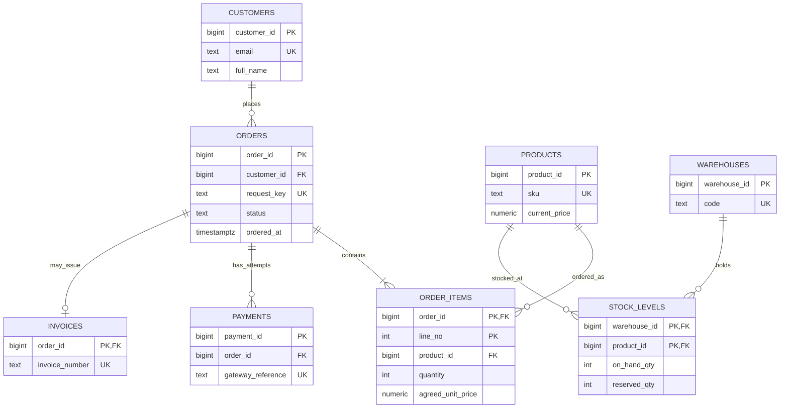

# Chuyển yêu cầu nghiệp vụ thành thực thể và quan hệ trong PostgreSQL

Khi bắt đầu thiết kế cơ sở dữ liệu, một yêu cầu nghiệp vụ thường được viết bằng ngôn ngữ tự nhiên: “Khách hàng đặt đơn hàng”, “Một đơn có nhiều sản phẩm”, “Mỗi kho lưu số lượng hàng khác nhau”, “Thanh toán có thể được thử lại”. Những câu này dễ hiểu đối với người làm nghiệp vụ nhưng **chưa đủ cụ thể để biến trực tiếp thành bảng SQL**.

Nhiệm vụ của thiết kế lược đồ là xác định **đối tượng nào cần lưu**, **thuộc tính nào thuộc về mỗi đối tượng**, **các đối tượng liên hệ ra sao**, và **quy tắc nào phải luôn đúng**. Sau đó mới chuyển mô hình thành bảng, khóa, ràng buộc và chỉ mục trong PostgreSQL.

Bài học sẽ đi xuyên suốt một ví dụ bán hàng có khách hàng, sản phẩm, đơn hàng, dòng đơn, kho hàng, thanh toán và hóa đơn. Trọng tâm là **phân tích nghiệp vụ → mô hình thực thể–quan hệ (ER) → lược đồ quan hệ → PostgreSQL DDL → kiểm chứng các quy tắc**. Những thành phần nghiệp vụ được giả định sẽ được ghi rõ để không nhầm lựa chọn thiết kế với quy tắc phổ quát.

## 1. Vì sao không nên bắt đầu bằng CREATE TABLE?

Giả sử người dùng nói:

> “Tôi muốn lưu các đơn khách đã đặt. Một khách có thể mua nhiều món, hệ thống cần biết kho nào đang có hàng và ghi nhận các lần thanh toán.”

Nếu vội tạo một bảng duy nhất:

```text
order_id | customer_name | customer_email | product_1 | product_2 |
product_3 | warehouse_name | quantity | payment_status
```

thì sẽ xuất hiện nhiều vấn đề:

- Một đơn có bao nhiêu sản phẩm? Ba cột `product_1`, `product_2`, `product_3` không thể đáp ứng số lượng tùy ý.
- Khách đổi tên/email thì dữ liệu ở bao nhiêu đơn phải sửa?
- Một sản phẩm có ở nhiều kho; một kho có nhiều sản phẩm. Một cột `warehouse_name` không mô tả được quan hệ này.
- Nếu thanh toán thất bại rồi thử lại, một cột `payment_status` không lưu được lịch sử các lần thử.
- Xóa một dòng đơn có vô tình làm mất thông tin khách hàng/sản phẩm không?
- Làm thế nào buộc mỗi dòng đơn tham chiếu đúng sản phẩm có thật?

Đây là những **lỗ hổng mô hình dữ liệu**, không thể khắc phục triệt để chỉ bằng cách thêm vài câu `SELECT` hay index.

Mục tiêu của bài không phải tạo càng nhiều bảng càng tốt. Mục tiêu là tạo **đúng số thực thể và quan hệ** để biểu diễn các quy tắc cần thiết, đồng thời giữ mô hình dễ phát triển và dễ kiểm soát tính đúng đắn.

## 2. Từ câu chuyện nghiệp vụ đến danh sách yêu cầu

Trước khi vẽ ERD, nên chuyển lời mô tả thành các câu có thể xác nhận với người phụ trách nghiệp vụ. Ví dụ, sau buổi làm rõ yêu cầu, nhóm thống nhất:

| Mã | Yêu cầu đã được làm rõ |
| --- | --- |
| R1 | Mỗi khách hàng có một định danh ổn định, họ tên và email; email không được trùng theo quy tắc không phân biệt hoa/thường. |
| R2 | Một khách có thể chưa đặt đơn nào hoặc đặt nhiều đơn; mỗi đơn phải thuộc về đúng một khách. |
| R3 | Mỗi đơn **đã xác nhận** phải có ít nhất một dòng hàng; mỗi dòng mô tả một sản phẩm và số lượng dương. |
| R4 | Một sản phẩm có SKU duy nhất, tên, giá hiện hành và trạng thái đang bán/ngừng bán. |
| R5 | Giá trên dòng đơn phải là **giá chốt tại thời điểm đặt**, không thay đổi theo giá hiện hành của sản phẩm. |
| R6 | Một kho có thể lưu nhiều sản phẩm, một sản phẩm có thể có ở nhiều kho; số lượng tồn phụ thuộc vào **cặp kho–sản phẩm**. |
| R7 | Một đơn có thể có nhiều lần thử thanh toán; mỗi lần thử có mã giao dịch từ cổng thanh toán riêng. |
| R8 | Một đơn có thể chưa có hóa đơn; trong phạm vi ví dụ, nhiều nhất một hóa đơn gắn với một đơn. |
| R9 | Địa chỉ giao hàng của đơn là **ảnh chụp tại thời điểm đặt**, không được tự đổi khi khách cập nhật địa chỉ cá nhân. |
| R10 | Không cho phép số lượng hoặc giá trị tiền âm; không làm mất lịch sử đơn hàng khi xóa sản phẩm khỏi danh mục bán. |

Những câu trên là **giả định cụ thể cho bài thực hành**, không phải quy tắc bắt buộc của mọi sàn thương mại điện tử. Ví dụ trong thực tế có thể có đơn của khách vãng lai, nhiều hóa đơn điều chỉnh, nhiều lần giao hàng hoặc nhiều loại tiền tệ.

### 2.1. Câu hỏi phải hỏi thêm trước khi quyết định cấu trúc

Một số câu hỏi thường làm thay đổi thiết kế:

1. **Đơn được tạo khi nào?** Có trạng thái nháp `DRAFT` chưa có dòng, hay chỉ tạo khi khách xác nhận?
2. **Một sản phẩm có thể xuất hiện nhiều lần trong cùng đơn không?** Nếu không, có thể đặt `UNIQUE(order_id, product_id)`.
3. **“Tồn kho” nghĩa là gì?** Tồn vật lý, tồn có thể bán, số lượng đang giữ chỗ hay số lượng đang vận chuyển?
4. **Thanh toán được mô hình hóa thế nào?** Một lần thử, nhiều lần thử, hoàn tiền từng phần, nhiều nguồn thanh toán?
5. **Địa chỉ giao hàng có cần giữ lịch sử không?** Nếu có, tham chiếu địa chỉ hiện hành của khách thường chưa đủ.
6. **Được phép xóa khách/sản phẩm đã có lịch sử giao dịch không?** Nghiệp vụ và quy định lưu trữ có thể yêu cầu ẩn danh hóa hoặc ngừng bán thay vì xóa.
7. **Hệ thống có nhiều công ty/tenant không?** Nếu có, khóa và ràng buộc phải ngăn dữ liệu thuộc tenant này tham chiếu nhầm tenant khác.

Nếu chưa có câu trả lời, hãy ghi rõ “chưa quyết định” thay vì biến một phỏng đoán thành constraint khó thay đổi về sau.

## 3. Xác định thực thể, thuộc tính và sự kiện

**Thực thể (entity)** là một đối tượng hoặc khái niệm nghiệp vụ có danh tính và vòng đời đủ rõ để hệ thống cần lưu. **Thuộc tính (attribute)** mô tả một đặc điểm của thực thể. **Quan hệ (relationship)** thể hiện sự liên hệ giữa hai hoặc nhiều thực thể.

Trong ví dụ bán hàng:

| Ứng viên | Phân loại | Lý do |
| --- | --- | --- |
| Khách hàng | Thực thể `Customer` | Có danh tính riêng và có thể tồn tại khi chưa đặt đơn |
| Đơn hàng | Thực thể `Order` | Có mã, thời điểm, trạng thái và vòng đời riêng |
| Sản phẩm | Thực thể `Product` | Có SKU riêng; tồn tại độc lập với từng đơn |
| Dòng đơn | Thực thể phụ thuộc `OrderItem` | Gắn với đơn, sản phẩm, số lượng và giá chốt |
| Kho hàng | Thực thể `Warehouse` | Có mã và vị trí/kho quản lý riêng |
| Số dư tồn kho | Thực thể liên kết `StockLevel` | Gắn với cặp kho–sản phẩm và mang thuộc tính số lượng |
| Lần thử thanh toán | Thực thể `Payment` | Có mã giao dịch và trạng thái riêng, có thể có nhiều lần |
| Hóa đơn | Thực thể `Invoice` | Có mã chứng từ, ngày phát hành và ràng buộc với đơn |
| Tên khách hàng | Thuộc tính | Không cần một bảng riêng trong mô hình đơn giản |
| Trạng thái đơn | Thuộc tính/miền giá trị | Là trạng thái của `Order`, không nhất thiết là thực thể riêng |
| “Khách đặt đơn” | Quan hệ | Một khách liên hệ tới nhiều đơn |
| “Sản phẩm có trong kho” | Quan hệ N:M có thuộc tính | Cần thực thể liên kết để lưu số lượng theo kho |

**Danh từ** là gợi ý tốt để tìm thực thể, **động từ** là gợi ý để tìm quan hệ. Nhưng đó không phải thuật toán tự động. Ví dụ “thanh toán” vừa là hành động, vừa có thể là một **sự kiện cần lưu riêng** vì có mã cổng thanh toán, thời điểm, kết quả và khả năng retry.

### 3.1. Khi nào một khái niệm xứng đáng là bảng riêng?

Cân nhắc tách thành thực thể nếu có một hoặc nhiều dấu hiệu:

- Có **danh tính ổn định** và nhiều đối tượng khác tham chiếu tới nó.
- Có **vòng đời riêng** (tạo, cập nhật, hủy, kết thúc).
- Có **nhiều bản ghi** liên quan tới cùng một thực thể cha.
- Có **thuộc tính riêng của quan hệ** như số lượng, giá chốt, thời điểm.
- Có quy tắc duy nhất, quyền truy cập hoặc lịch sử cần quản lý riêng.

Không phải mọi tập giá trị đều cần bảng tra cứu. Ví dụ `order_status` có thể được kiểm soát bằng `CHECK` ở mô hình nhỏ; nếu các trạng thái có metadata, quản trị động hoặc workflow phức tạp, bảng riêng có thể phù hợp hơn.

## 4. Đọc và xác định số lượng quan hệ (cardinality)

**Cardinality** cho biết một bản ghi của thực thể A có thể liên hệ với bao nhiêu bản ghi của B. **Optionality** cho biết sự liên hệ đó bắt buộc hay có thể không tồn tại.

| Loại | Ví dụ | Ý nghĩa |
| --- | --- | --- |
| Một–một (1:1) | Một đơn có tối đa một hóa đơn theo R8 | Mỗi bản ghi phía hóa đơn gắn đúng một đơn; một đơn có thể chưa có hóa đơn |
| Một–nhiều (1:N) | Khách hàng và đơn hàng | Một khách có 0..N đơn; mỗi đơn thuộc một khách |
| Nhiều–nhiều (N:M) | Đơn hàng và sản phẩm | Một đơn có nhiều sản phẩm; một sản phẩm xuất hiện trong nhiều đơn |
| Nhiều–nhiều có thuộc tính | Kho hàng và sản phẩm | Mỗi cặp kho–sản phẩm có số lượng tồn riêng |
| Quan hệ đệ quy | Nhân viên và người quản lý (ví dụ khác) | Một thực thể tham chiếu tới chính loại thực thể đó |

### 4.1. Phân biệt 0..N và 1..N

Theo R2:

```text
Customer 1  ----  0..N Order

Một khách có thể chưa đặt đơn.
Một đơn bắt buộc có đúng một khách.
```

Theo R3:

```text
Order đã xác nhận 1  ----  1..N OrderItem
```

Lưu ý: khóa ngoại trong bảng dòng đơn bảo đảm **mỗi dòng phải thuộc một đơn**, nhưng **không tự bảo đảm mỗi đơn có ít nhất một dòng**. Quy tắc “đơn xác nhận có từ một dòng trở lên” là một bất biến *xuyên bảng* cần xử lý ở transaction/service hoặc cơ chế cơ sở dữ liệu nâng cao.

### 4.2. ERD của bài thực hành



ERD là **mô hình khái niệm/logic**. Quan hệ `ORDERS ||--|{ ORDER_ITEMS` biểu diễn yêu cầu “đơn đã xác nhận phải có dòng”, nhưng DDL bên dưới không tự cưỡng chế phần tối thiểu một dòng bằng FK. Các ràng buộc nghiệp vụ không được DB enforce trực tiếp sẽ được liệt kê riêng.

## 5. Chuyển thực thể thành bảng, thuộc tính thành cột

Một phép chuyển đổi cơ bản:

```text
Entity Customer        -> bảng customers
  customerId           -> cột customer_id, primary key
  email                -> cột email, unique theo quy tắc nghiệp vụ
  fullName             -> cột full_name, NOT NULL

Entity Order           -> bảng orders
  orderId              -> cột order_id, primary key
  belongsTo Customer   -> cột customer_id, foreign key
  status               -> cột status với CHECK
```

Mỗi bảng nên có một **khóa** nhận diện được từng hàng. Với hệ thống mới, khóa tự sinh kiểu `BIGINT GENERATED ... AS IDENTITY` thường phù hợp; SKU, email hay mã đơn từ hệ thống ngoài vẫn có thể có ràng buộc `UNIQUE` riêng.

### 5.1. Khóa thay thế (surrogate key) và khóa tự nhiên

**Khóa tự nhiên** là dữ liệu nghiệp vụ tự có, ví dụ SKU. **Khóa thay thế** là giá trị định danh do hệ thống cấp, ví dụ `product_id`.

| Lựa chọn | Ưu điểm | Cần cân nhắc |
| --- | --- | --- |
| `sku` làm primary key | Dễ nhận diện trong nghiệp vụ | SKU có thể thay đổi quy tắc, độ dài hoặc cần tái gán |
| `product_id` làm primary key; `sku UNIQUE` | Khóa quan hệ ổn định, độc lập cách hiển thị SKU | Cần thêm ràng buộc unique của SKU |
| `email` làm primary key khách hàng | Không cần ID riêng | Email có thể đổi; quy tắc so sánh/chuẩn hóa không đơn giản |
| `customer_id` làm primary key; email có unique index | Không phải cập nhật FK khi đổi email | Cần quy trình chuẩn hóa email và quản lý danh tính |

Trong bài này, các thực thể chính dùng **BIGINT identity**; đồng thời có `UNIQUE` cho mã nghiệp vụ tương ứng. Đây là lựa chọn thiết kế thuận tiện, không phải yêu cầu của PostgreSQL.

### 5.2. Chọn kiểu dữ liệu theo ý nghĩa, không theo thói quen

| Thông tin | Kiểu PostgreSQL gợi ý | Lý do |
| --- | --- | --- |
| ID nội bộ | `BIGINT GENERATED ALWAYS AS IDENTITY` | Số định danh ổn định, tự sinh |
| Email, SKU, tên | `TEXT` hoặc `VARCHAR(n)` | Dữ liệu ký tự; giới hạn độ dài khi có yêu cầu |
| Số lượng | `INTEGER` | Đơn vị nguyên |
| Tiền đơn giá | `NUMERIC(12,2)` | Thập phân chính xác hơn float cho tiền cố định hai chữ số lẻ |
| Thời điểm phát sinh | `TIMESTAMPTZ` | Lưu thời điểm có ý nghĩa tuyệt đối, hiển thị tùy time zone |
| Đang kinh doanh | `BOOLEAN` | Hai trạng thái đúng/sai |
| Trạng thái workflow đơn giản | `TEXT` + `CHECK` | Giới hạn tập trạng thái được phép |

`TIMESTAMPTZ` trong PostgreSQL lưu thời điểm được chuẩn hóa theo ngữ nghĩa timestamp with time zone; PostgreSQL **không lưu nguyên chuỗi tên múi giờ** ban đầu cho mỗi giá trị. Nên dùng nó cho thời điểm đặt hàng/thanh toán, đồng thời chọn múi giờ hiển thị ở ứng dụng.

Không dùng `REAL` hoặc `DOUBLE PRECISION` để biểu diễn số tiền cố định chính xác nếu chưa có lý do rõ ràng về làm tròn, tỷ giá và đồng tiền.

## 6. Chuyển quan hệ 1:N bằng khóa ngoại

Yêu cầu: mỗi đơn thuộc đúng một khách, nhưng một khách có thể có nhiều đơn.

Thiết kế:

```sql
CREATE TABLE orders (
    order_id BIGINT GENERATED ALWAYS AS IDENTITY PRIMARY KEY,
    customer_id BIGINT NOT NULL REFERENCES customers(customer_id)
);
```

Đây là **mảnh DDL minh họa ý tưởng**, không phải câu chạy độc lập trong schema thực hành cuối bài. Cột `customer_id` thuộc **bảng phía N**, tức bảng `orders`. Nó trỏ tới khóa chính của `customers`.

Tác dụng:

- `NOT NULL`: mỗi đơn phải có `customer_id`.
- `REFERENCES customers(customer_id)`: ID đó phải trỏ tới khách hàng hợp lệ.
- **Không** yêu cầu mỗi khách phải có đơn: khách hàng chưa mua vẫn tồn tại hợp lệ.

Nếu đặt danh sách `order_ids` trong một cột `customers`, ta phải cập nhật một mảng ID mỗi khi thêm/xóa đơn; việc thiết lập FK từ từng phần tử mảng tới bảng `orders` cũng không còn tự nhiên. Mô hình khóa ngoại phía N thường rõ ràng và dễ truy vấn hơn.

### 6.1. ON DELETE là quyết định nghiệp vụ

Khi xóa khách đã có đơn, phải quyết định:

- `ON DELETE RESTRICT`: ngăn xóa khách khi còn đơn tham chiếu.
- `ON DELETE CASCADE`: xóa theo các dòng liên quan; **nguy hiểm đối với lịch sử giao dịch**.
- `ON DELETE SET NULL`: chỉ phù hợp nếu quy tắc cho phép FK tùy chọn và cột nullable.

Với lịch sử đơn hàng, bài chọn `ON DELETE RESTRICT`. Nếu cần thực hiện yêu cầu xóa dữ liệu cá nhân, có thể cần quy trình **ẩn danh hóa hoặc lưu trữ theo chính sách**, không đơn giản xóa cascade toàn bộ giao dịch.

## 7. Chuyển quan hệ N:M thành bảng liên kết

### 7.1. Đơn hàng và sản phẩm

Quan hệ “đơn chứa sản phẩm” là N:M:

- Một đơn có thể chứa nhiều sản phẩm.
- Một sản phẩm có thể nằm trong nhiều đơn của nhiều khách.
- Quan hệ còn có **số lượng, đơn giá chốt và vị trí dòng**.

Giải pháp là `order_items`:

```text
orders (1) -> (N) order_items (N) <- (1) products
```

Mỗi dòng `order_items` trỏ tới **một đơn** và **một sản phẩm**. Nó đồng thời mang dữ liệu riêng của lần mua như `quantity` và `agreed_unit_price`.

Đây là ví dụ về **associative entity**: một quan hệ nghiệp vụ đã trở thành thực thể bảng vì quan hệ đó có thuộc tính quan trọng.

### 7.2. Kho hàng và sản phẩm

Một sản phẩm có thể nằm ở nhiều kho và một kho lưu nhiều sản phẩm. Bảng liên kết `stock_levels` có khóa ghép:

```text
PRIMARY KEY (warehouse_id, product_id)
```

Khóa ghép bảo đảm **mỗi cặp kho–sản phẩm có tối đa một bản ghi số dư**. Các cột `on_hand_qty` và `reserved_qty` mô tả thuộc tính của đúng cặp đó.

Không đặt `product.warehouse_id` nếu nghiệp vụ cho phép sản phẩm có ở nhiều kho; cách đó vô tình biến quan hệ N:M thành 1:N.

### 7.3. Khóa chính ghép và khóa thay thế trong bảng liên kết

Có hai chiến lược thường gặp:

| Cách | Ví dụ | Khi phù hợp |
| --- | --- | --- |
| Khóa chính ghép | `PRIMARY KEY(warehouse_id, product_id)` | Quan hệ có danh tính chính là cặp hai thực thể |
| Khóa thay thế + UNIQUE ghép | `stock_level_id PK`, `UNIQUE(warehouse_id, product_id)` | Bản ghi liên kết cần ID riêng để được nhiều bảng khác tham chiếu |

Dù dùng khóa thay thế, vẫn phải đặt **UNIQUE trên cặp nghiệp vụ** nếu quy tắc không cho phép hai dòng số dư cùng kho và sản phẩm. Một ID tự tăng đơn thuần **không ngăn được dữ liệu trùng về nghiệp vụ**.

## 8. Chuyển quan hệ 1:1 và tính tùy chọn

Yêu cầu R8: một đơn có thể chưa có hóa đơn; trong bài, mỗi đơn có tối đa một hóa đơn.

Thiết kế đơn giản:

```sql
CREATE TABLE invoices (
    order_id BIGINT PRIMARY KEY REFERENCES orders(order_id),
    invoice_number TEXT NOT NULL UNIQUE
);
```

Đây là **mảnh DDL minh họa**; schema thực tế ở phần sau dùng tên bảng đầy đủ. `order_id` vừa là **primary key** vừa là **foreign key**:

- Một hóa đơn luôn gắn với một đơn tồn tại.
- Hai hóa đơn không thể có cùng `order_id`.
- Một đơn vẫn có thể **không có** dòng tương ứng trong `invoices`.

Nếu nghiệp vụ cho phép nhiều hóa đơn điều chỉnh, hủy/thay thế chứng từ hoặc nhiều pháp nhân xuất hóa đơn, mô hình 1:1 này **không còn phù hợp**. Cần làm rõ trước khi áp constraint.

## 9. Phân biệt dữ liệu hiện hành và dữ liệu lịch sử

Một trong những quyết định quan trọng nhất khi thiết kế schema giao dịch là **có nên lặp một số dữ liệu không?**

Giả sử hôm nay sản phẩm `BOOK-A5` giá 45.000 VND, khách đã mua hai cuốn. Một tháng sau giá danh mục tăng lên 50.000 VND. Nếu chỉ lưu:

```text
order_items: order_id, product_id, quantity
```

rồi tính lại tổng tiền đơn cũ bằng `products.current_price`, hóa đơn lịch sử sẽ **thay đổi theo giá hiện hành**.

Do đó bài lưu:

```text
products.current_price        = giá hiện hành trong danh mục
order_items.agreed_unit_price = giá chốt cho dòng đơn lịch sử
```

Tương tự, `orders` lưu **tên người nhận và địa chỉ giao hàng tại thời điểm đặt**. Nếu khách cập nhật địa chỉ hồ sơ sau này, đơn cũ vẫn phải giữ địa chỉ đã được thỏa thuận.

### 9.1. Đây có phải vi phạm chuẩn hóa không?

Không phải mọi dữ liệu nhìn giống nhau đều là trùng lặp sai. Hai giá trị có thể cùng xuất phát từ một thông tin ban đầu nhưng có **ngữ nghĩa thời gian và vòng đời khác nhau**:

- Giá hiện hành của sản phẩm là dữ liệu quản lý danh mục.
- Giá chốt trong đơn là **sự kiện lịch sử**.
- Địa chỉ hiện hành của khách phục vụ lần đặt tiếp theo.
- Địa chỉ trên đơn là **snapshot đã dùng để giao hàng**.

Những bản chụp lịch sử cần được đặt tên rõ ràng để không nhầm là dữ liệu có thể cập nhật đồng bộ khi bảng gốc thay đổi.

### 9.2. Tổng tiền lưu hay tính?

Tổng tiền đơn đơn giản có thể tính:

```sql
SELECT
    order_id,
    SUM(quantity * agreed_unit_price) AS items_subtotal
FROM order_items
GROUP BY order_id;
```

Trong ứng dụng thật, tổng phải tính thêm giảm giá, thuế, vận chuyển, tiền tệ và cách làm tròn. Có thể **lưu tổng tiền đã chốt** để phục vụ chứng từ và đối soát; nhưng khi lưu một giá trị tổng hợp, phải định nghĩa lúc nào nó được cập nhật và cơ chế bảo đảm khớp với các dòng thành phần.

Bài không lưu `orders.total_amount` trong DDL cơ bản để người học thấy rõ sự khác biệt giữa **dữ liệu gốc** và **dữ liệu suy diễn**.

## 10. Chuyển quy tắc nghiệp vụ thành constraint PostgreSQL

Một mô hình logic tốt phải được chuyển thành các ràng buộc có thể được PostgreSQL thực thi.

| Quy tắc nghiệp vụ | Cơ chế PostgreSQL | Giới hạn |
| --- | --- | --- |
| Khách/sản phẩm có ID riêng | `PRIMARY KEY` | Chỉ bảo vệ định danh bảng |
| Email/SKU không trùng | `UNIQUE` hoặc unique index | Cần định nghĩa rõ cách so sánh/chuẩn hóa |
| Mỗi đơn thuộc một khách | `customer_id NOT NULL REFERENCES customers` | Không buộc khách phải có đơn |
| Dòng đơn phải thuộc đơn và sản phẩm có thật | Hai `FOREIGN KEY` | Không tự buộc đơn có ít nhất một dòng |
| Số lượng dương | `CHECK (quantity > 0)` | Chỉ xét hàng đang ghi |
| Giá không âm | `CHECK (price >= 0)` | Không xác minh giá bằng bảng khác |
| Trạng thái nằm trong tập cho phép | `CHECK (status IN (...))` | Không tự kiểm soát mọi **chuyển trạng thái** hợp lệ |
| Mỗi cặp kho–sản phẩm không lặp | `PRIMARY KEY(warehouse_id, product_id)` | Không tự quản lý đúng tồn khi nhiều giao dịch |
| Tối đa một hóa đơn/đơn | `invoices.order_id PRIMARY KEY` | Không buộc mỗi đơn phải có hóa đơn |
| Đơn `PLACED` có ít nhất một dòng | Transaction/service hoặc giải pháp trigger/constraint nâng cao | Không diễn đạt trực tiếp bằng một `CHECK` đơn giản |
| Tổng tiền thanh toán bằng số tiền phải trả | Transaction và logic đối soát | Có thể phụ thuộc refund, phí, nhiều currency |

### 10.1. CHECK không dùng để kiểm tra tùy ý bảng khác

Một hiểu nhầm phổ biến là viết:

```sql
-- Ý tưởng này KHÔNG phải cách CHECK hợp lệ để đếm dòng bảng khác:
-- CHECK ((SELECT COUNT(*) FROM order_items
--          WHERE order_items.order_id = orders.order_id) >= 1)
```

PostgreSQL không hỗ trợ subquery trong biểu thức `CHECK` theo cách đó. `CHECK` chủ yếu mô tả điều kiện trên **hàng được chèn/sửa** và không nên phụ thuộc vào trạng thái tùy ý của các bảng khác.

Để bảo đảm một đơn ở trạng thái `PLACED` có dòng hàng, service có thể tạo đơn, thêm tất cả dòng rồi chuyển trạng thái **trong cùng transaction**, kiểm tra số dòng và rollback nếu không đạt. Nếu yêu cầu bảo vệ tuyệt đối trước mọi client SQL có quyền ghi, phải cân nhắc **constraint trigger/deferred validation**, thu hẹp quyền ghi hoặc API stored procedure kiểm soát workflow.

### 10.2. NULL và UNIQUE

Trong PostgreSQL, `UNIQUE` truyền thống có thể cho phép nhiều giá trị `NULL`, vì các `NULL` không được xem là bằng nhau theo mặc định. Nếu một mã bắt buộc phải tồn tại và không trùng, đặt cả:

```sql
provider_reference TEXT NOT NULL UNIQUE
```

Một số phiên bản PostgreSQL hiện đại hỗ trợ `UNIQUE NULLS NOT DISTINCT` khi muốn xem các `NULL` là không phân biệt, nhưng đó là quy tắc nghiệp vụ khác và cần áp dụng có chủ đích.

## 11. PostgreSQL DDL: tạo lược đồ đầy đủ cho ví dụ

Phần này có thể chạy trên **database thực hành riêng** bằng role có quyền tạo schema và bảng. Khuyến nghị dùng PostgreSQL hiện đại hỗ trợ `GENERATED ALWAYS AS IDENTITY`. Script giả định chưa có các bảng cùng tên trong schema; **chỉ chạy một lần trên môi trường thử nghiệm**, không áp dụng lên production.

### 11.1. Khởi tạo schema và các thực thể chính

```sql
CREATE SCHEMA IF NOT EXISTS order_design_lab;

CREATE TABLE order_design_lab.customers (
    customer_id BIGINT GENERATED ALWAYS AS IDENTITY PRIMARY KEY,
    email       TEXT NOT NULL,
    full_name   TEXT NOT NULL,
    created_at  TIMESTAMPTZ NOT NULL DEFAULT now(),
    CONSTRAINT chk_customers_full_name
        CHECK (length(btrim(full_name)) > 0)
);

-- Quy tắc ví dụ: email không trùng khi so sánh không phân biệt hoa/thường.
CREATE UNIQUE INDEX ux_customers_email_lower
ON order_design_lab.customers (lower(email));

CREATE TABLE order_design_lab.products (
    product_id    BIGINT GENERATED ALWAYS AS IDENTITY PRIMARY KEY,
    sku           TEXT NOT NULL UNIQUE,
    product_name  TEXT NOT NULL,
    current_price NUMERIC(12, 2) NOT NULL,
    is_active     BOOLEAN NOT NULL DEFAULT true,
    CONSTRAINT chk_products_price
        CHECK (current_price >= 0),
    CONSTRAINT chk_products_name
        CHECK (length(btrim(product_name)) > 0)
);

CREATE TABLE order_design_lab.warehouses (
    warehouse_id   BIGINT GENERATED ALWAYS AS IDENTITY PRIMARY KEY,
    warehouse_code TEXT NOT NULL UNIQUE,
    warehouse_name TEXT NOT NULL
);
```

Ở bảng `customers`, unique expression index trên `lower(email)` minh họa quy tắc không phân biệt hoa/thường. **Đây chưa phải giải pháp kiểm chứng email đúng chuẩn hay chuẩn hóa đầy đủ**: khoảng trắng, Unicode và đặc thù email quốc tế cần chính sách riêng. Có thể dùng `citext` hoặc collation thích hợp khi hệ thống có nhu cầu và phiên bản hỗ trợ.

### 11.2. Đơn hàng và dòng đơn

```sql
CREATE TABLE order_design_lab.orders (
    order_id              BIGINT GENERATED ALWAYS AS IDENTITY PRIMARY KEY,
    customer_id           BIGINT NOT NULL,
    request_key           TEXT NOT NULL UNIQUE,
    order_status          TEXT NOT NULL DEFAULT 'DRAFT',
    ordered_at            TIMESTAMPTZ NOT NULL DEFAULT now(),
    shipping_recipient    TEXT NOT NULL,
    shipping_street       TEXT NOT NULL,
    shipping_city         TEXT NOT NULL,
    shipping_country_code TEXT NOT NULL,
    CONSTRAINT fk_orders_customer
        FOREIGN KEY (customer_id)
        REFERENCES order_design_lab.customers (customer_id)
        ON DELETE RESTRICT,
    CONSTRAINT chk_orders_status
        CHECK (order_status IN ('DRAFT', 'PLACED', 'PAID', 'CANCELLED')),
    CONSTRAINT chk_orders_country_code
        CHECK (char_length(shipping_country_code) = 2)
);

CREATE TABLE order_design_lab.order_items (
    order_id          BIGINT NOT NULL,
    line_no           INTEGER NOT NULL,
    product_id        BIGINT NOT NULL,
    quantity          INTEGER NOT NULL,
    agreed_unit_price NUMERIC(12, 2) NOT NULL,
    PRIMARY KEY (order_id, line_no),
    CONSTRAINT uq_order_items_product
        UNIQUE (order_id, product_id),
    CONSTRAINT fk_order_items_order
        FOREIGN KEY (order_id)
        REFERENCES order_design_lab.orders (order_id)
        ON DELETE RESTRICT,
    CONSTRAINT fk_order_items_product
        FOREIGN KEY (product_id)
        REFERENCES order_design_lab.products (product_id)
        ON DELETE RESTRICT,
    CONSTRAINT chk_order_items_line
        CHECK (line_no > 0),
    CONSTRAINT chk_order_items_qty
        CHECK (quantity > 0),
    CONSTRAINT chk_order_items_price
        CHECK (agreed_unit_price >= 0)
);
```

Giải thích quyết định:

- `orders.customer_id NOT NULL` bắt buộc mỗi đơn liên kết với khách.
- `request_key UNIQUE` biểu diễn mã yêu cầu để hỗ trợ idempotency theo hợp đồng ứng dụng; mã này **không tự hoàn tất toàn bộ xử lý retry**.
- `order_items(order_id, line_no)` giúp định danh dòng theo thứ tự trong đơn.
- `UNIQUE(order_id, product_id)` mã hóa **giả định** một sản phẩm chỉ xuất hiện một lần trên mỗi đơn. Nếu nghiệp vụ cần cùng sản phẩm ở các dòng khác nhau do khuyến mại/lô hàng/đơn giá, phải bỏ hoặc thay ràng buộc này.
- `agreed_unit_price` giữ giá chốt; không có FK nào tới giá hiện hành vì giá không phải một thực thể có khóa trong mô hình đơn giản.
- `ON DELETE RESTRICT` được chọn để giữ lịch sử giao dịch thay vì xóa cascade.
- `order_status = 'DRAFT'` cho phép tồn tại đơn tạm thời chưa có dòng; muốn chuyển sang `PLACED`, nghiệp vụ cần kiểm tra rằng đã có dòng.

### 11.3. Tồn kho theo từng kho và sản phẩm

```sql
CREATE TABLE order_design_lab.stock_levels (
    warehouse_id BIGINT NOT NULL,
    product_id   BIGINT NOT NULL,
    on_hand_qty  INTEGER NOT NULL DEFAULT 0,
    reserved_qty INTEGER NOT NULL DEFAULT 0,
    PRIMARY KEY (warehouse_id, product_id),
    CONSTRAINT fk_stock_levels_warehouse
        FOREIGN KEY (warehouse_id)
        REFERENCES order_design_lab.warehouses (warehouse_id)
        ON DELETE RESTRICT,
    CONSTRAINT fk_stock_levels_product
        FOREIGN KEY (product_id)
        REFERENCES order_design_lab.products (product_id)
        ON DELETE RESTRICT,
    CONSTRAINT chk_stock_levels_qty
        CHECK (
            on_hand_qty >= 0
            AND reserved_qty >= 0
            AND on_hand_qty >= reserved_qty
        )
);
```

Theo định nghĩa **đơn giản** trong bài:

```text
on_hand_qty  = số lượng thực đang ghi nhận tại kho
reserved_qty = số lượng đang được giữ
available    = on_hand_qty - reserved_qty
```

Không tự thêm cột `available_qty` được lưu độc lập nếu nó luôn bằng phép trừ trên, trừ khi có nhu cầu hiệu năng và cơ chế duy trì nhất quán. Quy tắc `on_hand_qty >= reserved_qty` bảo vệ bất biến ngay trên một hàng tồn.

Lưu ý một hệ thống kho thực tế có thể cần ledger nhập/xuất, nhiều loại tồn, lô, hạn dùng, vị trí kệ và phiếu điều chuyển. Bảng số dư chỉ là **một góc nhìn tổng hợp** chứ không phải mô hình kế toán kho hoàn chỉnh.

### 11.4. Thanh toán và hóa đơn

```sql
CREATE TABLE order_design_lab.payments (
    payment_id        BIGINT GENERATED ALWAYS AS IDENTITY PRIMARY KEY,
    order_id          BIGINT NOT NULL,
    gateway_reference TEXT NOT NULL UNIQUE,
    amount            NUMERIC(14, 2) NOT NULL,
    payment_status    TEXT NOT NULL,
    attempted_at      TIMESTAMPTZ NOT NULL DEFAULT now(),
    CONSTRAINT fk_payments_order
        FOREIGN KEY (order_id)
        REFERENCES order_design_lab.orders (order_id)
        ON DELETE RESTRICT,
    CONSTRAINT chk_payments_amount
        CHECK (amount > 0),
    CONSTRAINT chk_payments_status
        CHECK (payment_status IN ('INITIATED', 'SUCCEEDED', 'FAILED'))
);

CREATE TABLE order_design_lab.invoices (
    order_id       BIGINT PRIMARY KEY,
    invoice_number TEXT NOT NULL UNIQUE,
    issued_at      TIMESTAMPTZ NOT NULL DEFAULT now(),
    CONSTRAINT fk_invoices_order
        FOREIGN KEY (order_id)
        REFERENCES order_design_lab.orders (order_id)
        ON DELETE RESTRICT
);
```

Vì `payments.order_id` **không unique**, một đơn có thể có nhiều lần thử thanh toán. Ngược lại, `invoices.order_id` chính là **primary key**, nên một đơn có tối đa một hóa đơn.

Việc hóa đơn được phát hành chỉ sau thanh toán thành công là **quy tắc workflow xuyên bảng**; các PK/FK ở đây chưa bảo đảm nó. Trong hệ thống thật còn có yêu cầu số hóa đơn, điều chỉnh chứng từ và lưu trữ pháp lý phải được thiết kế riêng.

## 12. Chỉ mục phục vụ quan hệ và truy vấn thường gặp

PostgreSQL tự tạo index hỗ trợ `PRIMARY KEY` và `UNIQUE`, nhưng **không tự động tạo index cho mọi cột foreign key ở bảng tham chiếu**. Khóa ngoại bảo đảm tính toàn vẹn; index ở phía tham chiếu giúp một số câu truy vấn join và thao tác trên bảng cha hiệu quả hơn.

Ví dụ:

```sql
CREATE INDEX idx_orders_customer_time
ON order_design_lab.orders (customer_id, ordered_at DESC);

CREATE INDEX idx_order_items_product
ON order_design_lab.order_items (product_id);

CREATE INDEX idx_stock_levels_product
ON order_design_lab.stock_levels (product_id);

CREATE INDEX idx_payments_order
ON order_design_lab.payments (order_id);
```

Không cần tạo lại index chỉ trên `order_items(order_id)` cho mọi tình huống, vì khóa chính ghép `(order_id, line_no)` đã bắt đầu bằng `order_id`. Tuy nhiên, quyết định index cụ thể nên dựa trên truy vấn và kế hoạch thực thi thực tế.

### 12.1. Thiết kế theo các truy vấn dự kiến

Một số truy vấn từ yêu cầu nghiệp vụ:

| Nhu cầu | Bảng cần join | Index có thể giúp |
| --- | --- | --- |
| Lấy đơn gần nhất của một khách | `orders` theo `customer_id` và `ordered_at` | `(customer_id, ordered_at DESC)` |
| Lấy dòng của một đơn | `order_items` theo `order_id` | Tiền tố khóa chính `(order_id, line_no)` |
| Tìm các đơn từng mua một sản phẩm | `order_items` theo `product_id` | `(product_id)` |
| Xem số dư sản phẩm ở các kho | `stock_levels` theo `product_id` | `(product_id)` |
| Xem các lần thanh toán của một đơn | `payments` theo `order_id` | `(order_id)` |
| Tìm hóa đơn từ mã chứng từ | `invoices` theo `invoice_number` | Unique index do `UNIQUE` tạo |

Mỗi index làm tăng dung lượng và chi phí `INSERT`/`UPDATE`/`DELETE`. Vì thế không nên tạo mọi tổ hợp index chỉ vì schema có nhiều cột.

## 13. Nạp dữ liệu mẫu có thể thực thi

Các lệnh sau dùng đúng DDL trong phần 11 và giả định bảng đang trống. Chúng tạo một khách, hai sản phẩm, một kho và một đơn có hai dòng.

### 13.1. Tạo dữ liệu danh mục

```sql
INSERT INTO order_design_lab.customers (email, full_name)
VALUES ('lan@example.test', 'Nguyễn Lan');

INSERT INTO order_design_lab.products
    (sku, product_name, current_price)
VALUES
    ('BOOK-A5', 'Sổ tay A5', 45000.00),
    ('PEN-BLUE', 'Bút bi xanh', 8000.00);

INSERT INTO order_design_lab.warehouses
    (warehouse_code, warehouse_name)
VALUES ('HCM-01', 'Kho Thành phố Hồ Chí Minh');
```

Không cần biết trước `customer_id`, `product_id` hoặc `warehouse_id` là bao nhiêu vì ta có các **khóa nghiệp vụ duy nhất** để tra đúng bản ghi.

### 13.2. Tạo số dư theo cặp kho–sản phẩm

```sql
INSERT INTO order_design_lab.stock_levels
    (warehouse_id, product_id, on_hand_qty, reserved_qty)
SELECT
    w.warehouse_id,
    p.product_id,
    v.on_hand_qty,
    0
FROM (
    VALUES
        ('BOOK-A5', 20),
        ('PEN-BLUE', 50)
) AS v(sku, on_hand_qty)
JOIN order_design_lab.products AS p
  ON p.sku = v.sku
JOIN order_design_lab.warehouses AS w
  ON w.warehouse_code = 'HCM-01';
```

Hai dòng được tạo vì có hai SKU và một kho. Một hệ thống thực tế phải xử lý số dư đã tồn tại bằng nghiệp vụ nhập kho/điều chỉnh có audit; không nên chạy lại lệnh insert này để “cộng hàng” một cách ngầm định.

### 13.3. Tạo đơn và các dòng trong một transaction

```sql
BEGIN;

INSERT INTO order_design_lab.orders (
    customer_id,
    request_key,
    order_status,
    shipping_recipient,
    shipping_street,
    shipping_city,
    shipping_country_code
)
SELECT
    c.customer_id,
    'REQ-DESIGN-001',
    'DRAFT',
    'Nguyễn Lan',
    '12 Đường Ví Dụ',
    'TP. Hồ Chí Minh',
    'VN'
FROM order_design_lab.customers AS c
WHERE c.email = 'lan@example.test';

INSERT INTO order_design_lab.order_items (
    order_id,
    line_no,
    product_id,
    quantity,
    agreed_unit_price
)
SELECT
    o.order_id,
    1,
    p.product_id,
    2,
    p.current_price
FROM order_design_lab.orders AS o
CROSS JOIN order_design_lab.products AS p
WHERE o.request_key = 'REQ-DESIGN-001'
  AND p.sku = 'BOOK-A5';

INSERT INTO order_design_lab.order_items (
    order_id,
    line_no,
    product_id,
    quantity,
    agreed_unit_price
)
SELECT
    o.order_id,
    2,
    p.product_id,
    3,
    p.current_price
FROM order_design_lab.orders AS o
CROSS JOIN order_design_lab.products AS p
WHERE o.request_key = 'REQ-DESIGN-001'
  AND p.sku = 'PEN-BLUE';

SELECT
    o.order_id,
    COUNT(i.line_no) AS item_line_count
FROM order_design_lab.orders AS o
LEFT JOIN order_design_lab.order_items AS i
  ON i.order_id = o.order_id
WHERE o.request_key = 'REQ-DESIGN-001'
GROUP BY o.order_id;

-- Với dữ liệu mới đúng như ví dụ, phải có item_line_count = 2.
-- Chỉ chuyển trạng thái và COMMIT khi đã xác minh đủ dòng.
UPDATE order_design_lab.orders
SET order_status = 'PLACED'
WHERE request_key = 'REQ-DESIGN-001';

COMMIT;
```

**Đây là bài thực hành có bước kiểm tra thủ công, không phải một stored procedure tự dừng khi thiếu dòng.** Nếu câu `SELECT` báo số dòng không phải 2 hoặc một câu insert bị lỗi, phải dừng và `ROLLBACK;`, không chạy tiếp `UPDATE`/`COMMIT`. Trong API thật, service hoặc procedure phải **cưỡng chế điều kiện** và rollback tự động khi không đạt, vì `INSERT ... SELECT` có thể chèn 0 hàng mà không báo lỗi nếu bộ lọc không tìm thấy SKU.

Theo hai dòng trên, tổng tiền trước giảm giá/thuế/vận chuyển là:

```text
2 × 45000 + 3 × 8000 = 114000 (VND)
```

Ở đây **chưa có lệnh trừ kho**. Thiết kế thực thể và quan hệ là nền tảng; quy trình giữ/trừ tồn kho an toàn khi hai người đặt đồng thời phải được triển khai bằng transaction và cập nhật có điều kiện ở phần nghiệp vụ riêng.

## 14. Kiểm chứng các quan hệ bằng truy vấn

### 14.1. Đơn, khách và tổng các dòng

```sql
SELECT
    o.order_id,
    o.request_key,
    c.full_name,
    o.order_status,
    COUNT(i.line_no) AS line_count,
    COALESCE(
        SUM(i.quantity * i.agreed_unit_price),
        0
    ) AS items_subtotal
FROM order_design_lab.orders AS o
JOIN order_design_lab.customers AS c
  ON c.customer_id = o.customer_id
LEFT JOIN order_design_lab.order_items AS i
  ON i.order_id = o.order_id
GROUP BY
    o.order_id,
    o.request_key,
    c.full_name,
    o.order_status
ORDER BY o.order_id;
```

Với dữ liệu mẫu, dòng `REQ-DESIGN-001` có `line_count = 2` và `items_subtotal = 114000.00`.

**Vì sao LEFT JOIN?** Nó vẫn hiển thị đơn không có dòng. Đây là cách hữu ích để kiểm tra dữ liệu nháp hoặc phát hiện đơn đã xác nhận nhưng thiếu chi tiết.

### 14.2. Tìm đơn đã xác nhận nhưng không có dòng

```sql
SELECT
    o.order_id,
    o.request_key
FROM order_design_lab.orders AS o
WHERE o.order_status IN ('PLACED', 'PAID')
  AND NOT EXISTS (
      SELECT 1
      FROM order_design_lab.order_items AS i
      WHERE i.order_id = o.order_id
  );
```

Trong dữ liệu được tạo đúng quy trình, kết quả phải rỗng. Nếu có dòng, một bất biến nghiệp vụ đã bị vi phạm. Query này phục vụ **kiểm chứng/giám sát**, không thay thế được cách bắt buộc quy tắc khi ghi.

### 14.3. Sản phẩm được lưu tại những kho nào?

```sql
SELECT
    p.sku,
    w.warehouse_code,
    s.on_hand_qty,
    s.reserved_qty,
    s.on_hand_qty - s.reserved_qty AS available_qty
FROM order_design_lab.stock_levels AS s
JOIN order_design_lab.products AS p
  ON p.product_id = s.product_id
JOIN order_design_lab.warehouses AS w
  ON w.warehouse_id = s.warehouse_id
ORDER BY p.sku, w.warehouse_code;
```

Đây là kết quả của quan hệ N:M thông qua `stock_levels`: từng bản ghi đại diện **một sản phẩm tại một kho**.

### 14.4. Xem thanh toán và hóa đơn tùy chọn

Theo R7/R8, một đơn có thể chưa có thanh toán hoặc hóa đơn. Để vẫn hiển thị đơn:

```sql
SELECT
    o.request_key,
    COUNT(DISTINCT p.payment_id) AS payment_attempts,
    i.invoice_number
FROM order_design_lab.orders AS o
LEFT JOIN order_design_lab.payments AS p
  ON p.order_id = o.order_id
LEFT JOIN order_design_lab.invoices AS i
  ON i.order_id = o.order_id
GROUP BY o.order_id, o.request_key, i.invoice_number
ORDER BY o.request_key;
```

Trong dữ liệu chỉ mới tạo đơn, `payment_attempts = 0` và `invoice_number` sẽ là `NULL`. Đây là **trạng thái hợp lệ** vì quan hệ thanh toán và hóa đơn được mô hình hóa là tùy chọn ở thời điểm này.

## 15. Kiểm thử constraint thay vì chỉ nhìn sơ đồ

Sau khi tạo schema, nên thử các trường hợp sai trong **database luyện tập** để hiểu giới hạn thật của mô hình.

### 15.1. Chặn SKU trùng

```sql
-- Cố ý vi phạm UNIQUE(sku); mong đợi lỗi unique_violation.
INSERT INTO order_design_lab.products
    (sku, product_name, current_price)
VALUES ('BOOK-A5', 'Sổ tay trùng mã', 45000.00);
```

### 15.2. Chặn số lượng không hợp lệ

```sql
-- Cố ý vi phạm CHECK(quantity > 0) nếu order_id/product_id tồn tại.
-- Ví dụ kỹ thuật: thay các ID bằng ID có thật trong database thực hành.
INSERT INTO order_design_lab.order_items
    (order_id, line_no, product_id, quantity, agreed_unit_price)
VALUES (1, 99, 1, -3, 45000.00);
```

Với ID không có thật, có thể gặp lỗi FK thay vì lỗi `CHECK`; do đó khi muốn kiểm thử chính xác một ràng buộc, phải bảo đảm các ràng buộc khác của hàng đầu vào đều hợp lệ. PostgreSQL không cam kết luôn báo lỗi theo thứ tự trực giác của người học.

### 15.3. Chặn hóa đơn trùng đơn

```sql
-- Giả định có một order_id hợp lệ.
-- Hai INSERT invoices có cùng order_id sẽ bị PRIMARY KEY từ chối.
```

Không cần tạo hóa đơn thật chỉ để chứng minh ý nghĩa của `PRIMARY KEY(order_id)` nếu chưa có workflow phát hành hóa đơn an toàn.

### 15.4. Chặn tham chiếu tới khách không tồn tại

```sql
-- Cố ý lỗi FK, chỉ dùng trên schema thử nghiệm.
INSERT INTO order_design_lab.orders (
    customer_id, request_key, order_status,
    shipping_recipient, shipping_street,
    shipping_city, shipping_country_code
)
VALUES (
    -999, 'REQ-INVALID-CUSTOMER', 'DRAFT',
    'Người nhận thử', 'Đường thử', 'Hà Nội', 'VN'
);
```

Nếu không có `customer_id = -999`, PostgreSQL báo vi phạm foreign key. Đây là cách database giữ **referential integrity**, thay vì yêu cầu mỗi chương trình client tự kiểm tra bằng `SELECT` trước khi chèn.

> Các lệnh ở mục 15 **cố ý gây lỗi**. Với PostgreSQL, sau lỗi trong một transaction tường minh, transaction có thể ở trạng thái aborted và cần `ROLLBACK` trước khi thực hiện tiếp. Nên thử từng lệnh riêng trong môi trường an toàn hoặc rollback rõ ràng.

## 16. Chuẩn hóa dữ liệu và các bất thường cập nhật

**Chuẩn hóa (normalization)** là công cụ giúp nhận diện thuộc tính đang đặt sai nơi, phụ thuộc không hợp lý và những dữ liệu lặp có thể gây lỗi.

### 16.1. Dạng chuẩn 1 (1NF): giá trị có cấu trúc nhất quán

Đừng lưu danh sách sản phẩm vào một cột văn bản dạng:

```text
orders.items = "BOOK-A5:2;PEN-BLUE:3"
```

Nó khiến việc bảo đảm FK tới sản phẩm, kiểm tra số lượng và tổng hợp theo sản phẩm trở nên khó khăn. Bảng `order_items` với mỗi dòng chứa một sản phẩm là cấu trúc quan hệ thích hợp cho nghiệp vụ này.

PostgreSQL hỗ trợ array và JSONB rất hữu ích, nhưng **có hỗ trợ kiểu dữ liệu phức hợp không có nghĩa mọi quan hệ nghiệp vụ nên được nhúng vào JSONB**. Khi cần FK, unique trên các thành phần và báo cáo join, bảng quan hệ thường mang lại khả năng cưỡng chế quy tắc tốt hơn.

### 16.2. Phụ thuộc hàm và khóa ghép

Ở `stock_levels`:

```text
(warehouse_id, product_id)
    -> on_hand_qty, reserved_qty
```

Số dư phụ thuộc vào **toàn bộ cặp khóa**, không chỉ riêng `warehouse_id` hay `product_id`. Nếu lưu số dư trong bảng `products`, ta sẽ mất khả năng thể hiện giá trị riêng ở nhiều kho.

### 16.3. Tránh phụ thuộc bắc cầu không cần thiết

Giả sử mỗi dòng đơn lưu cả:

```text
order_id, customer_id, customer_email, product_id, sku, product_name
```

Trong mô hình bình thường, `customer_email` phụ thuộc vào khách hàng, còn `sku`/tên hiện hành phụ thuộc vào sản phẩm. Lặp những thuộc tính đó trên mọi dòng đơn tạo ra nguy cơ bất thường cập nhật: sửa email hoặc SKU phải sửa nhiều nơi.

Hãy lưu FK và join khi cần dữ liệu hiện hành. **Ngoại lệ có chủ đích** là các snapshot lịch sử như giá chốt, tên sản phẩm hiển thị trên hóa đơn hoặc địa chỉ giao hàng, vì chúng có ngữ nghĩa khác thông tin hiện hành.

### 16.4. Không “chuẩn hóa quá mức” khi nghiệp vụ không cần

Tách mọi trường nhỏ thành bảng riêng có thể làm mô hình phức tạp hơn mà không tăng khả năng bảo vệ dữ liệu. Ví dụ không cần bảng chỉ để lưu giá trị `is_active = true/false`. Hãy cân nhắc vòng đời, tập giá trị, quan hệ và truy vấn thực tế thay vì áp dụng công thức máy móc.

## 17. Những quy tắc không thể xử lý chỉ bằng ERD và FK

Một ERD đúng là **điểm khởi đầu**, không thay thế thiết kế giao dịch và quy trình nghiệp vụ.

### 17.1. Giữ hoặc trừ tồn kho khi nhiều người mua đồng thời

Hai khách cùng mua sản phẩm từ một kho có thể cạnh tranh trên đúng một hàng `stock_levels`. Để trừ tồn có điều kiện trên PostgreSQL, một mẫu nguyên tử là:

```sql
-- Ví dụ: trừ 2 sản phẩm chỉ nếu số lượng có thể bán đủ.
-- Thay các ID bằng giá trị thực tế và chạy trong transaction đặt hàng.
UPDATE order_design_lab.stock_levels
SET on_hand_qty = on_hand_qty - 2
WHERE warehouse_id = 1
  AND product_id = 1
  AND on_hand_qty - reserved_qty >= 2
RETURNING
    warehouse_id,
    product_id,
    on_hand_qty,
    reserved_qty;
```

Nếu câu `UPDATE` trả **0 hàng**, đó không phải là đã trừ thành công; có thể không đủ tồn hoặc cặp kho–sản phẩm chưa tồn tại. Service phải rollback hoặc xử lý thiếu hàng, không tự ghi đơn `PLACED`.

Đây là minh họa cơ chế cập nhật có điều kiện và khóa hàng, **không phải toàn bộ workflow bán hàng**. Thực tế còn phải quyết định lúc nào giữ hàng, trừ tồn, hoàn hàng và lập ledger. Một schema với `CHECK(on_hand_qty >= reserved_qty)` cũng không tự biết hóa đơn/đơn hàng nào được quyền tiêu thụ tồn.

### 17.2. Chuyển trạng thái đơn hợp lệ

`CHECK (order_status IN (...))` cho phép các trạng thái trong một tập, nhưng không ngăn chuyển thẳng từ `CANCELLED` sang `PAID` nếu nghiệp vụ không cho phép.

Có thể cần:

- Điều kiện cập nhật rõ ràng như `WHERE order_status = 'PLACED'`.
- Transaction kèm kiểm tra số hàng bị thay đổi.
- Trigger hoặc stored procedure khi nhiều client SQL phải tuân theo một workflow chung.
- Audit log cho các chuyển trạng thái quan trọng.

Tương tự, `payments.payment_status = 'SUCCEEDED'` không tự chứng minh cổng thanh toán thực sự xác nhận giao dịch; phải tích hợp xác thực và idempotency với bên cung cấp thanh toán.

### 17.3. Thời gian và tính bất biến của lịch sử

Ràng buộc dữ liệu tại một thời điểm không tự bảo đảm ai cũng sẽ giữ nguyên lịch sử. Nếu yêu cầu “đơn giá đã chốt không được sửa”, ngoài việc có `agreed_unit_price`, cần quy định **role nào được UPDATE**, có cần trigger cấm sửa khi đơn đã `PAID`, audit thay đổi hay không. Schema chỉ phản ánh đầy đủ nghiệp vụ khi kết hợp quyền và quy tắc ghi dữ liệu.

## 18. Quy trình thiết kế từ yêu cầu tới database

Một quy trình có thể lặp lại trong dự án:

1. **Thu thập ngôn ngữ nghiệp vụ.** Ghi các câu mô tả quy trình, đầu ra mong muốn, các ngoại lệ và từ vựng quan trọng. Phân biệt “đơn đã tạo” và “đơn đã xác nhận”, “tồn vật lý” và “tồn có thể bán”.

2. **Xác định danh từ và động từ.** Danh từ cho ứng viên thực thể/thuộc tính; động từ cho ứng viên quan hệ hoặc sự kiện cần lưu.

3. **Xác định danh tính và vòng đời.** Đối tượng nào có ID ổn định? Khi nào nó được tạo/sửa/ngừng sử dụng/xóa? Có cần lịch sử không?

4. **Làm rõ cardinality và optionality.** Hỏi cả hai chiều: một khách có bao nhiêu đơn, một đơn có thể không có khách không, một đơn đã xác nhận có thể không có dòng không?

5. **Vẽ mô hình ER khái niệm.** Chưa vội chốt kiểu SQL cụ thể; ghi lại giả định và quy tắc còn chưa quyết định.

6. **Chuyển sang mô hình logic.** Chọn bảng, khóa chính, khóa ngoại, bảng liên kết N:M và các unique nghiệp vụ.

7. **Xem tính chuẩn hóa và lịch sử.** Thuộc tính nào phụ thuộc vào thực thể nào? Có snapshot lịch sử được cố ý lưu không?

8. **Hiện thực trong PostgreSQL.** Chọn kiểu dữ liệu, `NOT NULL`, `CHECK`, `UNIQUE`, `FOREIGN KEY`, index và chính sách `ON DELETE`.

9. **Thiết kế quy trình ghi an toàn.** Những bất biến xuyên bảng, chuyển trạng thái và cạnh tranh ghi cần transaction, lock, quyền và cơ chế kiểm soát riêng.

10. **Kiểm thử cả dữ liệu đúng lẫn sai.** Thử trùng email/SKU, thiếu FK, quantity âm, đơn không có dòng, nhiều payment attempts, invoice trùng và hai phiên cùng mua hàng.

11. **Đối chiếu với truy vấn thực tế.** Tạo index cho các đường truy vấn quan trọng; dùng `EXPLAIN (ANALYZE, BUFFERS)` phù hợp để đo thay vì suy đoán.

12. **Quản lý thay đổi schema.** Lưu migration có version, thử trên dữ liệu đại diện, chuẩn bị rollback/forward fix và trao đổi với các thành phần phụ thuộc.

### 18.1. Lập bảng truy vết yêu cầu → cấu trúc

Một tài liệu thiết kế nên lưu được bảng truy vết:

| Yêu cầu | Đối tượng / ràng buộc | Cách kiểm chứng |
| --- | --- | --- |
| R2: mỗi đơn thuộc khách | `orders.customer_id NOT NULL FK` | Thử insert customer_id không tồn tại |
| R3: đơn xác nhận có dòng | `orders + order_items`; quy trình transaction | Thử tạo đơn trống và chuyển `PLACED` qua API |
| R4: SKU duy nhất | `products.sku UNIQUE` | Thử SKU trùng |
| R5: giá lịch sử | `order_items.agreed_unit_price` | Đổi giá danh mục, truy vấn lại đơn cũ |
| R6: tồn theo kho–sản phẩm | `stock_levels PK(warehouse_id,product_id)` | Thử cặp khóa trùng; đọc nhiều kho |
| R7: nhiều payment attempts | `payments.order_id FK` không unique | Tạo hai payment attempts cùng order_id, khác reference |
| R8: tối đa một hóa đơn | `invoices.order_id PK/FK` | Thử hóa đơn thứ hai cho cùng đơn |
| R9: địa chỉ snapshot | Cột shipping ở `orders` | Thay địa chỉ hồ sơ, xác nhận đơn cũ không đổi |
| R10: số lượng không âm | `CHECK` và update có điều kiện | Thử quantity âm; kiểm thử concurrency |

Khi yêu cầu thay đổi, bảng này giúp chỉ ra những constraint, code, migration và test cần cập nhật.

## 19. Các sai lầm thường gặp

| Sai lầm | Hệ quả | Cách thiết kế phù hợp hơn |
| --- | --- | --- |
| Dùng một bảng chứa cả khách, đơn và sản phẩm | Lặp dữ liệu, khó cập nhật và khó bảo đảm FK | Tách thực thể và liên kết bằng khóa |
| Có các cột `product1`, `product2`, `product3` | Giới hạn số dòng đơn | Bảng `order_items` 1:N |
| Lưu danh sách ID trong chuỗi hoặc JSONB bất kể nghiệp vụ | Khó áp FK và unique cho từng phần tử | Bảng liên kết khi cần quan hệ chuẩn |
| Đặt `warehouse_id` trực tiếp vào sản phẩm | Không biểu diễn được nhiều kho | `stock_levels` với khóa ghép |
| Không hỏi quan hệ bắt buộc hay tùy chọn | FK nullable/NOT NULL sai, không biểu diễn trạng thái hợp lệ | Xác định min/max ở cả hai phía |
| Cho rằng FK buộc bản ghi cha có ít nhất một con | Đơn xác nhận vẫn có thể trống | Thiết kế constraint xuyên bảng/workflow |
| Lưu giá đơn bằng FK tới giá hiện hành | Giá đơn cũ thay đổi khi cập nhật catalog | Lưu giá chốt cho từng dòng đơn |
| Xóa cascade lịch sử giao dịch | Mất dữ liệu cần đối soát | RESTRICT, trạng thái ngừng bán/ẩn danh hóa |
| Dùng `FLOAT` cho tiền | Sai số làm tròn không mong muốn | `NUMERIC` và chính sách tiền tệ rõ ràng |
| Chỉ tạo ID nhưng quên unique của mã nghiệp vụ | Trùng SKU, email, request key | UNIQUE/unique index theo quy tắc cụ thể |
| Dùng `CHECK` để kiểm tra dữ liệu bảng khác | Không phù hợp khả năng của CHECK | FK, transaction, trigger hoặc quy trình ghi |
| Nghĩ có CHECK stock không âm là đủ khi hai khách mua cùng lúc | Có thể phát sinh yêu cầu được xác nhận sai nếu workflow lỗi | Cập nhật nguyên tử và kiểm tra kết quả |
| Tạo index cho mọi FK mà không xem đã có index tương đương | Tốn dung lượng và ghi dữ liệu | Dựa vào PK/UNIQUE và workload |
| Xem mọi luật nghiệp vụ là constraint một hàng | Không kiểm soát trạng thái, tổng tiền, lịch sử, đồng thời | Phân lớp DB constraints và transaction/service |

## 20. Bài tập thực hành

1. Từ câu “một giáo viên dạy nhiều lớp, một lớp có nhiều học viên”, xác định các thực thể, khóa và quan hệ. Có cần một bảng liên kết `enrollments` không? Vì sao?
2. Với một đơn hàng gồm ba dòng, hãy vẽ quan hệ giữa `orders`, `products` và `order_items`. Dòng nào lưu số lượng và giá chốt?
3. Phân biệt cardinality 0..N, 1..N và 0..1. Cho mỗi loại một ví dụ nghiệp vụ, nêu ràng buộc PostgreSQL có thể trực tiếp cưỡng chế.
4. Chuyển yêu cầu “mỗi khách có một email không trùng khi không phân biệt chữ hoa/thường” thành unique expression index. Giải thích những khía cạnh chuẩn hóa email vẫn chưa được index giải quyết.
5. Nếu một sản phẩm có ở ba kho với số dư khác nhau, vì sao đặt `available_qty` trong bảng `products` là không phù hợp? Hãy thiết kế khóa của bảng tồn.
6. Thực thi DDL trong phần 11 trên database thử nghiệm. Liệt kê primary key, foreign key, unique và check constraint của từng bảng.
7. Nạp dữ liệu mẫu rồi chạy truy vấn lấy đơn, khách, tổng dòng. Thay giá `products.current_price` và chứng minh giá `order_items.agreed_unit_price` của đơn cũ không thay đổi.
8. Thử các lệnh gây lỗi ở phần 15. Phân biệt lỗi `UNIQUE`, `FOREIGN KEY` và `CHECK`. Với transaction thất bại, xử lý `ROLLBACK` đúng cách.
9. Trình bày hai phương án cho quan hệ “một đơn có tối đa một hóa đơn”: khóa ngoại unique ở bảng nào, mỗi phương án có ưu/nhược điểm gì?
10. Nếu mỗi đơn có thể có nhiều lần thanh toán, vì sao không nên đặt `UNIQUE(payments.order_id)`? Cần cột nào để nhận diện riêng một lần thử thanh toán?
11. Thiết kế thêm `customer_addresses` cho phép một khách lưu nhiều địa chỉ. Giải thích tại sao vẫn có thể cần lưu snapshot giao hàng trong `orders`.
12. Bài đang dùng `UNIQUE(order_id, product_id)` ở `order_items`. Nếu nghiệp vụ cho phép cùng sản phẩm xuất hiện hai dòng với mức khuyến mại khác nhau, phải sửa ràng buộc và cách định danh dòng thế nào?
13. Giả sử có hai người mua đồng thời sản phẩm tồn chỉ 1 đơn vị. Thiết kế một câu `UPDATE ... WHERE available >= 1 RETURNING ...` và cách rollback khi 0 hàng được cập nhật.
14. Mở rộng hệ thống cho nhiều tenant. Nêu tình huống rò rỉ quan hệ nếu `orders.tenant_id` và `customers.tenant_id` không được ràng buộc nhất quán; đề xuất cách dùng khóa ghép hoặc ràng buộc bảo vệ tenant.
15. Định nghĩa thêm yêu cầu “đơn `PAID` không được sửa giá chốt”. Đây có phải constraint một hàng đơn giản không? Nên kiểm soát bằng quyền, trigger hay service/transaction thế nào?
16. Lập bảng truy vết cho năm yêu cầu của một hệ thống thư viện, gồm mã sách, bản sao vật lý, độc giả, phiếu mượn và ngày trả. Phân biệt “đầu sách” với “bản sao sách” vì sao là hai thực thể.

## 21. Tổng kết

Chuyển yêu cầu nghiệp vụ thành lược đồ PostgreSQL không phải việc đổi mỗi danh từ thành một bảng rồi lập tức viết `CREATE TABLE`. Quy trình đúng cần:

```text
Mô tả nghiệp vụ
    -> Làm rõ quy tắc và ngoại lệ
    -> Xác định thực thể, thuộc tính, sự kiện
    -> Xác định 1:1, 1:N, N:M và tính bắt buộc
    -> Vẽ ERD
    -> Chuyển thành bảng, PK, FK, UNIQUE, CHECK
    -> Phân biệt dữ liệu hiện hành và snapshot lịch sử
    -> Thiết kế transaction cho bất biến xuyên bảng
    -> Kiểm thử dữ liệu đúng/sai và truy vấn thực tế
```

**Điểm quan trọng nhất:** mô hình phải bảo vệ **ngữ nghĩa nghiệp vụ**, không chỉ lưu được một ví dụ dữ liệu. `PRIMARY KEY` xác định bản ghi, `FOREIGN KEY` bảo vệ tham chiếu, `UNIQUE` bảo vệ tính duy nhất, `CHECK` bảo vệ miền giá trị; còn những quy tắc như “đơn xác nhận phải có dòng”, “thanh toán hợp lệ” hoặc “không bán vượt kho” cần thêm transaction và cơ chế thực thi phù hợp. Khi hiểu rõ ranh giới đó, bạn có thể xây dựng lược đồ PostgreSQL nhất quán, dễ mở rộng và có khả năng kiểm chứng khi nghiệp vụ phát triển.
