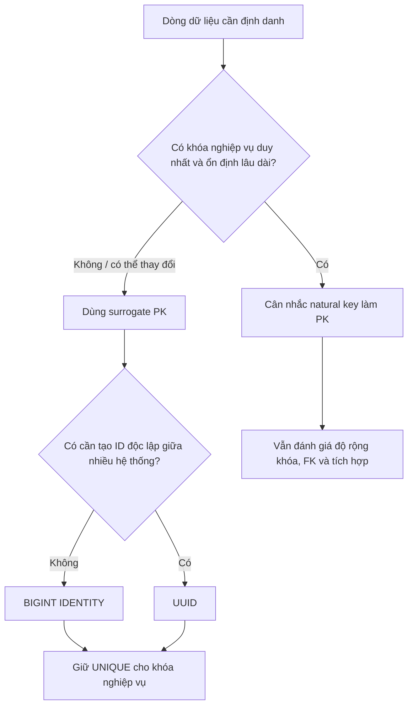

# Lựa chọn khóa tự nhiên, khóa thay thế và UUID trong PostgreSQL

Khi thiết kế một bảng PostgreSQL, quyết định chọn cột nào làm khóa chính ảnh hưởng đến nhiều phần của hệ thống: khả năng bảo toàn tính duy nhất, kích thước index, cách các bảng liên kết với nhau, xử lý thay đổi dữ liệu nghiệp vụ và khả năng tích hợp giữa nhiều dịch vụ. Một giá trị có vẻ “duy nhất hôm nay” chưa chắc phù hợp làm định danh ổn định trong nhiều năm.

Ba cách tiếp cận phổ biến là **khóa tự nhiên (natural key)**, **khóa thay thế (surrogate key)** và **UUID**. UUID thực chất cũng thường được dùng làm *khóa thay thế*; điểm khác biệt của UUID nằm ở kiểu dữ liệu và phương pháp sinh giá trị, không phải ở chỗ nó tự động mang ý nghĩa nghiệp vụ.

Bài học này hướng dẫn lựa chọn khóa trong bối cảnh thiết kế lược đồ quan hệ PostgreSQL, có ví dụ SQL và những tình huống thực tế khi ứng dụng Java/Spring Boot làm việc với dữ liệu.

## 1. Khóa dùng để giải quyết vấn đề gì?

Một dòng dữ liệu cần được nhận diện đủ rõ để câu lệnh `UPDATE`, `DELETE` hoặc một bảng khác có thể tham chiếu đúng dòng đó. PostgreSQL hỗ trợ các ràng buộc cơ bản:

- **`PRIMARY KEY`**: xác định khóa chính của bảng. Giá trị khóa không được `NULL` và phải duy nhất; PostgreSQL tạo unique B-tree index tương ứng. Mỗi bảng có tối đa một ràng buộc khóa chính, nhưng khóa đó có thể gồm nhiều cột.
- **`UNIQUE`**: đảm bảo tính duy nhất cho một cột hoặc nhóm cột, phù hợp với những định danh nghiệp vụ không được phép trùng. Một bảng có thể có nhiều ràng buộc `UNIQUE`.
- **`FOREIGN KEY`**: yêu cầu giá trị tham chiếu phải khớp với khóa chính, ràng buộc unique hợp lệ hoặc tập cột được hỗ trợ ở bảng đích, giúp giữ tính toàn vẹn tham chiếu.
- **Candidate key**: một tập thuộc tính có thể nhận diện duy nhất một dòng và tối giản theo quy tắc nghiệp vụ. Khóa chính được chọn từ các candidate key; những lựa chọn khác thường gọi là alternate key.

Ví dụ, bảng quốc gia có thể nhận diện theo mã chuẩn hai ký tự, còn bảng người dùng có email nhưng email thay đổi được và có nhiều quy tắc chuẩn hóa; hai tình huống này không nhất thiết chọn cùng loại khóa.



Sơ đồ là điểm bắt đầu cho quyết định, không phải một công thức tuyệt đối. Vẫn cần xét phạm vi duy nhất, kiểu truy cập, độ lớn dữ liệu và chính sách bảo mật.

## 2. Khóa tự nhiên (natural key)

**Khóa tự nhiên** là thuộc tính (hoặc tập thuộc tính) vốn đã có ý nghĩa trong miền nghiệp vụ và đủ để phân biệt các bản ghi. Ví dụ:

- Mã quốc gia theo bộ mã được tổ chức chấp nhận, trong phạm vi một tập dữ liệu cụ thể.
- Mã sinh viên do tổ chức cấp, nếu quy trình bảo đảm không tái sử dụng mã và giữ ổn định.
- Cặp `(order_id, line_number)` để xác định dòng thứ mấy của một đơn hàng.
- Cặp `(tenant_id, external_code)` nếu `external_code` chỉ duy nhất trong mỗi tenant.

Một thuộc tính chỉ trở thành lựa chọn tốt nếu các quy tắc này **thực sự được hệ thống nghiệp vụ cam kết**. Ví dụ “email thường không đổi” không tương đương “email sẽ không bao giờ đổi”.

### 2.1. Ví dụ natural key một cột

Giả sử một hệ thống nội bộ dùng mã quốc gia hai chữ cái được kiểm tra trước khi ghi:

```sql
CREATE SCHEMA IF NOT EXISTS key_lab;

CREATE TABLE key_lab.countries (
    country_code text PRIMARY KEY
        CHECK (country_code ~ '^[A-Z]{2}$'),
    country_name text NOT NULL
);

INSERT INTO key_lab.countries (country_code, country_name)
VALUES
    ('VN', 'Vietnam'),
    ('JP', 'Japan'),
    ('SG', 'Singapore');
```

Ở đây `country_code` đã là định danh có ý nghĩa; thêm `id bigint` không phải lúc nào cũng đem lại lợi ích. Tuy nhiên, ràng buộc biểu thức chính quy chỉ kiểm tra *định dạng*, không chứng minh mã thuộc danh mục quốc gia hợp lệ. Điều kiện tồn tại mã thực phải được kiểm soát qua nguồn tham chiếu đáng tin cậy.

Một bảng khác tham chiếu mã đó:

```sql
CREATE TABLE key_lab.shipping_zones (
    zone_id bigint GENERATED ALWAYS AS IDENTITY PRIMARY KEY,
    country_code text NOT NULL
        REFERENCES key_lab.countries(country_code),
    zone_name text NOT NULL,
    UNIQUE (country_code, zone_name)
);
```

Cấu trúc này phù hợp khi mã quốc gia đủ ổn định và có ý nghĩa cho các bảng phụ thuộc. Nếu danh mục mã có thể đổi hoặc được quản lý bởi một hệ thống không đáng tin cậy, cân nhắc thêm khóa thay thế.

### 2.2. Natural key nhiều cột (composite key)

Một dòng chi tiết đơn hàng có thể được nhận diện bằng **đơn hàng + số thứ tự dòng**:

```sql
CREATE TABLE key_lab.orders (
    order_id bigint GENERATED ALWAYS AS IDENTITY PRIMARY KEY,
    ordered_at timestamptz NOT NULL DEFAULT now()
);

CREATE TABLE key_lab.order_lines (
    order_id bigint NOT NULL
        REFERENCES key_lab.orders(order_id),
    line_no integer NOT NULL CHECK (line_no > 0),
    product_code text NOT NULL,
    quantity integer NOT NULL CHECK (quantity > 0),
    PRIMARY KEY (order_id, line_no)
);
```

Khóa chính của `order_lines` là `(order_id, line_no)`. Số dòng `1` có thể tồn tại trong nhiều đơn hàng, nhưng một đơn hàng không thể có hai dòng cùng `line_no`.

Với bảng trung gian nhiều–nhiều, composite key thường tự nhiên hơn việc thêm `id`:

```sql
CREATE TABLE key_lab.students (
    student_id bigint GENERATED ALWAYS AS IDENTITY PRIMARY KEY,
    full_name text NOT NULL
);

CREATE TABLE key_lab.courses (
    course_id bigint GENERATED ALWAYS AS IDENTITY PRIMARY KEY,
    course_title text NOT NULL
);

CREATE TABLE key_lab.enrollments (
    student_id bigint NOT NULL REFERENCES key_lab.students(student_id),
    course_id bigint NOT NULL REFERENCES key_lab.courses(course_id),
    enrolled_at timestamptz NOT NULL DEFAULT now(),
    PRIMARY KEY (student_id, course_id)
);
```

Cặp khóa `(student_id, course_id)` diễn tả trực tiếp quy tắc “mỗi sinh viên đăng ký mỗi khóa học tối đa một lần”. Nếu nghiệp vụ cho phép đăng ký lại nhiều đợt, mô hình cần thêm kỳ học/đợt đăng ký hoặc một khóa thay thế cho từng sự kiện đăng ký; không được áp quy tắc duy nhất sai với yêu cầu nghiệp vụ.

### 2.3. Điểm mạnh của natural key

Natural key có thể:

1. Thể hiện trực tiếp quy tắc nhận diện của miền nghiệp vụ.
2. Tránh thêm một cột định danh không cần thiết, đặc biệt với bảng danh mục nhỏ và khóa ngắn.
3. Giúp một số trường hợp tra cứu/join dùng luôn giá trị có ý nghĩa mà bên ngoài đã biết.
4. Giảm nguy cơ sinh hai bản ghi trùng về ý nghĩa nếu khóa tự nhiên được ràng buộc đúng trong cơ sở dữ liệu.

### 2.4. Rủi ro khi natural key thay đổi

Xét một bảng tài khoản dùng email làm khóa chính:

```sql
CREATE TABLE key_lab.accounts_by_email (
    email text PRIMARY KEY,
    display_name text NOT NULL
);
```

Cách này có vẻ đơn giản, nhưng phát sinh câu hỏi:

- Người dùng có quyền đổi email không?
- Có cho phép nhiều tài khoản dùng chung email trong các thời điểm khác nhau không?
- Quy tắc so sánh chữ hoa/thường, khoảng trắng và Unicode là gì?
- Có xử lý email chưa xác minh, email bị thu hồi, hoặc chuyển chủ tài khoản không?
- Bao nhiêu bảng con đang lưu email làm foreign key?

Nếu email đổi, các bảng con chứa email trong FK phải cập nhật theo chính sách `ON UPDATE`. Việc này có thể khiến nhiều row và index bị ghi lại, tốn lock và ảnh hưởng hệ thống. Ngoài ra, email là thông tin liên hệ cá nhân, thường không phù hợp để rải qua mọi khóa ngoại, log và URL.

Dùng một `UNIQUE` cho email (hoặc biểu thức email đã chuẩn hóa) trong khi giữ PK ổn định là thiết kế phù hợp hơn trong nhiều hệ thống người dùng.

## 3. Khóa thay thế (surrogate key) trong PostgreSQL

**Khóa thay thế** là định danh được tạo cho mục đích kỹ thuật, thường không biểu đạt ý nghĩa nghiệp vụ của bản ghi. Ví dụ `customer_id = 1042` không nói lên tên, email hay khu vực của khách hàng.

Trong PostgreSQL, lựa chọn phổ biến là số nguyên `bigint` được sinh từ **identity column**:

```sql
CREATE TABLE key_lab.customers (
    customer_id bigint GENERATED ALWAYS AS IDENTITY PRIMARY KEY,
    email text NOT NULL,
    full_name text NOT NULL,
    created_at timestamptz NOT NULL DEFAULT now(),
    CONSTRAINT uq_customers_email UNIQUE (email)
);
```

Bảng có hai loại ràng buộc phục vụ hai mục đích:

- `customer_id`: **định danh ổn định** cho row và khóa ngoại.
- `email`: **quy tắc nghiệp vụ** không cho phép hai customer có cùng email theo cách so sánh đang áp dụng.

Thêm surrogate key **không tự động ngăn dữ liệu nghiệp vụ bị trùng**. Nếu bỏ ràng buộc `UNIQUE (email)` mà nghiệp vụ yêu cầu email duy nhất, hai dòng với hai `customer_id` khác nhau vẫn có thể có cùng email.

### 3.1. GENERATED ALWAYS và BY DEFAULT AS IDENTITY

Hai biến thể:

```sql
CREATE TABLE key_lab.identity_always_demo (
    id bigint GENERATED ALWAYS AS IDENTITY PRIMARY KEY,
    note text
);

CREATE TABLE key_lab.identity_default_demo (
    id bigint GENERATED BY DEFAULT AS IDENTITY PRIMARY KEY,
    note text
);
```

| Cú pháp | Hành vi khi INSERT |
| --- | --- |
| `GENERATED ALWAYS AS IDENTITY` | PostgreSQL thường tự sinh ID; muốn chèn giá trị ID tường minh cần cú pháp cho phép ghi đè như `OVERRIDING SYSTEM VALUE` |
| `GENERATED BY DEFAULT AS IDENTITY` | Tự sinh khi không truyền ID nhưng chấp nhận giá trị ID do caller cung cấp |
| `bigint` thông thường | Không tự sinh giá trị nếu không có `DEFAULT` hoặc logic khác |

Ví dụ:

```sql
INSERT INTO key_lab.identity_always_demo (note)
VALUES ('created normally')
RETURNING id;

INSERT INTO key_lab.identity_always_demo (id, note)
OVERRIDING SYSTEM VALUE
VALUES (500, 'explicit import')
RETURNING id;
```

Với `BY DEFAULT`, caller có thể truyền `id` trực tiếp. Khả năng đó hữu ích cho import/migration, nhưng cũng khiến ứng dụng dễ vô tình gán ID và va chạm với ID tự sinh. Với `ALWAYS`, việc ghi đè phải được nêu rõ.

**Identity không thay thế PRIMARY KEY/UNIQUE.** PostgreSQL có thể tạo identity column không kèm khóa chính; muốn đảm bảo duy nhất và `NOT NULL` theo cách một PK được dùng, vẫn phải định nghĩa constraint phù hợp.

### 3.2. BIGINT, INTEGER và BIGSERIAL

- `integer` dùng 4 byte, khoảng giá trị từ −2^31 đến 2^31−1.
- `bigint` dùng 8 byte, khoảng giá trị từ −2^63 đến 2^63−1.
- `smallint` dùng 2 byte nhưng thường quá nhỏ để làm ID tăng liên tục của bảng lớn.
- `serial` / `bigserial` là cú pháp tiện ích lịch sử: khai báo integer/bigint với sequence và default `nextval`, **không phải kiểu dữ liệu độc lập**.
- `GENERATED ... AS IDENTITY` là cú pháp SQL hiện đại, gắn metadata identity với cột và sequence liên quan.

Nếu dữ liệu có khả năng phát triển lớn, `bigint` là lựa chọn phổ biến để tránh phải đổi PK và mọi FK từ `integer` sang `bigint` khi gần hết dải số.

### 3.3. Sequence không đảm bảo thứ tự commit liên tục

Giá trị identity thường lấy từ sequence. Sequence tối ưu cho cấp số đồng thời, nhưng:

- Một transaction gọi `nextval` rồi rollback vẫn có thể làm sequence tiến lên.
- Hai transaction có thể nhận ID theo thứ tự 100, 101 nhưng commit theo thứ tự ngược lại.
- Cache sequence và thao tác quản trị có thể tạo khoảng trống hoặc thứ tự nhìn thấy không liên tục.

Ví dụ:

```sql
BEGIN;
INSERT INTO key_lab.customers (email, full_name)
VALUES ('example1@example.test', 'A')
RETURNING customer_id;
ROLLBACK;

INSERT INTO key_lab.customers (email, full_name)
VALUES ('example2@example.test', 'B')
RETURNING customer_id;
```

Không nên kỳ vọng ID thứ hai chính xác bằng ID đầu tiên hay số lượng row cộng một. Nếu nghiệp vụ cần số chứng từ có quy định không bỏ số, đó là bài toán cấp số nghiệp vụ với giao dịch và đối soát riêng, không nên dùng trực tiếp PK identity để bảo đảm quy tắc ấy.

### 3.4. Khóa thay thế trong các bảng liên kết

```sql
CREATE TABLE key_lab.customer_addresses (
    address_id bigint GENERATED ALWAYS AS IDENTITY PRIMARY KEY,
    customer_id bigint NOT NULL
        REFERENCES key_lab.customers(customer_id),
    address_text text NOT NULL,
    is_default boolean NOT NULL DEFAULT false
);

CREATE INDEX idx_customer_addresses_customer_id
    ON key_lab.customer_addresses(customer_id);
```

FK `customer_id` của bảng con không cần chứa email. Khi khách đổi email, các địa chỉ vẫn tham chiếu đúng customer. PostgreSQL tự tạo index cho khóa chính/unique của bảng cha nhưng **không tự tạo index cho cột FK ở bảng con**; index trên `customer_addresses(customer_id)` có thể giúp join hoặc xử lý kiểm tra tham chiếu khi xóa/cập nhật parent. Có nên tạo index FK hay không vẫn tùy khối lượng dữ liệu và truy vấn.

## 4. UUID: định danh ít phụ thuộc vào một bộ cấp số trung tâm

**UUID (Universally Unique Identifier)** là giá trị 128 bit dùng làm định danh. PostgreSQL có kiểu dữ liệu gốc `uuid`, lưu 16 byte cho giá trị, trong khi biểu diễn văn bản thông thường có 36 ký tự gồm dấu gạch ngang.

Ví dụ:

```sql
CREATE TABLE key_lab.events (
    event_id uuid PRIMARY KEY DEFAULT gen_random_uuid(),
    event_type text NOT NULL,
    occurred_at timestamptz NOT NULL DEFAULT now(),
    payload jsonb NOT NULL
);

INSERT INTO key_lab.events (event_type, payload)
VALUES ('customer_created', '{"source":"web"}'::jsonb)
RETURNING event_id;
```

`gen_random_uuid()` sinh UUID phiên bản 4 (ngẫu nhiên) trên các phiên bản PostgreSQL hiện đại có hàm tích hợp sẵn. Với PostgreSQL cũ, hàm tương ứng có thể cần extension `pgcrypto`; hãy kiểm tra phiên bản và extension trong môi trường thật trước khi chọn phương án sinh UUID.

UUID phù hợp khi:

- Nhiều service, thiết bị hoặc node cần tạo ID **độc lập**, trước khi ghi vào cùng database.
- Dữ liệu sẽ được hợp nhất từ nhiều hệ thống và việc tránh đụng ID giữa các nguồn là quan trọng.
- Muốn dùng một loại ID trên API, message/event hoặc dữ liệu đồng bộ giữa các service.
- Không cần những thuộc tính của số nguyên tăng tuần tự.

UUID không bảo đảm tuyệt đối “không bao giờ trùng”; tính duy nhất phụ thuộc thuật toán và nguồn sinh. Với UUID ngẫu nhiên chất lượng cao, xác suất trùng cực nhỏ trong quy mô thông thường, nhưng database vẫn phải thực thi `PRIMARY KEY`/`UNIQUE` để loại bỏ va chạm nếu nó xảy ra.

### 4.1. Sinh UUID ở database hoặc ứng dụng

Có hai lựa chọn thực tế:

**Database sinh ID**

```sql
CREATE TABLE key_lab.api_tokens_demo (
    token_row_id uuid PRIMARY KEY DEFAULT gen_random_uuid(),
    label text NOT NULL
);

INSERT INTO key_lab.api_tokens_demo (label)
VALUES ('integration test')
RETURNING token_row_id;
```

Ứng dụng nhận ID sau `INSERT ... RETURNING` hoặc qua JDBC/ORM mapping.

**Ứng dụng sinh ID**

```java
import java.util.UUID;

UUID id = UUID.randomUUID();
```

Java `UUID.randomUUID()` trả UUID ngẫu nhiên phiên bản 4. Ứng dụng có thể gắn ID vào sự kiện, correlation object hoặc entity trước khi ghi database. Database vẫn cần constraint:

```sql
CREATE TABLE key_lab.external_messages (
    message_id uuid PRIMARY KEY,
    message_body jsonb NOT NULL
);
```

Client gửi `message_id` khi insert. Trong hệ thống phân tán, chỉ cần các node dùng cùng chiến lược sinh ID hợp lệ và kiểm soát trùng lặp bằng khóa chính; không cần một sequence dùng chung cho mọi node.

Lưu ý `UUID.randomUUID()` tạo identifier, không phải cơ chế phân quyền và cũng không nên tự động xem giá trị UUID là bí mật để làm token bảo mật. Nếu cần access token, hãy thiết kế theo yêu cầu entropy, thời hạn và xác thực của hệ thống.

### 4.2. UUID v4 và UUID có thứ tự theo thời gian

UUID tồn tại ở nhiều version. Hai nhóm thường được cân nhắc trong thiết kế khóa:

| Nhóm | Đặc điểm | Tác động thiết kế |
| --- | --- | --- |
| UUID v4 | Phần lớn bit được chọn ngẫu nhiên | Phân bố key rải rác trong không gian index; tiện sinh độc lập |
| UUID có thành phần thời gian, ví dụ v7 | Được thiết kế để có tính thứ tự thời gian tương đối khi sinh đúng cách | Có thể tăng tính cục bộ khi insert vào B-tree so với v4; độ sắp xếp thực tế tùy bộ sinh, độ phân giải thời gian và concurrency |

PostgreSQL/extension/client hỗ trợ hàm sinh UUID v7 phụ thuộc phiên bản và môi trường. Không nên ghi cứng tên hàm v7 vào migration khi chưa xác minh server cung cấp hàm đó. PostgreSQL có thể **lưu** UUID không phụ thuộc vào việc chính server sinh được mọi version.

Một UUID chứa thành phần thời gian có thể bộc lộ thời điểm tạo tương đối. Nếu khả năng suy đoán metadata thời gian là vấn đề, đánh giá trước khi chọn định dạng.

### 4.3. UUID v4 làm khóa chính có thể ảnh hưởng index

Với B-tree, `bigint` tăng dần thường thêm giá trị về vùng cuối thứ tự khóa, còn UUID v4 ngẫu nhiên làm insert phân bố rộng hơn. Tùy kích thước index, cache, tải đồng thời và cấu hình lưu trữ, UUID v4 có thể gây nhiều thao tác trang, page split hoặc giảm locality hơn so với ID tăng dần.

Nhưng lựa chọn “UUID luôn chậm hơn bigint” là kết luận quá đơn giản. Hiệu năng thực tế phụ thuộc vào tỷ lệ đọc/ghi, kích thước bảng, index đi kèm, truy vấn, lượng RAM, khả năng đồng thời và phương pháp sinh UUID. Cần đo trên khối lượng tương tự hệ thống thật bằng `EXPLAIN (ANALYZE, BUFFERS)` và các phép đo tải phù hợp.

### 4.4. Lưu UUID đúng kiểu trong PostgreSQL

Ưu tiên:

```sql
customer_id uuid PRIMARY KEY
```

thay vì:

```sql
customer_id varchar(36) PRIMARY KEY
```

Lưu dưới kiểu `uuid` giúp PostgreSQL kiểm tra cú pháp, lưu trữ nhị phân 16 byte và so sánh theo ngữ nghĩa UUID. Lưu dạng text có thể tạo nhiều cách biểu diễn của cùng một giá trị và tăng chi phí lưu trữ/index.

Trong truy vấn Java/JDBC, dùng `java.util.UUID` khi driver/ORM hỗ trợ mapping tới `uuid` thay vì tự đổi qua chuỗi một cách không cần thiết.

## 5. Bảng so sánh ba lựa chọn phổ biến

| Tiêu chí | Natural key | `bigint` IDENTITY | `uuid` |
| --- | --- | --- | --- |
| Giá trị mang ý nghĩa nghiệp vụ | Có | Không | Không |
| Dễ giữ nguyên khi thuộc tính nghiệp vụ đổi | Tùy độ ổn định của khóa | Cao | Cao |
| Kích thước khóa | Phụ thuộc số cột và kiểu dữ liệu | 8 byte giá trị `bigint` | 16 byte giá trị `uuid` |
| Tạo ID ở ứng dụng trước khi insert | Nếu ứng dụng đã biết khóa | Cần cơ chế cấp ID trước hoặc lấy ID từ database | Thường thuận tiện |
| Phù hợp nhiều writer độc lập | Phụ thuộc phạm vi duy nhất của nghiệp vụ | Thường cần thiết kế cấp dải/định danh riêng | Thuận tiện khi sinh UUID đúng cách |
| Tính cục bộ trong B-tree | Tùy kiểu giá trị và thứ tự insert | Thường tốt với sequence tăng | V4 rải ngẫu nhiên, v7 có thể cải thiện |
| Độ dễ hiểu khi xem dữ liệu | Cao nếu khóa ngắn/rõ nghĩa | Cao về thao tác kỹ thuật | Dài, khó đọc thủ công |
| Khả năng rò rỉ thông tin | Có thể lộ dữ liệu nghiệp vụ | Có thể tiết lộ chuỗi ID hoặc quy mô tương đối | V4 không tăng tuần tự; loại có timestamp có thể lộ thời gian |
| Hạn chế chính | Thay đổi nghiệp vụ gây tác động FK | Phụ thuộc cơ chế cấp số nếu muốn tạo trước DB | Index và FK lớn hơn `bigint`; quản lý UUID version |

Kích thước “8 byte/16 byte” là kích thước dữ liệu nguyên thủy, không phải dung lượng trọn vẹn của một hàng hay index entry. PostgreSQL còn có overhead tuple/index, alignment và các cột khác.

### Không đánh đổi correctness để tiết kiệm vài byte

Một khóa natural dài hoặc dễ thay đổi có thể làm nhiều FK/index phình to và khiến thay đổi nghiệp vụ trở thành migration phức tạp. Ngược lại, một surrogate key không được kèm ràng buộc unique nghiệp vụ có thể cho phép dữ liệu trùng lặp mà application không phát hiện. **Ràng buộc đúng theo nghiệp vụ** thường quan trọng hơn lựa chọn thuật toán sinh ID.

## 6. Khóa chính và ràng buộc UNIQUE phải được thiết kế cùng nhau

Dùng surrogate key không có nghĩa mọi cột còn lại đều được phép trùng.

```sql
CREATE TABLE key_lab.products (
    product_id bigint GENERATED ALWAYS AS IDENTITY PRIMARY KEY,
    sku text NOT NULL,
    title text NOT NULL,
    CONSTRAINT uq_products_sku UNIQUE (sku)
);
```

Ví dụ lưu hai loại ID khác nhau:

- `product_id` được dùng trong `order_lines`, bảng giá, báo cáo và foreign key.
- `sku` được người dùng/đối tác nhập khi tìm sản phẩm hoặc nhận file import.

Nếu SKU đổi do chính sách đặt mã mới, không cần cập nhật mọi FK đã trỏ bằng `product_id`. Nhưng constraint `UNIQUE (sku)` vẫn giúp chặn hai dòng dùng cùng một SKU.

### 6.1. Upsert theo khóa nghiệp vụ

Khi đồng bộ dữ liệu từ hệ thống bên ngoài, khóa phát hiện trùng nên là định danh nghiệp vụ thích hợp:

```sql
INSERT INTO key_lab.products (sku, title)
VALUES ('BK-100', 'PostgreSQL in Practice')
ON CONFLICT (sku)
DO UPDATE SET title = EXCLUDED.title
RETURNING product_id, sku, title;
```

Lệnh tìm xung đột theo `sku` vì đây là quy tắc cùng một sản phẩm trong bảng ví dụ, còn `product_id` không đổi nếu row đã tồn tại. Nếu một SKU thực sự được phép tái sử dụng sau thời gian, cần mô hình danh tính sản phẩm chính xác hơn; unique toàn cục theo SKU lúc đó không phù hợp.

### 6.2. UNIQUE và NULL trong PostgreSQL

Mặc định, ràng buộc `UNIQUE` trong PostgreSQL cho phép **nhiều giá trị NULL** vì `NULL` không được coi là bằng nhau trong kiểm tra uniqueness thông thường:

```sql
CREATE TABLE key_lab.contact_notes (
    note_id bigint GENERATED ALWAYS AS IDENTITY PRIMARY KEY,
    external_reference text UNIQUE,
    note_text text NOT NULL
);
```

Nhiều dòng `external_reference IS NULL` có thể cùng tồn tại.

Nếu yêu cầu “chỉ được có tối đa một NULL”, các phiên bản PostgreSQL hỗ trợ cú pháp `UNIQUE NULLS NOT DISTINCT` (PostgreSQL 15 trở lên):

```sql
CREATE TABLE key_lab.unique_null_demo (
    id bigint GENERATED ALWAYS AS IDENTITY PRIMARY KEY,
    external_code text UNIQUE NULLS NOT DISTINCT
);
```

Nếu nghiệp vụ yêu cầu mọi bản ghi phải có external code, giải pháp rõ ràng hơn thường là `NOT NULL` cùng `UNIQUE`, không dựa vào ý nghĩa ngầm của NULL.

### 6.3. Email và chuẩn hóa chữ hoa/thường

Ví dụ:

```sql
CREATE TABLE key_lab.app_users (
    user_id bigint GENERATED ALWAYS AS IDENTITY PRIMARY KEY,
    email text NOT NULL,
    display_name text NOT NULL
);

CREATE UNIQUE INDEX uq_app_users_email_lower
    ON key_lab.app_users (lower(email));
```

Index này chặn hai email chỉ khác chữ hoa/thường theo phép `lower` và collation áp dụng trong hệ thống. Tuy nhiên, email có các quy tắc kỹ thuật/kinh doanh riêng; không nên tự động áp cách chuẩn hóa này cho mọi hệ thống mà không xác định chính sách danh tính.

Một **unique expression index** như `lower(email)` không phải một cột khóa đơn giản có thể trực tiếp làm đích FK ở bảng khác. Khi cần FK tới người dùng, nên tham chiếu `user_id`; còn email giữ vai trò alternate business key để tìm kiếm và chặn trùng.

## 7. Tác động đến FOREIGN KEY, JOIN và index

Khóa chính được lặp lại trong các bảng con thường xuyên hơn bạn nghĩ. Ví dụ hệ thống có hàng triệu orders, mỗi order lưu `customer_id`.

```sql
CREATE TABLE key_lab.sales_orders (
    sales_order_id bigint GENERATED ALWAYS AS IDENTITY PRIMARY KEY,
    customer_id bigint NOT NULL
        REFERENCES key_lab.customers(customer_id),
    order_total numeric(14, 2) NOT NULL CHECK (order_total >= 0)
);

CREATE INDEX idx_sales_orders_customer_id
    ON key_lab.sales_orders(customer_id);
```

Một `bigint` FK dùng 8 byte dữ liệu khóa trong mỗi row và index tương ứng. Nếu dùng `uuid`, giá trị khóa dùng 16 byte. Nếu natural key là chuỗi dài hoặc composite key gồm nhiều cột, chi phí lưu trữ và join có thể lớn hơn; độ lớn thực cần đo theo schema, kiểu dữ liệu và index.

PostgreSQL đảm bảo tham chiếu hợp lệ bằng foreign key. Cần nhớ:

- PK hoặc `UNIQUE` phù hợp ở bảng cha thường có index tự động.
- Bảng con **không tự có index chỉ vì khai báo FK**.
- Thêm index FK khi có lợi cho join, lọc hoặc thao tác cập nhật/xóa ở parent; không bắt buộc tạo mọi index nếu bảng rất nhỏ hoặc không truy vấn theo FK.
- Một index trên khóa composite có thứ tự cột; các truy vấn chỉ lọc theo cột đứng sau có thể không tận dụng tốt như lọc theo tiền tố cột đứng trước.
- Thay đổi giá trị khóa được các FK tham chiếu có thể yêu cầu `ON UPDATE CASCADE` hoặc bị PostgreSQL từ chối theo chính sách ràng buộc.

### ON UPDATE CASCADE với natural key

Nếu business key thật sự phải thay đổi và đã được chọn làm khóa chính, có thể định nghĩa hành vi lan truyền:

```sql
CREATE TABLE key_lab.departments (
    department_code text PRIMARY KEY,
    department_name text NOT NULL
);

CREATE TABLE key_lab.employees (
    employee_id bigint GENERATED ALWAYS AS IDENTITY PRIMARY KEY,
    department_code text NOT NULL
        REFERENCES key_lab.departments(department_code)
        ON UPDATE CASCADE
);
```

Khi `department_code` ở bảng cha thay đổi, PostgreSQL có thể cập nhật cột FK trong các dòng `employees` phụ thuộc. Đây là một hành vi có thể hữu ích, nhưng cập nhật nhiều bản ghi và index có thể gây tải/lock đáng kể. Nếu mã phòng ban thường xuyên đổi, surrogate `department_id` thường cho thiết kế ổn định hơn.

## 8. Thiết kế multi-tenant: tính duy nhất nằm ở đâu?

Nhiều ứng dụng dùng cùng database cho nhiều khách hàng/đơn vị (**tenant**). Một mã như `EMP001` có thể chỉ duy nhất *bên trong* từng tenant.

Sai lầm thường gặp là đặt:

```sql
-- Ví dụ không phù hợp nếu employee_code được phép trùng giữa các tenant.
UNIQUE (employee_code)
```

Thay bằng ràng buộc đúng phạm vi:

```sql
CREATE TABLE key_lab.tenants (
    tenant_id bigint GENERATED ALWAYS AS IDENTITY PRIMARY KEY,
    tenant_name text NOT NULL
);

CREATE TABLE key_lab.tenant_employees (
    tenant_id bigint NOT NULL REFERENCES key_lab.tenants(tenant_id),
    employee_id uuid NOT NULL DEFAULT gen_random_uuid(),
    employee_code text NOT NULL,
    full_name text NOT NULL,
    PRIMARY KEY (tenant_id, employee_id),
    UNIQUE (tenant_id, employee_code)
);
```

Bảng này cố tình có composite PK `(tenant_id, employee_id)` dù `employee_id` đã là UUID. Cách đó thể hiện rằng danh tính được tham chiếu ở phạm vi tenant và cho phép FK kiểm tra tenant cùng lúc.

```sql
CREATE TABLE key_lab.employee_assignments (
    assignment_id bigint GENERATED ALWAYS AS IDENTITY PRIMARY KEY,
    tenant_id bigint NOT NULL,
    employee_id uuid NOT NULL,
    assigned_at timestamptz NOT NULL DEFAULT now(),
    FOREIGN KEY (tenant_id, employee_id)
        REFERENCES key_lab.tenant_employees(tenant_id, employee_id)
);
```

FK hai cột chặn việc một assignment vô tình tham chiếu employee thuộc tenant khác bằng một tổ hợp không tồn tại. Dù vậy, **PK/FK không thay thế toàn bộ kiểm soát truy cập tenant**. Chính sách authorization, query filtering và có thể Row Level Security vẫn phải được thiết kế riêng.

### Partitioning ảnh hưởng lựa chọn khóa

Đối với **partitioned table**, PostgreSQL có giới hạn khi khai báo `UNIQUE`/`PRIMARY KEY` trên bảng cha: các cột khóa phân vùng cần được đưa vào ràng buộc duy nhất/khóa chính theo quy tắc của phiên bản, để PostgreSQL có thể đảm bảo uniqueness trên các partition. Vì vậy, nếu bảng sự kiện phân vùng theo thời gian, thiết kế `PRIMARY KEY (event_id)` đơn lẻ có thể không hợp lệ hoặc không bảo đảm yêu cầu như bạn tưởng; có thể phải dùng khóa kết hợp với cột phân vùng hoặc chiến lược định danh khác.

Đừng chọn UUID chỉ vì dữ liệu sẽ được partition: **UUID sinh phân tán không tự tạo unique index toàn cục xuyên partition** nếu hệ quản trị không có cơ chế đó. Phải thiết kế uniqueness theo ranh giới partition và yêu cầu truy vấn cụ thể.

## 9. Trong ứng dụng Java/Spring Boot nên chọn thế nào?

Một hệ thống Java/JPA thường ánh xạ PK vào trường `@Id`. Ví dụ định danh số nguyên do PostgreSQL sinh:

```java
import jakarta.persistence.Entity;
import jakarta.persistence.GeneratedValue;
import jakarta.persistence.GenerationType;
import jakarta.persistence.Id;
import jakarta.persistence.Table;

@Entity
@Table(name = "customers", schema = "key_lab")
public class Customer {
    @Id
    @GeneratedValue(strategy = GenerationType.IDENTITY)
    private Long customerId;

    private String email;
    private String fullName;

    protected Customer() {
    }
}
```

Đây là ví dụ mapping căn bản; ánh xạ tên cột theo chiến lược naming của Hibernate/JPA hoặc thêm `@Column(name = "...")` khi cần kiểm soát tên chính xác. Tính duy nhất của email vẫn phải được database đảm bảo bằng `UNIQUE` tương ứng.

Khi dùng khóa UUID, entity có thể mang `UUID` và ứng dụng tự sinh:

```java
import java.util.UUID;

UUID orderId = UUID.randomUUID();
```

Tùy phiên bản Hibernate/JPA, framework cũng có cách tạo UUID tự động. Nên chọn **một chủ thể sinh ID** rõ ràng (database, ứng dụng hoặc ORM), tránh cùng lúc có nhiều quy tắc ngầm gây khó kiểm thử.

### Những câu hỏi thiết kế thường gặp

**Có nên cho API trả surrogate ID?** Có thể, nếu API cần định danh ổn định và hệ thống kiểm tra quyền trên tài nguyên. Không được coi việc dùng UUID thay `1, 2, 3` là giải pháp chống truy cập trái phép. Mọi API vẫn phải kiểm tra quyền theo người dùng/tenant.

**Có cần tách internal ID và public ID?** Một số hệ thống dùng `bigint` nội bộ để tối ưu quan hệ/index và một `uuid` riêng có unique constraint để công bố trong URL hoặc sự kiện tích hợp:

```sql
CREATE TABLE key_lab.public_customers (
    customer_id bigint GENERATED ALWAYS AS IDENTITY PRIMARY KEY,
    public_id uuid NOT NULL DEFAULT gen_random_uuid() UNIQUE,
    full_name text NOT NULL
);
```

Phương án này tạo thêm cột/index và thao tác ánh xạ. Chỉ chọn khi có lý do cụ thể như tương thích API, hợp nhất dữ liệu hoặc cần tách định danh công khai khỏi định danh nội bộ.

**Có nên dùng UUID làm PK cho mọi bảng?** Không có quy tắc bắt buộc. Bảng liên kết đơn giản có thể dùng composite PK; bảng danh mục nhỏ có natural key ổn định; bảng giao dịch tập trung có thể dùng bigint; dữ liệu độc lập giữa nhiều node có thể hợp với UUID.

## 10. Di chuyển từ natural key sang surrogate key

Trong hệ thống đang hoạt động, thay PK không chỉ là thêm cột `id` và `DROP CONSTRAINT`. Có thể có nhiều foreign key, API, cache, message hoặc báo cáo phụ thuộc vào khóa cũ.

Ví dụ tình huống ban đầu:

```sql
-- Hình dạng bảng legacy để minh họa, không chạy đè bảng hiện có.
CREATE TABLE key_lab.legacy_accounts (
    email text PRIMARY KEY,
    display_name text NOT NULL
);
```

Muốn chuyển sang `account_id bigint`, có thể lập kế hoạch:

1. **Khảo sát dependency**: tìm các FK đang trỏ đến `legacy_accounts(email)`, index, truy vấn, API và dữ liệu đã xuất sang hệ thống khác.
2. **Thêm cột surrogate**: tạo identity/sequence phù hợp và backfill giá trị cho mọi row cũ theo phương án được kiểm thử, bảo đảm không còn `NULL` hoặc trùng.
3. **Giữ khóa nghiệp vụ**: trước khi bỏ PK cũ, đảm bảo có unique constraint/index hợp lệ cho `email` nếu nghiệp vụ vẫn yêu cầu duy nhất.
4. **Chuyển bảng con**: thêm `account_id` tại các bảng tham chiếu, backfill dựa trên mapping email → ID, tạo FK mới và index cần thiết. Với bảng lớn, tổ chức theo batch và kiểm soát lock.
5. **Chuyển ứng dụng từng giai đoạn**: code mới đọc/ghi theo `account_id`, giữ tương thích tạm thời cho các caller cũ; cập nhật integration và API.
6. **Chuyển PRIMARY KEY**: chỉ sau khi FK/app đã ổn định và đã có phương án rollback/migration dữ liệu phù hợp, thay PK chính thức. Xóa cột và ràng buộc cũ cuối cùng nếu thật sự không còn sử dụng.

Trong PostgreSQL, đổi PK có thể yêu cầu lock mạnh, xây lại index và thay đổi foreign key; chi tiết downtime phụ thuộc kích thước bảng và chiến lược triển khai. Trên production cần migration script có quản lý phiên bản và kế hoạch kiểm thử/khôi phục. **Không dùng `DROP ... CASCADE` để “giải quyết nhanh” dependency PK**, vì nó có thể xóa các constraint và đối tượng liên quan ngoài dự kiến.

### Khi đổi natural key, có nhất thiết đổi PK?

Không. Nếu natural key ổn định trong thực tế, đơn giản và đã được dùng rộng rãi, thay sang surrogate PK có thể tốn công lớn mà lợi ích không rõ. Hãy cân nhắc dựa trên rủi ro thay đổi nghiệp vụ, độ rộng FK, hiệu năng và chiến lược tích hợp, thay vì xu hướng chọn “mọi bảng đều dùng UUID”.

## 11. Chọn khóa theo tình huống

| Tình huống | Gợi ý lựa chọn | Lý do và điều kiện |
| --- | --- | --- |
| Bảng danh mục quốc gia với mã ổn định | Natural key `country_code` | Ngắn, dễ hiểu; quy tắc ổn định cần được xác nhận |
| Bảng customer trong ứng dụng đơn database | `bigint GENERATED ... AS IDENTITY` | Dễ sinh, FK gọn; giữ `UNIQUE` trên email/mã khách nếu cần |
| Đăng ký sinh viên–khóa học một lần duy nhất | Composite `(student_id, course_id)` | Thể hiện đúng uniqueness của quan hệ |
| Đơn hàng có nhiều dòng | `order_id` + `line_no` hoặc line ID riêng | Tùy dòng có danh tính riêng khi tách/gộp/sắp xếp lại hay không |
| Sự kiện tạo tại nhiều thiết bị offline | UUID | Các node tự tạo ID trước khi đồng bộ; cần xử lý collision và conflict nghiệp vụ |
| Dữ liệu xuất/nhập giữa nhiều hệ thống | UUID hoặc ID bên ngoài kèm unique phù hợp | Giảm phụ thuộc sequence cục bộ; phải có namespace rõ |
| Multi-tenant với mã lặp giữa tenant | Composite key hoặc surrogate PK + `UNIQUE (tenant_id, code)` | Tính duy nhất đúng phạm vi tenant |
| API công khai cần ID không tăng tuần tự | UUID công khai, có thể song song bigint nội bộ | Phù hợp giao diện tích hợp; authorization vẫn bắt buộc |
| Bảng partition theo ngày | PK/UNIQUE có cột phân vùng theo điều kiện PostgreSQL | Đảm bảo constraint hợp lệ và truy vấn hiệu quả |

Bảng này là hướng dẫn thiết kế, không thay thế đánh giá workload thực tế hoặc quy định nghiệp vụ.

## 12. Thực hành tổng hợp: thiết kế cùng một miền theo hai chiến lược

Bài tập dưới đây được thực hiện trong schema `key_lab` đã tạo ở phần 2.

### Bài 1: Natural key để lưu mã vùng

Thiết kế bảng vùng vận chuyển sao cho một mã vùng chỉ được dùng một lần trong mỗi quốc gia, nhưng có thể lặp giữa hai quốc gia:

```sql
CREATE TABLE key_lab.regional_zones (
    country_code text NOT NULL REFERENCES key_lab.countries(country_code),
    zone_code text NOT NULL,
    zone_name text NOT NULL,
    PRIMARY KEY (country_code, zone_code)
);
```

Thử chèn hai vùng có cùng `zone_code` nhưng `country_code` khác nhau. Sau đó thử chèn hai vùng trùng cả hai cột khóa và quan sát unique violation.

### Bài 2: Surrogate PK và business UNIQUE

Dùng bảng `key_lab.products` ở phần trước. Thử hai thao tác:

```sql
INSERT INTO key_lab.products (sku, title)
VALUES ('SKU-01', 'Keyboard')
RETURNING product_id;

-- Thực thi lần nữa trên môi trường thực hành:
INSERT INTO key_lab.products (sku, title)
VALUES ('SKU-01', 'Another keyboard');
```

Lần hai phải gặp lỗi uniqueness vì `sku` đã có, dù ID tự sinh dự kiến khác. Đổi lệnh thứ hai thành `ON CONFLICT (sku) DO UPDATE ...` và kiểm tra xem `product_id` của row cũ có giữ nguyên không.

### Bài 3: UUID tạo tại database

```sql
INSERT INTO key_lab.events (event_type, payload)
VALUES
    ('payment_requested', '{"order":"A01"}'::jsonb),
    ('payment_requested', '{"order":"A02"}'::jsonb)
RETURNING event_id, event_type;
```

Quan sát định dạng ID, kiểm tra kiểu cột bằng `\d+ key_lab.events` trong `psql` và giải thích tại sao không nên dùng `ORDER BY event_id` để suy ra chính xác thời gian tạo đối với UUID v4.

### Bài 4: Ảnh hưởng tới bảng con

Tạo một bảng con dùng FK `customer_id` thay vì email:

```sql
CREATE TABLE key_lab.customer_preferences (
    customer_id bigint PRIMARY KEY
        REFERENCES key_lab.customers(customer_id),
    language_code text NOT NULL DEFAULT 'vi'
);
```

Thêm một customer và một preference. Sau đó đổi email trong bảng `customers` và xác nhận dòng `customer_preferences` vẫn tham chiếu đúng.

### Bài 5: Quyết định và giải thích

Với một hệ thống bán hàng có 10 triệu khách hàng, có thể đổi email, chạy trên một PostgreSQL chính và phải đồng bộ event tới nhiều dịch vụ, đề xuất:

- PK cho `customers` là loại gì? Có cần thêm `public_id uuid` không?
- Trên email phải có constraint nào và phải chuẩn hóa theo quy tắc gì?
- Bảng `orders` nên tham chiếu `customer_id` hay email?
- Event ID nên sinh từ database hay producer service? Cách đảm bảo việc ghi event trùng không tạo bản ghi trùng là gì?
- Kết quả benchmark về index, lượng RAM, throughput ghi sẽ thay đổi quyết định ra sao?

Không có một đáp án duy nhất; một thiết kế tốt phải **giữ đúng uniqueness nghiệp vụ**, **ổn định khi dữ liệu thay đổi** và **phù hợp vận hành thực tế**.

## 13. Ghi nhớ khi thiết kế schema PostgreSQL

- Chỉ chọn **natural key** làm `PRIMARY KEY` khi miền nghiệp vụ có quy tắc duy nhất và độ ổn định đủ rõ. Khóa tự nhiên nhiều cột vẫn hợp lý ở bảng quan hệ hoặc danh mục.
- Chọn **surrogate key** khi cần định danh không phụ thuộc vào email, mã sản phẩm hoặc thuộc tính dễ đổi. `BIGINT IDENTITY` là phương án phổ biến, nhưng luôn đi kèm `UNIQUE` cho các business key cần duy nhất.
- Chọn **UUID** khi cần sinh định danh độc lập, đồng bộ giữa nhiều hệ thống hoặc có yêu cầu API phù hợp. Dùng kiểu `uuid` gốc của PostgreSQL; hiểu sự khác biệt giữa UUID v4 và các phiên bản có thứ tự thời gian.
- Thiết kế **FOREIGN KEY** và các index liên quan ngay từ đầu. PK càng rộng thì nhiều bảng con/index có thể chịu chi phí lưu trữ và join lớn hơn.
- Xác định **phạm vi uniqueness**: toàn database, theo tenant, theo phiên bản, theo thời gian hay theo cặp nhiều thuộc tính. Sai phạm vi uniqueness là sai mô hình dữ liệu.
- Khi đổi PK trong hệ thống đang chạy, triển khai theo migration kiểm soát, bảo toàn dữ liệu và caller, có rollback phù hợp. Không sửa/xóa hàng loạt ràng buộc chỉ để migration chạy qua.

Quyết định khóa chính là một phần của **mô hình danh tính**: nó phải diễn đạt đúng một thực thể là ai, khi nào được coi là cùng thực thể và những thay đổi nào không nên làm mất danh tính đó. PostgreSQL cung cấp đủ ràng buộc để bảo vệ các quyết định này ngay ở lớp dữ liệu.
