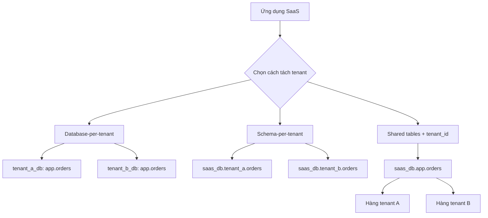

# Mô hình đa khách hàng theo database, schema hoặc cột định danh trong PostgreSQL

## 1. Bài toán: một ứng dụng phục vụ nhiều khách hàng

Trong một sản phẩm SaaS, **khách hàng thuê dịch vụ** thường được gọi là *tenant*. Một tenant có thể là một doanh nghiệp, cửa hàng, tổ chức hoặc nhóm sử dụng phần mềm. Hệ thống cần phục vụ nhiều tenant mà vẫn bảo đảm:

- Người dùng của tenant A không vô tình đọc hoặc thay đổi dữ liệu tenant B.
- Dữ liệu và ràng buộc nghiệp vụ hoạt động đúng ngay cả khi hai tenant dùng cùng mã đơn hàng hoặc email.
- Lượng tài nguyên, chi phí lưu trữ và công sức vận hành phù hợp số tenant và mức tải.
- Có thể backup, restore, nâng cấp lược đồ, điều tra lỗi và đáp ứng yêu cầu xóa/xuất dữ liệu.
- Ứng dụng duy trì tính nhất quán khi truy vấn, kết nối và xử lý các tác vụ bất đồng bộ.

Trong PostgreSQL có ba hướng tổ chức lược đồ phổ biến:

1. **Database-per-tenant:** mỗi tenant dùng một database riêng.
2. **Schema-per-tenant:** các tenant dùng chung database nhưng mỗi tenant có schema riêng.
3. **Shared schema, shared tables:** các tenant dùng chung bảng và phân biệt từng hàng bằng cột `tenant_id`.

Không có một mô hình đúng cho mọi hệ thống. Quyết định phụ thuộc yêu cầu cách ly dữ liệu, số lượng tenant, khả năng mở rộng, kiến trúc ứng dụng, tần suất migration và nguồn lực vận hành.

### 1.1. Sơ đồ tổng quan



Trong mô hình database-per-tenant, các database có thể vẫn nằm **trên cùng PostgreSQL instance/cluster**. Điều đó khác với việc mỗi tenant có một máy chủ/instance độc lập. Muốn cách ly CPU, bộ nhớ, WAL, quy trình restart và phạm vi sự cố ở tầng hạ tầng, cần cân nhắc **instance riêng** hoặc hạ tầng khác, không chỉ tạo nhiều database trong cùng cluster.

## 2. Trước tiên: phân biệt tenant, người dùng và đơn vị triển khai

Một tenant không nhất thiết là một user PostgreSQL.

| Khái niệm | Vai trò | Ví dụ |
|---|---|---|
| **Tenant** | Đơn vị dữ liệu/nghiệp vụ cần cách ly | Công ty A |
| **Application user** | Người dùng đăng nhập ứng dụng | Nhân viên của công ty A |
| **PostgreSQL role** | Danh tính và quyền ở tầng DB | `saas_runtime`, `tenant_a_reader` |
| **Database** | Không gian kết nối của PostgreSQL | `saas_db` hoặc `tenant_a_db` |
| **Schema** | Namespace trong một database | `app` hoặc `tenant_a` |
| **Row** | Một bản ghi cụ thể trong bảng | Đơn hàng `order_id = 1001`, `tenant_id = A` |

Một tenant có thể có hàng nghìn người dùng ứng dụng. Hệ thống thường kết nối database qua một số role dịch vụ rồi thực thi quy tắc phân quyền theo tenant. Tuy nhiên, khi yêu cầu cách ly mạnh hơn, có thể tạo role database riêng cho tenant, hoặc kết hợp role và Row-Level Security.

**Không tin tuyệt đối tenant ID lấy từ URL, header HTTP hoặc JSON body.** Ứng dụng phải xác định tenant từ danh tính đã xác thực và quan hệ thành viên hợp lệ, trước khi chọn database, schema hoặc giá trị `tenant_id`.

Ví dụ một request:

```text
GET /tenants/11111111-1111-4111-8111-111111111111/orders

JWT / session:
    user = user-42
    allowed_tenants = [tenant A]

Application:
    xác thực user-42
    xác nhận user-42 được truy cập tenant A
    tạo tenant context tin cậy
    chọn connection / schema / tenant_id phù hợp
```

Nếu chỉ lấy ID từ đường dẫn mà không xác minh quyền của người dùng, cả ba kiểu tổ chức dữ liệu đều có thể bị khai thác ở tầng ứng dụng.

## 3. Mô hình 1: mỗi tenant một database

### 3.1. Cấu trúc

```text
PostgreSQL instance
├── Database tenant_a_db
│   └── Schema app
│       ├── customers
│       └── orders
├── Database tenant_b_db
│   └── Schema app
│       ├── customers
│       └── orders
└── Database control_db
    └── tenant_registry
```

Ứng dụng định tuyến kết nối tới database tương ứng với tenant đã được xác thực. Ví dụ:

```text
Tenant A -> jdbc:postgresql://db.internal:5432/tenant_a_db
Tenant B -> jdbc:postgresql://db.internal:5432/tenant_b_db
```

Một connection PostgreSQL thông thường làm việc với **một database**. Nó không chuyển sang database khác chỉ bằng câu SQL `USE ...` như một số DBMS khác. Khi cần kết nối tới tenant khác, ứng dụng cần một connection tới database đó.

### 3.2. Khởi tạo database trong lab

Giả sử quản trị viên đang kết nối PostgreSQL instance lab và có quyền phù hợp:

```sql
CREATE DATABASE tenant_a_db;
CREATE DATABASE tenant_b_db;
```

Lệnh `CREATE DATABASE` không được chạy trong một transaction block. Ở môi trường thật, cần quản lý ownership, role, quota và quyền kết nối; không nên để ứng dụng runtime tự tạo database bằng superuser.

Kết nối bằng `psql`:

```text
\connect tenant_a_db
```

Tạo cấu trúc cho tenant A:

```sql
CREATE SCHEMA app;

CREATE TABLE app.orders (
    order_id bigint GENERATED ALWAYS AS IDENTITY PRIMARY KEY,
    total_amount numeric(12,2) NOT NULL CHECK (total_amount >= 0),
    status text NOT NULL DEFAULT 'NEW'
);
```

Sau đó kết nối sang tenant B:

```text
\connect tenant_b_db
```

Và tạo cùng cấu trúc:

```sql
CREATE SCHEMA app;

CREATE TABLE app.orders (
    order_id bigint GENERATED ALWAYS AS IDENTITY PRIMARY KEY,
    total_amount numeric(12,2) NOT NULL CHECK (total_amount >= 0),
    status text NOT NULL DEFAULT 'NEW'
);
```

Hai bảng `app.orders` có tên giống nhau nhưng nằm trong **hai database độc lập về namespace**. Một lệnh `SELECT * FROM app.orders` sẽ đọc bảng trong database mà connection hiện tại đã chọn.

Đoạn này là minh họa cho lab mới. Khi triển khai thực tế, các database được provision bằng automation/migration có kiểm soát, không tạo bảng thủ công cho từng tenant.

### 3.3. Lợi ích

**Tách biệt namespace và quyền truy cập:** role tenant A có thể được cấp quyền chỉ kết nối vào `tenant_a_db` và truy cập các bảng của nó. Lưu ý role PostgreSQL vẫn là đối tượng cấp cluster, nên phải cấu hình quyền `CONNECT` và quyền trên schema/bảng phù hợp; tạo database riêng **không tự sinh một boundary chống mọi role đặc quyền cao**.

**Quản lý một tenant riêng lẻ:** có thể tạo logical backup cho database A, kiểm tra restore, chạy migration có kiểm soát trên A hoặc di chuyển dữ liệu của A sang một PostgreSQL instance khác.

**Hạn chế va chạm tên và ràng buộc:** tenant A và B đều có thể dùng `order_id = 1001` trong database riêng mà không cần mã tenant trong khóa chính.

**Một số nhu cầu tuân thủ:** khách hàng doanh nghiệp đôi khi yêu cầu phân tách database, quyền truy cập hoặc chính sách vận hành rõ ràng. Cần xác minh mức cách ly họ yêu cầu; database riêng trên cùng host chưa chắc đủ.

### 3.4. Chi phí và giới hạn

- Mỗi database cần được provision, di chuyển schema và nâng cấp.
- Ứng dụng có thể phải quản lý nhiều pool hoặc chiến lược connection routing.
- Việc tạo một pool lớn cho mỗi tenant có thể khiến số connection tăng nhanh.
- Truy vấn tổng hợp xuyên tenant không thể dùng cú pháp `tenant_a_db.app.orders` từ một SQL connection thông thường.
- PostgreSQL có danh sách role ở cấp cluster, không tự tách role theo từng database.
- Backup/WAL, storage, CPU, RAM và nguy cơ lỗi instance vẫn có thể **dùng chung** nếu các database nằm trên cùng instance.
- Thao tác migration trên nhiều database có nguy cơ lệch phiên bản nếu automation hoặc rollback không được thiết kế.

Các công cụ như `postgres_fdw`, `dblink` hoặc một pipeline phân tích có thể hỗ trợ lấy dữ liệu từ database khác khi có chủ đích, nhưng đây không phải tính năng join xuyên database mặc định và cần bảo mật/transaction riêng.

### 3.5. Backup và restore

Ví dụ logical backup cho một database trong môi trường thử nghiệm:

```sh
pg_dump -h 127.0.0.1 -p 5432 -U backup_user \
  -d tenant_a_db -Fc -f tenant_a_db.dump
```

File custom format có thể được khôi phục bằng `pg_restore` vào **database đích đã chuẩn bị**, theo quyền và tùy chọn phù hợp:

```sh
pg_restore -h 127.0.0.1 -p 5432 -U restore_user \
  -d tenant_a_restore --no-owner tenant_a_db.dump
```

Ví dụ giả định role, database đích và file thực sự tồn tại, và được thực hiện trong **môi trường phục hồi tách biệt**, không phải trên production đang phục vụ khách hàng. Restore còn cần xử lý extension, ownership, roles, permissions, dependent services và dữ liệu khác ngoài phạm vi dump.

**Cảnh báo:** cơ chế physical backup và Point-in-Time Recovery dựa trên WAL của PostgreSQL thường hoạt động ở phạm vi **cluster/instance**, không đơn giản như việc “rewind một database” riêng biệt trong cùng cluster. Khả năng `pg_dump` xuất riêng một database không đồng nghĩa một PITR vật lý có thể khôi phục riêng database đó ngay trong instance production.

## 4. Mô hình 2: mỗi tenant một schema trong cùng database

### 4.1. Cấu trúc

```text
PostgreSQL instance
└── Database saas_db
    ├── Schema tenant_a
    │   ├── customers
    │   └── orders
    ├── Schema tenant_b
    │   ├── customers
    │   └── orders
    └── Schema shared
        └── application_settings
```

Đây là lựa chọn nằm giữa database-per-tenant và shared-tables. Mỗi tenant có một namespace riêng nhưng mọi schema cùng nằm trong database `saas_db`.

Ưu điểm nổi bật: trong một connection tới `saas_db`, PostgreSQL có thể truy cập các schema khác nhau bằng tên đầy đủ `schema.table`, khi role được cấp quyền phù hợp. Tuy nhiên, việc truy cập xuyên tenant vẫn phải tuân thủ chính sách bảo mật; không nên cho runtime role quyền trên mọi schema chỉ vì kỹ thuật SQL hỗ trợ.

### 4.2. Tạo schema trong lab

Kết nối tới database thử nghiệm `saas_db` đã tồn tại:

```sql
CREATE SCHEMA tenant_a;
CREATE SCHEMA tenant_b;

CREATE TABLE tenant_a.orders (
    order_id bigint GENERATED ALWAYS AS IDENTITY PRIMARY KEY,
    status text NOT NULL DEFAULT 'NEW',
    total_amount numeric(12,2) NOT NULL CHECK (total_amount >= 0)
);

CREATE TABLE tenant_b.orders (
    order_id bigint GENERATED ALWAYS AS IDENTITY PRIMARY KEY,
    status text NOT NULL DEFAULT 'NEW',
    total_amount numeric(12,2) NOT NULL CHECK (total_amount >= 0)
);
```

Mỗi schema có bảng `orders` riêng. Có thể chèn:

```sql
INSERT INTO tenant_a.orders (total_amount)
VALUES (100000.00);

INSERT INTO tenant_b.orders (total_amount)
VALUES (250000.00);
```

Rồi truy vấn tường minh:

```sql
SELECT * FROM tenant_a.orders;
SELECT * FROM tenant_b.orders;
```

Hai bảng có thể cùng chứa `order_id = 1` mà không xung đột, bởi chúng là hai relation khác nhau.

### 4.3. `search_path` và routing schema

Tham số `search_path` xác định nơi PostgreSQL tìm bảng khi câu SQL không ghi schema.

```sql
SHOW search_path;

SET search_path TO tenant_a, pg_catalog;

SELECT * FROM orders;
```

Ở đây `orders` được phân giải theo search path, thường thành `tenant_a.orders` nếu bảng tồn tại và role có quyền phù hợp.

Khi đổi:

```sql
SET search_path TO tenant_b, pg_catalog;

SELECT * FROM orders;
```

cùng một chuỗi SQL không có schema có thể đọc bảng tenant khác. Điều này tiện cho tái sử dụng câu SQL, nhưng cũng là **rủi ro cách ly dữ liệu rất lớn** nếu ứng dụng cấu hình search path sai.

Các quy tắc quan trọng:

1. Không lấy tên schema trực tiếp từ header hoặc tham số HTTP chưa xác thực.
2. Có ánh xạ tenant → schema do hệ thống kiểm soát, không để người dùng tùy ý tạo tên.
3. Với thao tác nhạy cảm, cân nhắc dùng tên đầy đủ `tenant_a.orders` thay vì phụ thuộc trạng thái session.
4. Nếu phải đổi search path, đặt nó theo **phạm vi transaction** và bảo đảm connection pool không giữ trạng thái của tenant trước.
5. Không cho tenant thiếu tin cậy quyền `CREATE` trong schema xuất hiện sớm trong search path của câu lệnh có đặc quyền cao.

Ví dụ sử dụng trong transaction của application worker:

```sql
BEGIN;

SET LOCAL search_path TO tenant_a, pg_catalog;

SELECT * FROM orders;

COMMIT;
```

Sau khi transaction kết thúc, giá trị đặt bằng `SET LOCAL` được gỡ khỏi session theo ngữ nghĩa PostgreSQL.

**Không ghép trực tiếp tên schema từ request vào chuỗi SQL.** Tham số `$1` hoặc `?` trong prepared statement dành cho **giá trị**, không thể dùng để thay thế tên định danh schema/table. Nếu ứng dụng bắt buộc sinh SQL với identifier động, phải lấy identifier từ danh mục đã xác minh và quote đúng identifier, ví dụ dùng `format('%I.%I', schema_name, table_name)` trong PL/pgSQL hoặc API quoting identifier của driver.

### 4.4. Phân quyền trên từng schema

Cách ly schema chỉ có ý nghĩa nếu quyền phản ánh điều đó. Một chiến lược là tạo role cho từng tenant, ví dụ `tenant_a_runtime`, và chỉ cấp `USAGE`/quyền bảng trong schema A.

```sql
-- Thực hiện bằng admin/migration owner trong database lab.
CREATE ROLE tenant_a_runtime LOGIN;

GRANT CONNECT ON DATABASE saas_db TO tenant_a_runtime;
GRANT USAGE ON SCHEMA tenant_a TO tenant_a_runtime;
GRANT SELECT, INSERT, UPDATE, DELETE
ON ALL TABLES IN SCHEMA tenant_a
TO tenant_a_runtime;
```

Cần cấu hình password/cơ chế xác thực riêng và xem quyền được cấp qua role membership hoặc `PUBLIC`. Nếu ứng dụng dùng một role chung có quyền truy cập **mọi schema**, chỉ đổi `search_path` **không phải ranh giới bảo mật vững chắc**: một câu SQL ghi rõ `tenant_b.orders` vẫn có thể truy cập nếu role có quyền.

Vì vậy, muốn schema-per-tenant có cách ly ở tầng DB, cần cân nhắc **database role riêng cho tenant hoặc cơ chế đặc quyền có kiểm soát**, không chỉ dùng tên schema khác nhau.

**Lưu ý về sequence/identity:** một số cấu trúc sử dụng sequence riêng, và quyền chèn cần được xem xét theo cách cột định danh được tạo. Quyền của bảng mới tạo trong tương lai cũng không tự giống bảng đã được cấp quyền; có thể cần cấu hình `ALTER DEFAULT PRIVILEGES` theo đúng role tạo bảng.

### 4.5. Ưu điểm

- Các bảng mỗi tenant có cấu trúc vật lý/metadata riêng, không cần `tenant_id` trong mọi bảng.
- Schema có thể được migration hoặc quản lý một số đối tượng độc lập theo tenant.
- Có thể cấp quyền trên schema/bảng cụ thể cho mỗi tenant.
- Các schema có thể cùng nằm trong một database để tận dụng quản lý connection, extension và một số tài nguyên chung.
- Có thể sao lưu riêng một schema theo logical dump, ví dụ `pg_dump -n tenant_a`, trong các giới hạn của công cụ và dependency.

### 4.6. Nhược điểm

- Số lượng schema, bảng, sequence, index và catalog entries tăng theo số tenant.
- Mỗi migration phải chạy qua nhiều schema; một schema lỗi có thể dẫn đến **schema drift**.
- Ứng dụng có nguy cơ đọc nhầm tenant vì `search_path` hoặc connection pool giữ trạng thái cũ.
- Dùng chung database/instance nên các tenant vẫn chia sẻ tài nguyên, tải I/O và WAL.
- Backup theo schema không nhất thiết có đầy đủ dependency ngoài schema, ví dụ extension, role, object thuộc schema khác.
- Một truy vấn báo cáo toàn hệ thống phải tổng hợp qua nhiều bảng vật lý; khó hơn một bảng chung.

Với vài chục hoặc vài trăm tenant có yêu cầu quản lý lược đồ tương tự nhau, mô hình này có thể phù hợp tùy kích thước schema và khả năng automation. Với hàng chục nghìn tenant, việc nhân số bảng và index có thể tạo gánh nặng vận hành/catalog đáng kể. Không có một ngưỡng số tenant cố định đúng cho mọi workload.

## 5. Mô hình 3: bảng dùng chung, mỗi hàng có `tenant_id`

### 5.1. Cấu trúc

```text
PostgreSQL instance
└── Database saas_db
    └── Schema app
        ├── tenants
        │   ├── tenant A
        │   └── tenant B
        ├── customers
        │   ├── tenant_id=A, customer_id=1
        │   └── tenant_id=B, customer_id=2
        └── orders
            ├── tenant_id=A, order_id=101
            ├── tenant_id=A, order_id=102
            └── tenant_id=B, order_id=103
```

Một bảng chứa nhiều tenant, nhưng các hàng được gắn nhãn tenant một cách rõ ràng. Đây là cách tổ chức thường thuận lợi khi số tenant lớn và nhiều tenant nhỏ có cùng schema.

Ví dụ truy vấn:

```sql
SELECT order_id, status, total_amount
FROM app.orders
WHERE tenant_id = '11111111-1111-4111-8111-111111111111'
ORDER BY order_id;
```

Điều kiện `tenant_id` không phải một chi tiết tối ưu hóa tùy chọn. Nó là một phần **ranh giới nghiệp vụ và bảo mật**. Nếu lập trình viên quên bộ lọc, câu SQL có thể đọc dữ liệu tenant khác, trừ khi có cơ chế cách ly bổ sung ở database như Row-Level Security.

### 5.2. Ví dụ schema dùng chung có khóa ghép

Trong database lab, tạo schema và ba bảng:

```sql
CREATE SCHEMA app;

CREATE TABLE app.tenants (
    tenant_id uuid PRIMARY KEY,
    tenant_name text NOT NULL
);

CREATE TABLE app.customers (
    tenant_id uuid NOT NULL
        REFERENCES app.tenants(tenant_id),
    customer_id bigint GENERATED BY DEFAULT AS IDENTITY,
    full_name text NOT NULL,
    email text NOT NULL,
    PRIMARY KEY (tenant_id, customer_id),
    UNIQUE (tenant_id, email)
);

CREATE TABLE app.orders (
    tenant_id uuid NOT NULL,
    order_id bigint GENERATED BY DEFAULT AS IDENTITY,
    customer_id bigint NOT NULL,
    status text NOT NULL DEFAULT 'NEW',
    total_amount numeric(12,2) NOT NULL CHECK (total_amount >= 0),
    created_at timestamptz NOT NULL DEFAULT now(),
    PRIMARY KEY (tenant_id, order_id),
    FOREIGN KEY (tenant_id, customer_id)
        REFERENCES app.customers(tenant_id, customer_id)
);
```

Ví dụ giả định database `saas_db` vừa được chuẩn bị và schema `app` chưa tồn tại. Trong lab đã có schema/bảng, không chạy lại DDL tùy tiện; cần môi trường sạch hoặc migration được kiểm soát.

**Các quyết định thiết kế quan trọng:**

- `tenant_id uuid NOT NULL` trên mọi bảng nghiệp vụ có dữ liệu thuộc tenant.
- Khóa chính `(tenant_id, customer_id)` và `(tenant_id, order_id)` tạo khóa định danh trong phạm vi tenant.
- `UNIQUE (tenant_id, email)` cho phép hai tenant cùng có email `admin@example.test`, nhưng ngăn email trùng **trong cùng tenant**.
- Khóa ngoại `(tenant_id, customer_id)` của đơn hàng trỏ đến khách hàng **cùng tenant**.
- Cột identity tạo giá trị ID theo một sequence cho cả bảng; **không** cam kết thứ tự hoặc chuỗi số ID độc lập cho từng tenant.

Ngay cả khi dùng `uuid` toàn cục làm `order_id`, vẫn cần nghĩ về điều kiện tenant trong truy vấn và ràng buộc, vì một ID toàn cục không tự thực thi chính sách “không truy cập tenant khác”.

### 5.3. Vì sao khóa ngoại phải mang `tenant_id`?

Một thiết kế dễ sai:

```sql
-- Minh họa lỗi thiết kế:
-- orders(tenant_id, customer_id)
-- FOREIGN KEY (customer_id) REFERENCES customers(customer_id)
```

Nếu `customer_id` được dùng lại giữa tenant hoặc khóa ngoại chỉ trỏ đến một customer ID toàn cục mà không buộc tenant khớp, đơn của tenant A có thể liên kết tới khách hàng tenant B. Ngay cả khi ID là duy nhất toàn hệ thống, quan hệ “cùng tenant” vẫn không được khóa ngoại một cột chứng minh.

Với ràng buộc đúng:

```sql
FOREIGN KEY (tenant_id, customer_id)
    REFERENCES app.customers(tenant_id, customer_id)
```

PostgreSQL yêu cầu **cả hai cột** khớp một hàng khách hàng. Nó ngăn một lớp lỗi tham chiếu chéo tenant ngay ở database.

Nên áp dụng cùng nguyên tắc cho quan hệ giữa `order_items` và `orders`, giữa `projects` và `tasks`, hoặc bất kỳ quan hệ phụ thuộc tenant nào.

### 5.4. Dữ liệu mẫu

Tạo hai tenant:

```sql
INSERT INTO app.tenants (tenant_id, tenant_name)
VALUES
    ('11111111-1111-4111-8111-111111111111', 'Cong ty A'),
    ('22222222-2222-4222-8222-222222222222', 'Cong ty B');
```

Thêm khách hàng:

```sql
INSERT INTO app.customers (tenant_id, full_name, email)
VALUES
    ('11111111-1111-4111-8111-111111111111',
     'An Nguyen', 'admin@example.test'),
    ('22222222-2222-4222-8222-222222222222',
     'Binh Tran', 'admin@example.test')
RETURNING tenant_id, customer_id, email;
```

Hai hàng được phép có cùng email vì uniqueness được đánh giá theo cặp `(tenant_id, email)`.

Tạo đơn cho tenant A:

```sql
INSERT INTO app.orders (
    tenant_id, customer_id, status, total_amount
)
SELECT tenant_id, customer_id, 'PAID', 150000.00
FROM app.customers
WHERE tenant_id = '11111111-1111-4111-8111-111111111111'
  AND email = 'admin@example.test';
```

Và đơn cho tenant B:

```sql
INSERT INTO app.orders (
    tenant_id, customer_id, status, total_amount
)
SELECT tenant_id, customer_id, 'NEW', 80000.00
FROM app.customers
WHERE tenant_id = '22222222-2222-4222-8222-222222222222'
  AND email = 'admin@example.test';
```

Truy vấn chỉ cho tenant A:

```sql
SELECT
    o.tenant_id,
    o.order_id,
    c.full_name,
    o.status,
    o.total_amount
FROM app.orders AS o
JOIN app.customers AS c
  ON c.tenant_id = o.tenant_id
 AND c.customer_id = o.customer_id
WHERE o.tenant_id = '11111111-1111-4111-8111-111111111111'
ORDER BY o.order_id;
```

Trong `JOIN`, điều kiện **cùng tenant** là một phần quan trọng của hợp đồng dữ liệu. Khi mọi truy vấn đều có `tenant_id` rõ ràng, vừa giảm nguy cơ lộ dữ liệu vừa tạo cơ hội dùng index phù hợp.

## 6. Row-Level Security (RLS): lớp bảo vệ khi dùng chung bảng

### 6.1. Vấn đề khi chỉ dựa vào `WHERE tenant_id = ...`

Giả sử API gọi:

```sql
SELECT *
FROM app.orders
WHERE tenant_id = $1;
```

Nếu một đoạn code quên điều kiện hoặc truyền sai tenant, database không biết đó là sai nghiệp vụ: có thể trả toàn bộ bảng.

**Row-Level Security** của PostgreSQL cho phép định nghĩa **policy ở cấp hàng**. Khi bật RLS cho bảng và có policy thích hợp, PostgreSQL giới hạn các hàng mà role được phép đọc hoặc thay đổi, ngay cả khi câu SQL ứng dụng không tự thêm điều kiện tenant.

RLS không thay thế xác thực ở API, kiểm soát quyền trên schema/table hay ràng buộc dữ liệu, nhưng là một **lớp phòng vệ quan trọng**.

### 6.2. Mô hình tenant context theo transaction

Một mẫu triển khai ứng dụng là:

1. Xác thực người dùng và xác định tenant hợp lệ.
2. Bắt đầu transaction trên connection ứng dụng.
3. Đặt tenant context được ứng dụng xác minh.
4. Chạy SQL trong transaction.
5. Commit hoặc rollback, trả connection về pool.

PostgreSQL cho phép đọc custom setting:

```sql
SELECT current_setting('app.tenant_id', true);
```

Tham số thứ hai `true` khiến hàm trả `NULL` khi chưa có setting phù hợp, thay vì buộc phải sinh lỗi. Với pool/driver, đôi khi setting đã từng có nhưng đang là chuỗi rỗng; có thể dùng `NULLIF(..., '')` trước khi ép kiểu.

Chẳng hạn một predicate RLS:

```sql
tenant_id = NULLIF(
    current_setting('app.tenant_id', true), ''
)::uuid
```

Khi chưa có tenant context, biểu thức thường không khớp hàng nào (NULL trong phép so sánh). Nếu context chứa UUID sai cú pháp, ép kiểu có thể làm câu SQL lỗi thay vì trả hàng. Cả hai đều tốt hơn việc **mặc định trả mọi tenant**.

### 6.3. Tạo một runtime role không sở hữu bảng

Dưới quyền admin trong lab:

```sql
CREATE ROLE saas_runtime LOGIN;

-- Trong psql, đặt mật khẩu bằng lệnh client:
-- \password saas_runtime
```

Trong database `saas_db`, cấp quyền cần thiết:

```sql
GRANT CONNECT ON DATABASE saas_db TO saas_runtime;
GRANT USAGE ON SCHEMA app TO saas_runtime;

GRANT SELECT, INSERT, UPDATE, DELETE
ON app.customers, app.orders
TO saas_runtime;
```

Role runtime **không** được cấp quyền đọc bảng `app.tenants` ở ví dụ này, không phải owner của các bảng và không được cấp superuser, `BYPASSRLS` hoặc quyền DDL.

Nếu ứng dụng cần `INSERT` vào cột identity, phải đánh giá quyền liên quan sequence/identity theo phiên bản và cách khai báo; không mặc định cấp mọi sequence của database. Các đoạn mẫu tạo schema bên trên được thực thi bởi role chủ sở hữu/migration được kiểm soát, **không** bởi `saas_runtime`.

### 6.4. Bật RLS cho bảng nghiệp vụ

Dưới role có quyền sở hữu bảng:

```sql
ALTER TABLE app.customers ENABLE ROW LEVEL SECURITY;
ALTER TABLE app.orders ENABLE ROW LEVEL SECURITY;
```

Khi RLS được bật, các role thuộc phạm vi kiểm soát của RLS và không có policy cho phép phù hợp thường bị **từ chối truy cập hàng theo mặc định**. Nhưng phải nhớ các ngoại lệ quan trọng:

- **Superuser** và role có `BYPASSRLS` bỏ qua Row-Level Security.
- **Table owner** thông thường cũng bỏ qua RLS, trừ khi bảng bật `FORCE ROW LEVEL SECURITY`.
- Policy RLS không tự thay thế `GRANT` quyền bảng, cũng không bảo vệ mọi hoạt động của role đặc quyền cao.

Trong ứng dụng thực tế, **không dùng table owner làm runtime role**. Khi muốn owner cũng bị kiểm soát RLS trong những thao tác phù hợp, có thể xét:

```sql
-- Tùy chính sách bảo mật và quyền ownership:
ALTER TABLE app.orders FORCE ROW LEVEL SECURITY;
ALTER TABLE app.customers FORCE ROW LEVEL SECURITY;
```

`FORCE` không khiến superuser và role `BYPASSRLS` chịu các policy. Nó còn ảnh hưởng thao tác bảo trì của owner, nên cần đánh giá trước khi bật trong hệ thống đang chạy.

### 6.5. Định nghĩa chính sách cho SELECT/INSERT/UPDATE/DELETE

Trên bảng khách hàng:

```sql
CREATE POLICY customers_tenant_policy
ON app.customers
FOR ALL
TO saas_runtime
USING (
    tenant_id = NULLIF(
        current_setting('app.tenant_id', true), ''
    )::uuid
)
WITH CHECK (
    tenant_id = NULLIF(
        current_setting('app.tenant_id', true), ''
    )::uuid
);
```

Và bảng đơn:

```sql
CREATE POLICY orders_tenant_policy
ON app.orders
FOR ALL
TO saas_runtime
USING (
    tenant_id = NULLIF(
        current_setting('app.tenant_id', true), ''
    )::uuid
)
WITH CHECK (
    tenant_id = NULLIF(
        current_setting('app.tenant_id', true), ''
    )::uuid
);
```

Hai mệnh đề cần phân biệt:

| Thành phần policy | Vai trò |
|---|---|
| `USING (...)` | Quyết định những hàng hiện có mà role có thể thấy/đụng tới theo loại thao tác |
| `WITH CHECK (...)` | Kiểm tra **hàng mới hoặc hàng sau UPDATE** có được phép tạo ra hay không |

Ví dụ, một role chỉ được nhìn hàng tenant A không nên được phép `UPDATE ... SET tenant_id = B`. Phần `WITH CHECK` giúp chặn trạng thái hàng sau cập nhật thuộc tenant khác.

Trong PostgreSQL có các cách kết hợp policy `PERMISSIVE`/`RESTRICTIVE`, policy theo từng command và role. Khi có nhiều policy, logic kết hợp có thể phức tạp; cần thử chính xác theo phiên bản và chính sách để tránh một policy quá rộng vô tình mở thêm dữ liệu.

### 6.6. Thực hành truy cập dưới role runtime

Mở kết nối mới bằng `saas_runtime` tới database `saas_db`, hoặc trong lab dùng role đúng qua quy trình kết nối đã cấu hình.

Một đơn vị công việc:

```sql
BEGIN;

SELECT set_config(
    'app.tenant_id',
    '11111111-1111-4111-8111-111111111111',
    true
);

SELECT order_id, status, total_amount
FROM app.orders
ORDER BY order_id;

COMMIT;
```

Đối số thứ ba `true` của `set_config` có nghĩa đặt tham số ở **phạm vi transaction-local**, tương đương chủ đích dùng `SET LOCAL`. Khi transaction kết thúc, thiết lập tạm thời được gỡ theo quy tắc PostgreSQL.

**Kết quả mong đợi:** role runtime chỉ thấy các đơn thuộc tenant A. Ngay cả khi câu `SELECT` không tự thêm điều kiện `tenant_id`, policy sẽ giới hạn hàng theo tenant context đã đặt.

Thử một transaction khác với tenant B:

```sql
BEGIN;

SELECT set_config(
    'app.tenant_id',
    '22222222-2222-4222-8222-222222222222',
    true
);

SELECT order_id, status, total_amount
FROM app.orders
ORDER BY order_id;

COMMIT;
```

Lần này chỉ thấy đơn của tenant B.

### 6.7. Kiểm tra trường hợp truy cập không hợp lệ

Trong connection runtime đang dùng context tenant A:

```sql
BEGIN;

SELECT set_config(
    'app.tenant_id',
    '11111111-1111-4111-8111-111111111111',
    true
);

SELECT *
FROM app.orders
WHERE tenant_id = '22222222-2222-4222-8222-222222222222';

ROLLBACK;
```

Truy vấn này thường trả **0 hàng**, vì policy tenant A giới hạn tập hàng mà role được phép nhìn.

Thử chèn sai tenant ở một transaction riêng:

```sql
BEGIN;

SELECT set_config(
    'app.tenant_id',
    '11111111-1111-4111-8111-111111111111',
    true
);

INSERT INTO app.orders (
    tenant_id, customer_id, status, total_amount
)
VALUES (
    '22222222-2222-4222-8222-222222222222',
    2,
    'NEW',
    1000.00
);

-- Dự kiến: ERROR do vi phạm RLS WITH CHECK.
ROLLBACK;
```

Khi câu `INSERT` gây lỗi trong transaction PostgreSQL, transaction có thể chuyển sang trạng thái aborted; `ROLLBACK` kết thúc transaction lỗi. ID `2` ở ví dụ là giá trị minh họa, không nên dựa vào thứ tự sinh identity nếu đã có thao tác trước đó. Lỗi RLS dự kiến có thể xảy ra trước hoặc cùng các ràng buộc khác tùy tình huống.

### 6.8. Giới hạn bảo mật của custom GUC

**Cảnh báo quan trọng:** custom setting như `app.tenant_id` là một cơ chế **truyền ngữ cảnh**, không phải một “bằng chứng cryptographic” về danh tính tenant. Nếu runtime role được phép đặt setting này, một kẻ tấn công chiếm được connection hoặc thực thi SQL tùy ý dưới role đó có thể đổi `app.tenant_id` sang ID khác.

Do đó:

- Ứng dụng phải xác thực và kiểm tra membership trước khi đặt context.
- Tuyệt đối không cho client tự gửi lệnh `SET app.tenant_id` hoặc chọn context không kiểm soát.
- Dùng prepared statements cho **giá trị** để giảm nguy cơ SQL injection.
- Giới hạn database role theo quyền thực sự cần thiết.
- Không để các câu query/raw SQL không tin cậy chạy dưới một role dùng chung toàn tenant.
- Với tenant cần boundary mạnh hơn trước cả SQL injection hoặc compromise của app, cân nhắc **database/role riêng**, hoặc một thiết kế security-definer/context có thể kiểm chứng và kiểm soát đặc quyền chặt chẽ.

RLS với custom setting tạo ra **defense in depth** cho sai sót query thường gặp, nhưng không nên được quảng bá thành cách ly tuyệt đối nếu một role có thể tự ý chọn mọi tenant ID.

## 7. Connection pool, transaction context và nguy cơ lẫn dữ liệu

### 7.1. Một connection có thể phục vụ nhiều request

Ứng dụng Java/Spring, Node.js hoặc Python thường dùng connection pool. Nếu request A:

```sql
SET app.tenant_id = '11111111-1111-4111-8111-111111111111';
```

rồi trả connection vào pool, request B có thể nhận lại session với cùng setting nếu pool không reset. Đây là một **lỗi cách ly tenant**.

Mẫu an toàn hơn trong một transaction:

```sql
BEGIN;

SELECT set_config('app.tenant_id', $1, true);

-- Các truy vấn nghiệp vụ cho tenant đã xác thực.
SELECT *
FROM app.orders;

COMMIT;
```

Ở đây `$1` tượng trưng cho tham số binding hợp lệ qua driver hoặc prepared statement, không phải SQL console tự hiểu biến `$1` nếu chưa dùng `PREPARE`. Trong code thực tế, phải dùng API bind parameter.

Một số nguyên tắc:

1. Bắt đầu transaction trước khi đặt context.
2. Đặt context trên **cùng connection** thực thi truy vấn.
3. Không tách sang thread/connection mới rồi giả định context tự đi theo.
4. Commit hoặc rollback đúng lúc và trả connection về pool.
5. Không đặt tenant context từ dữ liệu không được xác thực.
6. Với truy vấn ngoài transaction, cần chính sách rõ: role không có context nên không thấy hàng hoặc bị từ chối.

### 7.2. PgBouncer và pooling mode

Khi dùng PgBouncer:

- **Session pooling:** một server connection có thể gắn với client session trong thời gian dài; state session cần được quản lý đúng.
- **Transaction pooling:** server connection có thể được tái sử dụng cho client khác sau mỗi transaction. Không dựa vào session-level setting để giữ tenant context qua nhiều transaction.
- **Statement pooling:** hạn chế hơn nữa về transaction/session features; không phù hợp một số mẫu sử dụng context theo nhiều câu SQL.

Nếu dùng transaction pooling, đặt context **sau BEGIN và trước truy vấn**, dùng transaction-local setting, rồi thực hiện các thao tác cần thiết trong transaction đó. Cách làm vẫn phải được thử trong môi trường thật với ORM/driver và cách pool quản lý prepared statements, session settings, timeout.

### 7.3. Khi dùng schema-per-tenant

Cùng nguyên lý áp dụng cho `search_path`:

```sql
BEGIN;
SET LOCAL search_path TO tenant_a, pg_catalog;
SELECT * FROM orders;
COMMIT;
```

Nếu ứng dụng quên reset schema khi trả connection về pool và dùng `SET` session-level, request tiếp theo có thể đọc sai schema. Với schema-per-tenant, **role permission** là lớp bảo vệ bổ sung quan trọng nếu query vô tình chỉ sang schema khác.

## 8. Chỉ mục cho mô hình dùng cột `tenant_id`

### 8.1. Tenant ID thường là cột đầu của composite index

Đa số truy vấn của shared-table model đều lọc theo tenant. Ví dụ:

```sql
SELECT order_id, status, created_at
FROM app.orders
WHERE tenant_id = '11111111-1111-4111-8111-111111111111'
  AND status = 'PAID'
ORDER BY created_at DESC, order_id DESC
LIMIT 30;
```

Một index có thể cân nhắc:

```sql
CREATE INDEX idx_orders_tenant_status_created
ON app.orders (
    tenant_id,
    status,
    created_at DESC,
    order_id DESC
);
```

Đặt `tenant_id` đầu index thường hữu ích khi gần như mọi truy vấn chỉ tìm một tenant. Nhưng thứ tự index phải dựa trên **workload thật**, độ chọn lọc, filter, sort và join; không phải index nào cũng bắt đầu bằng tenant ID trong mọi ứng dụng.

Một index khác cho việc tìm đơn của khách:

```sql
CREATE INDEX idx_orders_tenant_customer
ON app.orders (tenant_id, customer_id);
```

PostgreSQL **không tự động tạo index ở cột tham chiếu của foreign key** trong mọi trường hợp. Index phù hợp trên bảng con có thể giúp join và kiểm tra/xử lý khóa ngoại hiệu quả hơn.

### 8.2. Khóa unique trong phạm vi tenant

Không đúng với nhiều SaaS:

```sql
-- Unique toàn bảng: không cho hai tenant dùng cùng một email.
UNIQUE (email)
```

Thường phù hợp hơn:

```sql
UNIQUE (tenant_id, email)
```

Nếu nghiệp vụ muốn email là duy nhất bất kể tenant, đó là quyết định khác, cần mô hình identity toàn hệ thống và chính sách riêng. Đừng vô tình chọn unique toàn bảng chỉ vì quên tenant ID.

### 8.3. RLS không thay thế index hoặc filter nghiệp vụ

Policy RLS có thể bổ sung điều kiện tenant trong kế hoạch truy vấn, nhưng ứng dụng **vẫn nên viết rõ tenant filter** khi hợp lý để dễ hiểu, dễ kiểm thử và hỗ trợ index:

```sql
SELECT order_id, status
FROM app.orders
WHERE tenant_id = $1
  AND status = 'PAID';
```

RLS là lớp bảo vệ, không phải lời hứa rằng mọi truy vấn thiếu `WHERE tenant_id` sẽ có performance tối ưu. Hãy dùng `EXPLAIN (ANALYZE, BUFFERS)` với dữ liệu đại diện trên môi trường phù hợp để kiểm tra, lưu ý `ANALYZE` thực sự thực thi truy vấn.

### 8.4. Khi một vài tenant rất lớn

Giả sử có 50.000 tenant, nhưng 5 tenant lớn nhất chứa 70% dữ liệu. Khi đó:

- Từng tenant lớn có thể gây ảnh hưởng cache, index và query planning cho tenant nhỏ.
- Query plan tốt cho tenant nhỏ có thể không tối ưu cho tenant lớn.
- Bảo trì VACUUM, index, backup/restore và chi phí I/O tập trung có thể tăng.
- Có thể cân nhắc **partitioning**, tách tenant lớn sang database/instance riêng hoặc thiết kế hybrid.

Partitioning không tự tạo ranh giới bảo mật. Partitioned table vẫn cần chính sách quyền và RLS thích hợp; không nên tạo một partition riêng cho mỗi tenant nếu số tenant quá lớn mà không đánh giá catalog, planner và chi phí vận hành.

## 9. Partitioning và mô hình hybrid

Ba mô hình không loại trừ hoàn toàn nhau.

Ví dụ hệ thống nhiều tenant nhỏ và vài khách hàng doanh nghiệp lớn:

```text
SaaS Router
├── Shared DB / shared schema / tenant_id
│   ├── tenant C (nhỏ)
│   ├── tenant D (nhỏ)
│   └── tenant E (nhỏ)
├── Dedicated DB for tenant A
└── Dedicated DB for tenant B
```

**Hybrid tenancy** cho phép tenant nhỏ dùng chung để tối ưu chi phí, còn tenant lớn hoặc có yêu cầu tuân thủ cao sử dụng database/instance riêng.

Một registry định tuyến có thể lưu:

| Trường | Ví dụ | Vai trò |
|---|---|---|
| `tenant_id` | UUID của tenant | Định danh bất biến |
| `storage_mode` | SHARED / SCHEMA / DATABASE | Cách lưu dữ liệu |
| `cluster_ref` | Mã backend được quản lý | Chọn cụm/instance |
| `database_name` | `saas_db` / `tenant_a_db` | Chọn database |
| `schema_name` | `app` / `tenant_a` | Chọn schema nếu phù hợp |
| `schema_version` | Phiên bản migration | Theo dõi độ tương thích |
| `status` | ACTIVE / MIGRATING / SUSPENDED | Điều phối vòng đời tenant |

Registry cần được bảo vệ đặc biệt. Nếu một người có thể tự sửa mapping tenant → database/schema, họ có thể vượt qua tầng định tuyến hoặc làm ứng dụng kết nối sai nơi.

### 9.1. Những bước di chuyển tenant từ shared sang dedicated

Một quy trình khái niệm:

1. Xác định tenant cần di chuyển, dữ liệu liên quan và thời gian gián đoạn cho phép.
2. Provision database/schema đích với version tương thích.
3. Trích xuất dữ liệu **đúng tenant**, cả dữ liệu phụ thuộc và các tham chiếu.
4. Đồng bộ thay đổi phát sinh trong thời gian sao chép theo phương pháp kiểm soát được.
5. Kiểm tra số hàng, constraint, totals, file/đối tượng ngoài DB và tính nhất quán nghiệp vụ.
6. Tạm dừng hoặc điều phối ghi khi cutover, chốt mốc dữ liệu.
7. Cập nhật registry/routing một cách có kiểm soát.
8. Giám sát truy vấn mới, giữ phương án rollback/cutback phù hợp.
9. Xóa bản dữ liệu cũ sau khi hết thời hạn xác nhận và theo chính sách retention.

Không đơn giản chạy `INSERT INTO new_database SELECT ... FROM old_database` trong cùng một connection SQL thông thường: PostgreSQL không hỗ trợ cross-database reference trực tiếp theo cách đó. Cần công cụ hoặc pipeline chuyển dữ liệu thích hợp.

### 9.2. Partition không tương đương database-per-tenant

Partitioning trong PostgreSQL giúp chia dữ liệu một bảng theo quy tắc và tối ưu một số kiểu truy vấn/bảo trì. Nhưng:

- Các partition vẫn thuộc cấu trúc bảng và database.
- Quyền/RLS phải được thiết kế để cách ly tenant.
- Dùng partition per tenant ở quy mô lớn có thể tạo quá nhiều relation.
- Partition key và các ràng buộc unique/primary key có những quy tắc PostgreSQL riêng; nhiều trường hợp khóa unique/PK của partitioned table phải bao gồm partition key.

Không dùng partition chỉ với mong muốn “tenant A sẽ không nhìn thấy B” nếu không có bảo vệ quyền thực tế.

## 10. So sánh ba mô hình theo từng tiêu chí

| Tiêu chí | Database riêng | Schema riêng | Bảng dùng chung + `tenant_id` |
|---|---|---|---|
| Tách namespace | Rõ ở database | Rõ ở schema | Dùng chung |
| Cách ly mặc định khỏi câu SQL thiếu tenant filter | Tương đối tốt khi routing connection và quyền đúng | Tốt khi role/schema permission đúng; `search_path` phải an toàn | Dễ rò nếu không có RLS/filter |
| Có cần tenant ID trong từng bảng? | Không bắt buộc | Không bắt buộc | Thường cần với mọi bảng thuộc tenant |
| Số database | Tăng theo tenant | Ít, có thể chỉ một | Ít, có thể chỉ một |
| Số schema và bảng vật lý | Nhân theo tenant | Nhân theo tenant | Chủ yếu theo domain, không theo tenant |
| Migration | Mỗi database | Mỗi schema | Một tập bảng chung |
| Backup logical một tenant | Tương đối trực tiếp theo database | Có thể dump schema, lưu ý dependency | Cần xuất lọc toàn bộ quan hệ, phức tạp hơn |
| Query báo cáo xuyên tenant | Cần tổng hợp qua DB hoặc ETL | Cần tổng hợp qua nhiều schema | Có thể query chung với quyền phù hợp |
| Quản lý connection | Dễ bị nhiều pool/connection | Có thể chia sẻ pool nhưng cần xử lý search path | Dễ chia sẻ pool, cần context an toàn |
| Index và thống kê | Theo từng database | Theo từng bảng schema | Dùng chung, dễ chịu skew của tenant lớn |
| Rủi ro query không lọc tenant | Tác động tới DB đang kết nối | Tác động tới schema đã chọn hoặc schema có quyền | Có thể lộ nhiều tenant nếu không có RLS |
| Chia sẻ CPU/WAL/storage | Vẫn có nếu cùng PostgreSQL instance | Có | Có |
| Độ phức tạp vận hành khi rất nhiều tenant | Cao | Cao do nhiều object | Thường thấp hơn về số object |
| Phù hợp điển hình | Tenant lớn, yêu cầu cách ly/backup riêng | Số tenant vừa, cần lược đồ riêng | Rất nhiều tenant nhỏ, schema đồng nhất |

Bảng chỉ phản ánh **xu hướng**. Khi đưa mỗi tenant lên instance riêng, mô hình database riêng có mức cách ly hạ tầng cao hơn và chi phí cao hơn. Khi dùng role dùng chung có quyền rộng, schema riêng có thể không bảo vệ dữ liệu tốt như kỳ vọng. Khi có RLS chặt chẽ, shared table có thể giảm đáng kể lỗi quên filter, nhưng vẫn cần bảo vệ khỏi SQL injection và role đặc quyền.

## 11. Thiết kế quyền và boundary bảo mật theo từng mô hình

### 11.1. Database-per-tenant

- Registry xác thực tenant và chọn database.
- Tài khoản ứng dụng chỉ có quyền cần thiết trên database của tenant.
- Phân tách owner/migration role và runtime role.
- Nếu dùng connection pool, không để request tenant B sử dụng connection của tenant A.
- Tài khoản superuser/backup đặc quyền vẫn có thể truy cập nhiều database, cần kiểm soát riêng.

### 11.2. Schema-per-tenant

- Xác thực tenant rồi chọn schema từ mapping tin cậy.
- Role chỉ được cấp `USAGE`/DML trên schema phù hợp khi cần cách ly thật.
- Đặt `search_path` đúng transaction, kiểm soát schema không tin cậy.
- Không cho ứng dụng thực thi identifier động lấy trực tiếp từ request.
- Quản lý default privileges và migration theo từng schema.

### 11.3. Shared-tables

- Mọi bảng nghiệp vụ có `tenant_id NOT NULL` khi thuộc tenant.
- Khóa chính, unique và foreign key phản ánh phạm vi tenant.
- Ứng dụng luôn đặt tenant context đã được xác thực.
- RLS có cả `USING` và `WITH CHECK`, runtime role không sở hữu bảng hoặc có `BYPASSRLS`.
- Query vẫn lọc tenant để dễ hiểu/tối ưu, RLS làm lớp phòng vệ.
- Truy vấn admin xuyên tenant cần role/quy trình riêng, audit và giới hạn mục đích.

### 11.4. Trường hợp đặc biệt: tài khoản quản trị có thể bỏ qua RLS

Nếu dùng shared-tables và chạy query bằng superuser, policy RLS không phải rào chắn như với application role. Vì vậy các bài test RLS phải được thực hiện bằng **đúng runtime role**, không chỉ bằng owner/admin.

Cần kiểm tra:

```sql
SELECT current_user, session_user;

SELECT rolname, rolsuper, rolbypassrls
FROM pg_roles
WHERE rolname = current_user;
```

Trong `psql` có thể xem policy và thuộc tính RLS của bảng bằng các meta-command phù hợp như `\d+ app.orders`. Không đánh giá “RLS hoạt động” chỉ vì `CREATE POLICY` đã chạy không lỗi.

## 12. Chống rò dữ liệu ngoài câu SQL

Cách ly tenant phải tồn tại trong toàn bộ luồng dữ liệu, không chỉ trong bảng PostgreSQL.

| Thành phần | Rủi ro | Biện pháp |
|---|---|---|
| **Cache Redis/in-memory** | Cache key `orders:1001` của tenant A bị trả cho B | Namespace key theo tenant và điều kiện auth |
| **Object storage** | File đính kèm thuộc A có URL/permission dùng chung | Gắn tenant, kiểm tra quyền, hạn URL |
| **Search index** | Chỉ mục tìm kiếm trộn dữ liệu nhiều tenant | Filter và access control theo tenant |
| **Message queue** | Worker nhận event nhưng thiếu tenant context | Tenant ID trong event, xác minh nguồn và set context mỗi job |
| **Background job** | Job chạy dưới role admin chung rồi ghi nhầm tenant | Job payload có tenant được xác thực, kiểm soát privilege |
| **Logs/tracing** | Ghi quá nhiều thông tin của tenant khác vào log | Redaction, quyền xem, retention và correlation ID |
| **Export/CSV** | File trích xuất thiếu `WHERE tenant_id` | Export theo tenant, test và audit |
| **Analytics** | Báo cáo toàn hệ thống lộ dữ liệu cá nhân | Role/phân quyền riêng và tổng hợp theo chính sách |
| **Notification/email** | Gửi nhầm địa chỉ hoặc template dữ liệu B | Kiểm tra tenant khi tạo/tiêu thụ sự kiện |

Ví dụ một cache key dùng chung:

```text
orders:1001
```

có thể gây va chạm nếu mỗi tenant đều có mã đơn 1001. Một cách đặt rõ hơn:

```text
tenant:11111111-1111-4111-8111-111111111111:order:1001
```

Tuy nhiên, key chứa tenant ID **không thay thế kiểm tra quyền** khi đọc cache hoặc khi nhận yêu cầu tải file.

## 13. Migration, backup, restore và xóa dữ liệu

### 13.1. Migration

**Database riêng:** chạy migration cho từng database, theo dõi version và trạng thái của từng tenant. Có thể rollout theo lô, canary và dừng khi phát hiện lỗi.

**Schema riêng:** chạy cùng migration với schema name được xác minh, lưu version theo tenant/schema. Cẩn trọng với DDL động và `search_path`; migration có thể tạo object sai schema nếu context sai.

**Bảng dùng chung:** chỉ cần một bộ migration cho bảng chung, nhưng thay đổi DDL có thể tác động mọi tenant cùng lúc. Với bảng rất lớn, thao tác `ALTER TABLE` và tạo index cần chọn kỹ khả năng lock/online migration; `CREATE INDEX CONCURRENTLY` có quy tắc riêng và không chạy trong transaction block thông thường.

### 13.2. Backup

- Database riêng: `pg_dump` có thể xuất một database, thuận tiện cho nhiều quy trình restore theo tenant.
- Schema riêng: `pg_dump -n schema_name` có thể xuất một schema nhưng dependency ngoài schema cần xem xét.
- Bảng chung: muốn trích một tenant cần **lọc đồng bộ tất cả bảng liên quan**, giữ khóa ngoại, metadata, sequence, file và các ràng buộc nghiệp vụ.

Không thể kết luận physical PITR của một cluster tự khôi phục riêng một tenant trong bảng chung mà không tác động tenant khác. Nếu cần restore một tenant, thường phải restore bản backup ra **môi trường phụ**, trích dữ liệu đúng tenant rồi nhập lại bằng quy trình có kiểm soát.

### 13.3. Xóa hoặc xuất dữ liệu theo yêu cầu

Trong shared-tables, “xóa toàn bộ dữ liệu tenant A” không chỉ là:

```sql
DELETE FROM app.orders WHERE tenant_id = $1;
```

Còn có khách hàng, dòng đơn, sự kiện, tệp, cache, bản sao, backup và chính sách retention. Trong mô hình schema/database riêng, việc drop namespace có thể thuận tiện **sau khi** xác định không còn phụ thuộc, nhưng vẫn cần quy trình xác nhận, backup, retention và kiểm soát hành động nguy hiểm.

Không chạy `DROP DATABASE` hoặc `DROP SCHEMA ... CASCADE` trên production như “một cách xóa tenant nhanh” mà chưa có kế hoạch dữ liệu/phụ thuộc và phê duyệt.

## 14. Giám sát, công bằng tài nguyên và noisy neighbor

Dùng chung hạ tầng thường phát sinh vấn đề **noisy neighbor**: một tenant tạo query nặng làm tenant khác chậm.

Các dấu hiệu:

- Một tenant truy vấn nhiều dòng hoặc xuất dữ liệu quá lớn.
- Query của tenant lớn khiến cache, CPU, disk I/O và WAL tăng.
- Bảng chung có nhiều dead tuples cần VACUUM thường xuyên.
- Một migration hoặc `CREATE INDEX` chiếm tài nguyên cho toàn bộ tenant.
- Connection pool và worker queue thiếu giới hạn theo tenant.

Những hướng giảm thiểu:

1. Giới hạn concurrency/request rate/chi phí công việc theo tenant tại tầng ứng dụng.
2. Theo dõi latency, throughput, error rate, lượng rows/bytes theo tenant mà không tiết lộ dữ liệu nhạy cảm.
3. Tối ưu index trên `tenant_id` và điều kiện phổ biến.
4. Giám sát autovacuum, table bloat, query plan và thống kê.
5. Dùng queue/worker pool có fairness, quota và backpressure.
6. Di chuyển tenant quá lớn sang database/instance riêng nếu phù hợp.
7. Cấu hình `statement_timeout` và giới hạn tài nguyên ở những điểm hợp lý, tránh thay đổi session state không kiểm soát.

Trong database riêng nhưng cùng instance, noisy neighbor **vẫn có thể xảy ra**: CPU, I/O, WAL, checkpoint và tài nguyên máy chủ còn chia sẻ. Muốn giới hạn tác động tốt hơn, đôi khi phải tách instance hoặc dùng hạ tầng có resource isolation rõ ràng.

## 15. Đặt chiến lược theo quy mô và yêu cầu

### 15.1. Ít tenant, mỗi tenant có yêu cầu đặc thù cao

Ví dụ 10–30 khách hàng doanh nghiệp, mỗi khách có lịch maintenance, chính sách restore, tích hợp và quota lớn riêng.

**Cân nhắc database-per-tenant**, thậm chí instance-per-tenant nếu có yêu cầu tài nguyên/an toàn dữ liệu nghiêm ngặt. Giá phải trả là nhiều database, migrations, backup và kết nối cần quản trị.

### 15.2. Một số lượng tenant vừa phải, schema giống nhau nhưng cần namespace riêng

Ví dụ vài trăm tenant với lược đồ tương tự, mỗi tenant có thể cần vài bảng bổ sung.

**Schema-per-tenant** có thể tiện nếu team quản lý được object count, migration, quyền theo schema và connection context. Cần tránh để các schema phân kỳ không kiểm soát.

### 15.3. Rất nhiều tenant nhỏ, cùng cấu trúc

Ví dụ hàng nghìn đến hàng chục nghìn cửa hàng nhỏ sử dụng cùng các tính năng.

**Shared-tables + `tenant_id`** thường giảm đáng kể số bảng và công sức migration. Đổi lại, cần đầu tư cẩn thận vào composite keys, RLS, tenant context, index và kiểm thử an ninh.

### 15.4. Tenant lớn và tenant nhỏ rất chênh nhau

**Hybrid** có thể phù hợp: tenant nhỏ ở shared DB, tenant lớn ở dedicated DB. Nhưng hệ thống routing, migration giữa mode, phục hồi và quan sát trạng thái sẽ phức tạp hơn. Không nên chọn hybrid nếu đội ngũ chưa có khả năng vận hành cả hai mô hình một cách đáng tin cậy.

## 16. Bài thực hành: truy vấn sai tenant bị ngăn bởi RLS

Giả sử lab đã tạo shared-tables và policy ở phần 5–6.

### Bước 1: Đăng nhập đúng role runtime

Trong `psql`, kết nối với role `saas_runtime` vào `saas_db`.

Kiểm tra:

```sql
SELECT current_user, current_database();

SELECT rolname, rolbypassrls, rolsuper
FROM pg_roles
WHERE rolname = current_user;
```

Kỳ vọng role là `saas_runtime`, `rolbypassrls = false`, `rolsuper = false`.

### Bước 2: Không đặt tenant context

```sql
SELECT order_id, tenant_id, status
FROM app.orders;
```

Khi chưa có tenant context và policy dùng `current_setting(..., true)`, truy vấn thường không trả hàng nào. Nếu trả tất cả hàng, cần dừng và xác minh RLS, policy, role và bảng đang dùng.

### Bước 3: Chọn tenant A trong transaction

```sql
BEGIN;

SELECT set_config(
    'app.tenant_id',
    '11111111-1111-4111-8111-111111111111',
    true
);

SELECT tenant_id, order_id, status
FROM app.orders
ORDER BY order_id;

COMMIT;
```

Kỳ vọng chỉ hàng tenant A.

### Bước 4: Thử tenant B trong transaction khác

```sql
BEGIN;

SELECT set_config(
    'app.tenant_id',
    '22222222-2222-4222-8222-222222222222',
    true
);

SELECT tenant_id, order_id, status
FROM app.orders
ORDER BY order_id;

COMMIT;
```

Kỳ vọng chỉ hàng tenant B.

### Bước 5: Thử viết dữ liệu chéo tenant

Đặt context A nhưng cố chèn hàng B trong transaction mới như ở phần 6.7. PostgreSQL phải chặn theo policy `WITH CHECK` khi điều kiện không hợp lệ. Nếu một phép `UPDATE` không tìm được hàng tenant B, nó cũng không được âm thầm cập nhật hàng đó.

**Chú ý phạm vi bài test:** các bước này chứng minh policy hoạt động với runtime role và context được đặt đúng; chúng **không** chứng minh role bị chiếm quyền không thể tự đổi context. Muốn kiểm tra ranh giới bảo mật trước SQL injection, cần mô hình threat và phương án quyền khác.

## 17. Bộ kịch bản kiểm thử cần có trước khi triển khai

| Kịch bản | Kết quả cần đạt |
|---|---|
| User tenant A truy vấn dữ liệu A | Chỉ trả hàng A theo quyền ứng dụng |
| User A thay URL thành ID tenant B | Bị từ chối trước khi chọn context |
| Query quên `WHERE tenant_id` trong shared-table | RLS không cho thấy tenant B |
| INSERT hàng B khi context A | Bị từ chối bởi `WITH CHECK` |
| UPDATE đổi `tenant_id` từ A sang B | Bị ngăn |
| JOIN orders với customers | Không ghép customer của tenant khác |
| Cùng email ở A và B | Thành công nếu unique ở phạm vi tenant |
| Hai email trùng trong A | Bị `UNIQUE (tenant_id, email)` từ chối |
| Request A rồi B dùng chung pooled connection | Không rò context/search_path từ A sang B |
| Worker nhận message của tenant A | Thiết lập context A sau xác thực event |
| Cache tra mã đơn giống nhau ở hai tenant | Không trả dữ liệu chéo tenant |
| Backup/restore một tenant | Đúng mốc, đủ dependency và không ảnh hưởng tenant khác |
| Migration thất bại giữa nhiều schema/database | Có trạng thái/retry và không để version âm thầm lệch |
| Admin query xuyên tenant | Chạy qua role/quy trình được cấp quyền và audit phù hợp |
| Tenant lớn chạy query nặng | Có quota/giới hạn tải để tenant khác không bị ảnh hưởng quá mức |

Các kiểm thử cần chạy bằng **đúng role và connection path của ứng dụng**. Test bằng superuser thường bỏ qua một số cơ chế RLS nên không đại diện cho runtime.

## 18. Những sai lầm thường gặp

### 18.1. Nghĩ schema riêng luôn có nghĩa cách ly bảo mật

Nếu role ứng dụng có `USAGE` và `SELECT` trên mọi schema, SQL có thể tham chiếu trực tiếp `tenant_b.orders` dù search path đang là A. Cần phân quyền schema/bảng phù hợp, không coi search path là một sandbox bảo mật.

### 18.2. Nghĩ database riêng luôn là máy chủ riêng

Nhiều database trong cùng PostgreSQL instance vẫn dùng chung CPU, RAM, WAL và một số phạm vi sự cố. Khi khách hàng yêu cầu dedicated infrastructure, phải làm rõ họ cần database, instance hay hạ tầng vật lý riêng.

### 18.3. Quên `tenant_id` trong bảng con

Nếu `orders` có tenant ID nhưng `order_items` không có, một số thao tác join/constraint có thể không kiểm soát được liên kết chéo tenant. Cần xác định tenant ownership xuyên suốt các bảng thuộc tenant.

### 18.4. Dùng unique toàn bảng cho dữ liệu chỉ duy nhất trong tenant

`UNIQUE(email)` chặn hai tenant dùng cùng email, có thể sai nghiệp vụ. Thường cần `UNIQUE(tenant_id, email)`.

### 18.5. Chỉ dùng `USING` mà không hiểu `WITH CHECK`

Với câu lệnh ghi, cần kiểm tra giá trị hàng mới/sau update có còn thuộc tenant được phép không. Policy phải được thiết kế và thử cho SELECT, INSERT, UPDATE, DELETE, không chỉ xem một câu SELECT thành công.

### 18.6. Runtime role là table owner

Table owner thông thường bỏ qua RLS nếu chưa bật `FORCE ROW LEVEL SECURITY`. Chạy API bằng owner rồi tin rằng policy chặn mọi query là sai; nên dùng role runtime không sở hữu bảng.

### 18.7. Tenant context được lấy trực tiếp từ request

Nếu user A có thể gửi tenant B làm giá trị `app.tenant_id`, RLS sẽ áp dụng theo context sai được ứng dụng cung cấp. Cần kiểm tra membership trước khi đặt context.

### 18.8. Dùng session-level setting trong pool mà không reset

`SET app.tenant_id = ...` hoặc `SET search_path = ...` có thể tồn tại khi connection tái sử dụng. Chọn transaction-local setting và kiểm tra lifecycle.

### 18.9. Cho rằng partitioning tự cách ly tenant

Partitioning phục vụ tổ chức và hiệu năng dữ liệu, không tự thực thi access control theo tenant. Vẫn cần quyền và RLS/đường truy cập an toàn.

### 18.10. Không có chiến lược restore tenant riêng lẻ

Shared tables dễ backup cả database nhưng trích một tenant ra có thể rất khó do foreign keys, file và dependency. Cần thiết kế backup/restore từ đầu nếu khách hàng có yêu cầu phục hồi độc lập.

## 19. Bài tập có lời giải

### Bài 1. Chọn mô hình cho 20 khách hàng doanh nghiệp

Một SaaS có 20 tenant, mỗi tenant yêu cầu backup logical riêng, lịch nâng cấp riêng và dễ di chuyển sang một PostgreSQL instance khác.

**Lời giải:** database-per-tenant là một ứng viên phù hợp. Dùng automation quản lý provision, migration, role và backup. Nếu cần tài nguyên/độ sẵn sàng riêng, có thể đi xa hơn thành instance-per-tenant. Không suy luận rằng database riêng trên cùng instance đáp ứng mọi điều kiện cách ly tài nguyên.

### Bài 2. Chọn mô hình cho 50.000 tenant nhỏ

Mọi tenant dùng cùng bảng `customers` và `orders`, dữ liệu mỗi tenant ít, sản phẩm nâng cấp schema thường xuyên.

**Lời giải:** shared schema/tables với `tenant_id` thường giảm số lượng object và công sức migration. Cần thiết kế composite keys/FKs, RLS, index và tenant context. Số tenant không phải tiêu chí duy nhất; phải xem phân bố quy mô và mục tiêu restore.

### Bài 3. Chỉ ra lỗi trong khóa ngoại

Cho thiết kế:

```text
customers(tenant_id, customer_id) PRIMARY KEY (tenant_id, customer_id)
orders(tenant_id, order_id, customer_id)
```

Một người muốn tạo FK từ `orders.customer_id` đến một customer ID toàn cục.

**Lời giải:** cần mô hình hóa quan hệ cùng tenant, thông thường bằng:

```sql
FOREIGN KEY (tenant_id, customer_id)
REFERENCES app.customers(tenant_id, customer_id)
```

Điều này kiểm tra cả mã tenant và mã khách. Nếu bảng khách hàng có PK ghép, tham chiếu một cột đơn lẻ cũng không khớp định nghĩa unique key tương ứng.

### Bài 4. Tại sao RLS trả toàn bộ hàng trong môi trường test?

Một lập trình viên bật policy RLS rồi `SELECT * FROM app.orders` vẫn thấy mọi tenant. Connection đang dùng role superuser.

**Lời giải:** superuser bỏ qua RLS. Test bằng runtime role không phải owner/`BYPASSRLS`, xác minh policy và `ENABLE ROW LEVEL SECURITY`. Nếu table owner chạy query, phải hiểu ngoại lệ owner và `FORCE ROW LEVEL SECURITY`.

### Bài 5. Vì sao không nên chỉ dùng `SET search_path`?

Ứng dụng có role dùng chung được cấp quyền đọc cả `tenant_a.orders` và `tenant_b.orders`. Sau khi `SET search_path = tenant_a`, query chứa `tenant_b.orders` có bị chặn không?

**Lời giải:** không, nếu role vẫn có quyền trên schema/bảng B. Search path chỉ là cơ chế **phân giải tên không đầy đủ**, không phải cơ chế thu hồi quyền. Dùng role/GRANT phù hợp nếu muốn database từ chối truy cập chéo.

### Bài 6. Connection pool gây lỗi gì?

Request A đặt `app.tenant_id = A` ở session rồi trả connection vào pool. Request B nhận lại connection đó và chạy query trước khi đặt context B.

**Lời giải:** B có thể nhìn dữ liệu A nếu context session còn tồn tại. Cần đặt context transaction-local sau xác thực và chạy mọi truy vấn cùng connection/transaction; không dựa vào state được giữ giữa request.

### Bài 7. Một khách hàng yêu cầu khôi phục dữ liệu về hôm qua

Hệ thống shared-tables có 10.000 tenant, customer A muốn rollback dữ liệu của mình về hôm qua nhưng giữ dữ liệu tenant khác không đổi.

**Lời giải:** PITR vật lý của PostgreSQL cluster không tự khôi phục riêng tenant A. Thường cần restore backup ra môi trường riêng, trích dữ liệu A tại mốc mong muốn, kiểm tra dependency và nhập lại theo quy trình. Đây là chi phí cần cân nhắc khi chọn shared-tables.

### Bài 8. Vì sao `UNIQUE (email)` có thể sai?

Tenant A và tenant B cùng có email `admin@example.test`, nhưng ứng dụng định danh user theo tenant.

**Lời giải:** ràng buộc thường nên ở phạm vi tenant:

```sql
UNIQUE (tenant_id, email)
```

Nếu hệ thống muốn một identity toàn cục dùng chung giữa nhiều tenant, đó là mô hình tài khoản/membership khác và phải thiết kế rõ từ đầu.

### Bài 9. Chỉ mục nào phù hợp danh sách đơn?

Truy vấn:

```sql
SELECT order_id, created_at
FROM app.orders
WHERE tenant_id = $1
  AND status = 'PAID'
ORDER BY created_at DESC, order_id DESC
LIMIT 20;
```

**Lời giải:** có thể cân nhắc composite index `(tenant_id, status, created_at DESC, order_id DESC)`. Tuy nhiên cần đo thực tế, xem phân bố tenant và kế hoạch optimizer; index không thay thế policy RLS.

### Bài 10. Vì sao custom GUC chưa phải boundary tuyệt đối?

Ứng dụng dùng một role chung và policy so sánh với `current_setting('app.tenant_id')`. Một người có khả năng thực thi SQL tùy ý dưới role đó có thể gọi `set_config` với tenant khác.

**Lời giải:** custom GUC chỉ truyền ngữ cảnh; runtime role có thể tự đặt giá trị. RLS phụ thuộc context do ứng dụng bảo vệ. Cần chống SQL injection, xác thực membership và cân nhắc role riêng/database riêng hoặc cách cấp context đáng tin cậy hơn cho mức cách ly nghiêm ngặt.

## 20. Ghi nhớ khi lựa chọn thiết kế đa khách hàng

| Câu hỏi thiết kế | Hướng suy nghĩ |
|---|---|
| Tenant cần backup/restore độc lập đến mức nào? | Database riêng dễ quản lý logical restore hơn shared table |
| Tenant cần lược đồ khác nhau không? | Database/schema riêng thuận lợi hơn nếu drift được kiểm soát |
| Số tenant và số object dự kiến là bao nhiêu? | Rất nhiều tenant nhỏ thường hợp shared-tables hơn |
| Ứng dụng có cần report xuyên tenant không? | Bảng chung thuận tiện hơn nhưng cần quyền riêng |
| Có yêu cầu cách ly CPU/I/O nghiêm ngặt không? | Cân nhắc instance/hạ tầng riêng, không chỉ database riêng |
| App có nguy cơ quên tenant filter không? | RLS và kiểm thử chéo tenant rất quan trọng |
| Role runtime có thể đổi context không? | Phải hiểu giới hạn của custom GUC và thiết kế trust boundary |
| Connection có được dùng lại không? | Dùng transaction-local tenant context/search path và reset an toàn |
| Ràng buộc quan hệ có ngăn tham chiếu chéo tenant không? | Composite PK/UNIQUE/FK chứa tenant ID |
| Cần chuyển tenant lớn sang nơi lưu riêng? | Thiết kế registry/routing và kế hoạch hybrid từ đầu |
| Dữ liệu ngoài PostgreSQL có tenant boundary không? | Cache, files, search, queue, email và logs đều cần kiểm soát |

**Nguyên tắc cốt lõi:** có ba lựa chọn phổ biến để tổ chức dữ liệu tenant trong PostgreSQL: **mỗi tenant một database**, **mỗi tenant một schema**, hoặc **dùng chung bảng và phân biệt bằng `tenant_id`**. Database/schema riêng giúp cách ly namespace; bảng chung giúp giảm số lượng object và migration. Nhưng **không mô hình nào tự thay thế xác thực, phân quyền và kiểm thử bảo mật**. Một thiết kế đa khách hàng tốt phải xét cùng lúc dữ liệu, query, role, connection pool, RLS, index, backup, migration và hoạt động vận hành.

