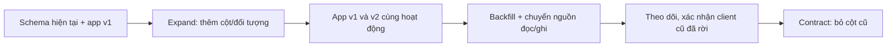

# Quy ước tên và thiết kế lược đồ dễ bảo trì

Một cơ sở dữ liệu PostgreSQL có thể chạy đúng hôm nay nhưng trở nên rất khó sửa sau vài năm: tên bảng viết hoa lẫn chữ thường, cột `id` không rõ thuộc thực thể nào, khóa ngoại không có quy tắc đặt tên, mọi đối tượng nằm trong `public`, một lần đổi tên cột làm hỏng nhiều phiên bản ứng dụng, còn những giá trị trạng thái được biểu diễn theo ba cách khác nhau ở ba bảng.

Đây không chỉ là vấn đề “đặt tên đẹp”. **Tên và cấu trúc lược đồ là giao diện chung giữa dữ liệu, câu SQL, ứng dụng, migration, báo cáo, hệ thống tích hợp và người vận hành.** Khi giao diện đó nhất quán, người mới có thể đoán đúng quan hệ giữa các bảng, câu SQL dễ review hơn, công cụ migration dễ làm việc hơn và sự thay đổi ít gây lỗi dây chuyền hơn.

Bài học thuộc chương **Thiết kế lược đồ**, tập trung vào hai câu hỏi thực tế:

1. **Đặt tên thế nào để dễ đọc, dễ tìm kiếm, ít va chạm và thuận với PostgreSQL?**
2. **Thiết kế và tiến hóa schema thế nào để dữ liệu vẫn đúng khi hệ thống lớn lên và nhiều nhóm cùng phát triển?**

Ta sẽ dùng một ví dụ bán hàng xuyên suốt để minh họa cách đặt tên schema, bảng, cột, khóa, ràng buộc, index, view và đối tượng ứng dụng; rồi chuyển sang thiết kế kiểu dữ liệu, quan hệ, quyền truy cập, thay đổi tương thích ngược và checklist review migration.

Các ví dụ SQL hướng tới PostgreSQL hiện đại với bảng heap thông thường. Một số tính năng có yêu cầu phiên bản riêng sẽ được ghi chú. Không chạy các ví dụ thay đổi cấu trúc trên database production khi chưa có migration và kế hoạch triển khai.

## 1. Vì sao quy ước tên là một phần của kiến trúc?

Hãy so sánh hai cách tổ chức cùng một nghiệp vụ.

**Kiểu thiếu nhất quán:**

```sql
-- Chỉ là ví dụ về tên khó bảo trì; không khuyến nghị tạo.
CREATE TABLE "Users" (
    "UserID" BIGINT PRIMARY KEY,
    UserName TEXT,
    createDate TIMESTAMP
);

CREATE TABLE order_tbl (
    orderid BIGINT PRIMARY KEY,
    uid BIGINT,
    stat VARCHAR(10)
);
```

Khi đọc SQL, người phát triển phải hỏi:

- Bảng `"Users"` có phải luôn phải đặt trong dấu nháy kép không?
- `uid` tham chiếu tới `"UserID"` hay một khái niệm khác?
- `createDate` theo múi giờ nào?
- `stat` có những giá trị hợp lệ nào?
- Quan hệ có foreign key thật hay chỉ ghi chú trong code?
- Vì sao có bảng viết số nhiều, bảng thêm hậu tố `_tbl`, cột camelCase và cột viết tắt?

**Kiểu có quy ước rõ ràng:**

```sql
CREATE SCHEMA IF NOT EXISTS commerce;

CREATE TABLE commerce.customer (
    id BIGINT GENERATED ALWAYS AS IDENTITY,
    full_name TEXT NOT NULL,
    created_at TIMESTAMPTZ NOT NULL DEFAULT now(),
    CONSTRAINT pk_customer PRIMARY KEY (id)
);

CREATE TABLE commerce.sales_order (
    id BIGINT GENERATED ALWAYS AS IDENTITY,
    customer_id BIGINT NOT NULL,
    status TEXT NOT NULL DEFAULT 'NEW',
    placed_at TIMESTAMPTZ NOT NULL DEFAULT now(),
    CONSTRAINT pk_sales_order PRIMARY KEY (id),
    CONSTRAINT fk_sales_order_customer
        FOREIGN KEY (customer_id)
        REFERENCES commerce.customer(id),
    CONSTRAINT ck_sales_order_status
        CHECK (status IN ('NEW', 'PAID', 'CANCELLED'))
);
```

Từ cấu trúc này, ta có thể suy đoán hợp lý:

- `commerce` là không gian tên cho miền bán hàng.
- `customer` và `sales_order` là các bảng thực thể, cùng dùng danh từ số ít.
- `id` là khóa chính bên trong từng bảng.
- `customer_id` là khóa ngoại tham chiếu tới khách hàng.
- `created_at`, `placed_at` là thời điểm, dùng `TIMESTAMPTZ`.
- `pk_`, `fk_` và `ck_` phân biệt loại ràng buộc.
- Quy tắc trạng thái được PostgreSQL thực thi, không chỉ là convention trong Java.

Lưu ý: ví dụ đầu chương chưa thể hiện mọi quyết định thiết kế; những phần tiếp theo sẽ xây dựng schema hoàn chỉnh hơn.

### 1.1. Mục tiêu của một quy ước tốt

| Mục tiêu | Câu hỏi kiểm tra |
|---|---|
| **Dễ dự đoán** | Nhìn `customer_id` có đoán đúng bảng tham chiếu không? |
| **Dễ tìm** | Tìm `fk_sales_order_` có thấy các quan hệ của đơn hàng không? |
| **Dễ đọc** | Có cần giải mã nhiều chữ viết tắt để hiểu SQL không? |
| **An toàn khi dùng PostgreSQL** | Có tránh tên phải quote mọi lần và tên trùng từ khóa không? |
| **Dễ mở rộng** | Thêm bảng mới có quy tắc đặt tên nhất quán không? |
| **Dễ thay đổi** | Migration, deploy nhiều phiên bản ứng dụng và rollback có được tính đến không? |
| **Thể hiện bất biến** | Khóa ngoại, unique, check và not-null có bảo vệ dữ liệu ngay tại database không? |

Quy ước chỉ hữu ích khi được áp dụng nhất quán và ghi thành tài liệu ngắn. Nó không cần giống hệt mọi dự án khác; điều quan trọng là nhóm có một lựa chọn có lý do và thực hiện nó đồng đều.

## 2. Cơ chế tên đối tượng trong PostgreSQL

### 2.1. Identifier không quote được chuyển về chữ thường

PostgreSQL **fold các identifier không đặt trong nháy kép thành chữ thường**:

```sql
-- Hai câu tham chiếu cùng một tên không quote:
CREATE TABLE commerce.demo_case (id INTEGER);

SELECT id FROM commerce.DEMO_CASE;
SELECT id FROM commerce.demo_case;
```

Nhưng identifier đặt trong nháy kép giữ nguyên cách viết:

```sql
CREATE TABLE commerce."DemoCase" (
    "OrderID" INTEGER
);

-- Phải tham chiếu đúng case:
SELECT "OrderID"
FROM commerce."DemoCase";

-- Không tương đương:
-- SELECT orderid FROM commerce.DemoCase;
```

Nháy đơn `'...'` dùng cho **giá trị chuỗi**; nháy kép `"..."` dùng để quote **identifier**. Không hoán đổi tùy tiện.

Vì lý do đó, lựa chọn khuyến nghị cho bảng, cột, index và schema ứng dụng là **chữ thường, ASCII, `snake_case` và tránh từ khóa**. Khi ấy SQL thường không cần nháy kép, dễ thao tác từ `psql`, JDBC, migration scripts và công cụ BI.

### 2.2. Giới hạn 63 byte, không phải 63 ký tự Unicode

Trong bản build PostgreSQL mặc định, độ dài identifier có ý nghĩa tối đa là **63 byte** vì giới hạn `NAMEDATALEN - 1`. Tên dài hơn có thể bị cắt ngắn ở mức identifier, với hành vi/thông báo tùy ngữ cảnh.

Ví dụ tên không nên dùng:

```text
idx_customer_orders_with_multiple_optional_filters_and_complex_business_status
```

Ngay cả khi hai tên khác nhau ở đoạn cuối, sau khi cắt ngắn chúng có thể gây trùng tên ngoài ý muốn. Với ký tự Unicode, một ký tự có thể chiếm nhiều byte, nên không nên đếm ký tự hiển thị để dự đoán giới hạn.

Có thể kiểm tra:

```sql
SHOW max_identifier_length;
```

**Thực hành tốt:** đặt tên ngắn đủ hiểu, đưa phần quan trọng lên đầu, tránh các chuỗi mô tả bằng nguyên một câu tiếng Anh dài. Chỉ số bảng và ràng buộc nên có tên dễ tra trong log lỗi mà không vượt giới hạn.

### 2.3. Những tên nên tránh

- Tên trùng từ khóa SQL như `order` hoặc `user` trong ngữ cảnh dễ phát sinh xung đột/cần quote; thay bằng `sales_order`, `app_user_account` hoặc tên miền rõ ràng.
- Tên quá chung chung: `data`, `object`, `record`, `table1`.
- Tên viết tắt bí hiểm: `u`, `st`, `dt`, `x_ref`.
- Tên có khoảng trắng, dấu gạch ngang, ký tự đặc biệt hoặc buộc phải quote.
- Tên chứa ý nghĩa kỹ thuật tạm thời nhưng trở thành API lâu dài, như `new_orders2` hoặc `temp_customer_final`.
- Tên bắt đầu bằng `pg_` cho những schema có thể trùng phạm vi tên hệ thống; PostgreSQL dùng prefix này cho các đối tượng nội bộ và hạn chế một số trường hợp.

**Quy ước không thể sửa tên đã xuất bản chỉ bằng cách áp lệnh rename.** Đối với hệ thống đã chạy, cần migration tương thích ngược và rà soát client trước khi đổi tên.

## 3. Bộ quy ước tên đề xuất

Đây là một bộ quy ước nhất quán để minh họa trong bài. Nhóm có thể chọn danh từ số nhiều hoặc prefix index khác, nhưng nên **chọn một quy tắc và giữ thống nhất**.

| Đối tượng | Quy ước | Ví dụ |
|---|---|---|
| Schema nghiệp vụ | `lower_snake_case`, tên miền | `commerce`, `billing` |
| Bảng thực thể | Danh từ số ít | `customer`, `product`, `sales_order` |
| Bảng liên kết | Hai danh từ thể hiện quan hệ | `user_role`, `product_category` |
| Khóa chính | `id` nếu một khóa đơn đại diện thực thể | `customer.id` |
| Khóa ngoại | `<thực_thể_tham_chiếu>_id` | `customer_id`, `sales_order_id` |
| Cột thời điểm | `..._at` | `created_at`, `paid_at` |
| Cột ngày không có giờ | `..._date` hoặc tên diễn đạt ngày | `due_date` |
| Cột boolean | Tên dễ đọc dưới dạng điều kiện | `is_active`, `requires_review` |
| Cột số lượng | Tên nói rõ đại lượng | `quantity`, `retry_count` |
| Cột tiền | Tên có ngữ nghĩa amount/price + mã tiền riêng | `unit_price`, `amount`, `currency_code` |
| Primary key constraint | `pk_<bảng>` | `pk_customer` |
| Foreign key constraint | `fk_<bảng>_<đích>` | `fk_sales_order_customer` |
| Unique constraint | `uq_<bảng>_<cột/ý_nghĩa>` | `uq_customer_email` |
| Check constraint | `ck_<bảng>_<quy_tắc>` | `ck_order_item_quantity_positive` |
| Index thông thường | `idx_<bảng>_<cột/ý_nghĩa>` | `idx_sales_order_customer_placed_at` |
| View | Tên thể hiện kết quả/ngữ nghĩa | `customer_order_summary` |
| Materialized view | `mv_<ngữ_nghĩa>` nếu nhóm chọn prefix | `mv_monthly_revenue` |
| Function nghiệp vụ | Động từ + đối tượng/tác dụng | `calculate_order_total` |
| Trigger | `trg_<bảng>_<sự_kiện>` | `trg_customer_set_updated_at` |
| Migration | Mã phiên bản/thời gian và mô tả hành động | `V014__add_customer_display_name.sql` |

**Tiền tố `pk_`, `fk_`, `uq_`, `ck_`, `idx_` không phải cú pháp bắt buộc của PostgreSQL.** Chúng là thỏa thuận để đọc log, truy vấn catalog và kiểm tra schema dễ hơn.

### 3.1. Không nên đổi toàn bộ tên vì sở thích cá nhân

Nếu một dự án đã dùng nhất quán `customers`, `orders`, `order_items` (số nhiều), đó vẫn có thể là một convention tốt. Việc đổi sang `customer`, `sales_order`, `order_item` chỉ vì một thành viên thích số ít có thể gây rủi ro lớn hơn lợi ích.

Tiêu chí đánh giá là **tính nhất quán, khả năng hiểu và chi phí duy trì**, không phải “số ít luôn đúng” hay “số nhiều luôn đúng”.

## 4. Schema là namespace, không chỉ là tiền tố trang trí

Trong PostgreSQL, một database có thể chứa nhiều schema. Schema nhóm các bảng, view, sequence, function, type và những đối tượng khác theo **namespace**.

Ví dụ:

```sql
CREATE SCHEMA IF NOT EXISTS commerce;
CREATE SCHEMA IF NOT EXISTS billing;
```

Hai schema có thể chứa đối tượng trùng tên:

```sql
CREATE TABLE commerce.event_log (
    id BIGINT PRIMARY KEY,
    description TEXT NOT NULL
);

CREATE TABLE billing.event_log (
    id BIGINT PRIMARY KEY,
    description TEXT NOT NULL
);
```

Để không nhầm, dùng tên có schema:

```sql
SELECT *
FROM commerce.event_log;

SELECT *
FROM billing.event_log;
```

Tên đầy đủ `schema.object` đặc biệt hữu ích trong migration, script DBA và code dùng nhiều schema.

### 4.1. search_path quyết định cách PostgreSQL tìm tên không có schema

```sql
SHOW search_path;

SELECT current_schema();
SELECT current_schemas(true);
```

Khi viết:

```sql
SELECT * FROM event_log;
```

PostgreSQL phân giải tên theo `search_path` và một số quy tắc tìm kiếm đối tượng hệ thống. Kết quả có thể không phải bảng mà người viết dự kiến nếu nhiều schema chứa `event_log`.

Trong ứng dụng dùng một miền dữ liệu quan trọng, có hai cách phổ biến:

1. **Viết tên đầy đủ** `commerce.customer`, `commerce.sales_order` trong SQL/migration.
2. **Thiết lập `search_path` có kiểm soát** cho role/session, xác định rõ schema nào được phép tra cứu.

Không nên để source code quan trọng phụ thuộc một `search_path` tình cờ được thiết lập từ terminal cá nhân.

### 4.2. search_path còn là vấn đề bảo mật

Nếu `search_path` có schema mà một role không đáng tin có thể tạo object, việc phân giải tên không đủ tường minh có thể đưa ứng dụng tới object không mong muốn trong một số tình huống. Vì vậy:

- Chỉ đưa các schema được tin cậy vào `search_path` của các role có quyền mạnh.
- Hạn chế quyền `CREATE` trên schema ứng dụng.
- Dùng tên đầy đủ trong migration và các đường SQL nhạy cảm.
- Rà soát quyền của schema `public`, nhất là database đã nâng cấp từ phiên bản PostgreSQL cũ.

Trong những database mới tạo từ PostgreSQL 15 trở lên, mặc định quyền tạo object trong `public` đã thay đổi so với một số phiên bản cũ; **không nên suy ra mọi database hiện có đều có cùng grants**. Hãy kiểm tra quyền thực tế thay vì dựa vào tên schema.

### 4.3. Schema không phải một database độc lập

Dùng hai schema `commerce` và `billing` vẫn là các object trong **cùng PostgreSQL database**. Chúng có thể tham gia cùng transaction và ràng buộc foreign key trong phạm vi được hỗ trợ; không phải hai server hoặc hai vùng backup độc lập tuyệt đối.

Tách schema hữu ích cho tổ chức và phân quyền, nhưng **không tự đảm bảo cô lập workload, tài nguyên, deploy hay tenant**. Nếu cần ranh giới cô lập mạnh hơn, phải đánh giá database/cluster riêng, quyền, hạ tầng và chiến lược vận hành.

## 5. Đặt tên bảng: thực thể, quan hệ và sự kiện

### 5.1. Tên bảng nên biểu diễn một khái niệm nghiệp vụ

Ví dụ cho hệ thống bán hàng:

| Tên | Vai trò |
|---|---|
| `customer` | Một khách hàng |
| `product` | Một sản phẩm |
| `sales_order` | Một đơn hàng |
| `order_item` | Một dòng sản phẩm trong đơn |
| `payment` | Một lần ghi nhận hoặc yêu cầu thanh toán |
| `inventory_movement` | Một biến động tồn kho |
| `shipment` | Một lần giao hàng |

Những tên này mang thông tin nghiệp vụ hơn `customer_tbl`, `order_data` hay `payment_info_table`.

Nếu một tên có thể hiểu theo hai nghĩa, dùng từ bổ nghĩa. `sales_order` rõ hơn `order` và tránh một từ khóa SQL dễ gây vấn đề khi viết không quote. `inventory_movement` nói về sự kiện tăng/giảm tồn, khác `inventory_balance` nói về số dư hiện tại.

### 5.2. Bảng liên kết nhiều-nhiều

Một sản phẩm có thể thuộc nhiều danh mục và một danh mục chứa nhiều sản phẩm. Có thể dùng bảng:

```sql
CREATE TABLE commerce.product_category (
    product_id BIGINT NOT NULL,
    category_id BIGINT NOT NULL,

    CONSTRAINT pk_product_category
        PRIMARY KEY (product_id, category_id),

    CONSTRAINT fk_product_category_product
        FOREIGN KEY (product_id)
        REFERENCES commerce.product(id),

    CONSTRAINT fk_product_category_category
        FOREIGN KEY (category_id)
        REFERENCES commerce.category(id)
);
```

Đây là ví dụ **giả định các bảng `commerce.product` và `commerce.category` đã tồn tại**. Điểm chính là tên bảng nói rõ quan hệ và khóa chính ghép ngăn cùng cặp xuất hiện hai lần.

Nếu bảng liên kết có nhiều thuộc tính và vòng đời riêng, chẳng hạn `assigned_at`, `assigned_by` hoặc trạng thái, nó có thể trở thành thực thể riêng với khóa chính riêng. Quyết định dựa trên **ngữ nghĩa dữ liệu**, không chỉ trên một thói quen đặt tên.

### 5.3. Tránh bảng “đa dụng” không có nghĩa rõ

Bảng `entity` với `type` và hàng chục cột `field1`, `field2`, `extra1` để chứa nhiều thực thể khác nhau thường làm khó:

- Bảo đảm dữ liệu bằng `CHECK`, foreign key và `NOT NULL`.
- Xác định cột nào có ý nghĩa cho mỗi loại.
- Thiết kế index phù hợp.
- Viết báo cáo và migration.
- Phân tích hiệu năng/truy vấn.

Một số mô hình generic/EAV hoặc JSONB có giá trị trong bài toán linh hoạt, nhưng không nên chọn chúng **chỉ để tránh phải tạo bảng và cột có tên đúng nghiệp vụ**.

## 6. Đặt tên cột: đúng nghĩa, đúng đơn vị, đúng loại giá trị

### 6.1. Khóa chính và khóa ngoại

Một quy ước đơn giản:

```sql
CREATE TABLE commerce.customer (
    id BIGINT PRIMARY KEY,
    full_name TEXT NOT NULL
);

CREATE TABLE commerce.sales_order (
    id BIGINT PRIMARY KEY,
    customer_id BIGINT NOT NULL,
    CONSTRAINT fk_sales_order_customer
        FOREIGN KEY (customer_id)
        REFERENCES commerce.customer(id)
);
```

Nếu dùng `id` cho khóa chính trong mỗi bảng, thì ở bảng khác dùng `customer_id`, `sales_order_id` hoặc tên vai trò rõ ràng.

Trường hợp một bảng có **hai quan hệ tới cùng bảng đích**, không dùng hai cột `customer_id1` và `customer_id2`:

```sql
-- Ví dụ cột có vai trò khác nhau:
requested_by_customer_id BIGINT,
approved_by_customer_id BIGINT
```

Tên phải cho biết **vai trò** của mỗi quan hệ; ràng buộc foreign key và index nên phản ánh vai trò đó.

### 6.2. Thời điểm, ngày và khoảng thời gian

| Dữ liệu | Kiểu thường cân nhắc | Tên gợi ý |
|---|---|---|
| Thời điểm xảy ra một sự kiện | `TIMESTAMPTZ` | `created_at`, `paid_at` |
| Ngày lịch không gắn giờ | `DATE` | `due_date`, `birth_date` |
| Giờ trong ngày | `TIME` | `opening_time` |
| Khoảng thời gian | `INTERVAL` hoặc số có đơn vị rõ | `retry_delay`, `duration_ms` |

Trong PostgreSQL, `TIMESTAMPTZ` đại diện cho một **thời điểm tuyệt đối**, được hiển thị theo timezone của session; nó không lưu nguyên tên múi giờ mà người dùng đã nhập như một thuộc tính của từng giá trị. Nếu nghiệp vụ cần giữ timezone gốc hoặc múi giờ theo địa điểm, lưu thông tin đó riêng.

**Không đặt `created_at` cho cột `DATE` chỉ có ngày**, cũng không dùng `created_date` cho timestamp có thời điểm. Tên và kiểu phải khớp.

### 6.3. Boolean phải đọc được như một mệnh đề

Tên tốt:

```text
is_active
is_verified
requires_review
has_consent
can_receive_email
```

Tên khó hiểu:

```text
flag
status_bool
enabled1
value_yes_no
```

Với nhiều boolean, cần mô tả rõ ý nghĩa `NULL`. Ví dụ, `has_consent BOOLEAN` cho phép ba trạng thái: `true`, `false` và `NULL`; nếu ứng dụng chỉ cho phép có/không, đặt `NOT NULL` cùng mặc định phù hợp.

Không chuyển một trạng thái nhiều giá trị như `NEW`, `PAID`, `CANCELLED` thành ba cột boolean `is_new`, `is_paid`, `is_cancelled` nếu chúng phải loại trừ nhau. Một cột trạng thái có constraint thường biểu diễn bất biến tốt hơn.

### 6.4. Đơn vị đo phải nhất quán

Một cột `weight` nhưng có hàng tính gram, hàng tính kilogram sẽ gây lỗi im lặng. Chọn một quy tắc:

```text
weight_grams
length_mm
duration_ms
storage_bytes
amount_minor_units
```

Không nhất thiết mọi đơn vị đều phải đưa vào tên cột nếu schema có một mô hình đơn vị chuẩn và tài liệu rõ ràng. Nhưng **không để cùng tên đại diện cho hai đơn vị không thể suy ra**.

### 6.5. Tiền tệ và độ chính xác

Trong nghiệp vụ tiền, thường cân nhắc `NUMERIC(p,s)` cho giá trị thập phân chính xác và một mã tiền riêng:

```sql
amount NUMERIC(14, 2) NOT NULL,
currency_code VARCHAR(3) NOT NULL
```

Một bảng chứa nhiều loại tiền phải quy định chính sách làm tròn, đơn vị và các phép tổng hợp; **không cộng USD và VND rồi gọi kết quả là một tổng tiền duy nhất**.

`NUMERIC(14,2)` chỉ có hai chữ số sau dấu thập phân; không phù hợp cho mọi loại tiền/tài sản hoặc tính toán trung gian. Chọn precision/scale theo nghiệp vụ. Tránh dùng `DOUBLE PRECISION` cho các khoản tiền cần tính toán thập phân chính xác nếu chưa có lý do thiết kế cụ thể.

Kiểu `money` có thể gây bất tiện liên quan cách hiển thị và locale; `NUMERIC` thường dễ kiểm soát quy tắc tài chính hơn.

## 7. Kiểu dữ liệu là một phần của hợp đồng schema

Một tên cột rõ ràng nhưng kiểu dữ liệu sai vẫn khiến schema khó bảo trì.

| Nhu cầu | Lựa chọn thường dùng | Lưu ý |
|---|---|---|
| Số ID tăng dần | `BIGINT GENERATED ... AS IDENTITY` | Cần hiểu chuỗi identity và giới hạn phạm vi |
| Văn bản biến độ dài | `TEXT` hoặc `VARCHAR(n)` | `VARCHAR(n)` chỉ nên dùng khi giới hạn thực sự có ý nghĩa |
| Thời điểm | `TIMESTAMPTZ` | Hiển thị phụ thuộc timezone session |
| Ngày lịch | `DATE` | Không có giờ/múi giờ |
| Số lượng | `INTEGER`/`BIGINT` | Dùng `CHECK` để cấm âm nếu nghiệp vụ cần |
| Số thập phân chính xác | `NUMERIC(p,s)` | Chọn precision/scale theo miền giá trị |
| Cờ hai trạng thái | `BOOLEAN NOT NULL` | Mặc định phải có nghĩa |
| ID phân tán | `UUID` | Chính sách tạo UUID do ứng dụng/server quyết định |
| Thuộc tính linh hoạt | `JSONB` | Chỉ dùng khi cấu trúc linh hoạt thực sự cần và đã tính tới query/index |

Ví dụ một cột email không nhất thiết phải `VARCHAR(255)` theo một thói quen không có lý do. Trong PostgreSQL, `TEXT` và `VARCHAR` không giới hạn có nhiều đặc điểm hiệu năng tương đồng. Nếu nghiệp vụ cần giới hạn độ dài, dùng constraint rõ ý nghĩa.

### 7.1. TEXT, VARCHAR và tên cột

`TEXT` không có nghĩa “dữ liệu lộn xộn”. Một cột `full_name TEXT NOT NULL` rõ ràng hơn `n VARCHAR(100)` nếu giới hạn 100 ký tự chưa được xác nhận.

Nếu cần giới hạn:

```sql
full_name TEXT NOT NULL,
CONSTRAINT ck_customer_full_name_nonempty
    CHECK (length(btrim(full_name)) > 0)
```

Constraint trên cấm chuỗi chỉ có khoảng trắng theo hành vi `btrim` mặc định. Nó không tự giải quyết tất cả trường hợp Unicode whitespace hoặc chuẩn hóa tên người.

### 7.2. JSONB không thay cho thiết kế quan hệ cho mọi thuộc tính

`JSONB` hữu ích cho metadata linh hoạt hoặc payload có cấu trúc thay đổi, ví dụ thuộc tính sản phẩm tùy danh mục. Nhưng nếu `customer_id`, `order_status` và `paid_at` nằm trong JSONB mà ứng dụng cần join, ràng buộc và lọc thường xuyên, việc giữ chúng thành cột quan hệ thường tốt hơn.

Giới hạn của thiết kế mọi thứ trong JSONB:

- Foreign key thông thường không thể tham chiếu tùy ý đến từng trường JSONB.
- Constraint theo từng thuộc tính khó biểu diễn hơn.
- Kiểu dữ liệu và tính bắt buộc dễ bị lệch giữa các hàng.
- Index/truy vấn phụ thuộc operator và cấu trúc tài liệu.
- Migration và kiểm thử dữ liệu cần xử lý nhiều dạng JSON cũ.

**Nguyên tắc:** đưa các dữ kiện nghiệp vụ ổn định, được truy vấn/ràng buộc thường xuyên thành cột có kiểu rõ; dùng JSONB cho phần thực sự linh hoạt.

## 8. Khóa chính: danh tính ổn định của thực thể

Một khóa chính tốt cần **duy nhất, không NULL và ổn định** theo vòng đời thực thể.

### 8.1. Identity columns thay cho tự quản lý số tăng

PostgreSQL hỗ trợ cú pháp identity:

```sql
CREATE TABLE commerce.example_identity (
    id BIGINT GENERATED ALWAYS AS IDENTITY,
    description TEXT NOT NULL,
    CONSTRAINT pk_example_identity PRIMARY KEY (id)
);
```

`GENERATED ALWAYS` thường ngăn ứng dụng cung cấp giá trị ID trực tiếp trong `INSERT` trừ khi dùng cú pháp override phù hợp. `GENERATED BY DEFAULT` cho phép cung cấp giá trị tường minh dễ hơn.

Identity sử dụng một sequence. **Sequence không bảo đảm ID liên tục không có khoảng trống**: rollback, cache sequence, transaction lỗi hoặc thao tác khác có thể làm bỏ qua giá trị. Không dùng ID tăng như số thứ tự hóa đơn bắt buộc không được thiếu số nếu nghiệp vụ pháp lý cần quy trình đánh số riêng.

### 8.2. Natural key và surrogate key

Ví dụ khách hàng có email duy nhất trong mô hình hiện tại:

- Dùng `email` làm primary key có vẻ đơn giản.
- Nhưng email có thể đổi, cần chuẩn hóa và chịu nhiều quy tắc nghiệp vụ.
- Dùng `id` ổn định làm primary key và `UNIQUE(email)` cho quy tắc duy nhất thường giảm chi phí lan truyền thay đổi khóa.

Một khóa tự nhiên vẫn có thể phù hợp nếu thật sự ổn định và đại diện duy nhất cho đối tượng. Đừng tạo ID surrogate theo thói quen rồi quên unique constraint cho mã nghiệp vụ quan trọng.

### 8.3. UUID khi cần định danh không phụ thuộc một sequence tập trung

`UUID` phù hợp với một số hệ thống phân tán, import nhiều nguồn hoặc tạo ID từ client. Nhưng cần tính tới kích thước index, pattern chèn, cách sinh UUID, bảo mật khi lộ ID và khả năng debug.

Đừng chọn UUID chỉ vì “ID khó đoán thì dữ liệu đã an toàn”: quyền truy cập vẫn phải được kiểm tra trên từng request và query.

## 9. Ràng buộc dữ liệu: tên tốt phải đi với luật đúng

Constraint là nơi PostgreSQL thực thi những bất biến không nên phụ thuộc duy nhất vào code ứng dụng.

### 9.1. Những loại ràng buộc cần biết

| Loại | Chức năng | Tên gợi ý |
|---|---|---|
| `PRIMARY KEY` | Khóa chính duy nhất và không NULL | `pk_customer` |
| `FOREIGN KEY` | Quan hệ tham chiếu tới khóa phù hợp | `fk_sales_order_customer` |
| `UNIQUE` | Duy nhất theo quy tắc so sánh/null | `uq_product_sku` |
| `CHECK` | Biểu thức điều kiện của từng hàng | `ck_order_item_quantity_positive` |
| `NOT NULL` | Cấm NULL tại cột | Không cần giả định luôn có constraint name đặt được như table constraint |

Ví dụ:

```sql
CONSTRAINT pk_product PRIMARY KEY (id),
CONSTRAINT uq_product_sku UNIQUE (sku),
CONSTRAINT ck_product_price_nonnegative CHECK (unit_price >= 0)
```

Với `FOREIGN KEY`, tên nên thể hiện bảng nguồn và quan hệ/bảng đích để thông báo lỗi dễ nhận ra.

### 9.2. CHECK và NULL: một bẫy phổ biến

Trong SQL, `CHECK` được chấp nhận nếu biểu thức cho kết quả **true hoặc unknown (NULL)**; chỉ `false` vi phạm.

Ví dụ:

```sql
quantity INTEGER,
CONSTRAINT ck_quantity_positive CHECK (quantity > 0)
```

Cột trên vẫn có thể nhận `NULL`. Nếu muốn lượng phải dương và luôn có giá trị:

```sql
quantity INTEGER NOT NULL,
CONSTRAINT ck_quantity_positive CHECK (quantity > 0)
```

Không dùng `CHECK (quantity > 0)` thay thế `NOT NULL`.

### 9.3. UNIQUE và NULL

Trong PostgreSQL, unique constraint thông thường **cho phép nhiều hàng NULL** ở cột nullable vì NULL không được coi như một giá trị bằng nhau theo quy tắc unique mặc định.

```sql
CREATE TABLE commerce.external_reference (
    id BIGINT GENERATED ALWAYS AS IDENTITY PRIMARY KEY,
    external_code TEXT UNIQUE
);
```

Nhiều hàng có `external_code IS NULL` có thể được chấp nhận. Nếu nghiệp vụ cần coi nhiều NULL là trùng nhau, PostgreSQL 15 trở lên có cú pháp `UNIQUE NULLS NOT DISTINCT` cho trường hợp phù hợp.

Đừng thêm `NOT NULL` chỉ để “chữa unique” nếu nghiệp vụ thực sự cho phép chưa có mã ngoài. Cần xác định rõ điều gì được phép thiếu và khi nào.

### 9.4. Foreign key không tự tạo index ở phía tham chiếu

PostgreSQL tạo index phục vụ primary key/unique constraint theo cơ chế của chúng, nhưng **không tự động tạo index cho mọi cột foreign key ở bảng tham chiếu**.

Ví dụ:

```sql
CREATE INDEX idx_sales_order_customer_id
ON commerce.sales_order(customer_id);
```

Một index trên `sales_order.customer_id` thường hữu ích khi:

- Tìm mọi đơn của một khách.
- Join từ `customer` sang `sales_order`.
- Kiểm tra thay đổi/xóa hàng parent trong tình huống quan hệ lớn.

Nhưng không phải mọi foreign key đều cần index đơn cột riêng. Nếu đã có index ghép bắt đầu bằng `customer_id`, có thể nó đã phục vụ các truy vấn đó. Phải đánh giá query patterns, selectivity, write cost và kích thước dữ liệu trước khi tạo index trùng.

## 10. Một schema bán hàng mẫu có thể thực hành

Phần này ghép các quy ước thành DDL có thể thực thi trên database thử nghiệm. Dùng **schema mới** để tránh va chạm với các ví dụ ngắn ở đầu bài; nếu trước đó đã tạo các bảng trong `commerce`, hãy chạy bài thực hành trên database sạch hoặc đổi tên schema cho môi trường lab.

### 10.1. Tạo namespace

```sql
CREATE SCHEMA IF NOT EXISTS commerce;
```

Trong bài thực hành dưới đây, toàn bộ tên bảng đều được ghi kèm schema `commerce` để tránh phụ thuộc `search_path`.

### 10.2. Bảng khách hàng

```sql
CREATE TABLE commerce.customer (
    id BIGINT GENERATED ALWAYS AS IDENTITY,
    full_name TEXT NOT NULL,
    email TEXT NOT NULL,
    is_active BOOLEAN NOT NULL DEFAULT TRUE,
    created_at TIMESTAMPTZ NOT NULL DEFAULT now(),

    CONSTRAINT pk_customer PRIMARY KEY (id),
    CONSTRAINT uq_customer_email UNIQUE (email),
    CONSTRAINT ck_customer_full_name_nonempty
        CHECK (length(btrim(full_name)) > 0),
    CONSTRAINT ck_customer_email_nonempty
        CHECK (length(btrim(email)) > 0)
);
```

Giải thích:

- `id` là danh tính nội bộ; `email` có luật duy nhất độc lập.
- `full_name` không để trống toàn khoảng trắng theo constraint.
- `is_active` là boolean có nghĩa rõ và không có trạng thái NULL ngầm.
- `created_at` là thời điểm, không phải ngày lịch.
- Tên constraint giúp tìm lỗi trong log hoặc truy vấn system catalog.

**Email case sensitivity:** `UNIQUE(email)` theo so sánh/collation của cột không tự bảo đảm “abc@example.test” và “ABC@example.test” luôn được xem là giống nhau theo quy tắc nghiệp vụ mong muốn. Nếu ứng dụng cần so sánh không phân biệt hoa thường, phải chọn chính sách normalization/collation hoặc biểu thức index thích hợp và thử trên dữ liệu thực; đừng giả định một phép `lower` đơn giản giải quyết mọi Unicode/email convention.

### 10.3. Bảng sản phẩm

```sql
CREATE TABLE commerce.product (
    id BIGINT GENERATED ALWAYS AS IDENTITY,
    sku TEXT NOT NULL,
    product_name TEXT NOT NULL,
    unit_price NUMERIC(14, 2) NOT NULL,
    is_active BOOLEAN NOT NULL DEFAULT TRUE,
    created_at TIMESTAMPTZ NOT NULL DEFAULT now(),

    CONSTRAINT pk_product PRIMARY KEY (id),
    CONSTRAINT uq_product_sku UNIQUE (sku),
    CONSTRAINT ck_product_sku_nonempty
        CHECK (length(btrim(sku)) > 0),
    CONSTRAINT ck_product_name_nonempty
        CHECK (length(btrim(product_name)) > 0),
    CONSTRAINT ck_product_unit_price_nonnegative
        CHECK (unit_price >= 0)
);
```

`sku` là mã nghiệp vụ được đặt tên rõ. Giá bán hiện tại ở `product.unit_price` có thể thay đổi theo thời gian; **giá đã bán** phải được ghi nhận ở dòng hàng của đơn, không chỉ lấy từ `product` tại thời điểm lập báo cáo lịch sử.

### 10.4. Bảng đơn hàng

```sql
CREATE TABLE commerce.sales_order (
    id BIGINT GENERATED ALWAYS AS IDENTITY,
    customer_id BIGINT NOT NULL,
    status TEXT NOT NULL DEFAULT 'NEW',
    currency_code VARCHAR(3) NOT NULL,
    placed_at TIMESTAMPTZ NOT NULL DEFAULT now(),
    paid_at TIMESTAMPTZ,

    CONSTRAINT pk_sales_order PRIMARY KEY (id),
    CONSTRAINT fk_sales_order_customer
        FOREIGN KEY (customer_id)
        REFERENCES commerce.customer(id)
        ON DELETE RESTRICT,
    CONSTRAINT ck_sales_order_status
        CHECK (status IN ('NEW', 'PAID', 'CANCELLED')),
    CONSTRAINT ck_sales_order_currency_code
        CHECK (currency_code ~ '^[A-Z]{3}$'),
    CONSTRAINT ck_sales_order_paid_after_placed
        CHECK (paid_at IS NULL OR paid_at >= placed_at)
);
```

Những điểm thiết kế:

- `sales_order` tránh dùng một tên dễ xung đột từ khóa.
- `customer_id` có foreign key thật.
- `currency_code` có định dạng ba chữ hoa; constraint này **chỉ kiểm tra hình thức**, không xác minh mã nằm trong danh sách tiền tệ hợp lệ.
- `paid_at` được phép NULL vì đơn chưa thanh toán có thể chưa có thời điểm trả tiền.
- Ràng buộc thứ tự thời gian là một bất biến đơn giản; quan hệ giữa `status` và `paid_at` cần được xác định chi tiết theo nghiệp vụ. Ví dụ không cố áp quy tắc “mọi đơn PAID nhất thiết phải có paid_at” nếu hệ thống có trạng thái thanh toán khác hoặc quá trình migration dữ liệu cũ.

Việc dùng `ON DELETE RESTRICT` có chủ đích: không muốn xóa khách hàng làm mất đơn lịch sử. Những yêu cầu xóa dữ liệu cá nhân cần một chiến lược riêng như ẩn danh hóa dữ liệu phù hợp chính sách, không phải xóa cascade mọi giao dịch.

### 10.5. Bảng dòng hàng

```sql
CREATE TABLE commerce.order_item (
    id BIGINT GENERATED ALWAYS AS IDENTITY,
    sales_order_id BIGINT NOT NULL,
    product_id BIGINT NOT NULL,
    quantity INTEGER NOT NULL,
    unit_price NUMERIC(14, 2) NOT NULL,

    CONSTRAINT pk_order_item PRIMARY KEY (id),
    CONSTRAINT fk_order_item_sales_order
        FOREIGN KEY (sales_order_id)
        REFERENCES commerce.sales_order(id)
        ON DELETE RESTRICT,
    CONSTRAINT fk_order_item_product
        FOREIGN KEY (product_id)
        REFERENCES commerce.product(id)
        ON DELETE RESTRICT,
    CONSTRAINT ck_order_item_quantity_positive
        CHECK (quantity > 0),
    CONSTRAINT ck_order_item_unit_price_nonnegative
        CHECK (unit_price >= 0)
);
```

`order_item.unit_price` là giá tại thời điểm bán, khác với `product.unit_price` là giá hiện tại. Hai cột cùng tên `unit_price` nhưng ở hai bảng khác nhau có thể đúng vì mỗi bảng có ngữ cảnh riêng; tài liệu mô hình phải giải thích **thời điểm có hiệu lực** để không hiểu nhầm.

Không áp `UNIQUE(sales_order_id, product_id)` khi chưa có luật nghiệp vụ: một sản phẩm có thể xuất hiện thành nhiều dòng do chương trình khuyến mãi, lô giao hàng, cấu hình riêng hoặc phân chia giá. Constraint chỉ nên thể hiện luật đã được xác nhận.

### 10.6. Bảng thanh toán

```sql
CREATE TABLE commerce.payment (
    id BIGINT GENERATED ALWAYS AS IDENTITY,
    sales_order_id BIGINT NOT NULL,
    provider_reference TEXT,
    amount NUMERIC(14, 2) NOT NULL,
    status TEXT NOT NULL DEFAULT 'PENDING',
    created_at TIMESTAMPTZ NOT NULL DEFAULT now(),
    settled_at TIMESTAMPTZ,

    CONSTRAINT pk_payment PRIMARY KEY (id),
    CONSTRAINT fk_payment_sales_order
        FOREIGN KEY (sales_order_id)
        REFERENCES commerce.sales_order(id)
        ON DELETE RESTRICT,
    CONSTRAINT uq_payment_provider_reference
        UNIQUE (provider_reference),
    CONSTRAINT ck_payment_amount_positive
        CHECK (amount > 0),
    CONSTRAINT ck_payment_status
        CHECK (status IN ('PENDING', 'SUCCEEDED', 'FAILED'))
);
```

Ở đây, `provider_reference` có thể NULL trước khi cổng thanh toán trả mã; unique mặc định vẫn cho phép nhiều NULL. Nếu mã bên ngoài chỉ duy nhất **trong từng nhà cung cấp**, cần thêm `provider_code` và dùng unique ghép `(provider_code, provider_reference)` theo quy tắc cụ thể, không coi một field provider-reference là duy nhất toàn cầu nếu thực tế không phải vậy.

Một đơn có thể có nhiều lần thử thanh toán. Quan hệ `sales_order` → `payment` là một-nhiều; không đặt unique trên `payment.sales_order_id` chỉ vì kỳ vọng một đơn luôn chỉ thanh toán một lần.

### 10.7. Index theo truy vấn thực tế

```sql
CREATE INDEX idx_sales_order_customer_placed_at
ON commerce.sales_order (customer_id, placed_at DESC);

CREATE INDEX idx_sales_order_status_placed_at
ON commerce.sales_order (status, placed_at DESC);

CREATE INDEX idx_order_item_sales_order_id
ON commerce.order_item (sales_order_id);

CREATE INDEX idx_order_item_product_id
ON commerce.order_item (product_id);

CREATE INDEX idx_payment_sales_order_id
ON commerce.payment (sales_order_id);
```

Index `(customer_id, placed_at DESC)` phục vụ một mẫu query như:

```sql
SELECT id, status, placed_at
FROM commerce.sales_order
WHERE customer_id = 42
ORDER BY placed_at DESC
LIMIT 20;
```

Đây là index **được thiết kế theo truy vấn**, không chỉ một index cho mỗi cột. Thực tế planner có thể chọn index hoặc Seq Scan tùy kích thước bảng, phân phối giá trị và chi phí. Không dùng `CREATE INDEX` như một bước chắc chắn giúp mọi câu SQL chạy nhanh.

## 11. Kiểm chứng tính nhất quán của DDL mẫu

Chèn dữ liệu thực hành trên database sạch:

```sql
INSERT INTO commerce.customer (full_name, email)
VALUES ('Lan', 'lan@example.test')
RETURNING id;

INSERT INTO commerce.product (sku, product_name, unit_price)
VALUES
    ('BOOK-001', 'Sách PostgreSQL', 150000.00),
    ('PEN-001', 'Bút', 10000.00)
RETURNING id, sku;
```

Giả sử các ID đầu tiên là 1 và 2 như trong database lab mới:

```sql
BEGIN;

INSERT INTO commerce.sales_order (customer_id, currency_code)
VALUES (1, 'VND')
RETURNING id;

-- Giả sử sales_order.id mới là 1.
INSERT INTO commerce.order_item
    (sales_order_id, product_id, quantity, unit_price)
VALUES
    (1, 1, 1, 150000.00),
    (1, 2, 2, 10000.00);

COMMIT;
```

**Lưu ý về thực thi:** các ID `1` chỉ đúng khi bảng/sequence mới và không có các lần chèn khác. Khi viết code ứng dụng thật, lấy giá trị từ `RETURNING`, rồi truyền ID đó vào câu lệnh tiếp theo; không hardcode kết quả dự đoán từ sequence.

Tính tổng đơn từ dòng hàng:

```sql
SELECT
    sales_order_id,
    SUM(quantity * unit_price) AS order_amount
FROM commerce.order_item
GROUP BY sales_order_id
ORDER BY sales_order_id;
```

Một lợi ích của thiết kế này là tránh lưu bản sao tổng tiền trên `sales_order` nếu ứng dụng không thật sự cần cache/denormalization. Nếu quyết định lưu `sales_order.total_amount` vì hiệu năng, phải xác định rõ ai duy trì, cập nhật trong transaction nào, điều gì xảy ra khi sửa dòng hàng và cách đối chiếu định kỳ.

### 11.1. Một vài lỗi có ý nghĩa

Thử trên môi trường lab:

```sql
-- Không hợp lệ vì quantity phải dương:
INSERT INTO commerce.order_item
    (sales_order_id, product_id, quantity, unit_price)
VALUES (1, 1, 0, 150000.00);

-- Không hợp lệ vì status không thuộc tập cho phép:
INSERT INTO commerce.sales_order
    (customer_id, status, currency_code)
VALUES (1, 'UNKNOWN', 'VND');

-- Không hợp lệ vì customer không tồn tại:
INSERT INTO commerce.sales_order
    (customer_id, status, currency_code)
VALUES (999999, 'NEW', 'VND');
```

Các lệnh trên nhằm minh họa lỗi constraint và **không chạy gộp bên trong một transaction cần tiếp tục sau lỗi mà không dùng savepoint/rollback**. Khi statement làm transaction PostgreSQL vào trạng thái aborted, cần xử lý transaction trước khi chạy statement khác.

Tên ràng buộc như `ck_order_item_quantity_positive` và `fk_sales_order_customer` giúp xác định lỗi nhanh hơn những tên autogenerated khó đoán.

## 12. Tên chỉ mục: gắn với bảng và mẫu truy vấn

Index không phải thuộc tính “miễn phí”. Nó chiếm dung lượng và được duy trì khi ghi dữ liệu. Một quy ước đặt tên nên giúp hiểu **index nằm ở bảng nào và phục vụ điều kiện gì**.

### 12.1. Tên theo cột hoặc vai trò

```sql
CREATE INDEX idx_sales_order_customer_placed_at
ON commerce.sales_order (customer_id, placed_at DESC);
```

Tên cho biết bảng và hai cột chính. Cú pháp đầy đủ vẫn quyết định các yếu tố không thể suy ra chỉ từ tên, ví dụ:

- Chiều `ASC`/`DESC`.
- Operator class và collation.
- Expression index hoặc partial predicate.
- `INCLUDE` columns.
- Phương pháp index (B-tree, GIN, GiST, BRIN...).

Không cố nhồi toàn bộ SQL index vào một identifier vượt 63 byte. Có thể dùng tên ngắn mang mục đích:

```text
idx_sales_order_recent_open
idx_customer_email_normalized
idx_product_attributes_gin
```

nhưng phải lưu DDL trong migration để mô tả đầy đủ.

### 12.2. Unique constraint so với unique index

`UNIQUE` constraint thường được PostgreSQL hỗ trợ bởi một unique index. Đặt constraint thể hiện **luật dữ liệu**, không chỉ một mẹo tăng tốc.

```sql
ALTER TABLE commerce.product
ADD CONSTRAINT uq_product_sku_alias UNIQUE (sku);
```

Đây chỉ là ví dụ cú pháp. Trong bảng thực hành đã có `uq_product_sku`, nên **không chạy lệnh tạo unique trùng mục đích này**; thêm ràng buộc giống nhau làm tăng công việc bảo trì không cần thiết.

Đối với partial uniqueness hoặc uniqueness theo biểu thức, PostgreSQL thường dùng `CREATE UNIQUE INDEX`:

```sql
-- Ví dụ minh họa; cần đánh giá dữ liệu trùng trước khi tạo.
CREATE UNIQUE INDEX uq_customer_email_lower
ON commerce.customer (lower(email));
```

Index này có thể áp quy tắc so sánh khác trên dữ liệu hiện hữu. Nếu đã có các email chỉ khác chữ hoa/chữ thường, lệnh có thể thất bại; cần dữ liệu và chính sách normalization rõ ràng trước khi tạo. Khi đã dùng unique expression index, không nên giữ vô số ràng buộc trùng lặp nếu không phục vụ quy tắc khác.

### 12.3. Partial index

Một index chỉ chứa đơn hàng mở có thể được tạo như sau:

```sql
CREATE INDEX idx_sales_order_new_placed_at
ON commerce.sales_order (placed_at DESC)
WHERE status = 'NEW';
```

Nó có thể hữu ích cho truy vấn thường xuyên chỉ quan tâm `status = 'NEW'`. Nhưng planner chỉ sử dụng partial index khi có thể chứng minh query predicate phù hợp với điều kiện index; một số câu truy vấn tham số hóa hoặc điều kiện tương đương về mặt nghiệp vụ không chắc được suy diễn như người viết mong đợi.

**Tên partial index nên phản ánh bộ lọc quan trọng**, còn predicate thật vẫn phải được review trong DDL.

### 12.4. Index và constraint dùng namespace chung với các relation

Index là một relation trong schema, có tên trong namespace relation của PostgreSQL. Vì vậy **không thể đặt cùng tên relation cho hai index/bảng trong cùng schema**, dù chúng gắn với hai bảng khác nhau.

Một số loại constraint có phạm vi duy nhất tên khác nhau theo loại và đối tượng; để công cụ và người vận hành dễ làm việc, nên dùng tên constraint đủ khác biệt theo **bảng nguồn + mục đích**, không dựa vào khả năng trùng tên ở hai bảng.

## 13. View và materialized view: tên phải thể hiện ngữ nghĩa kết quả

View là giao diện SQL có thể che bớt chi tiết cấu trúc bên dưới:

```sql
CREATE VIEW commerce.customer_order_summary AS
SELECT
    c.id AS customer_id,
    c.full_name,
    COUNT(o.id) AS order_count
FROM commerce.customer AS c
LEFT JOIN commerce.sales_order AS o
    ON o.customer_id = c.id
GROUP BY c.id, c.full_name;
```

Tên `customer_order_summary` diễn đạt một tập kết quả cấp **khách hàng**. Cột `order_count` nói rõ phép đếm; không dùng tên `total` quá chung chung.

View có thể đóng vai trò ổn định API dữ liệu khi bảng bên dưới tiến hóa, nhưng **không có bảo đảm view luôn tự tương thích với mọi thay đổi**. Những dependency về cột/kiểu, quyền và thứ tự triển khai vẫn phải được kiểm tra trong migration.

### 13.1. Materialized view cần ngữ nghĩa độ mới dữ liệu

```sql
CREATE MATERIALIZED VIEW commerce.mv_daily_order_count AS
SELECT
    placed_at::date AS order_date,
    COUNT(*) AS order_count
FROM commerce.sales_order
GROUP BY placed_at::date;
```

Khi dữ liệu nguồn thay đổi, materialized view không tự cập nhật từng hàng như view thường; phải có cơ chế `REFRESH MATERIALIZED VIEW` phù hợp.

Cũng cần lưu ý `placed_at::date` từ `TIMESTAMPTZ` được diễn giải theo timezone của session khi chuyển sang `DATE`. Với báo cáo theo ngày nghiệp vụ, phải chọn timezone rõ ràng để không đếm đơn vào ngày khác nhau giữa các môi trường.

Nếu một báo cáo dùng materialized view, tài liệu nên ghi **lịch refresh, thời gian trễ chấp nhận và quyền sở hữu**, không chỉ một tên `mv_`.

## 14. Function, procedure, trigger và sequence nên có vai trò rõ

### 14.1. Function đặt theo hành động/tính toán

Tên dễ hiểu:

```text
commerce.calculate_order_total(...)
commerce.normalize_sku(...)
commerce.is_customer_eligible(...)
```

Tên kém rõ:

```text
commerce.fn1(...)
commerce.do_stuff(...)
commerce.helper(...)
```

Không cần thêm `fn_` cho mọi function nếu convention đã dùng namespace và tên mô tả đủ rõ. Nếu nhóm chọn prefix `fn_` để dễ phân biệt catalog, hãy dùng nhất quán.

Trong PostgreSQL, function có thể overload theo kiểu tham số; hai function cùng tên ở một schema nhưng signature khác có thể tồn tại. Khi review hoặc đổi tên, cần xét đầy đủ **signature**, không chỉ tên.

### 14.2. Trigger: nói rõ bảng và sự kiện

Ví dụ nhóm đặt tên:

```text
trg_customer_set_updated_at
trg_sales_order_audit_changes
trg_payment_validate_transition
```

Trigger function và trigger object là hai đối tượng khác nhau. Nếu quy ước đặt tên gồm cả hai, có thể dùng:

```text
commerce.set_updated_at()
trg_customer_set_updated_at
```

Không dùng trigger để che mọi logic nghiệp vụ phức tạp khi một hàm service/transaction minh bạch sẽ dễ bảo trì hơn. Trigger phù hợp với những bất biến/công việc cấp dữ liệu được thiết kế có chủ đích, nhưng cũng có thể tạo side effect khó nhìn từ SQL gọi trực tiếp.

### 14.3. Sequence: tránh phụ thuộc tên do tool sinh

Identity column thường được PostgreSQL hỗ trợ bởi sequence. Một sequence có thể có tên dựa theo bảng/cột ở thời điểm tạo, nhưng ứng dụng không nên tự ghép tên sequence để gọi khi không cần.

Thay vì đoán ID tiếp theo:

```sql
SELECT nextval('commerce.customer_id_seq');
```

nên ưu tiên để `INSERT` sử dụng identity và lấy kết quả:

```sql
INSERT INTO commerce.customer (full_name, email)
VALUES ('Minh', 'minh@example.test')
RETURNING id;
```

Câu `nextval` trên chỉ là ví dụ tên sequence **có thể không trùng cấu hình thực tế**; việc lấy ID qua `RETURNING` ít phụ thuộc tên object nội bộ và tránh thêm thao tác gây khoảng trống sequence không cần thiết.

## 15. Tổ chức schema theo miền nghiệp vụ, không chia quá vụn

Một thiết kế có thể tổ chức như sau:

```text
Database: shopdb

Schemas:
  commerce
    customer
    product
    sales_order
    order_item
    payment

  billing
    invoice
    invoice_line
    tax_rule

  reporting
    customer_order_summary
    mv_daily_order_count

  integration
    partner_import_batch
    external_mapping
```

Đây chỉ là mô hình đề xuất. Một dự án nhỏ có thể chỉ cần `public` hoặc một schema ứng dụng. Việc tạo 20 schema cho 10 bảng không tự tạo kiến trúc tốt hơn; ngược lại làm tăng độ phức tạp quản lý quyền, migration và các tên đủ điều kiện.

Tiêu chí nên dùng để tách schema:

- Quyền sở hữu và vòng đời đối tượng khác nhau.
- Nhóm chức năng có ranh giới rõ.
- Có nhu cầu cấp quyền riêng.
- Tần suất thay đổi và cách triển khai khác nhau.
- Cần tránh va chạm tên giữa hai miền độc lập.

Đừng dùng schema để giả lập microservice boundaries mà không có quy tắc về truy cập chéo, giao dịch, migration và trách nhiệm dữ liệu.

### 15.1. Ownership và vai trò bảo trì

Có thể chọn một role migration làm owner object và các role ứng dụng chỉ nhận những quyền cần thiết:

```sql
-- Ví dụ định hướng, cần DBA tạo role và schema phù hợp trước.
GRANT USAGE ON SCHEMA commerce TO app_reader;

GRANT SELECT ON ALL TABLES IN SCHEMA commerce
TO app_reader;
```

`USAGE ON SCHEMA` cho phép truy cập tên trong schema theo quyền liên quan, không đồng nghĩa tự có `SELECT` trên mọi bảng. `CREATE ON SCHEMA` là quyền khác với `USAGE`.

Nếu cần các bảng **tạo trong tương lai** cũng được cấp quyền, phải quản lý `ALTER DEFAULT PRIVILEGES` cho đúng role tạo object và phạm vi schema; `GRANT ... ON ALL TABLES` chỉ áp vào những bảng hiện có tại thời điểm lệnh chạy.

Đây là các thao tác phân quyền thật. **Không áp dụng nguyên mẫu trên production** nếu chưa xác định role, nguyên tắc least privilege, đường đọc/ghi và chính sách audit.

### 15.2. Schema không tự ngăn SQL injection

Dù ứng dụng đặt bảng trong `commerce`, câu SQL nối chuỗi từ input vẫn có thể bị injection nếu không dùng parameter binding đúng cách.

```java
// Minh họa nguyên tắc, không phải chương trình JDBC đầy đủ:
PreparedStatement statement = connection.prepareStatement(
    "SELECT id, full_name FROM commerce.customer WHERE email = ?"
);
statement.setString(1, emailFromRequest);
```

Giá trị dữ liệu dùng bind parameters, còn tên bảng/cột/schema **không thể bind như giá trị bằng dấu `?`** trong SQL thông thường. Nếu phải xây dựng identifier động, cần whitelist và quote identifier đúng cách ở phía thư viện, không ghép trực tiếp từ input người dùng.

## 16. Thiết kế quan hệ để ngăn lệch dữ liệu

### 16.1. Một bảng nên có một grain rõ ràng

**Grain** là “một hàng đại diện cho cái gì?”.

| Bảng | Grain |
|---|---|
| `customer` | Một khách hàng |
| `sales_order` | Một đơn hàng |
| `order_item` | Một dòng sản phẩm trong đơn |
| `payment` | Một lần thanh toán hoặc yêu cầu thanh toán |
| `inventory_movement` | Một sự kiện biến động tồn kho |

Cần phân biệt grain trước khi viết tổng hợp. Ví dụ:

```sql
SELECT
    o.id AS sales_order_id,
    SUM(oi.quantity * oi.unit_price) AS items_amount
FROM commerce.sales_order AS o
JOIN commerce.order_item AS oi
    ON oi.sales_order_id = o.id
GROUP BY o.id;
```

Nếu join thêm nhiều `payment` cho cùng đơn rồi vẫn `SUM(oi.quantity * oi.unit_price)`, số tiền có thể bị **nhân hàng**. Đây là lỗi logic theo grain, không phải do index hay PostgreSQL tính sai.

### 16.2. Normalization và dữ liệu trùng lặp

Các nguyên tắc chuẩn hóa giúp tránh lưu cùng một sự kiện ở nhiều nơi mà không có quy tắc đồng bộ.

Ví dụ tốt:

- `customer.full_name` là tên khách hiện tại.
- `sales_order.customer_id` tham chiếu khách.
- `order_item.unit_price` lưu giá tại thời điểm bán.
- `product.unit_price` lưu giá niêm yết hiện tại.

Lưu lại `order_item.unit_price` không nhất thiết là “trùng lặp sai”: đây là **snapshot giá lịch sử**, có ngữ nghĩa khác với giá hiện tại. Điều quan trọng là viết rõ ý nghĩa, nguồn sinh và quy tắc cập nhật.

Ngược lại, lưu cả `sales_order.customer_email` và `customer.email` mà không xác định “email tại thời điểm đặt hàng” hay “email hiện hành” sẽ gây mơ hồ. Nếu cần email lịch sử, đặt tên như `contact_email_snapshot` hoặc tài liệu rõ ngữ nghĩa.

### 16.3. Ràng buộc phải thể hiện luật thật, không suy đoán

Ví dụ:

- `quantity > 0`: thường hợp lý với dòng hàng đã bán.
- `product.unit_price >= 0`: thường hợp lý với giá niêm yết.
- `payment.amount > 0`: phù hợp mô hình một khoản thu dương; nhưng **hoàn tiền** có thể là bảng/sự kiện khác, không nên lưu dưới dạng payment âm nếu miền nghiệp vụ đã tách riêng refund.
- `paid_at >= placed_at`: có thể hữu ích nhưng cần xem dữ liệu nhập từ hệ thống cũ và ngoại lệ có chủ đích.
- `status IN (...)`: phù hợp tập trạng thái nhỏ, ổn định; nếu state machine phức tạp, cần luật chuyển trạng thái ở tầng thích hợp.

**Schema dễ bảo trì không phải schema có nhiều constraint nhất**, mà là schema có constraint phản ánh đúng những bất biến được thỏa thuận và có chiến lược migration khi nghiệp vụ đổi.

## 17. Lựa chọn cách mô hình hóa trạng thái

Một cột trạng thái có thể biểu diễn bằng `TEXT + CHECK`, PostgreSQL enum hoặc bảng tham chiếu.

### 17.1. TEXT + CHECK

```sql
status TEXT NOT NULL,
CONSTRAINT ck_sales_order_status
CHECK (status IN ('NEW', 'PAID', 'CANCELLED'))
```

Ưu điểm: đơn giản, dễ đọc, constraint cho phép kiểm soát tập giá trị ở database. Nhược điểm: thêm trạng thái yêu cầu thay đổi constraint/schema, nhiều bảng cần thống nhất riêng.

### 17.2. PostgreSQL ENUM

```sql
CREATE TYPE commerce.order_status AS ENUM (
    'NEW', 'PAID', 'CANCELLED'
);
```

Sau đó dùng kiểu đó cho cột. Enum có lợi khi trạng thái rõ và được chia sẻ theo một kiểu, nhưng quản lý vòng đời/đổi tên/xóa giá trị và triển khai giữa nhiều phiên bản ứng dụng có đặc điểm riêng. Không tạo enum cho mọi chuỗi chỉ vì muốn “type-safe” nếu tập giá trị thực tế thay đổi liên tục.

### 17.3. Bảng tham chiếu

```sql
CREATE TABLE commerce.order_status_catalog (
    code TEXT PRIMARY KEY,
    description TEXT NOT NULL,
    is_active BOOLEAN NOT NULL DEFAULT TRUE
);
```

Dùng foreign key từ bảng đơn tới `code` nếu nghiệp vụ muốn trạng thái được quản lý như dữ liệu, có metadata, cho phép thêm trạng thái theo quyền/quy trình mà không phải thay đổi enum/type.

Quyết định dựa trên:

- Tần suất thay đổi các giá trị.
- Có cần metadata/mô tả/quyền trên từng giá trị không?
- Có nhiều ứng dụng và phiên bản code cùng tiêu thụ dữ liệu không?
- State transition được kiểm soát ở đâu?

**Tên `status` tự nó chưa đủ**; cần tài liệu hóa các giá trị, lifecycle và luật chuyển trạng thái.

## 18. Thiết kế để thay đổi: coi database schema là API versioned

Khi schema đã được ứng dụng, BI hoặc hệ thống tích hợp sử dụng, một lần rename table/column có thể giống việc đổi tên một public API.

Giả sử phiên bản ứng dụng cũ chạy:

```sql
SELECT id, full_name
FROM commerce.customer
WHERE id = $1;
```

Nếu migration đổi cột `full_name` thành `display_name` và deploy code mới không đồng thời với mọi instance ứng dụng, phiên bản cũ có thể báo lỗi `column does not exist`.

PostgreSQL có thể tự cập nhật một số dependency **nội bộ database** khi rename object, nhưng **SQL nằm trong Java service, script BI, migration ngoài, ORM mapping hoặc client độc lập không tự được sửa**.

Vì vậy phải nghĩ về **tương thích giữa nhiều phiên bản ứng dụng và schema**.

### 18.1. Mẫu expand → migrate → contract

Một thay đổi tương thích ngược thường đi qua ba giai đoạn:

1. **Expand:** thêm cấu trúc mới nhưng không phá client cũ.
2. **Migrate:** cập nhật code và backfill dữ liệu, để cả đường cũ/mới cùng hoạt động trong khoảng chuyển tiếp.
3. **Contract:** sau khi không còn client cũ, xóa đối tượng/logic cũ bằng migration riêng.



Đây là một **chiến lược**, không phải công thức áp dụng máy móc. Với một thay đổi chỉ thêm index không ảnh hưởng ứng dụng, có thể không cần mọi giai đoạn.

## 19. Ví dụ migration đổi tên cột an toàn hơn

Giả sử muốn chuyển từ `full_name` sang `display_name`. Thay vì rename ngay, có thể bắt đầu:

```sql
ALTER TABLE commerce.customer
ADD COLUMN display_name TEXT;
```

Sau đó cập nhật ứng dụng theo chiến lược chuyển tiếp: phiên bản mới có thể ghi cả hai cột trong giai đoạn dual-write (nếu nghiệp vụ yêu cầu) hoặc dùng một cơ chế đồng bộ có kiểm soát. Tránh hai nguồn dữ liệu được cập nhật độc lập mà không có quy tắc ưu tiên.

Backfill trên dữ liệu thử:

```sql
UPDATE commerce.customer
SET display_name = full_name
WHERE display_name IS NULL;
```

Đối với bảng hàng chục triệu hàng, **không chạy một UPDATE khổng lồ theo thói quen**: nó có thể tạo lượng WAL lớn, giữ khóa, tăng dead tuples và gây áp lực replication. Cần thiết kế batch, giới hạn tốc độ, theo dõi tiến độ và có khả năng chạy lại an toàn.

Sau khi tất cả code đã chuyển sang `display_name`, dữ liệu được đối chiếu và các đối tượng phụ thuộc đã được sửa, mới lên kế hoạch ràng buộc `NOT NULL` và loại bỏ `full_name` ở migration sau:

```sql
-- Ví dụ giai đoạn sau, chỉ khi dữ liệu đã không còn NULL:
ALTER TABLE commerce.customer
ALTER COLUMN display_name SET NOT NULL;
```

Lệnh `SET NOT NULL` có thể cần kiểm tra dữ liệu và khóa phù hợp, phụ thuộc trạng thái constraint, phiên bản PostgreSQL và kích thước bảng. Phải đánh giá tác động trước khi chạy trên bảng lớn.

Cuối cùng, ở một phiên bản triển khai sau và chỉ khi đã chắc chắn không còn dependency:

```sql
ALTER TABLE commerce.customer
DROP COLUMN full_name;
```

**Không chạy các đoạn này liền nhau nếu đang thực hiện rollout nhiều phiên bản**. Chúng là những cột mốc của quá trình migration, giữa các mốc có công việc code, kiểm chứng và vận hành.

### 19.1. Rename trực tiếp có phù hợp không?

```sql
ALTER TABLE commerce.customer
RENAME COLUMN full_name TO display_name;
```

Câu này ngắn và có thể hợp lý trong môi trường kiểm soát hoàn toàn, không có client cũ và đã có kế hoạch. Nhưng trên hệ thống online có nhiều consumer, nó dễ phá tương thích.

Tương tự:

```sql
ALTER TABLE commerce.sales_order
RENAME TO customer_order;
```

PostgreSQL quản lý dependency nội bộ, nhưng **tên index/constraint đã đặt theo tên cũ có thể không tự đổi tương ứng với convention mới**. Khi thực hiện rename, rà soát lại hệ thống đặt tên, tài liệu và những client truy cập trực tiếp.

## 20. Migration phải có version, người sở hữu và khả năng kiểm chứng

Quản lý DDL bằng migration có kiểm soát và commit cùng source code liên quan giúp tránh “schema trên staging khác production nhưng không biết từ đâu”.

Ví dụ cấu trúc file:

```text
db/
  migrations/
    V001__create_commerce_schema.sql
    V002__create_customer_and_product.sql
    V003__create_sales_order_and_order_item.sql
    V004__create_payment.sql
    V005__add_sales_order_query_indexes.sql
    V006__add_customer_display_name.sql
```

Đây là ví dụ tên theo một kiểu công cụ migration; cú pháp version cụ thể có thể khác giữa Flyway, Liquibase hoặc quy trình nội bộ.

Nguyên tắc:

- Mỗi migration có mục tiêu rõ, nhỏ đủ review.
- Không sửa nội dung migration đã chạy ở nhiều môi trường nếu công cụ quản lý checksum/version yêu cầu tính bất biến.
- Review schema và tác động dữ liệu trước khi deploy.
- Có quy trình cho migration thất bại giữa chừng.
- Không tự tạo cột/bảng thủ công trên production rồi quên phản ánh trong source.
- Kiểm tra quyền, downtime, lock, WAL, replication lag và thời gian backfill.
- Giữ tài liệu trạng thái migration đồng bộ với deploy ứng dụng.

### 20.1. DDL PostgreSQL thường transactional, nhưng không phải mọi lệnh

Nhiều câu `CREATE TABLE`, `ALTER TABLE` và `DROP TABLE` có thể chạy trong transaction PostgreSQL:

```sql
BEGIN;

ALTER TABLE commerce.customer
ADD COLUMN internal_note TEXT;

COMMIT;
```

Nhưng một số thao tác có quy tắc riêng; ví dụ **`CREATE INDEX CONCURRENTLY` không được chạy trong transaction block tường minh**:

```sql
CREATE INDEX CONCURRENTLY idx_sales_order_new_placed_at_v2
ON commerce.sales_order (placed_at DESC)
WHERE status = 'NEW';
```

Lệnh này nhằm giảm mức chặn hoạt động ghi trong những điều kiện phù hợp, nhưng có thể tốn thời gian, có nhiều giai đoạn, tiêu thụ I/O và để lại index không hợp lệ nếu thất bại. Công cụ migration phải cấu hình đúng đối với bước không chạy trong transaction.

Không đặt mọi lệnh DDL vào một transaction cực lớn chỉ vì PostgreSQL hỗ trợ transactional DDL. Một transaction chứa migration lâu có thể giữ khóa/metadata và ảnh hưởng hệ thống.

### 20.2. Đừng dùng IF NOT EXISTS để che sai lệch schema

```sql
CREATE TABLE IF NOT EXISTS commerce.customer (
    id BIGINT PRIMARY KEY
);
```

Nếu bảng `commerce.customer` đã tồn tại nhưng có cấu trúc **khác**, câu này có thể bỏ qua việc tạo bảng mà không xác minh bảng hiện hữu có đúng columns/constraints mà code cần hay không.

`IF NOT EXISTS` hữu ích cho một số tác vụ khởi tạo có chủ đích, nhưng không phải thay thế của migration versioned và kiểm chứng schema. **Một migration chạy thành công về mặt cú pháp chưa chắc database đã đạt trạng thái thiết kế mong muốn.**

## 21. Thay đổi constraint trên bảng lớn

Khi thêm một `CHECK` hoặc foreign key vào bảng có nhiều dữ liệu cũ, cần cân nhắc chi phí kiểm tra các hàng hiện có.

### 21.1. CHECK NOT VALID rồi VALIDATE CONSTRAINT

Ví dụ muốn cấm giá âm trên một bảng chưa có luật đó:

```sql
ALTER TABLE commerce.product
ADD CONSTRAINT ck_product_unit_price_nonnegative_v2
CHECK (unit_price >= 0) NOT VALID;
```

Sau đó kiểm tra/sửa dữ liệu cũ, rồi:

```sql
ALTER TABLE commerce.product
VALIDATE CONSTRAINT ck_product_unit_price_nonnegative_v2;
```

**Đây chỉ là ví dụ thao tác và bảng `commerce.product` đã có constraint tương đương ở phần trước.** Không thêm constraint thứ hai trùng nội dung vào schema lab nếu không có chủ đích.

Ý nghĩa:

- `NOT VALID` có thể tránh bước kiểm tra toàn bộ hàng cũ ngay khi thêm constraint, trong khi ràng buộc mới vẫn áp dụng cho các thay đổi dữ liệu phù hợp sau khi được tạo.
- `VALIDATE CONSTRAINT` kiểm tra những hàng hiện hữu để xác nhận mọi dữ liệu đều hợp lệ.
- Thao tác vẫn lấy lock và tiêu thụ tài nguyên theo quy tắc PostgreSQL; phải lên kế hoạch theo bảng và workload.

Đây là ví dụ **evolution an toàn hơn**, không có nghĩa thay đổi nào cũng “không khóa”.

### 21.2. Foreign key và dữ liệu đã tồn tại

Khi thêm foreign key vào bảng rất lớn, có thể cân nhắc `NOT VALID` rồi `VALIDATE CONSTRAINT` nếu phiên bản/loại constraint cho phép. Nhưng trước đó phải xác định dữ liệu orphan, chính sách sửa dữ liệu và cơ chế xử lý lỗi.

Đừng thêm constraint rồi coi mọi lỗi là lý do xóa constraint ngay. Nếu có orphan, đó có thể là dữ liệu lịch sử cần làm sạch hoặc một bất biến nghiệp vụ chưa được thống nhất.

## 22. Các thay đổi có nguy cơ phá tương thích

| Thay đổi | Nguy cơ | Cách tiếp cận |
|---|---|---|
| Đổi tên cột/bảng | SQL/ORM/BI cũ không tìm được object | Expand–migrate–contract hoặc rollout phối hợp |
| Xóa cột | Client còn đọc/ghi cột đó | Xác minh dependency và usage trước |
| Thêm `NOT NULL` | Dữ liệu cũ hoặc client cũ ghi NULL | Backfill, đổi code, validate trước |
| Thêm `UNIQUE` | Dữ liệu hiện có trùng | Kiểm tra duplicates và xử lý nghiệp vụ |
| Đổi kiểu cột | Cast, khóa, rewrite table/index | Kiểm tra tính tương thích và kế hoạch downtime |
| Đổi tập trạng thái | App cũ không hiểu giá trị mới | Versioned contract và xử lý unknown state |
| Tạo index trên bảng lớn | I/O, WAL, lock, replication lag | Xem `CONCURRENTLY` và kế hoạch rollout |
| Đổi `search_path` | Query resolve sang object khác | Dùng schema-qualified names và test |
| Đổi quyền | Ứng dụng mất quyền hoặc bị mở quá rộng | Test đúng role và least privilege |
| Chuyển schema | Tên đầy đủ, quyền, search_path thay đổi | Rà soát client/consumer và grants |

### 22.1. Tương thích đọc và ghi là hai vấn đề khác nhau

Một phiên bản ứng dụng cũ có thể vẫn **đọc** schema mới nhưng không **ghi** được vì cột mới `NOT NULL` không có default. Ngược lại, app mới ghi giá trị enum/trạng thái mới làm app cũ không biết xử lý khi đọc.

Vì vậy, review migration phải kiểm tra cả:

- Những câu `SELECT` của phiên bản cũ.
- Những câu `INSERT`/`UPDATE` của phiên bản cũ.
- Serialization/deserialization của kiểu và trạng thái.
- Job nền, ETL, báo cáo, replica/subscriber, trigger/function.
- Quy trình rollback code khi schema đã tiến lên.

## 23. Quy ước đặt tên cho dữ liệu lịch sử và trạng thái

Một vấn đề bảo trì phổ biến là có nhiều cột trông giống nhau nhưng không rõ **tại thời điểm nào**:

```text
customer.email
sales_order.contact_email
payment.status
sales_order.status
product.unit_price
order_item.unit_price
```

Các cặp này có thể hoàn toàn hợp lý nếu định nghĩa rõ:

- `customer.email`: email hiện tại trong hồ sơ.
- `sales_order.contact_email_snapshot`: email dùng tại thời điểm đặt hàng.
- `payment.status`: trạng thái của lần thanh toán, không phải trạng thái đơn.
- `sales_order.status`: trạng thái vòng đời đơn hàng.
- `product.unit_price`: giá hiện hành.
- `order_item.unit_price`: giá đơn vị đã chốt khi đặt hàng.

Nếu tên giống nhau nhưng ngữ nghĩa khác quá nhiều, hãy thêm hậu tố mô tả hoặc tài liệu data dictionary.

### 23.1. Data dictionary tối thiểu

Một bảng tài liệu thiết kế có thể chứa:

| Cột | Kiểu | Null | Ý nghĩa | Nguồn/luật |
|---|---|---|---|---|
| `sales_order.status` | `TEXT` | No | Trạng thái đơn | CHECK, chuyển trạng thái do service quản lý |
| `sales_order.placed_at` | `TIMESTAMPTZ` | No | Thời điểm đặt hàng | Default khi tạo |
| `sales_order.paid_at` | `TIMESTAMPTZ` | Yes | Thời điểm được ghi nhận đã trả | NULL nếu chưa có |
| `order_item.unit_price` | `NUMERIC(14,2)` | No | Giá đơn vị tại thời điểm bán | Snapshot từ giá đã chốt |
| `payment.provider_reference` | `TEXT` | Yes | Mã giao dịch từ nhà cung cấp | Unique khi không NULL theo luật đang chọn |

Data dictionary không nhất thiết là tài liệu tách rời vài trăm trang. Có thể ghi các quyết định quan trọng ngay trong migration, tài liệu kiến trúc và **`COMMENT ON`** để người dùng SQL tra cứu trực tiếp.

```sql
COMMENT ON COLUMN commerce.order_item.unit_price
IS 'Giá đơn vị đã chốt khi tạo dòng hàng, không tự đổi theo giá sản phẩm hiện tại.';

COMMENT ON TABLE commerce.sales_order
IS 'Một hàng đại diện một đơn hàng; trạng thái đơn không đồng nhất trạng thái từng payment.';
```

Các comment này là metadata trong database; chúng không tự thay thế tài liệu phiên bản hóa hoặc quy trình review thay đổi.

## 24. Phân vùng, đa tenant và yêu cầu đặt tên

### 24.1. Partitioned tables

Nếu bảng sự kiện rất lớn được phân vùng theo thời gian, tên nên chỉ ra bảng cha và khoảng phân vùng:

```text
event_log
event_log_2026_11
event_log_2026_12
event_log_2027_01
```

Đặt tên nhất quán giúp thao tác retention, theo dõi catalog và tìm partition thiếu. Nhưng không tự tạo partition theo tên; cần `PARTITION BY`, giới hạn `FOR VALUES`, index/constraint phù hợp và quy trình tạo/xóa.

Không đặt tên partition chỉ theo thứ tự `p1`, `p2` khi vận hành cần biết dữ liệu thời gian nào nằm trong partition nào.

### 24.2. Đa tenant

Ba kiểu thiết kế thường gặp:

1. Chung bảng, có `tenant_id`.
2. Mỗi tenant một schema.
3. Mỗi tenant một database/cluster.

Mỗi lựa chọn có trade-off về cô lập, query, quyền, migration và vận hành. **Không thể chỉ thêm tiền tố tenant vào tên schema rồi coi đó là cơ chế bảo mật hoàn chỉnh**.

Nếu dùng chung bảng, cần ràng buộc và index có tính đến `tenant_id`, ví dụ unique mã đơn trong từng tenant, và có thể cân nhắc Row-Level Security (RLS) theo yêu cầu. Nếu dùng mỗi tenant một schema, cần quản lý `search_path`, quyền, số lượng object và migration lặp lại.

Ví dụ unique trong một tenant:

```sql
-- Minh họa cho bảng có sẵn các cột tenant_id, external_order_no:
ALTER TABLE commerce.tenant_order
ADD CONSTRAINT uq_tenant_order_external_no
UNIQUE (tenant_id, external_order_no);
```

Lệnh này yêu cầu bảng `commerce.tenant_order` có tồn tại và chứa hai cột tương ứng; chỉ minh họa **ngữ nghĩa unique ghép**, không thuộc bộ DDL chạy trực tiếp từ đầu bài.

## 25. Xem thiết kế thật trong PostgreSQL catalog

Khi nhận bàn giao một hệ thống, không nên đoán schema từ tên file code. PostgreSQL cung cấp catalog để kiểm tra object thực.

### 25.1. Liệt kê bảng và schema

```sql
SELECT
    table_schema,
    table_name
FROM information_schema.tables
WHERE table_schema = 'commerce'
  AND table_type = 'BASE TABLE'
ORDER BY table_name;
```

Trong `psql`, cũng có thể dùng:

```text
\dn
\dt commerce.*
\d commerce.customer
\d commerce.sales_order
```

Các meta-command bắt đầu bằng `\` là lệnh của `psql`, không phải SQL chuẩn gửi trực tiếp qua JDBC.

### 25.2. Xem cột, kiểu và nullable

```sql
SELECT
    table_name,
    ordinal_position,
    column_name,
    data_type,
    is_nullable,
    column_default
FROM information_schema.columns
WHERE table_schema = 'commerce'
ORDER BY table_name, ordinal_position;
```

`information_schema` hữu ích cho nhiều công cụ nhưng không phơi bày mọi đặc tính PostgreSQL-specific dưới một định dạng giống system catalog. Khi cần xem identity, expression, generated column hoặc kiểu tùy biến, có thể phải truy vấn sâu hơn vào `pg_catalog`.

### 25.3. Xem constraint với tên và định nghĩa

```sql
SELECT
    con.conrelid::regclass AS table_name,
    con.conname AS constraint_name,
    con.contype AS constraint_type,
    pg_get_constraintdef(con.oid) AS definition
FROM pg_constraint AS con
WHERE con.connamespace = 'commerce'::regnamespace
ORDER BY table_name::text, con.conname;
```

Trong `pg_constraint`, các giá trị `contype` thường biểu diễn loại constraint, ví dụ `p` cho primary key, `f` cho foreign key, `u` cho unique và `c` cho check. Không dùng một script chỉ hiểu bốn loại đó để khẳng định đã bao phủ mọi đặc tính ràng buộc của PostgreSQL.

Truy vấn trên hiển thị constraint của các relation thuộc schema tương ứng, nhưng để phân tích đầy đủ domain constraints hoặc các object khác cần mở rộng phạm vi theo mục tiêu.

### 25.4. Xem index

```sql
SELECT
    schemaname,
    tablename,
    indexname,
    indexdef
FROM pg_indexes
WHERE schemaname = 'commerce'
ORDER BY tablename, indexname;
```

Quan sát tên và DDL index để tìm:

- Index có tên autogenerated khó đọc.
- Nhiều index trùng tiền tố/cột có thể dư thừa.
- Index không hỗ trợ mẫu query quan trọng.
- Unique index đang biểu diễn luật dữ liệu nào.
- Index cũ còn tên bảng/cột trước migration rename.

**Đừng xóa index chỉ vì tên cũ hoặc bộ đếm `idx_scan` thấp.** Một index có thể phục vụ ràng buộc duy nhất, báo cáo chạy hiếm, foreign-key maintenance hoặc tình huống sự cố quan trọng. Phải đánh giá workload và dependency.

### 25.5. Rà soát tên dài và tên không đúng quy ước

Một truy vấn liệt kê tên relation có dấu chữ hoa hoặc ký tự ngoài bộ đơn giản:

```sql
SELECT
    n.nspname AS schema_name,
    c.relname AS object_name,
    c.relkind
FROM pg_class AS c
JOIN pg_namespace AS n ON n.oid = c.relnamespace
WHERE n.nspname = 'commerce'
  AND c.relname !~ '^[a-z][a-z0-9_]*$'
ORDER BY c.relname;
```

Đây chỉ là **bộ lọc theo convention**, không phải quy tắc hợp lệ của PostgreSQL. Một tên không khớp regex có thể vẫn hoàn toàn hợp lệ; cần đánh giá trước khi đổi tên, nhất là object được tạo bởi extension/công cụ khác.

## 26. Review schema và migration theo nhóm

Một quy trình review có thể xoay quanh những câu hỏi:

**Ngữ nghĩa:**

- Tên bảng có nói rõ một hàng đại diện cái gì?
- Quan hệ 1:1, 1:N, N:N có được thể hiện rõ?
- Tên cột có cho biết đơn vị, thời điểm, trạng thái và phạm vi không?
- Có cột dữ liệu trùng lặp mà chưa có quy tắc đồng bộ không?

**Tính đúng dữ liệu:**

- Primary key, foreign key, unique và check có phản ánh luật thật không?
- Có cho phép NULL khi nghiệp vụ không cho phép không?
- Có dựa vào validation ở Java mà bỏ quên ràng buộc cần bảo vệ tại database không?
- Cách xử lý xóa parent và dữ liệu lịch sử đã được phê duyệt chưa?

**Hiệu năng:**

- Index có phục vụ đường query quan trọng không?
- Foreign-key referencing side có index thích hợp khi cần không?
- Index mới có quá trùng lặp hoặc làm tăng write amplification không?
- Migration có thể giữ lock lâu hoặc tạo nhiều WAL không?

**Tiến hóa:**

- Có client cũ còn phụ thuộc tên/kiểu cũ không?
- Backfill có thể chạy theo batch và retry an toàn không?
- Constraint mới có làm lỗi dữ liệu hiện có không?
- Có kế hoạch deploy, kiểm thử và rollback khi lỗi không?

**Vận hành và quyền:**

- Owner của schema/object là ai?
- Role ứng dụng có đúng quyền tối thiểu không?
- `search_path` và schema-qualified name có rõ ràng không?
- Có ảnh hưởng backup, replication, ETL, dashboard và log không?

Review như vậy biến quy ước tên từ “văn hóa code” thành **một phần của kiểm soát chất lượng dữ liệu và thay đổi hệ thống**.

## 27. Các anti-pattern thường gặp

### 27.1. Quoted MixedCase ở khắp nơi

```sql
SELECT "CustomerID", "OrderDate"
FROM "Orders";
```

PostgreSQL hỗ trợ hợp lệ, nhưng tên phân biệt hoa thường khiến SQL viết tay, migration, reporting và psql dễ sai. Nếu không có yêu cầu tương thích bắt buộc, dùng lower_snake_case mới tạo sẽ ít phiền hơn.

### 27.2. Mọi bảng đều kết thúc bằng _tbl

```text
customer_tbl
product_tbl
sales_order_tbl
```

Hậu tố thường không thêm nhiều nghĩa vì schema catalog đã biết đối tượng là table. Nếu công cụ nội bộ có convention riêng thì có thể chấp nhận, nhưng không dùng chỉ vì sợ nhầm bảng với view nếu có thể đặt tên view theo vai trò rõ hơn.

### 27.3. Tên cột chỉ có từ “value”, “status”, “type” nhưng thiếu ngữ cảnh

`status` có thể hợp lý trong bảng `payment` nếu chỉ có một trạng thái chính. Nhưng trong bảng tổng hợp nhiều vòng đời, `status` có thể mơ hồ. Chọn `payment_status`, `shipment_status`, `review_status` khi nhiều trạng thái cùng xuất hiện.

### 27.4. Dùng text cho mọi dữ liệu

```text
quantity TEXT
is_paid TEXT
created_at TEXT
amount TEXT
```

Cách đó bỏ lỡ type checking, so sánh/range đúng, tính toán, constraint và index phù hợp. Một chuỗi `'10'` không luôn được so sánh giống số 10, và timestamp text rất dễ lệch định dạng.

### 27.5. Không có foreign key vì “ứng dụng đã kiểm tra”

Nếu hai service/code path khác nhau ghi dữ liệu, validation chỉ ở một tầng có thể bị bỏ qua và tạo orphan records. Khi quan hệ phải được bảo đảm ngay trong cùng database, foreign key rất đáng cân nhắc; cần thiết kế index và tác động write phù hợp.

### 27.6. Dùng ON DELETE CASCADE không cân nhắc dữ liệu lịch sử

Cascade có thể hợp lý cho bảng con thật sự không có đời sống độc lập, nhưng với đơn hàng, thanh toán hoặc audit trail, xóa cascade có thể tạo mất dữ liệu nghiệp vụ nghiêm trọng.

### 27.7. Chỉ đổi tên trực tiếp rồi sửa code sau

Một lần `ALTER TABLE RENAME COLUMN` có thể nhanh ở database nhưng phá vỡ app/ETL đã deploy. Với môi trường online, cần chiến lược tương thích ngược và quan sát consumer.

### 27.8. Ràng buộc tên tốt nhưng không ràng buộc dữ liệu

Tên `amount_positive` trên một cột không có `CHECK (amount > 0)` chỉ là nhãn. Nếu luật phải được database thực thi, hãy đặt constraint thật và kiểm tra dữ liệu cũ.

### 27.9. Tạo quá nhiều index “để phòng hờ”

Index làm tăng chi phí ghi, WAL, dung lượng và VACUUM. Không tạo một index đơn cột trên tất cả các cột rồi thêm index ghép cho mọi cặp; đo workload và thiết kế index có mục tiêu.

### 27.10. Không có chủ sở hữu schema

Khi không ai chịu trách nhiệm về tên và cấu trúc, mỗi service tự thêm cột theo ý riêng, migration manual dễ trôi khỏi source. Cần xác định owner, quy tắc review và nguồn sự thật của schema.

## 28. Bài tập thực hành

### Bài 1 — cải thiện tên cột

Một bảng có các cột:

```text
UID, nm, dt, amount1, flag
```

Yêu cầu: đề xuất tên nếu bảng lưu lần thanh toán của khách hàng.

**Đáp án định hướng:**

```text
customer_id
customer_name_snapshot
paid_at
amount
is_confirmed
```

Tuy nhiên, những tên trên chỉ đúng sau khi đã biết ngữ nghĩa thật của từng cột. Nếu `dt` là hạn thanh toán, phải chọn `due_date`, không tự suy đoán nó là `paid_at`.

### Bài 2 — lựa chọn tên không quote

Bạn muốn tạo bảng về đơn đặt hàng, dùng `"Order"` hay `sales_order`?

**Hướng giải:** `sales_order` thường ít gây phiền hơn vì là lower_snake_case, có nghĩa cụ thể và tránh tên dễ xung đột từ khóa. Nếu dự án đã có convention khác nhưng nhất quán, hãy cân nhắc chi phí tương thích trước khi đổi.

### Bài 3 — tạo khóa và constraint có tên

Yêu cầu: tạo bảng `commerce.discount_code` gồm `id`, `code`, `discount_percent`. Mã phải duy nhất, phần trăm nằm từ 0 tới 100.

```sql
CREATE TABLE commerce.discount_code (
    id BIGINT GENERATED ALWAYS AS IDENTITY,
    code TEXT NOT NULL,
    discount_percent NUMERIC(5, 2) NOT NULL,

    CONSTRAINT pk_discount_code PRIMARY KEY (id),
    CONSTRAINT uq_discount_code_code UNIQUE (code),
    CONSTRAINT ck_discount_code_percent_range
        CHECK (discount_percent BETWEEN 0 AND 100),
    CONSTRAINT ck_discount_code_code_nonempty
        CHECK (length(btrim(code)) > 0)
);
```

Điều cần nhớ: nếu `discount_percent` nullable, riêng `CHECK BETWEEN` không tự cấm NULL.

### Bài 4 — giải thích một cột tiền

Bảng `product` có `unit_price` và bảng `order_item` cũng có `unit_price`. Đây có phải lỗi chuẩn hóa?

**Đáp án:** không nhất thiết. Nếu `product.unit_price` là giá hiện hành còn `order_item.unit_price` là giá chốt tại lúc bán, hai cột có ngữ nghĩa thời gian khác nhau. Phải tài liệu hóa nguồn và quy tắc cập nhật, tránh tự thay giá đơn cũ theo giá sản phẩm mới.

### Bài 5 — phân tích khóa ngoại chưa có index

Bảng `sales_order` có `customer_id` tham chiếu `customer.id` và ứng dụng thường lấy 20 đơn mới nhất của một khách.

**Hướng giải:** cân nhắc index `(customer_id, placed_at DESC)`, có thể vừa phục vụ lọc theo khách vừa phục vụ thứ tự. Không mặc định cần cả index `customer_id` riêng nếu index ghép đã đáp ứng đủ các mẫu query.

### Bài 6 — kiểm tra search_path

Trong database có cả `commerce.event_log` và `billing.event_log`. Một script chạy `SELECT * FROM event_log;`.

**Câu hỏi:** nó đọc bảng nào?

**Đáp án:** phụ thuộc `search_path` và những quy tắc phân giải tên liên quan trong session. Viết `commerce.event_log` khi muốn chỉ đúng bảng. Trong migration, tên đầy đủ thường làm ý định rõ ràng hơn.

### Bài 7 — migration đổi cột mà không dừng toàn ứng dụng

Bạn muốn đổi `customer.full_name` thành `display_name` nhưng app v1 và v2 sẽ tồn tại đồng thời trong một thời gian.

**Hướng giải:** ưu tiên expand bằng cách thêm `display_name`, triển khai chiến lược chuyển tiếp/đồng bộ ghi, backfill dữ liệu, chuyển đọc/ghi sang cột mới, xác nhận không còn client cũ, rồi contract bằng việc bỏ cột cũ ở migration sau. Không rename ngay rồi hy vọng mọi client được deploy đồng thời.

### Bài 8 — chọn kiểu dữ liệu phù hợp

Đề bài gồm: thời điểm thanh toán, ngày sinh, số lượng đặt, số tiền, trạng thái khách hoạt động và thuộc tính JSON linh hoạt.

**Đáp án gợi ý:**

| Thuộc tính | Kiểu thường cân nhắc |
|---|---|
| `paid_at` | `TIMESTAMPTZ` nullable nếu chưa thanh toán |
| `birth_date` | `DATE` |
| `quantity` | `INTEGER NOT NULL CHECK (quantity > 0)` |
| `amount` | `NUMERIC(p,s)` với luật đơn vị tiền |
| `is_active` | `BOOLEAN NOT NULL` |
| `attributes` | `JSONB` nếu cấu trúc thật sự linh hoạt |

Chọn kiểu dựa trên nghiệp vụ, không dựa duy nhất vào tên trường trong API JSON.

### Bài 9 — quyết định quy tắc unique cho thanh toán

`provider_reference` có thể trùng giữa hai nhà cung cấp khác nhau, nhưng phải duy nhất **trong cùng một nhà cung cấp**.

**Hướng giải:** có `provider_code` và dùng unique ghép `(provider_code, provider_reference)` theo quy tắc NULL phù hợp. Unique đơn trên `provider_reference` sẽ quá chặt hoặc sai nghĩa.

### Bài 10 — phân biệt naming review với schema review

Hai bảng đã có tên rất đẹp: `customer` và `sales_order`. Nhưng `sales_order.customer_id` không có foreign key; đồng thời `amount` lưu kiểu `TEXT` và có thể âm.

**Đáp án:** naming chỉ giải quyết một phần. Cần foreign key nếu quan hệ phải được cưỡng chế trong database, kiểu numeric chính xác phù hợp, constraint cho số tiền và quy tắc dữ liệu đầy đủ. Một schema dễ bảo trì cần **tên rõ + kiểu đúng + constraint đúng + migration có kiểm soát**.

## 29. Checklist rút gọn cho một bảng mới

Trước khi chấp nhận migration tạo bảng, có thể tự hỏi:

1. **Tên:** bảng và cột có viết lower_snake_case, không cần quote và đúng miền nghiệp vụ không?
2. **Grain:** một hàng đại diện cho thực thể/sự kiện nào?
3. **Khóa:** primary key có ổn định và phù hợp không?
4. **Quan hệ:** foreign key có thể hiện đúng đối tượng đích và hành vi khi xóa không?
5. **Null:** cột nào bắt buộc, cột nào thiếu có nghĩa nghiệp vụ?
6. **Kiểu:** timestamp, date, numeric, boolean, text, UUID, JSONB có đúng không?
7. **Giới hạn:** unique, check và rule nào phải được PostgreSQL bảo đảm?
8. **Index:** mẫu SELECT/JOIN/ORDER BY nào thực sự cần hỗ trợ?
9. **Bảo mật:** schema owner, grants, `search_path` và quyền role đã rõ chưa?
10. **Tài liệu:** cột có ý nghĩa lịch sử, đơn vị hoặc lifecycle phức tạp có được giải thích không?
11. **Migration:** code cũ có còn đọc/ghi được trong giai đoạn triển khai không?
12. **Vận hành:** lock, WAL, backfill, rollback, replication và backup có được cân nhắc không?

Checklist này không thay cho review nội dung cụ thể; nó giúp không bỏ sót những lớp thiết kế thường gây sự cố muộn.

## 30. Tổng kết: một schema tốt là hợp đồng sống lâu dài

```text
           Quy tắc đặt tên nhất quán
          lower_snake_case / tên đúng nghĩa
                         │
                         ▼
          Schema → table → column → key
                         │
          ┌──────────────┼────────────────┐
          │              │                │
          ▼              ▼                ▼
     Kiểu dữ liệu     Constraints        Index
     và đơn vị         bất biến          truy vấn
          │              │                │
          └──────────────┼────────────────┘
                         ▼
               SQL / ứng dụng / ETL
                         │
                         ▼
               Migration có version
              expand → migrate → contract
                         │
                         ▼
         Quyền / search_path / giám sát
                         │
                         ▼
                Schema dễ bảo trì
```

Năm nguyên tắc quan trọng nhất:

1. **Dùng tên dự đoán được và phù hợp PostgreSQL.** Chữ thường, `snake_case`, tránh quoted MixedCase, tránh tên mơ hồ và nhớ giới hạn identifier mặc định 63 byte.
2. **Thiết kế theo ngữ nghĩa dữ liệu, không chỉ theo giao diện hiện tại.** Mỗi bảng có grain rõ, cột có kiểu/đơn vị/thời điểm chính xác, khóa và constraint biểu diễn bất biến nghiệp vụ.
3. **Tổ chức schema và quyền có chủ đích.** Schema là namespace và ranh giới quản lý hữu ích, nhưng `search_path` và grants phải được kiểm soát; schema không tự là một hệ thống cô lập hoàn chỉnh.
4. **Đặt tên index/constraint để dễ điều tra nhưng chọn cấu trúc theo workload.** Index, foreign key, unique, check và trigger cần đúng luật, tránh trùng lặp và tính đến chi phí ghi.
5. **Xem schema là API có phiên bản.** Mọi thay đổi tên, kiểu, constraint hoặc quyền phải tính tới app cũ, backfill, migration, rollback và dữ liệu đang hoạt động.

Mục tiêu cuối cùng không phải đạt một danh sách tên “chuẩn” mang tính hình thức. Đó là tạo một **hợp đồng dữ liệu rõ nghĩa, có thể kiểm tra, dễ truy vấn và tiến hóa an toàn**, để người phát triển mới có thể hiểu database sau nhiều năm mà không cần hỏi người đã tạo ra từng cột.
