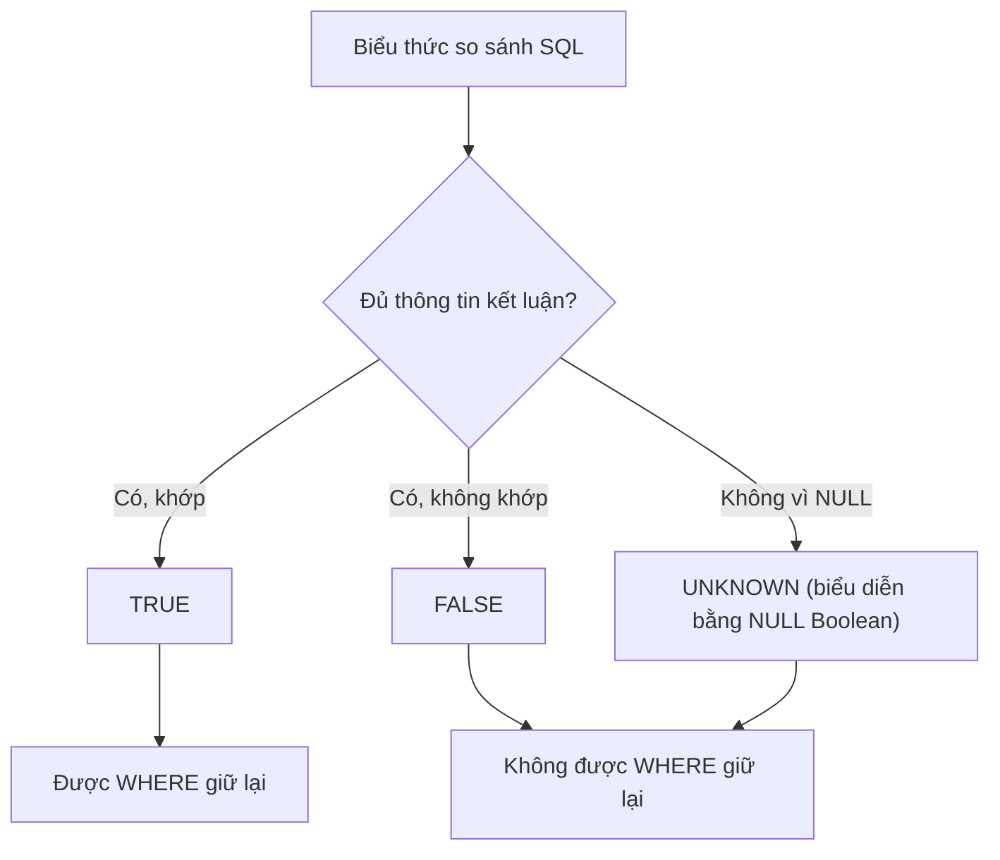

# Boolean, NULL và trạng thái thiếu dữ liệu trong PostgreSQL

Trong cơ sở dữ liệu quan hệ, giá trị Boolean thường được dùng để biểu diễn những thuộc tính có hai trạng thái như tài khoản đang hoạt động hay không, bản ghi đã được phê duyệt hay chưa, hoặc một tùy chọn đã được bật hay tắt. Tuy nhiên, PostgreSQL còn hỗ trợ **`NULL`**, biểu thị sự vắng mặt của một giá trị SQL. Vì thế, một cột `boolean` cho phép `NULL` thực tế có thể chứa ba khả năng: `TRUE`, `FALSE` và `NULL`.

Sự khác biệt này rất quan trọng. `FALSE` là một giá trị có nghĩa rõ ràng: điều kiện sai. `NULL` có nghĩa dữ liệu chưa được biết, không được cung cấp hoặc không áp dụng, tùy cách hệ thống định nghĩa. Nếu gộp hai trạng thái, ứng dụng có thể lọc thiếu bản ghi, tính sai báo cáo hoặc ra quyết định nghiệp vụ không đúng.

Bài học giải thích kiểu `boolean` và logic ba giá trị (three-valued logic) của PostgreSQL, sau đó áp dụng chúng vào `WHERE`, `JOIN`, ràng buộc, tổng hợp dữ liệu và thiết kế ứng dụng Java/Spring Boot.

## 1. Kiểu boolean của PostgreSQL

`boolean` là kiểu dữ liệu SQL gốc được PostgreSQL hỗ trợ. Mỗi giá trị Boolean xác định là đúng hoặc sai; một cột thuộc kiểu này vẫn có thể nhận `NULL` nếu không bị ràng buộc `NOT NULL`.

```sql
SELECT
    TRUE AS approved,
    FALSE AS rejected,
    NULL::boolean AS not_yet_known;
```

PostgreSQL chấp nhận nhiều cách biểu diễn đầu vào cho Boolean, chẳng hạn `TRUE`/`FALSE`, `'yes'`/`'no'`, `'on'`/`'off'` và `'1'`/`'0'`, không phân biệt hoa thường với các dạng chữ hợp lệ. Trong dữ liệu SQL và migration, nên dùng `TRUE` và `FALSE` tường minh để người đọc không hiểu nhầm.

```sql
SELECT
    'true'::boolean AS a,
    'false'::boolean AS b,
    'yes'::boolean AS c,
    '0'::boolean AS d;
```

PostgreSQL có thể hiển thị giá trị Boolean dưới dạng `t` và `f` trong một số kết quả truy vấn hoặc công cụ dòng lệnh. Đó chỉ là cách trình bày của giá trị đúng/sai; kiểu cột vẫn là `boolean`.

Một vài điều cần phân biệt:

| Giá trị | Kiểu và ý nghĩa |
| --- | --- |
| `TRUE` | Boolean đúng |
| `FALSE` | Boolean sai |
| `NULL::boolean` | Không có giá trị Boolean xác định |
| `'false'` | Chuỗi văn bản nếu không có ngữ cảnh ép kiểu Boolean |
| `0`, `1` | Số; không nên coi chúng là giá trị Boolean trong biểu thức SQL chung |
| `''` | Chuỗi rỗng; không tự động được xem là `NULL` |

Trong PostgreSQL, `boolean` có kích thước dữ liệu một byte cho mỗi giá trị Boolean; dung lượng lưu trữ thực tế của một hàng còn phụ thuộc cấu trúc row, NULL bitmap và các yếu tố khác.

## 2. NULL biểu diễn điều gì?

`NULL` là một **dấu hiệu vắng mặt giá trị** trong mô hình SQL. Nó không đồng nghĩa với một giá trị mặc định như `FALSE`, `0` hoặc chuỗi rỗng. Trong hệ thống thực, một cột `NULL` có thể được hiểu theo nhiều trường hợp:

- **Chưa biết**: chưa xác minh địa chỉ giao hàng có hợp lệ hay không.
- **Chưa được cung cấp**: khách hàng chưa chọn nhận hay từ chối bản tin.
- **Không áp dụng**: ngày kết thúc hợp đồng của hợp đồng không có ngày hết hạn.
- **Chưa được đo**: chưa có số liệu từ thiết bị hoặc quy trình đo.

Những trường hợp trên đều có thể được lưu dưới dạng `NULL`, nhưng ý nghĩa nghiệp vụ khác nhau. Nếu cần phân biệt chúng trong báo cáo hoặc quy trình, phải thiết kế thêm trạng thái cụ thể thay vì để một giá trị `NULL` mang nhiều nghĩa.

Ví dụ, với cột `email_verified`:

| Dữ liệu | Ý nghĩa được quy định trong ứng dụng |
| --- | --- |
| `TRUE` | Email đã được xác minh |
| `FALSE` | Email được kiểm tra và không đạt / bị xác nhận sai, theo quy trình |
| `NULL` | Chưa có kết quả kiểm tra |

Nếu chỉ có khái niệm “đã xác minh” và “chưa xác minh”, có thể chọn `boolean NOT NULL DEFAULT FALSE`. Nhưng nếu phải phân biệt “chưa kiểm tra” với “đã kiểm tra và thất bại”, cần mô hình ba trạng thái hoặc một cột trạng thái riêng.

**Nguyên tắc thiết kế:** định nghĩa ý nghĩa của từng trạng thái *trước* khi chọn `NULL` hoặc giá trị mặc định. Không để code frontend, backend và báo cáo tự diễn giải `NULL` theo ba cách khác nhau.

## 3. SQL dùng logic ba giá trị: TRUE, FALSE, UNKNOWN

Phép so sánh trong SQL có thể trả về `TRUE`, `FALSE` hoặc `UNKNOWN`. `UNKNOWN` là **kết quả logic** khi không đủ thông tin để quyết định đúng/sai; khi biểu diễn kết quả đó dưới dạng SQL Boolean, PostgreSQL cho giá trị `NULL`.

```sql
SELECT
    (5 = 5) AS definitely_true,
    (5 = 6) AS definitely_false,
    (5 = NULL) AS unknown_result,
    (NULL = NULL) AS also_unknown;
```

Hai biểu thức cuối cho `NULL`, không phải `FALSE`. Đặc biệt, `NULL = NULL` cũng không trả về `TRUE`: việc hai giá trị đều chưa biết không chứng minh chúng bằng nhau.

Có thể hình dung:



### 3.1. Bảng chân trị của AND và OR

Đặt `T = TRUE`, `F = FALSE`, `U = UNKNOWN`:

| A | B | `A AND B` | `A OR B` |
| --- | --- | --- | --- |
| T | T | T | T |
| T | F | F | T |
| T | U | U | T |
| F | T | F | T |
| F | F | F | F |
| F | U | F | U |
| U | T | U | T |
| U | F | F | U |
| U | U | U | U |

Điểm then chốt: `FALSE AND UNKNOWN` là `FALSE` vì điều kiện đã chắc chắn sai; `TRUE OR UNKNOWN` là `TRUE` vì điều kiện đã chắc chắn đúng.

Phép phủ định:

| A | `NOT A` |
| --- | --- |
| T | F |
| F | T |
| U | U |

Ví dụ SQL:

```sql
SELECT
    TRUE AND NULL::boolean  AS true_and_unknown,
    FALSE AND NULL::boolean AS false_and_unknown,
    TRUE OR NULL::boolean   AS true_or_unknown,
    FALSE OR NULL::boolean  AS false_or_unknown,
    NOT NULL::boolean      AS not_unknown;
```

Các kết quả tương ứng là `NULL`, `FALSE`, `TRUE`, `NULL` và `NULL`.

### 3.2. WHERE chỉ giữ các hàng có điều kiện TRUE

Đối với mệnh đề `WHERE`, PostgreSQL chỉ giữ hàng khi điều kiện có kết quả **`TRUE`**. Điều kiện `FALSE` và `UNKNOWN` đều làm hàng không xuất hiện trong kết quả.

```sql
SELECT *
FROM some_table
WHERE nullable_boolean_column;
```

Câu này chỉ lấy các hàng có giá trị `TRUE`, không lấy hàng `FALSE` hoặc `NULL`. Vì vậy, logic ba giá trị là một phần của cách SQL lọc dữ liệu, không chỉ là vấn đề trình bày.

## 4. Tạo bảng thực hành chứa đủ TRUE, FALSE và NULL

Sử dụng một cơ sở dữ liệu thử nghiệm; không thực hiện các lệnh `DROP` lên dữ liệu có thật. Tạo schema và bảng mới:

```sql
CREATE SCHEMA IF NOT EXISTS boolean_lab;

CREATE TABLE boolean_lab.customer_preferences (
    customer_id bigint GENERATED ALWAYS AS IDENTITY PRIMARY KEY,
    email text NOT NULL UNIQUE,
    is_active boolean NOT NULL DEFAULT TRUE,
    wants_newsletter boolean,
    reviewed_at timestamptz,
    CONSTRAINT chk_newsletter_review
        CHECK (wants_newsletter IS NULL OR reviewed_at IS NOT NULL)
);
```

Trong mô hình minh họa này:

- `is_active` là trạng thái hai giá trị, bắt buộc có giá trị; nếu không truyền thì mặc định `TRUE`.
- `wants_newsletter` là quyết định có ba trạng thái: `TRUE` đồng ý, `FALSE` từ chối, `NULL` chưa có câu trả lời.
- `reviewed_at` ghi thời điểm nhận quyết định. Ràng buộc `CHECK` yêu cầu có thời điểm nếu đã có câu trả lời xác định.

Thêm các bản ghi:

```sql
INSERT INTO boolean_lab.customer_preferences
    (email, is_active, wants_newsletter, reviewed_at)
VALUES
    ('alice@example.test', TRUE,  TRUE,  now()),
    ('bob@example.test',   TRUE,  FALSE, now()),
    ('chris@example.test', FALSE, NULL,  NULL);

-- Bỏ qua is_active để dùng DEFAULT TRUE;
-- bỏ qua wants_newsletter để mặc định NULL.
INSERT INTO boolean_lab.customer_preferences (email)
VALUES ('dana@example.test');

SELECT email, is_active, wants_newsletter, reviewed_at
FROM boolean_lab.customer_preferences
ORDER BY customer_id;
```

Kết quả về mặt trạng thái:

| Email | `is_active` | `wants_newsletter` |
| --- | --- | --- |
| alice@example.test | TRUE | TRUE |
| bob@example.test | TRUE | FALSE |
| chris@example.test | FALSE | NULL |
| dana@example.test | TRUE (mặc định) | NULL |

Dữ liệu được cố ý giữ đơn giản để quan sát SQL. Trong hệ thống thật, trường thể hiện lựa chọn nhận bản tin cần tuân theo quy trình ghi nhận/kiểm chứng lựa chọn của người dùng; không nên suy ra đồng ý từ việc bỏ trống dữ liệu.

## 5. Lọc Boolean: = TRUE, IS TRUE, IS FALSE, IS UNKNOWN

Các cách lọc dưới đây có ý nghĩa khác nhau khi cột cho phép `NULL`.

### 5.1. Lấy những hàng chắc chắn TRUE

```sql
SELECT email
FROM boolean_lab.customer_preferences
WHERE wants_newsletter IS TRUE;
```

Với dữ liệu ví dụ, chỉ có `alice@example.test`. Hai cách sau cũng chọn các hàng `TRUE`:

```sql
WHERE wants_newsletter = TRUE

-- Trong câu SELECT đầy đủ:
SELECT email
FROM boolean_lab.customer_preferences
WHERE wants_newsletter;
```

Tuy nhiên, `IS TRUE` diễn đạt rõ ý định “phải chắc chắn đúng” và hữu ích khi đọc query liên quan tới trạng thái ba giá trị.

### 5.2. Lấy những hàng chắc chắn FALSE

```sql
SELECT email
FROM boolean_lab.customer_preferences
WHERE wants_newsletter IS FALSE;
```

Chỉ có `bob@example.test`.

Phép phủ định cũng chọn các hàng xác định `FALSE`:

```sql
SELECT email
FROM boolean_lab.customer_preferences
WHERE NOT wants_newsletter;
```

**Lưu ý:** `NOT NULL` vẫn là `NULL` trong logic ba giá trị, nên `WHERE NOT wants_newsletter` **không** chọn hai hàng của Chris và Dana.

### 5.3. Lấy các hàng chưa có thông tin

```sql
SELECT email
FROM boolean_lab.customer_preferences
WHERE wants_newsletter IS NULL;
```

Hai hàng của Chris và Dana được chọn. Với biểu thức kiểu Boolean, PostgreSQL cũng hỗ trợ:

```sql
SELECT email
FROM boolean_lab.customer_preferences
WHERE wants_newsletter IS UNKNOWN;
```

Đối với cột Boolean, điều kiện `IS UNKNOWN` tương đương kiểm tra không có giá trị Boolean xác định. Dùng `IS NULL` khi cần nhấn mạnh trạng thái dữ liệu vắng mặt.

### 5.4. Lấy những hàng không chắc chắn TRUE

```sql
SELECT email
FROM boolean_lab.customer_preferences
WHERE wants_newsletter IS NOT TRUE;
```

Điều kiện này nhận cả `FALSE` lẫn `NULL`, tức Bob, Chris và Dana. Khác biệt rất rõ so với `WHERE NOT wants_newsletter` chỉ nhận Bob.

| Điều kiện | TRUE | FALSE | NULL |
| --- | --- | --- | --- |
| `WHERE flag` | Lấy | Bỏ | Bỏ |
| `WHERE NOT flag` | Bỏ | Lấy | Bỏ |
| `WHERE flag IS TRUE` | Lấy | Bỏ | Bỏ |
| `WHERE flag IS FALSE` | Bỏ | Lấy | Bỏ |
| `WHERE flag IS NULL` | Bỏ | Bỏ | Lấy |
| `WHERE flag IS NOT TRUE` | Bỏ | Lấy | Lấy |
| `WHERE flag IS NOT FALSE` | Lấy | Bỏ | Lấy |
| `WHERE flag IS NOT NULL` | Lấy | Lấy | Bỏ |

Thao tác lựa chọn cần gắn với mục tiêu nghiệp vụ. Ví dụ, để **gửi** thông báo chỉ tới người đã xác nhận đồng ý, dùng `IS TRUE`; không dùng `IS NOT FALSE` vì biểu thức đó bao gồm cả người chưa đưa ra lựa chọn.

## 6. So sánh với NULL: vì sao = NULL không hoạt động?

Với SQL chuẩn, không sử dụng `= NULL` hoặc `<> NULL` để phát hiện giá trị thiếu:

```sql
-- Sai về ý nghĩa: điều kiện nhận UNKNOWN, không tìm được hàng NULL.
SELECT email
FROM boolean_lab.customer_preferences
WHERE wants_newsletter = NULL;
```

Cách đúng:

```sql
SELECT email
FROM boolean_lab.customer_preferences
WHERE wants_newsletter IS NULL;
```

Tương tự:

```sql
-- Không phải cách kiểm tra "có giá trị".
WHERE wants_newsletter <> NULL

-- Đúng:
WHERE wants_newsletter IS NOT NULL
```

Lý do là `=` và `<>` biểu thị phép so sánh giữa các giá trị xác định. Khi ít nhất một toán hạng là `NULL`, phép so sánh thông thường trả `UNKNOWN`.

### 6.1. IS DISTINCT FROM: so sánh an toàn với NULL

PostgreSQL hỗ trợ toán tử:

- `a IS DISTINCT FROM b`: hai giá trị khác nhau, **kể cả xét sự hiện diện của NULL**.
- `a IS NOT DISTINCT FROM b`: hai giá trị bằng nhau theo quy tắc coi hai `NULL` là không khác nhau.

```sql
SELECT
    NULL::boolean IS NOT DISTINCT FROM NULL::boolean AS both_missing,
    TRUE IS DISTINCT FROM NULL::boolean AS known_vs_missing,
    FALSE IS NOT DISTINCT FROM FALSE AS equal_false,
    TRUE IS NOT DISTINCT FROM FALSE AS unequal_values;
```

Kết quả lần lượt: `TRUE`, `TRUE`, `TRUE`, `FALSE`. Khác với `=`, hai toán tử trên luôn trả về một giá trị Boolean xác định cho các kiểu dữ liệu có quy tắc so sánh phù hợp.

Giả sử ứng dụng cần lọc chính xác theo một tham số có thể `NULL`, có thể dùng:

```sql
-- $1 là tham số của câu lệnh chuẩn bị, kiểu boolean.
PREPARE find_preferences(boolean) AS
SELECT customer_id, email, wants_newsletter
FROM boolean_lab.customer_preferences
WHERE wants_newsletter IS NOT DISTINCT FROM $1;

EXECUTE find_preferences(NULL);
EXECUTE find_preferences(TRUE);
DEALLOCATE find_preferences;
```

Cách này cho phép truyền `NULL` và tìm đúng những hàng chưa có lựa chọn. Dù vậy, trong API nên định nghĩa rõ truyền tham số `NULL` có nghĩa là **tìm bản ghi NULL** hay **không áp bộ lọc**, vì đó là hai yêu cầu khác nhau.

## 7. AND, OR, NOT và điều kiện kết hợp trong WHERE

Giả sử cần tìm các khách hàng vừa đang hoạt động vừa đã chọn nhận bản tin:

```sql
SELECT email
FROM boolean_lab.customer_preferences
WHERE is_active IS TRUE
  AND wants_newsletter IS TRUE;
```

Chỉ lấy những dòng đáp ứng cả hai điều kiện đúng.

Nếu cần tìm người dùng đang hoạt động **nhưng chưa từng đồng ý**, có hai cách diễn đạt nghiệp vụ khác nhau:

```sql
-- Bao gồm cả người từ chối và người chưa có câu trả lời.
SELECT email
FROM boolean_lab.customer_preferences
WHERE is_active IS TRUE
  AND wants_newsletter IS NOT TRUE;

-- Chỉ những người đã từ chối rõ ràng.
SELECT email
FROM boolean_lab.customer_preferences
WHERE is_active IS TRUE
  AND wants_newsletter IS FALSE;
```

Không nên dùng:

```sql
WHERE is_active AND NOT wants_newsletter
```

nếu yêu cầu phải bao gồm cả trạng thái `NULL`. Câu đó chỉ nhận `FALSE` xác định ở cột thứ hai.

### 7.1. NOT IN với NULL: bẫy phổ biến

Ví dụ:

```sql
SELECT 3 NOT IN (1, 2, NULL) AS result;
```

Kết quả là `NULL` (UNKNOWN), **không phải `TRUE`**. Vì phép so sánh với giá trị `NULL` trong danh sách không thể kết luận, điều kiện `NOT IN` có thể loại bỏ nhiều hàng ngoài dự kiến.

Khi muốn lấy các hàng không có giá trị khớp trong bảng liên quan, `NOT EXISTS` thường diễn tả đúng ý định hơn:

```sql
-- Lấy customer không có bản ghi trong bảng events theo customer_id.
-- Ví dụ giả định boolean_lab.customer_events(customer_id, event_type) tồn tại.
SELECT p.customer_id, p.email
FROM boolean_lab.customer_preferences AS p
WHERE NOT EXISTS (
    SELECT 1
    FROM boolean_lab.customer_events AS e
    WHERE e.customer_id = p.customer_id
);
```

Ví dụ `NOT EXISTS` giả định bảng `customer_events` đã được tạo riêng; nó minh họa dạng query, không thuộc các lệnh thiết lập bảng ở phần 4. Với khóa join cho phép `NULL`, vẫn phải làm rõ ý nghĩa nghiệp vụ của những giá trị thiếu.

### 7.2. CASE WHEN xử lý UNKNOWN ra sao?

`CASE WHEN` chọn nhánh chỉ khi điều kiện là `TRUE`. Nếu điều kiện `FALSE` hoặc `UNKNOWN`, nó đi đến nhánh tiếp theo hoặc `ELSE`:

```sql
SELECT
    email,
    CASE
        WHEN wants_newsletter IS TRUE  THEN 'accepted'
        WHEN wants_newsletter IS FALSE THEN 'declined'
        ELSE 'not_answered'
    END AS newsletter_status
FROM boolean_lab.customer_preferences
ORDER BY customer_id;
```

Không nên viết chỉ hai nhánh `WHEN flag THEN 'yes' ELSE 'no'` nếu cần phân biệt `FALSE` và `NULL`; cách đó gộp những trạng thái khác nhau.

## 8. DEFAULT, NOT NULL và CHECK: bảo vệ ý nghĩa dữ liệu

### 8.1. DEFAULT không cấm NULL

`DEFAULT` được sử dụng khi cột bị bỏ qua trong câu lệnh `INSERT` hoặc được đặt tường minh bằng từ khóa `DEFAULT`:

```sql
CREATE TABLE boolean_lab.feature_flags (
    flag_id bigint GENERATED ALWAYS AS IDENTITY PRIMARY KEY,
    name text NOT NULL UNIQUE,
    enabled boolean DEFAULT FALSE
);

-- Bỏ enabled nên giá trị là FALSE.
INSERT INTO boolean_lab.feature_flags (name)
VALUES ('new_checkout');

-- Chỉ định NULL tường minh thì giá trị vẫn là NULL.
INSERT INTO boolean_lab.feature_flags (name, enabled)
VALUES ('beta_search', NULL);
```

Trong bảng này, `enabled` vẫn nullable. `DEFAULT FALSE` không tự động chuyển những giá trị `NULL` do ứng dụng gửi vào thành `FALSE`.

Nếu nghiệp vụ yêu cầu đúng hai trạng thái, dùng `NOT NULL`:

```sql
CREATE TABLE boolean_lab.strict_feature_flags (
    flag_id bigint GENERATED ALWAYS AS IDENTITY PRIMARY KEY,
    name text NOT NULL UNIQUE,
    enabled boolean NOT NULL DEFAULT FALSE
);
```

Khi ứng dụng gửi `NULL` tường minh cho `enabled`, PostgreSQL từ chối vì vi phạm `NOT NULL`; điều đó tốt hơn việc âm thầm chấp nhận một trạng thái không hợp lệ.

### 8.2. CHECK có thể chấp nhận UNKNOWN

Với ràng buộc `CHECK`, PostgreSQL **từ chối một hàng khi biểu thức kiểm tra là `FALSE`**. Nếu biểu thức là `TRUE` hoặc `UNKNOWN`, hàng được chấp nhận. Đây là khác biệt quan trọng so với `WHERE`, vốn chỉ giữ hàng khi biểu thức `TRUE`.

Ví dụ:

```sql
CREATE TABLE boolean_lab.age_checks (
    id bigint GENERATED ALWAYS AS IDENTITY PRIMARY KEY,
    age integer CHECK (age >= 18)
);

-- Có thể được chấp nhận vì age >= 18 cho UNKNOWN khi age NULL.
INSERT INTO boolean_lab.age_checks (age) VALUES (NULL);
```

Nếu tuổi bắt buộc phải có, cần kết hợp:

```sql
CREATE TABLE boolean_lab.required_age_checks (
    id bigint GENERATED ALWAYS AS IDENTITY PRIMARY KEY,
    age integer NOT NULL CHECK (age >= 18)
);
```

Tương tự, `CHECK (approved = TRUE)` **không đủ** để cấm `approved IS NULL`. Có thể dùng `approved boolean NOT NULL CHECK (approved = TRUE)` hoặc, tùy mục tiêu, `CHECK (approved IS TRUE)`; nhưng cách rõ ràng nhất cho trường có hai trạng thái vẫn là `boolean NOT NULL` kết hợp logic phù hợp.

### 8.3. Khi nào nullable boolean là lựa chọn tốt?

Cột `boolean` nullable phù hợp nếu *có đúng ba trạng thái nghiệp vụ* và trạng thái thiếu dữ liệu có thể giải thích rõ. Nếu thực tế có bốn hoặc nhiều trạng thái, hãy dùng cột trạng thái riêng.

Ví dụ, việc xét duyệt hồ sơ có thể có:

- `draft` — chưa nộp.
- `pending` — đã nộp, đang chờ xử lý.
- `approved` — được duyệt.
- `rejected` — bị từ chối.

Một cột `approved boolean` với `NULL` khó phân biệt `draft` và `pending`. Mô hình trạng thái rõ hơn:

```sql
CREATE TABLE boolean_lab.applications (
    application_id bigint GENERATED ALWAYS AS IDENTITY PRIMARY KEY,
    decision_status text NOT NULL DEFAULT 'draft',
    CONSTRAINT chk_application_status
        CHECK (decision_status IN ('draft', 'pending', 'approved', 'rejected'))
);
```

Đối với tập trạng thái ổn định, có thể cân nhắc kiểu enum của PostgreSQL hoặc bảng tham chiếu, tùy nhu cầu tiến hóa trạng thái và liên kết dữ liệu. Một boolean không nên phải mã hóa một quy trình nhiều bước.

## 9. UNIQUE và NULL: có thể có nhiều giá trị thiếu

Trong PostgreSQL, `UNIQUE` thông thường coi các giá trị `NULL` là **khác nhau cho mục đích kiểm tra tính duy nhất**. Vì thế, một cột `UNIQUE` nullable có thể có nhiều hàng cùng `NULL`.

```sql
CREATE TABLE boolean_lab.external_links (
    link_id bigint GENERATED ALWAYS AS IDENTITY PRIMARY KEY,
    external_code text UNIQUE,
    link_name text NOT NULL
);

INSERT INTO boolean_lab.external_links (external_code, link_name)
VALUES
    (NULL, 'not assigned A'),
    (NULL, 'not assigned B');
```

Hai dòng có thể được thêm vì chưa có mã. Quy tắc này không chỉ áp dụng cho Boolean mà cho những cột khác có `NULL`.

Khi nghiệp vụ muốn coi các `NULL` là trùng nhau trong unique constraint, PostgreSQL **15 trở lên** hỗ trợ `NULLS NOT DISTINCT`:

```sql
CREATE TABLE boolean_lab.one_unknown_slot (
    slot_id bigint GENERATED ALWAYS AS IDENTITY PRIMARY KEY,
    reservation_code text,
    CONSTRAINT uq_reservation_code
        UNIQUE NULLS NOT DISTINCT (reservation_code)
);
```

Theo ràng buộc này, hai hàng có `reservation_code = NULL` xung đột. Đây là một quy tắc chuyên biệt, không phải lý do để sử dụng `UNIQUE NULLS NOT DISTINCT` mặc định cho mọi cột nullable.

Nếu một mã là bắt buộc, thường nên dùng `NOT NULL UNIQUE`. Nếu một mã có thể bỏ trống ở nhiều hàng, unique mặc định có thể đúng hơn.

## 10. GROUP BY, COUNT và các hàm tổng hợp với NULL

Khi báo cáo dữ liệu ba trạng thái, cách đếm khác nhau cho ra con số khác nhau.

### 10.1. COUNT(*) và COUNT(column)

```sql
SELECT
    count(*) AS total_customers,
    count(wants_newsletter) AS answered_customers
FROM boolean_lab.customer_preferences;
```

Với bốn dòng dữ liệu ở phần 4:

- `count(*) = 4`: tính mọi hàng.
- `count(wants_newsletter) = 2`: chỉ tính những hàng có giá trị cột **khác `NULL`**, bao gồm cả `TRUE` và `FALSE`.

Nếu dùng `count(wants_newsletter)` làm số người đồng ý nhận bản tin, kết quả sẽ sai: hàm đó đếm cả những người đã từ chối.

### 10.2. Đếm ba trạng thái với FILTER

```sql
SELECT
    count(*) AS total,
    count(*) FILTER (WHERE wants_newsletter IS TRUE) AS accepted,
    count(*) FILTER (WHERE wants_newsletter IS FALSE) AS declined,
    count(*) FILTER (WHERE wants_newsletter IS NULL) AS not_answered
FROM boolean_lab.customer_preferences;
```

Kết quả tương ứng: tổng 4, đồng ý 1, từ chối 1, chưa trả lời 2.

Có thể sử dụng `GROUP BY`:

```sql
SELECT wants_newsletter, count(*) AS row_count
FROM boolean_lab.customer_preferences
GROUP BY wants_newsletter
ORDER BY wants_newsletter NULLS LAST;
```

Trong `GROUP BY`, các hàng có giá trị nhóm `NULL` được nhóm chung với nhau để tổng hợp, dù biểu thức `NULL = NULL` không trả về `TRUE`. Đây là quy tắc nhóm dữ liệu riêng của SQL; không nên suy luận rằng `NULL` đã trở thành một giá trị xác định.

### 10.3. bool_and, bool_or và NULL

PostgreSQL có hai aggregate cho giá trị Boolean:

- `bool_and(flag)`: `TRUE` nếu mọi giá trị **không NULL** trong nhóm đều `TRUE`; `FALSE` nếu có giá trị `FALSE`.
- `bool_or(flag)`: `TRUE` nếu có ít nhất một giá trị `TRUE`; `FALSE` nếu mọi giá trị **không NULL** trong nhóm đều `FALSE`.

Các aggregate này bỏ qua input `NULL`. Nếu không có giá trị không-NULL nào để tổng hợp, kết quả thường là `NULL`, không phải mặc định `FALSE`.

```sql
SELECT
    bool_and(wants_newsletter) AS all_known_accepted,
    bool_or(wants_newsletter) AS any_known_accepted
FROM boolean_lab.customer_preferences;
```

Do dữ liệu mẫu có `TRUE` và `FALSE`, `bool_and` là `FALSE`, `bool_or` là `TRUE`.

Nếu nghiệp vụ muốn xác định “tất cả khách hàng đều trả lời và đều đồng ý”, `bool_and` một mình chưa đủ vì nó bỏ qua `NULL`. Có thể kết hợp điều kiện:

```sql
SELECT
    count(*) > 0
    AND count(*) = count(wants_newsletter)
    AND bool_and(wants_newsletter) AS all_answered_and_accepted
FROM boolean_lab.customer_preferences;
```

Biểu thức trên yêu cầu có ít nhất một dòng, không có `NULL` và mọi câu trả lời đều `TRUE`. Việc chọn đúng ý nghĩa cho tập rỗng (ví dụ “mọi phần tử đều đúng” trong logic toán học) phải được định nghĩa theo yêu cầu sản phẩm.

## 11. COALESCE, NULLIF và CASE: xử lý dữ liệu thiếu có chủ đích

### 11.1. COALESCE trả giá trị đầu tiên không NULL

```sql
SELECT
    email,
    COALESCE(wants_newsletter, FALSE) AS newsletter_for_display
FROM boolean_lab.customer_preferences;
```

Với dòng chưa có câu trả lời, kết quả biểu diễn sẽ là `FALSE`. Điều đó có thể phù hợp với giao diện mặc định “chưa bật”, nhưng **không có nghĩa database đã xác nhận người dùng từ chối**. Cột gốc vẫn giữ `NULL`; việc diễn giải trong SELECT không thay đổi dữ liệu.

Nên tách hai mục tiêu:

- **Điều khiển tác vụ**: chỉ xử lý người có `wants_newsletter IS TRUE`.
- **Hiển thị trạng thái**: dùng `CASE` để phân biệt đồng ý, từ chối và chưa trả lời.

Không nên lạm dụng `COALESCE(flag, FALSE)` cho mọi biểu thức; nó có thể che giấu tình trạng dữ liệu chưa được thu thập.

### 11.2. NULLIF chuyển một giá trị sentinel thành NULL

`NULLIF(a, b)` trả `NULL` nếu `a = b` là `TRUE`, ngược lại trả `a`:

```sql
SELECT
    NULLIF('', '') AS blank_becomes_null,
    NULLIF('hello', '') AS preserved_text;
```

Trường hợp phổ biến khi nhập liệu là chuyển chuỗi rỗng thành `NULL` để biểu thị “không cung cấp”, nếu nghiệp vụ quy định hai trạng thái đó tương đương:

```sql
SELECT NULLIF(trim('   '), '') AS optional_text;
```

Không áp dụng quy tắc này mù quáng với dữ liệu mà chuỗi rỗng có ý nghĩa riêng.

### 11.3. CASE để giữ rõ ba trạng thái

```sql
SELECT
    email,
    CASE
        WHEN wants_newsletter IS TRUE  THEN 'Đã đồng ý'
        WHEN wants_newsletter IS FALSE THEN 'Đã từ chối'
        ELSE 'Chưa trả lời'
    END AS decision_label
FROM boolean_lab.customer_preferences;
```

Ở đây mỗi đầu ra có nghĩa nghiệp vụ riêng, giảm nguy cơ báo cáo gộp nhầm `FALSE` và `NULL`.

## 12. ORDER BY và NULLS FIRST / NULLS LAST

Nếu sắp xếp theo cột có `NULL`, PostgreSQL hỗ trợ chỉ rõ vị trí giá trị thiếu:

```sql
SELECT email, wants_newsletter
FROM boolean_lab.customer_preferences
ORDER BY wants_newsletter ASC NULLS LAST, email;
```

Với Boolean, thứ tự `ASC` của các giá trị đã biết là `FALSE` trước `TRUE`. `NULLS LAST` đặt các hàng chưa trả lời cuối cùng.

```sql
SELECT email, wants_newsletter
FROM boolean_lab.customer_preferences
ORDER BY wants_newsletter DESC NULLS FIRST, email;
```

Ở PostgreSQL, nếu không ghi gì thêm thì `ORDER BY ... ASC` mặc định `NULLS LAST`, còn `ORDER BY ... DESC` mặc định `NULLS FIRST`. Tuy nhiên, khi logic hiển thị quan trọng, nên viết tường minh để người đọc không phải nhớ quy tắc mặc định.

Muốn sắp xếp theo mức độ ưu tiên nghiệp vụ thay vì giá trị Boolean thô, dùng `CASE`:

```sql
SELECT email, wants_newsletter
FROM boolean_lab.customer_preferences
ORDER BY
    CASE
        WHEN wants_newsletter IS NULL  THEN 0
        WHEN wants_newsletter IS FALSE THEN 1
        ELSE 2
    END,
    email;
```

Ví dụ này đưa nhóm chưa trả lời lên đầu, sau đó nhóm từ chối, cuối cùng nhóm đồng ý. Đây là thứ tự do ứng dụng định nghĩa, không phải quy tắc chung của PostgreSQL.

## 13. NULL trong JOIN và quan hệ dữ liệu

`NULL` không chỉ ảnh hưởng bộ lọc Boolean; nó còn ảnh hưởng phép nối.

Ví dụ tạo bảng ghi nhận đánh giá tùy chọn:

```sql
CREATE TABLE boolean_lab.preference_reviews (
    review_id bigint GENERATED ALWAYS AS IDENTITY PRIMARY KEY,
    customer_id bigint
        REFERENCES boolean_lab.customer_preferences(customer_id),
    review_note text NOT NULL
);
```

Nếu join bằng phép bằng thông thường:

```sql
SELECT p.email, r.review_note
FROM boolean_lab.customer_preferences AS p
LEFT JOIN boolean_lab.preference_reviews AS r
    ON r.customer_id = p.customer_id;
```

`LEFT JOIN` giữ mọi hàng từ `p` ngay cả khi không có bản ghi `r` khớp. Các cột từ `r` sẽ là `NULL` khi không tìm được hàng phía phải. Đây là **NULL do kết quả join tạo ra**, khác với việc row thật ở bảng `r` có cột nullable. Trong báo cáo hoặc API, cần hiểu đúng nguồn gốc dữ liệu thiếu.

Một lỗi thường gặp là lọc cột của bảng phải trong `WHERE`:

```sql
SELECT p.email, r.review_note
FROM boolean_lab.customer_preferences AS p
LEFT JOIN boolean_lab.preference_reviews AS r
    ON r.customer_id = p.customer_id
WHERE r.review_note = 'reviewed';
```

Điều kiện trên loại bỏ mọi hàng không khớp vì `r.review_note = 'reviewed'` trở thành `UNKNOWN` khi `r.review_note` là `NULL`; trên thực tế nó có thể làm mất tính “giữ mọi hàng bên trái” mà người viết mong muốn. Nếu muốn giữ tất cả customer nhưng chỉ nối review phù hợp, chuyển bộ lọc vào `ON`:

```sql
SELECT p.email, r.review_note
FROM boolean_lab.customer_preferences AS p
LEFT JOIN boolean_lab.preference_reviews AS r
    ON r.customer_id = p.customer_id
   AND r.review_note = 'reviewed';
```

Lựa chọn đặt điều kiện trong `ON` hoặc `WHERE` phụ thuộc kết quả mong muốn. Điều quan trọng là dự đoán tác động của `UNKNOWN` đối với phép nối và phép lọc.

## 14. Index và truy vấn Boolean/NULL

Một cột Boolean chỉ có tối đa ba trạng thái (nếu nullable), nên mức độ phân biệt giá trị thường thấp. Index B-tree độc lập trên Boolean **không phải lúc nào cũng hữu ích**, nhất là khi phần lớn row cùng một trạng thái và truy vấn chọn tỷ lệ lớn dữ liệu.

Tuy nhiên, có thể có trường hợp hợp lý để dùng **partial index**:

```sql
-- Phù hợp khi rất ít bản ghi đang chờ phản hồi.
CREATE INDEX idx_preferences_pending
ON boolean_lab.customer_preferences (customer_id)
WHERE wants_newsletter IS NULL;
```

Index này chỉ chứa các hàng chưa có câu trả lời, có thể hỗ trợ truy vấn:

```sql
SELECT customer_id, email
FROM boolean_lab.customer_preferences
WHERE wants_newsletter IS NULL
ORDER BY customer_id;
```

Hoặc partial index cho các bản ghi đang hoạt động:

```sql
CREATE INDEX idx_preferences_active_email
ON boolean_lab.customer_preferences (email)
WHERE is_active IS TRUE;
```

Với một truy vấn như:

```sql
SELECT email
FROM boolean_lab.customer_preferences
WHERE is_active IS TRUE
  AND email = 'alice@example.test';
```

PostgreSQL có thể sử dụng index tương ứng nếu planner thấy có lợi. **Không có bảo đảm** mọi truy vấn dùng index: planner dựa trên thống kê, kích thước bảng, độ chọn lọc và chi phí ước tính. Trong schema thực tế, hãy đo bằng `EXPLAIN (ANALYZE, BUFFERS)` trên môi trường được phép, sau khi có dữ liệu và workload đại diện.

Đặc biệt khi dùng partial index, điều kiện `WHERE` của truy vấn cần phù hợp với predicate của index để planner nhận ra khả năng sử dụng. Hai biểu thức có thể có kết quả logic gần giống nhau nhưng không nhất thiết được planner chứng minh tương đương cho mọi kế hoạch hoặc tham số hóa.

## 15. Java, JDBC và Spring Boot: giữ được NULL ở tầng ứng dụng

SQL có ba trạng thái, nhưng kiểu nguyên thủy `boolean` của Java chỉ có `true` và `false`. Khi cột PostgreSQL có thể `NULL`, kiểu Java thường phù hợp là **`Boolean`** (wrapper) hoặc một kiểu trạng thái nghiệp vụ riêng.

### 15.1. Đọc nullable Boolean với JDBC

Nếu dùng `ResultSet.getBoolean(...)`, JDBC trả primitive boolean. Khi giá trị SQL là `NULL`, kết quả là `false`; cần gọi `wasNull()` ngay sau đó để phân biệt:

```java
boolean rawValue = rs.getBoolean("wants_newsletter");
boolean missing = rs.wasNull();

Boolean decision = missing ? null : rawValue;
```

Có thể dùng API `getObject` hỗ trợ kiểu wrapper khi driver phù hợp:

```java
Boolean decision = rs.getObject("wants_newsletter", Boolean.class);
```

Với PostgreSQL JDBC driver thông dụng, cách đọc `Boolean.class` cho phép nhận `true`, `false` hoặc `null`. Nếu ứng dụng phải hỗ trợ nhiều driver/phiên bản, hãy kiểm tra mapping thực tế.

### 15.2. Ghi NULL an toàn bằng PreparedStatement

Không nối chuỗi SQL từ dữ liệu người dùng. Dùng tham số:

```java
import java.sql.Connection;
import java.sql.PreparedStatement;
import java.sql.SQLException;
import java.sql.Types;

public void updateNewsletterDecision(
        Connection connection,
        long customerId,
        Boolean decision
) throws SQLException {
    String sql = """
        UPDATE boolean_lab.customer_preferences
        SET wants_newsletter = ?,
            reviewed_at = CASE
                WHEN ? IS NULL THEN NULL
                ELSE now()
            END
        WHERE customer_id = ?
        """;

    try (PreparedStatement ps = connection.prepareStatement(sql)) {
        if (decision == null) {
            ps.setNull(1, Types.BOOLEAN);
            ps.setNull(2, Types.BOOLEAN);
        } else {
            ps.setBoolean(1, decision);
            ps.setBoolean(2, decision);
        }
        ps.setLong(3, customerId);
        ps.executeUpdate();
    }
}
```

Ví dụ này cập nhật lại `reviewed_at` theo giá trị quyết định và giữ nhất quán với ràng buộc trong bảng ví dụ. Nếu nghiệp vụ cần **lưu lịch sử lựa chọn** hoặc chứng cứ đồng ý, nên dùng bảng sự kiện/audit riêng; cập nhật đè một cột không đủ để lưu lịch sử.

### 15.3. JPA/Hibernate: boolean và Boolean

Ví dụ entity:

```java
import jakarta.persistence.Column;
import jakarta.persistence.Entity;
import jakarta.persistence.GeneratedValue;
import jakarta.persistence.GenerationType;
import jakarta.persistence.Id;
import jakarta.persistence.Table;

@Entity
@Table(name = "customer_preferences", schema = "boolean_lab")
public class CustomerPreference {
    @Id
    @GeneratedValue(strategy = GenerationType.IDENTITY)
    @Column(name = "customer_id")
    private Long customerId;

    @Column(name = "is_active", nullable = false)
    private boolean active;

    @Column(name = "wants_newsletter")
    private Boolean wantsNewsletter;

    protected CustomerPreference() {
    }
}
```

- `boolean` phù hợp khi database đảm bảo `NOT NULL` và ứng dụng có giá trị hợp lệ ở thời điểm ghi.
- `Boolean` biểu diễn ba khả năng khi SQL cho phép `NULL`.
- Java field được khởi tạo `false` mặc định nếu là primitive. Điều này khác với **DEFAULT TRUE** của database: ORM có thể gửi `FALSE` tường minh khi INSERT, khiến mặc định SQL không được sử dụng.
- `@Column(nullable = false)` mô tả mapping và có thể tham gia sinh schema tùy cấu hình, nhưng trong hệ thống dùng migration, ràng buộc `NOT NULL` thực tế ở PostgreSQL mới là lớp bảo vệ cuối cùng.

Để áp dụng mặc định database khi tạo row, cần thống nhất cách ORM sinh `INSERT` và cách entity được khởi tạo. Không giả định `DEFAULT TRUE` sẽ chạy nếu ORM luôn gửi giá trị của cột.

### 15.4. Tránh NullPointerException khi dùng Boolean wrapper

```java
Boolean wantsNewsletter = preference.getWantsNewsletter();

// An toàn với null:
if (Boolean.TRUE.equals(wantsNewsletter)) {
    sendNewsletter();
}

// Dễ xảy ra NullPointerException khi unboxing:
if (wantsNewsletter) {
    sendNewsletter();
}
```

Đoạn thứ hai chỉ hợp lệ nếu chắc chắn `wantsNewsletter` không `null`. Với dữ liệu ba trạng thái, hãy xử lý từng trường hợp bằng logic rõ nghĩa hoặc một mô hình trạng thái riêng.

### 15.5. API PATCH: không truyền trường khác với truyền null

Khi thiết kế API cập nhật một phần, cần phân biệt:

- Request **không có trường** `wantsNewsletter`: thường nghĩa là **giữ nguyên**.
- Request có `"wantsNewsletter": null`: có thể nghĩa là **xóa lựa chọn hiện tại** hoặc “chưa biết”.
- Request có `"wantsNewsletter": false`: **từ chối** tường minh.
- Request có `"wantsNewsletter": true`: **đồng ý** tường minh.

Ví dụ hai payload JSON:

```json
{}
```

```json
{"wantsNewsletter": null}
```

Hai payload đó khác nhau dù một DTO chỉ có `Boolean wantsNewsletter` có thể ánh xạ cả hai thành Java `null` nếu không theo dõi sự hiện diện của field. Với PATCH, cần dùng kiểu mô tả sự hiện diện hoặc cơ chế cập nhật phù hợp, tránh vô tình xóa dữ liệu khi client chỉ bỏ qua trường.

## 16. JSONB: SQL NULL khác JSON null và field không tồn tại

PostgreSQL có kiểu `jsonb`. Bên trong JSON có giá trị `null` riêng, khác với `NULL` của SQL. Ngoài ra, một object JSON có thể **không có khóa** cần đọc.

```sql
SELECT
    '{}'::jsonb -> 'flag' AS missing_key,
    '{"flag":null}'::jsonb -> 'flag' AS json_null_value,
    '{"flag":false}'::jsonb -> 'flag' AS json_false_value;
```

Phân biệt khi phân tích kết quả:

- `'{}'::jsonb -> 'flag'`: khóa không tồn tại nên toán tử trả **SQL `NULL`**.
- `'{"flag":null}'::jsonb -> 'flag'`: trả **giá trị JSONB `null`**, không phải SQL `NULL`.
- `'{"flag":false}'::jsonb -> 'flag'`: trả giá trị JSONB Boolean `false`.

Có thể quan sát bằng:

```sql
SELECT
    jsonb_typeof('{}'::jsonb -> 'flag') AS missing_type,
    jsonb_typeof('{"flag":null}'::jsonb -> 'flag') AS json_null_type,
    jsonb_typeof('{"flag":false}'::jsonb -> 'flag') AS json_boolean_type;
```

Kết quả của ba biểu thức lần lượt là **SQL `NULL`**, chuỗi `'null'` và chuỗi `'boolean'`. Toán tử `->>` chuyển giá trị JSON thành văn bản; cả field thiếu và JSON `null` thường đưa đến SQL `NULL` khi dùng `->>`, nên không phù hợp nếu cần phân biệt đủ ba trường hợp chỉ từ kết quả văn bản.

Ứng dụng sử dụng JSONB cho cấu hình hoặc payload nên định nghĩa rõ “khóa vắng mặt”, “khóa có giá trị JSON null” và “khóa có Boolean false”, nhất là khi xử lý patch/merge.

## 17. Chuyển một cột nullable Boolean thành NOT NULL

Trong hệ thống cũ, cột `boolean` có thể cho `NULL` dù nghiệp vụ nay yêu cầu chỉ có `TRUE` hoặc `FALSE`. Không nên chuyển trực tiếp `NULL` thành `FALSE` trước khi xác định ý nghĩa dữ liệu đang thiếu.

Quy trình thường gồm:

1. **Đo hiện trạng**: đếm số hàng `TRUE`, `FALSE`, `NULL` và tìm xem những giá trị thiếu thuộc nhóm nghiệp vụ nào.
2. **Quyết định giá trị thay thế** cùng người phụ trách nghiệp vụ; có thể cần thu thập thêm dữ liệu thay vì tự mặc định.
3. **Cập nhật dữ liệu theo chính sách** và bảo đảm code mới không tạo `NULL`.
4. **Thêm ràng buộc** `NOT NULL` khi dữ liệu đã phù hợp và chọn `DEFAULT` nếu việc bỏ qua cột phải có giá trị xác định.
5. **Theo dõi sau migration** và xác nhận các API/ORM/report không tiếp tục kỳ vọng trạng thái `NULL`.

Ví dụ minh họa sau **chỉ đúng nếu nghiệp vụ quyết định NULL phải được hiểu là FALSE**:

```sql
-- Minh họa trên bảng thử nghiệm riêng.
CREATE TABLE boolean_lab.old_settings (
    setting_id bigint GENERATED ALWAYS AS IDENTITY PRIMARY KEY,
    enabled boolean
);

INSERT INTO boolean_lab.old_settings (enabled)
VALUES (TRUE), (FALSE), (NULL);

-- Quan sát trước khi thay đổi:
SELECT
    count(*) AS total,
    count(*) FILTER (WHERE enabled IS NULL) AS missing
FROM boolean_lab.old_settings;

-- Thực hiện sau khi đã được quyết định nghiệp vụ:
UPDATE boolean_lab.old_settings
SET enabled = FALSE
WHERE enabled IS NULL;

ALTER TABLE boolean_lab.old_settings
    ALTER COLUMN enabled SET DEFAULT FALSE;

ALTER TABLE boolean_lab.old_settings
    ALTER COLUMN enabled SET NOT NULL;
```

Ở bảng lớn, `UPDATE` có thể tạo lượng ghi WAL đáng kể, còn `ALTER TABLE ... SET NOT NULL` có thể cần kiểm tra dữ liệu và lấy khóa ảnh hưởng hoạt động. Phải lập kế hoạch batch/migration theo môi trường thật; không chạy tùy tiện trên production.

Nếu `NULL` có nghĩa “chưa biết” và không thể kết luận `FALSE`, cần giữ nullable hoặc chuyển sang mô hình trạng thái đầy đủ, thay vì ép mọi `NULL` về một giá trị giả.

## 18. Lỗi thường gặp và cách xử lý

| Hiện tượng | Nguyên nhân phổ biến | Cách xử lý |
| --- | --- | --- |
| `WHERE flag = NULL` không trả hàng nào | Phép bằng với `NULL` cho UNKNOWN | Dùng `flag IS NULL` |
| `WHERE NOT flag` bỏ qua hàng `NULL` | `NOT UNKNOWN` vẫn UNKNOWN | Dùng `IS NOT TRUE` khi muốn cả `FALSE` và `NULL` |
| `CHECK (age >= 18)` cho phép tuổi `NULL` | CHECK chỉ loại hàng có biểu thức FALSE | Bổ sung `NOT NULL` nếu bắt buộc nhập tuổi |
| `DEFAULT FALSE` nhưng hàng vẫn có `NULL` | Caller gửi `NULL` tường minh | Thêm `NOT NULL` khi miền nghiệp vụ chỉ có hai trạng thái |
| `count(flag)` thấp hơn `count(*)` | `count(column)` bỏ qua `NULL` | Chọn `count(*)` hoặc `FILTER` theo mục tiêu |
| `bool_and` báo `TRUE` khi còn người chưa trả lời | Aggregate bỏ qua đầu vào `NULL` | Kiểm tra thêm `count(*) = count(flag)` |
| `NOT IN` cho kết quả không như mong muốn | Danh sách hoặc subquery chứa `NULL` | Cân nhắc `NOT EXISTS` và soát khóa join |
| Java nhận `false` cho cả `FALSE` và `NULL` | `getBoolean` không phân biệt nếu không gọi `wasNull` | Dùng `getObject(..., Boolean.class)` hoặc `wasNull` |
| API PATCH xóa nhầm quyết định | Không phân biệt field thiếu với field chứa JSON null | Theo dõi field presence rõ ràng |
| Báo cáo gộp chưa trả lời với từ chối | `COALESCE(flag, FALSE)` làm mất trạng thái | Dùng `CASE` hoặc nhóm ba trạng thái riêng |

## 19. Bài thực hành: từ SQL Boolean đến mô hình nghiệp vụ

Các bài sau sử dụng `boolean_lab.customer_preferences` đã tạo ở phần 4.

**Bài 1 – Dự đoán kết quả theo logic ba giá trị**

Không chạy ngay; hãy tự điền `TRUE`, `FALSE` hoặc `NULL` cho mỗi biểu thức:

```sql
SELECT
    TRUE AND NULL::boolean AS a,
    FALSE AND NULL::boolean AS b,
    FALSE OR NULL::boolean AS c,
    NULL::boolean IS NOT TRUE AS d,
    NULL::boolean = NULL::boolean AS e;
```

Sau đó chạy SQL và đối chiếu với bảng chân trị ở phần 3.

**Bài 2 – Chọn đúng bộ lọc**

Viết ba truy vấn riêng để lấy: (1) chỉ khách đã đồng ý; (2) chỉ khách đã từ chối; (3) chỉ khách chưa trả lời. Gợi ý dùng lần lượt `IS TRUE`, `IS FALSE` và `IS NULL`.

**Bài 3 – Đếm ba trạng thái không gộp nhầm**

Tạo báo cáo một dòng gồm số khách đang hoạt động, số đã đồng ý, số đã từ chối và số chưa có câu trả lời. So sánh `count(*)` với `count(wants_newsletter)`.

**Bài 4 – Tự kiểm tra DEFAULT và NULL**

```sql
INSERT INTO boolean_lab.customer_preferences (email)
VALUES ('eva@example.test');

SELECT email, is_active, wants_newsletter
FROM boolean_lab.customer_preferences
WHERE email = 'eva@example.test';
```

Dự đoán vì sao `is_active` là `TRUE` còn `wants_newsletter` là `NULL`. Sau đó thử gửi `NULL` tường minh cho `is_active` trong môi trường thử nghiệm và quan sát ràng buộc `NOT NULL`.

**Bài 5 – CHECK và giá trị thiếu**

Dùng bảng `age_checks` trong phần 8 để kiểm tra insert `NULL`. So sánh với bảng `required_age_checks` có `NOT NULL`. Giải thích tại sao cùng một biểu thức `CHECK (age >= 18)` lại có thể cho phép hàng đầu tiên.

**Bài 6 – Đưa trạng thái vào Java**

Thiết kế DTO phản ánh `wants_newsletter` có ba khả năng. Xử lý `Boolean.TRUE.equals(value)` khi cần chạy tác vụ dành riêng cho người đã đồng ý. Trong API cập nhật một phần, định nghĩa rõ ba hành động: không đổi, xóa lựa chọn, ghi `TRUE`/`FALSE`.

## 20. Những nguyên tắc cần ghi nhớ

- `boolean` của PostgreSQL lưu `TRUE` và `FALSE`; cột nullable có thêm trạng thái `NULL`. **`NULL` không phải `FALSE`**, cũng không phải chuỗi rỗng hay số 0.
- SQL dùng logic ba giá trị. `WHERE` giữ hàng khi điều kiện `TRUE`, loại cả `FALSE` lẫn `UNKNOWN`. `NOT` không biến `UNKNOWN` thành `TRUE`.
- Dùng `IS NULL`/`IS NOT NULL` để kiểm tra giá trị thiếu; dùng `IS TRUE`, `IS FALSE`, `IS NOT TRUE` khi muốn thể hiện rõ cách xử lý Boolean ba trạng thái.
- `IS DISTINCT FROM` và `IS NOT DISTINCT FROM` hữu ích khi cần so sánh hai giá trị có thể `NULL` mà vẫn nhận kết quả đúng/sai xác định.
- `DEFAULT` chỉ áp dụng khi được yêu cầu hoặc cột bị bỏ qua, không tự cấm `NULL`; `NOT NULL` bảo vệ ràng buộc bắt buộc. `CHECK` chấp nhận UNKNOWN, còn `UNIQUE` có quy tắc NULL riêng.
- Các hàm `COUNT(column)`, `bool_and` và `bool_or` bỏ qua đầu vào `NULL`; báo cáo cần đếm riêng số bản ghi chưa có dữ liệu.
- Trong Java/JDBC/JPA, dùng kiểu `Boolean` khi cần phân biệt `true`, `false`, `null`. Với API PATCH hoặc JSONB, phải xét cả sự hiện diện của thuộc tính.
- Nếu miền nghiệp vụ có nhiều hơn ba trạng thái, dùng cột trạng thái được ràng buộc rõ ràng. Không ép nhiều ý nghĩa khác nhau vào một `boolean` nullable.

Thiết kế Boolean đúng không chỉ là lựa chọn kiểu cột. Quan trọng hơn là xác định một sự kiện đã được xác nhận đúng, xác nhận sai hay **chưa đủ dữ liệu để kết luận**. PostgreSQL cung cấp các công cụ SQL cần thiết để giữ nguyên sự khác biệt đó từ lưu trữ đến truy vấn và ứng dụng.
