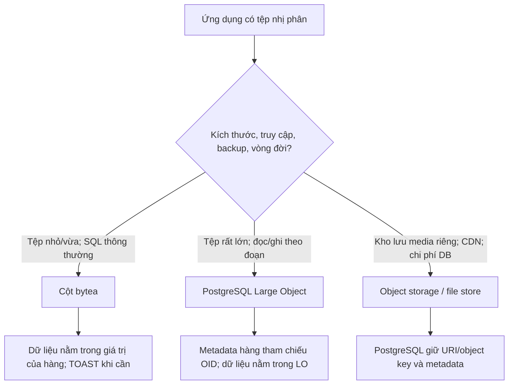
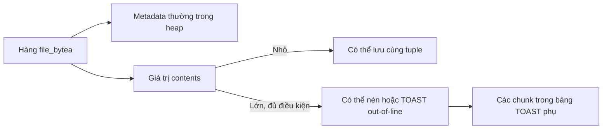
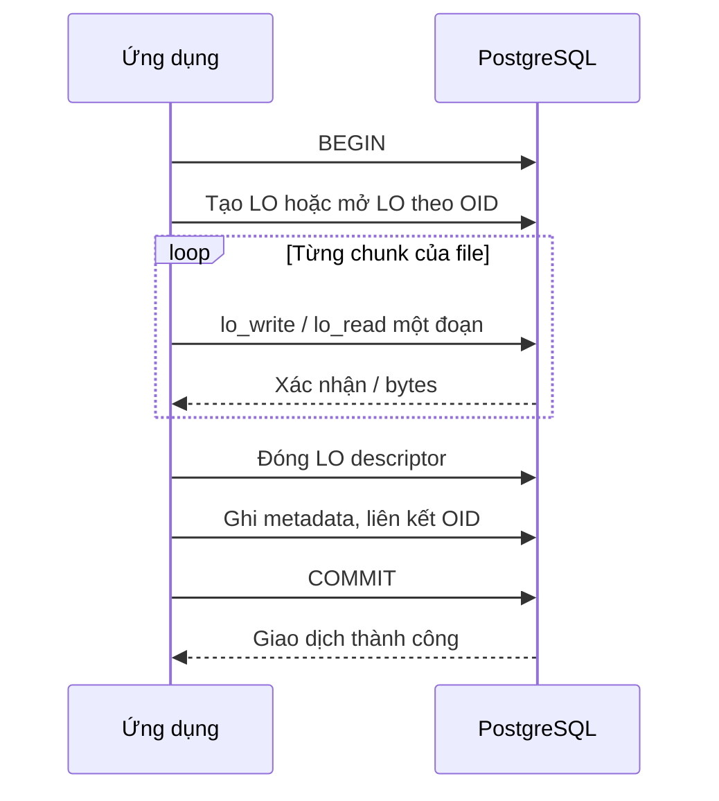

# Dữ liệu nhị phân bytea và đối tượng lớn trong PostgreSQL

Hầu hết các bài học SQL bắt đầu với chuỗi ký tự, số, ngày giờ và các quan hệ giữa bảng. Trong ứng dụng thật, PostgreSQL còn có thể lưu **dữ liệu nhị phân** (*binary data*): ảnh đại diện, tài liệu PDF, chữ ký điện tử, tệp đính kèm, bản ghi âm, chứng từ được số hóa hoặc những gói dữ liệu mà không thể biểu diễn an toàn như một chuỗi `TEXT` thông thường.

PostgreSQL có hai cơ chế quan trọng:

1. **`bytea`**: một kiểu cột lưu chuỗi byte như **giá trị của một hàng**. Có thể chèn, truy vấn, cập nhật và xóa bằng SQL thông thường.
2. **Large Object (LO, đối tượng lớn)**: cơ chế lưu các đối tượng nhị phân được quản lý riêng trong PostgreSQL, tham chiếu bằng một định danh kiểu **`oid`**, đồng thời có API để đọc/ghi theo từng đoạn.

Chúng không tương đương. Cột `bytea` tự mang dữ liệu; cột `oid` chỉ giữ **mã tham chiếu** đến Large Object. Cách lưu ảnh hưởng đến transaction, backup, quyền, bộ nhớ của client, cách dọn dữ liệu và giới hạn kích thước.

Bài học sẽ giải thích cơ chế của cả hai, minh họa bằng SQL và `psql`, so sánh với lưu tệp ngoài database, rồi đưa ra cách chọn phù hợp trong ứng dụng PostgreSQL/Java.

## 1. Dữ liệu nhị phân khác dữ liệu văn bản ra sao?

Với dữ liệu văn bản, ta có thể viết:

```sql
SELECT 'Xin chào PostgreSQL'::text;
```

Nhưng một tệp PNG, PDF hoặc ZIP gồm **các byte tùy ý**, có thể chứa `0x00`, byte không phải UTF-8 hợp lệ, byte điều khiển hoặc ký tự có ý nghĩa đặc biệt đối với SQL. Nếu ép toàn bộ tệp thành `TEXT`, PostgreSQL có thể từ chối chuỗi không hợp lệ theo encoding database hoặc dữ liệu bị biến dạng khi chuyển mã.

Trong khi đó, `bytea` lưu chính xác một **dãy byte**, chẳng hạn:

```text
00 FF 10 20 41 42 43
```

Đây là **7 byte**, không phải chuỗi gồm bảy ký tự hiển thị. Giá trị byte `FF` không bắt buộc là một ký tự UTF-8 hợp lệ, nhưng hoàn toàn hợp lệ trong `bytea`.

| Kiểu/cơ chế | Nội dung lưu | Khi nào dùng |
| --- | --- | --- |
| `TEXT` | Văn bản theo encoding PostgreSQL | Tên, mô tả, nội dung text |
| `JSONB` | Cấu trúc dữ liệu JSON được phân tích | Thuộc tính động, tài liệu JSON có truy vấn cấu trúc |
| `bytea` | Dãy byte không cần là văn bản | Ảnh nhỏ/vừa, hash, chứng từ nhỏ, payload nhị phân |
| Large Object | Dữ liệu nhị phân được quản lý theo LO API | Tệp lớn cần truyền theo từng đoạn |
| Object storage ngoài DB | Byte lưu tại hệ thống tệp/dịch vụ đối tượng; PostgreSQL lưu metadata | Khối lượng tệp lớn, phân phối CDN, xử lý media |

**Base64 hoặc hex không phải kiểu lưu trữ nhị phân tối ưu trong database.** Chúng là **cách biểu diễn byte thành văn bản** để truyền trong môi trường chỉ hiểu text. Khi dữ liệu có thể lưu trực tiếp bằng `bytea`, không cần chuyển thành Base64 rồi lưu trong `TEXT` nếu không có yêu cầu tích hợp đặc biệt.

## 2. Tổng quan: bytea, Large Object và lưu tệp bên ngoài



### 2.1. Bảng so sánh nhanh

| Tiêu chí | `bytea` | Large Object |
| --- | --- | --- |
| Cách biểu diễn trong bảng | Cột có kiểu `bytea` mang trực tiếp nội dung | Cột thường là `oid` tham chiếu LO độc lập |
| Kích thước tối đa về mặt cơ chế | Một giá trị `bytea` bị giới hạn bởi kích thước trường PostgreSQL, xấp xỉ **1 GB** và thực tế nhỏ hơn | Large Object có thể đạt khoảng **4 TB** theo giới hạn cơ chế |
| Đọc/ghi SQL bình thường | Rất thuận tiện | Có các hàm SQL, nhưng streaming cần LO API |
| Truyền tệp lớn theo đoạn | Có thể xử lý đoạn bằng truy vấn, nhưng toàn bộ giá trị vẫn chịu giới hạn `bytea` | Thiết kế cho việc đọc/ghi từng đoạn |
| Quan hệ với hàng chứa tham chiếu | Dữ liệu được quản lý cùng cột/hàng | Xóa hàng tham chiếu **không tự xóa LO** |
| Tính toàn vẹn tham chiếu | Không có tham chiếu ngoài: byte nằm trong hàng | `oid` không tự bảo đảm LO tồn tại |
| Quyền truy cập | Thông qua quyền bảng/cột, chính sách RLS nếu có | Có hệ thống quyền LO riêng, ngoài quyền bảng tham chiếu |
| Transaction | Thay đổi cột theo transaction thông thường | Tạo/ghi/xóa LO có tính giao dịch nhưng phải quản lý đồng bộ metadata |
| Backup/restore | Có trong dữ liệu bảng thông thường | Cần bảo đảm công cụ/tuỳ chọn backup bao gồm Large Objects |
| Mức độ tiện dụng với ORM | Thường đơn giản hơn | Cần driver/API tương thích và quản lý transaction rõ ràng |

Các mốc “1 GB” và “4 TB” là **giới hạn lý thuyết/cơ chế**, không phải khuyến nghị tải tệp lớn đến sát giới hạn. Bộ nhớ ứng dụng, WAL, thời gian backup, truy vấn, replication và hiệu suất thường tạo ra giới hạn vận hành thấp hơn nhiều.

## 3. Kiểu bytea lưu dữ liệu như thế nào?

`bytea` là kiểu dữ liệu chuẩn của PostgreSQL để chứa **byte string**. Mỗi giá trị `bytea` có thể:

- Chứa bất kỳ byte nào từ `0x00` tới `0xFF`.
- Có độ dài biến đổi, kể cả **0 byte**.
- Là `NULL` nếu cột cho phép và giá trị không được biết/không được cung cấp.
- Được so sánh, nối, cắt hoặc truy cập byte bằng các hàm/toán tử được PostgreSQL hỗ trợ.
- Sử dụng cơ chế **TOAST** khi giá trị đủ lớn theo điều kiện lưu trữ.

### 3.1. Trống (empty) khác NULL

```sql
SELECT
    octet_length(''::bytea) AS empty_size,
    octet_length(NULL::bytea) AS null_size,
    ''::bytea IS NULL AS empty_is_null,
    NULL::bytea IS NULL AS null_is_null;
```

Kết quả về ngữ nghĩa:

| Trường | Giá trị |
| --- | --- |
| `empty_size` | `0` |
| `null_size` | `NULL` |
| `empty_is_null` | `false` |
| `null_is_null` | `true` |

Nếu hệ thống yêu cầu một file bắt buộc có nội dung, `NOT NULL` chưa đủ; cần thêm điều kiện như `CHECK (octet_length(contents) > 0)` hoặc kiểm tra ở ứng dụng.

### 3.2. Hiển thị bytea ở dạng hex

PostgreSQL thường hiển thị `bytea` theo **định dạng hex**, có tiền tố `\x`:

```sql
SELECT decode('00FF1020414243', 'hex') AS data;
```

Kết quả dạng text của giá trị `bytea` khi hiển thị thông thường:

```text
\x00ff1020414243
```

Lưu ý: chuỗi xuất hiện trên màn hình là **biểu diễn để xem dữ liệu**, không có nghĩa cơ sở dữ liệu đang lưu ký tự `\`, `x`, `0`, `0`... thay cho các byte thực.

Thiết lập `bytea_output` điều khiển định dạng hiển thị văn bản của `bytea`, với `hex` là lựa chọn thường gặp. Có thể xem:

```sql
SHOW bytea_output;
```

### 3.3. Cách tạo giá trị bytea không nhập nhằng

Dùng `decode(text, format)` để chuyển biểu diễn hex hoặc Base64 thành byte thực:

```sql
SELECT decode('DEADBEEF', 'hex') AS binary_payload;

SELECT decode('SGVsbG8=', 'base64') AS hello_payload;
```

Hoặc dùng literal `bytea` dạng hex:

```sql
SELECT '\xDEADBEEF'::bytea;
```

Ở ví dụ literal, phần `\x` chỉ ra dữ liệu hex theo cú pháp đầu vào của PostgreSQL. Vì việc escape ký tự backslash có thể khác nhau giữa một file SQL, shell string và source code Java, **`decode(..., 'hex')` là cách trực quan, dễ tái hiện** khi cần đưa một mẫu byte cố định vào bài học.

**Đừng dùng `'DEADBEEF'::bytea` nếu mục tiêu là bốn byte `DE AD BE EF`.** Nếu không có tiền tố hex và cách parse tương ứng, giá trị này có thể được hiểu thành các byte của tám ký tự ASCII.

## 4. Những hàm và toán tử thường dùng với bytea

PostgreSQL có các công cụ thao tác byte mà không cần đổi sang text.

| Hàm/toán tử | Ví dụ | Ý nghĩa |
| --- | --- | --- |
| `octet_length(bytea)` | `octet_length(decode('00FF', 'hex'))` | Độ dài tính bằng **byte** |
| `bit_length(bytea)` | `bit_length(decode('00FF', 'hex'))` | Độ dài tính bằng **bit** |
| `get_byte(data, n)` | `get_byte(decode('00FF', 'hex'), 1)` | Đọc byte ở offset `n`, bắt đầu từ **0** |
| `set_byte(data, n, value)` | `set_byte(decode('00FF', 'hex'), 1, 1)` | Tạo giá trị bytea với byte ở offset `n` được thay |
| `substring(data FROM start FOR count)` | `substring(data FROM 2 FOR 3)` | Cắt chuỗi byte; vị trí `start` bắt đầu từ **1** |
| `encode(bytea, 'hex')` | `encode(decode('00FF','hex'),'hex')` | Tạo văn bản hex |
| `decode(text, 'hex')` | `decode('00FF','hex')` | Giải mã văn bản hex thành byte |
| `encode(bytea, 'base64')` | `encode(decode('00FF','hex'),'base64')` | Tạo văn bản Base64 |
| `bytea || bytea` | `decode('00','hex') || decode('FF','hex')` | Nối hai chuỗi byte |
| `convert_to(text, encoding)` | `convert_to('Xin chào','UTF8')` | Mã hóa văn bản thành byte |
| `convert_from(bytea, encoding)` | `convert_from(data,'UTF8')` | Giải mã byte thành văn bản theo encoding |

### 4.1. Ví dụ: đọc byte, cắt byte và chuyển biểu diễn

```sql
WITH sample AS (
    SELECT decode('00FF1020414243', 'hex') AS data
)
SELECT
    octet_length(data) AS size_bytes,
    bit_length(data) AS size_bits,
    get_byte(data, 0) AS first_byte,
    get_byte(data, 1) AS second_byte,
    encode(substring(data FROM 2 FOR 3), 'hex') AS middle_hex,
    encode(data, 'base64') AS as_base64
FROM sample;
```

Ý nghĩa kết quả:

- `size_bytes = 7`; `size_bits = 56`.
- `first_byte = 0`; `second_byte = 255`.
- `substring(data FROM 2 FOR 3)` lấy **byte số 2, 3, 4** theo cách đếm từ 1, nên `middle_hex` là `ff1020`.

**Cảnh báo về chỉ số:** `get_byte` sử dụng **offset bắt đầu từ 0**, trong khi `substring` dùng **vị trí bắt đầu từ 1**. Khi lập trình xử lý định dạng nhị phân, sai khác này có thể gây lỗi lệch một byte.

### 4.2. Giữ byte là byte, chỉ giải mã thành text khi biết encoding

```sql
SELECT
    encode(convert_to('Xin chào', 'UTF8'), 'hex') AS utf8_hex,
    convert_from(convert_to('Xin chào', 'UTF8'), 'UTF8') AS restored_text;
```

`convert_from` chỉ phù hợp khi dữ liệu đầu vào thực sự là **văn bản theo encoding được chỉ định**. Với một tệp ZIP hoặc chuỗi byte tùy ý, `convert_from(...,'UTF8')` có thể báo lỗi vì dữ liệu không phải UTF-8 hợp lệ. Không sử dụng hàm này để “đọc thử nội dung ảnh” như thể ảnh là văn bản.

### 4.3. Khi cần kiểm tra chữ ký hoặc checksum

Ứng dụng có thể cần lưu checksum cùng tệp để phát hiện truyền lỗi hoặc xác minh nội dung. PostgreSQL có các hàm hash và extension phục vụ việc này, nhưng cần phân biệt **checksum kiểm tra tính toàn vẹn** với **mã xác thực mật mã** dùng để chứng minh nguồn gửi.

Một thiết kế metadata phổ biến:

```text
sha256_hex TEXT hoặc một cột bytea chứa 32-byte digest
size_bytes BIGINT
media_type TEXT
created_at TIMESTAMPTZ
```

Nếu dùng hàm `digest(..., 'sha256')`, cần extension `pgcrypto` và quyền tạo extension phù hợp; ứng dụng Java cũng có thể tính digest trước khi gửi. Dù lưu hash ở đâu, **không dùng hash thay cho phân quyền**.

## 5. Ví dụ hoàn chỉnh: bảng lưu file bằng bytea

Trong một database thực hành riêng, tạo schema và bảng:

```sql
CREATE SCHEMA IF NOT EXISTS binary_lab;

CREATE TABLE binary_lab.file_bytea (
    file_id       BIGINT GENERATED ALWAYS AS IDENTITY PRIMARY KEY,
    object_key    TEXT NOT NULL UNIQUE,
    original_name TEXT NOT NULL,
    media_type    TEXT NOT NULL,
    contents      BYTEA NOT NULL,
    created_at    TIMESTAMPTZ NOT NULL DEFAULT now(),
    CONSTRAINT chk_file_bytea_key
        CHECK (length(btrim(object_key)) > 0),
    CONSTRAINT chk_file_bytea_name
        CHECK (length(btrim(original_name)) > 0),
    CONSTRAINT chk_file_bytea_size
        CHECK (octet_length(contents) BETWEEN 1 AND 10485760)
);
```

Trong bài, constraint `octet_length(contents) BETWEEN 1 AND 10485760` quy định file từ **1 byte đến 10 MiB**. Đây là **giới hạn nghiệp vụ giả định để thực hành**, không phải giới hạn hệ thống của `bytea` và không phải cấu hình phù hợp cho mọi ứng dụng.

### 5.1. Chèn tệp nhị phân mẫu

```sql
INSERT INTO binary_lab.file_bytea
    (object_key, original_name, media_type, contents)
VALUES
    ('sample-001', 'bytes.bin', 'application/octet-stream',
     decode('00FF1020414243', 'hex'))
RETURNING
    file_id,
    object_key,
    octet_length(contents) AS size_bytes;
```

Với dữ liệu demo mới, dòng được chèn có kích thước **7 byte**. `file_id` là identity tự sinh nên giá trị thực có thể khác nếu sequence đã từng được sử dụng.

`original_name` và `media_type` chỉ là **metadata do hệ thống nhận được**. Không dùng chúng để mặc định file an toàn; tên file có thể chứa ký tự đặc biệt và MIME type do client gửi có thể sai hoặc cố tình giả mạo.

### 5.2. Đọc metadata mà không trả payload

```sql
SELECT
    file_id,
    object_key,
    original_name,
    media_type,
    octet_length(contents) AS size_bytes,
    created_at
FROM binary_lab.file_bytea
ORDER BY file_id;
```

Query này **không chọn `contents` làm cột đầu ra**, giúp tránh chuyển toàn bộ tệp về client chỉ để hiển thị danh sách. PostgreSQL vẫn có thể cần đọc thông tin lưu trữ để tính `octet_length(contents)` theo cơ chế xử lý giá trị; trong ứng dụng nhiều tệp lớn, thường lưu riêng `size_bytes` đã được xác thực nếu truy vấn danh sách cần hiệu năng ổn định.

### 5.3. Đọc một payload có kích thước nhỏ

```sql
SELECT
    object_key,
    encode(contents, 'hex') AS contents_hex
FROM binary_lab.file_bytea
WHERE object_key = 'sample-001';
```

Kết quả dự kiến cho `contents_hex`:

```text
00ff1020414243
```

Ở ứng dụng thực tế, nên nhận giá trị `bytea` dưới dạng **byte array/stream của driver** thay vì `encode(...,'hex')` cho mọi tệp. Chuyển thành hex làm dữ liệu biểu diễn bằng văn bản dài gần **gấp đôi số byte gốc** (chưa tính overhead).

### 5.4. Cập nhật và xóa

```sql
UPDATE binary_lab.file_bytea
SET contents = decode('89504E470D0A1A0A', 'hex'),
    original_name = 'signature.bin'
WHERE object_key = 'sample-001'
RETURNING object_key, octet_length(contents) AS size_bytes;

DELETE FROM binary_lab.file_bytea
WHERE object_key = 'sample-001'
RETURNING file_id, object_key;
```

Với `bytea`, xóa hàng sẽ đưa giá trị nhị phân của hàng đó vào vòng đời xóa theo **MVCC/VACUUM** như dữ liệu PostgreSQL thông thường. Không cần gọi một hàm `lo_unlink` riêng vì ở đây **không có Large Object** được tạo.

## 6. Cơ chế TOAST phía sau bytea

Khi một hàng chứa giá trị lớn như `TEXT`, `JSONB` hoặc `bytea`, PostgreSQL có thể sử dụng **TOAST** (*The Oversized-Attribute Storage Technique*) để lưu trữ hiệu quả hơn.

Các ý chính:

1. PostgreSQL có giới hạn kích thước trang lưu dữ liệu và không thể đặt một giá trị nhị phân rất lớn trực tiếp trong một tuple thông thường.
2. Với các kiểu dữ liệu hỗ trợ TOAST, PostgreSQL có thể **nén** dữ liệu và/hoặc đưa giá trị lớn **ra bảng TOAST phụ** dưới dạng những đoạn nhỏ.
3. Bản ghi ở bảng chính giữ thông tin cần thiết để tìm giá trị đã được lưu ngoài dòng.
4. Khi truy vấn thật sự cần toàn bộ giá trị, hệ thống có thể phải **detoast**, tức lấy và tái dựng (và giải nén nếu cần) dữ liệu.



**TOAST tự động không biến `bytea` thành Large Object.** Một cột `bytea` có TOAST vẫn là giá trị thuộc bảng chính, được quản lý theo MVCC và DML của hàng. Trái lại, Large Object là một đối tượng có `oid` và vòng đời/quyền riêng.

### 6.1. Khi nào TOAST giúp ích?

Các byte có thể nén tốt, chẳng hạn một nội dung văn bản dài được lưu ở dạng byte, có thể hưởng lợi từ compression. Ngược lại, ảnh JPEG/PNG và ZIP đã nén thường không giảm đáng kể khi nén thêm, vì dữ liệu có entropy cao.

Không nên kỳ vọng cứ bật TOAST là tệp ảnh 20 MB giảm còn vài MB. Phải đo trên tập dữ liệu đại diện.

### 6.2. Quan sát chi phí lưu trữ

Sau khi nạp dữ liệu thực hành đủ lớn, có thể xem dung lượng toàn bộ bảng:

```sql
SELECT
    pg_size_pretty(
        pg_total_relation_size('binary_lab.file_bytea'::regclass)
    ) AS total_table_size;
```

`pg_total_relation_size` bao gồm dữ liệu bảng và những phần lưu trữ liên quan như index và TOAST. Nó **không phải tổng chính xác của riêng các byte nội dung tệp**; có overhead lưu trữ, metadata, index, tuple chết chưa được dọn và các cấu trúc khác.

### 6.3. Thay một payload lớn có thể tốn chi phí

Với một cột `bytea`, nếu ứng dụng viết lại nội dung, PostgreSQL tạo phiên bản giá trị/hàng mới phù hợp với MVCC. Việc cập nhật dữ liệu lớn có thể làm tăng:

- Lượng WAL và tải replication.
- Dung lượng tạm thời do các phiên bản dữ liệu cũ còn tồn tại.
- Công việc VACUUM và bảo trì bảng/TOAST.
- Băng thông truyền giữa database và ứng dụng.

Vì vậy, một file lớn bị sửa **liên tục theo những đoạn nhỏ** có thể là ứng viên phù hợp hơn cho Large Object hoặc một hệ thống lưu tệp chuyên dụng, tùy yêu cầu giao dịch và hạ tầng.

## 7. bytea trong transaction và quyền truy cập

Vì `bytea` là cột trong bảng, các thay đổi được quản lý cùng transaction:

```sql
BEGIN;

INSERT INTO binary_lab.file_bytea
    (object_key, original_name, media_type, contents)
VALUES
    ('rollback-test', 'temporary.bin', 'application/octet-stream',
     decode('01020304', 'hex'));

-- Nếu người dùng hủy thao tác:
ROLLBACK;
```

Sau rollback:

```sql
SELECT COUNT(*) AS matching_rows
FROM binary_lab.file_bytea
WHERE object_key = 'rollback-test';
```

Kết quả kỳ vọng là **0**, vì row và payload chưa commit đã được hoàn tác. Tương tự, khi xóa một hàng trong transaction rồi rollback, hàng vẫn tồn tại.

Phân quyền dữ liệu `bytea` thường theo **quyền bảng/cột**:

```sql
-- Minh họa cú pháp cho một role read-only đã tồn tại:
-- GRANT USAGE ON SCHEMA binary_lab TO app_reader;
-- GRANT SELECT ON binary_lab.file_bytea TO app_reader;
```

Nếu ứng dụng cần chỉ đọc metadata, không nên cấp `SELECT` toàn bảng cho role không được phép tải nội dung nhạy cảm. Có thể dùng **column-level permissions**, view giới hạn cột hoặc tầng API có xác thực và kiểm soát phân quyền.

Đừng dựa riêng vào việc API “không hiển thị nút download”: nếu database role vẫn được quyền đọc cột `contents` trực tiếp, dữ liệu nhạy cảm có thể bị lộ qua đường truy cập khác.

## 8. Khi nào bytea không phải lựa chọn tốt nhất?

`bytea` tiện lợi, nhưng không miễn phí:

- Giá trị có giới hạn kích thước xấp xỉ **1 GB** ở cơ chế varlena PostgreSQL.
- API/ORM có thể nạp toàn bộ payload vào RAM, gây tăng heap usage hoặc lỗi OutOfMemoryError.
- Một bản dump/restore database có thể phải xử lý cả khối lượng media lớn.
- Việc truy cập các file lớn có thể tăng áp lực WAL, I/O, replication và backup.
- Trả file trực tiếp qua PostgreSQL cho nhiều người dùng có thể không thuận tiện bằng cache/CDN và object storage.

Đối với **ảnh đại diện nhỏ, tài liệu được giới hạn kích thước, payload có yêu cầu transaction chặt với metadata**, `bytea` thường là lựa chọn đơn giản, dễ bảo trì.

Đối với tệp rất lớn hoặc cần truyền tải từng đoạn, hãy xét Large Object hoặc hệ thống lưu trữ bên ngoài. Không nên chuyển sang Large Object chỉ vì payload là nhị phân; **mọi `bytea` đều là nhị phân**.

## 9. Large Object là gì?

**Large Object (LO)** của PostgreSQL là một đối tượng lưu trữ nhị phân được nhận diện bằng một **OID** (*object identifier*). Dữ liệu không nằm trực tiếp trong cột `oid` của bảng ứng dụng.

PostgreSQL quản lý thông tin Large Object qua các catalog hệ thống như:

- `pg_largeobject_metadata`: metadata của đối tượng, bao gồm chủ sở hữu và thông tin quyền.
- `pg_largeobject`: lưu các trang/chunk dữ liệu của Large Object.

Một ứng dụng thường có bảng metadata:

```text
file_lobs
  asset_id       BIGINT
  original_name  TEXT
  content_oid    OID  --------->  PostgreSQL Large Object
  media_type     TEXT                    |
  created_at     TIMESTAMPTZ              +-- các trang dữ liệu nhị phân
```

**Cực kỳ quan trọng:** `content_oid` chỉ là **một số định danh**. PostgreSQL không tự hiểu `content_oid` là foreign key bảo vệ đến Large Object và cũng **không tự xóa Large Object khi xóa hàng metadata**. Nếu không quản lý vòng đời, database có thể tích tụ **orphan large objects** (đối tượng không còn hàng nào tham chiếu).

### 9.1. Tại sao Large Object có thể lớn hơn bytea?

Thay vì yêu cầu toàn bộ payload là một giá trị `bytea` đơn lẻ, Large Object dùng cơ chế phân trang và API thao tác ở **offset**. Client có thể mở đối tượng, đọc một phần, ghi một phần, di chuyển vị trí đọc và đóng đối tượng.

Large Object có giới hạn cơ chế thường được mô tả **tới khoảng 4 TB**, lớn hơn giới hạn của `bytea`. Tuy nhiên, dung lượng ổ đĩa, backup, client library và chính sách vận hành vẫn quyết định kích thước hợp lý trong thực tế.

### 9.2. OID khác khóa chính của bảng

`oid` là một kiểu số nguyên chuyên cho định danh đối tượng trong PostgreSQL. Trong bài:

- `asset_id` là khóa chính **của bảng ứng dụng**.
- `content_oid` là định danh **Large Object PostgreSQL**.

Chúng phục vụ hai mục đích khác nhau, không nên dùng lẫn hoặc tự suy luận rằng `asset_id = content_oid`.

## 10. Tạo bảng metadata cho Large Object

Tạo bảng dành riêng cho cách lưu LO, **độc lập với bảng `bytea`**:

```sql
CREATE TABLE binary_lab.file_lobs (
    asset_id       BIGINT GENERATED ALWAYS AS IDENTITY PRIMARY KEY,
    object_key     TEXT NOT NULL UNIQUE,
    original_name  TEXT NOT NULL,
    media_type     TEXT NOT NULL,
    content_oid    OID NOT NULL UNIQUE,
    created_at     TIMESTAMPTZ NOT NULL DEFAULT now(),
    CONSTRAINT chk_file_lobs_key
        CHECK (length(btrim(object_key)) > 0),
    CONSTRAINT chk_file_lobs_name
        CHECK (length(btrim(original_name)) > 0)
);
```

Vì sao đặt `UNIQUE(content_oid)` trong bảng demo?

- Tránh **hai hàng của cùng bảng** vô tình trỏ tới đúng một Large Object.
- Làm cho quy tắc “mỗi asset sở hữu một LO” rõ ràng hơn trong phạm vi bảng này.

Tuy nhiên, uniqueness trong `file_lobs` **không ngăn** bảng khác hoặc chương trình khác tham chiếu cùng OID. Muốn tự động dọn LO an toàn, phải kiểm soát toàn bộ nơi có thể giữ tham chiếu.

### 10.1. Kiểu oid không đồng nghĩa đảm bảo tham chiếu

Câu:

```sql
INSERT INTO binary_lab.file_lobs
    (object_key, original_name, media_type, content_oid)
VALUES
    ('invalid-ref', 'missing.bin', 'application/octet-stream', 999999::oid);
```

về mặt thiết kế có thể chèn thành công nếu không vướng unique hoặc ràng buộc khác, **dù Large Object 999999 chưa tồn tại**. Đây là ví dụ cần tránh thực thi ngoài môi trường test. Kiểu `OID` không tự đặt `FOREIGN KEY` tới metadata Large Object.

Điều đó khác với `bytea`: không có câu chuyện “hàng còn nhưng blob ở OID nào đó bị mất” khi payload được lưu trực tiếp trong cột.

## 11. Tạo và đọc Large Object bằng các hàm SQL

PostgreSQL cung cấp một số hàm SQL để tạo, lấy, thay đổi hoặc xóa Large Object.

| Hàm | Công dụng |
| --- | --- |
| `lo_create(0)` | Tạo Large Object rỗng, để PostgreSQL cấp OID mới |
| `lo_from_bytea(0, data)` | Tạo Large Object từ một giá trị `bytea`, trả OID mới |
| `lo_get(oid)` | Lấy toàn bộ nội dung LO thành một giá trị `bytea` |
| `lo_get(oid, offset, length)` | Lấy một vùng byte bắt đầu từ offset |
| `lo_put(oid, offset, data)` | Ghi dữ liệu tại offset chỉ định |
| `lo_unlink(oid)` | Xóa Large Object khỏi database |

Các hàm có yêu cầu quyền thích hợp. `lo_get(oid)` trả toàn bộ payload thành **một `bytea`**, nên **không phải cách streaming phù hợp cho LO rất lớn**; đối với tệp quá giới hạn `bytea`, cần dùng API đọc theo chunk.

### 11.1. Tạo một LO trong transaction rồi lưu tham chiếu

Đoạn sau có thể chạy sau khi đã tạo schema/bảng ở mục 5 và 10:

```sql
BEGIN;

WITH new_object AS (
    SELECT lo_from_bytea(
        0,
        decode('00FF1020414243', 'hex')
    ) AS new_oid
)
INSERT INTO binary_lab.file_lobs
    (object_key, original_name, media_type, content_oid)
SELECT
    'lo-sample-001',
    'large-object-demo.bin',
    'application/octet-stream',
    new_oid
FROM new_object
RETURNING asset_id, object_key, content_oid;

COMMIT;
```

Trong lời gọi `lo_from_bytea(0, data)`:

- Đối số `0` yêu cầu PostgreSQL **cấp OID mới**.
- `data` là một giá trị `bytea` chứa 7 byte mẫu.
- Kết quả là OID của Large Object mới, được lưu vào `file_lobs.content_oid`.

Hai hành động **tạo Large Object** và **chèn hàng metadata** được đặt trong cùng transaction. Nếu việc chèn hàng thất bại và transaction rollback, thay đổi tạo LO trong transaction cũng được hoàn tác.

**Không nhầm:** hàm `lo_from_bytea` tiện cho demo hoặc dữ liệu nhỏ/vừa. Vì đầu vào của nó là `bytea`, nó không phải giải pháp truyền một tệp nhiều TB qua một biến SQL. Khi cần hỗ trợ tệp rất lớn, dùng giao diện streaming Large Object.

### 11.2. Đọc một đoạn byte từ Large Object

```sql
SELECT
    object_key,
    content_oid,
    encode(lo_get(content_oid, 0, 4), 'hex') AS first_four_bytes
FROM binary_lab.file_lobs
WHERE object_key = 'lo-sample-001';
```

Offset của `lo_get(oid, offset, length)` được tính từ **0**. Do đó, kết quả dự kiến của `first_four_bytes` là:

```text
00ff1020
```

Đọc bốn byte đầu là minh họa hữu ích. Với một tệp lớn, ứng dụng nên đọc theo các chunk phù hợp mà không dựng toàn bộ tệp trong RAM.

### 11.3. Cập nhật một đoạn bên trong LO

Giả sử muốn đổi byte ở offset 2, từ `10` thành `AA`:

```sql
BEGIN;

SELECT lo_put(
    content_oid,
    2,
    decode('AA', 'hex')
)
FROM binary_lab.file_lobs
WHERE object_key = 'lo-sample-001';

SELECT
    encode(lo_get(content_oid, 0, 7), 'hex') AS after_update
FROM binary_lab.file_lobs
WHERE object_key = 'lo-sample-001';

COMMIT;
```

Kết quả dự kiến:

```text
00ffaa20414243
```

Đây là điểm khác với việc phải cung cấp một giá trị `bytea` mới cho cả cột. Tuy nhiên, cập nhật LO vẫn sinh hoạt động ghi/WAL và cần được đặt trong transaction; **không có nghĩa sửa tệp lớn là miễn phí**.

### 11.4. Tạo Large Object rỗng rồi ghi nội dung

Ví dụ thao tác theo nhiều bước:

```sql
BEGIN;

WITH new_object AS (
    SELECT lo_create(0) AS new_oid
)
INSERT INTO binary_lab.file_lobs
    (object_key, original_name, media_type, content_oid)
SELECT
    'lo-empty-001',
    'initially-empty.bin',
    'application/octet-stream',
    new_oid
FROM new_object
RETURNING content_oid;

SELECT lo_put(
    content_oid,
    0,
    decode('01020304', 'hex')
)
FROM binary_lab.file_lobs
WHERE object_key = 'lo-empty-001';

COMMIT;
```

Đối tượng được tạo rỗng, sau đó bốn byte đầu tiên được ghi tại offset 0. Toàn bộ thao tác nằm trong **một transaction**, tránh việc metadata đã commit nhưng nội dung dự kiến chưa hoàn tất.

## 12. Large Object và psql: nhập, xuất, liệt kê

Với `psql`, có những **meta-command** bắt đầu bằng `\lo_`. Chúng hữu ích khi thử với file trên máy đang chạy `psql`.

| Meta-command | Ý nghĩa |
| --- | --- |
| `\lo_import '/path/to/file'` | Đọc tệp phía **client psql**, tạo Large Object và hiển thị OID |
| `\lo_export OID '/path/to/output'` | Xuất dữ liệu LO ra file phía **client psql** |
| `\lo_list` | Liệt kê các Large Object và metadata được phép xem |
| `\lo_unlink OID` | Xóa Large Object |

Ví dụ trên Linux/macOS trong phiên `psql`:

```text
\lo_import '/home/student/demo.pdf'
\lo_list
\lo_export 12345 '/home/student/demo-copy.pdf'
```

**`12345` chỉ là OID ví dụ.** Phải thay bằng OID thực mà `\lo_import` đã tạo. Đường dẫn cũng phải là file thực trên **máy đang chạy psql**, không mặc định là file trên host của PostgreSQL server.

Trên Windows, sử dụng đường dẫn file theo quy tắc của `psql`/Windows và đảm bảo thư mục đích có quyền ghi. Không dùng nguyên đường dẫn Linux trong ví dụ.

### 12.1. Phân biệt client-side và server-side file access

Đây là một trong những khác biệt bảo mật quan trọng nhất:

| Thao tác | File nằm ở đâu? | Điều cần chú ý |
| --- | --- | --- |
| `\lo_import` của `psql` | File trên **client** nơi chạy psql | Client đọc tệp và gửi nội dung qua kết nối |
| `\lo_export` của `psql` | File đầu ra trên **client** | Client nhận dữ liệu và lưu tệp |
| Hàm SQL `lo_import('/path')` | File trên **filesystem của PostgreSQL server** | Bị kiểm soát bởi quyền server-side file access |
| Hàm SQL `lo_export(oid, '/path')` | File trên **filesystem của PostgreSQL server** | Có thể ghi file trên máy server nếu được phép |

Các hàm SQL `lo_import`/`lo_export` làm việc trực tiếp với filesystem **máy chủ database**, nên quyền sử dụng được hạn chế, thường chỉ superuser hoặc những role có quyền file server đặc biệt phù hợp.

**Không cấp quyền `pg_read_server_files`/`pg_write_server_files` cho application role chỉ để tải ảnh.** Những quyền này có phạm vi rất rộng và có thể gây rủi ro bảo mật nghiêm trọng. Đối với ứng dụng, nên gửi file qua driver/LO API hoặc để object storage phục vụ việc upload/download.

### 12.2. Nếu psql chỉ chạy trong container hoặc máy từ xa

Đường dẫn của `\lo_import` là đường dẫn nhìn thấy bởi **tiến trình psql**. Nếu psql đang chạy trong một container, file phải tồn tại bên trong filesystem của container đó hoặc được mount vào. Nếu psql chạy trên jump host, không thể dùng trực tiếp đường dẫn từ laptop khi tệp chưa được chuyển sang jump host.

Đừng xử lý lỗi “No such file or directory” bằng cách tùy ý copy file nhạy cảm vào data directory của PostgreSQL.

## 13. Giao diện streaming Large Object trong libpq và ứng dụng

Khi tệp đủ lớn, việc nạp toàn bộ vào RAM rồi gửi một câu `INSERT` hoặc `lo_from_bytea` có thể không khả thi. PostgreSQL cung cấp **Large Object API** để truy cập theo từng đoạn.

Luồng làm việc khái quát:



Trong **libpq** (thư viện client PostgreSQL), một số hàm thường dùng:

| API | Công dụng |
| --- | --- |
| `lo_creat` / `lo_create` | Tạo Large Object; cách gọi tùy API |
| `lo_open` | Mở descriptor để đọc/ghi LO |
| `lo_read` | Đọc một đoạn byte |
| `lo_write` | Ghi một đoạn byte |
| `lo_lseek64` | Di chuyển offset bằng giá trị 64-bit |
| `lo_tell64` | Đọc vị trí offset hiện tại |
| `lo_close` | Đóng descriptor |
| `lo_unlink` | Xóa đối tượng |

**Đối với giao diện LO streaming của libpq, các thao tác có descriptor phải nằm trong transaction SQL thích hợp.** Descriptor Large Object không nên được giữ qua `COMMIT` rồi sử dụng tiếp như một file handle vĩnh viễn. Với PgJDBC và những driver tương ứng, quản lý transaction/auto-commit là điều kiện quan trọng khi dùng Large Object.

### 13.1. Pseudocode đọc một LO theo chunk

```text
BEGIN TRANSACTION
  descriptor = openLargeObject(contentOid, READ)

  while not endOfObject:
      bytes = readLargeObject(descriptor, chunkSize)
      writeBytesToDestination(bytes)

  closeLargeObject(descriptor)
COMMIT
```

Đây là **pseudocode**, không phải cú pháp SQL/Java có thể copy chạy. Mỗi lần đọc có thể chọn một chunk, chẳng hạn hàng chục hoặc hàng trăm KiB tùy driver và tải hệ thống; đừng coi một kích thước chunk cố định là tối ưu cho mọi trường hợp.

Ưu điểm:

- Không cần nạp toàn bộ nội dung LO vào bộ nhớ ứng dụng.
- Có thể thao tác theo offset/đoạn nếu giao thức và quyền cho phép.
- Có thể xây dựng luồng download/upload cho tệp lớn với giới hạn RAM dự kiến.

Điểm đánh đổi:

- Giao dịch và connection có thể được giữ trong thời gian truyền file.
- Mất kết nối giữa chừng cần xử lý rollback/retry.
- Quản lý timeout, pool size và vòng đời descriptor trở nên phức tạp.
- Tệp lớn truyền qua database vẫn tạo tải I/O, mạng và backup của database.

### 13.2. Những điều phải tính khi streaming

Một request download nhiều GB có thể giữ một database connection suốt thời gian người dùng tải chậm. Điều đó có thể gây:

- Cạn connection pool khi nhiều người tải đồng thời.
- Transaction tồn tại lâu và tác động đến VACUUM/MVCC.
- Lưu lượng mạng từ database lớn hơn đáng kể so với tải SQL thông thường.

Vì vậy, kể cả khi Large Object hỗ trợ streaming, **không phải mọi media lớn đều nên phục vụ qua database trực tiếp**. Nếu lượng tải cao và cần CDN, object storage có thể phù hợp hơn.

## 14. Transaction, quyền và vòng đời của Large Object

Large Object là đối tượng riêng. Điều này tạo ra ba trách nhiệm bổ sung:

1. **Nhất quán giao dịch** giữa LO và hàng metadata tham chiếu.
2. **Phân quyền** cho cả bảng metadata và LO.
3. **Dọn đối tượng không còn được tham chiếu**.

### 14.1. Tạo LO nhưng không lưu tham chiếu

Giả sử ứng dụng làm:

```text
1. Tạo LO, COMMIT.
2. Tạo hàng file_lobs chứa content_oid trong transaction khác.
3. Bước 2 thất bại.
```

Khi đó LO đã được tạo và commit, nhưng không có hàng metadata tham chiếu. Đó là **orphan LO**.

Phương án tốt hơn là:

```text
BEGIN
  tạo LO
  ghi dữ liệu LO
  INSERT file_lobs(content_oid, ...)
COMMIT
```

Nếu bất kỳ bước nào thất bại, rollback cả đơn vị nghiệp vụ. Ngay cả thế, ứng dụng vẫn cần xử lý các trường hợp bất thường do người vận hành xóa hàng riêng, thay OID hoặc nhiều bảng cùng tham chiếu một đối tượng.

### 14.2. Xóa hàng không tự xóa LO

Câu:

```sql
DELETE FROM binary_lab.file_lobs
WHERE object_key = 'lo-sample-001';
```

chỉ xóa **hàng metadata**. Nó không tự gọi `lo_unlink(content_oid)`, nên có thể để lại LO không còn ai tham chiếu.

Trong môi trường test, nếu vẫn có mẫu LO cần xóa, có thể thực hiện cả hai trong một transaction:

```sql
BEGIN;

-- Khóa hàng metadata trước khi dọn, tránh hai luồng cùng thay đổi.
SELECT content_oid
FROM binary_lab.file_lobs
WHERE object_key = 'lo-sample-001'
FOR UPDATE;

-- Chỉ làm khi LO không được bất kỳ bảng/đối tượng nào khác dùng.
SELECT lo_unlink(content_oid)
FROM binary_lab.file_lobs
WHERE object_key = 'lo-sample-001';

DELETE FROM binary_lab.file_lobs
WHERE object_key = 'lo-sample-001';

COMMIT;
```

Với mẫu trên, `lo_unlink` xóa đối tượng nhị phân và `DELETE` xóa hàng tham chiếu. Nếu toàn transaction rollback, các thay đổi giao dịch tương ứng được hoàn tác.

**Cảnh báo:** câu SQL không tự xác minh LO có được một bảng khác tham chiếu hay không. Nếu OID được chia sẻ, `lo_unlink` có thể khiến các hàng còn lại trỏ tới đối tượng không tồn tại. Cần có quy tắc sở hữu LO rõ ràng trước khi tự động dọn.

### 14.3. Thay file bằng OID mới cũng có thể để lại orphan

Ví dụ:

```sql
UPDATE binary_lab.file_lobs
SET content_oid = lo_from_bytea(0, decode('010203', 'hex'))
WHERE object_key = 'lo-sample-001';
```

Nếu thực hiện như vậy, **OID cũ không tự bị xóa**. Quy trình thay payload cần ghi nhớ OID cũ, tạo/ghi LO mới, cập nhật metadata và dọn LO cũ trong cùng transaction hoặc bằng quy trình cleanup được kiểm soát.

### 14.4. Quyền truy cập Large Object khác quyền bảng

Large Object có **owner** và quyền riêng. Theo vai trò của ứng dụng và PostgreSQL:

- Đọc LO có thể yêu cầu quyền **SELECT** trên đối tượng.
- Ghi/sửa LO có thể yêu cầu quyền **UPDATE** trên đối tượng.
- Xóa LO thường là thao tác cần quyền sở hữu hoặc đặc quyền phù hợp.

Ví dụ cú pháp cấp quyền cho một OID có thật:

```sql
-- Ví dụ minh họa. Thay 12345 bằng OID thực.
-- GRANT SELECT ON LARGE OBJECT 12345 TO app_reader;
-- GRANT UPDATE ON LARGE OBJECT 12345 TO app_writer;
```

Cấp `SELECT` trên bảng `file_lobs` chỉ cho phép đọc **cột `content_oid`** theo quyền bảng. Nó **không đồng nghĩa** role đó có quyền đọc nội dung LO nếu hệ thống LO privilege đang được kiểm soát.

Ngược lại, nếu một role có quyền đọc LO nhưng không được thấy metadata, vẫn phải kiểm soát việc lộ OID và khả năng truy cập đối tượng. Quyền table/RLS và quyền LO phải được thiết kế cùng nhau; **không coi RLS trên bảng tham chiếu là lớp bảo vệ tự động cho mọi LO độc lập**.

### 14.5. Extension lo và tự động dọn

PostgreSQL có extension `lo` cung cấp cơ chế hỗ trợ quản lý reference tới Large Object, trong đó có trigger `lo_manage`. Đây là một lựa chọn khi ứng dụng cần tự động unlink LO lúc thay/xóa tham chiếu.

Tuy nhiên:

- Extension phải được cài/kích hoạt theo quyền và môi trường cho phép.
- Trigger chỉ hoạt động đúng nếu **quy tắc sở hữu tham chiếu** phù hợp, đặc biệt không tùy tiện chia sẻ cùng LO giữa các hàng.
- Tác dụng unlink cần được hiểu trong giao dịch và khi cập nhật/xóa hàng.

Không tạo trigger dọn LO hàng loạt trên production trước khi xác minh mọi nơi đang tham chiếu các OID có liên quan.

## 15. Backup và restore: bytea khác LO ở điểm nào?

Với `bytea`, dữ liệu nằm trong hàng nên các bản dump/restore bảng tương ứng thường mang theo nội dung byte. Còn LO được lưu độc lập với bảng metadata:

```text
file_lobs.content_oid = 12345
           |
           v
Large Object có OID 12345
```

Khi backup, bạn cần bảo đảm **cả metadata hàng và Large Object** đều được đưa vào bản sao lưu. Nếu restore bảng `file_lobs` mà bỏ qua LO, các cột OID vẫn có thể chứa giá trị nhưng nội dung không còn tồn tại.

### 15.1. Sao lưu đầy đủ một database

Ví dụ trên môi trường bạn có quyền truy cập:

```bash
pg_dump -h 127.0.0.1 -U backup_user -d learning_pg \
  -Fc -f learning_pg.backup
```

Với bản dump **đầy đủ database**, `pg_dump` thường bao gồm Large Objects theo hành vi mặc định phù hợp. Có tùy chọn như `--large-objects`/`--blobs` để chỉ định đưa LO vào khi cần.

Đặc biệt cần thận trọng khi dump có **bộ lọc schema hoặc table**: một số cách lọc và tùy chọn có thể khiến Large Objects không được đưa vào như bạn mong đợi. Luôn kiểm tra danh sách nội dung của bản backup và **thử restore** trước khi coi đã bảo vệ đủ dữ liệu.

### 15.2. Tránh hiểu sai về “backup thành công”

Một bản backup có thể hoàn tất về mặt lệnh nhưng vẫn không đáp ứng yêu cầu khôi phục:

- LO bị loại khỏi dump theo cách chọn phạm vi.
- Bản dump có nội dung nhưng restore thiếu owner hoặc quyền truy cập phù hợp.
- Restore bảng ứng dụng có OID tham chiếu nhưng LO bị thiếu.
- Backup không tính tới các tệp ngoài database nếu ứng dụng dùng object storage.

Cần có bài kiểm tra khôi phục thực tế, gồm tải thử nội dung nhị phân và so sánh checksum/độ dài, không chỉ kiểm tra số bảng.

## 16. Làm việc với bytea trong Java/JDBC

Với ứng dụng Java và JDBC, `bytea` thường là con đường đơn giản khi payload có kích thước được kiểm soát.

### 16.1. Ghi bytea bằng PreparedStatement

Giả sử đã có bảng `binary_lab.file_bytea`, ví dụ Java:

```java
byte[] payload = new byte[] {
    (byte) 0x00, (byte) 0xFF, (byte) 0x10, (byte) 0x20
};

String sql = """
    INSERT INTO binary_lab.file_bytea
        (object_key, original_name, media_type, contents)
    VALUES (?, ?, ?, ?)
    """;

try (PreparedStatement ps = connection.prepareStatement(sql)) {
    ps.setString(1, "java-demo-001");
    ps.setString(2, "java-demo.bin");
    ps.setString(3, "application/octet-stream");
    ps.setBytes(4, payload);
    ps.executeUpdate();
}
```

Đoạn code minh họa **JDBC API** trên Java hiện đại hỗ trợ text block, giả định đã có `java.sql.Connection` và imports tương ứng. Trong chương trình đầy đủ, cần quản lý datasource, exception, transaction và key bị trùng.

**Dùng `setBytes` với `bytea`** để driver nhận một chuỗi byte thay vì nội dung text hoặc một URL có nguy cơ bị sai encoding.

### 16.2. Đọc bytea

```java
String sql = """
    SELECT contents
    FROM binary_lab.file_bytea
    WHERE object_key = ?
    """;

try (PreparedStatement ps = connection.prepareStatement(sql)) {
    ps.setString(1, "java-demo-001");
    try (ResultSet rs = ps.executeQuery()) {
        if (rs.next()) {
            byte[] contents = rs.getBytes("contents");
            // Gửi tới nơi xử lý phù hợp theo quy định ứng dụng.
        }
    }
}
```

`ResultSet.getBytes` tạo một mảng byte trong bộ nhớ ứng dụng. Điều này thuận tiện với payload nhỏ/vừa, nhưng không phù hợp nếu có hàng nghìn file rất lớn cùng được tải đồng thời.

Đối với phần dữ liệu hàng MB trở lên, cần xem cách driver hỗ trợ binary stream, giới hạn nội dung ở HTTP layer và đo heap/GC. Tên API giống nhau giữa các JDBC driver không bảo đảm mọi backend lưu dữ liệu cùng cơ chế.

### 16.3. Cẩn thận với Blob và OID

Trong JDBC, `java.sql.Blob` là một abstraction của API, **không đồng nghĩa mọi JDBC Blob đều được PostgreSQL lưu như `bytea`**. PostgreSQL JDBC hỗ trợ Large Object thông qua giao diện riêng/logic Blob tùy cách sử dụng.

Nếu column SQL là `bytea`, dùng mapping driver/ORM dành cho **binary bytes**. Nếu column SQL là `oid` tham chiếu Large Object, phải hiểu cách driver mở/đọc LO, yêu cầu transaction và vòng đời của OID. Không đổi kiểu ORM từ `byte[]` sang `Blob` một cách máy móc rồi kỳ vọng schema và hành vi lưu dữ liệu giữ nguyên.

### 16.4. Nguyên tắc với HTTP upload/download

- Giới hạn kích thước upload **trước khi** tải hết dữ liệu vào bộ nhớ.
- Xác thực/ủy quyền người truy cập; không chỉ kiểm tra `file_id`.
- Không tin tuyệt đối tên file và MIME type do client gửi.
- Kiểm tra nội dung file theo yêu cầu bảo mật (ví dụ quét mã độc, định dạng cho phép).
- Không tạo đường dẫn file đầu ra trực tiếp từ tên file thiếu kiểm soát.
- Đặt thời gian chờ phù hợp cho database connection và request.
- Khi tải file, gửi content type, content disposition và header cache phù hợp; tránh render nội dung không tin cậy như HTML thực thi.

Đó là những trách nhiệm ở tầng ứng dụng, độc lập với việc chọn `bytea` hay Large Object.

## 17. Chọn lưu ở PostgreSQL hay object storage?

Một lựa chọn thứ ba thường gặp là lưu nội dung tại hệ thống object storage hoặc file store, còn PostgreSQL giữ các thuộc tính quản lý:

```sql
CREATE TABLE binary_lab.file_metadata_external (
    asset_id      BIGINT GENERATED ALWAYS AS IDENTITY PRIMARY KEY,
    object_key    TEXT NOT NULL UNIQUE,
    original_name TEXT NOT NULL,
    media_type    TEXT NOT NULL,
    size_bytes    BIGINT NOT NULL CHECK (size_bytes >= 0),
    created_at    TIMESTAMPTZ NOT NULL DEFAULT now()
);
```

Khi đó `object_key` xác định đối tượng trong storage bên ngoài. Database không lưu payload, nên cần thiết kế:

1. Ai được phép tải file theo `object_key`?
2. Khi metadata được commit nhưng upload ngoài DB thất bại, trạng thái nào được giữ?
3. Khi xóa metadata, file ngoài storage được xóa lúc nào?
4. Làm sao làm sạch file “mồ côi” hoặc metadata không có file?
5. Cần versioning, checksum, encryption, retention và backup nào?

**Transaction PostgreSQL không tự mở rộng thành transaction nguyên tử với object storage.** Thường cần workflow trạng thái như `UPLOADING` → `READY`, retry có idempotency và một cơ chế cleanup/outbox thích hợp.

### 17.1. Bảng quyết định theo nhu cầu

| Nhu cầu | Lựa chọn thường hợp lý | Vì sao |
| --- | --- | --- |
| Avatar 20–200 KiB, luôn đi cùng hồ sơ | `bytea` hoặc object storage | Đơn giản; chọn theo chi phí tải và API |
| Tài liệu nghiệp vụ vài MiB, cần commit cùng bản ghi | `bytea` | DML và transaction thông thường dễ kiểm soát |
| Dữ liệu nhị phân sát/qua giới hạn một giá trị `bytea` | Large Object hoặc external storage | Tránh giới hạn ~1 GB của `bytea` |
| Một tệp nhiều GB, cần đọc/ghi theo offset | Large Object hoặc external storage | Có streaming/range API phù hợp |
| Video, ảnh phân phối qua CDN | External object storage | Dễ dùng CDN, cache và scaling media |
| Dữ liệu rất nhạy cảm, quy trình backup chỉ dùng PostgreSQL | Cân nhắc `bytea` hoặc LO | Dễ gom chung backup nếu quyền/retention được thiết kế đúng |
| Hàng triệu payload rất nhỏ | Cần benchmark theo workload | Lưu DB có thể hợp lý; kích thước tổng và chi phí index/WAL quan trọng |
| Tệp thay đổi liên tục từng đoạn nhỏ | LO hoặc storage có hỗ trợ range/multipart | Cần đánh giá write amplification và API |

Không có một ngưỡng kích thước duy nhất mà tại đó **mọi ứng dụng** nên đổi từ `bytea` sang LO. Tần suất truy cập, số lượng file, độ trễ, RAM, RPO/RTO và vận hành backup thường quan trọng ngang kích thước đơn lẻ.

## 18. Những sai lầm thường gặp

| Nhận định sai hoặc dễ nhầm | Cách hiểu đúng |
| --- | --- |
| “Ảnh/PDF có thể luôn lưu vào TEXT vì đều là dữ liệu.” | Binary có thể chứa byte không hợp lệ với encoding text; dùng `bytea` hoặc LO. |
| “Hex của bytea chính là dữ liệu lưu dưới dạng ký tự hex.” | Hex là cách hiển thị; `bytea` giữ byte thật. |
| “NULL bytea là file 0 byte.” | `NULL` khác `''::bytea` có độ dài 0. |
| “bytea không chứa được byte 00.” | `bytea` chứa byte zero bình thường. |
| “bytea và OID Large Object là một.” | `bytea` là payload trong hàng; OID là tham chiếu đến đối tượng riêng. |
| “TOAST biến bytea thành Large Object.” | TOAST là cơ chế lưu giá trị lớn của cột; LO là subsystem khác. |
| “Cứ dùng LO thì mọi file được tự động xóa khi xóa hàng.” | Phải gọi `lo_unlink` hoặc dùng cơ chế quản lý vòng đời phù hợp. |
| “OID column tự bảo đảm đối tượng tồn tại.” | Kiểu `oid` không tự tạo foreign key tới LO. |
| “lo_get(oid) streaming được nhiều TB vào ứng dụng.” | `lo_get(oid)` trả `bytea`, chịu giới hạn bộ nhớ và kích thước giá trị; cần đọc theo chunk. |
| “lo_from_bytea giải quyết hoàn toàn giới hạn 1 GB.” | Đầu vào hàm vẫn là `bytea`; streaming API mới thích hợp cho dữ liệu cực lớn. |
| “Xóa một LO bất kỳ không ảnh hưởng hàng khác.” | Hàng/bảng khác có thể đang tham chiếu cùng OID. |
| “Client psql \lo_import đọc file trên server.” | Meta-command đọc **file của client psql**. |
| “Hàm SQL lo_import có quyền an toàn giống \lo_import.” | Hàm server-side truy cập filesystem của database server và bị giới hạn quyền nghiêm ngặt. |
| “Cấp SELECT trên bảng OID đủ để đọc mọi Large Object.” | Quyền LO được kiểm soát riêng. |
| “Backup chỉ cần pg_dump bảng metadata.” | Với LO, cần xác nhận backup có cả đối tượng nhị phân. |
| “Base64 lưu trong TEXT luôn tiết kiệm chỗ.” | Base64 tăng kích thước biểu diễn và không tận dụng lợi ích của bytea trực tiếp. |
| “MIME type do client gửi chứng minh file là PDF an toàn.” | MIME/name có thể giả; cần xác thực và kiểm tra theo chính sách. |
| “Lưu bên ngoài DB thì PostgreSQL rollback được mọi upload.” | PostgreSQL transaction không bao phủ object storage. |

## 19. Quy trình thực hành đầu cuối

Để kết nối kiến thức, hãy thử trên một **database riêng không có dữ liệu production**:

### Bước 1 — Tạo schema và hai bảng

Chạy DDL tại **mục 5** để tạo `binary_lab.file_bytea` và tại **mục 10** để tạo `binary_lab.file_lobs`.

### Bước 2 — Chèn bytea

```sql
INSERT INTO binary_lab.file_bytea
    (object_key, original_name, media_type, contents)
VALUES
    ('exercise-bytea', 'hello.bin',
     'application/octet-stream',
     decode('48656C6C6F00FF', 'hex'))
RETURNING
    file_id,
    octet_length(contents) AS file_size;
```

Kích thước dự kiến là **7 byte**: năm byte `Hello`, rồi `00` và `FF`.

### Bước 3 — Đọc bằng byte functions

```sql
SELECT
    encode(contents, 'hex') AS hex_text,
    get_byte(contents, 5) AS null_byte,
    get_byte(contents, 6) AS ff_byte,
    octet_length(contents) AS bytes
FROM binary_lab.file_bytea
WHERE object_key = 'exercise-bytea';
```

Kỳ vọng: `hex_text = 48656c6c6f00ff`, `null_byte = 0`, `ff_byte = 255` và `bytes = 7`.

### Bước 4 — Tạo Large Object độc lập trong transaction

```sql
BEGIN;

INSERT INTO binary_lab.file_lobs
    (object_key, original_name, media_type, content_oid)
VALUES
    ('exercise-lo', 'hello-lo.bin',
     'application/octet-stream',
     lo_from_bytea(0, decode('48656C6C6F00FF', 'hex')))
RETURNING asset_id, content_oid;

COMMIT;
```

### Bước 5 — Đọc một đoạn từ LO

```sql
SELECT
    object_key,
    content_oid,
    encode(lo_get(content_oid, 0, 5), 'hex') AS first_five,
    encode(lo_get(content_oid, 5, 2), 'hex') AS last_two
FROM binary_lab.file_lobs
WHERE object_key = 'exercise-lo';
```

Kỳ vọng `first_five = 48656c6c6f` và `last_two = 00ff`.

### Bước 6 — So sánh cách xóa

Với `bytea`:

```sql
DELETE FROM binary_lab.file_bytea
WHERE object_key = 'exercise-bytea';
```

Với LO, muốn xóa **cả LO lẫn metadata**:

```sql
BEGIN;

SELECT content_oid
FROM binary_lab.file_lobs
WHERE object_key = 'exercise-lo'
FOR UPDATE;

SELECT lo_unlink(content_oid)
FROM binary_lab.file_lobs
WHERE object_key = 'exercise-lo';

DELETE FROM binary_lab.file_lobs
WHERE object_key = 'exercise-lo';

COMMIT;
```

Hãy kiểm tra kết quả sau khi xóa. Ở môi trường thực tế, cần có logic kiểm soát trường hợp OID đang được tham chiếu ở nơi khác và phải xử lý exception/rollback thay vì chạy các bước riêng rẽ không có kiểm soát.

### Bước 7 — Xác nhận transaction

Tạo một LO mới trong transaction nhưng **ROLLBACK** trước khi commit metadata. Sau đó xác nhận không có hàng metadata được commit và không còn LO mới từ transaction ấy. Thử nghiệm này giúp phân biệt việc **đặt cả hai thao tác trong một transaction** với tạo LO và metadata ở hai transaction riêng.

## 20. Câu hỏi và bài tập mở rộng

1. Vì sao `bytea` có thể chứa `00` và `FF` nhưng `TEXT` không thích hợp để lưu một tệp ZIP bất kỳ?
2. Viết câu SQL tạo từ chuỗi hex `000102FEFF` thành `bytea`, rồi trả số byte, byte đầu và byte cuối bằng `octet_length`/`get_byte`.
3. Giải thích khác biệt vị trí bắt đầu từ 0 của `get_byte` và bắt đầu từ 1 của `substring`. Hãy chỉ ra byte thứ ba trong `decode('AABBCCDD','hex')` bằng cả hai cách.
4. Từ một giá trị `bytea` chứa chuỗi UTF-8 hợp lệ, dùng `convert_from` để tạo text. Điều gì xảy ra nếu byte không phải UTF-8 hợp lệ?
5. Tạo bảng `documents` có `bytea NOT NULL` và ràng buộc file từ 1 byte tới 2 MiB. Thử insert giá trị rỗng và giải thích constraint bị vi phạm.
6. Vì sao không nên trả `contents` trong truy vấn danh sách 1.000 tài liệu khi API chỉ cần tên, MIME và kích thước?
7. Giải thích tại sao TOAST giúp lưu một giá trị `bytea` lớn trong PostgreSQL mà **không** tạo ra Large Object có OID riêng.
8. Tạo LO bằng `lo_from_bytea`, lưu OID vào hàng metadata rồi đọc 16 byte đầu bằng `lo_get(content_oid,0,16)`. Vì sao cách này không phù hợp để tải toàn bộ LO 3 TB?
9. Xóa một hàng `file_lobs` bằng `DELETE` mà không gọi `lo_unlink` sẽ để lại hậu quả gì? Lập quy trình cleanup với transaction.
10. Nếu hai hàng ở hai bảng khác nhau cùng trỏ tới một OID, điều gì có thể xảy ra nếu một hàng bị xóa và trigger tự gọi `lo_unlink`? Đề xuất quy tắc sở hữu để ngăn sự cố.
11. Phân biệt `\lo_import` của `psql` và hàm SQL `lo_import`. File được đọc từ máy nào và quyền nào đáng lưu ý?
12. Một ứng dụng Java lưu `bytea` bằng `setBytes` nhưng dùng `getBytes` để tải cùng lúc 500 ảnh 20 MiB. Hãy ước lượng sơ bộ RAM chỉ cho các mảng byte và đề xuất cách giảm rủi ro.
13. Một ứng dụng tải file qua LO API và giữ transaction mở suốt một download kéo dài vài phút. Những tác động gì có thể xuất hiện với connection pool, VACUUM và timeout?
14. Thiết kế role `metadata_reader` chỉ đọc tên file và thời gian tạo, nhưng không đọc byte. So sánh phân quyền cột/view cho `bytea` với quyền riêng của LO.
15. Hệ thống chỉ dump bảng metadata bằng bộ lọc `-t` và bỏ qua Large Objects. Điều gì sẽ xảy ra khi restore? Thiết kế một bài kiểm tra restore để phát hiện tham chiếu OID hỏng.
16. So sánh lưu 10.000 ảnh sản phẩm nhỏ trong `bytea` với lưu trong object storage. Hãy xem xét tốc độ đọc, backup, cache/CDN, transaction, bảo mật và vận hành.
17. Tạo quy tắc idempotency cho upload file lớn: nếu upload hoàn tất nhưng client mất phản hồi, lần retry phải xác định đã có object hay chưa bằng cách nào?
18. Giải thích vì sao thêm cột `sha256_hex` và `size_bytes` không loại bỏ nhu cầu xác thực người tải, quét nội dung hoặc quản lý thời hạn lưu trữ.

## 21. Tổng kết

PostgreSQL cung cấp **hai cơ chế nhị phân với mô hình lưu trữ khác nhau**:

```text
BYTEA
  -> Nội dung là giá trị của một cột
  -> SQL/transaction/quyền bảng thông thường
  -> TOAST tự động với giá trị lớn
  -> Dễ dùng cho payload nhỏ/vừa

LARGE OBJECT
  -> Dữ liệu là một đối tượng riêng
  -> Cột OID chỉ giữ tham chiếu
  -> Có API đọc/ghi theo đoạn, phù hợp dữ liệu rất lớn
  -> Phải quản lý quyền, transaction và lo_unlink
  -> Backup phải bao gồm cả các LO tham chiếu
```

Với đa số trường hợp **tệp nhỏ/vừa cần gắn chặt với bản ghi nghiệp vụ**, nên bắt đầu bằng `bytea` vì đơn giản và tương thích SQL/ORM thuận tiện. Chọn **Large Object** khi cần những khả năng cụ thể như **streaming, truy cập theo offset hoặc kích thước vượt giới hạn một giá trị `bytea`**, và phải thiết kế đầy đủ vòng đời OID. Nếu mục tiêu chính là phân phối file lớn với lưu lượng cao, object storage có thể phù hợp hơn.

**Điểm cần nhớ:** lưu được một tệp không đồng nghĩa đã quản lý tốt tệp đó. Dù chọn `bytea`, Large Object hay storage bên ngoài, hệ thống vẫn cần **giới hạn kích thước, quyền truy cập, kiểm tra nội dung, transaction, sao lưu/khôi phục và chính sách xóa dữ liệu** được xác định rõ ràng.
